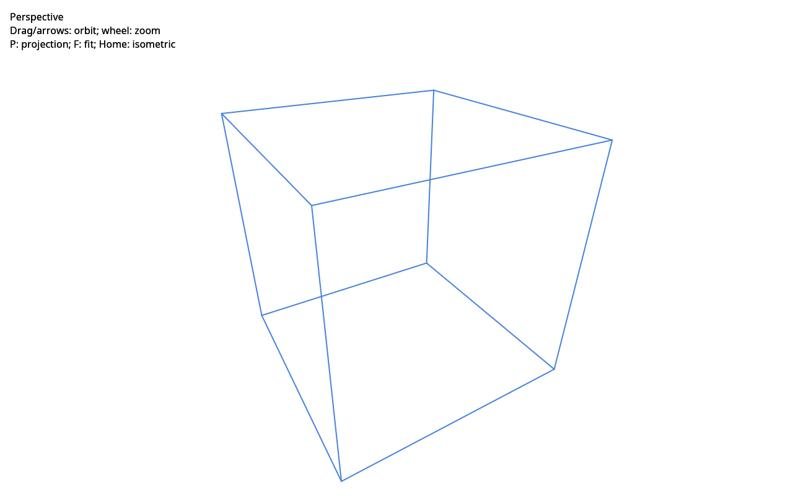
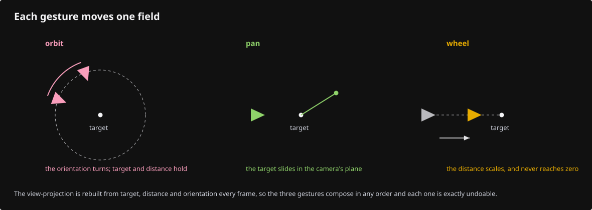
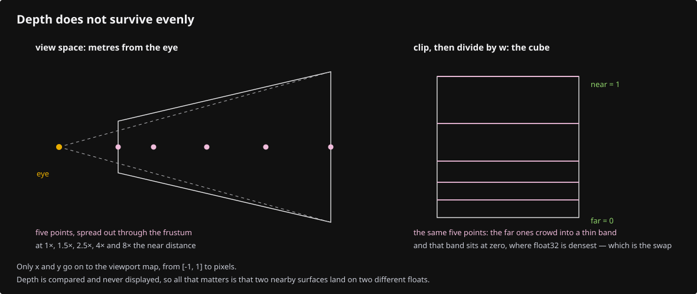
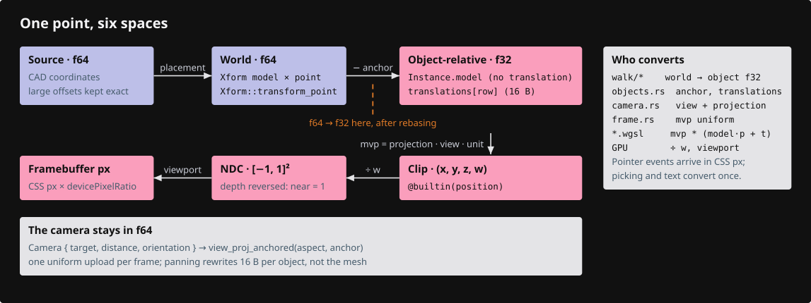

# Project and fit a scene

Orbit, pan, zoom toward the cursor, toggle perspective/orthographic projection, and fit 3D bounds using the production `src/camera.rs` math.





## Prerequisites and ownership

Requires [4. Enter commands](completion-dock.md). This fifth cumulative subject is reviewed against native tests, locked `wasm32` builds and desktop/upright WebGPU interactions. Checkpoint `camera` (`48` files) adds `2` files:

| Added file | Role |
| --- | --- |
| [src/camera.rs](../../src/camera.rs) | Anchor-relative view/projection matrices, reversed-Z `[1..0]` depth, cursor-preserving `zoom_at`, world rays and panel-aware `fit_in`. |
| [examples/course/camera.rs](../../examples/course/camera.rs) | Projects `8` `session_rust::Point` cube corners and `12` edges onto the canvas with orbit/zoom/fit controls. |

```rust
--8<-- "session_viewer/src/camera.rs:camera-pose"
```

## Build

Materialize checkpoint `camera` or add `src/camera.rs` and `examples/course/camera.rs`:

```sh
npm --prefix ../session_tests run course -- checkpoint camera ../session_viewer/target/learn-camera
```

### Anchor-relative view and reversed-Z projection





Compose scene-unit scaling (`mm` -> `m`), anchor-relative view, reversed-Z projection (`near` mapped to `z = 1.0`, `far` to `z = 0.0`) and panel `frame` lens shift:

```rust
--8<-- "session_viewer/src/camera.rs:camera-projection"
```

### Motion and fitting

`src/camera.rs` implements quaternion `orbit` (world-up yaw + right-axis pitch), distance-scaled `pan`, world `ray` unprojection, cursor-locked `zoom_at` (shifting `target` by the cursor's offset on the target plane), and `fit_in` across all `8` box corners inside the unobstructed panel `frame`.

### Wireframe cube checkpoint

Project the `8` cube corners with `Xform::transform_point` and flip NDC `+Y` (up) into screen `+Y` (down):

```rust
--8<-- "session_viewer/examples/course/camera.rs:course-camera"
```

## Run and observe

Serve the checkpoint and open `http://127.0.0.1:8780/?tutorial=camera`:

- Drag or press arrow keys to orbit; scroll wheel to zoom around the cursor.
- `P` switches perspective and orthographic projection; `F` fits the cube inside the viewport (including `390×844`); `Home` restores orthographic isometric fit.

## Predict and try

Orbit slightly off-axis and press `P`: predict which cube edges converge in perspective versus staying parallel in orthographic projection, then verify both modes in the browser.

## Question and answer

**Why does screen mapping negate the normalized `y` coordinate (`(1.0 - ndc.y) * 0.5 * height`)?**
Clip/NDC `+Y` points up, whereas canvas/egui pixel `+Y` points down from the top-left corner; omitting the sign flip mirrors the scene vertically.

## Validation

Verified by `48`-file locked `wasm32` build ([stage reconciliation](release/completion-stage-reconciliation-windows-20261118c.json)), `33` passing baseline native tests (`1` GPU test ignored), `5`-subject retention tests, and desktop/upright orbit, zoom, projection and fit checks on Intel Gen-12LP ([camera receipt](release/completion-camera-windows-20261115.json)). Physical-phone touch testing remains separate.
