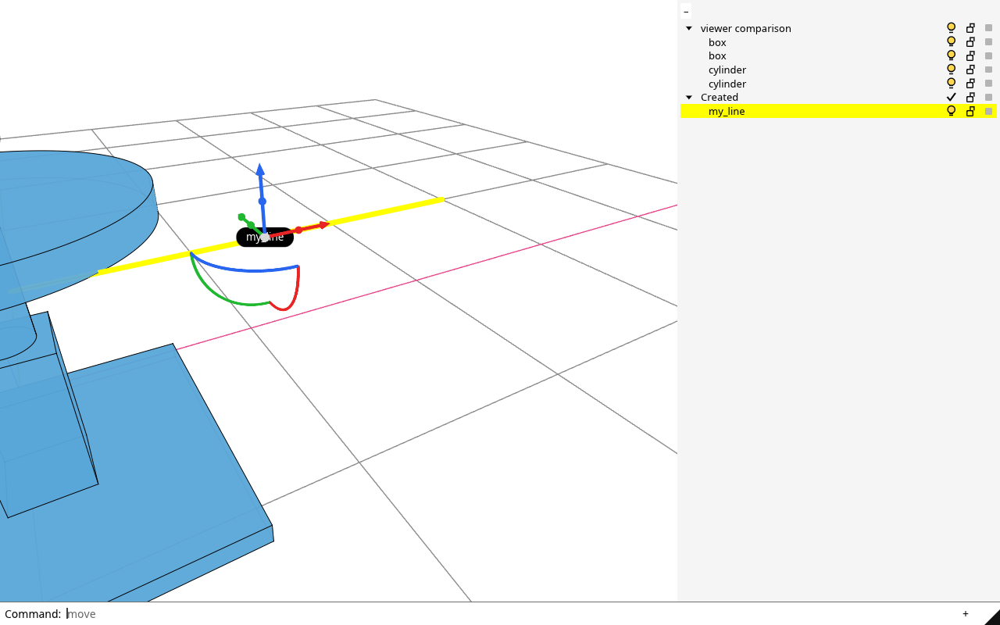

# Commands, tools and editing

Create a line, move it, and reverse the edit through the same command dock used by the production viewer.

## Prerequisites and ownership

Complete the dock, decoding, application lifecycle and document/history chapters. This chapter belongs to the existing `application` checkpoint: it owns `app/command`, `state/edit.rs`, `state/drawing.rs` and `state/tool.rs`. The dock continues to own text entry, focus, history display and completion presentation. Commands add behavior through the production registry rather than replacing that finished UI.

Continue with [construction planes, snapping and modeling](completion-modeling.md) in this same application checkpoint.

## Build

Copy the application command adapters and their registrations, then trace one typed line through parsing, execution and row synchronization.

### Separate spelling from execution

```rust
--8<-- "session_viewer/src/app/command/mod.rs:command-contract"
```

`Spec` describes names, aliases, help, options and parsing. A parser returns `Result<Box<dyn Action>, String>`: either an owned executable action or a user-facing explanation. The `Action` trait specifies execution and whether a command requires selection or preserves an active draft/split. Parsing is independent of the mutable viewer state; execution receives it explicitly.

The command matcher compares names without spaces or case and chooses the longest matching name. It returns the consumed word count, leaving arguments intact. This prevents a short verb from stealing the prefix of a longer command. `canonical` normalizes the displayed verb and option while preserving argument text. `number` rejects non-finite values before geometry or transforms receive them.

The `verbs!` macro declares modules and collects their `SPEC` values into `REGISTRY`. Each entry implements `Verb`; ordinary commands expose a `Spec`, while drawing commands additionally expose a `Draw`. A command therefore needs its implementation and a registry entry, with no new dispatch branch in the dock.

### Execute through the application host

```rust
--8<-- "session_viewer/src/state/edit.rs:command-dispatch"
```

`State::run_command` canonicalizes the line, calls `command_action`, and remembers a repeatable command only after success. `run_echoed` is the path for commands started by mouse or keyboard: it uses the same execution path and sends the answer to status/history.

The host first lets the active drawing operation consume coordinates, options or Enter. Otherwise it parses an action. A bare verb with a short option list can open a chooser instead of failing immediately. Commands cancel incompatible drafts and pending splits according to their trait methods. An action requiring selection starts an object-selection prompt when no object is selected; it is not silently executed against the whole document.

### Drawing is a checked construction

`Draw` supplies the permitted point count, a constructor, labels and buttons. A fixed count, such as a line's two endpoints, can finish automatically. A variable count, such as a polyline, uses Enter to finish. Typed and picked coordinates converge on the same constructor.

The line constructor rejects coincident endpoints. Shared drawing validation rejects non-finite coordinates and magnitudes beyond the supported bound. `Create::run` asks the scene to model the geometry, synchronizes history, then selects the created object. A rejected constructor must leave both the document and its row count unchanged.

### Preview without committing on every pointer event

```rust
--8<-- "session_viewer/src/app/command/verbs/move.rs:command-move"
```

A `Draft` owns collected points, the construction plane, the current tool and saved row placements. A `Tool` supplies prompts, options, a cursor preview and a response when another point is placed. `Next::More`, `Next::Repeat` and `Next::Done` make the continuation explicit.

Interactive Move first collects a base point, then previews the translation to the cursor. The preview changes displayed placements; it does not append an undo transaction on every mouse movement. The second accepted point applies one transform through `State::apply`. Cancelling restores saved placements, clears the draft and keeps the selection.

`with_tool` temporarily takes the draft and tool out of `State` before invoking the callback. This gives the callback mutable access to the host without borrowing the tool field and the containing state at the same time. The host restores ownership afterwards and interprets the returned continuation.

Typed `Move 0 1000 0` bypasses point collection and directly applies the checked offset. A whole-object transform updates the document and descendants, synchronizes rows, refreshes the gizmo and invalidates the image. A selected face, edge or control point instead follows the subobject deformation path. Locked objects are rejected before either operation.

## Run and observe

Run the `application` checkpoint's `production.html` entry with the recorded comparison fixture. Enter `Line 0,0,0 3000,0,0`, then `Fit`. A new line appears and is selected. Expand the new Created layer to see its hierarchy row; new layers start collapsed. Enter `Move 0 1000 0`, `Undo`, then `Redo`; the line alternates between its original and translated position. Existing comparison geometry stays in place.

Enter `Line 0,0,0 0,0,0`. The dock reports that endpoints must differ and adds no object. Select `my_line` in the expanded Created layer; undo/redo does not promise to retain selection. Enter `Move` to display the base-point prompt, then `Escape` to cancel it. The committed geometry remains unchanged.



A typed Move changes the selected line. The command history and hierarchy assertions support this step; this image does not prove every editing gesture.

## Predict and try

Predict the undo count after moving the cursor through several positions during interactive Move and then cancelling. Run `Move`, choose a base point, move the cursor, and press Escape before choosing the target. No transform transaction should be committed: preview placements are restored. Repeat and accept the target; one Undo should restore the original placement regardless of how many cursor events preceded it.

## Question and answer

Why does the dock keep a command specification separate from its action?

Completion and help need stable spelling and options before execution is possible. An action carries parsed values and receives mutable state only when the host runs it. The same registered command can therefore be offered by completion, typed in the dock or triggered by another input without duplicating editing logic.

## Validation

The cumulative application passes 171 native command tests. Fourteen browser captures cover this chapter's creation, move, undo/redo, invalid construction and cancellation sequence at desktop and upright sizes, with command history and hierarchy assertions. The upright open-panel view remains narrow and crops scene labels; close Layers for a full-width inspection. These checks do not establish interactive drag-preview cancellation or every modeling operation.
