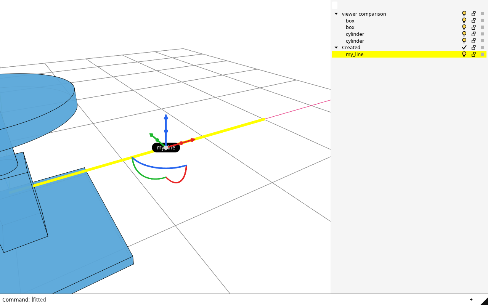
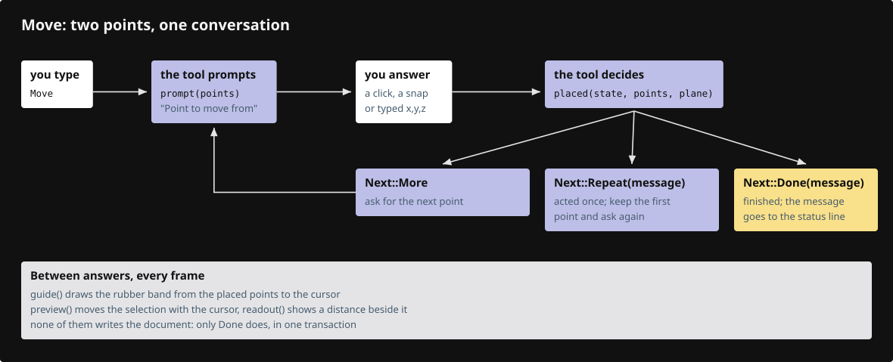

# Commands, tools and editing

Register typed and interactive CAD commands through `Spec`, `Action` and `Draw`, preview transforms without polluting undo history, and drive section planes and view modes from the dock.






## Prerequisites and ownership

Chapter `9.2` of [9. Run the application](completion-application.md) (`application` checkpoint). Covers `44` command dispatch, drawing, selection, view and clipping-plane modules under `src/app/command/`, `src/app/clipping.rs`, `src/state/clipping.rs` and `src/app/ui/command_line/tests.rs`.

## Build

### Separate spelling from execution

- `src/app/command/mod.rs` defines `Spec`, `Action` and `Draw`, matching longest space/case-insensitive command prefixes, canonicalizing verbs/options, rejecting non-finite numbers and returning `Result<Box<dyn Action>, String>` without mutating `State`.
- `src/app/command/verbs/mod.rs` expands `verbs!` into `REGISTRY` so every command registers completion, option chips, help and parsing in one place without editing the dock widget.

```rust
--8<-- "session_viewer/src/app/command/mod.rs:command-contract"
```

```rust
--8<-- "session_viewer/src/state/edit.rs:command-dispatch"
```

### Drawing is a checked construction & shared verb rules

`src/app/command/verbs/geometry.rs` (`Create::run`) validates finite coordinates within scene bounds, invokes the verb's constructor, commits the created object to `Scene`, syncs GPU rows, and selects the new row (leaving document and row counts untouched on error).

| File | Specification |
| --- | --- |
| [verbs/point.rs](../../src/app/command/verbs/point.rs) | Declares a `1`-point `Draw` spec wrapping the resolved world `Point` in `Rc` for immediate scene insertion. |
| [verbs/line.rs](../../src/app/command/verbs/line.rs) | Requires `2` endpoints separated by `> 1e-12`, rejecting coincident endpoints before constructing `session_rust::Line`. |
| [verbs/arrow.rs](../../src/app/command/verbs/arrow.rs) | Reuses the `2`-point `Line` validation and sets the end-arrowhead display attribute on the constructed curve. |
| [verbs/polyline.rs](../../src/app/command/verbs/polyline.rs) | Collects variable point counts (`Enter` to finish) and exposes planar rectangle and polygon sub-modes through the `Tool` path. |
| [verbs/curve.rs](../../src/app/command/verbs/curve.rs) | Builds clamped NURBS curves (`degree <= 3`) from control points, switching to periodic closed construction when `>= 4` points repeat the start. |
| [verbs/close.rs](../../src/app/command/verbs/close.rs) | Preserves the active `Draft` during dispatch and appends the start point via `close_drawing` to finish open polylines and curves. |
| [tool/choices.rs](../../src/app/command/tool/choices.rs) | Turns a bare command's options into clickable dock chips that dispatch full canonical command lines (cancelling on `Enter`). |
| [tool/options.rs](../../src/app/command/tool/options.rs) | Matches multi-word options case- and space-insensitively while reserving empty `Enter` and `Escape` for tool continuation. |
| [command/tests.rs](../../src/app/command/tests.rs) | Verifies sorted unique `REGISTRY` completions, readable labels, and identical `Action` parsing across aliases and canonical spellings. |

### Delegate each command to the state it owns

| Verb files | Delegated state operation |
| --- | --- |
| [verbs/undo.rs](../../src/app/command/verbs/undo.rs), [verbs/redo.rs](../../src/app/command/verbs/redo.rs), [verbs/delete.rs](../../src/app/command/verbs/delete.rs) | `undo.rs` and `redo.rs` step `Scene` history and run `after_history` (reporting empty stacks); `delete.rs` marks `requires_selection` and calls `delete_selection` without touching GPU buffers directly. |
| [verbs/hide.rs](../../src/app/command/verbs/hide.rs), [verbs/show.rs](../../src/app/command/verbs/show.rs), [verbs/fit.rs](../../src/app/command/verbs/fit.rs), [verbs/escape.rs](../../src/app/command/verbs/escape.rs) | `hide.rs`, `show.rs` and `fit.rs` invoke `hide_selected`, `show_all` and `fit_selected_or_all`; `escape.rs` (`Esc`) preserves an active draft long enough to call `cancel_drawing` before falling back to `escape_selection`. |
| [verbs/snap.rs](../../src/app/command/verbs/snap.rs), [verbs/grid_snap.rs](../../src/app/command/verbs/grid_snap.rs) | `snap.rs` toggles master `OSnap` or individual snap bits; `grid_snap.rs` updates positive construction-grid spacing while preserving any active drawing `Draft`. |
| [verbs/layers.rs](../../src/app/command/verbs/layers.rs), [verbs/report.rs](../../src/app/command/verbs/report.rs) | `layers.rs` toggles/expands the hierarchy panel (`All`/`Off`); `report.rs` triggers JSON diagnostics export through the `feedback` boundary. |
| [verbs/arctic.rs](../../src/app/command/verbs/arctic.rs), [verbs/outline.rs](../../src/app/command/verbs/outline.rs), [verbs/opacity.rs](../../src/app/command/verbs/opacity.rs) | `arctic.rs` enables ambient clay shading + surface outlines; `outline.rs` toggles borders independently; `opacity.rs` validates finite `[0.0, 1.0]` face alpha. |
| [verbs/attributes.rs](../../src/app/command/verbs/attributes.rs), [verbs/interactions.rs](../../src/app/command/verbs/interactions.rs), [verbs/arrowhead.rs](../../src/app/command/verbs/arrowhead.rs) | `attributes.rs` toggles owned element features; `interactions.rs` toggles joint/cut/contact features (rewalking when needed); `arrowhead.rs` (`None`/`Start`/`End`/`Both`) replaces unlocked selected curves in one transaction. |

### Select through a common eligibility rule

| File | Specification |
| --- | --- |
| [verbs/selecting.rs](../../src/app/command/verbs/selecting.rs) | Filters ascending selectable, unhidden rows and runs budgeted even-odd scanline crossings for window vs crossing region picks. |
| [verbs/object.rs](../../src/app/command/verbs/object.rs), [edge.rs](../../src/app/command/verbs/edge.rs), [face.rs](../../src/app/command/verbs/face.rs), [controls.rs](../../src/app/command/verbs/controls.rs) | `object.rs`, `edge.rs` and `face.rs` clear stale selections before switching `selection_tool`; `controls.rs` activates `enable_controls` for vertex/CV editing. |
| [verbs/select_all.rs](../../src/app/command/verbs/select_all.rs), [select_by_name.rs](../../src/app/command/verbs/select_by_name.rs), [select_small.rs](../../src/app/command/verbs/select_small.rs), [select_lasso.rs](../../src/app/command/verbs/select_lasso.rs) | `select_all.rs` selects all eligible rows; `select_by_name.rs` matches unquoted case-insensitive substrings; `select_small.rs` filters world-box diagonals strictly below `L`; `select_lasso.rs` records `>= 2 px` screen loops (decimating at `4,096` vertices). |

```rust
--8<-- "session_viewer/src/app/command/verbs/move.rs:command-move"
```

### Change drawing and viewing context

| File | Specification |
| --- | --- |
| [verbs/construction_plane.rs](../../src/app/command/verbs/construction_plane.rs) | Switches between `XY`, `XZ`, `YZ`, `3Point` and `View` planes while preserving active drawing `Draft` points. |
| [verbs/view.rs](../../src/app/command/verbs/view.rs) | Applies named orientations, perspective/orthographic switches, `Xray` and positive point/plane sizes without cancelling active drafts or splits. |
| [verbs/clipping_plane.rs](../../src/app/command/verbs/clipping_plane.rs) | Creates scene-sized section planes or toggles `On`/`Off`, `Flip` and `Hatch`/`Solid` fill modes within the `6`-plane GPU cap. |
| [src/app/clipping.rs](../../src/app/clipping.rs) | Derives GPU half-space normals by crossing transformed in-plane axes (handling non-uniform scale) and anchors hatch direction to the plane frame. |
| [src/state/clipping.rs](../../src/state/clipping.rs) | Reads live GPU row placements so dragging a plane updates the cut immediately, keeping cuts active when the plane border is hidden and verifying closed meshes on first cut. |

### Exercise the command field frame by frame

`src/app/ui/command_line/tests.rs` drives character-by-character `egui` frame sequences verifying preserved spaces (`Orient 3 Points`), `Down`/`Up` option cycling (`Snap Off` -> `Snap End`) and `Enter` commit rules.

## Run and observe

In the `application` build, run `Line 0,0,0 3000,0,0`, `Fit`, `Move 0 1000 0`, `Undo`, and `Redo`:

- `my_line` appears under `Created`, translates `+1000 Y`, and steps cleanly back and forth in history.
- Running `Line 0,0,0 0,0,0` reports coincident endpoints without adding a row.

## Predict and try

Run `Move` on `my_line`, click a base point, sweep the cursor across `20` frames, and press `Escape`: predict how many undo transactions were recorded (`0` — preview placements restore cleanly). Repeat and click a target point: `1` `Undo` restores the start position.

## Question and answer

**Why separate declarative `Spec` metadata from the boxed `Action` returned by `parse`?**
Tab completion, option chips and help inspect `Spec` on every keystroke without mutable `State`, whereas `Action::run(&mut State)` executes once with validated arguments after `Enter`.

## Validation

Verified by `171` native command tests and `14` desktop/upright browser captures covering `Line`, `Move`, `Undo`/`Redo`, zero-length rejection and `Escape` draft cancellation ([interactions evidence](release/completion-application-interactions-windows-20261115.json)).
