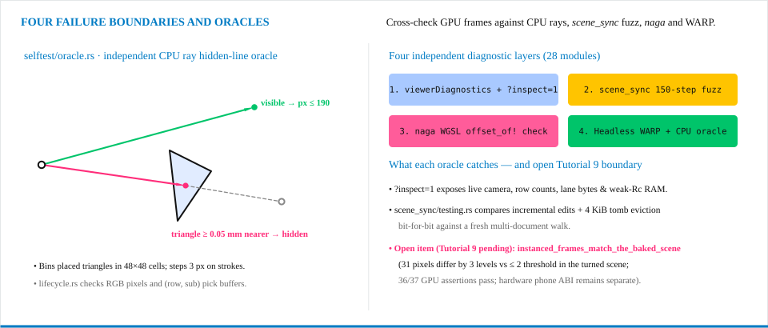
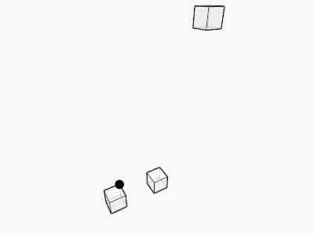

# Explain a failed frame

Isolate loading, synchronization, CPU-walk, WGSL-layout and GPU-driver defects using `viewerDiagnostics`, `?inspect=1` memory/row snapshots, CPU `scene_sync` fuzz oracles and headless `selftest` ray/ID witnesses.





## Prerequisites and ownership

Chapter `9.9` of [9. Run the application](completion-application.md) (`application` checkpoint). Covers `28` diagnostic, profiling, `selftest`, `scene_sync` oracle and GPU regression modules across `assets/diagnostics.js`, `src/engine/`, `src/app/` and `src/selftest*`.

## Build

### Step 1: Browser diagnostics, feedback and `?inspect=1` snapshots

| File | Specification |
| --- | --- |
| [assets/diagnostics.js](../../assets/diagnostics.js) | Records bounded startup, adapter, viewport, phase-timing and first-fatal-error JSON reports in `localStorage` + download, marking `ready` at first on-screen geometry. |
| [src/engine/diagnostics.rs](../../src/engine/diagnostics.rs) | Forwards optional `viewerDiagnostic` events and query-stripped `phase` load durations/bytes on `wasm32` while remaining a zero-cost no-op natively. |
| [src/engine/performance.rs](../../src/engine/performance.rs) | Separates wheel/drag interaction bursts from resting frames using median frame times and hysteresis before adjusting quality tiers. |
| [src/app/feedback.rs](../../src/app/feedback.rs) | Routes status text, non-clobbering download progress, canonical command history and fatal error reveals between `State`, DOM and native logs. |
| [src/app/inspection.rs](../../src/app/inspection.rs) | Serializes live camera matrices, row counts, selection, lane capacities and timing counters onto `#viewer[data-viewer-inspection]` when `?inspect=1`. |
| [src/app/inspection/source_memory.rs](../../src/app/inspection/source_memory.rs) | Sums unique `Rc<Session>` geometry vectors, strings, maps and history capacities via weak pointers to report scoped `known_bytes`. |

### Step 2: Headless `selftest` CPU ray oracle and software witnesses

| File | Specification |
| --- | --- |
| [src/selftest.rs](../../src/selftest.rs) | Boots a headless `Gpu`, settles bounded display refinement, and exports offscreen `PPM` (`RGB`) renders controlled by `VIEWER_*` env vars. |
| [src/selftest/profile.rs](../../src/selftest/profile.rs) | Times CPU `walk` stages by geometry kind (separating BRep meshing, edge chains and shell orientation) ahead of GPU submission. |
| [src/selftest/oracle.rs](../../src/selftest/oracle.rs) | Casts independent CPU rays from stroke samples against placed triangles (with coplanar clearance) to verify GPU hidden-line occlusion. |
| [src/selftest/lifecycle.rs](../../src/selftest/lifecycle.rs) | Asserts both colour and `(object, subobject)` ID attachments across resize, rewalk, edit/undo and reload cycles. |
| [src/selftest/stroke_witness.rs](../../src/selftest/stroke_witness.rs) | Captures deterministic sheet/stroke pixels, pick IDs, expanded WGSL and adapter metadata on a verified software renderer. |
| [src/engine/gpu/splat/cloud_witness.rs](../../src/engine/gpu/splat/cloud_witness.rs) | Verifies the CPU DX12 `Microsoft Basic Render Driver` (`WARP`) before capturing cloud splat/EDL pixels, uploaded byte counts and shader text. |
| [src/engine/gpu/splat/cloud_witness/lod.rs](../../src/engine/gpu/splat/cloud_witness/lod.rs) | Runs `LodWalk::select` on CPU cloud metadata to inspect chosen octree `(first, count, spacing, tile)` spans independently of shaders. |

```rust
--8<-- "session_viewer/src/selftest/oracle.rs:14:38"
```

```rust
--8<-- "session_viewer/src/selftest.rs:selftest-pixels"
```

### Step 3: Incremental `scene_sync` fuzzing and `naga` WGSL contract checks

| File | Specification |
| --- | --- |
| [scene_sync/testing.rs](../../viewer-core/src/scene_sync/testing.rs) | Models `settle` upload bookkeeping on the CPU and compares incremental edits bit-for-bit against a fresh multi-document walk (`verify`). |
| [scene_sync/tests.rs](../../viewer-core/src/scene_sync/tests.rs) | Runs `150`-step seeded random edit sequences (including a `4,096 B` tomb cap and cache on/off parity) against the fresh-scene oracle. |
| [scene_sync/panel_tests.rs](../../viewer-core/src/scene_sync/panel_tests.rs) | Verifies point create/delete/undo row identity survival and exact group-to-descendant row targeting in `Hierarchy`. |
| [scene_sync/editing_tests.rs](../../viewer-core/src/scene_sync/editing_tests.rs) | Verifies `100`-point cloud tomb burial/unbury, forced tomb-cap release, post-compaction `Undo` rebuild and multi-document single-step deletion. |
| [scene_sync/commands_tests.rs](../../viewer-core/src/scene_sync/commands_tests.rs) | Bounds `200`-frame growing-curve previews to `<= 16` reallocations and checks `100,000`-object vs `1,000`-object incremental edit scaling. |
| [scene_sync/split_tests.rs](../../viewer-core/src/scene_sync/split_tests.rs) | Verifies incremental row synchronization, cutter preservation and `Undo` restoration across BRep/mesh split edits. |

| File | Specification |
| --- | --- |
| [walk/application_tests.rs](../../viewer-core/src/walk/application_tests.rs) | Verifies element feature/contact polygon ribbons, dots and parent-row ID inheritance when element annotations toggle on/off. |
| [walk/brep/application_tests.rs](../../viewer-core/src/walk/brep/application_tests.rs) | Verifies rational cylindrical NURBS border-to-face vertex sharing, preserved source `.pb` bytes and exact `Δz` surface-preview pipe offsets. |
| [walk/frames/application_tests.rs](../../src/engine/gpu/scene_gpu_tests/frames.rs) | Checks occluded grey plane grids vs visible overlay RGB axis arrows, half-size scaling and `1`/`3`/`15 px` stroke widths. |
| [gpu/backdrop/application_tests.rs](../../src/engine/gpu/backdrop/application_tests.rs) | Verifies `0` changed pixels on `WARP` when rebasing the construction grid from `(0, 0, 0)` to `10^12` units and back. |
| [gpu/clip/tests.rs](../../src/engine/gpu/clip/tests.rs) | Parses WGSL via `naga` to verify `ClipUniform` byte offsets against `offset_of!` and tests closed-cube section hatches on GPU. |
| [gpu/clip/editing_tests.rs](../../src/engine/gpu/clip/editing_tests.rs) | Verifies live clipping-plane transforms, open-mesh non-capping and section restoration across interactive edits. |
| [gpu/ssao/tests.rs](../../src/engine/gpu/ssao/tests.rs) | Checks `1×`/`4×` MSAA contact darkening, zero distant-ground halo, first-vs-settled frame agreement and `Ssao` byte accounting. |
| [gpu/surface_outline/tests.rs](../../src/engine/gpu/surface_outline/tests.rs) | Verifies that yellow selected CAD edges never paint over black curved silhouette borders across views, MSAA counts and DPRs. |
| [engine/text/application_tests.rs](../../src/engine/text/application_tests.rs) | Verifies nonzero glyph IDs across all command names/symbols in bundled subsets and after full-font replacement. |

## Run and observe

Open `production.html` with `?inspect=1`:

- Run `window.viewerDiagnostics.read()` in DevTools Console -> inspect adapter info, phase durations, `status: "ready"` and `errors: []`.
- Read `JSON.parse(document.getElementById('viewer').dataset.viewerInspection)` -> inspect live `rows`, `selection`, `lanes` and `known_bytes`.

## Predict and try

Reload a scene and predict whether an identical colour screenshot guarantees picking still works: stale `guid_to_row` or `slot_table` entries can leave RGB pixels unchanged while mapping clicks to the wrong object, which is why `selftest::lifecycle` checks both colour and ID buffers.

## Question and answer

**Why can a passing Windows `WARP` software witness never close an Android hardware WebGPU bug (such as the `arrow_corner` struct-argument corruption)?**
`WARP` compiles WGSL through DXC/CPU rasterization rather than the mobile GPU's Vulkan/GLES shader compiler; software witnesses isolate logic regressions, while driver ABI workarounds require verification on the affected hardware.

## Validation

In the [37-test application GPU run](release/completion-application-gpu-windows-20261116.json), `36` assertions pass (clipping, SSAO, outlines, text, backdrop) and `1` fails: `app::scene::instances::tests::gpu::instanced_frames_match_the_baked_scene`, where `31` turned-scene pixels differ by `3` levels vs the `<= 2` threshold ([diagnostic receipt](release/completion-application-gpu-diagnostic-windows-20261116.json)). Both production code and the test assertion remain unchanged, keeping Tutorial 9 (`application`) `"pending"`.
