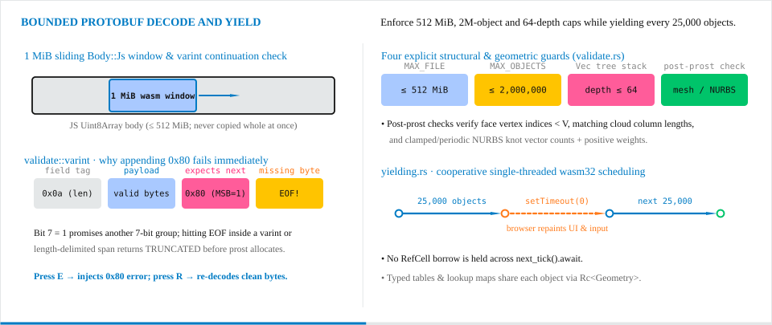
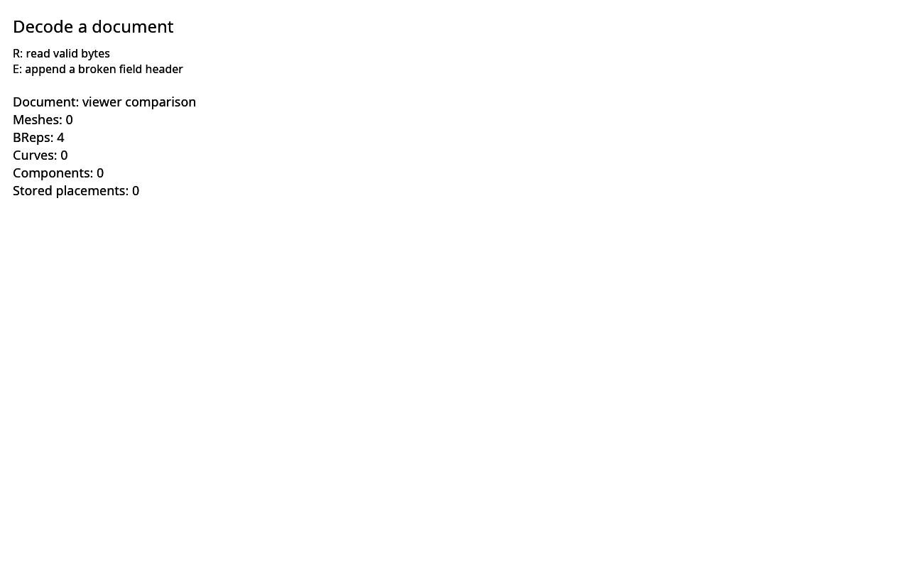
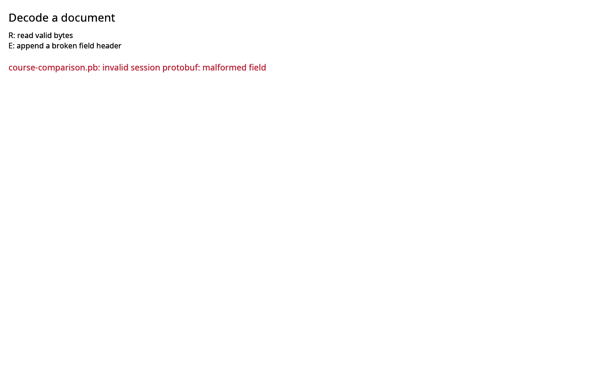

# Decode a document

Validate and decode `.pb` `Session` payloads under explicit byte, object-count and tree-depth limits while yielding cooperatively to the browser event loop.






## Prerequisites and ownership

Requires [7. Render kernel geometry](completion-geometry.md). Checkpoint `decoding` (`171` files) retains Tutorials 1–7 and adds `4` files:

| Added file | Role |
| --- | --- |
| [src/app/decode.rs](../../src/app/decode.rs) | `512 MiB` body cap, `1 MiB` JS window reader, `2,000,000`-object counter, `64`-deep iterative tree stack, graph/instance reconstruction and `Rc` GUID sharing. |
| [src/app/validate.rs](../../src/app/validate.rs) | Wire-level varint/field bounds plus post-`prost` mesh-index, point-column and NURBS knot/weight invariants. |
| [src/app/yielding.rs](../../src/app/yielding.rs) | Zero-delay `setTimeout` `Future` yielding to the browser on wasm so large decodes never freeze UI frames. |
| [examples/course/decoding.rs](../../examples/course/decoding.rs) | Decodes `course-comparison.pb`, injects a malformed `0x80` varint on `E`, and recovers cleanly on `R`. |

## Build

Materialize checkpoint `decoding` to compile the validator, decoder and recovery fixture:

```sh
npm --prefix ../session_tests run course -- checkpoint decoding ../session_viewer/target/learn-decoding
```

### Step 1: Enforce explicit byte, object-count and hierarchy bounds

`src/app/decode.rs` reads `Body::Bytes` or windowed `1 MiB` `Body::Js` slices with checked offsets, enforces a `512 MiB` whole-file cap, counts at most `2,000,000` geometry records (`Rc`-shared between typed tables and GUID maps), and rebuilds the hierarchy on an explicit `Vec` stack capped at depth `64` plus bidirectional graph edges and local instance transforms.

```rust
--8<-- "session_viewer/src/app/decode.rs:21:45"
```

### Step 2: Validate wire varints and post-`prost` geometry invariants

`src/app/validate.rs` checks complete varints (`validate::varint`) and enclosing message bounds (`Reader::field`) so unknown valid fields skip cleanly while truncated tags fail, then validates decoded `prost` mesh vertex indices, cloud column lengths and NURBS control/knot invariants before constructing `session_rust` objects.

```rust
--8<-- "session_viewer/src/app/validate.rs:4:15"
```

### Step 3: Yield to the browser event loop every 25,000 objects

`src/app/yielding.rs` pauses async decoding every `25,000` converted objects by awaiting a zero-millisecond browser timer Promise (`yield_now`), keeping `wasm32` single-threaded without holding any `RefCell` borrow across `.await`.

```rust
--8<-- "session_viewer/src/app/yielding.rs:browser-yield"
```

### Step 4: Wire the checkpoint and `0x80` fault-injection harness

`examples/course/decoding.rs` decodes `course-comparison.pb`, lets `E` append a truncated `0x80` varint byte to exercise `TRUNCATED` error reporting with filename context, and lets `R` re-decode the clean original bytes.

```rust
--8<-- "session_viewer/examples/course/decoding.rs:course-decoding"
```

## Run and observe

Serve checkpoint `decoding` and open `http://127.0.0.1:8780/?tutorial=decoding`:

- Displays `viewer comparison`: `4` BReps and `0` meshes, curves, components and placements.
- Press `E` -> appends an unfinished `0x80` varint byte and shows a red error naming `course-comparison.pb`; press `R` -> re-decodes the untouched original bytes and restores all counts.

## Predict and try

Predict why appending a single `0x80` byte breaks a valid protobuf file even though unknown fields are skipped: `0x80` sets the MSB continuation bit with no following byte, so `validate::varint` rejects the header before a field boundary exists. Press `E`, then `R` to verify.

## Question and answer

**Why run `validate.rs` geometry checks after `prost` has already parsed a protobuf message without wire errors?**
Valid protobuf wire syntax can still encode out-of-bounds mesh face indices, mismatched point-cloud attribute lengths or invalid NURBS degree/knot counts that would panic or corrupt downstream kernel/GPU code.

## Validation

Verified by `8`-subject retention and shader-closure tests, `171`-file locked `wasm32` build ([stage reconciliation](release/completion-stage-reconciliation-windows-20261118c.json)), `195` passing baseline native tests (`14` ignored), and `98` desktop/upright WebGPU captures including malformed-varint error reporting and recovery ([decoding receipt](release/completion-decoding-windows-20261115.json), [eight-subject receipt](release/completion-eight-subjects-windows-20261117.json)).
