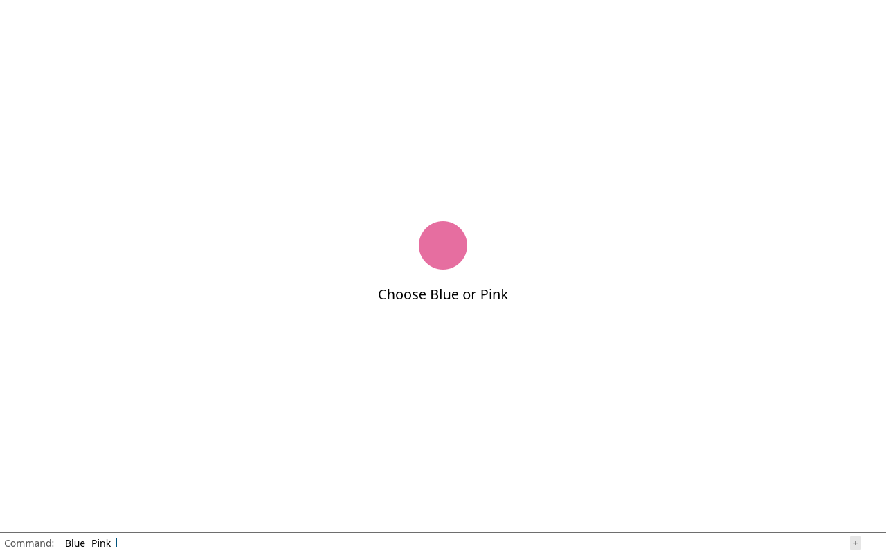
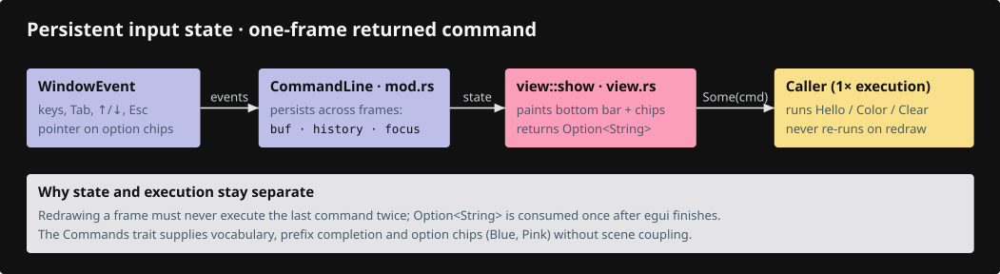

# Enter commands

Drive command entry, prefix completion, clickable option chips and `200`-entry command history with the production `src/command_dock` widget.






## Prerequisites and ownership

Requires [3. Lay out and animate mathematics](completion-mathematics.md). Checkpoint `dock` (`45` files) retains Tutorials 1–3 and adds `4` files:

| Added file | Role |
| --- | --- |
| [src/command_dock/mod.rs](../../src/command_dock/mod.rs) | `Commands` vocabulary trait, persistent `CommandLine` state, Tab/arrow completion, option chips and `Option<String>` one-frame commit. |
| [src/command_dock/view.rs](../../src/command_dock/view.rs) | Bottom `egui::Panel` (`30 pt` folded, resizable up to `75%` height expanded) and `2048`-char `TextEdit` field. |
| [src/command_dock/theme.rs](../../src/command_dock/theme.rs) | `Noto Sans` + `Symbols` font stack and light non-blinking `Visuals` for on-demand rendering. |
| [examples/course/dock.rs](../../examples/course/dock.rs) | Connects `egui_winit` events and tests `Hello`, `Color` (`Blue`/`Pink`) and `Clear`. |

## Build

Materialize checkpoint `dock` or add `src/command_dock/` and `examples/course/dock.rs`:

```sh
npm --prefix ../session_tests run course -- checkpoint dock ../session_viewer/target/learn-dock
```

### Focus, completion and cancellation

`src/command_dock/mod.rs` separates persistent `CommandLine` state (`command`, `200`-entry `VecDeque` history, character-indexed prefix completion, option buttons and focus flags) from the one-frame `Option<String>` returned when `Enter` or an option chip commits, while `Escape` cancels pending input without executing it.

```rust
--8<-- "session_viewer/src/command_dock/mod.rs:6:35"
```

```rust
--8<-- "session_viewer/examples/course/dock.rs:course-dock"
```

### Panel, history and fonts

- `src/command_dock/view.rs` builds a `30 pt` folded bottom bar or a resizable `64..0.75 * height` history panel in logical points, drawing an explicit caret on empty focused fields and recording `Control` hit rectangles.
- `src/command_dock/theme.rs` registers `Noto Sans` plus both `Noto Sans Symbols` fallbacks across proportional and monospace families and disables `text_cursor.blink` so idle focused frames consume zero repaints.

```rust
--8<-- "session_viewer/src/command_dock/view.rs"
```

```rust
--8<-- "session_viewer/src/command_dock/theme.rs"
```

## Run and observe

Serve the checkpoint and open `http://127.0.0.1:8780/?tutorial=dock`:

- Type `Hello` + `Enter` -> centre text reads `Hello!`; click `+` to inspect history.
- Type `Color` + `Enter`, then click `Blue` -> the circle turns blue and `Color Blue` logs once; `Clear` empties history; `Escape` aborts partial input.

## Predict and try

Type `He`, cycle completion with `Tab`, and press `Enter`: predict whether history stores `He` or canonical `Hello`, then open `+` to verify `Hello` appears once regardless of intermediate redraws.

## Question and answer

**Why does `CommandLine::show` return `Option<String>` instead of running the command inside the widget?**
`egui` may redraw the dock many times without new user input; returning `Some(cmd)` once after `egui` finishes guarantees each committed command mutates application state exactly once.

## Validation

Verified by `45`-file locked `wasm32` build, `19` passing native tests (`1` GPU test ignored), retention checks, and desktop/upright browser interaction tests in the recorded Windows Intel WebGPU environment ([receipt](release/completion-partials-windows-20261115.json)). Physical-phone virtual-keyboard bridging is covered in [9.3 Input](completion-input.md).
