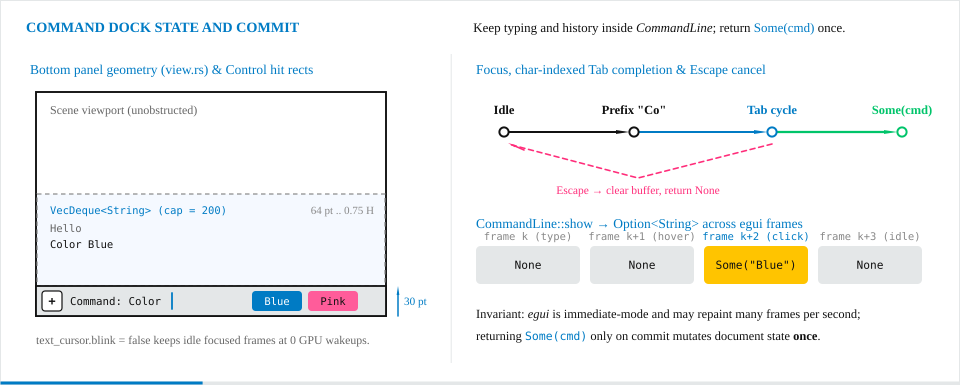
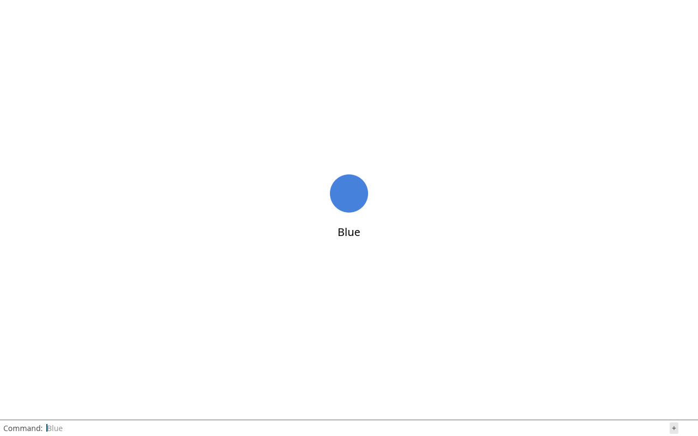

# Enter commands

Drive command entry, character-indexed `Tab` prefix completion, clickable option chips and `200`-entry command history with the production `src/command_dock` widget.






## Prerequisites and ownership

Requires [3. Lay out and animate mathematics](completion-mathematics.md). Checkpoint `dock` (`46` files) retains Tutorials 1–3 unchanged and adds `4` files:

| Added file | Role |
| --- | --- |
| [src/command_dock/mod.rs](../../src/command_dock/mod.rs) | `Commands` vocabulary trait, persistent `CommandLine` state, `Tab`/arrow completion, option chips and `Option<String>` one-frame commit. |
| [src/command_dock/view.rs](../../src/command_dock/view.rs) | Bottom `egui::Panel` (`30 pt` folded, resizable `64 pt .. 0.75 H` expanded) and `2048`-char `TextEdit` field. |
| [src/command_dock/theme.rs](../../src/command_dock/theme.rs) | `Noto Sans` + `Symbols` font stack and light non-blinking `Visuals` for zero-idle-wakeup rendering. |
| [examples/course/dock.rs](../../examples/course/dock.rs) | Bridges `egui_winit` events and executes `Hello`, `Color` (`Blue`/`Pink`) and `Clear`. |

## Build

Materialize checkpoint `dock` or add `src/command_dock/` and `examples/course/dock.rs` step by step:

```sh
npm --prefix ../session_tests run course -- checkpoint dock ../session_viewer/target/learn-dock
```

### Step 1. Define `Commands` and `CommandLine` state (`src/command_dock/mod.rs`)

Create `src/command_dock/mod.rs` and declare `mod command_dock;` in `src/lib.rs`. `src/command_dock/mod.rs` separates persistent `CommandLine` state (`command` buffer, `200`-entry `VecDeque` history, character-indexed prefix completion, option buttons and focus flags) from the one-frame `Option<String>` returned when `Enter` or an option chip commits, while `Escape` cancels pending input without executing it:

```rust
--8<-- "session_viewer/src/command_dock/mod.rs:6:35"
```

### Step 2. Lay out the bottom bar and non-blinking theme (`view.rs`, `theme.rs`)

- `src/command_dock/view.rs` builds a `30 pt` folded bottom bar or a resizable `64..0.75 * height` history panel in logical points, drawing an explicit caret on empty focused fields and recording `Control` hit rectangles for deterministic browser automation.
- `src/command_dock/theme.rs` registers `Noto Sans` plus both `Noto Sans Symbols` fallbacks across proportional and monospace families and sets `text_cursor.blink = false` so idle focused frames schedule zero repaints:

```rust
--8<-- "session_viewer/src/command_dock/view.rs"
```

```rust
--8<-- "session_viewer/src/command_dock/theme.rs"
```

### Step 3. Connect `egui_winit` events and command dispatch (`examples/course/dock.rs`)

Write `examples/course/dock.rs` and append `("dock", dock::start)` to `examples/course/registration.rs` so committed commands (`Hello`, `Color Blue`, `Color Pink`, `Clear`) mutate the scene circle once per commit:

```rust
--8<-- "session_viewer/examples/course/dock.rs:course-dock"
```

## Run and observe

Serve the checkpoint and open `http://127.0.0.1:8780/?tutorial=dock`:

- Type `Hello` + `Enter` -> centre text updates to `Hello!`; click `+` to inspect the history log.
- Type `Color` + `Enter`, then click `Blue` -> the circle turns blue and `Color Blue` logs once; `Clear` empties history; `Escape` aborts partial input.

## Predict and try

Type `He`, press `Tab` to complete, and press `Enter`: predict whether history stores `He` or canonical `Hello`, then open `+` to verify `Hello` appears once regardless of intermediate redraws.

## Question and answer

**Why does `CommandLine::show` return `Option<String>` instead of running the command inside the widget?**
`egui` is immediate-mode and may redraw the dock many times without new user input; returning `Some(cmd)` once after `egui` finishes guarantees each committed command mutates application state exactly once.

## Validation

Verified by `46`-file locked `wasm32` build ([stage reconciliation](release/completion-stage-reconciliation-windows-20261118c.json)), `19` passing baseline native tests (`1` GPU test ignored), retention checks, and desktop/upright browser interaction tests in the recorded Windows Intel WebGPU environment ([receipt](release/completion-partials-windows-20261115.json)). Physical-phone virtual-keyboard bridging is covered in [9.3 Input](completion-input.md).
