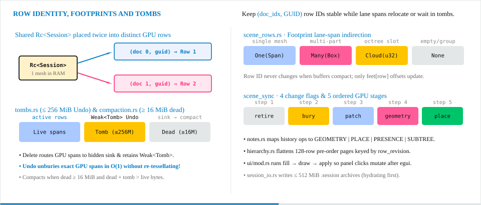
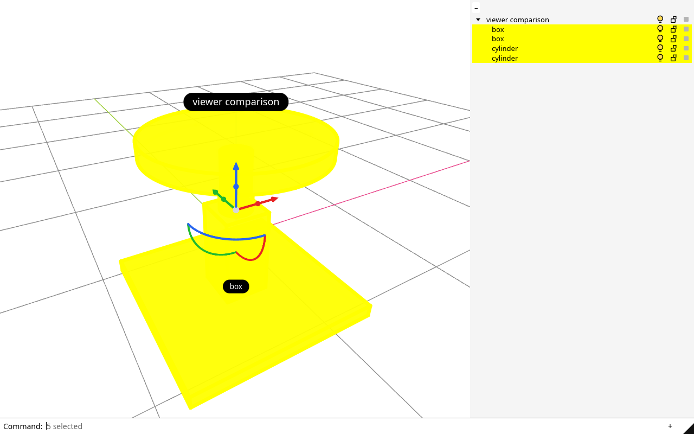

# Documents, hierarchy and history

Map `(doc_idx, GUID)` identities to multi-lane GPU `Footprint` spans, retain `256 MiB` of deleted geometry tombs for zero-rewalk `Undo`, flatten `128`-row layer trees, and serialize `.session` archives.





## Prerequisites and ownership

Chapter `9.1` of [9. Run the application](completion-application.md) (`application` checkpoint). Covers `25` document, sync, tomb, hierarchy, panel and archive modules across `src/app/` and `src/state/`.

## Build

All `25` modules compile inside checkpoint `application` (`trunk build production.html`).

### Step 1: Map `(doc_idx, GUID)` placements onto GPU rows and `Footprint` spans

`src/app/scene.rs` wraps `Rc<Session>` inside `FileDoc` (name, file `Xform`, `point_size`, shell flag) so two placements can share one kernel `Session` while `(doc_idx, GUID)` maps each placed object to its own GPU display row.

```rust
--8<-- "session_viewer/src/app/scene.rs:document-placement"
```

```rust
--8<-- "session_viewer/src/app/scene_rows.rs:document-footprint"
```

### Step 2: Translate history transactions into minimal tree invalidations

| File | Specification |
| --- | --- |
| [src/app/scene_sync/notes.rs](../../src/app/scene_sync/notes.rs) | Translates forward and reverse kernel transaction ops into `GEOMETRY`, `PLACE`, `PRESENCE` and `SUBTREE` invalidation flags without rebuilding untouched objects. |
| [src/app/scene_sync/nodes.rs](../../src/app/scene_sync/nodes.rs) | Resolves affected tree nodes via weak caches and batched per-document searches, multiplying file `Xform` by root-to-node transforms. |

```rust
--8<-- "session_viewer/src/app/scene_sync/notes.rs:document-history-notes"
```

### Step 3: Stage updates, retain `256 MiB` tombs and compact dead spans

| File | Specification |
| --- | --- |
| [src/app/scene_rows.rs](../../src/app/scene_rows.rs) | Separates `(doc_idx, GUID)` row identity (plus text/free/sink/tomb sentinels) from `Footprint` (`One`, `Many`, `Cloud`, `None`) lane spans. |
| [src/app/scene_sync.rs](../../src/app/scene_sync.rs) | Drains change notes, deduplicates identities, expands `SUBTREE` descendants and emits ordered `Staged` GPU updates (`retire`, `bury`, `patch`, `geometry`, `place`). |
| [src/app/scene_sync/allocation.rs](../../src/app/scene_sync/allocation.rs) | Reuses an identity's grave when all lane counts match, pads drag previews by ~`50%`, and routes retired tails to the hidden sink row. |
| [src/app/scene_sync/preview.rs](../../src/app/scene_sync/preview.rs) | Captures single-object vertex/pipe spans during interactive drags so surface/mesh edits patch GPU buffers in place without full rewalks. |
| [src/app/scene_sync/tombs.rs](../../src/app/scene_sync/tombs.rs) | Retains up to `256 MiB` of deleted lane spans keyed by weak kernel tomb pointers so `Undo` unburies rows without re-tessellating geometry. |

```rust
--8<-- "session_viewer/src/app/scene_sync/tombs.rs:4:35"
```

`src/app/scene_sync/compaction.rs` triggers GPU lane compaction once dead bytes reach `16 MiB` and dead + tomb bytes exceed live bytes, rebuilding buffer bind groups and skipping shared `Rc<Session>` purges.

### Step 4: Flatten hierarchies, move layers and isolate panel actions

- `src/app/hierarchy.rs` flattens document trees into pre-order node slices (`depth`, `subtree_end`, row range, `128`-node UI pages and `truncated` flag) refreshed on `row_revision` while keeping graph edges separate.
- `src/app/layers.rs` validates editable targets, deduplicates `(doc_idx, GUID)` pairs, drops descendants already carried by a selected ancestor, and moves tree nodes into the destination layer.
- `src/state/panel.rs` decodes layer-panel clicks into `(doc_idx, GUID)` face and edge colour override maps (restricting edge overrides to rows with faces) and refreshes GPU rows.
- `src/app/edit.rs` (`Scene::transform_rows`) converts world-space `Xform` deltas into each writable object's local parent frame, detaching shared `Rc<Session>` copies on write and skipping selected descendants of selected ancestors.

| File | Specification |
| --- | --- |
| [src/app/ui/mod.rs](../../src/app/ui/mod.rs) | Runs registered `Panel`s (`fill` -> `draw` -> `apply`) in one `egui` pass, ordering `number_box` ahead of `command_line` for `Escape` priority. |
| [src/app/ui/layers.rs](../../src/app/ui/layers.rs) | Draws the collapsible layer tree, inline rename field and graph toggle, deferring tree mutations until the `egui` pass finishes. |
| [src/app/ui/graph.rs](../../src/app/ui/graph.rs) | Virtualizes bidirectional relationship-graph rows via `show_rows`, returning clicked endpoint pairs for selection without mutating documents. |
| [src/app/ui/number_box.rs](../../src/app/ui/number_box.rs) | Paints the floating gizmo numeric entry field, retains focus until `Enter` or `Escape`, and closes automatically if the handle projects behind the eye. |
| [src/state/number_box.rs](../../src/state/number_box.rs) | Projects the active gizmo handle into CSS coordinates and commits valid typed distances, angles or scale factors as one labelled transaction. |

```rust
--8<-- "session_viewer/src/app/ui/mod.rs:application-panels"
```

### Step 5: Instances, idle refinement and `.session` archives

| File | Specification |
| --- | --- |
| [src/app/scene_instances.rs](../../src/app/scene_instances.rs) | Walks each shared definition once into a hidden row and assigns monotonic batch keys across clears for placed instances. |
| [src/app/scene_display.rs](../../src/app/scene_display.rs) | Scans up to `128` visible rows per idle frame under bounded source/refinement caches, refining only live or revision-matched geometry. |
| [src/app/session_io.rs](../../src/app/session_io.rs) | Reads and writes versioned `.session` archives (`<= 512 MiB`) combining stamped document `.pb` payloads with JSON placements, overrides, text and groups. |
| [src/app/command/verbs/open.rs](../../src/app/command/verbs/open.rs) | Opens the browser file picker on `wasm32` and posts selected `.pb` or `.session` payloads through the async loader. |
| [src/app/command/verbs/save.rs](../../src/app/command/verbs/save.rs) | Hydrates any released documents first, then serializes the `.session` archive and triggers browser download delivery. |
| [src/app/command/verbs/add_group.rs](../../src/app/command/verbs/add_group.rs) | Reparents selected single-document objects under their deepest shared layer while rebasing local transforms so world positions stay fixed. |
| [src/app/command/verbs/add_edge.rs](../../src/app/command/verbs/add_edge.rs) | Connects two editable objects in the relationship graph and pairs an `EdgeStep` with a marker transform so `Undo` removes added graph vertices. |

## Run and observe

Open the `application` build with the comparison fixture:

- Run `Layers All` -> toggle visibility on the document (`0` history ops), then restore it.
- Run `Select All` (`5` rows: `4` BReps/surfaces + `1` nameplate) -> `Delete` -> `Undo` -> all `5` rows and hierarchy keys return intact (at `390 px` width, run `Layers Off` to reclaim the `240 px` panel width).

## Predict and try

Hide a document in `Layers` vs running `Delete` on one object, then run `Undo`: predict which action `Undo` reverses (`Delete` records a kernel history transaction; layer visibility only flips `FLAG_HIDDEN`).

## Question and answer

**Why decouple an object's display row ID from its GPU lane vertex/segment offsets (`Footprint`)?**
Edits, surface refinement and `16 MiB` dead-space compaction relocate vertex and stroke spans across buffers; stable row IDs keep selection, layer overrides and undo tombs valid without rewriting references.

## Validation

Verified by `68` native scene tests (including `moving_one_placement_leaves_the_other_where_it_was`), `7` hierarchy tests, `12` desktop/upright browser captures, and `.session` save/delete/open round-trips in [feature-picking evidence](release/completion-feature-picking-windows-20261115.json). Note: `Save` compacts nested component JSON keys/whitespace, so raw byte-identical archive round-trip remains a recorded non-goal.
