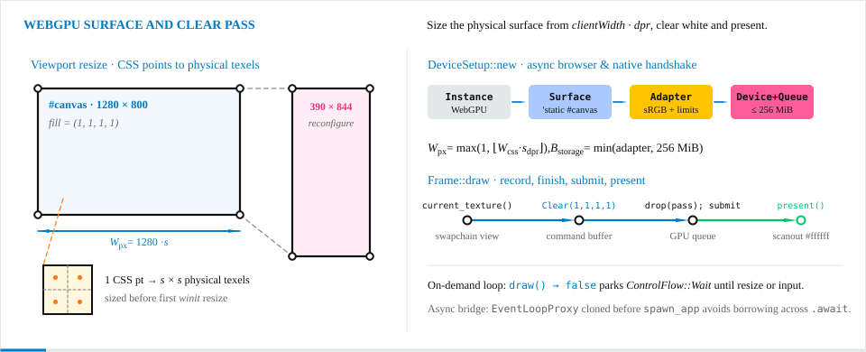

# Open a GPU frame

Open a WebGPU surface on `#canvas`, clear every pixel to white on the GPU queue, and resize cleanly across desktop (`1280×800`) and upright (`390×844`) viewports.




## Prerequisites and ownership

Install Rust `1.97.1`, `wasm32-unknown-unknown`, Trunk `0.21.14` and a WebGPU browser. Checkpoint `frame` starts from an empty directory and owns `13` files:

| File | Role |
| --- | --- |
| [Cargo.toml](../../Cargo.toml), [Cargo.lock](../../Cargo.lock) | Crate manifest (`cdylib` + `rlib`) and pinned dependency graph. |
| [src/lib.rs](../../src/lib.rs) | Crate root, `shader!` macro and `#[cfg(all(target_arch = "wasm32", feature = "tutorial"))]` entry gate. |
| [src/app/mod.rs](../../src/app/mod.rs), [src/engine/mod.rs](../../src/engine/mod.rs), [src/engine/gpu/mod.rs](../../src/engine/gpu/mod.rs) | Module roots extended strictly by additive `mod` declarations in later tutorials. |
| [src/app/launch.rs](../../src/app/launch.rs) | Generic `winit` event-loop launcher passing `EventLoopProxy<Message>` into the app factory. |
| [src/engine/gpu/device.rs](../../src/engine/gpu/device.rs) | Production WebGPU/native adapter request, `256 MiB` storage limit cap, error capture and surface configuration. |
| [examples/course/index.html](../../examples/course/index.html) | Full-viewport `#canvas` entry compiled by Trunk with `--features tutorial`. |
| [examples/course/canvas.rs](../../examples/course/canvas.rs), [frame.rs](../../examples/course/frame.rs), [registration.rs](../../examples/course/registration.rs), [entry.rs](../../examples/course/entry.rs) | Browser window adapter, white render-pass clear, and `?tutorial=frame` URL dispatcher. |

- `src/lib.rs` declares the top-level modules, defines the compile-time `shader!` `OUT_DIR` include macro, and gates the course `entry.rs` behind `wasm32` plus the `tutorial` feature so native and production builds stay separate.
- `src/app/mod.rs` opens the application namespace with `pub mod launch;` and grows strictly by additive module declarations as stage, walk, decoding and scene modules join later checkpoints.
- `src/engine/mod.rs` anchors the rendering engine namespace with `pub mod gpu;`, keeping GPU setup isolated until pipeline caches, frame timing and diagnostics join in checkpoint `rows`.
- `src/engine/gpu/mod.rs` exposes `pub mod device;` first and adds `ui`, `buffers`, `hull`, `instance` and `objects` without rewriting existing GPU modules.

## Build

Materialize checkpoint `frame` into a fresh workspace or create the `13` files step by step:

```sh
npm --prefix ../session_tests run course -- checkpoint frame ../session_viewer/target/learn-frame
```

### Step 1. Create `Cargo.toml`, `Cargo.lock` and module roots

Write `Cargo.toml` with both `cdylib` (for the browser `.wasm` target) and `rlib` (for native tests), linking `wgpu 29`, `winit 0.30`, `egui 0.34.3`, and `session_rust` with `default-features = false` and `viewer-display`. Copy `Cargo.lock` alongside it so `skrifa`/`swash` font crates, `wasm-bindgen`, `web-sys` DOM bindings, JS `getrandom` on wasm, and native-only `pollster` stay locked to exact versions.

```toml
--8<-- "session_viewer/Cargo.toml:1:26"
```

Create `src/lib.rs` plus the three additive module roots (`src/app/mod.rs`, `src/engine/mod.rs`, `src/engine/gpu/mod.rs`), alongside `viewer-core/Cargo.toml` and `viewer-core/src/lib.rs` so the UI- and GPU-free `viewer-core` workspace member grows additively from Tutorial 5 onward without `wgpu`, `winit`, `egui` or `web-sys` dependencies:

```rust
--8<-- "session_viewer/src/lib.rs:1:12"
```

### Step 2. Add `index.html`, `src/app/launch.rs` and `canvas.rs`

Create `examples/course/index.html` with a full-viewport `#canvas` element, then add `src/app/launch.rs` so `EventLoopProxy<Message>` is cloned *before* `spawn_app` starts the `async` WebGPU handshake without borrowing the event loop across `.await`:

```html
--8<-- "session_viewer/examples/course/index.html:course-page"
```

```rust
--8<-- "session_viewer/src/app/launch.rs"
```

Add `examples/course/canvas.rs` to compute initial physical texel dimensions from `canvas.clientWidth * devicePixelRatio` before `winit`'s first resize callback arrives:

```rust
--8<-- "session_viewer/examples/course/canvas.rs:course-canvas"
```

### Step 3. Request the WebGPU device in `src/engine/gpu/device.rs`

Write `src/engine/gpu/device.rs` to select `BROWSER_WEBGPU` on wasm or `PRIMARY` natively, cap `max_storage_buffer_binding_size` at `256 MiB`, prefer an sRGB surface format, and store the first uncaptured GPU error or device loss in `Arc<Mutex<Option<String>>>`:

```rust
--8<-- "session_viewer/src/engine/gpu/device.rs:20:154"
```

### Step 4. Record the white clear pass and register `?tutorial=frame`

Write `examples/course/frame.rs` to acquire the current swapchain view, drop `_pass` before calling `encoder.finish()`, submit the command buffer to `gpu.queue`, present the frame, and return `false` so idle frames park the event loop:

```rust
--8<-- "session_viewer/examples/course/frame.rs:course-frame"
```

Register `("frame", frame::start)` in `examples/course/registration.rs` and dispatch `?tutorial=` in `examples/course/entry.rs` so every later tutorial keeps `?tutorial=frame` runnable side by side:

```rust
--8<-- "session_viewer/examples/course/entry.rs:course-entry"
```

## Run and observe

Serve the checkpoint with Trunk and open `http://127.0.0.1:8780/?tutorial=frame`:

```sh
trunk serve --port 8780
```

Every pixel clears to `#ffffff` with no `data-course-error` attribute on `#canvas`, and resizing to `390×844` reconfigures the swapchain cleanly without stale borders.

## Predict and try

Change `wgpu::Color::WHITE` in `frame.rs` to `wgpu::Color::BLACK` before rebuilding: predict that both initial load and upright resize stay solid `#000000`, verify in the browser, then restore `WHITE`.

## Question and answer

**Why does `device.create_command_encoder(...)` alone leave the canvas unchanged?**
`CommandEncoder` only records commands into CPU-side driver memory; nothing executes until `encoder.finish()` is passed to `queue.submit(...)` and the acquired `SurfaceTexture` calls `present()`.

## Validation

Verified by locked `wasm32-unknown-unknown` compilation, cumulative source-retention tests, and desktop (`1280×800`) + upright (`390×844`) checks in the recorded Windows Intel WebGPU environment ([receipt](release/completion-partials-windows-20261115.json)). Upright browser emulation does not substitute for physical-phone testing.
