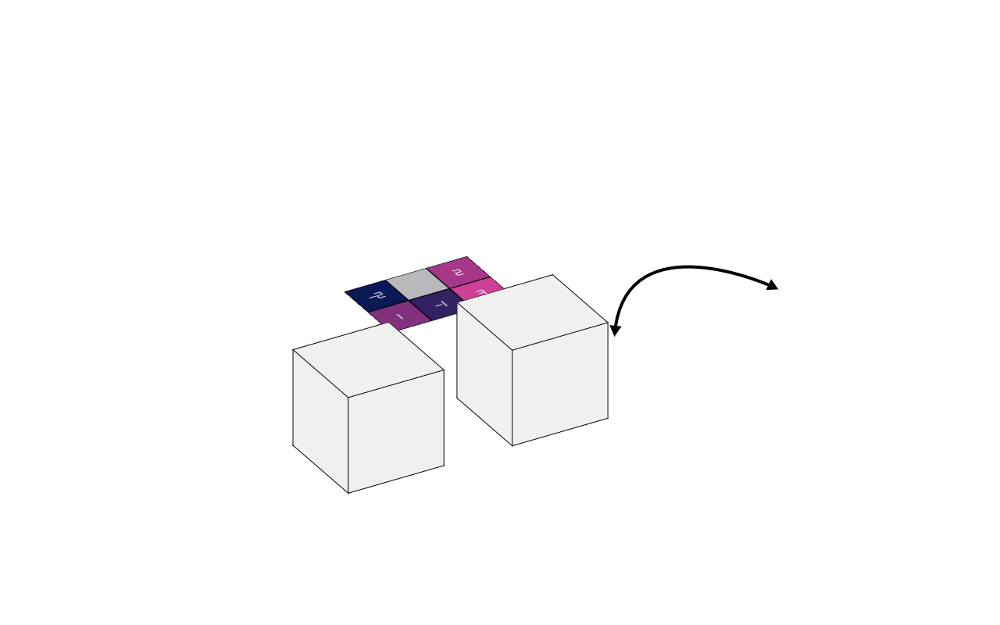
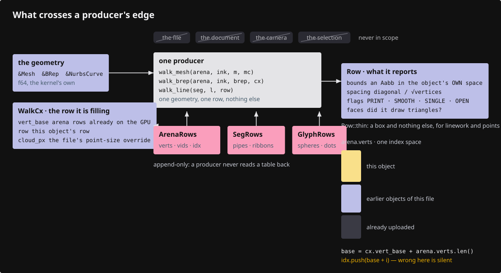
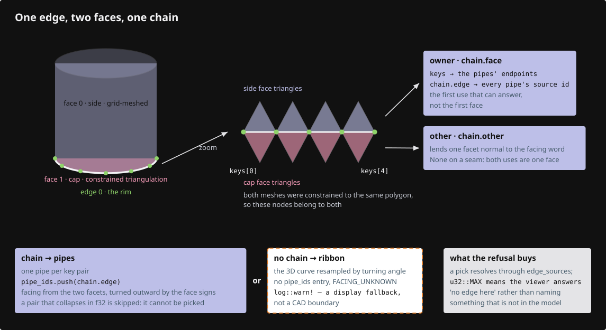
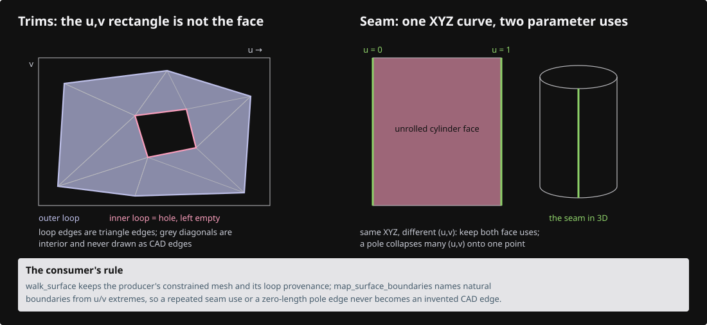
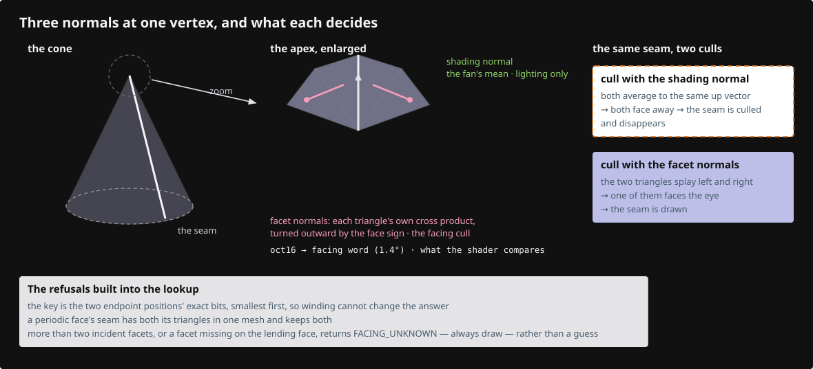
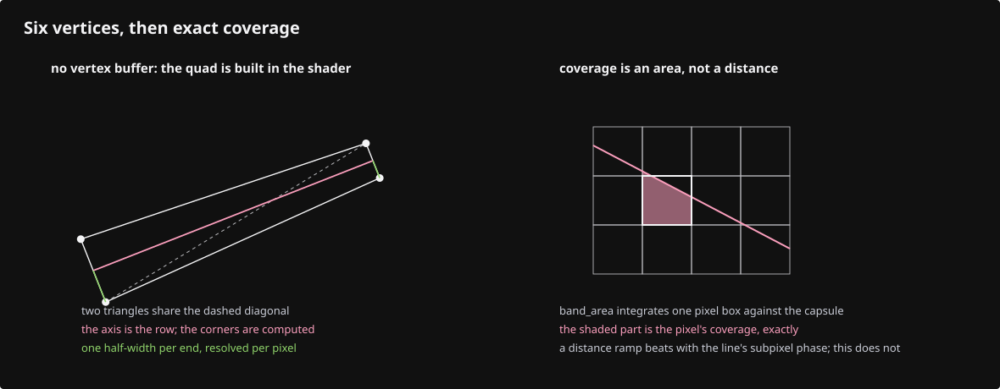
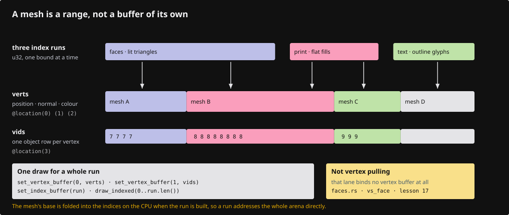
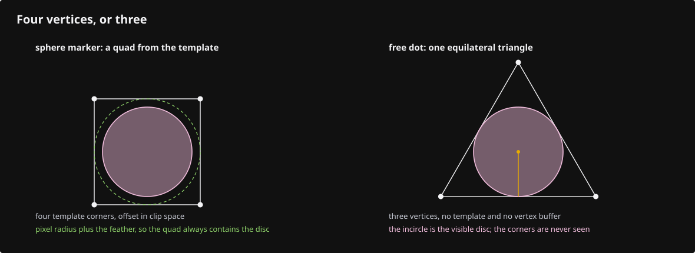

# Render kernel geometry

Convert `session_rust` meshes, BReps, arrowed NURBS curves, planes, point clouds and numerical `Matrix` objects into compact GPU lane tables and draw them through one multi-pass frame encoder.






## Prerequisites and ownership

Requires [6. Place and update object rows](completion-rows.md). Checkpoint `geometry` (`166` files) retains Tutorials 1–6 and adds `98` files across `src/app/walk/`, `src/engine/gpu/`, `src/shaders/` and [examples/course/geometry.rs](../../examples/course/geometry.rs). Continue with its companion chapter [7.1 Decide which ink is visible](completion-visibility.md) (`20` visibility, clipping and SSAO files in this same checkpoint).

## Build

Materialize checkpoint `geometry` to compile the complete GPU renderer and four-object scene:

```sh
npm --prefix ../session_tests run course -- checkpoint geometry ../session_viewer/target/learn-geometry
```

```rust
--8<-- "session_viewer/examples/course/geometry.rs:course-geometry"
```

### Borrow tables without losing object identity

| File | Specification |
| --- | --- |
| [src/app/walk/mod.rs](../../src/app/walk/mod.rs) | Splits mutable `Upload` borrows via `Walk::solid` so converters append faces, edges and dots under one `WalkCx` object row without cloning tables. |
| [src/app/walk/encode.rs](../../src/app/walk/encode.rs) | Packs RGBA bytes, maps explicit pixel widths to negative half-widths, and quantizes octahedral normals while reserving `0xffffffff` for unknown facing. |
| [src/app/walk/points.rs](../../src/app/walk/points.rs) | Appends one signed-distance dot per `Point` (`-3 px` default radius) while keeping scene bounds restricted to the world point centre. |
| [src/app/walk/bounds.rs](../../src/app/walk/bounds.rs) | Records pre-append `Baselines`, unions live placed bounds in `file_extent`, and flags `z < 0.001` planar batches as `0.5`-unit drawing sheets. |
| [src/app/interactions.rs](../../src/app/interactions.rs) | Separates contact, joint, cut and drill edge interactions from owned element features in deterministic graph-edge creation order. |

### Convert mesh topology into faces and ink



| File | Specification |
| --- | --- |
| [src/app/walk/mesh_topology.rs](../../src/app/walk/mesh_topology.rs) | Maps vertex keys to dense or hash slots, computes Newell polygon normals, and pairs shared edges with hole rings oriented against outer borders. |
| [src/app/walk/mesh.rs](../../src/app/walk/mesh.rs) | Applies `MeshOpts` (ordinary, smooth sampled, or closed element), estimates spacing from `diag / sqrt(V)`, and drops raw wireframe above `200,000` triangles. |
| [src/app/walk/mesh_ink.rs](../../src/app/walk/mesh_ink.rs) | Suppresses coplanar diagonals, retains borders and creases above `25°`, marks smooth silhouette seams, and switches wireframes above `10,000` edges to black. |
| [src/app/knobs.rs](../../src/app/knobs.rs) | Latches diagnostic `VIEWER_*` environment switches once via `OnceLock` for profiling, edge/dot suppression, coplanar edges and BRep refinement. |

### Tessellate a BRep without replacing its model





| File | Specification |
| --- | --- |
| [src/app/walk/brep.rs](../../src/app/walk/brep.rs) | Reuses congruent shapes or requests per-face display meshes, retains `(u, v)` samples and face IDs, and sets smooth/open/closed row flags without mutating the BRep. |
| [src/app/walk/brep_orient.rs](../../src/app/walk/brep_orient.rs) | Traverses shared-edge BFS components on closed shells and flips connected components by signed volume so solid normals point outward reproducibly. |
| [src/app/walk/brep_edges.rs](../../src/app/walk/brep_edges.rs) | Evaluates exact 3D trim/seam curves, unwraps closed seams, and stores each chord's geometric sag above its facet so curved ink stays visible without global depth bias. |
| [src/app/walk/brep_shapes.rs](../../src/app/walk/brep_shapes.rs) | Scopes thread-local `SharedWalks` to one document walk so congruent shapes replay recorded vertex/edge ranges under distinct placed object rows. |
| [src/app/walk/display.rs](../../src/app/walk/display.rs) | Quantizes `Quality::for_error` in half-octave steps and subdivides knot spans up to depth `16` and `4,096` segments with a drop-guarded candidate state. |
| [src/app/walk/display_features.rs](../../src/app/walk/display_features.rs) | Caps element annotations at `256` features and `4,096` finite points, copying lean display polylines so hidden kernel caches are not retained. |

### Strokes, dashes and reveal



| File | Specification |
| --- | --- |
| [src/engine/gpu/segments.rs](../../src/engine/gpu/segments.rs) | Expands `40 B` CPU segments into `72 B` `StrokeSegment` records across pipe, ribbon and sheet tables while keeping source entity intervals separate from GPU offsets. |
| [src/shaders/ribbon.wgsl](../../src/shaders/ribbon.wgsl) | Extrudes `6`-vertex screen-space quads with neighbour miter planes, arrowhead trims, cumulative dash phase, per-segment `reveal` and sag-bit silhouette tests. |
| [src/app/walk/sheet.rs](../../src/app/walk/sheet.rs) | Walks flat `6`-float segment slices into the dedicated sheet lane with scene-unit half-widths and preserved `(source_offset, gpu_row)` spans. |
| [src/app/walk/curves.rs](../../src/app/walk/curves.rs) | Emits chained polyline/NURBS segments with cumulative arc-length dash offsets, terminal arrowhead `VectorRow`s, and marker-aware endpoint trims. |

```rust
--8<-- "session_viewer/src/engine/gpu/segments.rs:stroke-row-layout"
```

```rust
--8<-- "session_viewer/src/app/walk/curves.rs:curve-dash-chain"
```

```rust
--8<-- "session_viewer/src/app/walk/curves.rs:curve-heads"
```

```rust
--8<-- "session_viewer/src/app/walk/curves.rs:endpoint-clearance"
```

### The arrow function boundary

`src/shaders/arrow.wgsl` generates `18` shaft and start/end head vertices per vector by accepting scalar/vector arguments individually rather than a packed `VectorRow` struct, avoiding an observed Android WebGPU driver struct-argument corruption bug.

### Generate planes and arrows from compact rows

| File | Specification |
| --- | --- |
| [src/app/walk/plane.rs](../../src/app/walk/plane.rs) | Emits `48 B` `Plane` frame rows (`12`-edge ribbons for `OBB`s) and separates clipping-plane rectangles + cut arrows from orientation grids, triggering solid-mesh verification on first cut. |
| [src/app/walk/frames.rs](../../src/app/walk/frames.rs) | Converts coordinate frames and vectors into compact `48 B` plane and `64 B` `VectorRow` GPU records instead of tessellated arrow meshes. |
| [src/engine/gpu/planes.rs](../../src/engine/gpu/planes.rs) | Registers `PlaneLane` (`48 B` stride, `1` instanced draw -> `22` grid lines + `3` axis arrows) with atomic `f64` global plane-size scaling. |
| [src/shaders/plane.wgsl](../../src/shaders/plane.wgsl) | Synthesizes the `10×10` grid with depth-tested shafts and overlay RGB `XYZ` end-headed arrows directly from vertex indices. |
| [src/engine/gpu/vectors.rs](../../src/engine/gpu/vectors.rs) | Registers `VectorLane` (`64 B` `VectorRow` stride, `18` generated vertices per arrow) with matching colour and object-ID pipelines. |
| [src/shaders/vector.wgsl](../../src/shaders/vector.wgsl) | Unpacks `VectorRow` fields and passes each endpoint, radius, head bitmask and trim scalar individually into `arrow_corner`. |

### Kernel Matrix display

| File | Specification |
| --- | --- |
| [src/app/walk/matrix.rs](../../src/app/walk/matrix.rs) | Validates dimensions, computes nonzero min/max range, and packs a `16`-word header plus `3` words per cell (`f32` colour + integer whole/thousandths). |
| [src/engine/gpu/matrices.rs](../../src/engine/gpu/matrices.rs) | Stores variable-length packed matrices in one storage word buffer indexed by per-matrix block starts for `6`-vertex quad draws. |
| [src/shaders/matrix.wgsl](../../src/shaders/matrix.wgsl) | Shades distinct zero vs min/max cells and renders crisp procedural `7`-segment digits, minus signs and decimals without font textures. |

```rust
--8<-- "session_viewer/src/app/walk/matrix.rs:kernel-matrix-upload"
```

### Device, uploads and frames

`src/engine/pipelines/geometry.rs` binds `GpuVertex` (`20 B` stride) to arena pipelines and includes the adapter-gated lazy-compilation test verifying `1×`/`4×` MSAA target reuse without redundant shader builds.

### Keep allocation, identity and frame state separate



| File | Specification |
| --- | --- |
| [src/engine/gpu/context.rs](../../src/engine/gpu/context.rs) | Owns `Gpu` (`device`, `queue`, `Targets`, `ObjectRows`, fixed/registered `Lane`s via `lane_list!`, `Pass`es, `Picker` and `PassTimer`). |
| [src/engine/gpu/upload.rs](../../src/engine/gpu/upload.rs) | Stages CPU lane vectors, rebases vertex indices and valid face IDs on merge, and frees host vectors via `drop_uploaded` after GPU transfer. |
| [src/engine/gpu/upload_padding.rs](../../src/engine/gpu/upload_padding.rs) | Pads editable preview uploads by ~`50%` whole-triangle spare capacity routed to the hidden sink row so in-place drag edits avoid reallocating later objects. |
| [src/engine/gpu/arena.rs](../../src/engine/gpu/arena.rs) | Packs vertices into `20 B` (`xyz` `f32`, octahedral normal `u32`, RGBA `u32`) with separate ordinary, printed-fill and text-outline index streams. |
| [src/engine/gpu/faces.rs](../../src/engine/gpu/faces.rs) | Maps drawn triangles to source faces and binds physical, opaque, clipped, object-ID, face-pick, highlight and mask pipelines. |
| [src/engine/gpu/slots.rs](../../src/engine/gpu/slots.rs) | Maps shared definition meshes to placed instances via `8 B` `(object_row, tri_id_base)` entries (`slot 0 = OWN_ROW`) and a `1024`-wide lookup texture. |
| [src/shaders/slot_table.wgsl](../../src/shaders/slot_table.wgsl) | Binary-searches `placed_triangle` across the `1024`-texel slot texture so shared definition triangles resolve to each instance's own row and unique triangle ID. |
| [src/engine/gpu/instanced.rs](../../src/engine/gpu/instanced.rs) | Synchronizes face/stroke instance draw ranges and slot buffers after arena growth, invalidating projected triangle tile lists on change. |
| [src/engine/gpu/patch.rs](../../src/engine/gpu/patch.rs) | Tracks per-lane `Counts` and `Span` offsets (including CPU source-ID mirrors) so edits test in-place fit across all lanes simultaneously. |
| [src/engine/gpu/objects/lane.rs](../../src/engine/gpu/objects/lane.rs) | Adapts `ObjectRows` to the `Lane` reset, release and byte-accounting contract alongside geometry lanes. |
| [src/engine/gpu/hull/upload.rs](../../src/engine/gpu/hull/upload.rs) | Extracts reduced `hull_of` extreme points across arena vertices, strokes and markers, rejecting incomplete hulls that fail to span the declared box. |
| [src/engine/gpu/frame.rs](../../src/engine/gpu/frame.rs) | Packs `FrameInput`, `FrameCx` and the checked `80 B` `LineUniform`, installing `@group(0..2)` bindings via `Binds::set`. |
| [src/engine/gpu/view.rs](../../src/engine/gpu/view.rs) | Stores view flags (`0.95` desktop face opacity, `1.0` coarse-pointer default, Arctic auto-outlines, and DPR cap `<= 2`). |
| [src/engine/gpu/targets.rs](../../src/engine/gpu/targets.rs) | Allocates reverse-Z depth, optional `4×` MSAA colour, `2×u16` triangle-ID attachments and `1×1` sample-type-matched placeholders. |
| [src/engine/gpu/timing.rs](../../src/engine/gpu/timing.rs) | Records up to `32` encoder timestamp queries via `PassTimer` when `TIMESTAMP_QUERY_INSIDE_ENCODERS` is supported. |
| [src/engine/gpu/instance/validation.rs](../../src/engine/gpu/instance/validation.rs) | Parses WGSL struct declarations and verifies exact field order and `112 B` / `80 B` byte sizes against Rust `Instance` and `LineUniform`. |
| [src/engine/gpu/objects/gpu_tests.rs](../../src/engine/gpu/objects/gpu_tests.rs) | Adapter-gated headless GPU test verifying neighbour row isolation, scale-updated `ao_radius` and widget-last ordering. |

### Pass order and visibility

| File | Specification |
| --- | --- |
| [src/engine/gpu/render.rs](../../src/engine/gpu/render.rs) | Encodes one frame in strict order: pass prep + triangle tiles + splats -> backdrop, caps, faces & splat resolve -> SSAO & outlines -> ink, lanes, markers, text & gizmo. |
| [src/engine/gpu/pass.rs](../../src/engine/gpu/pass.rs) | Defines `Pass` lifecycle hooks (`PASSES`: instancing, clipping, SSAO, outlines), swapping each pass with `Nothing` during mutable `Gpu` borrows. |
| [src/engine/gpu/backdrop.rs](../../src/engine/gpu/backdrop.rs) | Renders the fullscreen background triangle and anchor-rebased `f64` construction grid without rebuilding vertex buffers on pan/orbit. |
| [src/shaders/background.wgsl](../../src/shaders/background.wgsl) | Emits one oversized `3`-vertex fullscreen triangle with `0` primitive ID so background pixels never occlude ink as triangles. |
| [src/shaders/grid.wgsl](../../src/shaders/grid.wgsl) | Generates `11 + 11` construction-plane lines (`1,000`-unit spacing across `±5,000`) plus RGB axes directly from `@builtin(vertex_index)`. |
| [src/engine/gpu/objects/ink.rs](../../src/engine/gpu/objects/ink.rs) | Builds `@group(2)` ink bind groups combining object rows, translations, `1×`/`4×` depth and primitive-ID views, projected triangles and tile lists. |
| [src/engine/gpu/pick.rs](../../src/engine/gpu/pick.rs) | Renders a cropped cursor window (`+3 px` visibility halo, `256 B`-aligned readback row) tagged by a monotonic generation counter for non-blocking `poll`. |

### Draw dots and vertex markers



| File | Specification |
| --- | --- |
| [src/engine/gpu/glyphs.rs](../../src/engine/gpu/glyphs.rs) | Stores `48 B` `GlyphPoint` records (position, signed radius, colour, row and up to `6` packed face normals) for dots and vertex markers. |
| [src/shaders/glyph.wgsl](../../src/shaders/glyph.wgsl) | Expands `3`-vertex screen-space triangles around dots, preserving a `0.5 px` minimum anti-aliased disc and distinct marker/point-query pick IDs. |
| [src/shaders/sphere.wgsl](../../src/shaders/sphere.wgsl) | Shades front/back vertex markers from transformed neighbour normals and tapers marker radius down to `0.15×` when mesh spacing drops below `3` diameters. |

### Render resident cloud points

| File | Specification |
| --- | --- |
| [src/app/walk/cloud.rs](../../src/app/walk/cloud.rs) | Declares the additive module boundary re-exporting `walk_cloud` now and registering `stream.rs` in checkpoint `application`. |
| [src/app/walk/cloud/resident.rs](../../src/app/walk/cloud/resident.rs) | Packs kernel `PointCloud` positions, colours and complete normal arrays (`NO_NORMALS` when absent) with file-level `point_size` override. |
| [src/engine/gpu/cloud.rs](../../src/engine/gpu/cloud.rs) | Maps source point intervals to GPU `Chunk` offsets (`row_of` -> `None` when non-resident) with independent octree and normal bases. |
| [src/engine/gpu/lod.rs](../../src/engine/gpu/lod.rs) | Traverses resident octree nodes against projected pixel spacing, camera distance and scale, clamping selected spans to uploaded residency. |
| [src/engine/gpu/splat.rs](../../src/engine/gpu/splat.rs) | Emits `160 B` (`40`-word) splat draw records cached by camera/LOD/revision key into dedicated `1×` colour and reverse-Z depth targets. |
| [src/shaders/splat.wgsl](../../src/shaders/splat.wgsl) | Binary-searches cumulative point runs to expand `6`-vertex point discs with analytic circular coverage and reverse-Z depth. |
| [src/shaders/splat_resolve.wgsl](../../src/shaders/splat_resolve.wgsl) | Folds non-empty splat colour and `frag_depth` into the scene pass with optional logarithmic-depth eye-dome lighting (`EDL`). |

### Text resources

| File | Specification |
| --- | --- |
| [src/engine/gpu/text_plate.rs](../../src/engine/gpu/text_plate.rs) | Emits `6`-vertex rounded label backing quads (depth-tested before overlays) preserving pre-clip centre, half-size and corner radius. |
| [src/shaders/text_plate.wgsl](../../src/shaders/text_plate.wgsl) | Evaluates screen-derivative SDF rounded plates (black, or yellow when selected) and writes `row + 1` into the pick attachment. |
| [src/shaders/text_plane.wgsl](../../src/shaders/text_plane.wgsl) | Samples rasterized world-plane glyph textures with uniform derivative control flow and full-plate pick coverage across interior spaces. |
| [src/shaders/text_outline.wgsl](../../src/shaders/text_outline.wgsl) | Draws triangulated sheet lettering from the arena with object-ID pick output and `0` surface-triangle ID so letters never occlude as solids. |

### Keep the manipulation widget independent of scene depth

| File | Specification |
| --- | --- |
| [src/app/gizmo.rs](../../src/app/gizmo.rs) | Computes 3-axis arrow, quarter-ring arc and scale-ball `Xform` deltas from ray-axis closest points, plane angles (`90°` snap) and pivot reach. |
| [src/engine/gpu/widget_mesh.rs](../../src/engine/gpu/widget_mesh.rs) | Builds the static CSS-sized gumball mesh once with `10` handle IDs matching `gizmo.rs` hit-test geometry. |
| [src/engine/gpu/widget.rs](../../src/engine/gpu/widget.rs) | Renders the gumball into a private depth-tested tile (`96 B` uniform) and composites it over the scene so solids never bury active handles. |
| [src/shaders/widget.wgsl](../../src/shaders/widget.wgsl) | Highlights the hovered/active handle in orange inside the private tile and unpremultiplies RGB safely during canvas alpha composite. |

### Presentation and pacing

- `src/engine/gpu/present.rs` updates frame uniforms, widgets and text, reconfigures suboptimal/outdated surfaces, submits the encoded frame, and schedules idle post-present pipeline warming.
- `src/engine/gpu/pacing.rs` (`FramePacing`) gates redraws behind an `Arc` acquire/release queue-completion callback so slow frames never build an unbounded submission backlog.

## Run and observe

Serve checkpoint `geometry` and open `http://127.0.0.1:8780/?tutorial=geometry`:

- Mesh cube, BRep cube, `2×3` `Matrix` and double-arrow NURBS curve render together; arrow keys orbit, `P` toggles projection, `F` fits bounds.
- `R` toggles `0.5` curve segment reveal; `W` toggles curve strokes while BRep surface borders stay intact; `O` toggles solid face shading/occlusion.

## Predict and try

Press `R` (`0.5` reveal), orbit `45°` with `ArrowRight`, then press `R` again: predict whether the gaps close along the exact original 3D curve without re-evaluating NURBS samples, and verify in the browser.

## Question and answer

**How do a triangle mesh, a NURBS curve and a numerical `Matrix` move together under one transform despite completely different GPU vertex formats?**
Every primitive stores the same `u32` `Instance` row index; each lane's vertex shader fetches `instances[id]` + `translations[id]` from `@group(2)` after decoding its own lane buffer.

## Validation

Verified by clean `OUT_DIR` shader build, `166`-file locked `wasm32` build, `185` passing default native tests, all `13` original tests in the [geometry GPU receipt](release/completion-geometry-gpu-windows-20261116.json), and `92` desktop/upright WebGPU captures across `frame..geometry`. The separate [application GPU run](release/completion-application-gpu-windows-20261116.json) passes `36/37` assertions while `instanced_frames_match_the_baked_scene` remains open in Tutorial 9.
