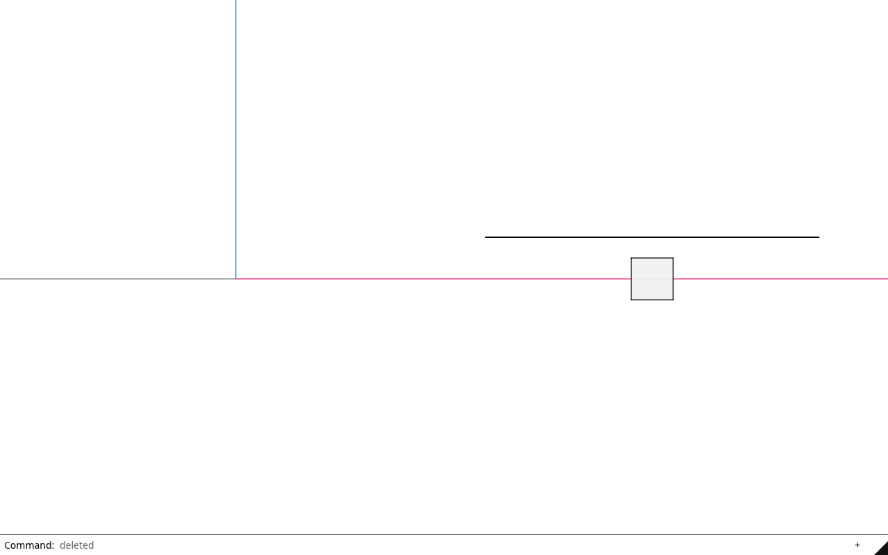

# Route input and select geometry

Orbit, select and edit the scene while keeping dock typing and panel gestures separate from scene interaction.

## Prerequisites and ownership

Complete the camera, renderer, dock, application, document and command chapters. This application chapter teaches `app/input.rs`, `touch.rs`, `keys.rs`, `gesture/`, `selection.rs`, `ui/pointer.rs` and the selection adapters in `state.rs` and `state/features.rs`. The renderer retains its completed GPU picking implementation; the application interprets those asynchronous answers.

## Build

Register the application gestures and route panel, keyboard, pointer and pick events through the existing host.

### A pointer belongs to one interaction

The panel adapter receives an event before normal scene input. `ui/pointer.rs` uses the current pointer position and actual popup layers, not the previous frame's hover state. A press in a panel captures its drag. Releasing a scene drag over a panel drops that edit rather than applying it through the UI. Wheel and touch events also respect the scene rectangle.

The command dock's completed focus policy determines when text entry owns keyboard input. A keyboard shortcut intended for text must not also select scene objects. Scene shortcuts run through `keys.rs`, which maps keys and modifiers to the same command behavior used by the dock. Runtime focus and repeat checks happen before this dispatch.

Normal mouse navigation uses right drag to orbit, middle drag to pan and the wheel to zoom. A right press that remains a click can finish a draft or repeat a command; a right drag must not repeat that command on release. `Input` therefore retains both press position and whether it became a drag.

### Choose a gesture before changing geometry

```rust
--8<-- "session_viewer/src/app/gesture/mod.rs:input-gestures"
```

The registry tries control handles, gizmo handles, object drags and box selection in that order. A handle may take the initial press. An ordinary object drag or selection rectangle starts only after the pointer moves beyond the click threshold. This lets a small hand movement remain a click while deliberate movement starts editing.

Each gesture supplies press/start, drag and release callbacks. Once chosen, it remains responsible for the interaction. Adding a gesture means adding its module and registry entry, not reopening every event branch. The `control`, `gizmo`, `object` and `box_select` adapters delegate to their corresponding state operations, which own saved placements, preview and commit/cancel behavior.

Input thresholds are in CSS pixels, while window events and GPU picking can use different pixel spaces. The adapter converts window coordinates to surface pixels and accounts for device scale when comparing movement or handle reach. A finger gets a wider handle reach than a mouse; multiplying an already converted position by the device ratio again would move the pick away from the visible pointer.

### Touch has its own state

```rust
--8<-- "session_viewer/src/app/touch.rs:input-touch-camera"
```

The ordinary viewer tracks touches by browser ID. One finger orbits. Two fingers pan by their midpoint and zoom by the change in separation. When finger count changes, the next event records a fresh span instead of applying a jump from the previous gesture. Each pinch ratio is clamped to bound an unusually large event.

A tap must satisfy both distance and duration limits. A nearby second tap can fit the view. The input host separately tracks a finger engaged with an editing tool; camera gestures must not simultaneously move that tool. Cancellation clears the gesture and pending tap. Browser pointer cancellation also invalidates the host's gesture state and wheel interaction.

Stage input is a different mode: quick horizontal swipes step through the deck and a column tap advances it. Its scene camera uses the stage's own held-touch policy. These policies belong to the stage adapter described in [the scene chapter](stage-scene.md), not an additional rewrite of normal viewer touch handling.

### A pick answer is not immediate

The GPU pick pass identifies geometry near a cursor and copies its result to a readback buffer. Mapping that buffer completes asynchronously. `Pick::poll` distinguishes no answer yet from a completed background hit: its return type is an option containing another option.

Each request or cancellation advances a generation. The submitted copy remembers its generation; an answer from before a newer request, camera change or cancellation is discarded. The host can continue rendering while waiting, without letting a delayed answer select an object under an obsolete cursor.

`state/features.rs::TAKE_PICK` offers a completed result to the active drag, tool, split and cloud-query adapters before ordinary selection. The first consumer handles it. `State::apply_pick` then interprets unconsumed results using object identity and the current selection mode. A non-pickable decoration may be visible without participating in this path.

### Selection identifies what an edit means

```rust
--8<-- "session_viewer/src/app/selection.rs:input-selection"
```

`SelectionMode` distinguishes a whole object from an edge, face or control on a parent row. `ControlId` preserves the geometric address: a vertex, curve control, surface control pair or cloud point. These are not interchangeable with GPU buffer offsets.

`Controls` derives finite control positions and connection lines from the kernel geometry. Cloud controls remain GPU-resident instead of expanding every point into a CPU vector. Escape can return from a sub-selection to its parent. Editing uses the mode to choose a whole-object transform or a deformation of geometry inside that object.

## Run and observe

Run the cumulative application with the comparison fixture. Drag with the right button to orbit, use the wheel to zoom, and enter `Fit` to restore the framing. Open `Layers All` and click an object's row: its selection highlight and gizmo should appear. Type a command in the dock and verify that its letters do not trigger scene shortcuts.

At an upright 390-pixel viewport, use `Layers Off` to recover the scene width. The open panel has a 240-pixel minimum and can crop document nameplates in the remaining region. This is current production behavior, not proof of a fully adapted phone layout. Test ordinary touch navigation separately from the stage's swipe/tap navigation.


An actual feature-pixel click resolves the original Element, pick-first. This is the controlled front-view fixture, not a general picking-mode or physical-device qualification.



Deleting that original removes its visible feature and makes the same pixel unpickable. The second original remains; allocated ribbon storage is retained for Undo.

## Predict and try

Predict what happens when you press a handle, drag it, then cancel before releasing. Its preview should return to the saved placement, without an undo transaction. Compare that with accepting the drag and undoing once. Then type into the dock while the object remains selected: input ownership should prevent the same key from acting on both the text and the scene.

## Question and answer

Why must a completed GPU pick carry a generation?

Readback finishes later than the event that requested it. The camera, pointer or scene may have changed in between. Comparing the submitted generation with the current generation prevents an old result from selecting geometry according to a view the user no longer sees.

## Validation

Current cumulative browser evidence covers normal zoom and command focus, hierarchy-row selection, and stage mouse/reset/zoom/click/key navigation with emulated upright swipe/tap input. Hierarchy selection does not test GPU screen-pick readback. Normal-viewer multitouch, cancelled editing gestures and physical-device interaction remain separate checks; stage touch success must not be reported as normal-viewer touch acceptance.
