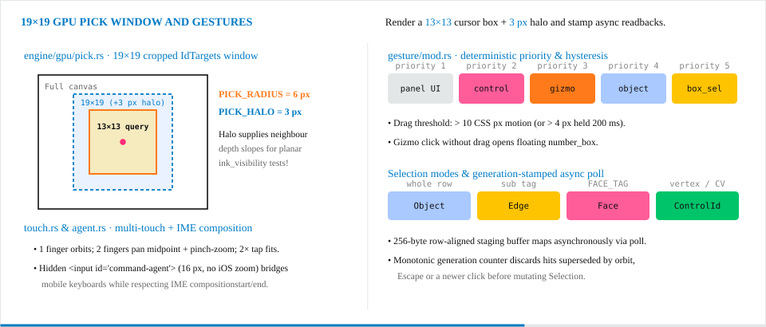
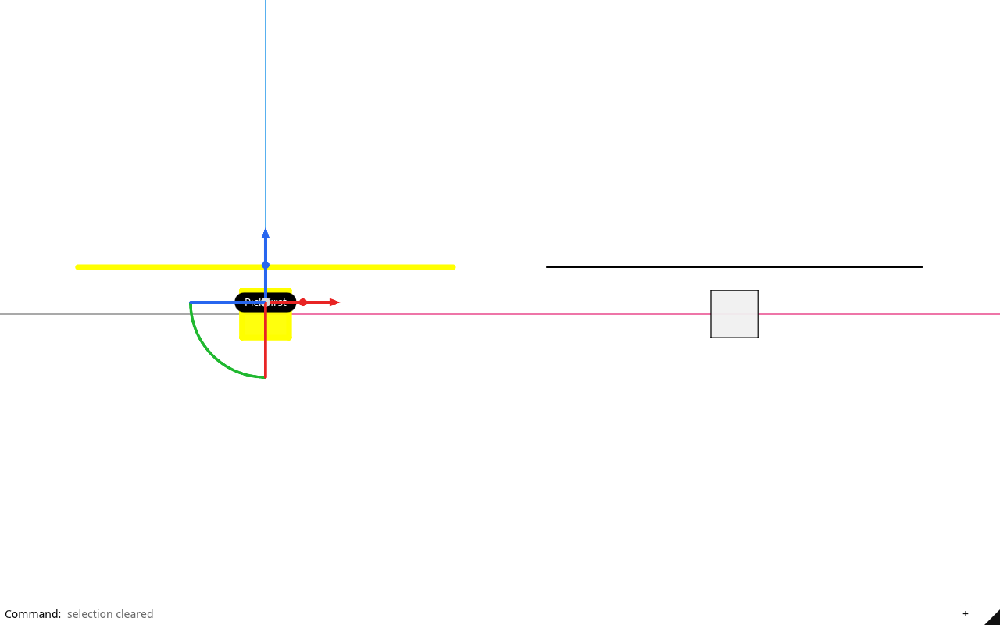

# Route input and select geometry

Route pointer, keyboard, multi-touch and mobile IME events to one owner at a time, preview drags at `60 Hz` on the GPU, and resolve asynchronous `19×19` GPU pick readbacks by generation.






## Prerequisites and ownership

Chapter `9.3` of [9. Run the application](completion-application.md) (`application` checkpoint). Covers `17` pointer, gesture, shortcut, touch, IME and selection modules under `src/app/` and `src/state/`.

## Build

### Step 1: Isolate UI panels from canvas gestures

- `src/app/ui/pointer.rs` checks live `egui` panel and popup rectangles on press so panel drags stay inside UI, scene drags released over panels cancel cleanly, and wheel/touch events respect the canvas rect.
- `src/app/ui/command_line.rs` binds `CommandLine` to `REGISTRY` completions, active `Tool` prompts/chips and `Escape` priority, returning keyboard focus to the canvas after command execution.
- `src/app/gesture/mod.rs` tests registered handlers in priority order (`control` -> `gizmo` -> `object` -> `box_select`), converting CSS thresholds into physical pixels with wider touch hit radii so clicks never accidentally drag geometry.

```rust
--8<-- "session_viewer/src/app/gesture/mod.rs:input-gestures"
```

| File | Specification |
| --- | --- |
| [gesture/control.rs](../../src/app/gesture/control.rs) | Claims control-point presses, cancelling sub-threshold clicks cleanly while committing true vertex/CV drags on release. |
| [gesture/gizmo.rs](../../src/app/gesture/gizmo.rs) | Claims gumball handle presses: a click without motion opens the floating `number_box`, whereas a drag previews on GPU rows and commits once on release. |
| [gesture/object.rs](../../src/app/gesture/object.rs) | Activates only after mouse motion exceeds the drag threshold, pairing delayed GPU pick results with ground/vertical-plane translation or falling back to box select on miss. |
| [gesture/box_select.rs](../../src/app/gesture/box_select.rs) | Tracks mouse-drag rectangles without touching geometry, delegating window (left-to-right) and crossing (right-to-left) resolution on release. |
| [src/app/keys.rs](../../src/app/keys.rs) | Maps unfocused canvas keys (`Escape`, `Enter`, `Delete`, `F`, `H`, `S`, `Ctrl/Cmd+Z/Y/A`) through the shared command dispatcher after text-focus checks. |

### Step 2: Multi-touch camera and mobile IME keyboard bridge

- `src/app/touch.rs` tracks active touch IDs (`1` finger orbits, `2` fingers pan by midpoint and clamped pinch-zoom, double-tap fits bounds) while resetting span baselines whenever finger count changes.
- `src/app/agent.rs` (`CommandAgent`) manages the hidden mobile `<input>`, forwarding full-string replacements, tracking IME `compositionstart`/`compositionend` so active compositions are never clobbered, and detaching all DOM closures on `Drop`.

```rust
--8<-- "session_viewer/src/app/touch.rs:input-touch-camera"
```

### Step 3: Cropped `19×19` GPU pick window and generation-stamped selection

```rust
--8<-- "session_viewer/src/engine/gpu/pick.rs:7:29"
```

| File | Specification |
| --- | --- |
| [src/app/input.rs](../../src/app/input.rs) | Enforces `> 10 CSS px` (or `> 4 px` held `200 ms`) drag hysteresis, distinguishes right-click repeat from right-drag orbit, and cancels touch edits when a second finger lands. |
| [src/app/selection.rs](../../viewer-core/src/selection.rs) | Separates parent row ID from `SelectionMode` (`Object`, `Edge`, `Face`, `ControlId`), building finite control cages while keeping cloud points GPU-resident. |
| [src/app/ui/phone.rs](../../src/app/ui/phone.rs) | Routes `CommandAgent` text/keys to the topmost open panel field ahead of the dock, skipping inline completion suffixes and active IME compositions. |
| [src/app/ui/overlay.rs](../../src/app/ui/overlay.rs) | Converts physical preview pixels once into `egui` points to draw rubber-band lines, dashed crossing boxes, snap squares and padded measurement chips. |
| [src/state/box_select.rs](../../src/state/box_select.rs) | Applies `Ctrl`-remove before `Shift`-add on release (solid window left-to-right, dashed crossing right-to-left) and refuses start during active drawing/splitting. |
| [src/state/cloud_query.rs](../../src/state/cloud_query.rs) | Assigns a monotonic generation to streamed-cloud control picks, ranking `65,536`-point pages on the GPU and discarding results if camera or selection changes. |
| [src/state/sheet_query.rs](../../src/state/sheet_query.rs) | Highlights picked sheet entities immediately on the parent row and resolves optional `.meta` side-table names under a generation token. |

```rust
--8<-- "session_viewer/viewer-core/src/selection.rs:input-selection"
```

## Run and observe

Open the `application` build with the comparison fixture:

- Right-drag orbits, wheel zooms, `Layers All` + row click highlights the object and spawns its 3-axis gumball.
- Typing `Fit` or `Select All` in the dock never triggers single-key `F` or `S` viewport shortcuts while the text field holds focus.

## Predict and try

Grab a gumball arrow, drag an object across `30` frames, then press `Escape` before releasing the mouse button: predict the undo history count (`0` — `base_place` restores immediately) versus releasing the button (`1` undo transaction).

## Question and answer

**Why tag every asynchronous `19×19` GPU pick readback with a generation counter?**
`Buffer::map_async` resolves on a later turn of the browser event loop; if the user orbited, clicked again or pressed `Escape` meanwhile, generation mismatch discards the stale hit before it can select the wrong object.

## Validation

Verified by native input/selection tests, [feature-pixel picking and deletion captures](release/completion-feature-picking-windows-20261115.json), hierarchy-row selection, dock focus isolation, and stage touch swipe/tap checks. Physical multi-touch hardware verification remains separate.
