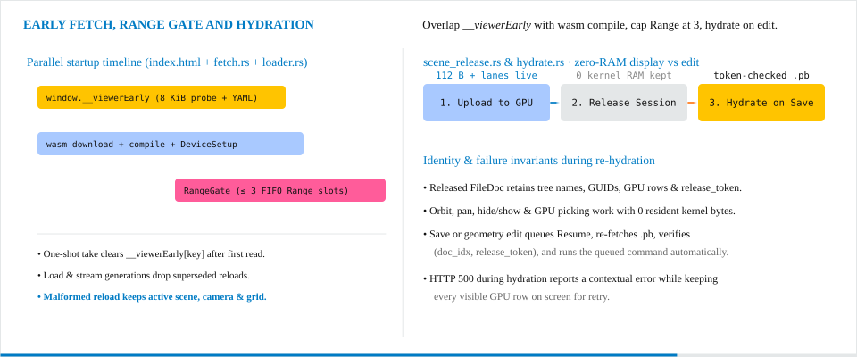
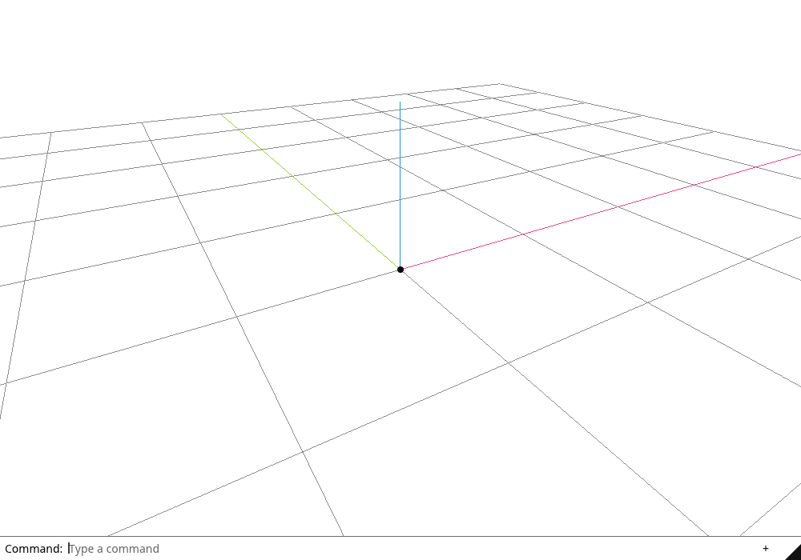

# Load without blocking the viewer

Start `window.__viewerEarly` fetches before `.wasm` compiles, guard overlapping scene reloads with monotonic generations, bound HTTP `Range` concurrency to `3` slots, and re-hydrate released geometry on demand before edits or saves.





## Prerequisites and ownership

Chapter `9.5` of [9. Run the application](completion-application.md) (`application` checkpoint). Covers `7` loading, routing, concurrency and hydration modules under `src/app/` and `src/state/` plus `index.html`'s `__viewerEarly` script.

## Build

### Step 1: Overlap `window.__viewerEarly` pre-fetches with wasm compilation

`src/app/fetch.rs` takes one-shot ownership of pre-started `window.__viewerEarly` Promises/AbortControllers (separating `8,192 B` head probes from full GETs), leaves large payloads in JS `Uint8Array`s until needed, resets stall timers per chunk, and caps whole-file bodies at `512 MiB`.

```rust
--8<-- "session_viewer/src/app/fetch.rs:loading-early"
```

### Step 2: Guard routes, load generations and `RangeGate` permits

| File | Specification |
| --- | --- |
| [src/app/route.rs](../../src/app/route.rs) | Validates scene query names (rejecting `..`, leading `/` and URL schemes) and resolves relative paths against same-origin (`data=off`) or configured data bases. |
| [src/app/manifest.rs](../../src/app/manifest.rs) | Parses YAML scene manifests (`files`, `xform` overriding `at`, `point_size`, authored `text`, `view` and `grid`) independently of kernel `.pb` bytes. |
| [src/app/loader.rs](../../src/app/loader.rs) | Overlaps `8 KiB` protobuf probes with GPU setup, tracks separate load and stream generations, and decrements active-load counts via an RAII `Loading` drop guard. |
| [src/app/range_gate.rs](../../src/app/range_gate.rs) | Caps concurrent HTTP `Range` reads at `3` permits in FIFO `Future` order, handing slots forward on `Drop` and waking waiters when a scene closes. |

```rust
--8<-- "session_viewer/src/app/range_gate.rs:8:33"
```

```rust
--8<-- "session_viewer/src/app/loader.rs:loading-generations"
```

### Step 3: Release display-only RAM and re-hydrate on demand

- `src/app/scene_release.rs` drops resident `Session` geometry on unmodified display-only documents while keeping tree nodes, names, shape summaries, GPU rows and a unique release token for later identity-checked re-hydration.
- `src/state/hydrate.rs` distinguishes read-only streamed shells from releasable documents, queues pending `Save`/edit `Resume` actions, and re-fetches source `.pb` bytes validated against the current document index and release token.

```rust
--8<-- "session_viewer/src/state/hydrate.rs:loading-hydration"
```

## Run and observe

Serve `production.html`:

- Open `/?stage=decks/equilibrium/index.yaml&data=off`: DevTools Network shows `4` stage fonts + YAML starting inside `__viewerEarly` before `.wasm` finishes initializing.
- Block one font URL and reload -> a contextual error names the missing font instead of showing a blank ready slide.
- Run `node tests/hydration.cjs` -> initial `HTTP 500` on `Save` keeps the `2` visible point rows intact with `0` resident geometries; retrying restores `2` geometries and downloads a valid `.session` archive.

## Predict and try

Trigger a slow scene load `A`, immediately switch to fast scene `B` (`B` finishes first, `A` finishes `2 s` later): predict which scene stays on screen (`B` — `A`'s stale load generation is dropped before `Msg` adoption).

## Question and answer

**Why does `fetch::early` remove the matched entry from `window.__viewerEarly` on first take?**
Each `Response` body stream and `AbortController` can be consumed and cancelled by only one owner; removing the entry prevents a later reload or range read from consuming an already-drained body stream.

## Validation

Verified by `6` injected stage font/chapter/picture failure checks at `1280` and `390` widths, `tests/loading.cjs` (malformed-reload retention, out-of-order generation rejection and `6` alternating reloads with stable GPU bytes), and `tests/hydration.cjs` (`HTTP 500` recovery + verified `.session` download at desktop/upright sizes).
