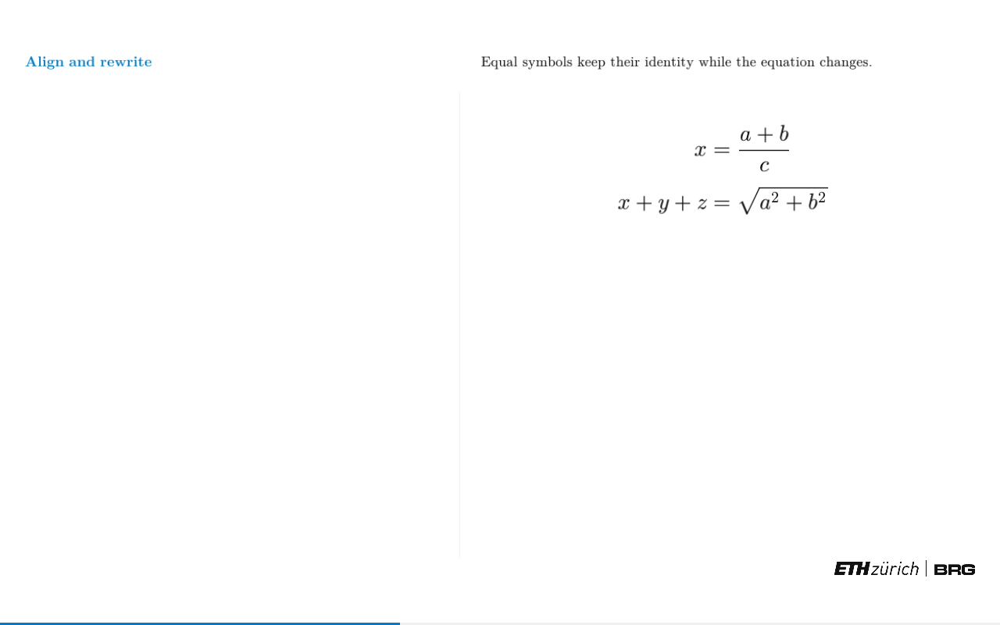
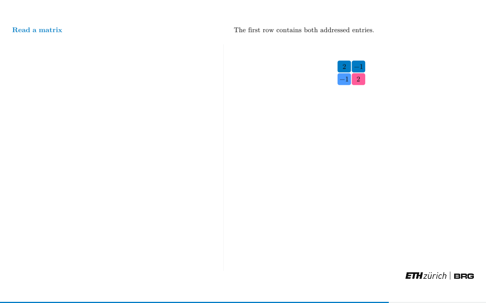
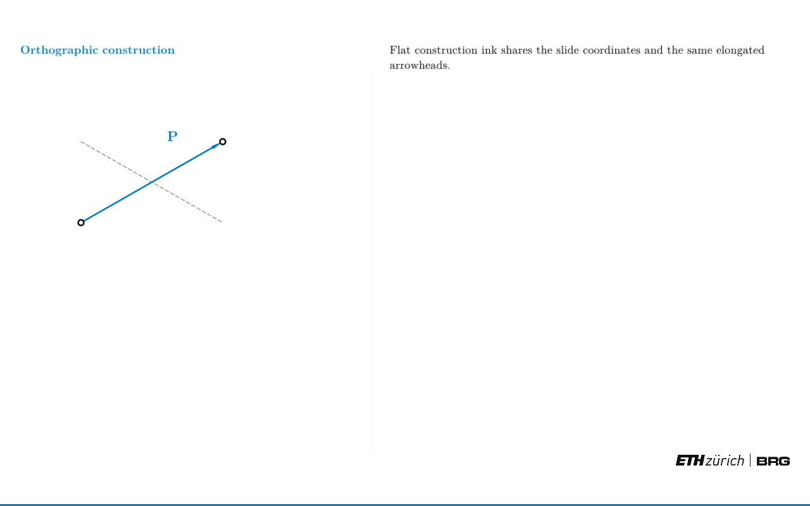
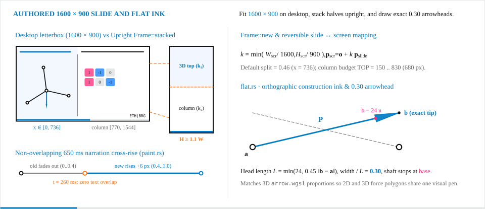
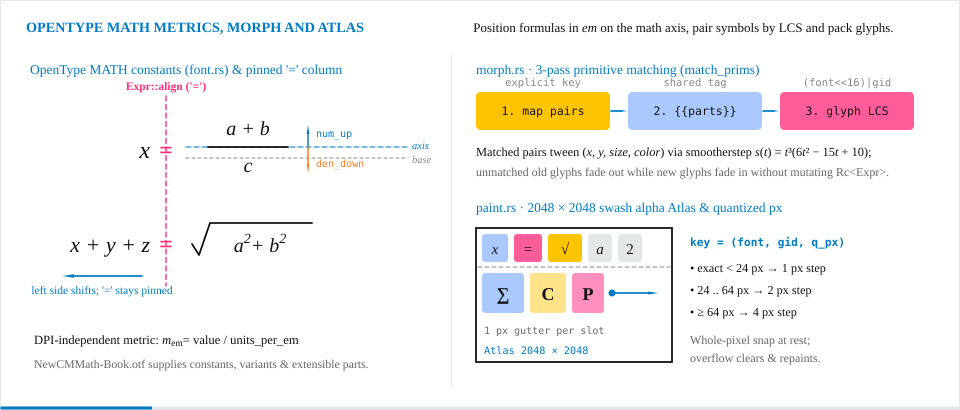
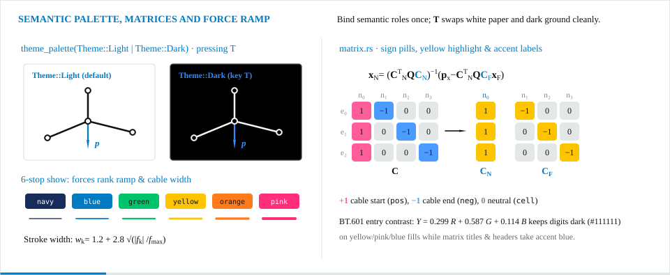

# Lay out and animate mathematics

Typeset OpenType `MATH` formulas, signed matrices, `2D` orthographic graphic-statics constructions and smootherstep tweens inside a `1600×900` logical slide using the production `src/app/stage` engine.






## Prerequisites and ownership

Requires [2. Paint shapes and text](completion-painting.md). Checkpoint `mathematics` (`42` files) keeps Tutorials 1–2 untouched and adds [src/app/mode.rs](../../src/app/mode.rs), `23` files under `src/app/stage/`, [examples/course/mathematics.rs](../../examples/course/mathematics.rs), [examples/course/index.yaml](../../examples/course/index.yaml) and [example.yaml](../lessons/03a-math/example.yaml):

| Module group | Owned files |
| --- | --- |
| Mode & host | [src/app/mode.rs](../../src/app/mode.rs), [stage/mod.rs](../../src/app/stage/mod.rs), [stage/math_mode.rs](../../src/app/stage/math_mode.rs), [stage/presentation.rs](../../src/app/stage/presentation.rs) |
| Fonts, TeX & atlas | [stage/font.rs](../../src/app/stage/font.rs), [stage/tex.rs](../../src/app/stage/tex.rs), [stage/paint.rs](../../src/app/stage/paint.rs) |
| Layout, matrices & 2D ink | [stage/layout.rs](../../src/app/stage/layout.rs), [stage/object.rs](../../src/app/stage/object.rs), [stage/matrix.rs](../../src/app/stage/matrix.rs), [stage/morph.rs](../../src/app/stage/morph.rs), [stage/flat.rs](../../src/app/stage/flat.rs) |
| Playback & YAML | [stage/tween.rs](../../src/app/stage/tween.rs), [stage/actions.rs](../../src/app/stage/actions.rs), [stage/draw.rs](../../src/app/stage/draw.rs), [stage/run.rs](../../src/app/stage/run.rs), [stage/deck.rs](../../src/app/stage/deck.rs), [stage/eval.rs](../../src/app/stage/eval.rs), [stage/check.rs](../../src/app/stage/check.rs) |
| Pure 3D descriptors & tests | [stage/geometry.rs](../../src/app/stage/geometry.rs), [stage/net.rs](../../src/app/stage/net.rs), [stage/view.rs](../../src/app/stage/view.rs) (wired to GPU rows in [9.8 Real-scene stages](stage-scene.md)), [stage/tests.rs](../../src/app/stage/tests.rs), [stage/presentation_tests.rs](../../src/app/stage/presentation_tests.rs) |

- `src/app/stage/mod.rs` is the additive module index for the stage engine: checkpoint `mathematics` registers the `22` host-independent modules above, and checkpoint `application` appends `mode`, `spatial` and `application` without editing earlier stage files.
- `src/app/stage/geometry.rs` converts authored `3D` stage points, lines, polylines, cuboids and floor grids into pure `session_rust` data structures ready for scene-row synchronization in Tutorial `9.8`.
- `src/app/stage/net.rs` solves `3D` equilibrium cable nets from node connectivity, force densities $q_k$ and boundary supports so mathematical matrices and `3D` form-finding diagrams read from one numerical source.
- `src/app/stage/view.rs` computes camera yaw, pitch, zoom and bounding-box framing for stage chapters without coupling the stage crate to a GPU device.

## Build

Materialize checkpoint `mathematics` or add the modules step by step:

```sh
npm --prefix ../session_tests run course -- checkpoint mathematics ../session_viewer/target/learn-mathematics
```

### Step 1. Decouple presentations from the host (`mode.rs`, `math_mode.rs`, `presentation.rs`)

Create `src/app/mode.rs` to define `Frame`, `Mode<Host>` and `Loaded<Host>` so an active presentation receives viewport metrics, millisecond timestamps and keyboard events while returning `egui::FullOutput` without owning `wgpu::Device` or `Surface`:

```rust
--8<-- "session_viewer/src/app/mode.rs:application-mode"
```

Add `src/app/stage/presentation.rs` to pair `run::Stage` with `paint::Atlas` and the current `Frame`, assigning picture IDs once and clearing `changed` only after checking whether animations or atlas overflow require another repaint:

```rust
--8<-- "session_viewer/src/app/stage/presentation.rs:stage-presentation"
```

Add `src/app/stage/math_mode.rs` to implement `Mode<Host>` for any `Host` (`ArrowRight`, `ArrowLeft`, `ArrowUp`, `ArrowDown`, `T`), and wire `?tutorial=mathematics` in `examples/course/mathematics.rs`:

```rust
--8<-- "session_viewer/src/app/stage/math_mode.rs:math-mode"
```

```rust
--8<-- "session_viewer/examples/course/mathematics.rs:course-mathematics"
```

### Step 2. Map the `1600×900` slide and upright stack (`paint.rs`)



`src/app/stage/paint.rs` maps the authored `1600×900` slide into letterboxed desktop points (`Frame::new`) or stacked upright halves (`Frame::stacked` when `screen.height() >= 1.1 * screen.width()`), draws the `split = 0.46` (`x = 736`) `1 px` `faint` divider, clips spatial ink to `[0, split * W]`, cross-rises `650 ms` `say:` sentences without overlap, and paints the `ETH Zürich | BRG` marks and `4 px` whole-deck `accent` progress bar:

```rust
--8<-- "session_viewer/src/app/stage/paint.rs:188:267"
```

### Step 3. Parse OpenType `MATH` metrics, typeset TeX and pack the glyph `Atlas`



`src/app/stage/font.rs` parses `ttf-parser` glyph advances, ink bounds and OpenType `MATH` constants (`axis_height`, fraction numerator/denominator shifts, radical rules and extensible delimiter parts) normalized by `units_per_em` so layout stays independent of screen DPI:

```rust
--8<-- "session_viewer/src/app/stage/font.rs:68:160"
```

`src/app/stage/tex.rs` lexes TeX commands, braces, `{{...}}` named sub-parts and `_`/`^` scripts into an immutable `Expr` of `em`-space `Prim` shapes (`Glyph`, `Rect`, `Stroke`, `Image`) with `w`, `h`, `d` and optional `=` alignment offset (`Expr::align`), plus inline `$...$` prose and `NewCMMono10` code blocks:

```rust
--8<-- "session_viewer/src/app/stage/tex.rs:8:54"
```

In `src/app/stage/paint.rs`, `Atlas::slot` rasterizes outline masks on demand with `swash` at quantized pixel sizes (`1 px` below `24 px`, `2 px` below `64 px`, `4 px` above) into a `2048×2048` linear texture with a `1 px` transparent gutter around every shelf slot:

```rust
--8<-- "session_viewer/src/app/stage/paint.rs:111:178"
```

### Step 4. Align equations, build signed matrices and morph symbols (`layout.rs`, `matrix.rs`, `morph.rs`)

- `src/app/stage/layout.rs` stacks column blocks inside `[split * W + 33.6, W - 56]` (`TOP = 150..830`), computes uniform overflow fit scale, aligns equation stacks on each expression's `Expr::align` (`=`) column, and centres any row item with an explicit `width` in `em` inside that fixed slot.
- `src/app/stage/object.rs` separates immutable `Rc<Expr>` primitives and `Content::Drawing` shapes from animated `Tween` channels (`pos`, `dim`, per-glyph colour) and `hidden` index sets, assigning optical sizes (`Tex` `36 px`, `Matrix`/`Row` `30 px`, `Text` `25 px`, `Label` `24 px`, `Code` `19 px`).
- `src/app/stage/matrix.rs` measures every entry before sizing uniform rounded cells, fills signed pills (`pos` `#ff5c9a`, `neg` `#4c9bff`, `cell` `#e4e7e8`), chooses whichever of `ink` or `bg` has higher BT.601 luminance contrast (`0.299R + 0.587G + 0.114B`), and switches large or `pattern: true` matrices to compact sparsity squares:

```rust
--8<-- "session_viewer/src/app/stage/matrix.rs:8:75"
```

`src/app/stage/morph.rs` (`match_prims`) pairs explicit `map:` keys first, shared `{{part}}` tags second and longest-common-subsequence glyph identifiers (`(font << 16) | gid`) third without mutating `Rc<Expr>`: matched pairs tween position and scale, unmatched source glyphs fade out, and unmatched target glyphs fade in:

```rust
--8<-- "session_viewer/src/app/stage/morph.rs:59:120"
```

### Step 5. Sample smootherstep tweens, `flat.rs` drawings and kernel motion

- `src/app/stage/tween.rs` samples `Tween<T>` analytically at `now` via quintic smootherstep $s(t) = t^3(10(1-t)^2 + 5(1-t)t + t^2)$ and retargets mid-flight from `self.at(now)` rather than accumulating per-frame deltas.
- `src/app/stage/actions.rs` executes identical state transitions during animated forward steps and instant backward replay, co-highlighting matching equation parts and `matrix_name_key` titles/headers in `accent` blue while keeping numeric cell `entries` in dark `ink`.
- `src/app/stage/draw.rs` (`prims_of` and `snapshot`) samples positions, colours, `flat_draws` paths and fade alpha into slide pixels and neutralizes matrix cell fills to `faint` whenever all glyphs in that cell are hidden.
- `src/app/stage/flat.rs` (`flat_draws`) renders `2D` orthographic constructions (`drawing:` + `at: [x, y]`) directly in `1600×900` slide coordinates: `point` draws a `5.5 px` open ring filled with `bg` paper, and `arrow` trims its shaft behind an elongated `24.0 × 0.30` solid head landing on the exact vector tip:

```rust
--8<-- "session_viewer/src/app/stage/tween.rs:38:98"
```

```rust
--8<-- "session_viewer/src/app/stage/flat.rs:49:75"
```

The stage clock computes eased $t \in [0, 1]$, and `session_rust` interpolates geometric values at parameter $t$:

- [Vector::lerp](../../../session_rust/src/vector.rs) — componentwise linear blend; at `0.5` between `(2, 0, 0)` and `(0, 2, 0)` the midpoint is `(1, 1, 0)`.
- [Color::lerp](../../../session_rust/src/color.rs) — channelwise RGBA blend preserving the first colour's name.
- [Line::lerp](../../../session_rust/src/line.rs) — blends start-to-start and end-to-end; reversing one line's endpoints collapses the midpoint to a point.
- [Polyline::resampled](../../../session_rust/src/polyline.rs) — places `count >= 2` vertices at equal arc-length intervals between the original endpoints.
- [Polyline::morph](../../../session_rust/src/polyline.rs) — resamples both polylines to the larger vertex count, then blends corresponding vertices in traversal order.
- [Xform::interpolate](../../../session_rust/src/xform.rs) — blends translation and scale linearly and rotation via normalized quaternion slerp so rigid lengths stay invariant mid-turn.

### Step 6. Replay steps deterministically and parse YAML decks (`run.rs`, `deck.rs`)

`src/app/stage/run.rs` flattens slide steps into a linear timeline with default `3.2 px` geometric pens (`split = 0.46`): `next` finishes active tweens before starting the next step, while `prev` resets chapter state and replays steps `0..=g-1` deterministically with `animate = false`:

```rust
--8<-- "session_viewer/src/app/stage/run.rs:259:332"
```

- `src/app/stage/deck.rs` parses index and chapter YAML, defaults to the white paper ground (`Theme::Light`) when `theme` is omitted, parses fixed-width row slots in `em` and `drawing:` shapes, builds the `6`-stop `show: forces` rank ramp, and merges step options via `object_with_options` with chapter/step error context.
- `src/app/stage/eval.rs` evaluates scalar and `3D` `Val` expressions (`+`, `-`, `*`, `/`) by recursive descent against named `Points`, rejecting invalid point-times-point products.
- `src/app/stage/check.rs` computes laid-out glyph, cell, stroke and picture ink boxes after clock sampling and reports block/label pairs overlapping by more than `1` slide unit on both axes.

```rust
--8<-- "session_viewer/src/app/stage/deck.rs:9:72"
```

```yaml
--8<-- "lessons/03a-math/example.yaml:deck"
```

### Theme palette and visual style



Decks name semantic graphic-statics roles in `theme_palette` rather than hard-coded hex values so pressing `T` (or passing `&theme=dark` / `&theme=light`) swaps the entire presentation between white paper (`Theme::Light` `#ffffff`, default) and dark ground (`Theme::Dark` `#000000`) at the exact current step:

```rust
--8<-- "session_viewer/src/app/stage/deck.rs:856:927"
```

- `src/app/stage/tests.rs` verifies math-axis fractions, fixed-width row-slot centring, `object_with_options` merging, vivid matrix sign fills, `yellow`/`accent` co-highlighting with `#111111` digits, white-default ground swaps, deterministic backward replay and ink-overlap checks against all `7` shipped decks.
- `src/app/stage/presentation_tests.rs` verifies `Presentation` picture aspect ratios, reversible `1600×900` coordinate round trips at desktop/upright viewports, repaint settling on static frames, and host-untouched `math_mode` white-to-black theme and step transitions.

## Run and observe

Serve the checkpoint and open `http://127.0.0.1:8780/?tutorial=mathematics`:

- Slide 1 opens on the default white paper ground (`#ffffff`) with `x` and `x + y` equations aligned vertically on `=`.
- `ArrowRight` morphs into `x + y + z = \sqrt{a^2 + b^2}`, advances to Slide 2's `2×2` matrix (`0,:` `accent` highlight), and reaches Slide 3 (`Orthographic construction`: dashed grey line, `24×0.30` `load` arrow and open-ring vertices); `ArrowLeft` replays prior states; `T` swaps white and dark grounds.

## Predict and try

Edit Slide 1 in `example.yaml` from `x + y = ...` to `x + y + w + z = ...`: predict that the `=` column stays pinned while only the left-hand glyphs shift left, verify in the browser, then restore `example.yaml`.

## Question and answer

**Why does `ArrowLeft` replay actions from the start of the chapter instead of running tweens in reverse?**
Actions can delete objects, rebind groups and cascade box removals; deterministic replay reconstructs exact removed state without maintaining inverse mutations for every action kind.

## Validation

Verified by `42`-file locked `wasm32` build, `25` passing native stage tests (`1` GPU test ignored), and desktop/upright WebGPU navigation + white/dark ground captures ([partials receipt](release/completion-partials-windows-20261115.json), [stage reconciliation receipt](release/completion-stage-reconciliation-windows-20261118e.json)). Physical-phone testing remains separate.
