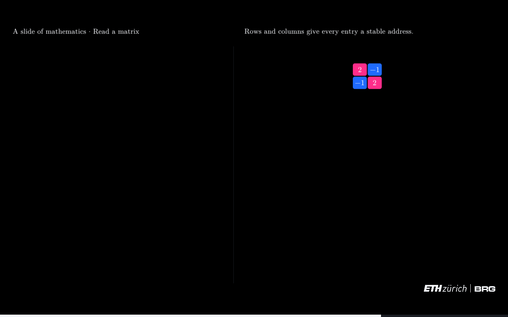
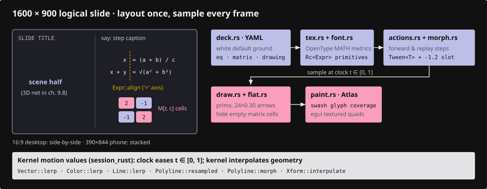

# Lay out and animate mathematics

Typeset OpenType `MATH` equations, addressed matrices and time-sampled tweens inside a `1600×900` logical slide using the production `src/app/stage` engine.






## Prerequisites and ownership

Requires [2. Paint shapes and text](completion-painting.md). Checkpoint `mathematics` (`41` files) keeps Tutorials 1–2 intact and adds [src/app/mode.rs](../../src/app/mode.rs), `22` files under `src/app/stage/`, [examples/course/mathematics.rs](../../examples/course/mathematics.rs), [examples/course/index.yaml](../../examples/course/index.yaml) and [example.yaml](../lessons/03a-math/example.yaml):

| Module group | Owned files |
| --- | --- |
| Mode & host | [src/app/mode.rs](../../src/app/mode.rs), [stage/mod.rs](../../src/app/stage/mod.rs), [stage/math_mode.rs](../../src/app/stage/math_mode.rs), [stage/presentation.rs](../../src/app/stage/presentation.rs) |
| Fonts, TeX & atlas | [stage/font.rs](../../src/app/stage/font.rs), [stage/tex.rs](../../src/app/stage/tex.rs), [stage/paint.rs](../../src/app/stage/paint.rs) |
| Layout & matrices | [stage/layout.rs](../../src/app/stage/layout.rs), [stage/object.rs](../../src/app/stage/object.rs), [stage/matrix.rs](../../src/app/stage/matrix.rs), [stage/morph.rs](../../src/app/stage/morph.rs) |
| Playback & YAML | [stage/tween.rs](../../src/app/stage/tween.rs), [stage/actions.rs](../../src/app/stage/actions.rs), [stage/draw.rs](../../src/app/stage/draw.rs), [stage/run.rs](../../src/app/stage/run.rs), [stage/deck.rs](../../src/app/stage/deck.rs), [stage/eval.rs](../../src/app/stage/eval.rs), [stage/check.rs](../../src/app/stage/check.rs) |
| Pure 3D descriptors & tests | [stage/geometry.rs](../../src/app/stage/geometry.rs), [stage/net.rs](../../src/app/stage/net.rs), [stage/view.rs](../../src/app/stage/view.rs) (wired to GPU rows in [9.8 Real-scene stages](stage-scene.md)), [stage/tests.rs](../../src/app/stage/tests.rs), [stage/presentation_tests.rs](../../src/app/stage/presentation_tests.rs) |

### One schema, two hosts

`src/app/stage/mod.rs` is the additive module index for the stage engine: checkpoint `mathematics` registers the `21` host-independent modules above, and checkpoint `application` appends `mode`, `spatial` and `application` without editing earlier stage files.

## Build

Materialize checkpoint `mathematics` to inspect and build all `41` files:

```sh
npm --prefix ../session_tests run course -- checkpoint mathematics ../session_viewer/target/learn-mathematics
```

### Register content without owning the application

`src/app/mode.rs` defines `Frame`, `Mode<Host>` and `Loaded<Host>` so an active presentation receives viewport metrics, timestamps and events while returning `egui::FullOutput` without owning a `wgpu::Device` or `Surface`.

```rust
--8<-- "session_viewer/src/app/mode.rs:application-mode"
```

`src/app/stage/math_mode.rs` implements `Mode<Host>` for any `Host` without reading host state: it ticks the millisecond stage clock, paints `Presentation` into `egui`, and forwards keyboard navigation (`ArrowRight`, `ArrowLeft`, `ArrowUp`, `ArrowDown`, `t`).

```rust
--8<-- "session_viewer/src/app/stage/math_mode.rs:math-mode"
```

```rust
--8<-- "session_viewer/examples/course/mathematics.rs:course-mathematics"
```

### Frame and letterbox

`src/app/stage/paint.rs` maps the authored `1600×900` slide into letterboxed desktop points (`Frame::fit`) or stacked upright halves (`Frame::stacked`), rasterizes glyphs via `swash` into a 1 px-guttered `Atlas` keyed by `(font, glyph_id, px)`, and draws the slide title (or chapter fallback) at top-left.

```rust
--8<-- "lessons/03a-math/src/app/stage/paint.rs:frame"
```

### Font metrics and TeX


`src/app/stage/font.rs` parses `ttf-parser` glyph advances, ink bounds and OpenType `MATH` constants (axis height, fraction rule gaps, script shifts and extensible delimiters) normalized by `units_per_em` so layout stays independent of screen DPI.

```rust
--8<-- "lessons/03a-math/src/app/stage/font.rs:metrics"
```

`src/app/stage/tex.rs` lexes commands, braces and `_`/`^` scripts into an `Expr` of positioned glyph and rule primitives with `width`, `height`, `depth`, named sub-parts and optional `=` alignment offset, supporting inline `$...$` prose and monospace code blocks.

```rust
--8<-- "lessons/03a-math/src/app/stage/tex.rs:typeset"
```

```rust
--8<-- "lessons/03a-math/src/app/stage/paint.rs:atlas"
```

### Column and equals alignment

- `src/app/stage/layout.rs` stacks column blocks, computes uniform fit scale, aligns equation stacks on each expression's `Expr::align` (`=`) offset, and centres any row item with an explicit `width` in `em` inside that fixed slot.
- `src/app/stage/object.rs` separates immutable `Rc<Expr>` primitives from animated `Tween` channels (`pos`, `dim`, per-glyph colour) and `hidden` index sets so hiding matrix entries never shifts group addresses.
- `src/app/stage/presentation.rs` pairs `Running` with its `Atlas` and current `Frame`, assigning picture IDs once and clearing `changed` only after computing whether animation or atlas overflow needs another repaint.

```rust
--8<-- "session_viewer/src/app/stage/presentation.rs:stage-presentation"
```

### Matrices and addresses

`src/app/stage/matrix.rs` measures every entry before sizing uniform cells, records slice groups (`r,c`, `r,:`, `:,c`, `cells`, `entries`), picks contrast-safe ink against cell fills, and switches matrices above `14` rows/columns (or `pattern: true`) to sparse structure squares.

```rust
--8<-- "lessons/03a-math/src/app/stage/matrix.rs:cells"
```

### Matching transform

`src/app/stage/morph.rs` pairs named parts first and longest-common-subsequence symbols second without reusing primitives: matched glyphs tween position and scale, unmatched old glyphs fade out, and unmatched new glyphs fade in.

```rust
--8<-- "lessons/03a-math/src/app/stage/morph.rs:matching"
```

### Clock, actions and drawing

- `src/app/stage/tween.rs` samples `Tween<T>` directly from `(start_ms, duration_ms, ease)` at clock `t` and retargets mid-flight from the current sampled value rather than accumulating frame deltas.
- `src/app/stage/actions.rs` applies identical state transitions during animated forward steps and instant replay, staggering group reveals, attaching flush `-1.2`-unit highlight boxes, and cascading removals to dependent labels and boxes.
- `src/app/stage/draw.rs` (`prims_of`) samples positions, colours and fade alpha into slide pixels and neutralizes matrix cell fills whenever all entry glyphs in that cell are hidden.

```rust
--8<-- "lessons/03a-math/src/app/stage/tween.rs:clock"
```

### Kernel motion values

The stage clock computes eased `t ∈ [0, 1]`; `session_rust` interpolates geometric values at parameter `t`:

- [Vector::lerp](../../../session_rust/src/vector.rs) — componentwise linear blend; at parameter `0.5` between `(2, 0, 0)` and `(0, 2, 0)` the midpoint is `(1, 1, 0)`.
- [Color::lerp](../../../session_rust/src/color.rs) — channelwise RGBA blend preserving the first colour's name.
- [Line::lerp](../../../session_rust/src/line.rs) — blends start-to-start and end-to-end; reversing one line's endpoints collapses the midpoint to a point.
- [Polyline::resampled](../../../session_rust/src/polyline.rs) — places `count >= 2` vertices at equal arc-length intervals between the original endpoints.
- [Polyline::morph](../../../session_rust/src/polyline.rs) — resamples both polylines to the larger vertex count, then blends corresponding vertices in traversal order.
- [Xform::interpolate](../../../session_rust/src/xform.rs) — blends translation and scale linearly and rotation via normalized quaternion slerp so rigid lengths stay invariant mid-turn.

### Steps, slides and stepping backward

`src/app/stage/run.rs` flattens slide steps into a linear timeline: stepping forward finishes active tweens first, while stepping backward resets chapter state and replays actions deterministically with `animate = false` up to `step - 1`.

```rust
--8<-- "lessons/03a-math/src/app/stage/run.rs:navigation"
```

### Deck data and errors

- `src/app/stage/deck.rs` parses index and chapter YAML, defaults to the dark ground when `theme` is omitted, parses fixed-width row slots in `em`, and merges step options onto scalar and nested `eq`/`then`/`tex` blocks via `object_with_options` with chapter/step error context.
- `src/app/stage/eval.rs` evaluates scalar and 3D `Val` expressions (`+`, `-`, `*`, `/`) by recursive descent against named `Points`, rejecting invalid point-times-point products.
- `src/app/stage/check.rs` computes laid-out glyph, cell, stroke and picture ink boxes after clock sampling and reports block/label pairs overlapping by more than `1` slide unit on both axes.

```rust
--8<-- "lessons/03a-math/src/app/stage/deck.rs:schema"
```

```yaml
--8<-- "lessons/03a-math/example.yaml:deck"
```

### Test the model and its host separately

- `src/app/stage/tests.rs` verifies math-axis fractions, fixed-width row-slot centring, `object_with_options` merging, matrix cell addressing, dark-default theme flips, deterministic backward replay and ink-overlap checks against shipped fonts and decks.
- `src/app/stage/presentation_tests.rs` verifies `Presentation` picture aspect ratios, reversible `1600×900` coordinate round trips at desktop/upright viewports, repaint settling on static frames, and host-untouched `math_mode` theme/step transitions.

## Run and observe

Serve the checkpoint and open `http://127.0.0.1:8780/?tutorial=mathematics`:

- Slide 1 opens with `x` and `x + y` equations aligned vertically on `=`.
- `ArrowRight` morphs into the rewritten equation, advances to Slide 2's `2×2` matrix, and highlights row `0,:`; `ArrowLeft` replays prior states; `T` toggles dark and light themes.

## Predict and try

Edit Slide 1 in `example.yaml` from `x + y = ...` to `x + y + z = ...`: predict that the `=` column stays pinned while only the left-hand glyphs shift left, verify in the browser, then restore `example.yaml`.

## Question and answer

**Why does `ArrowLeft` replay actions from the start of the chapter instead of running tweens in reverse?**
Actions can delete objects, rebind groups and cascade box removals; deterministic replay reconstructs exact removed state without writing inverse mutations for every action type.

## Validation

Verified by `41`-file locked `wasm32` build, `21` passing native stage tests (`1` GPU test ignored), and desktop/upright WebGPU navigation + dark-default ground checks ([partials receipt](release/completion-partials-windows-20261115.json), [stage reconciliation receipt](release/completion-stage-reconciliation-windows-20261118.json)). Physical-phone testing remains separate.
