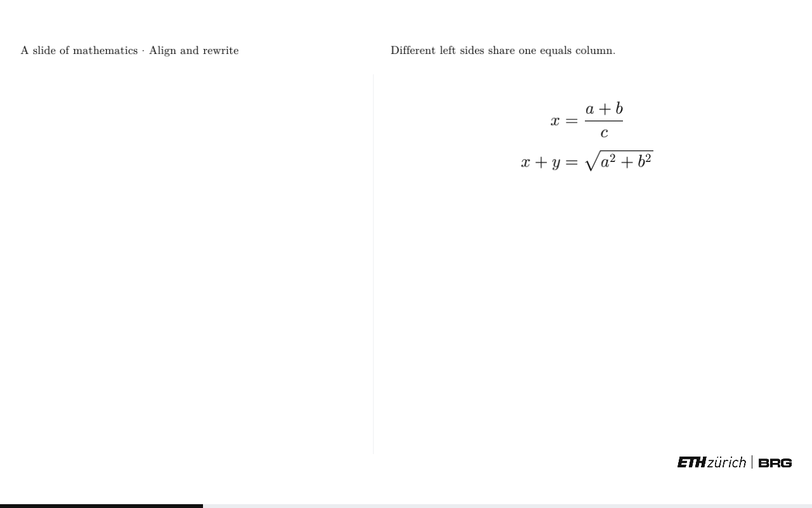
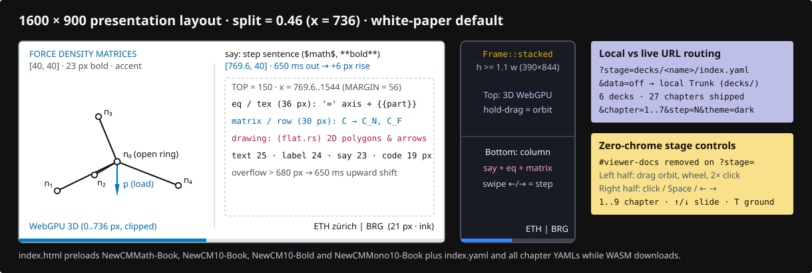
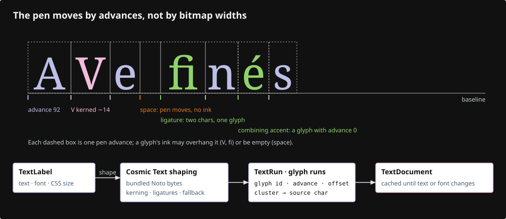
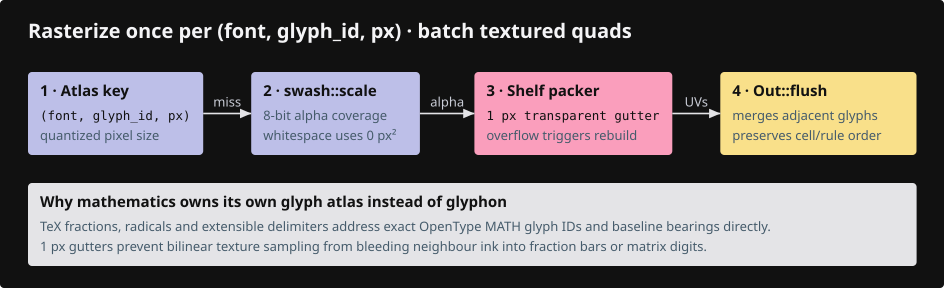
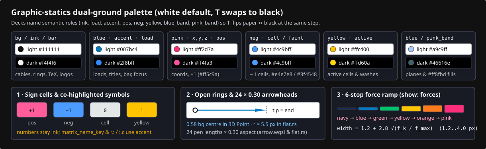

# Lay out and animate mathematics

Typeset OpenType `MATH` equations, addressed matrices, `2D` orthographic constructions and time-sampled tweens inside a `1600×900` logical slide using the production `src/app/stage` engine.




## Prerequisites and ownership

Requires [2. Paint shapes and text](completion-painting.md). Checkpoint `mathematics` (`42` files) keeps Tutorials 1–2 intact and adds [src/app/mode.rs](../../src/app/mode.rs), `23` files under `src/app/stage/`, [examples/course/mathematics.rs](../../examples/course/mathematics.rs), [examples/course/index.yaml](../../examples/course/index.yaml) and [example.yaml](../lessons/03a-math/example.yaml):

| Module group | Owned files |
| --- | --- |
| Mode & host | [src/app/mode.rs](../../src/app/mode.rs), [stage/mod.rs](../../src/app/stage/mod.rs), [stage/math_mode.rs](../../src/app/stage/math_mode.rs), [stage/presentation.rs](../../src/app/stage/presentation.rs) |
| Fonts, TeX & atlas | [stage/font.rs](../../src/app/stage/font.rs), [stage/tex.rs](../../src/app/stage/tex.rs), [stage/paint.rs](../../src/app/stage/paint.rs) |
| Layout, matrices & 2D ink | [stage/layout.rs](../../src/app/stage/layout.rs), [stage/object.rs](../../src/app/stage/object.rs), [stage/matrix.rs](../../src/app/stage/matrix.rs), [stage/morph.rs](../../src/app/stage/morph.rs), [stage/flat.rs](../../src/app/stage/flat.rs) |
| Playback & YAML | [stage/tween.rs](../../src/app/stage/tween.rs), [stage/actions.rs](../../src/app/stage/actions.rs), [stage/draw.rs](../../src/app/stage/draw.rs), [stage/run.rs](../../src/app/stage/run.rs), [stage/deck.rs](../../src/app/stage/deck.rs), [stage/eval.rs](../../src/app/stage/eval.rs), [stage/check.rs](../../src/app/stage/check.rs) |
| Pure 3D descriptors & tests | [stage/geometry.rs](../../src/app/stage/geometry.rs), [stage/net.rs](../../src/app/stage/net.rs), [stage/view.rs](../../src/app/stage/view.rs) (wired to GPU rows in [9.8 Real-scene stages](stage-scene.md)), [stage/tests.rs](../../src/app/stage/tests.rs), [stage/presentation_tests.rs](../../src/app/stage/presentation_tests.rs) |

### One schema, two hosts

`src/app/stage/mod.rs` is the additive module index for the stage engine: checkpoint `mathematics` registers the `22` host-independent modules above, and checkpoint `application` appends `mode`, `spatial` and `application` without editing earlier stage files.

## Build

Materialize checkpoint `mathematics` to inspect and build all `42` files:

```sh
npm --prefix ../session_tests run course -- checkpoint mathematics ../session_viewer/target/learn-mathematics
```

### Register content without owning the application

`src/app/mode.rs` defines `Frame`, `Mode<Host>` and `Loaded<Host>` so an active presentation receives viewport metrics, timestamps and events while returning `egui::FullOutput` without owning a `wgpu::Device` or `Surface`.

```rust
--8<-- "session_viewer/src/app/mode.rs:application-mode"
```

`src/app/stage/math_mode.rs` implements `Mode<Host>` for any `Host` without reading host state: it ticks the millisecond stage clock, paints `Presentation` into `egui`, and forwards keyboard navigation (`ArrowRight`, `ArrowLeft`, `ArrowUp`, `ArrowDown`, `t`).

```rust
--8<-- "session_viewer/src/app/stage/math_mode.rs:math-mode"
```

```rust
--8<-- "session_viewer/examples/course/mathematics.rs:course-mathematics"
```

### Frame and letterbox



`src/app/stage/paint.rs` maps the authored `1600×900` slide into letterboxed desktop points (`Frame::fit`) or stacked upright halves (`Frame::stacked`), rasterizes glyphs via `swash` into a `1 px`-guttered `Atlas` keyed by `(font, glyph_id, px)`, and paints the bold `accent` slide title, `650 ms` `say:` narration, `ETH Zürich | BRG` marks and `4 px` `accent` progress bar.

| Slide region (`1600×900`) | Exact coordinates & rule |
| --- | --- |
| Horizontal split | `split = 0.46` (`x = 736` default, configurable per chapter e.g. `0.54` or `0.45`): transparent WebGPU `3D` side (`0..736`, clipped) + `1 px` `faint` divider (`y = 96..844`) + opaque `bg` column (`736..1600`). |
| Column box & overflow | `x = 769.6..1544` (`MARGIN = 56`), `TOP = 150`, `BOTTOM = 70` (`680 px` height); stacks taller than `680 px` tween upward over `650 ms`. |
| Title & `say:` narration | Slide/chapter title at `[40, 40]` (`23 px/em` bold `accent` blue); `say:` sentence at `[769.6, 40]` (`23 px/em` `ink`, `$math$` and `**bold**`) fades out (`0..40%` of `650 ms`) before the next rises `+6 px` (`40..100%`) so sentences never overlap. |
| Marks & progress bar | `ETH Zürich` and `BRG` marks (`21 px` optical height, tinted `ink`) at `[1560, 870]`; `4 px` continuous whole-deck progress bar (`faint` track, `accent` blue fill) across all chapters. |
| Portrait reflow | When `screen.height() >= 1.1 * screen.width()`, `Frame::stacked` places the `3D` half on top and the derivation column underneath with independent scale and hit-testing. |

```rust
--8<-- "lessons/03a-math/src/app/stage/paint.rs:frame"
```

### Font metrics and TeX





`src/app/stage/font.rs` parses `ttf-parser` glyph advances, ink bounds and OpenType `MATH` constants (axis height, fraction rule gaps, script shifts and extensible delimiters) normalized by `units_per_em` so layout stays independent of screen DPI.

```rust
--8<-- "lessons/03a-math/src/app/stage/font.rs:metrics"
```

`src/app/stage/tex.rs` lexes commands, braces and `_`/`^` scripts into an `Expr` of positioned glyph and rule primitives with `width`, `height`, `depth`, named sub-parts and optional `=` alignment offset, supporting inline `$...$` prose and monospace code blocks.

```rust
--8<-- "lessons/03a-math/src/app/stage/tex.rs:typeset"
```

```rust
--8<-- "lessons/03a-math/src/app/stage/paint.rs:atlas"
```

### Column and equals alignment

- `src/app/stage/layout.rs` stacks column blocks, computes uniform fit scale, aligns equation stacks on each expression's `Expr::align` (`=`) offset, and centres any row item with an explicit `width` in `em` inside that fixed slot.
- `src/app/stage/object.rs` separates immutable `Rc<Expr>` primitives and `Content::Drawing` shapes from animated `Tween` channels (`pos`, `dim`, per-glyph colour) and `hidden` index sets, assigning default optical sizes (`Tex` `36 px`, `Matrix`/`Row` `30 px`, `Text` `25 px`, `Label` `24 px`, `Code` `19 px`).
- `src/app/stage/presentation.rs` pairs `Running` with its `Atlas` and current `Frame`, assigning picture IDs once and clearing `changed` only after computing whether animation or atlas overflow needs another repaint.

```rust
--8<-- "session_viewer/src/app/stage/presentation.rs:stage-presentation"
```

### Matrices and addresses

`src/app/stage/matrix.rs` measures every entry before sizing uniform cells, fills signed pills (`pos` `#ff5c9a`, `neg` `#4c9bff`, `cell` `#e4e7e8`/`#3f4548`), selects whichever of `ink` or `bg` has greater BT.601 luminance contrast (`0.299R + 0.587G + 0.114B`), and switches matrices above `14` rows/columns (or `pattern: true`) to sparse squares.

```rust
--8<-- "lessons/03a-math/src/app/stage/matrix.rs:cells"
```

### Matching transform

`src/app/stage/morph.rs` pairs named parts first and longest-common-subsequence symbols second without reusing primitives: matched glyphs tween position and scale, unmatched old glyphs fade out, and unmatched new glyphs fade in.

```rust
--8<-- "lessons/03a-math/src/app/stage/morph.rs:matching"
```

### Clock, actions and drawing

- `src/app/stage/tween.rs` samples `Tween<T>` directly from `(start_ms, duration_ms, ease)` at clock `t` and retargets mid-flight from the current sampled value rather than accumulating frame deltas.
- `src/app/stage/actions.rs` applies identical state transitions during animated forward steps and instant replay, co-highlighting matching equation symbols and `matrix_name_key` titles/labels in `accent` blue while keeping numeric cell `entries` in `ink`, attaching `-1.2`-unit boxes, and cascading removals.
- `src/app/stage/draw.rs` (`prims_of` and `snapshot`) samples positions, colours, `flat_draws` paths and fade alpha into slide pixels and neutralizes matrix cell fills to `faint` whenever all entry glyphs in that cell are hidden.
- `src/app/stage/flat.rs` (`flat_draws`) renders `Content::Drawing` (`drawing:` + `at: [x, y]`) directly in `1600×900` slide coordinates: `point` draws a `5.5 px` open ring filled with `bg` paper, `arrow` trims its shaft behind an elongated `24.0 × 0.30` solid head landing on the exact vector tip, and `line`, `polyline` and `polygon` draw dashed projectors and translucent washes.

```rust
--8<-- "lessons/03a-math/src/app/stage/tween.rs:clock"
```

```rust
--8<-- "session_viewer/src/app/stage/flat.rs:49:75"
```

### Kernel motion values

The stage clock computes eased `t ∈ [0, 1]`; `session_rust` interpolates geometric values at parameter `t`:

- [Vector::lerp](../../../session_rust/src/vector.rs) — componentwise linear blend; at parameter `0.5` between `(2, 0, 0)` and `(0, 2, 0)` the midpoint is `(1, 1, 0)`.
- [Color::lerp](../../../session_rust/src/color.rs) — channelwise RGBA blend preserving the first colour's name.
- [Line::lerp](../../../session_rust/src/line.rs) — blends start-to-start and end-to-end; reversing one line's endpoints collapses the midpoint to a point.
- [Polyline::resampled](../../../session_rust/src/polyline.rs) — places `count >= 2` vertices at equal arc-length intervals between the original endpoints.
- [Polyline::morph](../../../session_rust/src/polyline.rs) — resamples both polylines to the larger vertex count, then blends corresponding vertices in traversal order.
- [Xform::interpolate](../../../session_rust/src/xform.rs) — blends translation and scale linearly and rotation via normalized quaternion slerp so rigid lengths stay invariant mid-turn.

### Steps, slides and stepping backward

`src/app/stage/run.rs` flattens slide steps into a linear timeline with default `3.2 px` geometric pens (`split = 0.46`): stepping forward finishes active tweens first, while stepping backward resets chapter state and replays actions deterministically with `animate = false` up to `step - 1`.

```rust
--8<-- "lessons/03a-math/src/app/stage/run.rs:navigation"
```

### Deck data and errors

- `src/app/stage/deck.rs` parses index and chapter YAML, defaults to the white paper ground (`Theme::Light`) when `theme` is omitted, parses fixed-width row slots in `em` and `drawing:` shapes, builds the `6`-stop `show: forces` rank ramp, and merges step options via `object_with_options` with chapter/step error context.
- `src/app/stage/eval.rs` evaluates scalar and 3D `Val` expressions (`+`, `-`, `*`, `/`) by recursive descent against named `Points`, rejecting invalid point-times-point products.
- `src/app/stage/check.rs` computes laid-out glyph, cell, stroke and picture ink boxes after clock sampling and reports block/label pairs overlapping by more than `1` slide unit on both axes.

```rust
--8<-- "lessons/03a-math/src/app/stage/deck.rs:schema"
```

```yaml
--8<-- "lessons/03a-math/example.yaml:deck"
```

### Theme palette and visual style



Decks name semantic graphic-statics roles rather than single-ground hex colours so pressing `T` (or passing `&theme=dark` / `&theme=light`) swaps the entire presentation between white paper (`Theme::Light` `#ffffff`, default) and black (`Theme::Dark` `#000000`) at the current step:

| Token / role | Light (`#ffffff` default) | Dark (`#000000` via `T`) | Presentation use |
| --- | --- | --- | --- |
| `bg` / `ink` (`bar`, `free`, `fixed`) | `#ffffff` / `#111111` | `#000000` / `#f4f4f6` | Paper ground, `3.2 px` member bars, open-ring nodes, TeX formulas, prose and `ETH Zürich` / `BRG` marks. |
| `blue` (`accent`, `load`) | `#007bc4` | `#2f8bff` | External load vectors, bold slide titles, `4 px` progress fill, co-highlighted formula symbols and matrix titles/labels. |
| `pink` (`x`, `y`, `z`) & `pos` | `#ff2d7a` & `#ff5c9a` | `#ff4fa3` & `#ff5c9a` | Coordinate components, tension vectors, and positive (`+`) matrix cell pills. |
| `neg` & `cell` / `faint` | `#4c9bff` & `#e4e7e8` | `#4c9bff` & `#3f4548` | Negative (`-`) matrix pills, neutral zero pills (`cell`), split divider and progress track (`faint`). |
| `yellow` & `yellow_light` | `#ffc400` & `#ffe38a` | `#ffd60a` & `#766b38` | Active matrix row/column cells and warm auxiliary construction washes. |
| `blue_band` (`lightblue`) & `pink_band` | `#a9c9ff` & `#ff8fbd` | `#46616e` & `#765260` | Pale ruled auxiliary planes and unfolded force-polygon triangle washes. |
| `dim`, `grey`, `orange`, `green`, `navy` | `#666666`, `#888888`, `#ff7a1a`, `#00c46a`, `#182c5b` | `#c9ccd6`, `#b9b9bd`, `#ff8a1f`, `#00f5b0`, `#bdbfe8` | Matrix index labels, `#` code comments, dashed projectors, resultant vectors and `show: forces` rank stops. |

- **Co-highlighted symbols & readable digits**: `{{...}}` registers addressable sub-expressions (`color: {target: 'balance{\mathbf{C}_N}', color: yellow}`), automatically co-highlighting matching `matrix_name_key` matrix titles and `r,:` / `:,c` labels in `accent` blue while keeping numeric `entries` in crisp `ink` (`#111111` on light, `#f4f4f6` on dark).
- **Monospace `code:` blocks**: `tex::code` sets `NewCMMono10-Book.otf` at `19 px` (`1.3 em` leading) with `#` comments tinted `dim`.

```rust
--8<-- "session_viewer/src/app/stage/deck.rs:856:927"
```

### Test the model and its host separately

- `src/app/stage/tests.rs` verifies math-axis fractions, fixed-width row-slot centring, `object_with_options` merging, vivid matrix sign fills, `yellow`/`accent` co-highlighting with black numbers, white-default ground swaps, deterministic backward replay and ink-overlap checks against all `6` shipped decks.
- `src/app/stage/presentation_tests.rs` verifies `Presentation` picture aspect ratios, reversible `1600×900` coordinate round trips at desktop/upright viewports, repaint settling on static frames, and host-untouched `math_mode` white-to-black theme and step transitions.

## Run and observe

Serve the checkpoint and open `http://127.0.0.1:8780/?tutorial=mathematics`:

- Slide 1 opens on the default white ground with `x` and `x + y` equations aligned vertically on `=`.
- `ArrowRight` morphs into the rewritten equation, advances to Slide 2's `2×2` matrix (`0,:` `accent` highlight), and reaches Slide 3 (`Orthographic construction`: dashed projector, `24×0.30` `load` arrow and open-ring vertices); `ArrowLeft` replays prior states; `T` swaps white and black grounds.

## Predict and try

Edit Slide 1 in `example.yaml` from `x + y = ...` to `x + y + z = ...`: predict that the `=` column stays pinned while only the left-hand glyphs shift left, verify in the browser, then restore `example.yaml`.

## Question and answer

**Why does `ArrowLeft` replay actions from the start of the chapter instead of running tweens in reverse?**
Actions can delete objects, rebind groups and cascade box removals; deterministic replay reconstructs exact removed state without writing inverse mutations for every action type.

## Validation

Verified by `42`-file locked `wasm32` build, `25` passing native stage tests (`1` GPU test ignored), and desktop/upright WebGPU navigation + white/dark ground checks ([partials receipt](release/completion-partials-windows-20261115.json), [stage reconciliation receipt](release/completion-stage-reconciliation-windows-20261118c.json)). Physical-phone testing remains separate.
