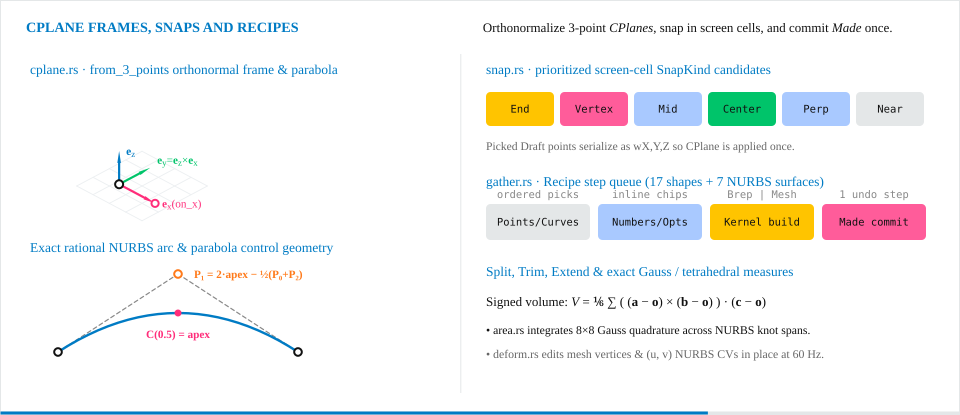
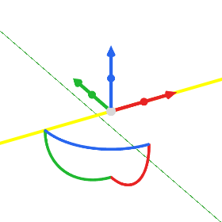

# Construct and edit geometry

Resolve relative, polar and construction-plane coordinates, snap in screen space, build `17` parametric primitives and `7` NURBS surface families via `Recipe`, deform subobjects, split/trim/extend geometry, and measure lengths, areas and volumes.





## Prerequisites and ownership

Chapter `9.4` of [9. Run the application](completion-application.md) (`application` checkpoint). Covers `62` coordinate, snapping, draft/drag, primitive, surfacing, boolean-cut and measurement modules across `src/app/` and `src/state/`.

## Build

### Step 1: Resolve coordinates, `CPlane` frames and screen-space snaps

- `src/app/coords.rs` parses absolute `x,y,z`, relative `@dx,dy,dz`, polar `@r<deg`, direction-locked distances and explicit `w` world prefixes before projecting through the active `CPlane`.
- `src/app/cplane.rs` (`CPlane::from_3_points`) builds right-handed orthonormal frames (rejecting collinear triples) and maps square-on named views to their facing planes with grazing-ray fallbacks.
- `src/app/snap.rs` evaluates prioritized `SnapKind` candidates (endpoints, vertices, midpoints, centres, perpendiculars, near curves) and rounds local `CPlane` `(u, v)` grid coordinates under per-move CSS-pixel and time budgets.

```rust
--8<-- "session_viewer/viewer-core/src/cplane.rs:9:34"
```

```rust
--8<-- "session_viewer/viewer-core/src/coords.rs:modeling-coordinates"
```

### Step 2: Drafts, tools, delayed drags and in-place subobject deformation

| File | Specification |
| --- | --- |
| [src/state/drawing.rs](../../src/state/drawing.rs) | Owns `Draft` points, hover preview and `CPlane`, serializing completed picks with explicit `w` world prefixes into `run_command` so typed and picked geometry share one undo path. |
| [src/app/command/tool.rs](../../viewer-core/src/command/tool.rs) | Defines `Tool` (`Next::More`, `Repeat`, `Done`), temporarily moving out of `State` during callbacks to satisfy exclusive mutable borrows. |
| [src/state/tool.rs](../../src/state/tool.rs) | Snapshots original row placements before tool previews so `Escape` restores exact GPU placements with zero history entries. |
| [src/state/drag.rs](../../src/state/drag.rs) | Bins snap `Targets` in screen cells (invalidated on camera change) and retains early mouse-release state in `ObjectDrag` until delayed GPU pick readback resolves. |
| [src/app/deform.rs](../../viewer-core/src/deform.rs) | Deforms selected mesh vertices, first-appearance edges (including hole rims) and checked `(u, v)` NURBS control points without altering whole-object placement. |
| [src/app/modeling.rs](../../viewer-core/src/modeling.rs) | Inserts constructed `Made` objects into the active editable layer (creating `Created` on demand) and compensates for parent/document transforms. |
| [src/state/edit.rs](../../src/state/edit.rs) | Coordinates command dispatch, gumball drag preview/restore, whole-object vs subobject commits and single-click `number_box` activation. |
| [src/app/mesh_preview.rs](../../viewer-core/src/mesh_preview.rs) | Maps GPU arena vertices, pipes and markers back to source mesh vertex keys for in-place flat-shaded drag previews. |
| [src/app/surface_preview.rs](../../viewer-core/src/surface_preview.rs) | Retains per-vertex `(surface_idx, u, v)` and pipe endpoint indices so CV drags re-evaluate only modified NURBS faces in place. |

### Step 3: `Recipe` step queues, `17` parametric primitives and `7` NURBS surfaces

| File | Specification |
| --- | --- |
| [tool/gather.rs](../../viewer-core/src/command/tool/gather.rs) | Runs `Recipe` step queues (points, numbers, distance vectors, ordered curve groups and inline options) and commits multi-object `Made` results in one transaction. |
| [tool/shape.rs](../../viewer-core/src/command/tool/shape.rs) | Provides the shared local-frame primitive builder (`Brep`/`Mesh` toggle, rubber-band distances and signed-height upright frame reversal). |
| [tool/surfacing.rs](../../viewer-core/src/command/tool/surfacing.rs) | Checks scale-relative Newell area and planarity, aligns open/closed section directions and seams, and requires `>= 3` sections for closed lofts. |
| [tool/cut.rs](../../viewer-core/src/command/tool/cut.rs) | Converts lines/polylines to degree-`1` NURBS and transforms cutting planes/rays by `3` points / `2` points so non-uniform target scales stay exact. |

| Primitive verbs | Geometric rule |
| --- | --- |
| [box.rs](../../viewer-core/src/command/verbs/box.rs), [block_with_hole.rs](../../viewer-core/src/command/verbs/block_with_hole.rs), [pyramid.rs](../../viewer-core/src/command/verbs/pyramid.rs) | `box.rs` treats picked corners as symmetric half-widths and translates `abs(h)` by `h/2` for negative heights; `block_with_hole.rs` adds a central through-hole bounded below half the shorter base side; `pyramid.rs` derives square edge `r * sqrt(2)` rotated `-45°` with upright signed height. |
| [sphere.rs](../../viewer-core/src/command/verbs/sphere.rs), [quad_sphere.rs](../../viewer-core/src/command/verbs/quad_sphere.rs), [cylinder.rs](../../viewer-core/src/command/verbs/cylinder.rs), [cone.rs](../../viewer-core/src/command/verbs/cone.rs), [capsule.rs](../../viewer-core/src/command/verbs/capsule.rs), [torus.rs](../../viewer-core/src/command/verbs/torus.rs) | `sphere.rs` aligns poles with the `CPlane` normal; `quad_sphere.rs` welds `6` `8×8` patches into a `384`-quad mesh; `cylinder.rs` and `cone.rs` flip frames on negative height for positive kernel solids; `capsule.rs` requires `abs(h) > 2r` across hemisphere caps (`Mesh` only); `torus.rs` enforces `0 < minor < major`. |
| [tetrahedron.rs](../../viewer-core/src/command/verbs/tetrahedron.rs), [octahedron.rs](../../viewer-core/src/command/verbs/octahedron.rs), [icosahedron.rs](../../viewer-core/src/command/verbs/icosahedron.rs), [dodecahedron.rs](../../viewer-core/src/command/verbs/dodecahedron.rs) | Each Platonic verb (`tetrahedron.rs`, `octahedron.rs`, `icosahedron.rs`, `dodecahedron.rs`) scales edge length from unit circumradius, caches `OnceLock` wireframe previews, and rejects `Brep` radii `< 0.001`. |
| [nurbs_curve_circle.rs](../../viewer-core/src/command/verbs/nurbs_curve_circle.rs), [nurbs_curve_ellipse.rs](../../viewer-core/src/command/verbs/nurbs_curve_ellipse.rs), [nurbs_curve_arc.rs](../../viewer-core/src/command/verbs/nurbs_curve_arc.rs), [nurbs_curve_parabola.rs](../../viewer-core/src/command/verbs/nurbs_curve_parabola.rs) | `nurbs_curve_circle.rs` places an exact rational circle on `CPlane`; `nurbs_curve_ellipse.rs` aligns major axis to a picked point and measures perpendicular minor reach; `nurbs_curve_arc.rs` (`Center` or `3Points`) splits sweeps `<= 90°` with middle weight `cos(theta/2)`; `nurbs_curve_parabola.rs` sets middle control `2*apex - 0.5*(a + b)` so `C(0.5) == apex`. |

| Verb group | Specification |
| --- | --- |
| [move.rs](../../viewer-core/src/command/verbs/move.rs), [rotate.rs](../../viewer-core/src/command/verbs/rotate.rs), [scale.rs](../../viewer-core/src/command/verbs/scale.rs), [copy.rs](../../viewer-core/src/command/verbs/copy.rs), [orient_3_points.rs](../../viewer-core/src/command/verbs/orient_3_points.rs) | `move.rs` previews and commits `2`-point or typed translations; `rotate.rs` computes `atan2` angles around a picked `CPlane` pivot or typed world axis; `scale.rs` applies `1D`/`2D`/`3D` orthonormal reach ratios; `copy.rs` loops with `Next::Repeat` minting fresh GUIDs in parent frames; `orient_3_points.rs` composes rigid `6`-point orthonormal frame alignment without scaling. |
| [nurbs_surface_4_points.rs](../../viewer-core/src/command/verbs/nurbs_surface_4_points.rs), [loft.rs](../../viewer-core/src/command/verbs/loft.rs), [nurbs_surface_loft.rs](../../viewer-core/src/command/verbs/nurbs_surface_loft.rs), [nurbs_surface_revolve.rs](../../viewer-core/src/command/verbs/nurbs_surface_revolve.rs), [nurbs_surface_sweep1.rs](../../viewer-core/src/command/verbs/nurbs_surface_sweep1.rs), [nurbs_surface_sweep2.rs](../../viewer-core/src/command/verbs/nurbs_surface_sweep2.rs), [nurbs_surface_network.rs](../../viewer-core/src/command/verbs/nurbs_surface_network.rs) | `nurbs_surface_4_points.rs` orders bilinear controls `(a, d, b, c)`; `loft.rs` (`Open`/`Closed`) and `nurbs_surface_loft.rs` (`Smooth` deg `3` / `Straight` deg `1`) loft aligned sections; `nurbs_surface_revolve.rs` rotates profiles `(0, 360]`° right-handedly; `nurbs_surface_sweep1.rs` blends compatible knots along perpendicular rail stations; `nurbs_surface_sweep2.rs` aligns two rails and shapes by endpoint proximity; `nurbs_surface_network.rs` `2`-colours `4..32` crossing curves into Coons or sampled Gordon patches. |
| [project_to_plane.rs](../../viewer-core/src/command/verbs/project_to_plane.rs) | `project_to_plane.rs` flattens points, curves and meshes via `place^-1 * P_world * place`, clearing invalidated mesh normals and skipping degenerate collapses. |

### Step 4: Split, trim, extend, extrude and exact geometric measurements

| File | Specification |
| --- | --- |
| [src/app/splitting.rs](../../viewer-core/src/splitting.rs), [src/state/splitting.rs](../../src/state/splitting.rs), [verbs/split.rs](../../viewer-core/src/command/verbs/split.rs) | `app/splitting.rs` validates `1..64` unlocked cutters transformed into the target's frame; `state/splitting.rs` retains pending target/cutters across picks and restores highlights on error; `verbs/split.rs` confirms or starts `split_command` while preserving the pending split. |
| [verbs/explode.rs](../../viewer-core/src/command/verbs/explode.rs), [verbs/extrude.rs](../../viewer-core/src/command/verbs/extrude.rs) | `explode.rs` replaces leaf objects (refusing group parents) with bounded child parts in one undo step; `extrude.rs` caps closed planar profiles topologically along shared top, bottom and seam edges while leaving open/bent profiles uncapped. |
| [verbs/trim.rs](../../viewer-core/src/command/verbs/trim.rs), [verbs/trim/parts.rs](../../viewer-core/src/command/verbs/trim/parts.rs) | `trim.rs` supports interactive target/cutter/part clicking plus `2`-parameter curve domain trims; `trim/parts.rs` partitions curve intervals (wrapping closed seams), BRep faces and plane-cut meshes in the target frame. |
| [verbs/extend.rs](../../viewer-core/src/command/verbs/extend.rs), [verbs/extend/reach.rs](../../viewer-core/src/command/verbs/extend/reach.rs) | `extend.rs` runs `Repeat` endpoint clicks (each its own undo step) or `2`-parameter domain growth; `extend/reach.rs` extends open line/polyline tangents or NURBS ends to positive distances or nearest boundary crossings. |
| [verbs/measure.rs](../../viewer-core/src/command/verbs/measure.rs), [measure_distance.rs](../../viewer-core/src/command/verbs/measure_distance.rs), [length.rs](../../viewer-core/src/command/verbs/length.rs), [area.rs](../../viewer-core/src/command/verbs/area.rs), [volume.rs](../../viewer-core/src/command/verbs/volume.rs), [bounding_box.rs](../../viewer-core/src/command/verbs/bounding_box.rs), [length_bounding_box.rs](../../viewer-core/src/command/verbs/length_bounding_box.rs) | `measure.rs` resolves placed geometry (requesting hydration if released) and tags temporary marks with `row_revision`; `measure_distance.rs` reports Euclidean + `Δx/Δy/Δz` without document edits; `length.rs` transforms curves into world space first for non-uniform scale accuracy; `area.rs` sums placed mesh/BRep triangles or `8×8` Gauss-quadrature NURBS knot spans; `volume.rs` sums origin-shifted signed tetrahedra on closed solids only; `bounding_box.rs` commits an axis-aligned world box while `length_bounding_box.rs` only displays `X × Y × Z` dimensions. |

## Run and observe

In `application`, run `Construction Plane XZ`, then `Box 0,0,0 1000 1000 500`, `Measure Distance 0,0,0 1000,500,1000`, and `Undo`:

- The box extrudes along the `XZ` plane's normal (`±Y`), the distance chip floats at the midpoint without adding a hierarchy row, and `Undo` removes the box while clearing the stale measurement chip on `row_revision` change.

## Predict and try

Switch `Construction Plane YZ`, start `Line 0,0,0`, and compare `@1000,0` vs `w1000,0,0`: predict which world axis `@1000,0` follows (`YZ` local `+X`, not world `+X`), then verify in the viewport.

## Question and answer

**Why serialize picked `Draft` points with an explicit `w` world prefix (`wX,Y,Z`) when finishing a drawing tool?**
Picked points were already transformed from `CPlane` into world coordinates at click time; `w` prevents `run_command` from applying the active `CPlane` transform a second time while keeping identical validation and undo logic.

## Validation

Verified by `609` passing default native tests (`60` ignored) covering coordinates, `CPlane`, snaps, `Recipe` primitives, surfacing, cuts and measurements, plus the `14`-capture desktop/upright command browser suite.
