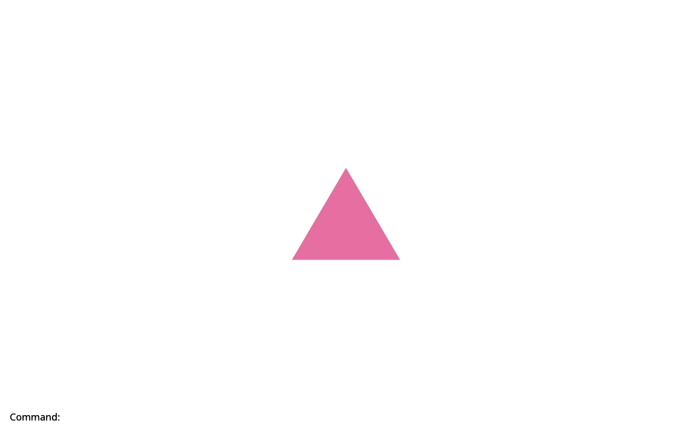
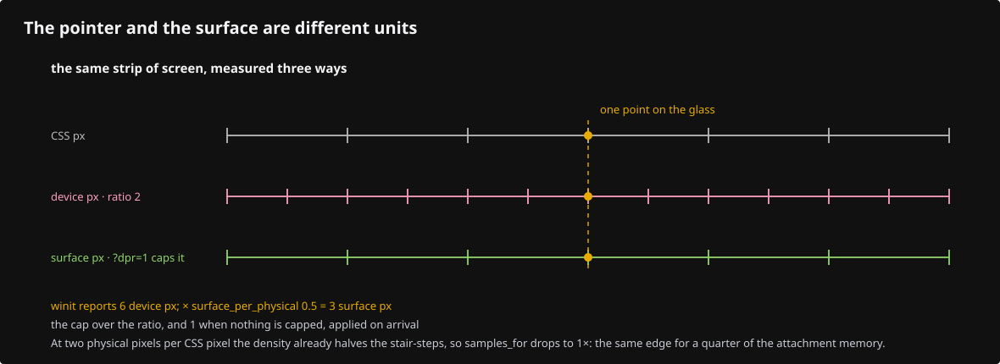
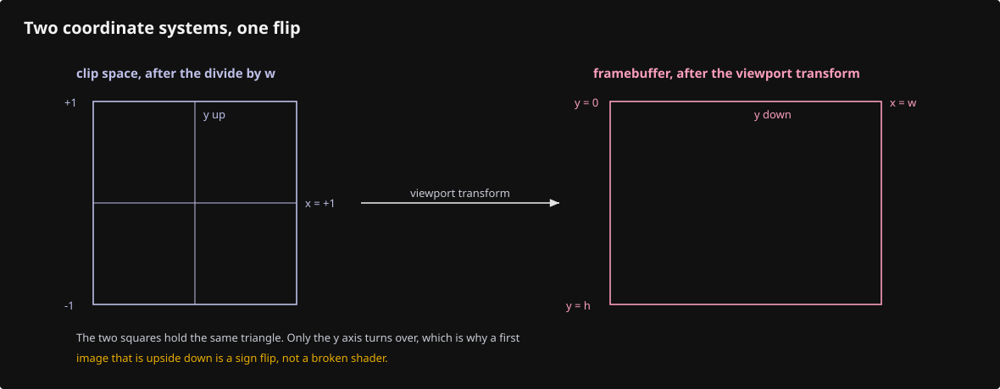

# Paint shapes and text

Composite a pink `egui` triangle and a bottom-left `Command:` label over Tutorial 1's cleared white WebGPU surface.



## Prerequisites and ownership

Requires [1. Open a GPU frame](completion-frame.md). All `13` files from `frame` stay untouched; checkpoint `painting` (`15` files) adds `2` files plus module registrations in `src/engine/gpu/mod.rs` and `examples/course/registration.rs`:

| Added file | Role |
| --- | --- |
| [src/engine/gpu/ui.rs](../../src/engine/gpu/ui.rs) | Production `egui_wgpu::Renderer` wrapper: texture delta upload, 1-frame deferred free, tessellation and `LoadOp::Load` draw pass. |
| [examples/course/painting.rs](../../examples/course/painting.rs) | Loads `NotoSans-Subset.ttf`, converts physical pixels to logical points, and paints the centred triangle and `Command:` label. |

## Build

Materialize checkpoint `painting` or add the two files below to your `frame` project:

```sh
npm --prefix ../session_tests run course -- checkpoint painting ../session_viewer/target/learn-painting
```

### 1. Logical points and display density





Divide `[config.width, config.height]` by `scale` (`devicePixelRatio`) so `egui` lays out geometry in density-independent points while rasterizing glyphs and anti-aliased edges at native physical resolution:

```rust
--8<-- "session_viewer/examples/course/painting.rs:course-painting"
```

### 2. Upload and lifetime

`src/engine/gpu/ui.rs` owns `Ui`: `prepare` frees textures retired by the *previous* frame, uploads `textures_delta.set`, tessellates `output.shapes` at `pixels_per_point`, and submits vertex/index uploads ahead of `draw`, which composites with `LoadOp::Load` so the cleared white background survives.

```rust
--8<-- "session_viewer/src/engine/gpu/ui.rs"
```

## Run and observe

Serve the project and open `http://127.0.0.1:8780/?tutorial=painting`:

- A crisp `#fa9ebc` pink triangle stays centred on `#ffffff`, and `Command:` hugs the bottom-left edge at both `1280×800` and `390×844`.
- Navigating to `?tutorial=frame` still renders the plain white canvas from Tutorial 1.

## Predict and try

Replace `screen.center()` with `screen.left_top()` in `painting.rs`: predict which vertices have negative coordinates and get clipped at the top-left border, verify in the browser, then restore `screen.center()`.

## Question and answer

**Why does `Ui::draw` open its render pass with `wgpu::LoadOp::Load` instead of `LoadOp::Clear`?**
`Ui::draw` overlays 2D shapes onto a surface already cleared (and in later tutorials, shaded in 3D) earlier in the same encoder; `LoadOp::Clear` would wipe out the underlying frame.

## Validation

Verified by locked `wasm32` compilation, native + wasm viewer typechecks, cumulative retention tests, and desktop/upright pixel checks in the recorded Windows Intel WebGPU environment ([receipt](release/completion-partials-windows-20261115.json)). Physical-phone verification remains separate.
