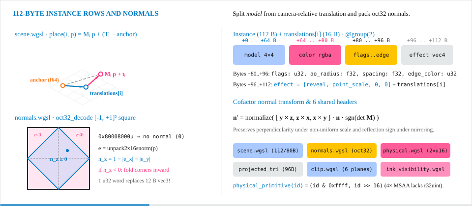

# Place and update object rows

Store per-object transforms, RGBA tints, visibility/pickability flags and reveal fractions in `112`-byte GPU `Instance` rows plus `16`-byte camera-relative translations, and compile the `6` shared WGSL headers through `build.rs`.




## Prerequisites and ownership

Requires [5. Project and fit a scene](completion-camera.md). Checkpoint `rows` (`69` files) retains Tutorials 1–5 unchanged and adds `21` files across `build.rs`, `src/engine/gpu/`, `src/engine/pipelines/`, `src/shaders/` and `examples/course/rows.rs`:

| Group | Owned files |
| --- | --- |
| Build & row layout | [build.rs](../../build.rs), [gpu/instance.rs](../../src/engine/gpu/instance.rs), [gpu/instance/layout.rs](../../src/engine/gpu/instance/layout.rs) |
| Buffers, table & bounds | [gpu/buffers.rs](../../src/engine/gpu/buffers.rs), [gpu/objects.rs](../../src/engine/gpu/objects.rs), [gpu/objects/table.rs](../../src/engine/gpu/objects/table.rs), [gpu/hull.rs](../../src/engine/gpu/hull.rs), [gpu/hull/geometry.rs](../../src/engine/gpu/hull/geometry.rs) |
| Pipelines & timing | [pipelines/mod.rs](../../src/engine/pipelines/mod.rs), [pipelines/bindings.rs](../../src/engine/pipelines/bindings.rs), [pipelines/layouts.rs](../../src/engine/pipelines/layouts.rs), [pipelines/core.rs](../../src/engine/pipelines/core.rs), [performance.rs](../../src/engine/performance.rs), [diagnostics.rs](../../src/engine/diagnostics.rs) |
| Shared WGSL headers | [scene.wgsl](../../src/shaders/scene.wgsl), [normals.wgsl](../../src/shaders/normals.wgsl), [physical.wgsl](../../src/shaders/physical.wgsl), [projected_triangle.wgsl](../../src/shaders/projected_triangle.wgsl), [clip.wgsl](../../src/shaders/clip.wgsl), [ink_visibility.wgsl](../../src/shaders/ink_visibility.wgsl) |
| Checkpoint entry | [examples/course/rows.rs](../../examples/course/rows.rs) |

- `src/engine/performance.rs` maintains rolling CPU/GPU frame-time windows and adaptive quality thresholds without coupling timing counters to individual render lanes.
- `src/engine/diagnostics.rs` formats adapter metadata, buffer byte totals and GPU validation messages for the status overlay and browser test harness.

## Build

Materialize checkpoint `rows` or create the build script, row table, pipeline cache and `6` shared WGSL headers step by step:

```sh
npm --prefix ../session_tests run course -- checkpoint rows ../session_viewer/target/learn-rows
```

### Step 1. Expand and minify WGSL includes in `build.rs`

Create `build.rs` at the crate root. `build.rs` expands `#include "file.wgsl"` directives once per shader, rejects `/*` block comments, strips `//` comments and redundant whitespace, and writes minified `.wgsl` sources into `OUT_DIR/shaders/` for `src/lib.rs`'s `shader!()` macro:

```rust
--8<-- "session_viewer/build.rs"
```

### Step 2. Pin the `112`-byte `Instance` layout and `GrowBuf` table

`src/engine/gpu/instance/layout.rs` defines the `#[repr(C)]` `Pod` `Instance` struct pinned to `112` bytes: `model` (`64 B` rotation + scale), `color` (`16 B`), `flags`, `ao_radius`, `spacing`, the `u32` word following `spacing` carries the packed edge colour, and `effect` (`16 B`) stores `[reveal, point_scale, 0.0, 0.0]`:

```rust
--8<-- "session_viewer/src/engine/gpu/instance/layout.rs:object-instance-layout"
```

- `src/engine/gpu/buffers.rs` provides `GpuCtx`, `Template`, and `GrowBuf` (`append`, `reserve`, `WRITE_CHUNK`-bounded `fill`, `fits` against device/storage limits, `reset`, `release`, and GPU-copied `packed`), rebuilding bind groups whenever growth swaps an underlying `wgpu::Buffer`.
- `src/engine/gpu/objects/table.rs` (`InstanceTable` / `ObjectRows`) mirrors CPU rows alongside `instances` (`N × 112 B`) and `translations` (`N × 16 B`), keeping any gizmo widget row last and uploading single-row edits via `write_at`.
- `src/engine/gpu/hull/geometry.rs` extracts scale-normalized convex `extreme_points` (up to `8,192` vertices, falling back to the source box) so `placed_box` computes tight rotated bounds without transforming full meshes.
- `src/engine/gpu/hull.rs`, `src/engine/gpu/instance.rs`, `src/engine/gpu/objects.rs` and `src/engine/pipelines/mod.rs` re-export narrow public types (`Hull`, `Instance`, `ObjectRows`, `Layouts`, `Cache`) that Tutorial 7 extends additively.

`set_placement` keeps world translation in `f64` on the CPU, subtracts the throttled camera anchor into `translations[i]`, and writes rotation/scale into `Instance.model`:

```rust
--8<-- "session_viewer/src/engine/gpu/objects/table.rs:object-placement"
```

```rust
--8<-- "session_viewer/src/engine/gpu/objects/table.rs:object-reveal"
```

### Step 3. Declare `@group(0..2)` bind layouts and lazy pipeline compilation

- `src/engine/pipelines/bindings.rs` constructs typed uniform, read-only storage and `2D`/multisampled texture `BindGroupLayoutEntry` descriptors without allocating GPU memory.
- `src/engine/pipelines/layouts.rs` assembles `Layouts`: camera `mvp` (`@group(0)`), `LineUniform` + `ClipUniform` (`@group(1)`), and `instances` + `translations` (`@group(2)`), plus depth/ID/tile bindings for ink visibility.
- `src/engine/pipelines/core.rs` wraps shaders and pipelines in `Lazy<T>` (`Rc<LazyCell<...>>`) inside `Cache`, keying render pipelines by entry points, layouts, topology, sample count, target format and `CLIPPING` specialization so unused variants never compile.

### Step 4. Write the `6` shared WGSL headers (`src/shaders/`)

Every lane and visibility pass in Tutorials `7` and `7.1` includes from these `6` shared WGSL headers:

1. **`src/shaders/scene.wgsl`** mirrors the `112 B` `Instance` and `80 B` `LineUniform` structs, resolves selection/tint/edge colours, offsets coplanar contact layers along the view ray (`depth_layer`), and places vertices via `place(i, p) = (instances[i].model * vec4(p, 1.0)).xyz + translations[i].xyz`:

```wgsl
--8<-- "session_viewer/src/shaders/scene.wgsl:1:37"
```

```wgsl
--8<-- "session_viewer/src/shaders/scene.wgsl:126:135"
```

2. **`src/shaders/normals.wgsl`** transforms normals by the cofactor inverse-transpose matrix (preserving perpendicularity under non-uniform scale and flipping sign when $\det(\mathbf{M}) < 0$) and decodes octahedral `16`-bit and `32`-bit normals while reserving `0x80008000` for absent normals:

```wgsl
--8<-- "session_viewer/src/shaders/normals.wgsl:1:27"
```

```wgsl
--8<-- "session_viewer/src/shaders/normals.wgsl:44:59"
```

3. **`src/shaders/physical.wgsl`** splits `32`-bit triangle IDs across two `16`-bit halves (`rg16uint`) alongside colour and `(object, subobject)` pick outputs because WebGPU forbids `4×` MSAA on `r32uint` attachments:

```wgsl
--8<-- "session_viewer/src/shaders/physical.wgsl:1:16"
```

4. **`src/shaders/projected_triangle.wgsl`** defines the `96 B` `ProjectedTriangle` screen-space record (`edge0..3` inward line equations, reference point, linear depth gradient and pixel bounds) and evaluates exact point-in-triangle depth across at most `262,144` adaptive screen tiles:

```wgsl
--8<-- "session_viewer/src/shaders/projected_triangle.wgsl:1:36"
```

5. **`src/shaders/clip.wgsl`** declares the `448 B` `ClipUniform` (`6` world/screen section planes, hatch numerators/denominators, `CLIP_OFFSETS` for `4×` MSAA, scale-aware `CLIP_SLACK = 2^-17` for faces, `8`-epsilon dot-product rounding for on-plane ink, and `override CLIPPING: bool`):

```wgsl
--8<-- "session_viewer/src/shaders/clip.wgsl:1:38"
```

6. **`src/shaders/ink_visibility.wgsl`** binds `1×`/`4×` depth and `2×u16` primitive-ID textures (`override SCENE_MSAA: bool`) and defines `InkAxis` plus grazing-angle curved-chord sag slack `ink_sag_slack` (whose full occlusion test is detailed in [7.1 Decide which ink is visible](completion-visibility.md)):

```wgsl
--8<-- "session_viewer/src/shaders/ink_visibility.wgsl:1:40"
```

### Step 5. Wire the two-row inspector (`examples/course/rows.rs`)

Add `examples/course/rows.rs` and register `("rows", rows::start)` in `examples/course/registration.rs`:

```rust
--8<-- "session_viewer/examples/course/rows.rs:course-rows"
```

## Run and observe

Serve the checkpoint and open `http://127.0.0.1:8780/?tutorial=rows`:

- Pink row `0` and blue non-pickable row `1` render side by side.
- `ArrowLeft`/`ArrowRight` translate row `0` by `±20` units; `H` toggles `FLAG_HIDDEN`; `R` toggles `effect[0]` reveal between `1.0` and `0.5`; `C` toggles `FLAG_COLOR` tint override while row `1` stays untouched.

## Predict and try

Press `R`, press `ArrowRight` twice, then press `H` twice: predict whether hiding resets `effect[0]` or placement, and verify row `0` reappears at `+40` with `0.5` reveal intact.

## Question and answer

**Why must `ObjectRows` rebuild its `wgpu::BindGroup` when `GrowBuf::append` grows capacity?**
Growing allocates a new `wgpu::Buffer` and copies old bytes across; an existing `BindGroup` stays bound to the retired buffer handle until recreated against the new buffer.

## Validation

Verified by clean `OUT_DIR` shader expansion, `69`-file locked `wasm32` build ([stage reconciliation](release/completion-stage-reconciliation-windows-20261118c.json)), `54` passing baseline native tests (`1` GPU test ignored), and `70` desktop/upright WebGPU captures across `frame..rows` ([partials receipt](release/completion-partials-windows-20261115.json)). GPU lane rendering follows in [7. Render kernel geometry](completion-geometry.md).
