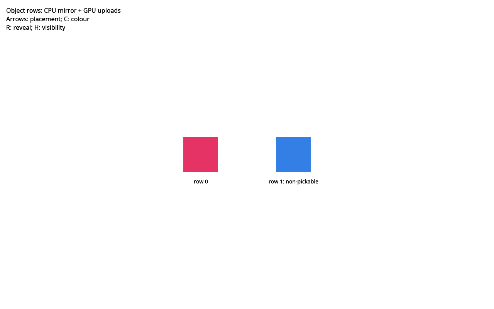
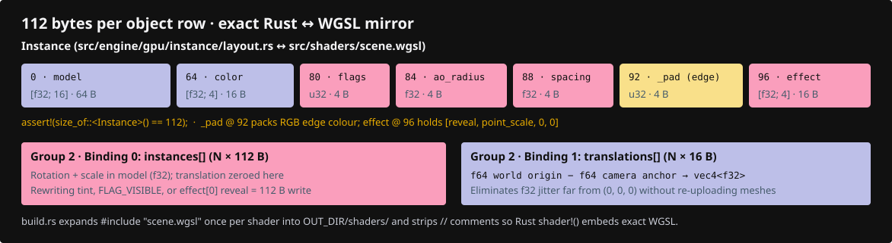
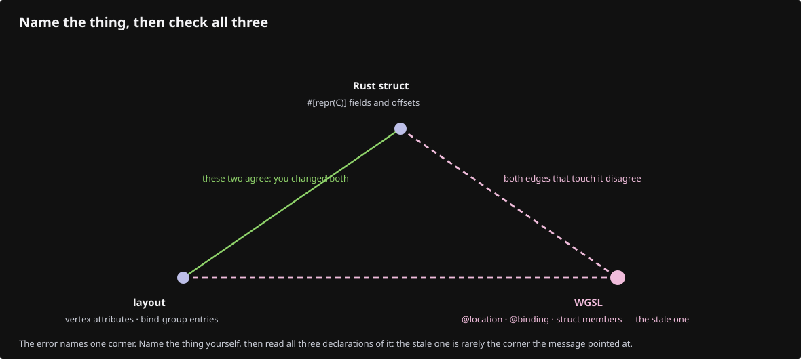

# Place and update object rows

Store per-object transforms, RGBA tints, visibility/pickability flags and reveal fractions in `112`-byte GPU `Instance` rows plus `16`-byte camera-relative translations.





## Prerequisites and ownership

Requires [5. Project and fit a scene](completion-camera.md). Checkpoint `rows` (`69` files) retains Tutorials 1–5 and adds `21` files across `build.rs`, `src/engine/gpu/`, `src/engine/pipelines/`, `src/shaders/` and `examples/course/rows.rs`:

| Group | Owned files |
| --- | --- |
| Build & row layout | [build.rs](../../build.rs), [gpu/instance.rs](../../src/engine/gpu/instance.rs), [gpu/instance/layout.rs](../../src/engine/gpu/instance/layout.rs) |
| Buffers, table & bounds | [gpu/buffers.rs](../../src/engine/gpu/buffers.rs), [gpu/objects.rs](../../src/engine/gpu/objects.rs), [gpu/objects/table.rs](../../src/engine/gpu/objects/table.rs), [gpu/hull.rs](../../src/engine/gpu/hull.rs), [gpu/hull/geometry.rs](../../src/engine/gpu/hull/geometry.rs) |
| Pipelines & timing | [pipelines/mod.rs](../../src/engine/pipelines/mod.rs), [pipelines/bindings.rs](../../src/engine/pipelines/bindings.rs), [pipelines/layouts.rs](../../src/engine/pipelines/layouts.rs), [pipelines/core.rs](../../src/engine/pipelines/core.rs), [performance.rs](../../src/engine/performance.rs), [diagnostics.rs](../../src/engine/diagnostics.rs) |
| Shared WGSL headers | [scene.wgsl](../../src/shaders/scene.wgsl), [normals.wgsl](../../src/shaders/normals.wgsl), [physical.wgsl](../../src/shaders/physical.wgsl), [projected_triangle.wgsl](../../src/shaders/projected_triangle.wgsl), [clip.wgsl](../../src/shaders/clip.wgsl), [ink_visibility.wgsl](../../src/shaders/ink_visibility.wgsl) |
| Checkpoint entry | [examples/course/rows.rs](../../examples/course/rows.rs) |

`src/engine/gpu/instance/layout.rs` defines the `#[repr(C)]` `Pod` `Instance` struct pinned to `112` bytes: the `u32` word following `spacing` carries the packed edge colour, and `effect` stores `[reveal, point_scale, 0.0, 0.0]`.

```rust
--8<-- "session_viewer/src/engine/gpu/instance/layout.rs:object-instance-layout"
```

## Build

Materialize checkpoint `rows` to compile `build.rs`, the GPU table and the row inspector:

```sh
npm --prefix ../session_tests run course -- checkpoint rows ../session_viewer/target/learn-rows
```

### Shader build inputs

`build.rs` expands `#include "file.wgsl"` directives once per shader, rejects `/*` block comments, strips `//` comments and extra whitespace, and writes minified WGSL into `OUT_DIR/shaders/` for `shader!()`.

```rust
--8<-- "session_viewer/build.rs"
```

### Ownership and allocation

- `src/engine/gpu/buffers.rs` provides `GpuCtx`, `Template`, `GrowBuf` (`append`, `reserve`, `WRITE_CHUNK`-bounded `fill`, `fits` against device/storage limits, `reset`, `release`, and GPU-copied `packed`), rebuilding bind groups whenever growth swaps a buffer handle.
- `src/engine/gpu/objects/table.rs` (`InstanceTable` / `ObjectRows`) mirrors CPU rows alongside `instances` (`N × 112 B`) and `translations` (`N × 16 B`), keeping any gizmo widget row last and uploading single-row edits via `write_at`.

### Describe bindings before supplying resources



- `src/engine/pipelines/bindings.rs` constructs typed uniform, read-only storage and 2D/multisampled texture `BindGroupLayoutEntry` descriptors without allocating GPU memory.
- `src/engine/pipelines/layouts.rs` assembles `Layouts`: camera `mvp` (`@group(0)`), `LineUniform` + `ClipUniform` (`@group(1)`), and `instances` + `translations` (`@group(2)`), plus depth/ID/tile bindings for ink visibility.

### Compile a shared description on first use

`src/engine/pipelines/core.rs` wraps shaders and pipelines in `Lazy<T>` (`Rc<LazyCell<...>>`) inside `Cache`, keying render pipelines by entry points, layouts, topology, sample count, target format and `CLIPPING` specialization so unused variants never compile.

### Placement and bounds

- `src/engine/gpu/hull/geometry.rs` extracts scale-normalized convex `extreme_points` (up to `8,192` vertices, falling back to the source box) so `placed_box` computes tight rotated bounds without transforming full meshes.
- `src/engine/gpu/hull.rs`, `src/engine/gpu/instance.rs`, `src/engine/gpu/objects.rs` and `src/engine/pipelines/mod.rs` re-export narrow public types (`Hull`, `Instance`, `ObjectRows`, `Layouts`, `Cache`) that Tutorial 7 extends additively.

`set_placement` keeps translation in `f64` on the CPU, subtracts the throttled camera anchor into a `vec4<f32>` offset, and writes rotation/scale into `Instance.model`:

```rust
--8<-- "session_viewer/src/engine/gpu/objects/table.rs:object-placement"
```

```rust
--8<-- "session_viewer/src/engine/gpu/objects/table.rs:object-reveal"
```

### Shared shader records and coordinate rules

- `src/shaders/scene.wgsl` mirrors the `112 B` `Instance` and `80 B` `LineUniform` structs, applying `model` before adding the camera-relative `translations[id]` vector and resolving selection, layer, face and edge colours.
- `src/shaders/normals.wgsl` transforms normals by cofactor inverse-transpose (preserving reflection sign) and decodes octahedral unit vectors while reserving `0x80008000` for absent normals.
- `src/shaders/physical.wgsl` splits `32`-bit triangle IDs across two `16`-bit halves alongside colour and `(object, subobject)` pick outputs so `4×` MSAA targets stay compatible.
- `src/shaders/projected_triangle.wgsl` packs clipped triangle edge equations, depth gradients and screen bounds into `96 B` records binned into at most `262,144` adaptive screen tiles.
- `src/shaders/clip.wgsl` declares up to `6` world/screen section planes with scale-aware face slack, ink dot-product tolerance, self-exemption for plane widgets and `CLIPPING` specialization.

```wgsl
--8<-- "session_viewer/src/shaders/scene.wgsl:1:37"
```

### Row inspector checkpoint

```rust
--8<-- "session_viewer/examples/course/rows.rs:course-rows"
```

## Run and observe

Serve the checkpoint and open `http://127.0.0.1:8780/?tutorial=rows`:

- Pink row `0` and blue non-pickable row `1` appear side by side.
- `ArrowLeft`/`ArrowRight` translate row `0` by `±20` units; `H` toggles `FLAG_HIDDEN`; `R` toggles `effect[0]` reveal between `1.0` and `0.5`; `C` toggles `FLAG_COLOR` tint override while row `1` never moves.

## Predict and try

Press `R`, press `ArrowRight` twice, then press `H` twice: predict whether hiding resets `effect[0]` or placement, and verify row `0` reappears at `+40` with `0.5` reveal.

## Question and answer

**Why must `ObjectRows` rebuild its `wgpu::BindGroup` when `GrowBuf::append` grows capacity?**
Growing allocates a new `wgpu::Buffer` and copies old bytes across; an existing `BindGroup` stays bound to the retired buffer handle until recreated against the new buffer.

## Validation

Verified by clean `OUT_DIR` shader expansion, `69`-file locked `wasm32` build ([stage reconciliation](release/completion-stage-reconciliation-windows-20261118c.json)), `54` passing baseline native tests (`1` GPU test ignored), and `70` desktop/upright WebGPU captures across `frame..rows` ([partials receipt](release/completion-partials-windows-20261115.json)). GPU lane rendering follows in [7. Render kernel geometry](completion-geometry.md).
