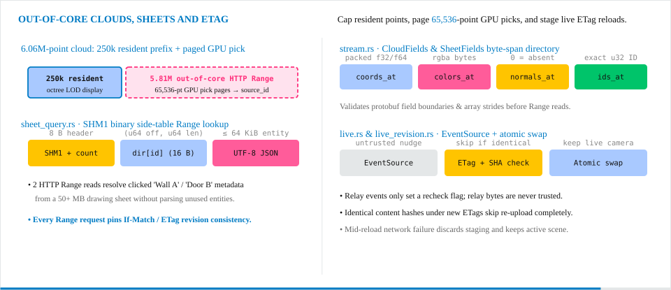
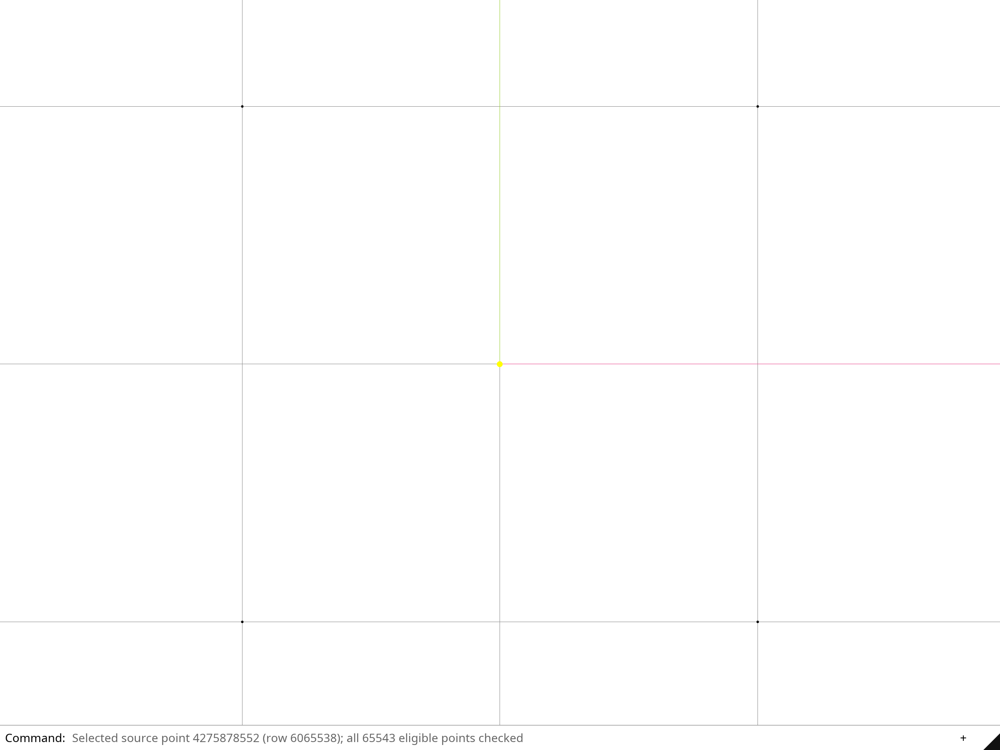
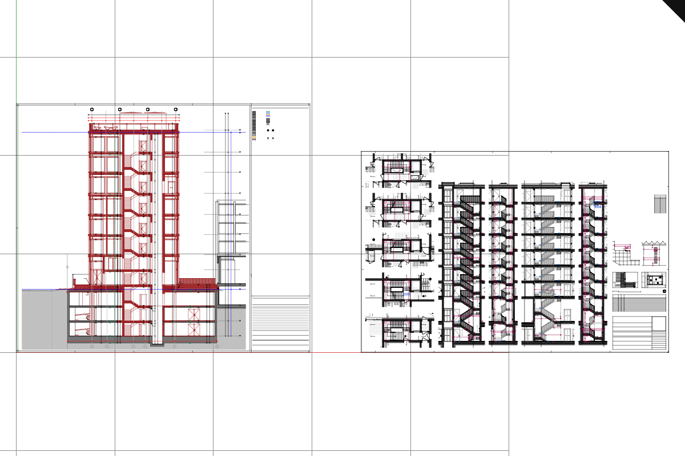

# Bound large scenes and live updates

Stream multi-million-point clouds and `50+ MB` `2D` drawing sheets over HTTP `Range`, pick exact out-of-core source IDs and `.meta` side-table records on demand, and adopt live ETag/`EventSource` scene updates atomically.






## Prerequisites and ownership

Chapter `9.7` of [9. Run the application](completion-application.md) (`application` checkpoint). Covers `6` streaming, out-of-core query and live-reload modules under `src/app/` (pairing with `RangeGate`, `state/cloud_query.rs` and `state/sheet_query.rs`).

## Build

### Step 1: Parse streamed field boundaries and resident cloud slices

- `src/app/stream.rs` parses bounded `CloudFields` and `SheetFields` byte ranges (`field_at`), validating element strides, segment counts, packed-`f64` LOD alignment and source `ETag` revisions before issuing HTTP `Range` reads.
- `src/app/walk/cloud/stream.rs` appends streamed position, colour (black-padded when absent) and complete normal slices into GPU chunks, installing the octree table once on the first slice while preserving `(source_offset, gpu_offset)`.

```rust
--8<-- "session_viewer/src/app/stream.rs:1:33"
```

```rust
--8<-- "session_viewer/src/app/loader.rs:loading-generations"
```

### Step 2: Out-of-core `65,536`-point GPU picks and `SHM1` side-table lookups

- `src/app/cloud_query.rs` narrows out-of-core click candidates via octree LOD bounds (falling back to full scan if incomplete), streams `<= 65,536`-point pages through GPU pick ranking, and reads exact stored `u32` source IDs.
- `src/app/sheet_query.rs` validates the `SHM1` side-table header, fixed-width `(offset, len)` directory and bounded UTF-8 JSON payloads pinned to the table's `ETag` revision.

```rust
--8<-- "session_viewer/src/app/sheet_query.rs:5:34"
```

### Step 3: Live `EventSource` notifications and atomic `ETag` swaps

- `src/app/live.rs` manages an `EventSource` change relay plus polling fallback, marking a recheck flag without trusting relay bytes and detaching DOM listeners cleanly on `Drop`.
- `src/app/live_revision.rs` (`Revisions`) tracks HTTP `ETag` validators separately from received content hashes and stages complete replacements so unchanged polls or failed mid-reload fetches never reset the active camera or scene.

## Run and observe

Against `production.html`, run the four streaming/live browser suites:

- `node tests/streamed-controls.cjs` -> keeps `250,000 / 6,065,539` points resident while `Controls` click resolves nonresident point `[-1, 0, 10]` (`0xfedcba98`).
- `node tests/sheet-metadata.cjs` -> resolves `Wall A` and `Door B` via two HTTP `Range` reads, reusing one `SHM1` header and honouring `Escape` cancellation.
- `node tests/live-revision.cjs` & `node tests/live-notification.cjs` -> `4` ETag-varied identical polls download geometry once; `EventSource` notification updates `1` point -> `2` points in `< 1 s` without moving the camera.

## Predict and try

Pause Network responses in DevTools while a cloud range read is queued in `RangeGate`, load a new scene, then unpause the old responses: predict whether old chunks enter the new scene (`0` chunks adopted — closing the gate + generation mismatch drops them).

## Question and answer

**Why keep each point's original `u32` source ID separate from its GPU buffer index?**
Display residency stops at the point budget and octree order differs from file order; storing and querying the source ID ensures clicking a point names the same source record regardless of budget or LOD.

## Validation

Verified at DPR `1` and `2` by `tests/streamed-controls.cjs`, at `1280` and `390` widths by `tests/sheet-metadata.cjs` (`6` captures), `tests/live-revision.cjs` and `tests/live-notification.cjs`. External relay uptime and physical-phone cellular behavior remain separate.
