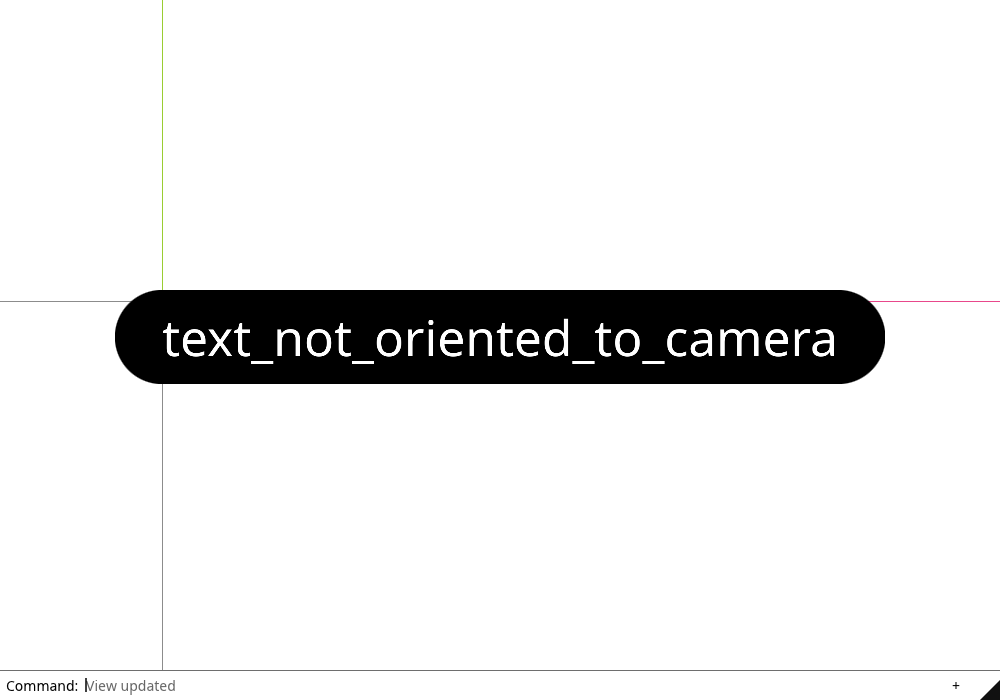
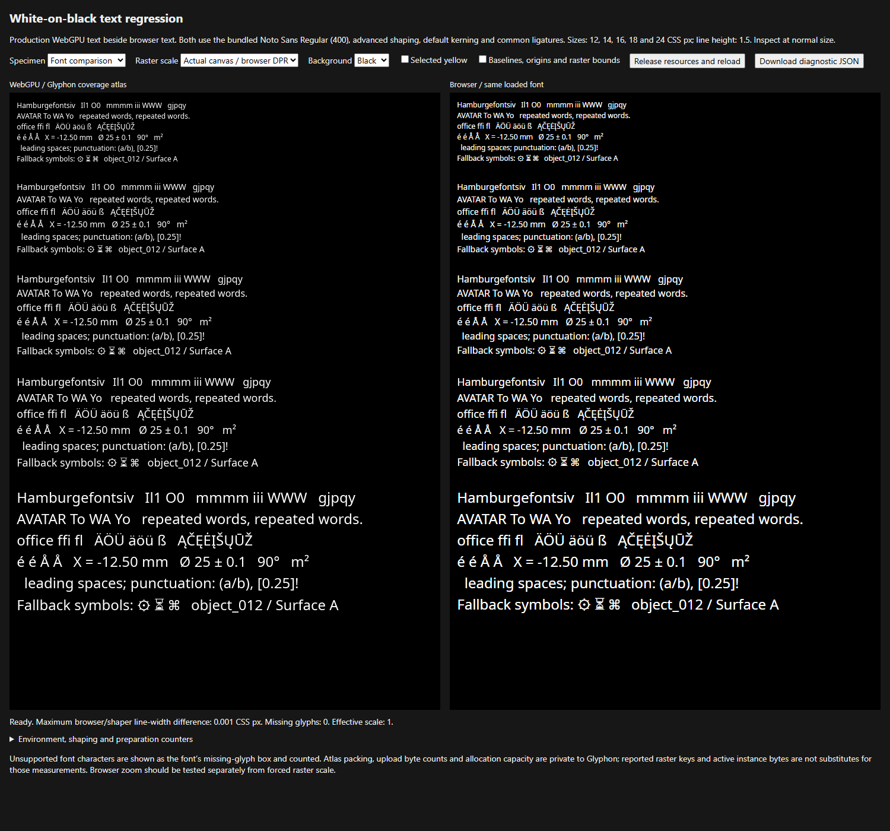

# Keep scene labels readable

Attach a readable title to a document while reusing shaped glyphs and preserving its scene identity during selection and undo.

## Prerequisites and ownership

Complete rendering, documents and loading. This application chapter explains the scene-text renderer introduced with the complete rendering source: `engine/text.rs`, `gpu/text.rs`, `text_plane.rs`, `text_plate.rs` and `text_outline.rs`, together with their shaders. It owns the explanation of application adapters in `app/fonts.rs`, `app/scene_text.rs` and `state/text.rs`. The mathematics subject's TeX parser and glyph atlas remain a separate finished implementation; scene labels use glyphon shaping.

## Build

Connect document text identities to the existing text document and GPU lane, retaining shaped runs across placement and color changes.

### Placement determines size and depth behavior

```rust
--8<-- "session_viewer/src/engine/text.rs:scene-text-placement"
```

A screen label has CSS-sized coordinates independent of the camera. An anchored label follows a world point but stays screen-sized and can be hidden by geometry. A nameplate follows a world point with an always-on-top background. World-plane text has authored axes and world height; a world billboard keeps world size while facing the camera. These choices affect projection, occlusion and cache invalidation, not just visual style.

`TextLabel` separates stable label ID, optional scene ownership, text, metrics, color and placement. Its clip rectangle can restrict the visible part to the scene region. `TextObject` carries the row and selected state; a title can therefore be selectable even though it is not kernel geometry. Selecting it changes its ink/background presentation without changing its text content.

### Validate a replacement before changing the document

```rust
--8<-- "session_viewer/src/engine/text.rs:scene-text-shaping"
```

`TextDocument::set_labels` validates the complete incoming set first: unique IDs, bounded total text bytes and valid placement/metrics. An invalid replacement leaves the previous runs intact. If labels are identical it returns without advancing the revision.

For a changed set, a map of prior runs by ID lets unchanged layout reuse its shaped buffer. Moving or recoloring a label does not require reshaping its glyph sequence. Changing text or metrics does. Replacing fonts validates the new sources and reshapes against the new font system, advancing both font and document revisions. Cache reuse follows the inputs that determine layout, not whether a label happened to be drawn last frame.

### Prepare GPU data only when its inputs change

`TextLane::prepare` keys work by document revision, font revision and relevant camera/canvas facts. If every label is fixed on screen, the key omits camera motion while retaining canvas dimensions. Otherwise projection changes require preparation. A matching key increments the skipped-preparation counter and retains the buffers.

The lane owns the glyph atlas, viewport, raster cache and distinct overlay/anchored renderers. A font revision change rebuilds dependent resources. A large raster-key set also triggers rebuilding rather than growing indefinitely. Diagnostics distinguish shaping, raster images, active glyph instances, preparation time and atlas resets; counting labels alone would miss those different costs.

`text_plane.rs` caches a texture for each world-plane label, keyed by the inputs needed to rasterize it, and draws textured geometry in the world. Dropping a cached plane destroys its texture. `text_plane.wgsl` supplies that color/identity path. `text_plate.rs` builds clipped background rectangles, places depth-tested rectangles before overlays, and retains color and ID pipelines. Its `text_plate.wgsl` shader therefore supports selectable plates as well as their visible backgrounds.

Sheet lettering is different again: `text_outline.rs` draws existing arena geometry as unlit fills with color and identity pipelines, using `text_outline.wgsl`. It does not reshape those outlines as label strings. `glyphs.rs` and `glyph.wgsl` draw the renderer's geometry glyph lane, which also differs from the glyphon atlas used for ordinary labels.

### Load full fonts when a subset is insufficient

The renderer bundles subset font bytes as static data so initial labels can draw without waiting for all full fonts. `fonts::need` checks coverage and starts one asynchronous request when a character is missing. `need_names` checks document, tree and object names. Failed fetching clears the request flag so a later need can try again.

On success, `Msg::Fonts` transfers the full faces to the application and its text consumers. This follows the same message ownership as document loading. It must not mutate a borrowed text lane from inside a fetch future. A font replacement invalidates the caches described above; retaining old glyph IDs against a new font database would be incorrect.

### A document title is an object

`state/text.rs::annotate_document` measures newly added BRep and surface bounds and places a nameplate above them. `scene_text.rs` registers it as a text row with its own identity. Hiding document geometry and deleting all selected rows therefore have different effects: hide can leave the title visible, while Delete removes the separately selected title too. Undo restores the joined transaction.

The `text_quality.rs` diagnostic page compares the actual text lane with browser text at several sizes, including accents, combining characters and fallback symbols. It owns its own test surface and calls the production lane. This is a diagnostic fixture, not a replacement production text implementation or proof that every device renders the same glyph edges.

### Share UI fonts with the finished dock

The application theme reexports the completed command-dock fonts and visuals instead of maintaining another style implementation. Its bundled font list orders the main scene-label subset first, then fallback and symbol subsets. This lets the UI and label consumers start from the same owned static bytes while full-font loading remains an asynchronous responsibility of the font adapter.

### Place authored text in a world plane

The Text verb accepts 1 to 80 characters and opens a placement tool. Its initial height comes from the previous successful placement or a rounded camera-distance scale; Height changes it before the insertion point is accepted. The tool chooses signs and order of the construction-plane axes to read toward the current view, then creates a world-plane white-on-black label. The lower-left insertion point is lifted by the line-box height to locate the text anchor. Accepting creates one undoable text object and remembers its height; subsequent camera motion does not convert it into a screen-sized label.

## Run and observe

Run the cumulative application with the comparison fixture. Its black rounded title says `viewer comparison`. Zoom and orbit: the title follows its world anchor while keeping screen-sized text. Open Layers and hide the document geometry; the title remains. Restore visibility, then use Select All, Delete and Undo: the geometry and title return together.

Use `Layers Off` at upright width to inspect the full scene. With the 240-pixel panel open at 390 pixels, clipping can cut the nameplate in the remaining scene region. That behavior is preserved and is distinct from a missing glyph or failed font request.

For fixed-plane lettering, run `node tests/world-text.cjs` against the same cumulative server, using the browser environment variables described in [Maintaining](../maintaining.md). Its supplied manifest authors a label on world-X/world-Y axes. The initial isometric view tilts its baseline; `View Top` makes the world-X baseline horizontal without reshaping or changing those axes. `View Names` leaves the authored text intact. Clicking the label changes its selection ink; H hides it and prevents picking, while S restores it. This experiment distinguishes a world-plane label from a camera-facing nameplate.


Authored world-plane text in the isometric view. The fixture keeps its XY plane and reuses shaping as the camera changes.



The same authored plane from above. This fixture verifies projection and picking; it does not establish every font or occlusion case.



Bundled Noto Sans at five sizes: production WebGPU text on the left, browser text using the same font on the right. This compares metrics and coverage, not identical rasterization.

## Predict and try

Predict whether orbiting should increase the number of shaped labels or only their projection/preparation work. Observe the text diagnostics while orbiting a fixed title. The glyph sequence and metrics stay the same, so shaping can be reused even though the world anchor projects somewhere else. Changing the title's text or replacing its font has different cache consequences.

## Question and answer

Why keep document revision separate from font revision?

Changing label placement can reuse shaped glyphs, but replacing the font database changes what glyph IDs and raster keys mean. The renderer needs both facts to invalidate the right resources without rebuilding every label for an unrelated camera or color change.

## Validation

The document browser sequence verifies the title's visibility, five-row selection count, deletion and restoration at both sizes. The maintained text-quality check passes at DPR 1, 1.25 and 2: visible glyph pixels, same-font line metrics within 0.2 CSS pixels, scale changes without reshaping, selection color, resource release and resize. The world-text check separately passes at DPR 1 and 2, including authored axes, projected baseline, visible white glyphs on a black backing, unchanged shaping, selection and hide/show pickability. Both use the cumulative bundle. Full-font fallback delivery remains open; these desktop checks do not establish physical-phone typography.
