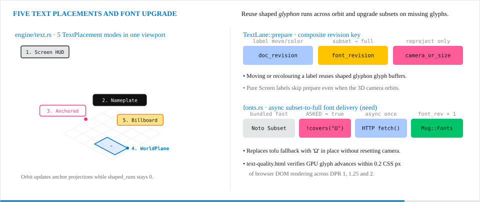
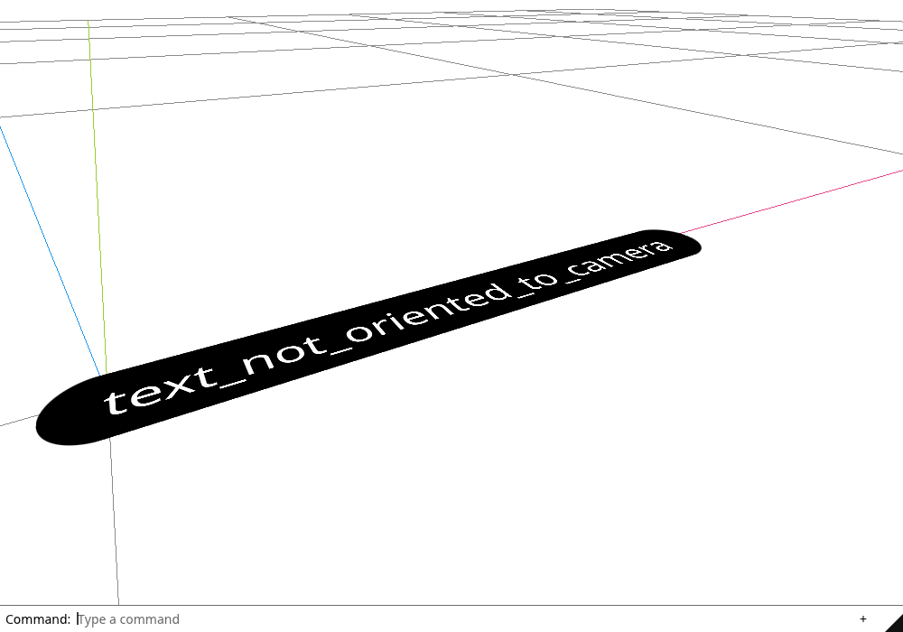

# Keep scene labels readable

Shape and cache `glyphon` scene labels, world-plane signs and selectable document nameplates, upgrade subset fonts to full faces asynchronously on missing glyphs, and verify metrics against browser DOM typography.






## Prerequisites and ownership

Chapter `9.6` of [9. Run the application](completion-application.md) (`application` checkpoint). Covers `11` scene-text, GPU-atlas, subset-fallback and verification files across `src/engine/`, `src/app/`, `src/state/`, `src/text_quality.rs` and `assets/text-quality.html`.

## Build

### Step 1: Five `TextPlacement` modes and validated shaping reuse

`src/engine/text.rs` defines `5` `TextPlacement` modes (screen, depth-tested anchored, overlay nameplate, world-plane and billboard) and validates `TextDocument::set_labels` atomically so moving or recolouring labels reuses shaped `glyphon` buffers while font upgrades advance `font_revision`.

```rust
--8<-- "session_viewer/viewer-core/src/rows/lanes.rs:scene-text-placement"
```

```rust
--8<-- "session_viewer/src/engine/text.rs:scene-text-shaping"
```

### Step 2: Revision-keyed GPU preparation and async subset-to-full font delivery

| File | Specification |
| --- | --- |
| [src/engine/gpu/text.rs](../../src/engine/gpu/text.rs) | Keys `TextLane::prepare` by `(doc_revision, font_revision, camera_or_canvas)` so static frames and pure screen-label views skip redundant GPU uploads. |
| [src/engine/gpu/text_plane.rs](../../src/engine/gpu/text_plane.rs) | Caches per-label world-plane textures keyed by raster inputs, freeing GPU textures automatically when a plane label drops. |
| [src/engine/gpu/text_outline.rs](../../src/engine/gpu/text_outline.rs) | Draws pre-triangulated arena sheet lettering with flat colour and object-ID picking without reshaping strings through `glyphon`. |
| [src/app/fonts.rs](../../src/app/fonts.rs) | Checks bundled `Subset` glyph coverage (`need` / `need_names`) and triggers one async HTTP fetch posting `Msg::Fonts` when a codepoint (e.g. `Ω`) is missing. |
| [src/app/ui/theme.rs](../../src/app/ui/theme.rs) | Re-exports `command_dock` `Visuals` and orders static `Noto Sans` + `Symbols` subsets so UI and scene labels share one initial font allocation. |
| [src/app/command/verbs/text.rs](../../viewer-core/src/command/verbs/text.rs) | Validates `1..80`-char strings, orients `CPlane` axes toward the eye, and commits an undoable world-plane white-on-black label. |

```rust
--8<-- "session_viewer/src/app/fonts.rs:9:22"
```

### Step 3: Selectable document nameplates and DOM metric verification

| File | Specification |
| --- | --- |
| [src/app/scene_text.rs](../../viewer-core/src/scene_text.rs) | Registers document nameplates as independent selectable text rows joined to document `Delete`/`Undo` transactions. |
| [src/state/text.rs](../../src/state/text.rs) | Computes newly added BRep/surface bounds in `annotate_document` and anchors a rounded nameplate above the document. |
| [src/text_quality.rs](../../src/text_quality.rs) | Exports the `wasm_bindgen` `TextQuality` harness driving the production `TextLane` across DPRs, sizes, accents and selection states. |
| [assets/text-quality.html](../../assets/text-quality.html) | Loads the current built `.wasm` bundle and aligns same-font DOM reference specimens over GPU labels to measure sub-pixel width agreement. |

## Run and observe

- Open `application` with the comparison fixture: `viewer comparison` tracks its world anchor at constant CSS size during orbit/zoom, survives `Layers` geometry hide, and deletes/undoes together with `Select All`.
- Run `node tests/world-text.cjs` -> verifies isometric vs `View Top` baseline projection, pick highlight and `H`/`S` visibility without reshaping.
- Run `node tests/font-delivery.cjs` -> delayed full-font HTTP responses replace a missing-glyph tofu box with `Ω` in place without resetting camera or row count.

## Predict and try

Orbit `360°` around `viewer comparison` with `?inspect=1`: predict whether `shaped_runs` increments on every orbit frame (`0` new shapings — only anchor projection updates).

## Question and answer

**Why track `document_revision` and `font_revision` separately in `TextLane`?**
Moving or tinting a label advances `document_revision` while keeping glyph IDs valid; loading full fonts advances `font_revision` and invalidates cached glyph IDs and atlas rasters across all labels.

## Validation

Verified by `tests/text-quality.cjs` at DPR `1`, `1.25` and `2` (line metrics within `0.2 CSS px`), `tests/world-text.cjs` at DPR `1` and `2`, and `tests/font-delivery.cjs` at `1280` and `390` CSS widths. Physical-phone typography remains separate.
