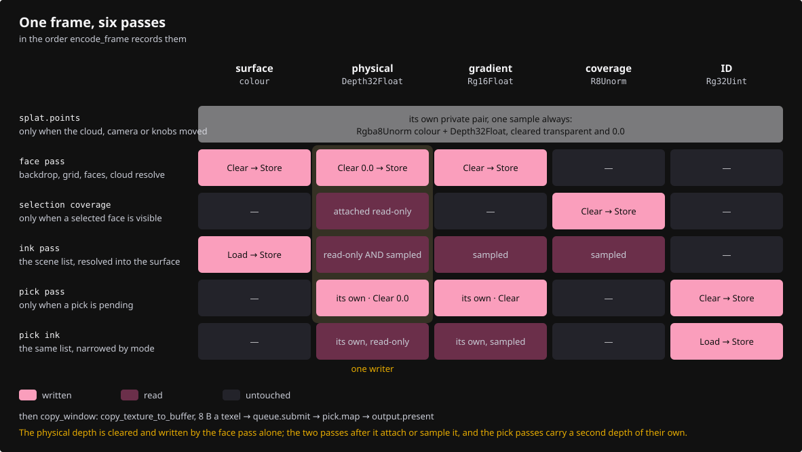
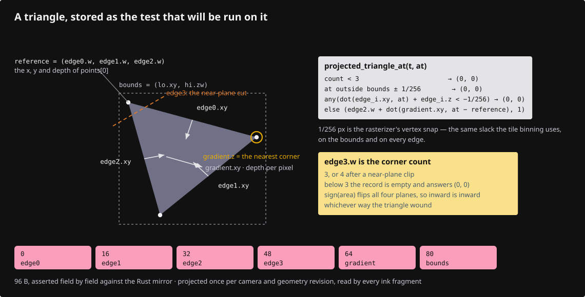
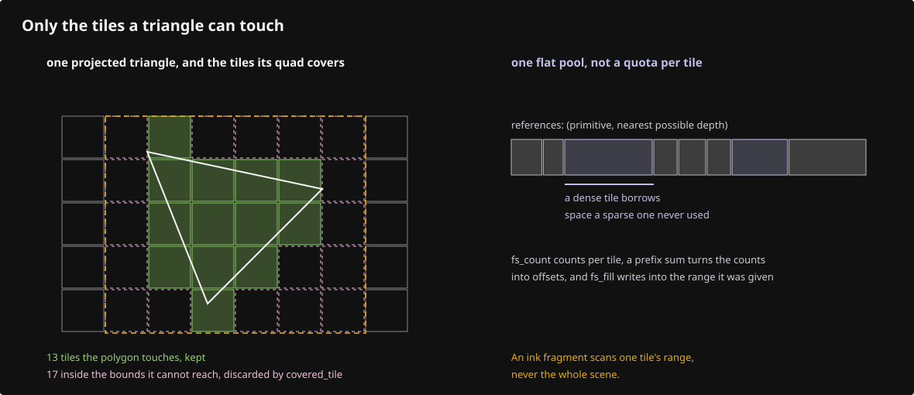
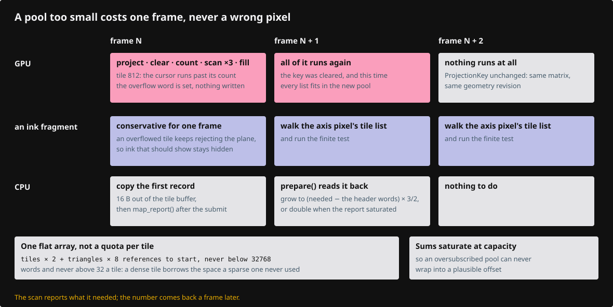
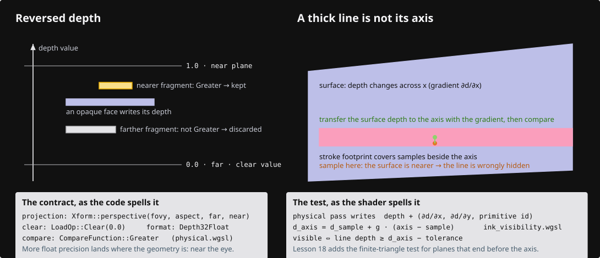
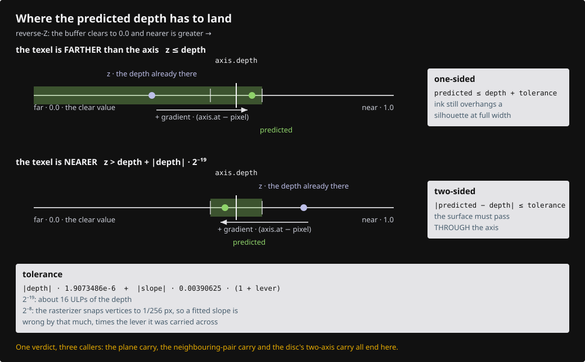
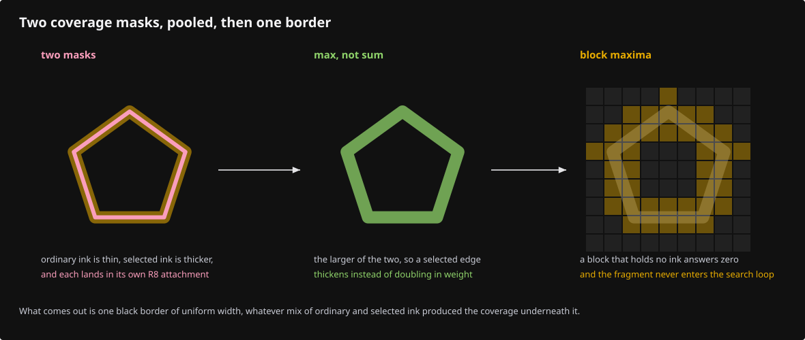

# Decide which ink is visible

Occlude hidden edges behind curved and faceted solids, bin projected triangles into prefix-summed screen tiles, cap section planes, and composite screen-space ambient occlusion (`SSAO`) and selection outlines.




## Prerequisites and ownership

Companion chapter to [7. Render kernel geometry](completion-geometry.md) inside the `geometry` checkpoint (`166` files). Covers `20` visibility, clipping, outline and ambient-shading files across `src/engine/gpu/` and `src/shaders/`.

## Build

All `20` files below compile as part of checkpoint `geometry` (`npm --prefix ../session_tests run course -- checkpoint geometry ../session_viewer/target/learn-geometry`).

### Give every lane the same resource contract

`src/engine/gpu/lane.rs` defines `Lane` (`reset` vs `release`, `retarget`, `append`, `draw`, `bytes`) and `RowLane` (`Registered` table descriptors retiring edited rows to the hidden sink instead of shifting offsets).

```rust
--8<-- "session_viewer/src/engine/gpu/lane.rs:render-lane"
```

### Project once, then restrict each visibility query







| File | Specification |
| --- | --- |
| [src/engine/gpu/triangle_tiles.rs](../../src/engine/gpu/triangle_tiles.rs) | Manages projected-triangle buffers, tile headers and the shared reference pool, polling async overflow readbacks to grow capacity up to ceiling. |
| [src/shaders/project_triangles.wgsl](../../src/shaders/project_triangles.wgsl) | Clips arena and instanced triangles into `96 B` `ProjectedTriangle` records storing screen bounds, signed edge equations and linear depth gradients. |
| [src/shaders/triangle_tiles.wgsl](../../src/shaders/triangle_tiles.wgsl) | Rasterizes each projected triangle's bounding box over adaptive screen tiles (`<= 262,144` tiles), discarding tiles outside the triangle's edges via `covered_tile`. |
| [src/shaders/scan_triangle_tiles.wgsl](../../src/shaders/scan_triangle_tiles.wgsl) | Runs `256`-thread workgroup exclusive prefix sums with saturating counts to assign disjoint tile ranges inside the flat reference pool. |

```wgsl
--8<-- "session_viewer/src/shaders/scan_triangle_tiles.wgsl:visibility-prefix"
```

### Compare ink with the right surface





| File | Specification |
| --- | --- |
| [src/shaders/triangle.wgsl](../../src/shaders/triangle.wgsl) | Shades solid/translucent faces, flips front-facing state under negative-determinant transforms, applies per-sample clip masks and writes `2×u16` primitive IDs. |
| [src/shaders/face_coverage.wgsl](../../src/shaders/face_coverage.wgsl) | Derives fractional sample coverage and exact per-sample masks from nonzero primitive IDs so `4×` MSAA silhouettes stay razor-sharp. |
| [src/shaders/ink_visibility.wgsl](../../src/shaders/ink_visibility.wgsl) | Tests stroke fragments against `1×`/`4×` depth, primitive IDs and the pixel's tile triangle list, accounting for local depth slope and curved-chord facet sag. |

### A section cap needs depth and identity too

| File | Specification |
| --- | --- |
| [src/engine/gpu/clip.rs](../../src/engine/gpu/clip.rs) | Tests placed object bounds against active half-spaces with precision slack and builds per-plane cap resources only for verified closed solids. |
| [src/engine/gpu/clip/pipelines.rs](../../src/engine/gpu/clip/pipelines.rs) | Specializes WGSL cap headers for `1×` vs `4×` MSAA count/ID textures and single-sample cap-picking passes. |
| [src/shaders/cap.wgsl](../../src/shaders/cap.wgsl) | Draws plane-anchored section hatches/fills, writes plane depth and cap primitive IDs, and clips against all other active section planes. |

### Shade and outline the resulting surface coverage



- `src/engine/gpu/surface_outline.rs` builds resolved, coarse and dilated coverage masks so empty screen tiles skip border work while separating selection halos from surface silhouettes.
- `src/shaders/surface_outline.wgsl` composites crisp silhouettes and selection outlines from a bounded pixel-offset ring without confusing object IDs with alpha coverage.

### Reconstruct ambient shading from visible geometry

| File | Specification |
| --- | --- |
| [src/engine/gpu/ssao.rs](../../src/engine/gpu/ssao.rs) | Owns half-res depth, radius, normal, occlusion and temporal-history textures keyed by `(frame_uniforms, geometry_revision)`. |
| [src/engine/gpu/ssao/pipelines.rs](../../src/engine/gpu/ssao/pipelines.rs) | Builds the `8`-stage depth-mip, occupancy, normal, horizon-SSAO, bilateral-filter, history and MSAA-aware composite pipeline family. |
| [src/shaders/ambient_depth.wgsl](../../src/shaders/ambient_depth.wgsl) | Downsamples nearest positive depth together with its object's `ao_radius` and dilates active `5×5` occupancy tiles. |
| [src/shaders/ambient_geometry.wgsl](../../src/shaders/ambient_geometry.wgsl) | Resolves visible primitive IDs through `slot_table` to compute flat transformed face normals (falling back to discontinuity-safe depth derivatives). |
| [src/shaders/ssao.wgsl](../../src/shaders/ssao.wgsl) | Samples multi-direction quadratic depth horizons, applies depth/normal bilateral filters, and clamps temporal history by signed depth agreement. |
| [src/shaders/ambient_composite.wgsl](../../src/shaders/ambient_composite.wgsl) | Composites ambient darkening and applies per-sample `@builtin(sample_mask)` corrections on `16×16` MSAA edge tiles. |
| [src/engine/gpu/ambient_warm.rs](../../src/engine/gpu/ambient_warm.rs) | Schedules `1×` and `4×` SSAO pipeline compilation inside browser `requestIdleCallback` (`50 ms` fallback) after first geometry presentation. |

## Run and observe

Open `http://127.0.0.1:8780/?tutorial=geometry`, orbit the BRep and mesh cubes, and toggle `O` (faces) versus `W` (curve strokes):

- With `O` enabled, solid faces write depth + primitive IDs and hide back edges cleanly while curved front edges stay crisp without z-fighting.
- With `O` disabled, solid depth/ID writes stop and back edges appear immediately; `W` hides the NURBS curve independently of surface borders.

## Predict and try

Look through the BRep cube along a diagonal, predict which back edges appear when you press `O` vs `W`, and verify that `W` leaves all `12` cube edges untouched while `O` exposes the occluded `3` rear edges.

## Question and answer

**Why run a GPU prefix sum (`scan_triangle_tiles.wgsl`) between counting per-tile triangle hits and filling the tile lists?**
Tiles touch anywhere from `0` to hundreds of triangles; exclusive prefix sums pack variable-length lists tightly into one flat buffer without wasting worst-case memory per tile.

## Validation

Verified by the [13-test geometry GPU run](release/completion-geometry-gpu-windows-20261116.json) (tile-pool overflow growth, idle redraw settling, drag invalidation and pipeline cache reuse) and `36/37` assertions in the [application GPU run](release/completion-application-gpu-windows-20261116.json) covering clipping caps, SSAO and outlines (with `instanced_frames_match_the_baked_scene` tracked in Tutorial 9).
