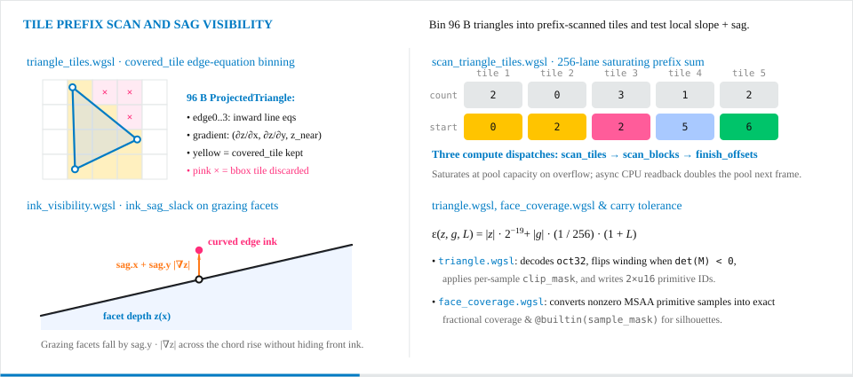
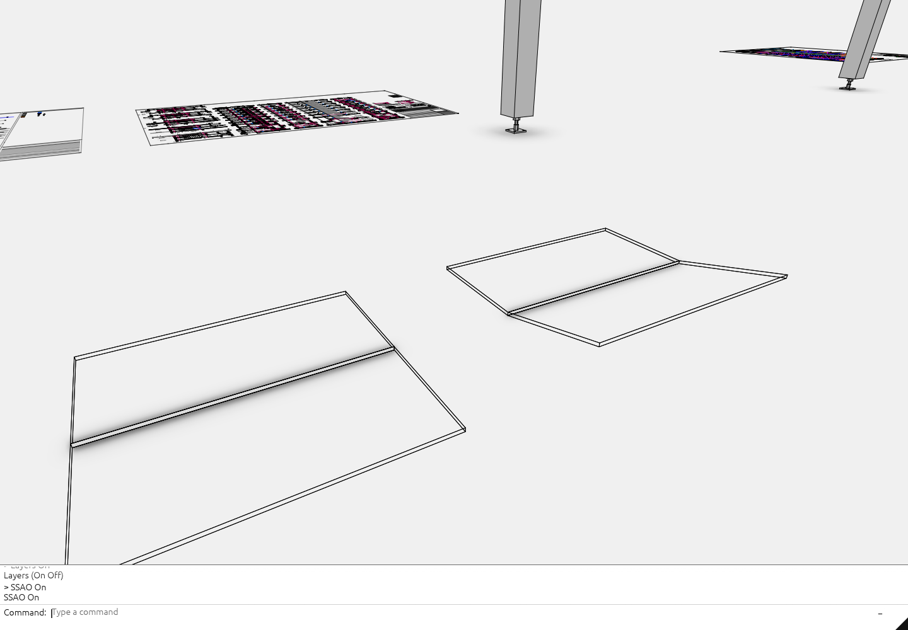
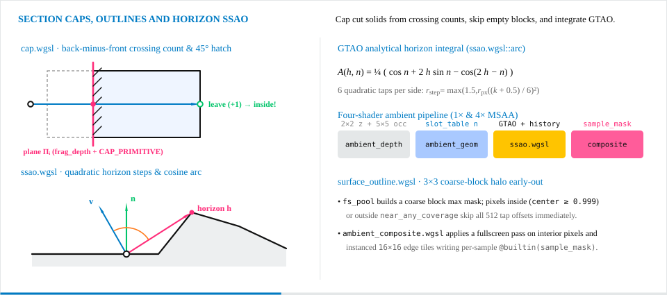

# Decide which ink is visible

Occlude hidden edges behind curved and faceted solids, bin `96`-byte projected triangles into prefix-summed screen tiles, cap section planes, and composite screen-space ambient occlusion (`SSAO`) and selection outlines across `11` visibility/ambient WGSL shaders.





## Prerequisites and ownership

Companion chapter to [7. Render kernel geometry](completion-geometry.md) inside checkpoint `geometry` (`167` files). Covers the remaining `20` visibility, clipping, outline and ambient-shading files (`9` Rust modules in `src/engine/gpu/` + `11` WGSL shaders in `src/shaders/`).

## Build

All `20` files below compile inside checkpoint `geometry` (`npm --prefix ../session_tests run course -- checkpoint geometry ../session_viewer/target/learn-geometry`).

### Step 1. Unify every lane under `Lane` and `RowLane` (`src/engine/gpu/lane.rs`)

`src/engine/gpu/lane.rs` defines `Lane` (`reset` vs `release`, `retarget`, `append`, `draw`, `bytes`) and `RowLane` (`Registered` table descriptors retiring edited rows to the hidden sink instead of shifting offsets):

```rust
--8<-- "session_viewer/src/engine/gpu/lane.rs:render-lane"
```

### Step 2. Project triangles, bin screen tiles and run the `256`-lane prefix sum (`project_triangles.wgsl`, `triangle_tiles.wgsl`, `scan_triangle_tiles.wgsl`)

| File | Specification |
| --- | --- |
| [src/engine/gpu/triangle_tiles.rs](../../src/engine/gpu/triangle_tiles.rs) | Manages projected-triangle buffers, tile headers and the shared reference pool, polling async overflow readbacks to grow capacity up to ceiling. |
| [src/shaders/project_triangles.wgsl](../../src/shaders/project_triangles.wgsl) | Clips arena and instanced triangles into `96 B` `ProjectedTriangle` records storing screen bounds, signed edge equations and linear depth gradients. |
| [src/shaders/triangle_tiles.wgsl](../../src/shaders/triangle_tiles.wgsl) | Rasterizes each projected triangle's bounding box over adaptive screen tiles (`<= 262,144` tiles), discarding tiles outside the triangle's edges via `covered_tile`. |
| [src/shaders/scan_triangle_tiles.wgsl](../../src/shaders/scan_triangle_tiles.wgsl) | Runs `256`-thread workgroup exclusive prefix sums with saturating counts to assign disjoint tile ranges inside the flat reference pool. |

1. **`src/shaders/project_triangles.wgsl`** runs a `64`-thread compute pass (`PROJECT_ROW_GROUPS` `2D` dispatch above `65,535` groups) that resolves each triangle via `placed_triangle`, clips against the near plane, fits inward edge equations `equations[0..3]`, and chooses a local corner reference on small far triangles so homogeneous depth extrapolation never suffers cancellation:

```wgsl
--8<-- "session_viewer/src/shaders/project_triangles.wgsl:37:108"
```

2. **`src/shaders/triangle_tiles.wgsl`** rasterizes one quad over each projected triangle's tile bounding box, discards uncovered tiles via `covered_tile`, atomically counts hits in `fs_count`, and packs `(primitive, nearest_depth_bound)` pairs in `fs_fill`:

```wgsl
--8<-- "session_viewer/src/shaders/triangle_tiles.wgsl:67:120"
```

3. **`src/shaders/scan_triangle_tiles.wgsl`** executes a `256`-lane Hillis-Steele / Blelloch workgroup prefix sum (`scan_tiles` -> `scan_blocks` -> `finish_offsets`) between `fs_count` and `fs_fill`, saturating at buffer capacity instead of wrapping on overflow:

```wgsl
--8<-- "session_viewer/src/shaders/scan_triangle_tiles.wgsl:visibility-prefix"
```

### Step 3. Shade solid faces, extract MSAA coverage and test ink visibility (`triangle.wgsl`, `face_coverage.wgsl`, `ink_visibility.wgsl`)

| File | Specification |
| --- | --- |
| [src/shaders/triangle.wgsl](../../src/shaders/triangle.wgsl) | Shades solid/translucent faces, flips front-facing state under negative-determinant transforms, applies per-sample clip masks and writes `2×u16` primitive IDs. |
| [src/shaders/face_coverage.wgsl](../../src/shaders/face_coverage.wgsl) | Derives fractional sample coverage and exact per-sample masks from nonzero primitive IDs so `4×` MSAA silhouettes stay razor-sharp. |
| [src/shaders/ink_visibility.wgsl](../../src/shaders/ink_visibility.wgsl) | Tests stroke fragments against `1×`/`4×` depth, primitive IDs and the pixel's tile triangle list, accounting for local depth slope and curved-chord facet sag. |

1. **`src/shaders/triangle.wgsl`** transforms arena and slot-instanced vertices (`slot_row`), preserves unlit opaque contact fills pulled forward via `depth_layer`, detects mirrored transforms (`det(model) < 0`), and writes `PhysicalColor` (`color` + `2×u16` `primitive`):

```wgsl
--8<-- "session_viewer/src/shaders/triangle.wgsl:41:94"
```

2. **`src/shaders/face_coverage.wgsl`** inspects the `2×u16` `physical` attachment across all `SAMPLES` to emit fractional solid coverage (`fs_fraction`):

```wgsl
--8<-- "session_viewer/src/shaders/face_coverage.wgsl:1:31"
```

3. **`src/shaders/ink_visibility.wgsl`** carries neighbour depth along verified planar surfaces (`ink_pair_planar`) and adds `ink_sag_slack(sag, gradient)` when testing tile triangles so curved BRep edges rising above grazing facets stay unbroken while rear edges disappear cleanly:

```wgsl
--8<-- "session_viewer/src/shaders/ink_visibility.wgsl:58:92"
```

### Step 4. Cap section planes, dilate outlines and integrate GTAO horizons (`cap.wgsl`, `surface_outline.wgsl`, `ambient_*.wgsl`, `ssao.wgsl`)



| File | Specification |
| --- | --- |
| [src/engine/gpu/clip.rs](../../src/engine/gpu/clip.rs) | Tests placed object bounds against active half-spaces with precision slack and builds per-plane cap resources only for verified closed solids. |
| [src/engine/gpu/clip/pipelines.rs](../../src/engine/gpu/clip/pipelines.rs) | Specializes WGSL cap headers for `1×` vs `4×` MSAA count/ID textures and single-sample cap-picking passes. |
| [src/shaders/cap.wgsl](../../src/shaders/cap.wgsl) | Draws plane-anchored section hatches/fills, writes plane depth and cap primitive IDs, and clips against all other active section planes. |

1. **`src/shaders/cap.wgsl`** evaluates plane depth `clip_plane_depth`, trims against every other active section plane sample-by-sample, tests whether back-minus-front crossings behind the plane exceed `0.5` (`count_at`), and outputs `45°` `box_cdf`-filtered hatches plus `CAP_PRIMITIVE`:

```wgsl
--8<-- "session_viewer/src/shaders/cap.wgsl:87:136"
```

- `src/engine/gpu/surface_outline.rs` builds resolved, coarse and dilated coverage masks so empty screen tiles skip border work while separating selection halos from surface silhouettes.
- `src/shaders/surface_outline.wgsl` composites crisp silhouettes and selection outlines from a bounded `512`-tap offset ring (`Taps`), exiting immediately via `near_any_coverage` on interior (`center >= 0.999`) or empty blocks:

```wgsl
--8<-- "session_viewer/src/shaders/surface_outline.wgsl:1:38"
```

| File | Specification |
| --- | --- |
| [src/engine/gpu/ssao.rs](../../src/engine/gpu/ssao.rs) | Owns half-res depth, radius, normal, occlusion and temporal-history textures keyed by `(frame_uniforms, geometry_revision)`. |
| [src/engine/gpu/ssao/pipelines.rs](../../src/engine/gpu/ssao/pipelines.rs) | Builds the `8`-stage depth-mip, occupancy, normal, horizon-SSAO, bilateral-filter, history and MSAA-aware composite pipeline family. |
| [src/shaders/ambient_depth.wgsl](../../src/shaders/ambient_depth.wgsl) | Downsamples nearest positive depth together with its object's `ao_radius` and dilates active `5×5` occupancy tiles. |
| [src/shaders/ambient_geometry.wgsl](../../src/shaders/ambient_geometry.wgsl) | Resolves visible primitive IDs through `slot_table` to compute flat transformed face normals (falling back to discontinuity-safe depth derivatives). |
| [src/shaders/ssao.wgsl](../../src/shaders/ssao.wgsl) | Samples multi-direction quadratic depth horizons (`arc`), applies depth/normal bilateral filters, and clamps temporal history by signed depth agreement. |
| [src/shaders/ambient_composite.wgsl](../../src/shaders/ambient_composite.wgsl) | Composites ambient darkening and applies per-sample `@builtin(sample_mask)` corrections on `16×16` MSAA edge tiles. |
| [src/engine/gpu/ambient_warm.rs](../../src/engine/gpu/ambient_warm.rs) | Schedules `1×` and `4×` SSAO pipeline compilation inside browser `requestIdleCallback` (`50 ms` fallback) after first geometry presentation. |

2. **`src/shaders/ambient_depth.wgsl`** reduces `2×2` linear depth + `ao_radius` (`fs_reduce`) and marks `5×5` active occupancy tiles (`fs_occupancy`):

```wgsl
--8<-- "session_viewer/src/shaders/ambient_depth.wgsl:1:35"
```

3. **`src/shaders/ambient_geometry.wgsl`** resolves each pixel's `2×u16` primitive ID through `placed_triangle` to reconstruct exact world-space triangle cross-product normals (falling back to discontinuity-aware neighbour depth differences on non-triangle pixels):

```wgsl
--8<-- "session_viewer/src/shaders/ambient_geometry.wgsl:16:49"
```

4. **`src/shaders/ssao.wgsl`** integrates cosine-weighted GTAO horizon arcs `arc(h, n)` across `6` quadratic screen-space steps per side with mip-level selection, spatial-temporal noise phase, bilateral `X`/`Y` denoising and depth-clamped temporal history:

```wgsl
--8<-- "session_viewer/src/shaders/ssao.wgsl:181:239"
```

5. **`src/shaders/ambient_composite.wgsl`** darkens interior pixels in one fullscreen pass (`fs_main`) and refines `16×16` MSAA silhouette tiles per sample (`vs_edges` / `fs_edges`):

```wgsl
--8<-- "session_viewer/src/shaders/ambient_composite.wgsl:14:36"
```

## Run and observe

Open `http://127.0.0.1:8780/?tutorial=geometry`, orbit the BRep and mesh cubes, and toggle `O` (faces) versus `W` (curve strokes):

- With `O` enabled, solid faces write depth + `2×u16` primitive IDs and hide back edges cleanly while curved front edges stay crisp without z-fighting.
- With `O` disabled, solid depth/ID writes stop and back edges appear immediately; `W` hides the NURBS curve independently of surface borders.

## Predict and try

Look through the BRep cube along a diagonal, predict which back edges appear when you press `O` vs `W`, and verify that `W` leaves all `12` cube edges untouched while `O` exposes the occluded `3` rear edges.

## Question and answer

**Why run a GPU prefix sum (`scan_triangle_tiles.wgsl`) between counting per-tile triangle hits and filling the tile lists?**
Tiles touch anywhere from `0` to hundreds of triangles; exclusive prefix sums pack variable-length lists tightly into one flat buffer without wasting worst-case memory per tile.

## Validation

Verified by the [13-test geometry GPU run](release/completion-geometry-gpu-windows-20261116.json) (tile-pool overflow growth, idle redraw settling, drag invalidation and pipeline cache reuse) and `36/37` assertions in the [application GPU run](release/completion-application-gpu-windows-20261116.json) covering clipping caps, SSAO and outlines (with `instanced_frames_match_the_baked_scene` tracked in Tutorial 9).
