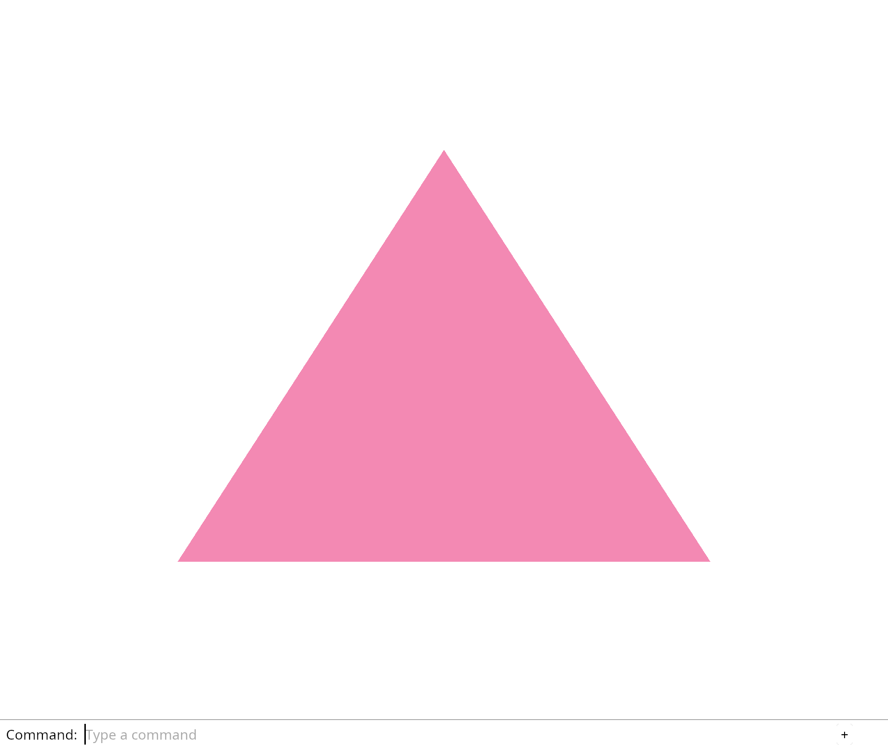

# 1.4 · Commands that change the view

**Section 1: WebGPU Foundations, Shaders, and the Command Dock** · **Checkpoints:** `04-input` · **Production source:** [`State`](../../../src/state.rs) · [`engine/gpu/frame.rs`](../../../src/engine/gpu/frame.rs)

> **Goal:** Use a command to switch backgrounds without changing the triangle.

## 1. Visual WebGPU Schematic

<svg xmlns="http://www.w3.org/2000/svg" width="840" height="220" viewBox="0 0 840 220" style="width:100%;max-width:840px;height:auto;display:block;margin:14px 0;" role="img">
  <defs>
    <marker id="arr" viewBox="0 0 10 10" refX="8" refY="5" markerWidth="6" markerHeight="6" orient="auto">
      <path d="M 0 1 L 9 5 L 0 9 z" fill="#111111"/>
    </marker>
    <pattern id="hatch" width="6" height="6" patternTransform="rotate(45 0 0)" patternUnits="userSpaceOnUse">
      <line x1="0" y1="0" x2="0" y2="6" stroke="#111111" stroke-width="1"/>
    </pattern>
    <pattern id="dots" width="8" height="8" patternUnits="userSpaceOnUse">
      <circle cx="2" cy="2" r="1" fill="#111111"/>
    </pattern>
  </defs>
  <rect x="2" y="2" width="836" height="216" rx="10" fill="#ffffff" stroke="#111111" stroke-width="2"/>
  <rect x="20" y="20" width="230" height="180" rx="8" fill="#ffffff" stroke="#111111" stroke-width="1.75"/>
  <text x="135" y="42" text-anchor="middle" font-family="monospace" font-size="12" font-weight="700" fill="#111111">1. &lt;canvas&gt; (px)</text>
  <rect x="45" y="56" width="180" height="110" rx="6" fill="url(#dots)" stroke="#111111" stroke-width="1.5"/>
  <circle cx="45" cy="56" r="3.5" fill="#111111"/>
  <text x="53" y="70" font-family="monospace" font-size="10" fill="#111111">(0,0)</text>
  <text x="175" y="160" font-family="monospace" font-size="10" fill="#111111">(W,H)</text>
  <rect x="65" y="140" width="140" height="16" rx="4" fill="#ffffff" stroke="#111111" stroke-width="1.25"/>
  <text x="135" y="151" text-anchor="middle" font-family="monospace" font-size="9" font-weight="700" fill="#111111">&gt; Command Dock</text>
  <text x="135" y="186" text-anchor="middle" font-family="sans-serif" font-size="10" fill="#111111">DOM Surface + Events</text>
  <line x1="250" y1="110" x2="298" y2="110" stroke="#111111" stroke-width="2" marker-end="url(#arr)"/>
  <rect x="304" y="20" width="230" height="180" rx="8" fill="#ffffff" stroke="#111111" stroke-width="1.75"/>
  <text x="419" y="42" text-anchor="middle" font-family="monospace" font-size="12" font-weight="700" fill="#111111">2. CommandEncoder</text>
  <rect x="326" y="58" width="186" height="44" rx="6" fill="#ffffff" stroke="#111111" stroke-width="1.5"/>
  <text x="419" y="77" text-anchor="middle" font-family="monospace" font-size="11" font-weight="700" fill="#111111">Pass 1: LoadOp::Clear</text>
  <text x="419" y="93" text-anchor="middle" font-family="sans-serif" font-size="10" fill="#111111">Clear + Scene Triangle</text>
  <line x1="419" y1="102" x2="419" y2="118" stroke="#111111" stroke-width="1.5" marker-end="url(#arr)"/>
  <rect x="326" y="122" width="186" height="44" rx="6" fill="#ffffff" stroke="#111111" stroke-width="1.5"/>
  <text x="419" y="141" text-anchor="middle" font-family="monospace" font-size="11" font-weight="700" fill="#111111">Pass 2: LoadOp::Load</text>
  <text x="419" y="157" text-anchor="middle" font-family="sans-serif" font-size="10" fill="#111111">Keep Pixels + Dock UI</text>
  <text x="419" y="186" text-anchor="middle" font-family="monospace" font-size="10" fill="#111111">queue.submit()</text>
  <line x1="534" y1="110" x2="582" y2="110" stroke="#111111" stroke-width="2" marker-end="url(#arr)"/>
  <rect x="588" y="20" width="232" height="180" rx="8" fill="#ffffff" stroke="#111111" stroke-width="1.75"/>
  <text x="704" y="42" text-anchor="middle" font-family="monospace" font-size="12" font-weight="700" fill="#111111">3. Clip Space (-1..+1)</text>
  <rect x="644" y="56" width="120" height="108" rx="4" fill="#ffffff" stroke="#111111" stroke-width="1.25"/>
  <line x1="644" y1="110" x2="764" y2="110" stroke="#111111" stroke-width="1" stroke-dasharray="3 3"/>
  <line x1="704" y1="56" x2="704" y2="164" stroke="#111111" stroke-width="1" stroke-dasharray="3 3"/>
  <polygon points="704,68 662,148 746,148" fill="url(#hatch)" stroke="#111111" stroke-width="2"/>
  <circle cx="704" cy="68" r="3.5" fill="#111111"/>
  <circle cx="662" cy="148" r="3.5" fill="#111111"/>
  <circle cx="746" cy="148" r="3.5" fill="#111111"/>
  <text x="712" y="69" font-family="monospace" font-size="9" font-weight="700" fill="#111111">(0,+1)</text>
  <text x="606" y="152" font-family="monospace" font-size="9" fill="#111111">(-1,-1)</text>
  <text x="767" y="152" font-family="monospace" font-size="9" fill="#111111">(+1,-1)</text>
  <text x="704" y="186" text-anchor="middle" font-family="monospace" font-size="10" fill="#111111">@vertex -&gt; @fragment</text>
</svg>

| Layer | Construct | Role |
| :--- | :--- | :--- |
| **HTML** | `<canvas id="canvas">` | Full-window pixel surface (`width/height: 100%`). |
| **Rust (`wgpu`)** | `Pass 1 (Clear)` → `Pass 2 (Load)` | Pass 1 clears and draws 3D scene; Pass 2 overlays Command Dock UI. |
| **WGSL** | `@vertex` & `@fragment` | Outputs clip coordinates `(-1..+1)` and RGBA pixel color. |



---

## 2. Complete Code Overview (All Steps Open)

<a id="checkpoint-04-input"></a>

### Step 1 of 1 · Make a choice change the picture (`04-input`)

<svg xmlns="http://www.w3.org/2000/svg" width="840" height="64" viewBox="0 0 840 64" style="width:100%;max-width:840px;height:auto;display:block;margin:14px 0;" role="img">
  <defs>
    <marker id="arr" viewBox="0 0 10 10" refX="8" refY="5" markerWidth="6" markerHeight="6" orient="auto">
      <path d="M 0 1 L 9 5 L 0 9 z" fill="#111111"/>
    </marker>
    <pattern id="hatch" width="6" height="6" patternTransform="rotate(45 0 0)" patternUnits="userSpaceOnUse">
      <line x1="0" y1="0" x2="0" y2="6" stroke="#111111" stroke-width="1"/>
    </pattern>
    <pattern id="dots" width="8" height="8" patternUnits="userSpaceOnUse">
      <circle cx="2" cy="2" r="1" fill="#111111"/>
    </pattern>
  </defs>
  <rect x="2" y="2" width="836" height="60" rx="10" fill="#ffffff" stroke="#111111" stroke-width="2"/>
  <rect x="16" y="12" width="240" height="40" rx="6" fill="#ffffff" stroke="#111111" stroke-width="1.5"/>
  <text x="136" y="36" text-anchor="middle" font-family="monospace" font-size="11" font-weight="700" fill="#111111">src/background.rs, src/li…</text>
  <line x1="256" y1="32" x2="294" y2="32" stroke="#111111" stroke-width="1.75" marker-end="url(#arr)"/>
  <rect x="300" y="12" width="240" height="40" rx="6" fill="url(#hatch)" stroke="#111111" stroke-width="1.5"/>
  <text x="420" y="36" text-anchor="middle" font-family="monospace" font-size="11" font-weight="700" fill="#111111">Background toggles</text>
  <line x1="540" y1="32" x2="578" y2="32" stroke="#111111" stroke-width="1.75" marker-end="url(#arr)"/>
  <rect x="584" y="12" width="240" height="40" rx="6" fill="#ffffff" stroke="#111111" stroke-width="1.5"/>
  <text x="704" y="36" text-anchor="middle" font-family="monospace" font-size="11" font-weight="700" fill="#111111">Renderer redraws</text>
</svg>

We can already type in the viewer’s own command line. Today one submitted word changes the picture. Type Background and press Enter: one boolean flips, and the existing renderer draws again.

The browser owns Background beside Panel and Renderer. Panel reads the line; Background owns the choice; Renderer turns that choice into pixels. No new device or pipeline is created when you run the command.

> **Check:** *Does submitting Background create a new GPU pipeline?* — No. The browser keeps the existing Renderer and changes one boolean in Background. The next draw reuses the device, queue and pipeline.

### 1. `src/background.rs`

Create the small piece of application state. It knows colours, but knows nothing about HTML or GPU resources.

Create the file and type:

```rust
--8<-- "journey/code/04-input-02.rs"
```

### 2. `src/lib.rs`

Register the state module so both the browser and the renderer can use it.

Edit the existing block to match this code; keep unchanged lines:

```rust
--8<-- "journey/code/04-input-fullscreen-1.rs"
```

### 3. `src/renderer.rs`

Borrow Background in draw and read its RGB value. Clear the render target with that RGB value.

Edit these blocks from bottom to top. Keep the surrounding lines unchanged.

**Locate this block:**

```rust
                    resolve_target: None,
                    ops: wgpu::Operations {
                        load: wgpu::LoadOp::Clear(wgpu::Color {
                            r: 1.0, g: 1.0, b: 1.0, a: 1.0,
                        }),
                        store: wgpu::StoreOp::Store,
                    },
```

Replace it with:

```rust
                    resolve_target: None,
                    ops: wgpu::Operations {
                        load: wgpu::LoadOp::Clear(wgpu::Color {
                            r, g, b, a: 1.0,
                        }),
                        store: wgpu::StoreOp::Store,
                    },
```

**Locate this block:**

```rust
        Self { device, queue, pipeline }
    }

    pub fn draw(&self, view: &wgpu::TextureView) {
        let mut encoder = self.device.create_command_encoder(&Default::default());
        {
            // The pass borrows the encoder. This scope ends that borrow before finish takes it.
```

Replace it with:

```rust
        Self { device, queue, pipeline }
    }

    pub fn draw(&self, view: &wgpu::TextureView, background: &crate::background::Background) {
        let [r, g, b] = background.rgb();
        let mut encoder = self.device.create_command_encoder(&Default::default());
        {
            // The pass borrows the encoder. This scope ends that borrow before finish takes it.
```

**Complete updated block reference:**

```rust
pub struct Renderer {
    pub device: wgpu::Device,
    pub queue: wgpu::Queue,
    pipeline: wgpu::RenderPipeline,
}

impl Renderer {
    pub fn new(device: wgpu::Device, queue: wgpu::Queue, format: wgpu::TextureFormat) -> Self {
        let shader = device.create_shader_module(wgpu::ShaderModuleDescriptor {
            label: Some("triangle"),
            source: wgpu::ShaderSource::Wgsl(include_str!("triangle.wgsl").into()),
        });
        let pipeline = device.create_render_pipeline(&wgpu::RenderPipelineDescriptor {
            label: Some("triangle"),
            layout: None,
            vertex: wgpu::VertexState {
                module: &shader,
                entry_point: Some("vertex"),
                compilation_options: Default::default(),
                buffers: &[],
            },
            fragment: Some(wgpu::FragmentState {
                module: &shader,
                entry_point: Some("fragment"),
                compilation_options: Default::default(),
                targets: &[Some(format.into())],
            }),
            primitive: Default::default(),
            depth_stencil: None,
            multisample: Default::default(),
            multiview_mask: None,
            cache: None,
        });
        Self { device, queue, pipeline }
    }

    pub fn draw(&self, view: &wgpu::TextureView, background: &crate::background::Background) {
        let [r, g, b] = background.rgb();
        let mut encoder = self.device.create_command_encoder(&Default::default());
        {
            // The pass borrows the encoder. This scope ends that borrow before finish takes it.
            let mut pass = encoder.begin_render_pass(&wgpu::RenderPassDescriptor {
                label: Some("canvas"),
                color_attachments: &[Some(wgpu::RenderPassColorAttachment {
                    view,
                    depth_slice: None,
                    resolve_target: None,
                    ops: wgpu::Operations {
                        load: wgpu::LoadOp::Clear(wgpu::Color {
                            r, g, b, a: 1.0,
                        }),
                        store: wgpu::StoreOp::Store,
                    },
                })],
                ..Default::default()
            });
            pass.set_pipeline(&self.pipeline);
            pass.draw(0..3, 0..1);
        }
        self.queue.submit([encoder.finish()]);
    }
}
```

### 4. `src/browser.rs`

Import the background state. Own the background and toggle it when the dock submits Background. Pass the background into presentation and update the status message. Draw the scene with the current background.

Edit these blocks from bottom to top. Keep the surrounding lines unchanged.

**Locate this block:**

```rust
        format: Some(frame.texture.format().add_srgb_suffix()),
        ..Default::default()
    });
    renderer.draw(&view);
    panel.draw(renderer, &view);
    frame.present();
    Ok(())
```

Replace it with:

```rust
        format: Some(frame.texture.format().add_srgb_suffix()),
        ..Default::default()
    });
    renderer.draw(&view, background);
    panel.draw(renderer, &view);
    frame.present();
    Ok(())
```

**Locate this block:**

```rust
    )?;
    // The page has one listener for its lifetime; JavaScript must retain the Rust callback.
    click.forget();
    report("Type Help in the command field and press Enter.");
    Ok(())
}

fn present(
    surface: &wgpu::Surface<'_>,
    renderer: &Renderer,
    panel: &mut crate::panel::Panel,
) -> Result<(), JsValue> {
    let frame = match surface.get_current_texture() {
```

Replace it with:

```rust
    )?;
    // The page has one listener for its lifetime; JavaScript must retain the Rust callback.
    click.forget();
    report("Change the background. The triangle keeps its shape and colour.");
    Ok(())
}

fn present(
    surface: &wgpu::Surface<'_>,
    renderer: &Renderer,
    background: &Background,
    panel: &mut crate::panel::Panel,
) -> Result<(), JsValue> {
    let frame = match surface.get_current_texture() {
```

**Locate this block:**

```rust
    config.view_formats = vec![config.format.add_srgb_suffix()];
    surface.configure(&device, &config);
    let renderer = Renderer::new(device, queue, config.format.add_srgb_suffix());
    let mut panel = crate::panel::Panel::new(&renderer, config.format.add_srgb_suffix(), &["Help"]);
    panel.update(None, &canvas)?;
    present(&surface, &renderer, &mut panel)?;
    let input_canvas = canvas.clone();
    let click = Closure::<dyn FnMut(web_sys::Event)>::new(move |event: web_sys::Event| {
        let _line = match panel.update(Some(&event), &input_canvas) {
            Ok(line) => line,
            Err(error) => {
                report(&format!("Cannot read command: {error:?}"));
                return;
            }
        };
        if let Err(error) = panel.update(None, &input_canvas) {
            report(&format!("Cannot lay out commands: {error:?}"));
            return;
        }
        if let Err(error) = present(&surface, &renderer, &mut panel) {
            report(&format!("Cannot redraw: {error:?}"));
        }
    });
```

Replace it with:

```rust
    config.view_formats = vec![config.format.add_srgb_suffix()];
    surface.configure(&device, &config);
    let renderer = Renderer::new(device, queue, config.format.add_srgb_suffix());
    let mut panel = crate::panel::Panel::new(
        &renderer,
        config.format.add_srgb_suffix(),
        &["Help", "Background"],
    );
    panel.update(None, &canvas)?;
    let mut background = Background::default();
    present(&surface, &renderer, &background, &mut panel)?;
    let input_canvas = canvas.clone();
    let click = Closure::<dyn FnMut(web_sys::Event)>::new(move |event: web_sys::Event| {
        let line = match panel.update(Some(&event), &input_canvas) {
            Ok(line) => line,
            Err(error) => {
                report(&format!("Cannot read command: {error:?}"));
                return;
            }
        };
        if line.as_deref() == Some("background") {
            background.toggle();
        }
        if let Err(error) = panel.update(None, &input_canvas) {
            report(&format!("Cannot lay out commands: {error:?}"));
            return;
        }
        if let Err(error) = present(&surface, &renderer, &background, &mut panel) {
            report(&format!("Cannot redraw: {error:?}"));
        }
    });
```

**Locate this block:**

```rust
use crate::renderer::Renderer;
use wasm_bindgen::{JsCast, JsValue, closure::Closure};
```

Replace it with:

```rust
use crate::background::Background;
use crate::renderer::Renderer;
use wasm_bindgen::{JsCast, JsValue, closure::Closure};
```

**Complete updated block reference:**

```rust
use crate::background::Background;
use crate::renderer::Renderer;
use wasm_bindgen::{JsCast, JsValue, closure::Closure};

pub fn report(message: &str) {
    if let Some(document) = web_sys::window().and_then(|window| window.document()) {
        if let Some(status) = document.get_element_by_id("status") {
            status.set_text_content(Some(message));
            if message.starts_with("Cannot") { let _ = status.remove_attribute("hidden"); }
        }
    }
}

pub async fn run() -> Result<(), JsValue> {
    let window = web_sys::window().ok_or("No browser window")?;
    let document = window.document().ok_or("No document")?;
    let canvas: web_sys::HtmlCanvasElement = document
        .get_element_by_id("canvas")
        .ok_or("Missing canvas")?
        .dyn_into()?;
    let instance = wgpu::Instance::new(wgpu::InstanceDescriptor {
        backends: wgpu::Backends::BROWSER_WEBGPU,
        flags: Default::default(),
        memory_budget_thresholds: Default::default(),
        backend_options: Default::default(),
        display: None,
    });
    let surface = instance
        .create_surface(wgpu::SurfaceTarget::Canvas(canvas.clone()))
        .map_err(|error| JsValue::from_str(&error.to_string()))?;
    let adapter = instance
        .request_adapter(&wgpu::RequestAdapterOptions {
            compatible_surface: Some(&surface),
            ..Default::default()
        })
        .await
        .map_err(|error| JsValue::from_str(&error.to_string()))?;
    let (device, queue) = adapter
        .request_device(&wgpu::DeviceDescriptor::default())
        .await
        .map_err(|error| JsValue::from_str(&error.to_string()))?;
    device.on_uncaptured_error(std::sync::Arc::new(|error| report(&error.to_string())));
    let limit = device.limits().max_texture_dimension_2d;
    let width = (window.inner_width()?.as_f64().ok_or("No window width")? as u32).clamp(1, limit);
    let height = (window.inner_height()?.as_f64().ok_or("No window height")? as u32).clamp(1, limit);
    canvas.set_width(width);
    canvas.set_height(height);
    let mut config = surface
        .get_default_config(&adapter, width, height)
        .ok_or("No compatible surface format")?;
    config.view_formats = vec![config.format.add_srgb_suffix()];
    surface.configure(&device, &config);
    let renderer = Renderer::new(device, queue, config.format.add_srgb_suffix());
    let mut panel = crate::panel::Panel::new(
        &renderer,
        config.format.add_srgb_suffix(),
        &["Help", "Background"],
    );
    panel.update(None, &canvas)?;
    let mut background = Background::default();
    present(&surface, &renderer, &background, &mut panel)?;
    let input_canvas = canvas.clone();
    let click = Closure::<dyn FnMut(web_sys::Event)>::new(move |event: web_sys::Event| {
        let line = match panel.update(Some(&event), &input_canvas) {
            Ok(line) => line,
            Err(error) => {
                report(&format!("Cannot read command: {error:?}"));
                return;
            }
        };
        if line.as_deref() == Some("background") {
            background.toggle();
        }
        if let Err(error) = panel.update(None, &input_canvas) {
            report(&format!("Cannot lay out commands: {error:?}"));
            return;
        }
        if let Err(error) = present(&surface, &renderer, &background, &mut panel) {
            report(&format!("Cannot redraw: {error:?}"));
        }
    });
    for name in [
        "pointerdown",
        "pointermove",
        "pointerup",
        "pointercancel",
        "lostpointercapture",
        "contextmenu",
        "keydown",
        "keyup",
        "blur",
    ] {
        canvas.add_event_listener_with_callback(name, click.as_ref().unchecked_ref())?;
    }
    let options = web_sys::AddEventListenerOptions::new();
    options.set_passive(false);
    canvas.add_event_listener_with_callback_and_add_event_listener_options(
        "wheel",
        click.as_ref().unchecked_ref(),
        &options,
    )?;
    // The page has one listener for its lifetime; JavaScript must retain the Rust callback.
    click.forget();
    report("Change the background. The triangle keeps its shape and colour.");
    Ok(())
}

fn present(
    surface: &wgpu::Surface<'_>,
    renderer: &Renderer,
    background: &Background,
    panel: &mut crate::panel::Panel,
) -> Result<(), JsValue> {
    let frame = match surface.get_current_texture() {
        wgpu::CurrentSurfaceTexture::Success(frame)
        | wgpu::CurrentSurfaceTexture::Suboptimal(frame) => frame,
        other => {
            return Err(JsValue::from_str(&format!(
                "Surface unavailable: {other:?}"
            )));
        }
    };
    let view = frame.texture.create_view(&wgpu::TextureViewDescriptor {
        format: Some(frame.texture.format().add_srgb_suffix()),
        ..Default::default()
    });
    renderer.draw(&view, background);
    panel.draw(renderer, &view);
    frame.present();
    Ok(())
}
```

**Result after `04-input`:** Type `Background` twice. The first command changes the background; the second restores white. The triangle keeps the same shape and position.

---

## 3. Build, Verify & Save

```sh
cd workspace/journey
cargo build --lib --locked --target wasm32-unknown-unknown -j1
CARGO_BUILD_JOBS=1 trunk serve --port 8780
cd ../..
npm --prefix ../session_tests run course -- check 1.4
npm --prefix ../session_tests run course -- save 1.4
```

Open `http://127.0.0.1:8780/` to inspect the live WebGPU canvas, or use [checkpoint recovery](../recovery.md).

Continue with [2.1 · Buffers that describe a shared mesh](05-vertices.md).
