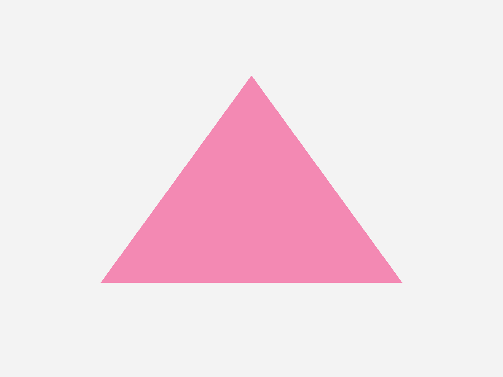

# Commands that change the view

**Section 1: WebGPU Foundations, Shaders, and the Command Dock** · **Lesson 1.4** (Redraft `1.4`) · **1 checkpoint (`04-input`)** · **Study time: 1–2 h**

> **What You Will Learn & Build:** Use a command to switch backgrounds without changing the triangle.

## 1. Visual Pipeline & WebGPU Architecture (Black & White Schematics)

<div class="webgpu-schematic" style="margin:1.1rem 0;padding:0.75rem;border:1.5px solid #111111;border-radius:10px;background:#ffffff;">
<svg viewBox="0 0 840 220" xmlns="http://www.w3.org/2000/svg" style="max-width:100%;height:auto;display:block;font-family:system-ui,-apple-system,Segoe UI,Roboto,sans-serif;">
  <defs>
    <marker id="arrow" viewBox="0 0 10 10" refX="8" refY="5" markerWidth="6" markerHeight="6" orient="auto-start-reverse">
      <path d="M 0 1 L 10 5 L 0 9 z" fill="#111111"/>
    </marker>
  </defs>
  <rect x="4" y="4" width="832" height="212" rx="8" fill="#ffffff" stroke="#111111" stroke-width="1.5"/>
  <text x="20" y="28" font-size="14" font-weight="700" fill="#111111">Lesson 1.4 Execution Flow: Commands that change the view</text>
  <text x="20" y="46" font-size="11.5" fill="#111111">Concrete data pipeline you build in this lesson (Checkpoint: 04-input)</text>
  <line x1="16" y1="54" x2="824" y2="54" stroke="#111111" stroke-width="1"/>
  
    
    <rect x="18" y="68" width="184" height="82" rx="8" fill="#ffffff" stroke="#111111" stroke-width="1.5"/>
    <text x="110" y="86" text-anchor="middle" font-size="11" font-weight="700" fill="#111111">Stage 1</text>
    <line x1="28" y1="92" x2="192" y2="92" stroke="#111111" stroke-width="0.75"/>
    <text x="110" y="108" text-anchor="middle" font-size="11" fill="#111111">Typed Background</text>
    <line x1="202" y1="108" x2="222" y2="108" stroke="#111111" stroke-width="1.75" marker-end="url(#arrow)"/>

    <rect x="224" y="68" width="184" height="82" rx="8" fill="#ffffff" stroke="#111111" stroke-width="1.5"/>
    <text x="316" y="86" text-anchor="middle" font-size="11" font-weight="700" fill="#111111">Stage 2</text>
    <line x1="234" y1="92" x2="398" y2="92" stroke="#111111" stroke-width="0.75"/>
    <text x="316" y="108" text-anchor="middle" font-size="11" fill="#111111">Panel returns a line</text>
    <line x1="408" y1="108" x2="428" y2="108" stroke="#111111" stroke-width="1.75" marker-end="url(#arrow)"/>

    <rect x="430" y="68" width="184" height="82" rx="8" fill="#ffffff" stroke="#111111" stroke-width="1.5"/>
    <text x="522" y="86" text-anchor="middle" font-size="11" font-weight="700" fill="#111111">Stage 3</text>
    <line x1="440" y1="92" x2="604" y2="92" stroke="#111111" stroke-width="0.75"/>
    <text x="522" y="108" text-anchor="middle" font-size="11" fill="#111111">Background toggles</text>
    <line x1="614" y1="108" x2="634" y2="108" stroke="#111111" stroke-width="1.75" marker-end="url(#arrow)"/>

    <rect x="636" y="68" width="184" height="82" rx="8" fill="#ffffff" stroke="#111111" stroke-width="1.5"/>
    <text x="728" y="86" text-anchor="middle" font-size="11" font-weight="700" fill="#111111">Stage 4</text>
    <line x1="646" y1="92" x2="810" y2="92" stroke="#111111" stroke-width="0.75"/>
    <text x="728" y="108" text-anchor="middle" font-size="11" fill="#111111">Renderer redraws</text>
    
    <rect x="18" y="162" width="804" height="44" rx="8" fill="#ffffff" stroke="#111111" stroke-width="1.5"/>
    <text x="32" y="181" font-size="11" font-weight="700" fill="#111111">Files You Edit in Lesson 1.4:</text>
    <text x="215" y="181" font-size="11" fill="#111111">src/background.rs  ·  src/lib.rs  ·  src/renderer.rs  ·  src/browser.rs</text>
    <text x="32" y="198" font-size="10.5" fill="#111111">Checkpoint: 04-input — Verify at each checkpoint with: npm --prefix ../session_tests run course -- check &lt;ID&gt;</text>
  
</svg>
</div>

<div class="webgpu-schematic" style="margin:1.1rem 0;padding:0.75rem;border:1.5px solid #111111;border-radius:10px;background:#ffffff;">
<svg viewBox="0 0 840 240" xmlns="http://www.w3.org/2000/svg" style="max-width:100%;height:auto;display:block;font-family:system-ui,-apple-system,Segoe UI,Roboto,sans-serif;">
  <defs>
    <marker id="arrow" viewBox="0 0 10 10" refX="8" refY="5" markerWidth="6" markerHeight="6" orient="auto-start-reverse">
      <path d="M 0 1 L 10 5 L 0 9 z" fill="#111111"/>
    </marker>
  </defs>
  <rect x="4" y="4" width="832" height="232" rx="8" fill="#ffffff" stroke="#111111" stroke-width="1.5"/>
  <text x="20" y="28" font-size="14" font-weight="700" fill="#111111">Chapter 1 WebGPU Architecture: Surface → CommandEncoder → Scene Pass (Clear) + UI Pass (Load)</text>
  <text x="20" y="46" font-size="11.5" fill="#111111">Why two passes share one GPU TextureView: Pass 1 clears & draws the 3D scene; Pass 2 loads existing pixels and overlays the Command Dock.</text>
  <line x1="16" y1="54" x2="824" y2="54" stroke="#111111" stroke-width="1"/>
  
    <!-- Box 1: HTML Canvas -->
    <rect x="18" y="68" width="160" height="145" rx="8" fill="#ffffff" stroke="#111111" stroke-width="1.5"/>
    <text x="98" y="88" text-anchor="middle" font-size="12" font-weight="700" fill="#111111">1. Browser (HTML/JS)</text>
    <text x="30" y="110" font-size="11" fill="#111111">• &lt;canvas id="canvas"&gt;</text>
    <text x="30" y="128" font-size="11" fill="#111111">• Pointer / Key Events</text>
    <text x="30" y="146" font-size="11" fill="#111111">• Surface TextureView</text>
    <text x="30" y="164" font-size="11" font-weight="600" fill="#111111">• frame.present()</text>
    <text x="30" y="192" font-size="10.5" fill="#111111">Format: Bgra8UnormSrgb</text>

    <line x1="178" y1="125" x2="208" y2="125" stroke="#111111" stroke-width="2" marker-end="url(#arrow)"/>

    <!-- Box 2: Rust CPU Owner -->
    <rect x="210" y="68" width="215" height="145" rx="8" fill="#ffffff" stroke="#111111" stroke-width="1.5"/>
    <text x="317" y="88" text-anchor="middle" font-size="12" font-weight="700" fill="#111111">2. Rust / WASM (CPU Owner)</text>
    <text x="222" y="108" font-size="11" fill="#111111">• Adapter.request_device().await</text>
    <text x="222" y="126" font-size="11" fill="#111111">• Panel::update(event) -&gt; Command</text>
    <text x="222" y="144" font-size="11" fill="#111111">• let mut enc = create_encoder()</text>
    <text x="222" y="162" font-size="11" font-weight="600" fill="#111111">• { let pass = enc.begin_...(); }</text>
    <text x="222" y="180" font-size="10.5" fill="#111111">  (Braces end &amp;mut borrow!)</text>
    <text x="222" y="198" font-size="11" font-weight="600" fill="#111111">• queue.submit([enc.finish()])</text>

    <line x1="425" y1="108" x2="458" y2="108" stroke="#111111" stroke-width="2" marker-end="url(#arrow)"/>
    <line x1="425" y1="172" x2="458" y2="172" stroke="#111111" stroke-width="2" marker-end="url(#arrow)"/>

    <!-- Box 3: GPU Pass 1 -->
    <rect x="460" y="68" width="360" height="68" rx="8" fill="#ffffff" stroke="#111111" stroke-width="1.5"/>
    <text x="472" y="86" font-size="11.5" font-weight="700" fill="#111111">3A. GPU RenderPass #1 — Scene (LoadOp::Clear)</text>
    <text x="472" y="104" font-size="11" fill="#111111">• @vertex fn vertex(@builtin(vertex_index) i: u32) -&gt; clip (-1..+1)</text>
    <text x="472" y="122" font-size="11" fill="#111111">• @fragment fn fragment() -&gt; @location(0) vec4f (Scene Triangle)</text>

    <!-- Box 4: GPU Pass 2 -->
    <rect x="460" y="145" width="360" height="68" rx="8" fill="#ffffff" stroke="#111111" stroke-width="1.5"/>
    <text x="472" y="163" font-size="11.5" font-weight="700" fill="#111111">3B. GPU RenderPass #2 — Command Dock (LoadOp::Load)</text>
    <text x="472" y="181" font-size="11" fill="#111111">• Keeps Pass #1 pixels! Uploads Noto Font Atlas glyph changes</text>
    <text x="472" y="199" font-size="11" fill="#111111">• egui_wgpu::Renderer draws Command: prompt + completions on top</text>
    
</svg>
</div>

## 2. Language & Shader Bridge (`Rust` ↔ `WGSL` ↔ `WebGPU`)

Before writing code, review how the three layers in this chapter talk to each other:

| Layer | Construct | Plain-English Explanation for Students |
| :--- | :--- | :--- |
| **HTML / CSS** | `<canvas id="canvas">` | Full-window browser drawing surface; CSS `width/height: 100%` fills the viewport while Rust synchronizes physical pixel dimensions. |
| **Rust (`wgpu`)** | `CommandEncoder` + `{ begin_render_pass(...) }` | Records GPU commands on the CPU. Scoping Pass #1 (`LoadOp::Clear`) in `{ ... }` releases the mutable borrow so Pass #2 (`LoadOp::Load`, Command Dock UI) can draw on top. |
| **WGSL Shader** | `@vertex` & `@fragment` (`@builtin(vertex_index)`) | GPU stages that compute clip-space coordinates `(-1..+1)` and RGBA pixel colors in parallel across GPU cores. |

**Authoritative production source (`session_viewer/src`):** [`State`](../../../src/state.rs), [`engine/gpu/frame.rs`](../../../src/engine/gpu/frame.rs)

## 3. Checkpoint Roadmap (Jump to Any Notebook Step)

| Step | Checkpoint | What You Build | Files Modified | Pipeline Trace |
| ---: | :--- | :--- | :--- | :--- |
| **1** | [`04-input`](#checkpoint-04-input) | Use a command to switch backgrounds without changing the triangle. | `src/background.rs`, `src/lib.rs`, `src/renderer.rs`, `src/browser.rs` | `Typed Background → Panel returns a line → Background toggles → Renderer redraws` |

---

## 4. Step-by-Step Coding Notebook (Concept + Implementation)

Work through each notebook cell below in order inside `workspace/journey`. Read the **Concept Walkthrough** and **Self-Check Q&A** first, then expand the **Implementation** block to type and verify the code.

<a id="checkpoint-04-input"></a>

### Step 1 of 1 · Make a choice change the picture (`04-input`)

- **Goal:** Use a command to switch backgrounds without changing the triangle.
- **Data Flow Trace:** `Typed Background → Panel returns a line → Background toggles → Renderer redraws`
- **Files You Touch:** `src/background.rs` (*Create the small piece of application state. It knows colours, but knows nothing about HTML or GPU resources.*) · `src/lib.rs` (*Register the state module so both the browser and the renderer can use it.*) · `src/renderer.rs` (*Borrow Background in draw and read its RGB value.*) · `src/browser.rs` (*Import the background state.*)

We can already type in the viewer’s own command line. Today one submitted word changes the picture. Type Background and press Enter: one boolean flips, and the existing renderer draws again.

The browser owns Background beside Panel and Renderer. Panel reads the line; Background owns the choice; Renderer turns that choice into pixels. No new device or pipeline is created when you run the command.

`Option<String>` means a submitted line may or may not be present. Most events only move a caret or update completion. Only the recognised Background line changes the background. The match reads that result without inventing a second input path.

> **Self-Check Question:** *Does submitting Background create a new GPU pipeline?*  
> **Answer:** No. The browser keeps the existing Renderer and changes one boolean in Background. The next draw reuses the device, queue and pipeline.

- **What You Should See:** Type `Background` twice. The first command changes the background; the second restores white. The triangle keeps the same shape and position.
- **Hands-On Lab Experiment:** Before submitting Background twice, predict the final picture. Then trace the one boolean changed by toggle. Find the Renderer constructor and explain why neither command calls it again.

<details>
<summary>Implementation 04-input: Make a choice change the picture</summary>

### 1. `src/background.rs`

Create the small piece of application state. It knows colours, but knows nothing about HTML or GPU resources.

Create the file and type:

```rust
--8<-- "journey/code/04-input-02.rs"
```

### 2. `src/lib.rs`

Register the state module so both the browser and the renderer can use it.

<details>
<summary>Locate the existing block</summary>

```rust
pub mod renderer;
#[cfg(target_arch = "wasm32")]
mod browser;
```

</details>

Edit the existing block to match this code; keep unchanged lines:

```rust
--8<-- "journey/code/04-input-fullscreen-1.rs"
```

### 3. `src/renderer.rs`

Borrow Background in draw and read its RGB value. Clear the render target with that RGB value.

Edit these blocks from bottom to top. Keep the surrounding lines unchanged.

<details>
<summary>Locate this block</summary>

```rust
                    resolve_target: None,
                    ops: wgpu::Operations {
                        load: wgpu::LoadOp::Clear(wgpu::Color {
                            r: 1.0, g: 1.0, b: 1.0, a: 1.0,
                        }),
                        store: wgpu::StoreOp::Store,
                    },
```

</details>

Replace it with:

```rust
                    resolve_target: None,
                    ops: wgpu::Operations {
                        load: wgpu::LoadOp::Clear(wgpu::Color {
                            r, g, b, a: 1.0,
                        }),
                        store: wgpu::StoreOp::Store,
                    },
```

<details>
<summary>Locate this block</summary>

```rust
        Self { device, queue, pipeline }
    }

    pub fn draw(&self, view: &wgpu::TextureView) {
        let mut encoder = self.device.create_command_encoder(&Default::default());
        {
            // The pass borrows the encoder. This scope ends that borrow before finish takes it.
```

</details>

Replace it with:

```rust
        Self { device, queue, pipeline }
    }

    pub fn draw(&self, view: &wgpu::TextureView, background: &crate::background::Background) {
        let [r, g, b] = background.rgb();
        let mut encoder = self.device.create_command_encoder(&Default::default());
        {
            // The pass borrows the encoder. This scope ends that borrow before finish takes it.
```

<details>
<summary>Complete updated block reference</summary>

```rust
pub struct Renderer {
    pub device: wgpu::Device,
    pub queue: wgpu::Queue,
    pipeline: wgpu::RenderPipeline,
}

impl Renderer {
    pub fn new(device: wgpu::Device, queue: wgpu::Queue, format: wgpu::TextureFormat) -> Self {
        let shader = device.create_shader_module(wgpu::ShaderModuleDescriptor {
            label: Some("triangle"),
            source: wgpu::ShaderSource::Wgsl(include_str!("triangle.wgsl").into()),
        });
        let pipeline = device.create_render_pipeline(&wgpu::RenderPipelineDescriptor {
            label: Some("triangle"),
            layout: None,
            vertex: wgpu::VertexState {
                module: &shader,
                entry_point: Some("vertex"),
                compilation_options: Default::default(),
                buffers: &[],
            },
            fragment: Some(wgpu::FragmentState {
                module: &shader,
                entry_point: Some("fragment"),
                compilation_options: Default::default(),
                targets: &[Some(format.into())],
            }),
            primitive: Default::default(),
            depth_stencil: None,
            multisample: Default::default(),
            multiview_mask: None,
            cache: None,
        });
        Self { device, queue, pipeline }
    }

    pub fn draw(&self, view: &wgpu::TextureView, background: &crate::background::Background) {
        let [r, g, b] = background.rgb();
        let mut encoder = self.device.create_command_encoder(&Default::default());
        {
            // The pass borrows the encoder. This scope ends that borrow before finish takes it.
            let mut pass = encoder.begin_render_pass(&wgpu::RenderPassDescriptor {
                label: Some("canvas"),
                color_attachments: &[Some(wgpu::RenderPassColorAttachment {
                    view,
                    depth_slice: None,
                    resolve_target: None,
                    ops: wgpu::Operations {
                        load: wgpu::LoadOp::Clear(wgpu::Color {
                            r, g, b, a: 1.0,
                        }),
                        store: wgpu::StoreOp::Store,
                    },
                })],
                ..Default::default()
            });
            pass.set_pipeline(&self.pipeline);
            pass.draw(0..3, 0..1);
        }
        self.queue.submit([encoder.finish()]);
    }
}
```

</details>

<details>
<summary>Optional patch references</summary>

Use these original edit fragments when comparing a saved checkpoint. Apply the complete blocks above.

```text
--8<-- "journey/code/04-input-fullscreen-6.rs"
```

```text
--8<-- "journey/code/04-input-fullscreen-7.rs"
```

</details>

### 4. `src/browser.rs`

Import the background state. Own the background and toggle it when the dock submits Background. Pass the background into presentation and update the status message. Draw the scene with the current background.

Edit these blocks from bottom to top. Keep the surrounding lines unchanged.

<details>
<summary>Locate this block</summary>

```rust
        format: Some(frame.texture.format().add_srgb_suffix()),
        ..Default::default()
    });
    renderer.draw(&view);
    panel.draw(renderer, &view);
    frame.present();
    Ok(())
```

</details>

Replace it with:

```rust
        format: Some(frame.texture.format().add_srgb_suffix()),
        ..Default::default()
    });
    renderer.draw(&view, background);
    panel.draw(renderer, &view);
    frame.present();
    Ok(())
```

<details>
<summary>Locate this block</summary>

```rust
    )?;
    // The page has one listener for its lifetime; JavaScript must retain the Rust callback.
    click.forget();
    report("Type Help in the command field and press Enter.");
    Ok(())
}

fn present(
    surface: &wgpu::Surface<'_>,
    renderer: &Renderer,
    panel: &mut crate::panel::Panel,
) -> Result<(), JsValue> {
    let frame = match surface.get_current_texture() {
```

</details>

Replace it with:

```rust
    )?;
    // The page has one listener for its lifetime; JavaScript must retain the Rust callback.
    click.forget();
    report("Change the background. The triangle keeps its shape and colour.");
    Ok(())
}

fn present(
    surface: &wgpu::Surface<'_>,
    renderer: &Renderer,
    background: &Background,
    panel: &mut crate::panel::Panel,
) -> Result<(), JsValue> {
    let frame = match surface.get_current_texture() {
```

<details>
<summary>Locate this block</summary>

```rust
    config.view_formats = vec![config.format.add_srgb_suffix()];
    surface.configure(&device, &config);
    let renderer = Renderer::new(device, queue, config.format.add_srgb_suffix());
    let mut panel = crate::panel::Panel::new(&renderer, config.format.add_srgb_suffix(), &["Help"]);
    panel.update(None, &canvas)?;
    present(&surface, &renderer, &mut panel)?;
    let input_canvas = canvas.clone();
    let click = Closure::<dyn FnMut(web_sys::Event)>::new(move |event: web_sys::Event| {
        let _line = match panel.update(Some(&event), &input_canvas) {
            Ok(line) => line,
            Err(error) => {
                report(&format!("Cannot read command: {error:?}"));
                return;
            }
        };
        if let Err(error) = panel.update(None, &input_canvas) {
            report(&format!("Cannot lay out commands: {error:?}"));
            return;
        }
        if let Err(error) = present(&surface, &renderer, &mut panel) {
            report(&format!("Cannot redraw: {error:?}"));
        }
    });
```

</details>

Replace it with:

```rust
    config.view_formats = vec![config.format.add_srgb_suffix()];
    surface.configure(&device, &config);
    let renderer = Renderer::new(device, queue, config.format.add_srgb_suffix());
    let mut panel = crate::panel::Panel::new(
        &renderer,
        config.format.add_srgb_suffix(),
        &["Help", "Background"],
    );
    panel.update(None, &canvas)?;
    let mut background = Background::default();
    present(&surface, &renderer, &background, &mut panel)?;
    let input_canvas = canvas.clone();
    let click = Closure::<dyn FnMut(web_sys::Event)>::new(move |event: web_sys::Event| {
        let line = match panel.update(Some(&event), &input_canvas) {
            Ok(line) => line,
            Err(error) => {
                report(&format!("Cannot read command: {error:?}"));
                return;
            }
        };
        if line.as_deref() == Some("background") {
            background.toggle();
        }
        if let Err(error) = panel.update(None, &input_canvas) {
            report(&format!("Cannot lay out commands: {error:?}"));
            return;
        }
        if let Err(error) = present(&surface, &renderer, &background, &mut panel) {
            report(&format!("Cannot redraw: {error:?}"));
        }
    });
```

<details>
<summary>Locate this block</summary>

```rust
use crate::renderer::Renderer;
use wasm_bindgen::{JsCast, JsValue, closure::Closure};
```

</details>

Replace it with:

```rust
use crate::background::Background;
use crate::renderer::Renderer;
use wasm_bindgen::{JsCast, JsValue, closure::Closure};
```

<details>
<summary>Complete updated block reference</summary>

```rust
use crate::background::Background;
use crate::renderer::Renderer;
use wasm_bindgen::{JsCast, JsValue, closure::Closure};

pub fn report(message: &str) {
    if let Some(document) = web_sys::window().and_then(|window| window.document()) {
        if let Some(status) = document.get_element_by_id("status") {
            status.set_text_content(Some(message));
            if message.starts_with("Cannot") { let _ = status.remove_attribute("hidden"); }
        }
    }
}

pub async fn run() -> Result<(), JsValue> {
    let window = web_sys::window().ok_or("No browser window")?;
    let document = window.document().ok_or("No document")?;
    let canvas: web_sys::HtmlCanvasElement = document
        .get_element_by_id("canvas")
        .ok_or("Missing canvas")?
        .dyn_into()?;
    let instance = wgpu::Instance::new(wgpu::InstanceDescriptor {
        backends: wgpu::Backends::BROWSER_WEBGPU,
        flags: Default::default(),
        memory_budget_thresholds: Default::default(),
        backend_options: Default::default(),
        display: None,
    });
    let surface = instance
        .create_surface(wgpu::SurfaceTarget::Canvas(canvas.clone()))
        .map_err(|error| JsValue::from_str(&error.to_string()))?;
    let adapter = instance
        .request_adapter(&wgpu::RequestAdapterOptions {
            compatible_surface: Some(&surface),
            ..Default::default()
        })
        .await
        .map_err(|error| JsValue::from_str(&error.to_string()))?;
    let (device, queue) = adapter
        .request_device(&wgpu::DeviceDescriptor::default())
        .await
        .map_err(|error| JsValue::from_str(&error.to_string()))?;
    device.on_uncaptured_error(std::sync::Arc::new(|error| report(&error.to_string())));
    let limit = device.limits().max_texture_dimension_2d;
    let width = (window.inner_width()?.as_f64().ok_or("No window width")? as u32).clamp(1, limit);
    let height = (window.inner_height()?.as_f64().ok_or("No window height")? as u32).clamp(1, limit);
    canvas.set_width(width);
    canvas.set_height(height);
    let mut config = surface
        .get_default_config(&adapter, width, height)
        .ok_or("No compatible surface format")?;
    config.view_formats = vec![config.format.add_srgb_suffix()];
    surface.configure(&device, &config);
    let renderer = Renderer::new(device, queue, config.format.add_srgb_suffix());
    let mut panel = crate::panel::Panel::new(
        &renderer,
        config.format.add_srgb_suffix(),
        &["Help", "Background"],
    );
    panel.update(None, &canvas)?;
    let mut background = Background::default();
    present(&surface, &renderer, &background, &mut panel)?;
    let input_canvas = canvas.clone();
    let click = Closure::<dyn FnMut(web_sys::Event)>::new(move |event: web_sys::Event| {
        let line = match panel.update(Some(&event), &input_canvas) {
            Ok(line) => line,
            Err(error) => {
                report(&format!("Cannot read command: {error:?}"));
                return;
            }
        };
        if line.as_deref() == Some("background") {
            background.toggle();
        }
        if let Err(error) = panel.update(None, &input_canvas) {
            report(&format!("Cannot lay out commands: {error:?}"));
            return;
        }
        if let Err(error) = present(&surface, &renderer, &background, &mut panel) {
            report(&format!("Cannot redraw: {error:?}"));
        }
    });
    for name in [
        "pointerdown",
        "pointermove",
        "pointerup",
        "pointercancel",
        "lostpointercapture",
        "contextmenu",
        "keydown",
        "keyup",
        "blur",
    ] {
        canvas.add_event_listener_with_callback(name, click.as_ref().unchecked_ref())?;
    }
    let options = web_sys::AddEventListenerOptions::new();
    options.set_passive(false);
    canvas.add_event_listener_with_callback_and_add_event_listener_options(
        "wheel",
        click.as_ref().unchecked_ref(),
        &options,
    )?;
    // The page has one listener for its lifetime; JavaScript must retain the Rust callback.
    click.forget();
    report("Change the background. The triangle keeps its shape and colour.");
    Ok(())
}

fn present(
    surface: &wgpu::Surface<'_>,
    renderer: &Renderer,
    background: &Background,
    panel: &mut crate::panel::Panel,
) -> Result<(), JsValue> {
    let frame = match surface.get_current_texture() {
        wgpu::CurrentSurfaceTexture::Success(frame)
        | wgpu::CurrentSurfaceTexture::Suboptimal(frame) => frame,
        other => {
            return Err(JsValue::from_str(&format!(
                "Surface unavailable: {other:?}"
            )));
        }
    };
    let view = frame.texture.create_view(&wgpu::TextureViewDescriptor {
        format: Some(frame.texture.format().add_srgb_suffix()),
        ..Default::default()
    });
    renderer.draw(&view, background);
    panel.draw(renderer, &view);
    frame.present();
    Ok(())
}
```

</details>

<details>
<summary>Optional patch references</summary>

Use these original edit fragments when comparing a saved checkpoint. Apply the complete blocks above.

```text
--8<-- "journey/code/04-input-window-1.rs"
```

```text
--8<-- "journey/code/04-input-window-2.rs"
```

```text
--8<-- "journey/code/04-input-window-3.rs"
```

```text
--8<-- "journey/code/04-input-window-4.rs"
```

</details>

</details>

---

## 5. Build, Verify, and Save Your Checkpoint

Run these commands from `session_viewer` to install dependencies, verify your typed code against the checkpoint, and save your progress:

```sh

```

Open `http://127.0.0.1:8780/` in your browser. Use [checkpoint recovery](../recovery.md) to save or restore any checkpoint ID.

## 6. Lesson Summary & Expected Visual Result



Type `Background` twice. The first command changes the background; the second restores white. The triangle keeps the same shape and position.

- **Final Lesson Experiment:** Before submitting Background twice, predict the final picture. Then trace the one boolean changed by toggle. Find the Renderer constructor and explain why neither command calls it again.
