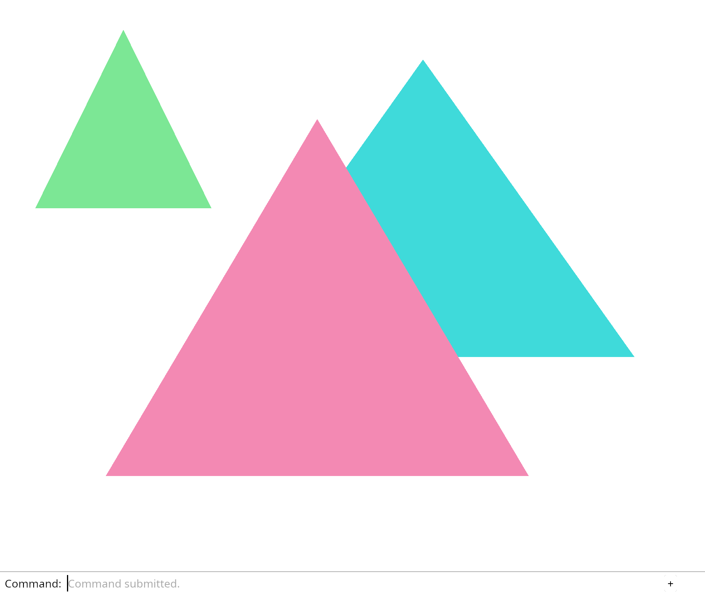

# 2.3 · Depth, validated geometry and stable objects

**Goal:** Keep object identity stable when removal changes vector order. · **Steps:** 4 · **Source:** `src/camera.rs,src/engine/gpu/render.rs,src/shaders/scene.wgsl`

<div class="webgpu-schematic" style="width:100%;margin:6px auto;">
<svg xmlns="http://www.w3.org/2000/svg" width="1120" height="200" viewBox="0 0 1120 200" style="width:100%;max-width:100%;height:auto;display:block;margin:0 auto;" role="img">
  <defs>
    <marker id="arr" viewBox="0 0 10 10" refX="8" refY="5" markerWidth="6" markerHeight="6" orient="auto">
      <path d="M 0 1 L 9 5 L 0 9 z" fill="#111111"/>
    </marker>
    <marker id="arrR" viewBox="0 0 10 10" refX="8" refY="5" markerWidth="6" markerHeight="6" orient="auto">
      <path d="M 0 1 L 9 5 L 0 9 z" fill="#dc2626"/>
    </marker>
    <marker id="arrG" viewBox="0 0 10 10" refX="8" refY="5" markerWidth="6" markerHeight="6" orient="auto">
      <path d="M 0 1 L 9 5 L 0 9 z" fill="#16a34a"/>
    </marker>
    <marker id="arrB" viewBox="0 0 10 10" refX="8" refY="5" markerWidth="6" markerHeight="6" orient="auto">
      <path d="M 0 1 L 9 5 L 0 9 z" fill="#2563eb"/>
    </marker>
  </defs>
  <rect x="2" y="2" width="1116" height="196" rx="10" fill="#ffffff" stroke="#111111" stroke-width="2"/>
  <rect x="16" y="14" width="248" height="172" rx="8" fill="#ffffff" stroke="#111111" stroke-width="1.75"/>
  <text paint-order="stroke fill" stroke="#ffffff" stroke-width="5" stroke-linejoin="round" x="140" y="34" text-anchor="middle" font-family="monospace" font-size="11.5" font-weight="700" fill="#111111">1. Lesson 2.3 Code</text>
  <rect x="34" y="48" width="212" height="24" rx="4" fill="#ffffff" stroke="#111111" stroke-width="1.25"/>
  <text paint-order="stroke fill" stroke="#ffffff" stroke-width="5" stroke-linejoin="round" x="140" y="64" text-anchor="middle" font-family="monospace" font-size="10" font-weight="700" fill="#111111">src/triangle.wgsl</text>
  <rect x="34" y="78" width="212" height="24" rx="4" fill="#ffffff" stroke="#111111" stroke-width="1.5"/>
  <text paint-order="stroke fill" stroke="#ffffff" stroke-width="5" stroke-linejoin="round" x="140" y="94" text-anchor="middle" font-family="monospace" font-size="10" font-weight="700" fill="#111111">src/renderer.rs</text>
  <rect x="34" y="108" width="212" height="24" rx="4" fill="#ffffff" stroke="#111111" stroke-width="1.25"/>
  <text paint-order="stroke fill" stroke="#ffffff" stroke-width="5" stroke-linejoin="round" x="140" y="124" text-anchor="middle" font-family="monospace" font-size="10" font-weight="700" fill="#111111">src/browser.rs</text>
  <text paint-order="stroke fill" stroke="#ffffff" stroke-width="5" stroke-linejoin="round" x="140" y="172" text-anchor="middle" font-family="monospace" font-size="9.5" fill="#111111">4 Coding Steps</text>
  <line x1="264" y1="100" x2="292" y2="100" stroke="#111111" stroke-width="2" marker-end="url(#arr)"/>
  <rect x="296" y="14" width="248" height="172" rx="8" fill="#ffffff" stroke="#111111" stroke-width="1.75"/>
  <text paint-order="stroke fill" stroke="#ffffff" stroke-width="5" stroke-linejoin="round" x="420" y="34" text-anchor="middle" font-family="monospace" font-size="11.5" font-weight="700" fill="#111111">2. session_viewer/src</text>
  <rect x="314" y="48" width="212" height="26" rx="4" fill="#ffffff" stroke="#111111" stroke-width="1.5"/>
  <text paint-order="stroke fill" stroke="#ffffff" stroke-width="5" stroke-linejoin="round" x="420" y="65" text-anchor="middle" font-family="monospace" font-size="10" font-weight="700" fill="#111111">src/camera.rs</text>
  <rect x="314" y="80" width="212" height="26" rx="4" fill="#ffffff" stroke="#111111" stroke-width="1.5"/>
  <text paint-order="stroke fill" stroke="#ffffff" stroke-width="5" stroke-linejoin="round" x="420" y="97" text-anchor="middle" font-family="monospace" font-size="10" font-weight="700" fill="#111111">src/engine/gpu/render.rs</text>
  <rect x="314" y="112" width="212" height="24" rx="4" fill="#ffffff" stroke="#111111" stroke-width="1.5"/>
  <text paint-order="stroke fill" stroke="#ffffff" stroke-width="5" stroke-linejoin="round" x="420" y="128" text-anchor="middle" font-family="monospace" font-size="9.5" font-weight="700" fill="#111111">✓ cargo check (wasm32)</text>
  <text paint-order="stroke fill" stroke="#ffffff" stroke-width="5" stroke-linejoin="round" x="420" y="172" text-anchor="middle" font-family="sans-serif" font-size="10" fill="#111111">Keep the nearest surface</text>
  <line x1="544" y1="100" x2="572" y2="100" stroke="#111111" stroke-width="2" marker-end="url(#arr)"/>
  <rect x="576" y="14" width="248" height="172" rx="8" fill="#ffffff" stroke="#111111" stroke-width="1.75"/>
  <text paint-order="stroke fill" stroke="#ffffff" stroke-width="5" stroke-linejoin="round" x="700" y="34" text-anchor="middle" font-family="monospace" font-size="11.5" font-weight="700" fill="#111111">3. Vertex RGB &amp; Uniforms</text>
  <polygon points="610,56 690,56 610,126" fill="#bfdbfe" stroke="#111111" stroke-width="1.75"/>
  <polygon points="690,56 690,126 610,126" fill="#fde68a" stroke="#111111" stroke-width="1.75"/>
  <circle cx="610" cy="56" r="4" fill="#ef4444"/><text paint-order="stroke fill" stroke="#ffffff" stroke-width="5" stroke-linejoin="round" x="590" y="58" font-family="monospace" font-size="9" font-weight="700" fill="#111111">v0</text>
  <circle cx="690" cy="56" r="4" fill="#22c55e"/><text paint-order="stroke fill" stroke="#ffffff" stroke-width="5" stroke-linejoin="round" x="696" y="58" font-family="monospace" font-size="9" font-weight="700" fill="#111111">v1</text>
  <circle cx="610" cy="126" r="4" fill="#3b82f6"/><text paint-order="stroke fill" stroke="#ffffff" stroke-width="5" stroke-linejoin="round" x="590" y="130" font-family="monospace" font-size="9" font-weight="700" fill="#111111">v2</text>
  <circle cx="690" cy="126" r="4" fill="#f59e0b"/><text paint-order="stroke fill" stroke="#ffffff" stroke-width="5" stroke-linejoin="round" x="696" y="130" font-family="monospace" font-size="9" font-weight="700" fill="#111111">v3</text>
  <rect x="720" y="64" width="90" height="54" rx="5" fill="#ffffff" stroke="#111111" stroke-width="1.5"/>
  <text paint-order="stroke fill" stroke="#ffffff" stroke-width="5" stroke-linejoin="round" x="765" y="88" text-anchor="middle" font-family="monospace" font-size="10" font-weight="700" fill="#111111">view_proj</text>
  <text paint-order="stroke fill" stroke="#ffffff" stroke-width="5" stroke-linejoin="round" x="765" y="104" text-anchor="middle" font-family="monospace" font-size="9" fill="#111111">mat4x4&lt;f32&gt;</text>
  <text paint-order="stroke fill" stroke="#ffffff" stroke-width="5" stroke-linejoin="round" x="700" y="172" text-anchor="middle" font-family="monospace" font-size="9.5" fill="#111111">Depth, validated geometry a…</text>
  <line x1="824" y1="100" x2="852" y2="100" stroke="#111111" stroke-width="2" marker-end="url(#arr)"/>
  <rect x="856" y="14" width="248" height="172" rx="8" fill="#ffffff" stroke="#111111" stroke-width="1.75"/>
  <text paint-order="stroke fill" stroke="#ffffff" stroke-width="5" stroke-linejoin="round" x="980" y="34" text-anchor="middle" font-family="monospace" font-size="11.5" font-weight="700" fill="#111111">4. Depth32Float &amp; Ray Pick</text>
  <rect x="936" y="54" width="96" height="62" rx="4" fill="#93c5fd" stroke="#111111" stroke-width="1.5" stroke-dasharray="3 3"/>
  <rect x="892" y="74" width="96" height="62" rx="4" fill="#fdba74" stroke="#111111" stroke-width="2"/>
  <line x1="864" y1="138" x2="932" y2="102" stroke="#111111" stroke-width="2" marker-end="url(#arr)"/>
  <circle cx="936" cy="100" r="5" fill="#facc15" stroke="#111111" stroke-width="1.5"/>
  <text paint-order="stroke fill" stroke="#ffffff" stroke-width="5" stroke-linejoin="round" x="896" y="68" font-family="monospace" font-size="9" font-weight="700" fill="#111111">z=0.2 &lt; z=0.7</text>
  <text paint-order="stroke fill" stroke="#ffffff" stroke-width="5" stroke-linejoin="round" x="980" y="172" text-anchor="middle" font-family="sans-serif" font-size="10" font-weight="700" fill="#111111">Name objects independentl…</text>
</svg>
</div>

## <a id="checkpoint-10-depth"></a>1. Keep the nearest surface

<div class="webgpu-schematic" style="width:100%;margin:6px auto;">
<svg xmlns="http://www.w3.org/2000/svg" width="1120" height="72" viewBox="0 0 1120 72" style="width:100%;max-width:100%;height:auto;display:block;margin:0 auto;" role="img">
  <defs>
    <marker id="arr" viewBox="0 0 10 10" refX="8" refY="5" markerWidth="6" markerHeight="6" orient="auto">
      <path d="M 0 1 L 9 5 L 0 9 z" fill="#111111"/>
    </marker>
    <marker id="arrR" viewBox="0 0 10 10" refX="8" refY="5" markerWidth="6" markerHeight="6" orient="auto">
      <path d="M 0 1 L 9 5 L 0 9 z" fill="#dc2626"/>
    </marker>
    <marker id="arrG" viewBox="0 0 10 10" refX="8" refY="5" markerWidth="6" markerHeight="6" orient="auto">
      <path d="M 0 1 L 9 5 L 0 9 z" fill="#16a34a"/>
    </marker>
    <marker id="arrB" viewBox="0 0 10 10" refX="8" refY="5" markerWidth="6" markerHeight="6" orient="auto">
      <path d="M 0 1 L 9 5 L 0 9 z" fill="#2563eb"/>
    </marker>
  </defs>
  <rect x="2" y="2" width="1116" height="68" rx="10" fill="#ffffff" stroke="#111111" stroke-width="2"/>
  <rect x="14" y="10" width="252" height="52" rx="6" fill="#ffffff" stroke="#111111" stroke-width="1.5"/>
  <text paint-order="stroke fill" stroke="#ffffff" stroke-width="5" stroke-linejoin="round" x="140" y="30" text-anchor="middle" font-family="monospace" font-size="10.5" font-weight="700" fill="#111111">Step 1 of 4</text>
  <text paint-order="stroke fill" stroke="#ffffff" stroke-width="5" stroke-linejoin="round" x="140" y="48" text-anchor="middle" font-family="monospace" font-size="9.5" fill="#111111">src/triangle.wgsl, src/rend…</text>
  <line x1="266" y1="36" x2="292" y2="36" stroke="#111111" stroke-width="1.75" marker-end="url(#arr)"/>
  <rect x="296" y="10" width="252" height="52" rx="6" fill="#ffffff" stroke="#111111" stroke-width="1.5"/>
  <text paint-order="stroke fill" stroke="#ffffff" stroke-width="5" stroke-linejoin="round" x="422" y="30" text-anchor="middle" font-family="monospace" font-size="10" font-weight="700" fill="#111111">1. CPU / Rust Input</text>
  <text paint-order="stroke fill" stroke="#ffffff" stroke-width="5" stroke-linejoin="round" x="422" y="48" text-anchor="middle" font-family="sans-serif" font-size="9.5" fill="#111111">Vertex z</text>
  <line x1="548" y1="36" x2="574" y2="36" stroke="#111111" stroke-width="1.75" marker-end="url(#arr)"/>
  <rect x="578" y="10" width="252" height="52" rx="6" fill="#ffffff" stroke="#111111" stroke-width="1.5"/>
  <text paint-order="stroke fill" stroke="#ffffff" stroke-width="5" stroke-linejoin="round" x="704" y="30" text-anchor="middle" font-family="monospace" font-size="10" font-weight="700" fill="#111111">2. WebGPU / WGSL</text>
  <text paint-order="stroke fill" stroke="#ffffff" stroke-width="5" stroke-linejoin="round" x="704" y="48" text-anchor="middle" font-family="sans-serif" font-size="9.5" fill="#111111">depth comparison</text>
  <line x1="830" y1="36" x2="856" y2="36" stroke="#111111" stroke-width="1.75" marker-end="url(#arr)"/>
  <rect x="860" y="10" width="246" height="52" rx="6" fill="#ffffff" stroke="#111111" stroke-width="1.75"/>
  <text paint-order="stroke fill" stroke="#ffffff" stroke-width="5" stroke-linejoin="round" x="983" y="30" text-anchor="middle" font-family="monospace" font-size="10" font-weight="700" fill="#111111">3. -&gt; src/camera.rs</text>
  <text paint-order="stroke fill" stroke="#ffffff" stroke-width="5" stroke-linejoin="round" x="983" y="48" text-anchor="middle" font-family="sans-serif" font-size="9.5" fill="#111111">colour written only for t…</text>
</svg>
</div>

**What this code does:** Draw two overlapping triangles in depth, keeping the nearer one visible even when it is drawn first.

### 1. `src/triangle.wgsl`

Pass transformed 3D positions and vertex colours to the rasterizer. The fragment function uses the interpolated colour.

Replace the entire file with:

```wgsl
--8<-- "journey/code/10-depth-09.wgsl"
```

### 2. `src/renderer.rs`

Define two coloured triangles with different Z coordinates. Retain a depth view and upload position/color vertex records. Describe the two Float32x3 attributes in each 24-byte vertex. Enable depth writes and the Less comparison. Create and retain the Depth32Float texture view. Attach the depth view and clear it to 1.0 for each frame.

Edit these blocks from bottom to top. Keep the surrounding lines unchanged.

**Locate this block:**

```rust
            // The pass borrows the encoder. This scope ends that borrow before finish takes it.
            let mut pass = encoder.begin_render_pass(&wgpu::RenderPassDescriptor {
                label: Some("canvas"),
                color_attachments: &[Some(wgpu::RenderPassColorAttachment {
                    view,
                    depth_slice: None,
```

Replace it with:

```rust
            // The pass borrows the encoder. This scope ends that borrow before finish takes it.
            let mut pass = encoder.begin_render_pass(&wgpu::RenderPassDescriptor {
                label: Some("canvas"),
                depth_stencil_attachment: Some(wgpu::RenderPassDepthStencilAttachment {
                    view: &self.depth,
                    depth_ops: Some(wgpu::Operations {
                        load: wgpu::LoadOp::Clear(1.0),
                        store: wgpu::StoreOp::Store,
                    }),
                    stencil_ops: None,
                }),
                color_attachments: &[Some(wgpu::RenderPassColorAttachment {
                    view,
                    depth_slice: None,
```

**Locate this block:**

```rust
                resource: uniform.as_entire_binding(),
            }],
        });
        Self { device, queue, pipeline, vertices, indices, uniform, view_group }
    }

    pub fn draw(
```

Replace it with:

```rust
                resource: uniform.as_entire_binding(),
            }],
        });
        let depth = Self::depth(&device, 640, 480);
        Self { device, queue, pipeline, vertices, indices, uniform, view_group, depth }
    }

    fn depth(device: &wgpu::Device, width: u32, height: u32) -> wgpu::TextureView {
        let depth_texture = device.create_texture(&wgpu::TextureDescriptor {
            label: Some("opaque depth"),
            size: wgpu::Extent3d { width, height, depth_or_array_layers: 1 },
            mip_level_count: 1,
            sample_count: 1,
            dimension: wgpu::TextureDimension::D2,
            format: wgpu::TextureFormat::Depth32Float,
            usage: wgpu::TextureUsages::RENDER_ATTACHMENT,
            view_formats: &[],
        });
        depth_texture.create_view(&Default::default())
    }

    pub fn resize(&mut self, width: u32, height: u32) {
        self.depth = Self::depth(&self.device, width, height);
    }

    pub fn draw(
```

**Locate this block:**

```rust
                targets: &[Some(format.into())],
            }),
            primitive: Default::default(),
            depth_stencil: None,
            multisample: Default::default(),
            multiview_mask: None,
            cache: None,
```

Replace it with:

```rust
                targets: &[Some(format.into())],
            }),
            primitive: Default::default(),
            depth_stencil: Some(wgpu::DepthStencilState {
                format: wgpu::TextureFormat::Depth32Float,
                depth_write_enabled: Some(true),
                depth_compare: Some(wgpu::CompareFunction::Less),
                stencil: Default::default(),
                bias: Default::default(),
            }),
            multisample: Default::default(),
            multiview_mask: None,
            cache: None,
```

**Locate this block:**

```rust
                entry_point: Some("vertex"),
                compilation_options: Default::default(),
                buffers: &[wgpu::VertexBufferLayout {
                    array_stride: 8,
                    step_mode: wgpu::VertexStepMode::Vertex,
                    attributes: &wgpu::vertex_attr_array![0 => Float32x2],
                }],
            },
            fragment: Some(wgpu::FragmentState {
```

Replace it with:

```rust
                entry_point: Some("vertex"),
                compilation_options: Default::default(),
                buffers: &[wgpu::VertexBufferLayout {
                    array_stride: 24,
                    step_mode: wgpu::VertexStepMode::Vertex,
                    attributes: &wgpu::vertex_attr_array![0 => Float32x3, 1 => Float32x3],
                }],
            },
            fragment: Some(wgpu::FragmentState {
```

**Locate this block:**

```rust
    indices: wgpu::Buffer,
    uniform: wgpu::Buffer,
    view_group: wgpu::BindGroup,
}

impl Renderer {
    pub fn new(device: wgpu::Device, queue: wgpu::Queue, format: wgpu::TextureFormat) -> Self {
        let bytes: Vec<u8> = POSITIONS.iter().flatten()
            .flat_map(|value| value.to_ne_bytes()).collect();
        let vertices = device.create_buffer_init(&wgpu::util::BufferInitDescriptor {
            label: Some("rectangle positions"),
```

Replace it with:

```rust
    indices: wgpu::Buffer,
    uniform: wgpu::Buffer,
    view_group: wgpu::BindGroup,
    depth: wgpu::TextureView,
}

impl Renderer {
    pub fn new(device: wgpu::Device, queue: wgpu::Queue, format: wgpu::TextureFormat) -> Self {
        let bytes: Vec<u8> = VERTICES.iter().flatten()
            .flat_map(|value| value.to_ne_bytes()).collect();
        let vertices = device.create_buffer_init(&wgpu::util::BufferInitDescriptor {
            label: Some("rectangle positions"),
```

**Locate this block:**

```rust
use wgpu::util::DeviceExt;

const POSITIONS: [[f32; 2]; 4] = [
    [-0.6, 0.0], [0.0, -0.6], [0.6, 0.0], [0.0, 0.6],
];
const INDICES: [u16; 6] = [0, 1, 2, 0, 2, 3];

pub struct Renderer {
    pub device: wgpu::Device,
```

Replace it with:

```rust
use wgpu::util::DeviceExt;

// Each vertex stores x, y, z, then red, green and blue.
const VERTICES: [[f32; 6]; 6] = [
    [-0.7, -0.6, 0.25, 0.9, 0.25, 0.45],
    [ 0.5, -0.6, 0.25, 0.9, 0.25, 0.45],
    [-0.1,  0.6, 0.25, 0.9, 0.25, 0.45],
    [-0.4, -0.2, 0.75, 0.05, 0.7, 0.7],
    [ 0.8, -0.2, 0.75, 0.05, 0.7, 0.7],
    [ 0.2,  0.8, 0.75, 0.05, 0.7, 0.7],
];
const INDICES: [u16; 6] = [0, 1, 2, 3, 4, 5];

pub struct Renderer {
    pub device: wgpu::Device,
```

### 3. `src/browser.rs`

Allocate depth storage at the canvas size. Report which triangle wins the overlap.

Edit these blocks from bottom to top. Keep the surrounding lines unchanged.

**Locate this block:**

```rust
    )?;
    // The page has one listener for its lifetime; JavaScript must retain the Rust callback.
    click.forget();
    report("A matrix carries pan, scale and rotation.");
    Ok(())
}
```

Replace it with:

```rust
    )?;
    // The page has one listener for its lifetime; JavaScript must retain the Rust callback.
    click.forget();
    report("The nearer pink triangle wins the overlap.");
    Ok(())
}
```

**Locate this block:**

```rust
        .ok_or("No compatible surface format")?;
    config.view_formats = vec![config.format.add_srgb_suffix()];
    surface.configure(&device, &config);
    let renderer = Renderer::new(device, queue, config.format.add_srgb_suffix());
    let mut panel = crate::panel::Panel::new(
        &renderer,
        config.format.add_srgb_suffix(),
```

Replace it with:

```rust
        .ok_or("No compatible surface format")?;
    config.view_formats = vec![config.format.add_srgb_suffix()];
    surface.configure(&device, &config);
    let mut renderer = Renderer::new(device, queue, config.format.add_srgb_suffix());
    renderer.resize(width, height);
    let mut panel = crate::panel::Panel::new(
        &renderer,
        config.format.add_srgb_suffix(),
```

## <a id="checkpoint-10a-mesh"></a>2. Give geometry a validated CPU owner

<div class="webgpu-schematic" style="width:100%;margin:6px auto;">
<svg xmlns="http://www.w3.org/2000/svg" width="1120" height="72" viewBox="0 0 1120 72" style="width:100%;max-width:100%;height:auto;display:block;margin:0 auto;" role="img">
  <defs>
    <marker id="arr" viewBox="0 0 10 10" refX="8" refY="5" markerWidth="6" markerHeight="6" orient="auto">
      <path d="M 0 1 L 9 5 L 0 9 z" fill="#111111"/>
    </marker>
    <marker id="arrR" viewBox="0 0 10 10" refX="8" refY="5" markerWidth="6" markerHeight="6" orient="auto">
      <path d="M 0 1 L 9 5 L 0 9 z" fill="#dc2626"/>
    </marker>
    <marker id="arrG" viewBox="0 0 10 10" refX="8" refY="5" markerWidth="6" markerHeight="6" orient="auto">
      <path d="M 0 1 L 9 5 L 0 9 z" fill="#16a34a"/>
    </marker>
    <marker id="arrB" viewBox="0 0 10 10" refX="8" refY="5" markerWidth="6" markerHeight="6" orient="auto">
      <path d="M 0 1 L 9 5 L 0 9 z" fill="#2563eb"/>
    </marker>
  </defs>
  <rect x="2" y="2" width="1116" height="68" rx="10" fill="#ffffff" stroke="#111111" stroke-width="2"/>
  <rect x="14" y="10" width="252" height="52" rx="6" fill="#ffffff" stroke="#111111" stroke-width="1.5"/>
  <text paint-order="stroke fill" stroke="#ffffff" stroke-width="5" stroke-linejoin="round" x="140" y="30" text-anchor="middle" font-family="monospace" font-size="10.5" font-weight="700" fill="#111111">Step 2 of 4</text>
  <text paint-order="stroke fill" stroke="#ffffff" stroke-width="5" stroke-linejoin="round" x="140" y="48" text-anchor="middle" font-family="monospace" font-size="9.5" fill="#111111">src/mesh.rs, src/scene.rs</text>
  <line x1="266" y1="36" x2="292" y2="36" stroke="#111111" stroke-width="1.75" marker-end="url(#arr)"/>
  <rect x="296" y="10" width="252" height="52" rx="6" fill="#ffffff" stroke="#111111" stroke-width="1.5"/>
  <text paint-order="stroke fill" stroke="#ffffff" stroke-width="5" stroke-linejoin="round" x="422" y="30" text-anchor="middle" font-family="monospace" font-size="10" font-weight="700" fill="#111111">1. CPU / Rust Input</text>
  <text paint-order="stroke fill" stroke="#ffffff" stroke-width="5" stroke-linejoin="round" x="422" y="48" text-anchor="middle" font-family="sans-serif" font-size="9.5" fill="#111111">Mesh::new validates owned…</text>
  <line x1="548" y1="36" x2="574" y2="36" stroke="#111111" stroke-width="1.75" marker-end="url(#arr)"/>
  <rect x="578" y="10" width="252" height="52" rx="6" fill="#ffffff" stroke="#111111" stroke-width="1.5"/>
  <text paint-order="stroke fill" stroke="#ffffff" stroke-width="5" stroke-linejoin="round" x="704" y="30" text-anchor="middle" font-family="monospace" font-size="10" font-weight="700" fill="#111111">2. WebGPU / WGSL</text>
  <text paint-order="stroke fill" stroke="#ffffff" stroke-width="5" stroke-linejoin="round" x="704" y="48" text-anchor="middle" font-family="sans-serif" font-size="9.5" fill="#111111">Scene retains Mesh values</text>
  <line x1="830" y1="36" x2="856" y2="36" stroke="#111111" stroke-width="1.75" marker-end="url(#arr)"/>
  <rect x="860" y="10" width="246" height="52" rx="6" fill="#ffffff" stroke="#111111" stroke-width="1.75"/>
  <text paint-order="stroke fill" stroke="#ffffff" stroke-width="5" stroke-linejoin="round" x="983" y="30" text-anchor="middle" font-family="monospace" font-size="10" font-weight="700" fill="#111111">3. -&gt; src/camera.rs</text>
  <text paint-order="stroke fill" stroke="#ffffff" stroke-width="5" stroke-linejoin="round" x="983" y="48" text-anchor="middle" font-family="sans-serif" font-size="9.5" fill="#111111">Scene retains Mesh values</text>
</svg>
</div>

**What this code does:** Own validated mesh values and a scene collection before uploading them.

### 1. `src/mesh.rs`

Create validated CPU mesh data. The vertex record layout is the same six floats used in the depth lesson.

Create the file and type:

```rust
--8<-- "journey/code/11-scene-01.rs"
```

### 2. `src/scene.rs`

Move the demonstration geometry into a scene and add its third-mesh toggle.

Create the file and type:

```rust
--8<-- "journey/code/11-scene-02.rs"
```

### 3. `src/lib.rs`

Register the CPU mesh and scene modules.

**Locate this existing block:**

```rust
pub mod background;
pub mod camera;
pub mod renderer;
#[cfg(target_arch = "wasm32")]
mod browser;
```

Edit the existing block to match this code; keep unchanged lines:

```rust
--8<-- "journey/code/10a-mesh-register.rs"
```

## <a id="checkpoint-11-scene"></a>3. Draw the scene through GPU mesh owners

<div class="webgpu-schematic" style="width:100%;margin:6px auto;">
<svg xmlns="http://www.w3.org/2000/svg" width="1120" height="72" viewBox="0 0 1120 72" style="width:100%;max-width:100%;height:auto;display:block;margin:0 auto;" role="img">
  <defs>
    <marker id="arr" viewBox="0 0 10 10" refX="8" refY="5" markerWidth="6" markerHeight="6" orient="auto">
      <path d="M 0 1 L 9 5 L 0 9 z" fill="#111111"/>
    </marker>
    <marker id="arrR" viewBox="0 0 10 10" refX="8" refY="5" markerWidth="6" markerHeight="6" orient="auto">
      <path d="M 0 1 L 9 5 L 0 9 z" fill="#dc2626"/>
    </marker>
    <marker id="arrG" viewBox="0 0 10 10" refX="8" refY="5" markerWidth="6" markerHeight="6" orient="auto">
      <path d="M 0 1 L 9 5 L 0 9 z" fill="#16a34a"/>
    </marker>
    <marker id="arrB" viewBox="0 0 10 10" refX="8" refY="5" markerWidth="6" markerHeight="6" orient="auto">
      <path d="M 0 1 L 9 5 L 0 9 z" fill="#2563eb"/>
    </marker>
  </defs>
  <rect x="2" y="2" width="1116" height="68" rx="10" fill="#ffffff" stroke="#111111" stroke-width="2"/>
  <rect x="14" y="10" width="252" height="52" rx="6" fill="#ffffff" stroke="#111111" stroke-width="1.5"/>
  <text paint-order="stroke fill" stroke="#ffffff" stroke-width="5" stroke-linejoin="round" x="140" y="30" text-anchor="middle" font-family="monospace" font-size="10.5" font-weight="700" fill="#111111">Step 3 of 4</text>
  <text paint-order="stroke fill" stroke="#ffffff" stroke-width="5" stroke-linejoin="round" x="140" y="48" text-anchor="middle" font-family="monospace" font-size="9.5" fill="#111111">src/gpu_mesh.rs, src/lib.rs</text>
  <line x1="266" y1="36" x2="292" y2="36" stroke="#111111" stroke-width="1.75" marker-end="url(#arr)"/>
  <rect x="296" y="10" width="252" height="52" rx="6" fill="#ffffff" stroke="#111111" stroke-width="1.5"/>
  <text paint-order="stroke fill" stroke="#ffffff" stroke-width="5" stroke-linejoin="round" x="422" y="30" text-anchor="middle" font-family="monospace" font-size="10" font-weight="700" fill="#111111">1. CPU / Rust Input</text>
  <text paint-order="stroke fill" stroke="#ffffff" stroke-width="5" stroke-linejoin="round" x="422" y="48" text-anchor="middle" font-family="sans-serif" font-size="9.5" fill="#111111">Example Triangle</text>
  <line x1="548" y1="36" x2="574" y2="36" stroke="#111111" stroke-width="1.75" marker-end="url(#arr)"/>
  <rect x="578" y="10" width="252" height="52" rx="6" fill="#ffffff" stroke="#111111" stroke-width="1.5"/>
  <text paint-order="stroke fill" stroke="#ffffff" stroke-width="5" stroke-linejoin="round" x="704" y="30" text-anchor="middle" font-family="monospace" font-size="10" font-weight="700" fill="#111111">2. WebGPU / WGSL</text>
  <text paint-order="stroke fill" stroke="#ffffff" stroke-width="5" stroke-linejoin="round" x="704" y="48" text-anchor="middle" font-family="sans-serif" font-size="9.5" fill="#111111">set_scene uploads</text>
  <line x1="830" y1="36" x2="856" y2="36" stroke="#111111" stroke-width="1.75" marker-end="url(#arr)"/>
  <rect x="860" y="10" width="246" height="52" rx="6" fill="#ffffff" stroke="#111111" stroke-width="1.75"/>
  <text paint-order="stroke fill" stroke="#ffffff" stroke-width="5" stroke-linejoin="round" x="983" y="30" text-anchor="middle" font-family="monospace" font-size="10" font-weight="700" fill="#111111">3. -&gt; src/camera.rs</text>
  <text paint-order="stroke fill" stroke="#ffffff" stroke-width="5" stroke-linejoin="round" x="983" y="48" text-anchor="middle" font-family="sans-serif" font-size="9.5" fill="#111111">GpuMesh draws</text>
</svg>
</div>

**What this code does:** Add and remove a mesh through scene data while reusing the renderer and camera.

### 1. `src/gpu_mesh.rs`

Move mesh upload and indexed drawing into the owner of those GPU buffers.

Create the file and type:

```rust
--8<-- "journey/code/11-scene-03.rs"
```

### 2. `src/lib.rs`

Register the GPU mesh owner.

**Locate this existing block:**

```rust
pub mod background;
pub mod camera;
pub mod mesh;
pub mod scene;
pub mod renderer;
#[cfg(target_arch = "wasm32")]
mod browser;
```

Edit the existing block to match this code; keep unchanged lines:

```rust
--8<-- "journey/code/11-scene-fullscreen-1.rs"
```

### 3. `src/renderer.rs`

Own uploaded GpuMesh values and build them from Scene. Rebuild uploaded meshes when the scene changes. Draw each uploaded mesh through GpuMesh::draw.

Edit these blocks from bottom to top. Keep the surrounding lines unchanged.

**Locate this block:**

```rust
            });
            pass.set_pipeline(&self.pipeline);
            pass.set_bind_group(0, &self.view_group, &[]);
            pass.set_vertex_buffer(0, self.vertices.slice(..));
            pass.set_index_buffer(self.indices.slice(..), wgpu::IndexFormat::Uint16);
            pass.draw_indexed(0..INDICES.len() as u32, 0, 0..1);
        }
        self.queue.submit([encoder.finish()]);
    }
```

Replace it with:

```rust
            });
            pass.set_pipeline(&self.pipeline);
            pass.set_bind_group(0, &self.view_group, &[]);
            for mesh in &self.meshes {
                mesh.draw(&mut pass);
            }
        }
        self.queue.submit([encoder.finish()]);
    }
```

**Locate this block:**

```rust
            }],
        });
        let depth = Self::depth(&device, 640, 480);
        Self { device, queue, pipeline, vertices, indices, uniform, view_group, depth }
    }

    fn depth(device: &wgpu::Device, width: u32, height: u32) -> wgpu::TextureView {
```

Replace it with:

```rust
            }],
        });
        let depth = Self::depth(&device, 640, 480);
        Self { device, queue, pipeline, meshes, uniform, view_group, depth }
    }

    pub fn set_scene(&mut self, scene: &Scene) {
        self.meshes = scene.meshes.iter().map(|mesh| GpuMesh::upload(&self.device, mesh)).collect();
    }

    fn depth(device: &wgpu::Device, width: u32, height: u32) -> wgpu::TextureView {
```

**Locate this block:**

```rust
use wgpu::util::DeviceExt;

// Each vertex stores x, y, z, then red, green and blue.
const VERTICES: [[f32; 6]; 6] = [
    [-0.7, -0.6, 0.25, 0.9, 0.25, 0.45],
    [ 0.5, -0.6, 0.25, 0.9, 0.25, 0.45],
    [-0.1,  0.6, 0.25, 0.9, 0.25, 0.45],
    [-0.4, -0.2, 0.75, 0.05, 0.7, 0.7],
    [ 0.8, -0.2, 0.75, 0.05, 0.7, 0.7],
    [ 0.2,  0.8, 0.75, 0.05, 0.7, 0.7],
];
const INDICES: [u16; 6] = [0, 1, 2, 3, 4, 5];

pub struct Renderer {
    pub device: wgpu::Device,
    pub queue: wgpu::Queue,
    pipeline: wgpu::RenderPipeline,
    vertices: wgpu::Buffer,
    indices: wgpu::Buffer,
    uniform: wgpu::Buffer,
    view_group: wgpu::BindGroup,
    depth: wgpu::TextureView,
}

impl Renderer {
    pub fn new(device: wgpu::Device, queue: wgpu::Queue, format: wgpu::TextureFormat) -> Self {
        let bytes: Vec<u8> = VERTICES.iter().flatten()
            .flat_map(|value| value.to_ne_bytes()).collect();
        let vertices = device.create_buffer_init(&wgpu::util::BufferInitDescriptor {
            label: Some("rectangle positions"),
            contents: &bytes,
            usage: wgpu::BufferUsages::VERTEX,
        });
        let bytes: Vec<u8> = INDICES.iter().flat_map(|index| index.to_ne_bytes()).collect();
        let indices = device.create_buffer_init(&wgpu::util::BufferInitDescriptor {
            label: Some("diamond indices"),
            contents: &bytes,
            usage: wgpu::BufferUsages::INDEX,
        });
        let shader = device.create_shader_module(wgpu::ShaderModuleDescriptor {
            label: Some("triangle"),
            source: wgpu::ShaderSource::Wgsl(include_str!("triangle.wgsl").into()),
```

Replace it with:

```rust
use crate::{gpu_mesh::GpuMesh, scene::Scene};

pub struct Renderer {
    pub device: wgpu::Device,
    pub queue: wgpu::Queue,
    pipeline: wgpu::RenderPipeline,
    meshes: Vec<GpuMesh>,
    uniform: wgpu::Buffer,
    view_group: wgpu::BindGroup,
    depth: wgpu::TextureView,
}

impl Renderer {
    pub fn new(
        device: wgpu::Device,
        queue: wgpu::Queue,
        format: wgpu::TextureFormat,
        scene: &Scene,
    ) -> Self {
        let meshes = scene.meshes.iter().map(|mesh| GpuMesh::upload(&device, mesh)).collect();
        let shader = device.create_shader_module(wgpu::ShaderModuleDescriptor {
            label: Some("triangle"),
            source: wgpu::ShaderSource::Wgsl(include_str!("triangle.wgsl").into()),
```

### 4. `src/browser.rs`

Import the scene owner. Create the demo scene and add Example Triangle to the vocabulary. Toggle the example object and synchronize the renderer. Report the separation between scene data and drawing.

Edit these blocks from bottom to top. Keep the surrounding lines unchanged.

**Locate this block:**

```rust
    )?;
    // The page has one listener for its lifetime; JavaScript must retain the Rust callback.
    click.forget();
    report("The nearer pink triangle wins the overlap.");
    Ok(())
}
```

Replace it with:

```rust
    )?;
    // The page has one listener for its lifetime; JavaScript must retain the Rust callback.
    click.forget();
    report("Scene data owns the meshes; the renderer displays them.");
    Ok(())
}
```

**Locate this block:**

```rust

        if let Some(line) = line {
            match line.as_str() {
                "background" => background.toggle(),
                "zoom in" => camera.zoom(2.0),
                "zoom out" => camera.zoom(0.5),
```

Replace it with:

```rust

        if let Some(line) = line {
            match line.as_str() {
                "example triangle" => {
                    scene.toggle_extra();
                    renderer.set_scene(&scene);
                }
                "background" => background.toggle(),
                "zoom in" => camera.zoom(2.0),
                "zoom out" => camera.zoom(0.5),
```

**Locate this block:**

```rust
        .ok_or("No compatible surface format")?;
    config.view_formats = vec![config.format.add_srgb_suffix()];
    surface.configure(&device, &config);
    let mut renderer = Renderer::new(device, queue, config.format.add_srgb_suffix());
    renderer.resize(width, height);
    let mut panel = crate::panel::Panel::new(
        &renderer,
        config.format.add_srgb_suffix(),
        &[
            "Help",
            "Background",
            "Zoom In",
            "Zoom Out",
```

Replace it with:

```rust
        .ok_or("No compatible surface format")?;
    config.view_formats = vec![config.format.add_srgb_suffix()];
    surface.configure(&device, &config);
    let mut scene = Scene::demo();
    let mut renderer = Renderer::new(device, queue, config.format.add_srgb_suffix(), &scene);
    renderer.resize(width, height);
    let mut panel = crate::panel::Panel::new(
        &renderer,
        config.format.add_srgb_suffix(),
        &[
            "Help",
            "Example Triangle",
            "Background",
            "Zoom In",
            "Zoom Out",
```

**Locate this block:**

```rust
use crate::background::Background;
use crate::camera::Camera;
use crate::renderer::Renderer;
use wasm_bindgen::{JsCast, JsValue, closure::Closure};

pub fn report(message: &str) {
```

Replace it with:

```rust
use crate::background::Background;
use crate::camera::Camera;
use crate::renderer::Renderer;
use crate::scene::Scene;
use wasm_bindgen::{JsCast, JsValue, closure::Closure};

pub fn report(message: &str) {
```

## <a id="checkpoint-11a-identity"></a>4. Name objects independently of their rows

<div class="webgpu-schematic" style="width:100%;margin:6px auto;">
<svg xmlns="http://www.w3.org/2000/svg" width="1120" height="72" viewBox="0 0 1120 72" style="width:100%;max-width:100%;height:auto;display:block;margin:0 auto;" role="img">
  <defs>
    <marker id="arr" viewBox="0 0 10 10" refX="8" refY="5" markerWidth="6" markerHeight="6" orient="auto">
      <path d="M 0 1 L 9 5 L 0 9 z" fill="#111111"/>
    </marker>
    <marker id="arrR" viewBox="0 0 10 10" refX="8" refY="5" markerWidth="6" markerHeight="6" orient="auto">
      <path d="M 0 1 L 9 5 L 0 9 z" fill="#dc2626"/>
    </marker>
    <marker id="arrG" viewBox="0 0 10 10" refX="8" refY="5" markerWidth="6" markerHeight="6" orient="auto">
      <path d="M 0 1 L 9 5 L 0 9 z" fill="#16a34a"/>
    </marker>
    <marker id="arrB" viewBox="0 0 10 10" refX="8" refY="5" markerWidth="6" markerHeight="6" orient="auto">
      <path d="M 0 1 L 9 5 L 0 9 z" fill="#2563eb"/>
    </marker>
  </defs>
  <rect x="2" y="2" width="1116" height="68" rx="10" fill="#ffffff" stroke="#111111" stroke-width="2"/>
  <rect x="14" y="10" width="252" height="52" rx="6" fill="#ffffff" stroke="#111111" stroke-width="1.5"/>
  <text paint-order="stroke fill" stroke="#ffffff" stroke-width="5" stroke-linejoin="round" x="140" y="30" text-anchor="middle" font-family="monospace" font-size="10.5" font-weight="700" fill="#111111">Step 4 of 4</text>
  <text paint-order="stroke fill" stroke="#ffffff" stroke-width="5" stroke-linejoin="round" x="140" y="48" text-anchor="middle" font-family="monospace" font-size="9.5" fill="#111111">src/scene.rs, src/renderer.…</text>
  <line x1="266" y1="36" x2="292" y2="36" stroke="#111111" stroke-width="1.75" marker-end="url(#arr)"/>
  <rect x="296" y="10" width="252" height="52" rx="6" fill="#ffffff" stroke="#111111" stroke-width="1.5"/>
  <text paint-order="stroke fill" stroke="#ffffff" stroke-width="5" stroke-linejoin="round" x="422" y="30" text-anchor="middle" font-family="monospace" font-size="10" font-weight="700" fill="#111111">1. CPU / Rust Input</text>
  <text paint-order="stroke fill" stroke="#ffffff" stroke-width="5" stroke-linejoin="round" x="422" y="48" text-anchor="middle" font-family="sans-serif" font-size="9.5" fill="#111111">Scene allocates ObjectId</text>
  <line x1="548" y1="36" x2="574" y2="36" stroke="#111111" stroke-width="1.75" marker-end="url(#arr)"/>
  <rect x="578" y="10" width="252" height="52" rx="6" fill="#ffffff" stroke="#111111" stroke-width="1.5"/>
  <text paint-order="stroke fill" stroke="#ffffff" stroke-width="5" stroke-linejoin="round" x="704" y="30" text-anchor="middle" font-family="monospace" font-size="10" font-weight="700" fill="#111111">2. WebGPU / WGSL</text>
  <text paint-order="stroke fill" stroke="#ffffff" stroke-width="5" stroke-linejoin="round" x="704" y="48" text-anchor="middle" font-family="sans-serif" font-size="9.5" fill="#111111">Object retains Mesh</text>
  <line x1="830" y1="36" x2="856" y2="36" stroke="#111111" stroke-width="1.75" marker-end="url(#arr)"/>
  <rect x="860" y="10" width="246" height="52" rx="6" fill="#ffffff" stroke="#111111" stroke-width="1.75"/>
  <text paint-order="stroke fill" stroke="#ffffff" stroke-width="5" stroke-linejoin="round" x="983" y="30" text-anchor="middle" font-family="monospace" font-size="10" font-weight="700" fill="#111111">3. -&gt; src/camera.rs</text>
  <text paint-order="stroke fill" stroke="#ffffff" stroke-width="5" stroke-linejoin="round" x="983" y="48" text-anchor="middle" font-family="sans-serif" font-size="9.5" fill="#111111">GPU upload borrows that m…</text>
</svg>
</div>

**What this code does:** Keep object identity stable when removal changes vector order.

### 1. `src/scene.rs`

Replace the scene with stable object IDs and named insertion, removal and lookup operations. Keep the two existing demonstration meshes unchanged.

Replace the entire file with:

```rust
--8<-- "journey/code/12-identity-01.rs"
```

### 2. `src/renderer.rs`

Upload the mesh borrowed from each named object.

Edit these blocks from bottom to top. Keep the surrounding lines unchanged.

**Locate this block:**

```rust
    }

    pub fn set_scene(&mut self, scene: &Scene) {
        self.meshes = scene.meshes.iter().map(|mesh| GpuMesh::upload(&self.device, mesh)).collect();
    }

    fn depth(device: &wgpu::Device, width: u32, height: u32) -> wgpu::TextureView {
```

Replace it with:

```rust
    }

    pub fn set_scene(&mut self, scene: &Scene) {
        self.meshes = scene.objects().iter().map(|object| GpuMesh::upload(&self.device, &object.mesh)).collect();
    }

    fn depth(device: &wgpu::Device, width: u32, height: u32) -> wgpu::TextureView {
```

**Locate this block:**

```rust
        format: wgpu::TextureFormat,
        scene: &Scene,
    ) -> Self {
        let meshes = scene.meshes.iter().map(|mesh| GpuMesh::upload(&device, mesh)).collect();
        let shader = device.create_shader_module(wgpu::ShaderModuleDescriptor {
            label: Some("triangle"),
            source: wgpu::ShaderSource::Wgsl(include_str!("triangle.wgsl").into()),
```

Replace it with:

```rust
        format: wgpu::TextureFormat,
        scene: &Scene,
    ) -> Self {
        let meshes = scene.objects().iter().map(|object| GpuMesh::upload(&device, &object.mesh)).collect();
        let shader = device.create_shader_module(wgpu::ShaderModuleDescriptor {
            label: Some("triangle"),
            source: wgpu::ShaderSource::Wgsl(include_str!("triangle.wgsl").into()),
```

## Build & Run



```sh
cd workspace/journey
cargo build --lib --locked --target wasm32-unknown-unknown -j1
CARGO_BUILD_JOBS=1 trunk serve --port 8780
cd ../..
npm --prefix ../session_tests run course -- check 2.3
npm --prefix ../session_tests run course -- save 2.3
```

Continue with [2.4 · Selection that agrees with the displayed view](12-identity.md).
