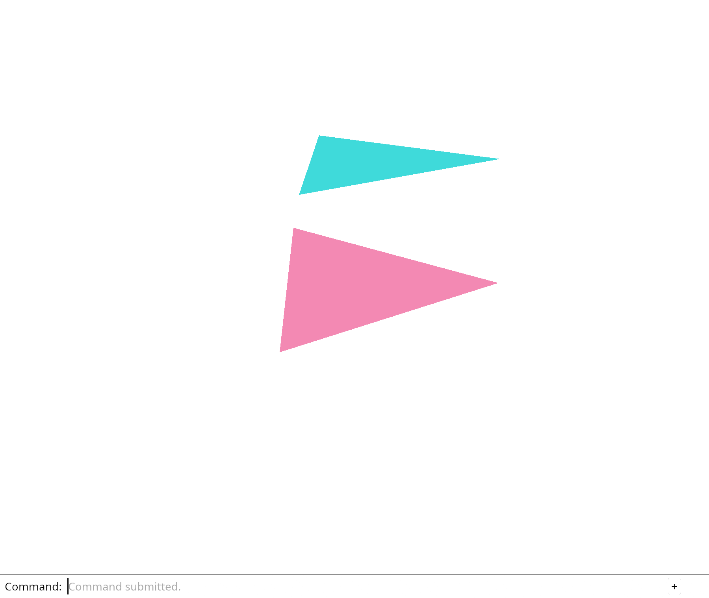

# 2.6 · Perspective picking and orbit navigation

**Goal:** Orbit and tilt a perspective camera while keeping its target in place. · **Checkpoints:** `15-perspective` → `16-orbit` (2 steps) · **Source:** `src/camera.rs,src/engine/gpu/render.rs,src/shaders/scene.wgsl`

<div class="webgpu-schematic" style="width:100%;margin:6px auto;">
<svg xmlns="http://www.w3.org/2000/svg" width="1120" height="200" viewBox="0 0 1120 200" style="width:100%;max-width:100%;height:auto;display:block;margin:0 auto;" role="img">
  <defs>
    <marker id="arr" viewBox="0 0 10 10" refX="8" refY="5" markerWidth="6" markerHeight="6" orient="auto">
      <path d="M 0 1 L 9 5 L 0 9 z" fill="#111111"/>
    </marker>
    <marker id="arrR" viewBox="0 0 10 10" refX="8" refY="5" markerWidth="6" markerHeight="6" orient="auto">
      <path d="M 0 1 L 9 5 L 0 9 z" fill="#dc2626"/>
    </marker>
    <marker id="arrG" viewBox="0 0 10 10" refX="8" refY="5" markerWidth="6" markerHeight="6" orient="auto">
      <path d="M 0 1 L 9 5 L 0 9 z" fill="#16a34a"/>
    </marker>
    <marker id="arrB" viewBox="0 0 10 10" refX="8" refY="5" markerWidth="6" markerHeight="6" orient="auto">
      <path d="M 0 1 L 9 5 L 0 9 z" fill="#2563eb"/>
    </marker>
  </defs>
  <rect x="2" y="2" width="1116" height="196" rx="10" fill="#ffffff" stroke="#111111" stroke-width="2"/>
  <rect x="16" y="14" width="248" height="172" rx="8" fill="#ffffff" stroke="#111111" stroke-width="1.75"/>
  <text paint-order="stroke fill" stroke="#ffffff" stroke-width="5" stroke-linejoin="round" x="140" y="34" text-anchor="middle" font-family="monospace" font-size="11.5" font-weight="700" fill="#111111">1. Lesson 2.6 Code</text>
  <rect x="34" y="48" width="212" height="24" rx="4" fill="#ffffff" stroke="#111111" stroke-width="1.25"/>
  <text paint-order="stroke fill" stroke="#ffffff" stroke-width="5" stroke-linejoin="round" x="140" y="64" text-anchor="middle" font-family="monospace" font-size="10" font-weight="700" fill="#111111">src/picking.rs</text>
  <rect x="34" y="78" width="212" height="24" rx="4" fill="#ffffff" stroke="#111111" stroke-width="1.5"/>
  <text paint-order="stroke fill" stroke="#ffffff" stroke-width="5" stroke-linejoin="round" x="140" y="94" text-anchor="middle" font-family="monospace" font-size="10" font-weight="700" fill="#111111">src/lib.rs</text>
  <rect x="34" y="108" width="212" height="24" rx="4" fill="#ffffff" stroke="#111111" stroke-width="1.25"/>
  <text paint-order="stroke fill" stroke="#ffffff" stroke-width="5" stroke-linejoin="round" x="140" y="124" text-anchor="middle" font-family="monospace" font-size="10" font-weight="700" fill="#111111">src/browser.rs</text>
  <text paint-order="stroke fill" stroke="#ffffff" stroke-width="5" stroke-linejoin="round" x="140" y="172" text-anchor="middle" font-family="monospace" font-size="9.5" fill="#111111">15-perspective -&gt; 16-orbit</text>
  <line x1="264" y1="100" x2="292" y2="100" stroke="#111111" stroke-width="2" marker-end="url(#arr)"/>
  <rect x="296" y="14" width="248" height="172" rx="8" fill="#ffffff" stroke="#111111" stroke-width="1.75"/>
  <text paint-order="stroke fill" stroke="#ffffff" stroke-width="5" stroke-linejoin="round" x="420" y="34" text-anchor="middle" font-family="monospace" font-size="11.5" font-weight="700" fill="#111111">2. session_viewer/src</text>
  <rect x="314" y="48" width="212" height="26" rx="4" fill="#ffffff" stroke="#111111" stroke-width="1.5"/>
  <text paint-order="stroke fill" stroke="#ffffff" stroke-width="5" stroke-linejoin="round" x="420" y="65" text-anchor="middle" font-family="monospace" font-size="10" font-weight="700" fill="#111111">src/camera.rs</text>
  <rect x="314" y="80" width="212" height="26" rx="4" fill="#ffffff" stroke="#111111" stroke-width="1.5"/>
  <text paint-order="stroke fill" stroke="#ffffff" stroke-width="5" stroke-linejoin="round" x="420" y="97" text-anchor="middle" font-family="monospace" font-size="10" font-weight="700" fill="#111111">src/engine/gpu/render.rs</text>
  <rect x="314" y="112" width="212" height="24" rx="4" fill="#ffffff" stroke="#111111" stroke-width="1.5"/>
  <text paint-order="stroke fill" stroke="#ffffff" stroke-width="5" stroke-linejoin="round" x="420" y="128" text-anchor="middle" font-family="monospace" font-size="9.5" font-weight="700" fill="#111111">✓ cargo check (wasm32)</text>
  <text paint-order="stroke fill" stroke="#ffffff" stroke-width="5" stroke-linejoin="round" x="420" y="172" text-anchor="middle" font-family="sans-serif" font-size="10" fill="#111111">Pick the nearest surface…</text>
  <line x1="544" y1="100" x2="572" y2="100" stroke="#111111" stroke-width="2" marker-end="url(#arr)"/>
  <rect x="576" y="14" width="248" height="172" rx="8" fill="#ffffff" stroke="#111111" stroke-width="1.75"/>
  <text paint-order="stroke fill" stroke="#ffffff" stroke-width="5" stroke-linejoin="round" x="700" y="34" text-anchor="middle" font-family="monospace" font-size="11.5" font-weight="700" fill="#111111">3. Vertex RGB &amp; Uniforms</text>
  <polygon points="610,56 690,56 610,126" fill="#bfdbfe" stroke="#111111" stroke-width="1.75"/>
  <polygon points="690,56 690,126 610,126" fill="#fde68a" stroke="#111111" stroke-width="1.75"/>
  <circle cx="610" cy="56" r="4" fill="#ef4444"/><text paint-order="stroke fill" stroke="#ffffff" stroke-width="5" stroke-linejoin="round" x="590" y="58" font-family="monospace" font-size="9" font-weight="700" fill="#111111">v0</text>
  <circle cx="690" cy="56" r="4" fill="#22c55e"/><text paint-order="stroke fill" stroke="#ffffff" stroke-width="5" stroke-linejoin="round" x="696" y="58" font-family="monospace" font-size="9" font-weight="700" fill="#111111">v1</text>
  <circle cx="610" cy="126" r="4" fill="#3b82f6"/><text paint-order="stroke fill" stroke="#ffffff" stroke-width="5" stroke-linejoin="round" x="590" y="130" font-family="monospace" font-size="9" font-weight="700" fill="#111111">v2</text>
  <circle cx="690" cy="126" r="4" fill="#f59e0b"/><text paint-order="stroke fill" stroke="#ffffff" stroke-width="5" stroke-linejoin="round" x="696" y="130" font-family="monospace" font-size="9" font-weight="700" fill="#111111">v3</text>
  <rect x="720" y="64" width="90" height="54" rx="5" fill="#ffffff" stroke="#111111" stroke-width="1.5"/>
  <text paint-order="stroke fill" stroke="#ffffff" stroke-width="5" stroke-linejoin="round" x="765" y="88" text-anchor="middle" font-family="monospace" font-size="10" font-weight="700" fill="#111111">view_proj</text>
  <text paint-order="stroke fill" stroke="#ffffff" stroke-width="5" stroke-linejoin="round" x="765" y="104" text-anchor="middle" font-family="monospace" font-size="9" fill="#111111">mat4x4&lt;f32&gt;</text>
  <text paint-order="stroke fill" stroke="#ffffff" stroke-width="5" stroke-linejoin="round" x="700" y="172" text-anchor="middle" font-family="monospace" font-size="9.5" fill="#111111">Perspective picking and orb…</text>
  <line x1="824" y1="100" x2="852" y2="100" stroke="#111111" stroke-width="2" marker-end="url(#arr)"/>
  <rect x="856" y="14" width="248" height="172" rx="8" fill="#ffffff" stroke="#111111" stroke-width="1.75"/>
  <text paint-order="stroke fill" stroke="#ffffff" stroke-width="5" stroke-linejoin="round" x="980" y="34" text-anchor="middle" font-family="monospace" font-size="11.5" font-weight="700" fill="#111111">4. Depth32Float &amp; Ray Pick</text>
  <rect x="936" y="54" width="96" height="62" rx="4" fill="#93c5fd" stroke="#111111" stroke-width="1.5" stroke-dasharray="3 3"/>
  <rect x="892" y="74" width="96" height="62" rx="4" fill="#fdba74" stroke="#111111" stroke-width="2"/>
  <line x1="864" y1="138" x2="932" y2="102" stroke="#111111" stroke-width="2" marker-end="url(#arr)"/>
  <circle cx="936" cy="100" r="5" fill="#facc15" stroke="#111111" stroke-width="1.5"/>
  <text paint-order="stroke fill" stroke="#ffffff" stroke-width="5" stroke-linejoin="round" x="896" y="68" font-family="monospace" font-size="9" font-weight="700" fill="#111111">z=0.2 &lt; z=0.7</text>
  <text paint-order="stroke fill" stroke="#ffffff" stroke-width="5" stroke-linejoin="round" x="980" y="172" text-anchor="middle" font-family="sans-serif" font-size="10" font-weight="700" fill="#111111">Walk around the model</text>
</svg>
</div>

## <a id="checkpoint-15-perspective"></a>Step 1 of 2 · Pick the nearest surface through the view (`15-perspective`)

<div class="webgpu-schematic" style="width:100%;margin:6px auto;">
<svg xmlns="http://www.w3.org/2000/svg" width="1120" height="72" viewBox="0 0 1120 72" style="width:100%;max-width:100%;height:auto;display:block;margin:0 auto;" role="img">
  <defs>
    <marker id="arr" viewBox="0 0 10 10" refX="8" refY="5" markerWidth="6" markerHeight="6" orient="auto">
      <path d="M 0 1 L 9 5 L 0 9 z" fill="#111111"/>
    </marker>
    <marker id="arrR" viewBox="0 0 10 10" refX="8" refY="5" markerWidth="6" markerHeight="6" orient="auto">
      <path d="M 0 1 L 9 5 L 0 9 z" fill="#dc2626"/>
    </marker>
    <marker id="arrG" viewBox="0 0 10 10" refX="8" refY="5" markerWidth="6" markerHeight="6" orient="auto">
      <path d="M 0 1 L 9 5 L 0 9 z" fill="#16a34a"/>
    </marker>
    <marker id="arrB" viewBox="0 0 10 10" refX="8" refY="5" markerWidth="6" markerHeight="6" orient="auto">
      <path d="M 0 1 L 9 5 L 0 9 z" fill="#2563eb"/>
    </marker>
  </defs>
  <rect x="2" y="2" width="1116" height="68" rx="10" fill="#ffffff" stroke="#111111" stroke-width="2"/>
  <rect x="14" y="10" width="252" height="52" rx="6" fill="#ffffff" stroke="#111111" stroke-width="1.5"/>
  <text paint-order="stroke fill" stroke="#ffffff" stroke-width="5" stroke-linejoin="round" x="140" y="30" text-anchor="middle" font-family="monospace" font-size="10.5" font-weight="700" fill="#111111">Step 1/2: 15-perspective</text>
  <text paint-order="stroke fill" stroke="#ffffff" stroke-width="5" stroke-linejoin="round" x="140" y="48" text-anchor="middle" font-family="monospace" font-size="9.5" fill="#111111">src/picking.rs, src/lib.rs</text>
  <line x1="266" y1="36" x2="292" y2="36" stroke="#111111" stroke-width="1.75" marker-end="url(#arr)"/>
  <rect x="296" y="10" width="252" height="52" rx="6" fill="#ffffff" stroke="#111111" stroke-width="1.5"/>
  <text paint-order="stroke fill" stroke="#ffffff" stroke-width="5" stroke-linejoin="round" x="422" y="30" text-anchor="middle" font-family="monospace" font-size="10" font-weight="700" fill="#111111">1. CPU / Rust Input</text>
  <text paint-order="stroke fill" stroke="#ffffff" stroke-width="5" stroke-linejoin="round" x="422" y="48" text-anchor="middle" font-family="sans-serif" font-size="9.5" fill="#111111">Canvas click</text>
  <line x1="548" y1="36" x2="574" y2="36" stroke="#111111" stroke-width="1.75" marker-end="url(#arr)"/>
  <rect x="578" y="10" width="252" height="52" rx="6" fill="#ffffff" stroke="#111111" stroke-width="1.5"/>
  <text paint-order="stroke fill" stroke="#ffffff" stroke-width="5" stroke-linejoin="round" x="704" y="30" text-anchor="middle" font-family="monospace" font-size="10" font-weight="700" fill="#111111">2. WebGPU / WGSL</text>
  <text paint-order="stroke fill" stroke="#ffffff" stroke-width="5" stroke-linejoin="round" x="704" y="48" text-anchor="middle" font-family="sans-serif" font-size="9.5" fill="#111111">nearest valid triangle</text>
  <line x1="830" y1="36" x2="856" y2="36" stroke="#111111" stroke-width="1.75" marker-end="url(#arr)"/>
  <rect x="860" y="10" width="246" height="52" rx="6" fill="#fef9c3" stroke="#111111" stroke-width="1.75"/>
  <text paint-order="stroke fill" stroke="#ffffff" stroke-width="5" stroke-linejoin="round" x="983" y="30" text-anchor="middle" font-family="monospace" font-size="10" font-weight="700" fill="#111111">3. -&gt; src/camera.rs</text>
  <text paint-order="stroke fill" stroke="#ffffff" stroke-width="5" stroke-linejoin="round" x="983" y="48" text-anchor="middle" font-family="sans-serif" font-size="9.5" fill="#111111">yellow display</text>
</svg>
</div>

**What this code does:** View the scene in perspective and select surfaces with a ray that agrees with the camera.

### 1. `src/picking.rs`

Replace the flat coverage query with ray–triangle intersections and update the visibility tests for the new camera.

Replace the entire file with:

```rust
--8<-- "journey/code/15-perspective-03.rs"
```

### 2. `src/lib.rs`

Register the camera-ray query now that its input is available.

**Locate this existing block:**

```rust
pub mod scene;
```

After that block, type:

```rust
--8<-- "journey/code/15-perspective-picking-module.rs" skip=15
```

### 3. `src/browser.rs`

Convert a canvas click to a camera ray and highlight its nearest valid object. Report that perspective picking is ready.

Edit these blocks from bottom to top. Keep the surrounding lines unchanged.

**Locate this block:**

```rust
    )?;
    // The page has one listener for its lifetime; JavaScript must retain the Rust callback.
    click.forget();
    report("Perspective drawing uses the current camera.");
    Ok(())
}
```

Replace it with:

```rust
    )?;
    // The page has one listener for its lifetime; JavaScript must retain the Rust callback.
    click.forget();
    report("Perspective and picking use the same camera.");
    Ok(())
}
```

**Locate this block:**

```rust
        });
        if let Some(line) = line {
            match line.as_str() {
                "canvas" => return,
                "example triangle" => {
                    history.edit(&mut scene, Scene::toggle_extra);
                    selected = selected.filter(|id| scene.contains(*id));
```

Replace it with:

```rust
        });
        if let Some(line) = line {
            match line.as_str() {
                "canvas" => {
                    let Some(event) = event.dyn_ref::<web_sys::MouseEvent>() else {
                        return;
                    };
                    let rect = input_canvas.get_bounding_client_rect();
                    if rect.width() <= 0.0 || rect.height() <= 0.0 {
                        return;
                    }
                    let screen = [
                        (2.0 * (event.client_x() as f64 - rect.left()) / rect.width() - 1.0) as f32,
                        (1.0 - 2.0 * (event.client_y() as f64 - rect.top()) / rect.height()) as f32,
                    ];
                    selected = camera
                        .ray(screen)
                        .and_then(|ray| crate::picking::pick(&scene, &ray));
                    renderer.set_scene(&scene, selected);
                }
                "example triangle" => {
                    history.edit(&mut scene, Scene::toggle_extra);
                    selected = selected.filter(|id| scene.contains(*id));
```

## <a id="checkpoint-16-orbit"></a>Step 2 of 2 · Walk around the model (`16-orbit`)

<div class="webgpu-schematic" style="width:100%;margin:6px auto;">
<svg xmlns="http://www.w3.org/2000/svg" width="1120" height="72" viewBox="0 0 1120 72" style="width:100%;max-width:100%;height:auto;display:block;margin:0 auto;" role="img">
  <defs>
    <marker id="arr" viewBox="0 0 10 10" refX="8" refY="5" markerWidth="6" markerHeight="6" orient="auto">
      <path d="M 0 1 L 9 5 L 0 9 z" fill="#111111"/>
    </marker>
    <marker id="arrR" viewBox="0 0 10 10" refX="8" refY="5" markerWidth="6" markerHeight="6" orient="auto">
      <path d="M 0 1 L 9 5 L 0 9 z" fill="#dc2626"/>
    </marker>
    <marker id="arrG" viewBox="0 0 10 10" refX="8" refY="5" markerWidth="6" markerHeight="6" orient="auto">
      <path d="M 0 1 L 9 5 L 0 9 z" fill="#16a34a"/>
    </marker>
    <marker id="arrB" viewBox="0 0 10 10" refX="8" refY="5" markerWidth="6" markerHeight="6" orient="auto">
      <path d="M 0 1 L 9 5 L 0 9 z" fill="#2563eb"/>
    </marker>
  </defs>
  <rect x="2" y="2" width="1116" height="68" rx="10" fill="#ffffff" stroke="#111111" stroke-width="2"/>
  <rect x="14" y="10" width="252" height="52" rx="6" fill="#ffffff" stroke="#111111" stroke-width="1.5"/>
  <text paint-order="stroke fill" stroke="#ffffff" stroke-width="5" stroke-linejoin="round" x="140" y="30" text-anchor="middle" font-family="monospace" font-size="10.5" font-weight="700" fill="#111111">Step 2/2: 16-orbit</text>
  <text paint-order="stroke fill" stroke="#ffffff" stroke-width="5" stroke-linejoin="round" x="140" y="48" text-anchor="middle" font-family="monospace" font-size="9.5" fill="#111111">src/camera.rs, src/browser.…</text>
  <line x1="266" y1="36" x2="292" y2="36" stroke="#111111" stroke-width="1.75" marker-end="url(#arr)"/>
  <rect x="296" y="10" width="252" height="52" rx="6" fill="#ffffff" stroke="#111111" stroke-width="1.5"/>
  <text paint-order="stroke fill" stroke="#ffffff" stroke-width="5" stroke-linejoin="round" x="422" y="30" text-anchor="middle" font-family="monospace" font-size="10" font-weight="700" fill="#111111">1. CPU / Rust Input</text>
  <text paint-order="stroke fill" stroke="#ffffff" stroke-width="5" stroke-linejoin="round" x="422" y="48" text-anchor="middle" font-family="sans-serif" font-size="9.5" fill="#111111">View action</text>
  <line x1="548" y1="36" x2="574" y2="36" stroke="#111111" stroke-width="1.75" marker-end="url(#arr)"/>
  <rect x="578" y="10" width="252" height="52" rx="6" fill="#ffffff" stroke="#111111" stroke-width="1.5"/>
  <text paint-order="stroke fill" stroke="#ffffff" stroke-width="5" stroke-linejoin="round" x="704" y="30" text-anchor="middle" font-family="monospace" font-size="10" font-weight="700" fill="#111111">2. WebGPU / WGSL</text>
  <text paint-order="stroke fill" stroke="#ffffff" stroke-width="5" stroke-linejoin="round" x="704" y="48" text-anchor="middle" font-family="sans-serif" font-size="9.5" fill="#111111">eye and up vectors</text>
  <line x1="830" y1="36" x2="856" y2="36" stroke="#111111" stroke-width="1.75" marker-end="url(#arr)"/>
  <rect x="860" y="10" width="246" height="52" rx="6" fill="#ffffff" stroke="#111111" stroke-width="1.75"/>
  <text paint-order="stroke fill" stroke="#ffffff" stroke-width="5" stroke-linejoin="round" x="983" y="30" text-anchor="middle" font-family="monospace" font-size="10" font-weight="700" fill="#111111">3. -&gt; src/camera.rs</text>
  <text paint-order="stroke fill" stroke="#ffffff" stroke-width="5" stroke-linejoin="round" x="983" y="48" text-anchor="middle" font-family="sans-serif" font-size="9.5" fill="#111111">drawing and pick ray</text>
</svg>
</div>

**What this code does:** Orbit and tilt a perspective camera while keeping its target in place.

### 1. `src/camera.rs`

Use the kernel’s rotation representation alongside its points, vectors and matrices. Store a 3D target and orientation instead of a flat centre and one angle. Keep the same initial eye and up directions as the perspective lesson. Move the target in the camera’s current right/up plane, including its world-z component. Add world-up orbit and a named pose. Keep rotate as the existing Turn view action. Calculate eye and up from the orientation, then reuse the existing view and projection construction. Extend the target-centering test to include a 3D orbit. Check the rotation invariant after many small updates, not just one convenient angle.

Replace the entire file with:

```rust
use session_rust::{Point, Quaternion, Vector, Xform};

pub struct Ray {
    pub origin: Point,
    pub direction: Vector,
    pub max_distance: f64,
}

pub struct Camera {
    pub target: [f64; 3],
    pub distance: f64,
    pub orientation: Quaternion,
    pub aspect: f64,
}

impl Default for Camera {
    fn default() -> Self {
        Self {
            target: [0.0; 3],
            distance: 3.0,
            orientation: Quaternion::from_axis_angle(Vector::x_axis(), -std::f64::consts::FRAC_PI_2),
            aspect: 640.0 / 480.0,
        }
    }
}

impl Camera {
    pub fn pan(&mut self, dx: f32, dy: f32) {
        let right = self.orientation.rotate_vector(Vector::x_axis());
        let up = self.orientation.rotate_vector(Vector::z_axis());
        for i in 0..3 {
            self.target[i] += dx as f64 * right[i] + dy as f64 * up[i];
        }
    }

    pub fn zoom(&mut self, factor: f32) {
        if factor.is_finite() && factor > 0.0 {
            self.distance = (self.distance / factor as f64).clamp(0.2, 50.0);
        }
    }

    pub fn rotate(&mut self, radians: f32) {
        self.orbit(radians as f64, 0.0);
    }

    pub fn orbit(&mut self, yaw: f64, pitch: f64) {
        let right = self.orientation.rotate_vector(Vector::x_axis());
        let turn = Quaternion::from_axis_angle(Vector::z_axis(), yaw);
        let tilt = Quaternion::from_axis_angle(right, pitch);
        self.orientation = (turn * (tilt * self.orientation.duplicate())).normalized();
    }

    pub fn isometric(&mut self) {
        let turn = Quaternion::from_axis_angle(Vector::z_axis(), -std::f64::consts::FRAC_PI_6);
        let right = turn.rotate_vector(Vector::x_axis());
        let tilt = Quaternion::from_axis_angle(right, -std::f64::consts::FRAC_PI_6);
        self.orientation = (tilt * turn).normalized();
    }

    pub fn view_projection(&self) -> Xform {
        let forward = self.orientation.rotate_vector(Vector::y_axis());
        let up = self.orientation.rotate_vector(Vector::z_axis());
        let target = Point::new(self.target[0], self.target[1], self.target[2]);
        let eye = Point::new(
            self.target[0] - forward[0] * self.distance,
            self.target[1] - forward[1] * self.distance,
            self.target[2] - forward[2] * self.distance,
        );
        let view = Xform::look_at_right_handed(&eye, &target, &up);
        let projection = Xform::perspective(60.0_f64.to_radians(), self.aspect, 0.01, 100.0);
        projection * view
    }

    pub fn uniform(&self) -> [f32; 16] {
        self.view_projection().to_f32()
    }

    pub fn ray(&self, screen: [f32; 2]) -> Option<Ray> {
        if screen.iter().any(|value| !value.is_finite() || value.abs() > 1.0) {
            return None;
        }
        let inverse = self.view_projection().inverse()?;
        let origin = inverse.transform_point(&Point::new(screen[0] as f64, screen[1] as f64, 0.0));
        let end = inverse.transform_point(&Point::new(screen[0] as f64, screen[1] as f64, 1.0));
        let delta = &end - &origin;
        let max_distance = delta.magnitude();
        if !max_distance.is_finite() || max_distance <= 0.0 {
            return None;
        }
        Some(Ray { origin, direction: delta.normalized(), max_distance })
    }
}

#[cfg(test)]
mod tests {
    use super::*;

    #[test]
    fn the_target_stays_centred_after_pan_zoom_and_turn() {
        let mut camera = Camera::default();
        camera.pan(0.25, -0.5);
        camera.zoom(2.0);
        camera.rotate(0.7);
        camera.orbit(0.3, 0.2);
        let target = Point::new(camera.target[0], camera.target[1], camera.target[2]);
        let screen = camera.view_projection().transform_point(&target);
        assert!(screen[0].abs() < 1.0e-9 && screen[1].abs() < 1.0e-9);
        assert!((0.0..1.0).contains(&screen[2]));
    }

    #[test]
    fn repeated_orbit_keeps_the_camera_axes_orthonormal() {
        let mut camera = Camera::default();
        for _ in 0..1_000 {
            camera.orbit(0.01, 0.02);
        }
        let right = camera.orientation.rotate_vector(Vector::x_axis());
        let forward = camera.orientation.rotate_vector(Vector::y_axis());
        let up = camera.orientation.rotate_vector(Vector::z_axis());
        for axis in [&right, &forward, &up] {
            assert!((axis.magnitude() - 1.0).abs() < 1.0e-10);
        }
        assert!(right.dot(&forward).abs() < 1.0e-10);
        assert!(right.dot(&up).abs() < 1.0e-10);
        assert!(forward.dot(&up).abs() < 1.0e-10);
    }

    #[test]
    fn a_projected_point_lies_on_its_unprojected_ray() {
        let camera = Camera::default();
        let world = Point::new(0.4, 0.2, 0.75);
        let screen = camera.view_projection().transform_point(&world);
        let ray = camera.ray([screen[0] as f32, screen[1] as f32]).unwrap();
        let offset = &world - &ray.origin;
        assert!(offset.cross(&ray.direction).magnitude() < 1.0e-6);
        assert!(offset.dot(&ray.direction) > 0.0);
        assert!(offset.magnitude() < ray.max_distance);
        assert!(camera.ray([f32::NAN, 0.0]).is_none());
    }
}
```

### 2. `src/browser.rs`

Add vertical orbit and isometric commands. Apply vertical orbit or the isometric orientation. Report that orbit preserves the target.

Edit these blocks from bottom to top. Keep the surrounding lines unchanged.

**Locate this block:**

```rust
    )?;
    // The page has one listener for its lifetime; JavaScript must retain the Rust callback.
    click.forget();
    report("Perspective and picking use the same camera.");
    Ok(())
}
```

Replace it with:

```rust
    )?;
    // The page has one listener for its lifetime; JavaScript must retain the Rust callback.
    click.forget();
    report("Orbit moves the eye around a fixed target.");
    Ok(())
}
```

**Locate this block:**

```rust
                "pan left" => camera.pan(-0.25, 0.0),
                "pan right" => camera.pan(0.25, 0.0),
                "orbit right" => camera.rotate(std::f32::consts::FRAC_PI_4),
                "view reset" => camera = Camera { aspect: camera.aspect, ..Camera::default() },
                _ => return,
            }
```

Replace it with:

```rust
                "pan left" => camera.pan(-0.25, 0.0),
                "pan right" => camera.pan(0.25, 0.0),
                "orbit right" => camera.rotate(std::f32::consts::FRAC_PI_4),
                "orbit up" => camera.orbit(0.0, std::f64::consts::FRAC_PI_6),
                "view isometric" => camera.isometric(),
                "view reset" => camera = Camera { aspect: camera.aspect, ..Camera::default() },
                _ => return,
            }
```

**Locate this block:**

```rust
            "Pan Left",
            "Pan Right",
            "Orbit Right",
            "View Reset",
        ],
    );
```

Replace it with:

```rust
            "Pan Left",
            "Pan Right",
            "Orbit Right",
            "Orbit Up",
            "View Isometric",
            "View Reset",
        ],
    );
```

## Build & Run



```sh
cd workspace/journey
REGEN_PROTO=0 cargo build --lib --locked --target wasm32-unknown-unknown -j1
REGEN_PROTO=0 CARGO_BUILD_JOBS=1 trunk serve --port 8780
cd ../..
npm --prefix ../session_tests run course -- check 2.6
npm --prefix ../session_tests run course -- save 2.6
```

Continue with [3.1 · Kernel geometry and a single editor owner](17-solid.md).
