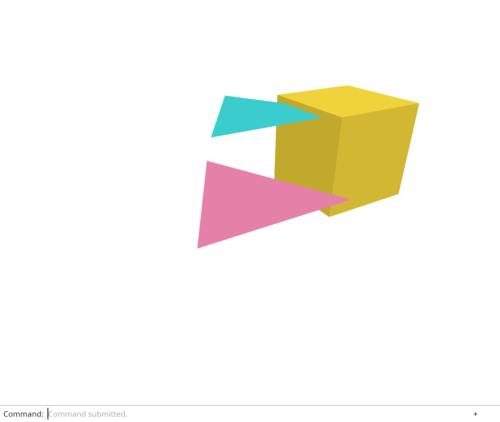

# 3.1 · Kernel geometry and a single editor owner

**Steps:** 5 · **Source:** `src/app/decode.rs` · `src/app/loader.rs` · `src/state.rs`

## <a id="checkpoint-17-solid"></a>1. Bring a solid into the scene

<div class="webgpu-schematic" style="width:100%;margin:6px auto;">
<svg xmlns="http://www.w3.org/2000/svg" width="1120" height="214" viewBox="0 0 1120 214" style="width:100%;max-width:100%;height:auto;display:block;margin:0 auto;" role="img">
  <defs>
    <marker id="arr-bf4ea7de" viewBox="0 0 10 10" refX="8" refY="5" markerWidth="6" markerHeight="6" orient="auto">
      <path d="M 0 1 L 9 5 L 0 9 z" fill="#111111"/>
    </marker>
    <marker id="arr-r-bf4ea7de" viewBox="0 0 10 10" refX="8" refY="5" markerWidth="6" markerHeight="6" orient="auto">
      <path d="M 0 1 L 9 5 L 0 9 z" fill="#dc2626"/>
    </marker>
    <marker id="arr-g-bf4ea7de" viewBox="0 0 10 10" refX="8" refY="5" markerWidth="6" markerHeight="6" orient="auto">
      <path d="M 0 1 L 9 5 L 0 9 z" fill="#16a34a"/>
    </marker>
    <marker id="arr-b-bf4ea7de" viewBox="0 0 10 10" refX="8" refY="5" markerWidth="6" markerHeight="6" orient="auto">
      <path d="M 0 1 L 9 5 L 0 9 z" fill="#2563eb"/>
    </marker>
    <pattern id="grid-bf4ea7de" width="20" height="20" patternUnits="userSpaceOnUse">
      <path d="M 20 0 L 0 0 0 20" fill="none" stroke="#f1f5f9" stroke-width="1"/>
    </pattern>
  </defs>
  <rect x="2" y="2" width="1116" height="210" rx="8" fill="#ffffff" stroke="#111111" stroke-width="2"/>
  <rect x="2" y="2" width="1116" height="28" rx="6" fill="#f8fafc" stroke="#111111" stroke-width="1.5"/>
  <line x1="2" y1="30" x2="1118" y2="30" stroke="#111111" stroke-width="1.5"/>
  <rect x="12" y="7" width="176" height="18" rx="3" fill="#111111"/>
  <text x="100" y="19.5" text-anchor="middle" font-family="monospace" font-size="9.5" font-weight="700" fill="#ffffff" paint-order="normal" stroke="none">17..19 · SOLID &amp; EDITOR</text>
  <text paint-order="stroke fill" stroke="#ffffff" stroke-width="4.5" stroke-linejoin="round" x="518" y="20" text-anchor="middle" font-family="monospace" font-size="10.5" font-weight="700" fill="#111111">24-Vertex Split-Normal Solid Box, Headlamp Lambertian Shading &amp; Unidirectional Editor State</text>
  <rect x="838" y="7" width="268" height="18" rx="3" fill="#ffffff" stroke="#111111" stroke-width="1.2"/>
  <text paint-order="stroke fill" stroke="#ffffff" stroke-width="4.5" stroke-linejoin="round" x="972" y="19.5" text-anchor="middle" font-family="monospace" font-size="9" font-weight="700" fill="#2563eb">I = k_a + k_d * max(dot(N, L), 0.0)</text>
  <rect x="14" y="38" width="344" height="164" rx="6" fill="url(#grid-bf4ea7de)" stroke="#111111" stroke-width="1.5"/>
  <line x1="14" y1="60" x2="358" y2="60" stroke="#cbd5e1" stroke-width="1"/>
  <text paint-order="stroke fill" stroke="#ffffff" stroke-width="4.5" stroke-linejoin="round" x="186" y="53" text-anchor="middle" font-family="monospace" font-size="10" font-weight="700" fill="#111111">1 · Split-Corner Normals + Headlamp dot(N, L)</text>
  <line x1="68" y1="154" x2="256" y2="154" stroke="#111111" stroke-width="2"/>
  <line x1="162" y1="154" x2="162" y2="76" stroke="#2563eb" stroke-width="2.5" marker-end="url(#arr-b-bf4ea7de)"/>
  <text paint-order="stroke fill" stroke="#ffffff" stroke-width="4.5" stroke-linejoin="round" x="148" y="84" font-family="monospace" font-size="10" font-weight="700" fill="#2563eb">N</text>
  <line x1="162" y1="154" x2="232" y2="86" stroke="#dc2626" stroke-width="2.2" marker-end="url(#arr-r-bf4ea7de)"/>
  <text paint-order="stroke fill" stroke="#ffffff" stroke-width="4.5" stroke-linejoin="round" x="242" y="88" font-family="monospace" font-size="10" font-weight="700" fill="#dc2626">L</text>
  <text paint-order="stroke fill" stroke="#ffffff" stroke-width="4.5" stroke-linejoin="round" x="186" y="180" text-anchor="middle" font-family="monospace" font-size="9" font-weight="700" fill="#111111">24 verts (3 distinct normals / corner)</text>
  <line x1="358" y1="120" x2="384" y2="120" stroke="#111111" stroke-width="2" marker-end="url(#arr-bf4ea7de)"/>
  <rect x="388" y="38" width="344" height="164" rx="6" fill="url(#grid-bf4ea7de)" stroke="#111111" stroke-width="1.5"/>
  <line x1="388" y1="60" x2="732" y2="60" stroke="#cbd5e1" stroke-width="1"/>
  <text paint-order="stroke fill" stroke="#ffffff" stroke-width="4.5" stroke-linejoin="round" x="560" y="53" text-anchor="middle" font-family="monospace" font-size="10" font-weight="700" fill="#111111">2 · Editor::apply(Action) -&gt; Change Flags</text>
  <rect x="414" y="76" width="292" height="46" rx="4" fill="#dbeafe" stroke="#2563eb" stroke-width="1.5"/>
  <text paint-order="stroke fill" stroke="#ffffff" stroke-width="4.5" stroke-linejoin="round" x="560" y="96" text-anchor="middle" font-family="monospace" font-size="9.5" font-weight="700" fill="#111111">Orbit / Pan / Zoom Action</text>
  <text paint-order="stroke fill" stroke="#ffffff" stroke-width="4.5" stroke-linejoin="round" x="560" y="113" text-anchor="middle" font-family="monospace" font-size="8.5" fill="#2563eb">sync_scene: false · redraw: true (64B uniform)</text>
  <rect x="414" y="132" width="292" height="48" rx="4" fill="#dcfce7" stroke="#16a34a" stroke-width="1.5"/>
  <text paint-order="stroke fill" stroke="#ffffff" stroke-width="4.5" stroke-linejoin="round" x="560" y="152" text-anchor="middle" font-family="monospace" font-size="9.5" font-weight="700" fill="#111111">Document Edit / Undo / Import</text>
  <text paint-order="stroke fill" stroke="#ffffff" stroke-width="4.5" stroke-linejoin="round" x="560" y="170" text-anchor="middle" font-family="monospace" font-size="8.5" fill="#16a34a">sync_scene: true · redraw: true (GPU buffers)</text>
  <line x1="732" y1="120" x2="758" y2="120" stroke="#111111" stroke-width="2" marker-end="url(#arr-bf4ea7de)"/>
  <rect x="762" y="38" width="344" height="164" rx="6" fill="url(#grid-bf4ea7de)" stroke="#111111" stroke-width="1.75"/>
  <line x1="762" y1="60" x2="1106" y2="60" stroke="#cbd5e1" stroke-width="1"/>
  <text paint-order="stroke fill" stroke="#ffffff" stroke-width="4.5" stroke-linejoin="round" x="934" y="53" text-anchor="middle" font-family="monospace" font-size="10" font-weight="700" fill="#111111">3 · Shaded 3D Solid in Viewport</text>
  <rect x="806" y="68" width="256" height="122" rx="4" fill="#ffffff" stroke="#111111" stroke-width="2"/>
  <polygon points="884,96 944,74 1004,96 944,118" fill="#dbeafe" stroke="#111111" stroke-width="1.5"/>
  <polygon points="884,96 944,118 944,176 884,154" fill="#60a5fa" stroke="#111111" stroke-width="1.5"/>
  <polygon points="944,118 1004,96 1004,154 944,176" fill="#1d4ed8" stroke="#111111" stroke-width="1.5"/>
</svg>
</div>

### 1. `src/mesh.rs`

**Locate this existing block:**

```rust
    }

    pub fn vertices(&self) -> &[[f32; 6]] {
        &self.vertices
    }

    pub fn indices(&self) -> &[u16] {
        &self.indices
    }
}

#[cfg(test)]
mod tests {
    use super::*;

    #[test]
```

Edit the existing block to match this code; keep unchanged lines:

```rust
    }

    pub fn from_kernel(mesh: &session_rust::Mesh) -> Result<Self, &'static str> {
        let render = mesh.to_render();
        let vertices = render
            .vertices
            .iter()
            .map(|vertex| {
                let [x, y, z] = vertex.position;
                let [r, g, b, _] = vertex.color;
                [x, y, z, r, g, b]
            })
            .collect();
        let indices: Result<Vec<u16>, _> = render
            .indices
            .into_iter()
            .map(u16::try_from)
            .collect();
        Self::new(
            vertices,
            indices.map_err(|_| "Mesh exceeds this lesson's 16-bit index capacity")?,
        )
    }

    pub fn vertices(&self) -> &[[f32; 6]] {
        &self.vertices
    }

    pub fn indices(&self) -> &[u16] {
        &self.indices
    }
}

#[cfg(test)]
mod tests {
    use super::*;

    #[test]
    fn a_kernel_box_becomes_eight_vertices_and_twelve_triangles() {
        let source = session_rust::Mesh::create_box(0.8, 0.8, 0.8);
        let mesh = Mesh::from_kernel(&source).unwrap();
        assert_eq!(mesh.vertices().len(), 8);
        assert_eq!(mesh.indices().len(), 36);
    }

    #[test]
```

### 2. `src/scene.rs`

**Locate this existing block:**

```rust
    }

    pub fn toggle_extra(&mut self) {
```

Edit the existing block to match this code; keep unchanged lines:

```rust
    }

    pub fn add_box(&mut self) -> Result<ObjectId, &'static str> {
        let mut source = session_rust::Mesh::create_box(0.8, 0.8, 0.8);
        source.transform(&session_rust::Xform::translation(
            0.9, 0.0, 0.4,
        ));
        source.set_objectcolor(session_rust::Color::new(
            0.65, 0.65, 0.65, 1.0,
        ));
        self.insert(Mesh::from_kernel(&source)?)
    }

    pub fn toggle_extra(&mut self) {
```

### 3. `src/history.rs`

Edit these blocks from bottom to top. Keep the surrounding lines unchanged.

**Locate this block:**

```rust
        assert_ne!(scene.objects()[2].id, old_id);
        assert!(!history.redo(&mut scene));
    }
```

Replace it with:

```rust
        assert_ne!(scene.objects()[2].id, old_id);
        assert!(!history.redo(&mut scene));
    }

    #[test]
    fn a_failed_action_restores_the_scene_and_preserves_redo() {
        let mut scene = Scene::demo();
        let mut history = History::default();
        let id = scene.objects()[0].id;
        history.edit(&mut scene, |scene| {
            scene.remove(id);
        });
        history.undo(&mut scene);
        let result = history.try_edit(&mut scene, |scene| {
            scene.remove(id);
            Err("Creation failed after a partial change")
        });
        assert!(result.is_err());
        assert!(scene.contains(id));
        assert!(history.redo(&mut scene));
        assert!(!scene.contains(id));
    }
```

**Locate this block:**

```rust
    pub fn edit(&mut self, scene: &mut Scene, action: impl FnOnce(&mut Scene)) {
        let before = scene.clone();
        action(scene);
        if self.undo.len() == LIMIT {
            self.undo.remove(0);
        }
        self.undo.push(before);
        self.redo.clear();
    }

    pub fn undo(&mut self, scene: &mut Scene) -> bool {
```

Replace it with:

```rust
    pub fn edit(&mut self, scene: &mut Scene, action: impl FnOnce(&mut Scene)) {
        self.try_edit(scene, |scene| {
            action(scene);
            Ok(())
        })
        .expect("Infallible scene edit");
    }

    pub fn try_edit(
        &mut self,
        scene: &mut Scene,
        action: impl FnOnce(&mut Scene) -> Result<(), &'static str>,
    ) -> Result<(), &'static str> {
        let before = scene.clone();
        if let Err(error) = action(scene) {
            scene.restore(before);
            return Err(error);
        }
        if self.undo.len() == LIMIT {
            self.undo.remove(0);
        }
        self.undo.push(before);
        self.redo.clear();
        Ok(())
    }

    pub fn undo(&mut self, scene: &mut Scene) -> bool {
```

### 4. `src/browser.rs`

Edit these blocks from bottom to top. Keep the surrounding lines unchanged.

**Locate this block:**

```rust
    )?;
    // The page has one listener for its lifetime; JavaScript must retain the Rust callback.
    click.forget();
    report("Orbit moves the eye around a fixed target.");
    Ok(())
```

Replace it with:

```rust
    )?;
    // The page has one listener for its lifetime; JavaScript must retain the Rust callback.
    click.forget();
    report("Kernel geometry becomes an undoable scene object.");
    Ok(())
```

**Locate this block:**

```rust
                            .and_then(|ray| crate::picking::pick(&scene, &ray));
                        renderer.set_scene(&scene, selected);
                    }
                    "example triangle" => {
                        history.edit(&mut scene, Scene::toggle_extra);
                        selected = selected.filter(|id| scene.contains(*id));
```

Replace it with:

```rust
                            .and_then(|ray| crate::picking::pick(&scene, &ray));
                        renderer.set_scene(&scene, selected);
                    }
                    "example box" => {
                        if let Err(error) = history.try_edit(&mut scene, |scene| {
                            scene.add_box().map(|_| ())
                        }) {
                            report(error);
                            return;
                        }
                        renderer.set_scene(&scene, selected);
                    }
                    "example triangle" => {
                        history.edit(&mut scene, Scene::toggle_extra);
                        selected = selected.filter(|id| scene.contains(*id));
```

**Locate this block:**

```rust
            "Help",
            "Example Triangle",
            "Select Next",
            "Delete",
```

Replace it with:

```rust
            "Help",
            "Example Box",
            "Example Triangle",
            "Select Next",
            "Delete",
```

## <a id="checkpoint-18-light"></a>2. Read the shape through light

<div class="webgpu-schematic" style="width:100%;margin:6px auto;">
<svg xmlns="http://www.w3.org/2000/svg" width="1120" height="188" viewBox="0 0 1120 188" style="width:100%;max-width:100%;height:auto;display:block;margin:0 auto;" role="img">
  <defs>
    <marker id="arr" viewBox="0 0 10 10" refX="8" refY="5" markerWidth="6" markerHeight="6" orient="auto">
      <path d="M 0 1 L 9 5 L 0 9 z" fill="#111111"/>
    </marker>
    <marker id="arrR" viewBox="0 0 10 10" refX="8" refY="5" markerWidth="6" markerHeight="6" orient="auto">
      <path d="M 0 1 L 9 5 L 0 9 z" fill="#dc2626"/>
    </marker>
    <marker id="arrG" viewBox="0 0 10 10" refX="8" refY="5" markerWidth="6" markerHeight="6" orient="auto">
      <path d="M 0 1 L 9 5 L 0 9 z" fill="#16a34a"/>
    </marker>
    <marker id="arrB" viewBox="0 0 10 10" refX="8" refY="5" markerWidth="6" markerHeight="6" orient="auto">
      <path d="M 0 1 L 9 5 L 0 9 z" fill="#2563eb"/>
    </marker>
  </defs>
  <rect x="2" y="2" width="1116" height="184" rx="10" fill="#ffffff" stroke="#111111" stroke-width="2"/>
  <rect x="14" y="12" width="344" height="164" rx="8" fill="#ffffff" stroke="#111111" stroke-width="1.5"/>
  <text paint-order="stroke fill" stroke="#ffffff" stroke-width="5" stroke-linejoin="round" x="186" y="30" text-anchor="middle" font-family="monospace" font-size="10.5" font-weight="700" fill="#111111">Kernel Box + Face Normals N</text>
  <polygon points="186,52 256,82 186,112 116,82" fill="#f8fafc" stroke="#111111" stroke-width="1.75"/>
  <polygon points="116,82 186,112 186,160 116,130" fill="#e2e8f0" stroke="#111111" stroke-width="1.75"/>
  <polygon points="186,112 256,82 256,130 186,160" fill="#cbd5e1" stroke="#111111" stroke-width="1.75"/>
  <line x1="186" y1="82" x2="186" y2="38" stroke="#2563eb" stroke-width="2" marker-end="url(#arrB)"/>
  <line x1="222" y1="120" x2="268" y2="140" stroke="#dc2626" stroke-width="2" marker-end="url(#arrR)"/>
  <line x1="150" y1="120" x2="104" y2="140" stroke="#16a34a" stroke-width="2" marker-end="url(#arrG)"/>
  <line x1="358" y1="94" x2="384" y2="94" stroke="#111111" stroke-width="2" marker-end="url(#arr)"/>
  <rect x="388" y="12" width="344" height="164" rx="8" fill="#ffffff" stroke="#111111" stroke-width="1.5"/>
  <text paint-order="stroke fill" stroke="#ffffff" stroke-width="5" stroke-linejoin="round" x="560" y="30" text-anchor="middle" font-family="monospace" font-size="10.5" font-weight="700" fill="#111111">@fragment: max(dot(N, L), 0.0)</text>
  <line x1="470" y1="134" x2="650" y2="134" stroke="#111111" stroke-width="2"/>
  <line x1="560" y1="134" x2="560" y2="54" stroke="#2563eb" stroke-width="2.25" marker-end="url(#arrB)"/>
  <text paint-order="stroke fill" stroke="#ffffff" stroke-width="5" stroke-linejoin="round" x="546" y="60" font-family="monospace" font-size="10" font-weight="700" fill="#2563eb">N</text>
  <line x1="560" y1="134" x2="628" y2="66" stroke="#f59e0b" stroke-width="2.25" marker-end="url(#arr)"/>
  <text paint-order="stroke fill" stroke="#ffffff" stroke-width="5" stroke-linejoin="round" x="640" y="68" font-family="monospace" font-size="10" font-weight="700" fill="#d97706">L</text>
  <path d="M 560 98 A 36 36 0 0 1 585 109" fill="none" stroke="#111111" stroke-width="1.5"/>
  <text paint-order="stroke fill" stroke="#ffffff" stroke-width="5" stroke-linejoin="round" x="582" y="94" font-family="monospace" font-size="9.5" font-weight="700" fill="#111111">θ</text>
  <text paint-order="stroke fill" stroke="#ffffff" stroke-width="5" stroke-linejoin="round" x="560" y="156" text-anchor="middle" font-family="monospace" font-size="9.5" font-weight="700" fill="#111111">lit = base * (amb + diff * cos θ)</text>
  <line x1="732" y1="94" x2="758" y2="94" stroke="#111111" stroke-width="2" marker-end="url(#arr)"/>
  <rect x="762" y="12" width="344" height="164" rx="8" fill="#ffffff" stroke="#111111" stroke-width="1.75"/>
  <text paint-order="stroke fill" stroke="#ffffff" stroke-width="5" stroke-linejoin="round" x="934" y="30" text-anchor="middle" font-family="monospace" font-size="10.5" font-weight="700" fill="#111111">Shaded 3D Solid in Viewer</text>
  <rect x="814" y="44" width="240" height="118" rx="4" fill="#ffffff" stroke="#111111" stroke-width="2"/>
  <polygon points="934,54 1004,82 934,110 864,82" fill="#93c5fd" stroke="#111111" stroke-width="1.75"/>
  <polygon points="864,82 934,110 934,154 864,126" fill="#60a5fa" stroke="#111111" stroke-width="1.75"/>
  <polygon points="934,110 1004,82 1004,126 934,154" fill="#2563eb" stroke="#111111" stroke-width="1.75"/>
</svg>
</div>

### 1. `src/triangle.wgsl`

**Locate this existing block:**

```wgsl
    @location(0) colour: vec3<f32>,
}

@vertex
fn vertex(@location(0) position: vec3<f32>, @location(1) colour: vec3<f32>) -> VertexOutput {
    var output: VertexOutput;
    output.position = transform * vec4<f32>(position, 1.0);
    output.colour = colour;
    return output;
}

@fragment
fn fragment(input: VertexOutput) -> @location(0) vec4<f32> {
    return vec4<f32>(input.colour, 1.0);
}
```

Edit the existing block to match this code; keep unchanged lines:

```wgsl
    @location(0) colour: vec3<f32>,
    @location(1) world: vec3<f32>,
}

@vertex
fn vertex(@location(0) position: vec3<f32>, @location(1) colour: vec3<f32>) -> VertexOutput {
    var output: VertexOutput;
    output.position = transform * vec4<f32>(position, 1.0);
    output.colour = colour;
    output.world = position;
    return output;
}

@fragment
fn fragment(input: VertexOutput) -> @location(0) vec4<f32> {
    // Neighbouring fragments give two directions along this triangle's surface.
    let normal = normalize(cross(dpdx(input.world), dpdy(input.world)));
    let light = normalize(vec3<f32>(0.4, -0.6, 1.0));
    // abs lights both sides of an open face; 0.3 keeps unlit faces readable.
    let brightness = 0.3 + 0.7 * abs(dot(normal, light));
    return vec4<f32>(input.colour * brightness, 1.0);
}
```

### 2. `src/browser.rs`

**Locate this existing block:**

```rust
    click.forget();
    report("Kernel geometry becomes an undoable scene object.");
    Ok(())
```

Edit the existing block to match this code; keep unchanged lines:

```rust
    click.forget();
    report("Surface direction changes brightness, not geometry.");
    Ok(())
```

## <a id="checkpoint-18a-editor"></a>3. Give application state one owner

<div class="webgpu-schematic" style="width:100%;margin:6px auto;">
<svg xmlns="http://www.w3.org/2000/svg" width="1120" height="214" viewBox="0 0 1120 214" style="width:100%;max-width:100%;height:auto;display:block;margin:0 auto;" role="img">
  <defs>
    <marker id="arr-16ee0472" viewBox="0 0 10 10" refX="8" refY="5" markerWidth="6" markerHeight="6" orient="auto">
      <path d="M 0 1 L 9 5 L 0 9 z" fill="#111111"/>
    </marker>
    <marker id="arr-r-16ee0472" viewBox="0 0 10 10" refX="8" refY="5" markerWidth="6" markerHeight="6" orient="auto">
      <path d="M 0 1 L 9 5 L 0 9 z" fill="#dc2626"/>
    </marker>
    <marker id="arr-g-16ee0472" viewBox="0 0 10 10" refX="8" refY="5" markerWidth="6" markerHeight="6" orient="auto">
      <path d="M 0 1 L 9 5 L 0 9 z" fill="#16a34a"/>
    </marker>
    <marker id="arr-b-16ee0472" viewBox="0 0 10 10" refX="8" refY="5" markerWidth="6" markerHeight="6" orient="auto">
      <path d="M 0 1 L 9 5 L 0 9 z" fill="#2563eb"/>
    </marker>
    <pattern id="grid-16ee0472" width="20" height="20" patternUnits="userSpaceOnUse">
      <path d="M 20 0 L 0 0 0 20" fill="none" stroke="#f1f5f9" stroke-width="1"/>
    </pattern>
  </defs>
  <rect x="2" y="2" width="1116" height="210" rx="8" fill="#ffffff" stroke="#111111" stroke-width="2"/>
  <rect x="2" y="2" width="1116" height="28" rx="6" fill="#f8fafc" stroke="#111111" stroke-width="1.5"/>
  <line x1="2" y1="30" x2="1118" y2="30" stroke="#111111" stroke-width="1.5"/>
  <rect x="12" y="7" width="176" height="18" rx="3" fill="#111111"/>
  <text x="100" y="19.5" text-anchor="middle" font-family="monospace" font-size="9.5" font-weight="700" fill="#ffffff" paint-order="normal" stroke="none">18A..19 · ACTION -&gt; CHANGE</text>
  <text paint-order="stroke fill" stroke="#ffffff" stroke-width="4.5" stroke-linejoin="round" x="518" y="20" text-anchor="middle" font-family="monospace" font-size="10.5" font-weight="700" fill="#111111">Unidirectional Editor State Machine &amp; Split GPU Sync Flags (sync_scene vs redraw)</text>
  <rect x="838" y="7" width="268" height="18" rx="3" fill="#ffffff" stroke="#111111" stroke-width="1.2"/>
  <text paint-order="stroke fill" stroke="#ffffff" stroke-width="4.5" stroke-linejoin="round" x="972" y="19.5" text-anchor="middle" font-family="monospace" font-size="9" font-weight="700" fill="#2563eb">apply(Action) -&gt; Change { sync_scene, redraw }</text>
  <rect x="14" y="38" width="344" height="164" rx="6" fill="url(#grid-16ee0472)" stroke="#111111" stroke-width="1.5"/>
  <line x1="14" y1="60" x2="358" y2="60" stroke="#cbd5e1" stroke-width="1"/>
  <text paint-order="stroke fill" stroke="#ffffff" stroke-width="4.5" stroke-linejoin="round" x="186" y="53" text-anchor="middle" font-family="monospace" font-size="10" font-weight="700" fill="#111111">1 · Typed Action Enum (UI + Shortcuts)</text>
  <rect x="44" y="76" width="284" height="104" rx="4" fill="#ffffff" stroke="#111111" stroke-width="1.5"/>
  <text paint-order="stroke fill" stroke="#ffffff" stroke-width="4.5" stroke-linejoin="round" x="186" y="98" text-anchor="middle" font-family="monospace" font-size="9.5" font-weight="700" fill="#111111">enum Action {</text>
  <text paint-order="stroke fill" stroke="#ffffff" stroke-width="4.5" stroke-linejoin="round" x="186" y="118" text-anchor="middle" font-family="monospace" font-size="9" fill="#2563eb">  Orbit(dx, dy), Pan(dx, dy), Zoom(d),</text>
  <text paint-order="stroke fill" stroke="#ffffff" stroke-width="4.5" stroke-linejoin="round" x="186" y="138" text-anchor="middle" font-family="monospace" font-size="9" fill="#16a34a">  Pick(px, py), DeleteSelected,</text>
  <text paint-order="stroke fill" stroke="#ffffff" stroke-width="4.5" stroke-linejoin="round" x="186" y="158" text-anchor="middle" font-family="monospace" font-size="9" fill="#dc2626">  Undo, Redo, ToggleBackground }</text>
  <line x1="358" y1="120" x2="384" y2="120" stroke="#111111" stroke-width="2" marker-end="url(#arr-16ee0472)"/>
  <rect x="388" y="38" width="344" height="164" rx="6" fill="url(#grid-16ee0472)" stroke="#111111" stroke-width="1.5"/>
  <line x1="388" y1="60" x2="732" y2="60" stroke="#cbd5e1" stroke-width="1"/>
  <text paint-order="stroke fill" stroke="#ffffff" stroke-width="4.5" stroke-linejoin="round" x="560" y="53" text-anchor="middle" font-family="monospace" font-size="10" font-weight="700" fill="#111111">2 · Two-Tier GPU Update Contract</text>
  <rect x="414" y="76" width="292" height="48" rx="4" fill="#dbeafe" stroke="#2563eb" stroke-width="1.5"/>
  <text paint-order="stroke fill" stroke="#ffffff" stroke-width="4.5" stroke-linejoin="round" x="560" y="96" text-anchor="middle" font-family="monospace" font-size="9.5" font-weight="700" fill="#111111">Camera / Selection / Backdrop</text>
  <text paint-order="stroke fill" stroke="#ffffff" stroke-width="4.5" stroke-linejoin="round" x="560" y="114" text-anchor="middle" font-family="monospace" font-size="8.5" fill="#2563eb">sync_scene: false · redraw: true (64B write)</text>
  <rect x="414" y="132" width="292" height="48" rx="4" fill="#dcfce7" stroke="#16a34a" stroke-width="1.5"/>
  <text paint-order="stroke fill" stroke="#ffffff" stroke-width="4.5" stroke-linejoin="round" x="560" y="152" text-anchor="middle" font-family="monospace" font-size="9.5" font-weight="700" fill="#111111">Delete / Undo / Redo / Import</text>
  <text paint-order="stroke fill" stroke="#ffffff" stroke-width="4.5" stroke-linejoin="round" x="560" y="170" text-anchor="middle" font-family="monospace" font-size="8.5" fill="#16a34a">sync_scene: true · redraw: true (Mesh upload)</text>
  <line x1="732" y1="120" x2="758" y2="120" stroke="#111111" stroke-width="2" marker-end="url(#arr-16ee0472)"/>
  <rect x="762" y="38" width="344" height="164" rx="6" fill="url(#grid-16ee0472)" stroke="#111111" stroke-width="1.75"/>
  <line x1="762" y1="60" x2="1106" y2="60" stroke="#cbd5e1" stroke-width="1"/>
  <text paint-order="stroke fill" stroke="#ffffff" stroke-width="4.5" stroke-linejoin="round" x="934" y="53" text-anchor="middle" font-family="monospace" font-size="10" font-weight="700" fill="#111111">3 · Zero Redundant GPU Uploads</text>
  <rect x="806" y="68" width="256" height="122" rx="4" fill="#ffffff" stroke="#111111" stroke-width="2"/>
  <text paint-order="stroke fill" stroke="#ffffff" stroke-width="4.5" stroke-linejoin="round" x="934" y="108" text-anchor="middle" font-family="monospace" font-size="10" font-weight="700" fill="#16a34a">60 FPS Orbit = 64 B / frame</text>
  <text paint-order="stroke fill" stroke="#ffffff" stroke-width="4.5" stroke-linejoin="round" x="934" y="138" text-anchor="middle" font-family="monospace" font-size="9" fill="#111111">Vertex buffers untouched ✓</text>
</svg>
</div>

### 1. `src/editor.rs`

Create the file and type:

```rust
use crate::{
    background::Background,
    camera::Camera,
    history::History,
    scene::{ObjectId, Scene},
};

pub enum Action {
    Pick([f32; 2]),
    AddBox,
    ToggleExtra,
    SelectNext,
    Delete,
    Undo,
    Redo,
    Background,
    Zoom(f32),
    Pan(f32, f32),
    Orbit(f64, f64),
    Isometric,
    ResetView,
}

#[derive(Debug, PartialEq, Eq)]
pub enum Change {
    View,
    Scene,
}

pub struct Editor {
    pub scene: Scene,
    pub selected: Option<ObjectId>,
    pub camera: Camera,
    pub background: Background,
    history: History,
}

impl Default for Editor {
    fn default() -> Self {
        Self {
            scene: Scene::demo(),
            selected: None,
            camera: Camera::default(),
            background: Background::default(),
            history: History::default(),
        }
    }
}

#[cfg(test)]
mod tests {
    use super::*;

    #[test]
    fn changing_the_owned_camera_keeps_document_identity() {
        let mut editor = Editor::default();
        let ids: Vec<_> = editor
            .scene
            .objects()
            .iter()
            .map(|object| object.id)
            .collect();
        editor.camera.zoom(2.0);
        assert_eq!(editor.camera.distance, 1.5);
        assert_eq!(
            editor
                .scene
                .objects()
                .iter()
                .map(|object| object.id)
                .collect::<Vec<_>>(),
            ids
        );
        assert!(editor.selected.is_none());
    }
}
```

### 2. `src/lib.rs`

**Locate this existing block:**

```rust
pub mod camera;
pub mod gpu_mesh;
```

Edit the existing block to match this code; keep unchanged lines:

```rust
pub mod camera;
pub mod editor;
pub mod gpu_mesh;
```

## <a id="checkpoint-18b-actions"></a>4. Apply document and view actions in Rust

### 1. `src/editor.rs`

**Locate this existing block:**

```rust
}

#[cfg(test)]
mod tests {
    use super::*;

    #[test]
    fn changing_the_owned_camera_keeps_document_identity() {
        let mut editor = Editor::default();
        let ids: Vec<_> = editor
            .scene
            .objects()
            .iter()
            .map(|object| object.id)
            .collect();
        editor.camera.zoom(2.0);
        assert_eq!(editor.camera.distance, 1.5);
        assert_eq!(
            editor
                .scene
                .objects()
                .iter()
                .map(|object| object.id)
                .collect::<Vec<_>>(),
            ids
        );
        assert!(editor.selected.is_none());
    }
```

Edit the existing block to match this code; keep unchanged lines:

```rust
}

impl Editor {
    pub fn apply(&mut self, action: Action) -> Result<Change, &'static str> {
        match action {
            Action::Pick(screen) => {
                self.selected = self
                    .camera
                    .ray(screen)
                    .and_then(|ray| crate::picking::pick(&self.scene, &ray));
            }
            Action::AddBox => {
                self.history
                    .try_edit(&mut self.scene, |scene| {
                        scene.add_box().map(|_| ())
                    })?;
            }
            Action::ToggleExtra => self
                .history
                .edit(&mut self.scene, Scene::toggle_extra),
            Action::SelectNext => self.selected = self.scene.next(self.selected),
            Action::Delete => {
                if let Some(id) = self.selected.take() {
                    self.history.edit(&mut self.scene, |scene| {
                        scene.remove(id);
                    });
                }
            }
            Action::Undo => {
                self.history.undo(&mut self.scene);
            }
            Action::Redo => {
                self.history.redo(&mut self.scene);
            }
            view => {
                match view {
                    Action::Background => self.background.toggle(),
                    Action::Zoom(factor) => self.camera.zoom(factor),
                    Action::Pan(dx, dy) => self.camera.pan(dx, dy),
                    Action::Orbit(yaw, pitch) => self.camera.orbit(yaw, pitch),
                    Action::Isometric => self.camera.isometric(),
                    Action::ResetView => {
                        let aspect = self.camera.aspect;
                        self.camera = Camera {
                            aspect,
                            ..Camera::default()
                        };
                    }
                    _ => unreachable!("Document actions were handled above"),
                }
                return Ok(Change::View);
            }
        }
        // Deletion and history travel can invalidate selection; repair it in one place.
        self.selected = self
            .selected
            .filter(|id| self.scene.contains(*id));
        Ok(Change::Scene)
    }
}

#[cfg(test)]
mod tests {
    use super::*;

    #[test]
    fn resetting_the_view_preserves_its_current_aspect() {
        let mut editor = Editor::default();
        editor.camera.aspect = 2.0;
        editor.apply(Action::Zoom(2.0)).unwrap();
        editor.apply(Action::ResetView).unwrap();
        assert_eq!(editor.camera.aspect, 2.0);
        assert_eq!(editor.camera.distance, 3.0);
    }

    #[test]
    fn undo_changes_the_document_without_rewinding_the_view() {
        let mut editor = Editor::default();
        editor.apply(Action::AddBox).unwrap();
        editor.apply(Action::Zoom(2.0)).unwrap();
        editor.apply(Action::Background).unwrap();
        editor.apply(Action::Undo).unwrap();
        assert_eq!(editor.scene.objects().len(), 2);
        assert_eq!(editor.camera.distance, 1.5);
        assert_eq!(editor.background.rgb(), [0.9, 0.9, 0.9]);
    }
```

## <a id="checkpoint-19-actions"></a>5. Route browser input through the editor

### 1. `src/editor.rs`

**Locate this existing block:**

```rust
        assert_eq!(editor.background.rgb(), [0.9, 0.9, 0.9]);
    }
}
```

Edit the existing block to match this code; keep unchanged lines:

```rust
        assert_eq!(editor.background.rgb(), [0.9, 0.9, 0.9]);
    }

    #[test]
    fn undo_repairs_selection_and_empty_delete_preserves_redo() {
        let mut editor = Editor::default();
        editor.apply(Action::AddBox).unwrap();
        for _ in 0..3 {
            editor.apply(Action::SelectNext).unwrap();
        }
        let box_id = editor.selected.unwrap();
        editor.apply(Action::Undo).unwrap();
        assert!(editor.selected.is_none());
        editor.apply(Action::Delete).unwrap();
        editor.apply(Action::Redo).unwrap();
        assert!(editor.scene.contains(box_id));
    }

    #[test]
    fn picking_a_moved_view_uses_the_editors_current_camera() {
        let mut editor = Editor::default();
        editor.apply(Action::Pan(0.2, 0.1)).unwrap();
        let point = session_rust::Point::new(0.2, 0.3, 0.75);
        let screen = editor
            .camera
            .view_projection()
            .transform_point(&point);
        assert_eq!(
            editor
                .apply(Action::Pick([
                    screen[0] as f32,
                    screen[1] as f32
                ]))
                .unwrap(),
            Change::Scene
        );
        assert_eq!(
            editor.selected,
            Some(editor.scene.objects()[1].id)
        );
        assert_eq!(
            editor.apply(Action::Zoom(2.0)).unwrap(),
            Change::View
        );
    }
}
```

### 2. `src/browser.rs`

Edit these blocks from bottom to top. Keep the surrounding lines unchanged.

**Locate this block:**

```rust
    )?;
    // The page has one listener for its lifetime; JavaScript must retain the Rust callback.
    click.forget();
    report("Surface direction changes brightness, not geometry.");
    Ok(())
```

Replace it with:

```rust
    )?;
    // The page has one listener for its lifetime; JavaScript must retain the Rust callback.
    click.forget();
    report("Every document action follows the same editor path.");
    Ok(())
```

**Locate this block:**

```rust
            if let Err(error) = present(
                &surface,
                &renderer,
                &background,
                &camera.uniform(),
                &mut panel,
            ) {
                report(&format!("Cannot redraw: {error:?}"));
```

Replace it with:

```rust
            if let Err(error) = present(
                &surface,
                &renderer,
                &editor.background,
                &editor.camera.uniform(),
                &mut panel,
            ) {
                report(&format!("Cannot redraw: {error:?}"));
```

**Locate this block:**

```rust
                        if rect.width() <= 0.0 || rect.height() <= 0.0 {
                            return;
                        }
                        let screen = [
                            (2.0 * (event.client_x() as f64 - rect.left())
                                / rect.width()
                                - 1.0) as f32,
                            (1.0 - 2.0 * (event.client_y() as f64 - rect.top())
                                / rect.height()) as f32,
                        ];
                        selected = camera
                            .ray(screen)
                            .and_then(|ray| crate::picking::pick(&scene, &ray));
                        renderer.set_scene(&scene, selected);
                    }
                    "example box" => {
                        if let Err(error) = history.try_edit(&mut scene, |scene| {
                            scene.add_box().map(|_| ())
                        }) {
                            report(error);
                            return;
                        }
                        renderer.set_scene(&scene, selected);
                    }
                    "example triangle" => {
                        history.edit(&mut scene, Scene::toggle_extra);
                        selected = selected.filter(|id| scene.contains(*id));
                        renderer.set_scene(&scene, selected);
                    }
                    "select next" => {
                        selected = scene.next(selected);
                        renderer.set_scene(&scene, selected);
                    }
                    "delete" => {
                        if let Some(id) = selected.take() {
                            history.edit(&mut scene, |scene| {
                                scene.remove(id);
                            });
                            renderer.set_scene(&scene, selected);
                        }
                    }
                    "undo" | "redo" => {
                        if line == "undo" {
                            history.undo(&mut scene);
                        } else {
                            history.redo(&mut scene);
                        }
                        selected = selected.filter(|id| scene.contains(*id));
                        renderer.set_scene(&scene, selected);
                    }
                    "background" => background.toggle(),
                    "zoom in" => camera.zoom(2.0),
                    "zoom out" => camera.zoom(0.5),
                    "pan left" => camera.pan(-0.25, 0.0),
                    "pan right" => camera.pan(0.25, 0.0),
                    "orbit right" => camera.rotate(std::f32::consts::FRAC_PI_4),
                    "orbit up" => camera.orbit(0.0, std::f64::consts::FRAC_PI_6),
                    "view isometric" => camera.isometric(),
                    "view reset" => {
                        camera = Camera {
                            aspect: camera.aspect,
                            ..Camera::default()
                        }
                    }
                    _ => return,
                }
            }
            if let Err(error) = panel.update(None, &input_canvas) {
```

Replace it with:

```rust
                        if rect.width() <= 0.0 || rect.height() <= 0.0 {
                            return;
                        }
                        Action::Pick([
                            (2.0 * (event.client_x() as f64 - rect.left())
                                / rect.width()
                                - 1.0) as f32,
                            (1.0 - 2.0 * (event.client_y() as f64 - rect.top())
                                / rect.height()) as f32,
                        ])
                    }
                    "example box" => Action::AddBox,
                    "example triangle" => Action::ToggleExtra,
                    "select next" => Action::SelectNext,
                    "delete" => Action::Delete,
                    "undo" => Action::Undo,
                    "redo" => Action::Redo,
                    "background" => Action::Background,
                    "zoom in" => Action::Zoom(2.0),
                    "zoom out" => Action::Zoom(0.5),
                    "pan left" => Action::Pan(-0.25, 0.0),
                    "pan right" => Action::Pan(0.25, 0.0),
                    "orbit right" => Action::Orbit(std::f64::consts::FRAC_PI_4, 0.0),
                    "orbit up" => Action::Orbit(0.0, std::f64::consts::FRAC_PI_6),
                    "view isometric" => Action::Isometric,
                    "view reset" => Action::ResetView,
                    _ => return,
                };
                match editor.apply(action) {
                    Ok(Change::Scene) => {
                        renderer.set_scene(&editor.scene, editor.selected)
                    }
                    Ok(Change::View) => {}
                    Err(error) => {
                        report(error);
                        return;
                    }
                }
            }
            if let Err(error) = panel.update(None, &input_canvas) {
```

**Locate this block:**

```rust
                .then(|| "canvas".into())
            });
            if let Some(line) = line {
                match line.as_str() {
                    "canvas" => {
                        let Some(event) = event.dyn_ref::<web_sys::MouseEvent>() else {
                            return;
```

Replace it with:

```rust
                .then(|| "canvas".into())
            });
            if let Some(line) = line {
                let action = match line.as_str() {
                    "canvas" => {
                        let Some(event) = event.dyn_ref::<web_sys::MouseEvent>() else {
                            return;
```

**Locate this block:**

```rust
        ],
    );
    panel.update(None, &canvas)?;
    let mut history = History::default();
    let mut selected = None;
    let mut background = Background::default();
    let mut camera = Camera {
        aspect: width as f64 / height as f64,
        ..Camera::default()
    };
    present(
        &surface,
        &renderer,
        &background,
        &camera.uniform(),
        &mut panel,
    )?;
    let input_canvas = canvas.clone();
```

Replace it with:

```rust
        ],
    );
    panel.update(None, &canvas)?;
    present(
        &surface,
        &renderer,
        &editor.background,
        &editor.camera.uniform(),
        &mut panel,
    )?;
    let input_canvas = canvas.clone();
```

**Locate this block:**

```rust
        .ok_or("No compatible surface format")?;
    config.view_formats = vec![config.format.add_srgb_suffix()];
    surface.configure(&device, &config);
    let mut scene = Scene::demo();
    let mut renderer = Renderer::new(
        device,
        queue,
        config.format.add_srgb_suffix(),
        &scene,
    );
    renderer.resize(width, height);
    let mut panel = crate::panel::Panel::new(
```

Replace it with:

```rust
        .ok_or("No compatible surface format")?;
    config.view_formats = vec![config.format.add_srgb_suffix()];
    surface.configure(&device, &config);
    let mut editor = Editor::default();
    editor.camera.aspect = width as f64 / height as f64;
    let mut renderer = Renderer::new(
        device,
        queue,
        config.format.add_srgb_suffix(),
        &editor.scene,
    );
    renderer.resize(width, height);
    let mut panel = crate::panel::Panel::new(
```

**Locate this block:**

```rust
use crate::background::Background;
use crate::camera::Camera;
use crate::history::History;
use crate::renderer::Renderer;
use crate::scene::Scene;
use wasm_bindgen::{JsCast, JsValue, closure::Closure};

pub fn report(message: &str) {
```

Replace it with:

```rust
use crate::background::Background;
use crate::editor::{Action, Change, Editor};
use crate::renderer::Renderer;
use wasm_bindgen::{JsCast, JsValue, closure::Closure};

pub fn report(message: &str) {
```

## Build & Run



```sh
cd workspace/journey
REGEN_PROTO=0 cargo build --lib --locked --target wasm32-unknown-unknown -j1
REGEN_PROTO=0 CARGO_BUILD_JOBS=1 trunk serve --port 8780
cd ../..
npm --prefix ../session_tests run course -- check 3.1
npm --prefix ../session_tests run course -- save 3.1
```

Continue with [3.2 · One drawing size and one captured gesture](19a-viewport.md).
