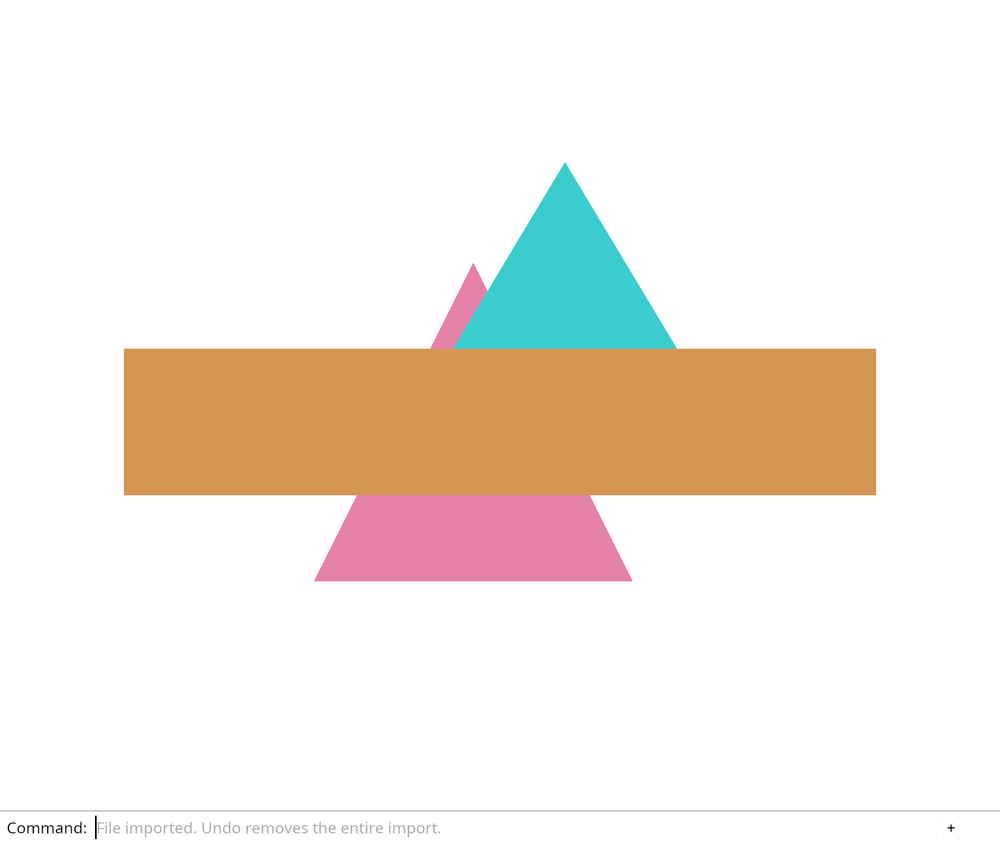

# 4.4 · Heartbeat suspension and revocable startup

**Section 3: Scene Documents, Transactions, and Browser GPU Lifetime** · **Checkpoints:** `34g-heartbeat` → `34gbca-startup` (8 steps) · **Production source:** `session_viewer/src`

> **Goal:** Stop delayed adapter or device delivery from installing a renderer after final exit.

## 1. Visual WebGPU Schematic

<svg xmlns="http://www.w3.org/2000/svg" width="840" height="220" viewBox="0 0 840 220" style="width:100%;max-width:840px;height:auto;display:block;margin:14px 0;" role="img">
  <defs>
    <marker id="arr" viewBox="0 0 10 10" refX="8" refY="5" markerWidth="6" markerHeight="6" orient="auto">
      <path d="M 0 1 L 9 5 L 0 9 z" fill="#111111"/>
    </marker>
    <pattern id="hatch" width="6" height="6" patternTransform="rotate(45 0 0)" patternUnits="userSpaceOnUse">
      <line x1="0" y1="0" x2="0" y2="6" stroke="#111111" stroke-width="1"/>
    </pattern>
    <pattern id="dots" width="8" height="8" patternUnits="userSpaceOnUse">
      <circle cx="2" cy="2" r="1" fill="#111111"/>
    </pattern>
  </defs>
  <rect x="2" y="2" width="836" height="216" rx="10" fill="#ffffff" stroke="#111111" stroke-width="2"/>
  <rect x="20" y="20" width="230" height="180" rx="8" fill="#ffffff" stroke="#111111" stroke-width="1.75"/>
  <text x="135" y="42" text-anchor="middle" font-family="monospace" font-size="12" font-weight="700" fill="#111111">1. Owned Listeners</text>
  <rect x="44" y="62" width="182" height="28" rx="5" fill="#ffffff" stroke="#111111" stroke-width="1.5"/>
  <text x="135" y="80" text-anchor="middle" font-family="monospace" font-size="10" fill="#111111">pointerdown / move</text>
  <rect x="44" y="98" width="182" height="28" rx="5" fill="#ffffff" stroke="#111111" stroke-width="1.5"/>
  <text x="135" y="116" text-anchor="middle" font-family="monospace" font-size="10" fill="#111111">keydown / wheel</text>
  <rect x="44" y="136" width="182" height="28" rx="5" fill="url(#hatch)" stroke="#111111" stroke-width="1.5"/>
  <text x="135" y="154" text-anchor="middle" font-family="monospace" font-size="10" font-weight="700" fill="#111111">Drop -&gt; Unregister All</text>
  <text x="135" y="186" text-anchor="middle" font-family="sans-serif" font-size="10" fill="#111111">Zero Closure Leaks</text>
  <line x1="250" y1="110" x2="298" y2="110" stroke="#111111" stroke-width="2" marker-end="url(#arr)"/>
  <rect x="304" y="20" width="230" height="180" rx="8" fill="#ffffff" stroke="#111111" stroke-width="1.75"/>
  <text x="419" y="42" text-anchor="middle" font-family="monospace" font-size="12" font-weight="700" fill="#111111">2. Tab Lifecycle</text>
  <rect x="324" y="90" width="76" height="44" rx="6" fill="#ffffff" stroke="#111111" stroke-width="1.5"/>
  <text x="362" y="116" text-anchor="middle" font-family="monospace" font-size="10" font-weight="700" fill="#111111">Active</text>
  <rect x="438" y="90" width="76" height="44" rx="6" fill="url(#hatch)" stroke="#111111" stroke-width="1.5"/>
  <text x="476" y="116" text-anchor="middle" font-family="monospace" font-size="10" font-weight="700" fill="#111111">Paused</text>
  <path d="M 400 100 L 434 100" stroke="#111111" stroke-width="1.5" marker-end="url(#arr)"/>
  <path d="M 438 124 L 404 124" stroke="#111111" stroke-width="1.5" marker-end="url(#arr)"/>
  <text x="419" y="80" text-anchor="middle" font-family="monospace" font-size="9" fill="#111111">pagehide</text>
  <text x="419" y="148" text-anchor="middle" font-family="monospace" font-size="9" fill="#111111">pageshow</text>
  <text x="419" y="186" text-anchor="middle" font-family="sans-serif" font-size="10" fill="#111111">bfcache Safe</text>
  <line x1="534" y1="110" x2="582" y2="110" stroke="#111111" stroke-width="2" marker-end="url(#arr)"/>
  <rect x="588" y="20" width="232" height="180" rx="8" fill="#ffffff" stroke="#111111" stroke-width="1.75"/>
  <text x="704" y="42" text-anchor="middle" font-family="monospace" font-size="12" font-weight="700" fill="#111111">3. Fault Recovery</text>
  <circle cx="704" cy="108" r="42" fill="#ffffff" stroke="#111111" stroke-width="1.75"/>
  <circle cx="704" cy="108" r="24" fill="url(#hatch)" stroke="#111111" stroke-width="1.5"/>
  <text x="704" y="112" text-anchor="middle" font-family="monospace" font-size="10" font-weight="700" fill="#111111">Ring</text>
  <text x="704" y="186" text-anchor="middle" font-family="monospace" font-size="10" fill="#111111">1x Safe Fallback</text>
</svg>

| Layer | Construct | Role |
| :--- | :--- | :--- |
| **Rust / WASM** | `Drop` Listener Table | Unregisters DOM closures on teardown with zero memory leaks. |
| **Browser DOM** | `pagehide` / `pageshow` | Pauses GPU timers when hidden or in `bfcache`. |
| **WebGPU** | Fault Ring-Buffer + `1x` Fallback | Records GPU validation/OOM faults and rebuilds pipelines safely. |



---

## 2. Complete Code Overview (All Steps Open)

<a id="checkpoint-34g-heartbeat"></a>

### Step 1 of 8 · Refresh heartbeat without rewriting failure evidence (`34g-heartbeat`)

<svg xmlns="http://www.w3.org/2000/svg" width="840" height="64" viewBox="0 0 840 64" style="width:100%;max-width:840px;height:auto;display:block;margin:14px 0;" role="img">
  <defs>
    <marker id="arr" viewBox="0 0 10 10" refX="8" refY="5" markerWidth="6" markerHeight="6" orient="auto">
      <path d="M 0 1 L 9 5 L 0 9 z" fill="#111111"/>
    </marker>
    <pattern id="hatch" width="6" height="6" patternTransform="rotate(45 0 0)" patternUnits="userSpaceOnUse">
      <line x1="0" y1="0" x2="0" y2="6" stroke="#111111" stroke-width="1"/>
    </pattern>
    <pattern id="dots" width="8" height="8" patternUnits="userSpaceOnUse">
      <circle cx="2" cy="2" r="1" fill="#111111"/>
    </pattern>
  </defs>
  <rect x="2" y="2" width="836" height="60" rx="10" fill="#ffffff" stroke="#111111" stroke-width="2"/>
  <rect x="16" y="12" width="240" height="40" rx="6" fill="#ffffff" stroke="#111111" stroke-width="1.5"/>
  <text x="136" y="36" text-anchor="middle" font-family="monospace" font-size="11" font-weight="700" fill="#111111">src/diagnostic.rs, src/he…</text>
  <line x1="256" y1="32" x2="294" y2="32" stroke="#111111" stroke-width="1.75" marker-end="url(#arr)"/>
  <rect x="300" y="12" width="240" height="40" rx="6" fill="url(#hatch)" stroke="#111111" stroke-width="1.5"/>
  <text x="420" y="36" text-anchor="middle" font-family="monospace" font-size="11" font-weight="700" fill="#111111">release report borrow</text>
  <line x1="540" y1="32" x2="578" y2="32" stroke="#111111" stroke-width="1.75" marker-end="url(#arr)"/>
  <rect x="584" y="12" width="240" height="40" rx="6" fill="#ffffff" stroke="#111111" stroke-width="1.5"/>
  <text x="704" y="36" text-anchor="middle" font-family="monospace" font-size="11" font-weight="700" fill="#111111">bounded metadata persis…</text>
</svg>

Refresh lastSeen without recording an event. A periodic heartbeat would otherwise fill the 24-event window and push out useful observations.

`Report::heartbeat` validates timestamp text before updating that single field. Running, Ready, Closed and Failed keep their outcome, events and first fatal reason.

> **Check:** *Why must a heartbeat not append a fatal event or rewrite the first failure time?* — A heartbeat proves recent observation of a page, not a new failure. Rewriting failure time would recreate the stale-warning bug, while synthetic heartbeat events would rotate meaningful observations out of the recent window.

### 1. `src/diagnostic.rs`

Advance heartbeat independently of observations, outcome and the first fatal timestamp; invalid timestamp text leaves the report unchanged.

Edit the existing block to match this code; keep unchanged lines:

```rust
    pub fn heartbeat(&mut self, time: String) -> Result<(), &'static str> {
        if time.is_empty() || time.chars().count() > 64 { return Err("Invalid heartbeat timestamp"); }
        self.last_seen = time; Ok(())
    }

    pub fn failure(&self) -> Option<&Event> { self.failure.as_ref() }
```

**Supplied validation fixture:**

Copy this supplied authoring fixture once. Continue with the browser build below; the course does not require running native tests.

### 2. `src/heartbeat_tests.rs`

Optional authoring fixture. Verify all run outcomes, first-failure/event retention and atomic timestamp-text bounds without a browser clock dependency.

Copy this supplied file:

```text
--8<-- "journey/code/34g-heartbeat-02.rs"
```

### 3. `src/lib.rs`

Include native heartbeat state proofs.

After that block, type:

```rust
#[cfg(test)]
mod heartbeat_tests;
```

### 4. `src/browser_report.rs`

Refresh actual browser context and UTC heartbeat, release its borrow, then persist metadata without invoking renderer or recording synthetic observations.

Edit the existing block to match this code; keep unchanged lines:

```rust
#[wasm_bindgen::prelude::wasm_bindgen]
pub fn heartbeat() -> Result<(), JsValue> {
    let context = context()?; let time = js_sys::Date::new_0().to_iso_string().into();
    REPORT.with(|slot| {
        let mut slot = slot.borrow_mut(); let report = slot.as_mut().ok_or("No report")?;
        report.heartbeat(time).map_err(JsValue::from_str)?; report.context = context; Ok::<_, JsValue>(())
    })?;
    let _ = persist(); Ok(())
}

pub fn download() -> Result<(), JsValue> {
```

**Result after `34g-heartbeat`:** In the debug console, call `window.wasmBindings.heartbeat()`. Download `Report`: lastSeen advances, while outcome, events and the first failure stay unchanged.

---

<a id="checkpoint-34ga-timer"></a>

### Step 2 of 8 · Own the periodic diagnostic heartbeat (`34ga-timer`)

<svg xmlns="http://www.w3.org/2000/svg" width="840" height="64" viewBox="0 0 840 64" style="width:100%;max-width:840px;height:auto;display:block;margin:14px 0;" role="img">
  <defs>
    <marker id="arr" viewBox="0 0 10 10" refX="8" refY="5" markerWidth="6" markerHeight="6" orient="auto">
      <path d="M 0 1 L 9 5 L 0 9 z" fill="#111111"/>
    </marker>
    <pattern id="hatch" width="6" height="6" patternTransform="rotate(45 0 0)" patternUnits="userSpaceOnUse">
      <line x1="0" y1="0" x2="0" y2="6" stroke="#111111" stroke-width="1"/>
    </pattern>
    <pattern id="dots" width="8" height="8" patternUnits="userSpaceOnUse">
      <circle cx="2" cy="2" r="1" fill="#111111"/>
    </pattern>
  </defs>
  <rect x="2" y="2" width="836" height="60" rx="10" fill="#ffffff" stroke="#111111" stroke-width="2"/>
  <rect x="16" y="12" width="240" height="40" rx="6" fill="#ffffff" stroke="#111111" stroke-width="1.5"/>
  <text x="136" y="36" text-anchor="middle" font-family="monospace" font-size="11" font-weight="700" fill="#111111">src/timer.rs, src/lib.rs</text>
  <line x1="256" y1="32" x2="294" y2="32" stroke="#111111" stroke-width="1.75" marker-end="url(#arr)"/>
  <rect x="300" y="12" width="240" height="40" rx="6" fill="url(#hatch)" stroke="#111111" stroke-width="1.5"/>
  <text x="420" y="36" text-anchor="middle" font-family="monospace" font-size="11" font-weight="700" fill="#111111">heartbeat persists meta…</text>
  <line x1="540" y1="32" x2="578" y2="32" stroke="#111111" stroke-width="1.75" marker-end="url(#arr)"/>
  <rect x="584" y="12" width="240" height="40" rx="6" fill="#ffffff" stroke="#111111" stroke-width="1.5"/>
  <text x="704" y="36" text-anchor="middle" font-family="monospace" font-size="11" font-weight="700" fill="#111111">clear interval before c…</text>
</svg>

Own the browser interval and its Rust closure together. `Timer` stores the Window, native handle and Closure. Drop clears the interval before releasing the callback environment.

Keep one timer outside the GPU runtime and schedule a metadata heartbeat every 15000 milliseconds. Its callback captures no renderer or document, so diagnostics can continue after device loss.

> **Check:** *Why must clearing the interval happen before dropping its Rust Closure?* — JavaScript holds the callback function while the interval is registered. Dropping the Rust environment first could leave a callback that invokes released state. The owner clears the native interval in Drop before field cleanup releases the closure.

### 1. `src/timer.rs`

Own the actual interval and callback together; clear its native timer before Rust releases the closure.

Create the file and type:

```rust
--8<-- "journey/code/34ga-timer-01.rs"
```

### 2. `src/lib.rs`

Keep browser interval ownership out of the native editor model.

After that block, type:

```rust
#[cfg(target_arch = "wasm32")]
mod timer;
```

### 3. `src/browser_report.rs`

Retain metadata scheduling independently of the GPU runtime lifetime. Install periodic metadata refresh at run startup; report scheduler unavailability without rejecting drawing or current downloads. Replace one owned interval at a time, cancel outside the slot borrow, and keep the callback metadata-only.

Edit these blocks from bottom to top. Keep the surrounding lines unchanged.

**Locate this block:**

```rust
    crate::file_output::download_named(json.as_bytes(), "viewer-diagnostic.json")
}

fn persist() -> bool {
    let report = REPORT.with(|slot| slot.borrow().clone());
    let Some(report) = report else { return false; };
```

Replace it with:

```rust
    crate::file_output::download_named(json.as_bytes(), "viewer-diagnostic.json")
}

#[wasm_bindgen::prelude::wasm_bindgen]
pub fn start_periodic() -> Result<(), JsValue> {
    stop_periodic();
    let timer = crate::timer::Timer::every(15000, || { let _ = heartbeat(); })?;
    BEAT.with(|slot| slot.replace(Some(timer))); Ok(())
}

#[wasm_bindgen::prelude::wasm_bindgen]
pub fn stop_periodic() -> bool {
    let timer = BEAT.with(|slot| slot.borrow_mut().take());
    let active = timer.is_some(); drop(timer); active
}

fn persist() -> bool {
    let report = REPORT.with(|slot| slot.borrow().clone());
    let Some(report) = report else { return false; };
```

**Locate this block:**

```rust
    let report = Report::new(store.tab.clone(), js_sys::Date::new_0().to_iso_string().into(), context()?);
    PREVIOUS.with(|slot| slot.replace(previous)); STORE.with(|slot| slot.replace(Some(store)));
    REPORT.with(|slot| slot.replace(Some(report)));
    let _ = persist(); Ok(())
}

pub fn observe(kind: &str, message: &str) -> Result<(), JsValue> {
```

Replace it with:

```rust
    let report = Report::new(store.tab.clone(), js_sys::Date::new_0().to_iso_string().into(), context()?);
    PREVIOUS.with(|slot| slot.replace(previous)); STORE.with(|slot| slot.replace(Some(store)));
    REPORT.with(|slot| slot.replace(Some(report)));
    let _ = persist();
    if let Err(error) = start_periodic() { let _ = observe("diagnostic", &format!("Heartbeat unavailable: {error:?}")); }
    Ok(())
}

pub fn observe(kind: &str, message: &str) -> Result<(), JsValue> {
```

**Locate this block:**

```rust
    static REPORT: RefCell<Option<Report>> = const { RefCell::new(None) };
    static STORE: RefCell<Option<crate::report_storage::Store>> = const { RefCell::new(None) };
    static PREVIOUS: RefCell<Option<Report>> = const { RefCell::new(None) };
}

fn context() -> Result<Context, JsValue> {
```

Replace it with:

```rust
    static REPORT: RefCell<Option<Report>> = const { RefCell::new(None) };
    static STORE: RefCell<Option<crate::report_storage::Store>> = const { RefCell::new(None) };
    static PREVIOUS: RefCell<Option<Report>> = const { RefCell::new(None) };
    static BEAT: RefCell<Option<crate::timer::Timer>> = const { RefCell::new(None) };
}

fn context() -> Result<Context, JsValue> {
```

**Complete updated block reference:**

```rust
use crate::diagnostic::{Context, Report};
use std::cell::RefCell;
use wasm_bindgen::{JsCast, JsValue};

thread_local! {
    static REPORT: RefCell<Option<Report>> = const { RefCell::new(None) };
    static STORE: RefCell<Option<crate::report_storage::Store>> = const { RefCell::new(None) };
    static PREVIOUS: RefCell<Option<Report>> = const { RefCell::new(None) };
    static BEAT: RefCell<Option<crate::timer::Timer>> = const { RefCell::new(None) };
}

fn context() -> Result<Context, JsValue> {
    let window = web_sys::window().ok_or("No browser window")?;
    let document = window.document().ok_or("No document")?;
    let canvas: web_sys::HtmlCanvasElement = document.get_element_by_id("canvas").ok_or("No canvas")?.dyn_into()?;
    let location = window.location(); let navigator = window.navigator();
    Ok(Context {
        page: format!("{}{}", location.origin()?, location.pathname()?),
        browser: navigator.user_agent()?, secure_context: window.is_secure_context(),
        webgpu: js_sys::Reflect::get(navigator.as_ref(), &"gpu".into())?.is_object(),
        viewport: [window.inner_width()?.as_f64().ok_or("No width")? as u32,
            window.inner_height()?.as_f64().ok_or("No height")? as u32],
        canvas: [canvas.width(), canvas.height()], device_pixel_ratio: window.device_pixel_ratio(),
    })
}

pub fn start() -> Result<(), JsValue> {
    let store = crate::report_storage::Store::open(); let previous = store.previous();
    let report = Report::new(store.tab.clone(), js_sys::Date::new_0().to_iso_string().into(), context()?);
    PREVIOUS.with(|slot| slot.replace(previous)); STORE.with(|slot| slot.replace(Some(store)));
    REPORT.with(|slot| slot.replace(Some(report)));
    let _ = persist();
    if let Err(error) = start_periodic() { let _ = observe("diagnostic", &format!("Heartbeat unavailable: {error:?}")); }
    Ok(())
}

pub fn observe(kind: &str, message: &str) -> Result<(), JsValue> {
    let context = context()?;
    let elapsed = web_sys::window().and_then(|window| window.performance()).ok_or("No clock")?.now();
    REPORT.with(|slot| {
        let mut slot = slot.borrow_mut(); let report = slot.as_mut().ok_or("No report")?;
        report.context = context;
        report.record(js_sys::Date::new_0().to_iso_string().into(), elapsed, kind, message).map_err(JsValue::from_str)
    })?;
    let _ = persist(); Ok(())
}

#[wasm_bindgen::prelude::wasm_bindgen]
pub fn heartbeat() -> Result<(), JsValue> {
    let context = context()?; let time = js_sys::Date::new_0().to_iso_string().into();
    REPORT.with(|slot| {
        let mut slot = slot.borrow_mut(); let report = slot.as_mut().ok_or("No report")?;
        report.heartbeat(time).map_err(JsValue::from_str)?; report.context = context; Ok::<_, JsValue>(())
    })?;
    let _ = persist(); Ok(())
}

pub fn download() -> Result<(), JsValue> {
    let json = diagnostic_snapshot()?; let _ = persist();
    crate::file_output::download_named(json.as_bytes(), "viewer-diagnostic.json")
}

#[wasm_bindgen::prelude::wasm_bindgen]
pub fn start_periodic() -> Result<(), JsValue> {
    stop_periodic();
    let timer = crate::timer::Timer::every(15000, || { let _ = heartbeat(); })?;
    BEAT.with(|slot| slot.replace(Some(timer))); Ok(())
}

#[wasm_bindgen::prelude::wasm_bindgen]
pub fn stop_periodic() -> bool {
    let timer = BEAT.with(|slot| slot.borrow_mut().take());
    let active = timer.is_some(); drop(timer); active
}

fn persist() -> bool {
    let report = REPORT.with(|slot| slot.borrow().clone());
    let Some(report) = report else { return false; };
    STORE.with(|slot| slot.borrow().as_ref().is_some_and(|store| store.write(&report)))
}

pub fn previous_notice() -> Option<&'static str> {
    PREVIOUS.with(|slot| slot.borrow().as_ref().map(|report| if report.outcome == crate::diagnostic::Outcome::Failed {
        "Previous viewer run failed. Type Report Previous."
    } else { "Previous viewer run was interrupted. Type Report Previous." }))
}

pub fn download_previous() -> Result<(), JsValue> {
    let json = previous_diagnostic_snapshot()?;
    crate::file_output::download_named(json.as_bytes(), "viewer-diagnostic-previous.json")
}

#[wasm_bindgen::prelude::wasm_bindgen]
pub fn previous_diagnostic_snapshot() -> Result<String, JsValue> {
    PREVIOUS.with(|slot| {
        let slot = slot.borrow(); let report = slot.as_ref().ok_or("No previous report")?;
        serde_json::to_string_pretty(report).map_err(|error| JsValue::from_str(&error.to_string()))
    })
}

pub fn fatal(message: &str) {
    let first = REPORT.with(|slot| slot.borrow().as_ref().is_some_and(|report| report.failure().is_none()));
    if observe("fatal", message).is_ok() && first { let _ = download(); }
}

#[wasm_bindgen::prelude::wasm_bindgen]
pub fn diagnostic_snapshot() -> Result<String, JsValue> {
    let context = context()?;
    REPORT.with(|slot| {
        let mut slot = slot.borrow_mut(); let report = slot.as_mut().ok_or("No report")?;
        report.context = context;
        serde_json::to_string_pretty(report).map_err(|error| JsValue::from_str(&error.to_string()))
    })
}
```

**Result after `34ga-timer`:** Download `Report`, wait at least 15 seconds, then download it again. lastSeen should advance without adding an event. The timer updates metadata only.

---

<a id="checkpoint-34gb-close"></a>

### Step 3 of 8 · Mark a final healthy run closed (`34gb-close`)

<svg xmlns="http://www.w3.org/2000/svg" width="840" height="64" viewBox="0 0 840 64" style="width:100%;max-width:840px;height:auto;display:block;margin:14px 0;" role="img">
  <defs>
    <marker id="arr" viewBox="0 0 10 10" refX="8" refY="5" markerWidth="6" markerHeight="6" orient="auto">
      <path d="M 0 1 L 9 5 L 0 9 z" fill="#111111"/>
    </marker>
    <pattern id="hatch" width="6" height="6" patternTransform="rotate(45 0 0)" patternUnits="userSpaceOnUse">
      <line x1="0" y1="0" x2="0" y2="6" stroke="#111111" stroke-width="1"/>
    </pattern>
    <pattern id="dots" width="8" height="8" patternUnits="userSpaceOnUse">
      <circle cx="2" cy="2" r="1" fill="#111111"/>
    </pattern>
  </defs>
  <rect x="2" y="2" width="836" height="60" rx="10" fill="#ffffff" stroke="#111111" stroke-width="2"/>
  <rect x="16" y="12" width="240" height="40" rx="6" fill="#ffffff" stroke="#111111" stroke-width="1.5"/>
  <text x="136" y="36" text-anchor="middle" font-family="monospace" font-size="11" font-weight="700" fill="#111111">src/diagnostic.rs, src/cl…</text>
  <line x1="256" y1="32" x2="294" y2="32" stroke="#111111" stroke-width="1.75" marker-end="url(#arr)"/>
  <rect x="300" y="12" width="240" height="40" rx="6" fill="url(#hatch)" stroke="#111111" stroke-width="1.5"/>
  <text x="420" y="36" text-anchor="middle" font-family="monospace" font-size="11" font-weight="700" fill="#111111">release borrow</text>
  <line x1="540" y1="32" x2="578" y2="32" stroke="#111111" stroke-width="1.75" marker-end="url(#arr)"/>
  <rect x="584" y="12" width="240" height="40" rx="6" fill="#ffffff" stroke="#111111" stroke-width="1.5"/>
  <text x="704" y="36" text-anchor="middle" font-family="monospace" font-size="11" font-weight="700" fill="#111111">metadata-only persisten…</text>
</svg>

Mark a healthy run Closed when it finally ends. Keep Failed and its original fatal reason. A cached page has not ended and must not call this operation.

`close` first validates its timestamp through heartbeat, then changes the healthy outcome. Invalid text leaves the whole value untouched. Guard the ready milestone too: a delayed success must not reopen a Closed report.

> **Check:** *Why must a failed run remain failed when its page later closes?* — Closing the page says the lifetime ended. It does not repair the error. Keeping Failed and its original fatal timestamp preserves useful evidence and prevents a later close from making the run look healthy.

### 1. `src/diagnostic.rs`

Mark a healthy final exit closed without erasing a failure or appending synthetic observations.

Edit the existing block to match this code; keep unchanged lines:

```rust
    pub fn close(&mut self, time: String) -> Result<(), &'static str> {
        self.heartbeat(time)?;
        if self.failure.is_none() { self.outcome = Outcome::Closed; }
        Ok(())
    }

    pub fn failure(&self) -> Option<&Event> { self.failure.as_ref() }
```

**Supplied validation fixture:**

Copy this supplied authoring fixture once. Continue with the browser build below; the course does not require running native tests.

### 2. `src/close_report_tests.rs`

Optional authoring fixture. Prove healthy/failed final outcomes, repeatability and atomic refusal separately from browser suspension.

Copy this supplied file:

```text
--8<-- "journey/code/34gb-close-02.rs"
```

### 3. `src/lib.rs`

Include native final-close policy proofs.

After that block, type:

```rust
#[cfg(test)]
mod close_report_tests;
```

### 4. `src/browser_report.rs`

Refresh real context/time, release the report borrow and persist the final outcome without accessing GPU state.

Edit the existing block to match this code; keep unchanged lines:

```rust
#[wasm_bindgen::prelude::wasm_bindgen]
pub fn close_report() -> Result<(), JsValue> {
    let context = context()?; let time = js_sys::Date::new_0().to_iso_string().into();
    REPORT.with(|slot| {
        let mut slot = slot.borrow_mut(); let report = slot.as_mut().ok_or("No report")?;
        report.close(time).map_err(JsValue::from_str)?; report.context = context; Ok::<_, JsValue>(())
    })?;
    let _ = persist(); Ok(())
}

pub fn download() -> Result<(), JsValue> {
```

### 5. `src/diagnostic.rs`

A delayed ready milestone must not reopen a final closed run; cache suspension retains Ready without closing.

Edit the existing block to match this code; keep unchanged lines:

```rust
        } else if kind == "milestone" && message == "geometry on screen" && self.failure.is_none() && self.outcome != Outcome::Closed {
```

### 6. `src/browser_report.rs`

Let Chrome submit a real late milestone through the same metadata path; release builds gain no user control.

Edit the existing block to match this code; keep unchanged lines:

```rust
#[wasm_bindgen::prelude::wasm_bindgen]
pub fn observe(kind: &str, message: &str) -> Result<(), JsValue> {
```

**Result after `34gb-close`:** Run the close checks below. Closing a healthy report marks it Closed; closing a Failed report preserves its first fatal reason. A late ready milestone must not reopen Closed.

---

<a id="checkpoint-34gba-lifecycle"></a>

### Step 4 of 8 · Own diagnostic page transitions (`34gba-lifecycle`)

<svg xmlns="http://www.w3.org/2000/svg" width="840" height="64" viewBox="0 0 840 64" style="width:100%;max-width:840px;height:auto;display:block;margin:14px 0;" role="img">
  <defs>
    <marker id="arr" viewBox="0 0 10 10" refX="8" refY="5" markerWidth="6" markerHeight="6" orient="auto">
      <path d="M 0 1 L 9 5 L 0 9 z" fill="#111111"/>
    </marker>
    <pattern id="hatch" width="6" height="6" patternTransform="rotate(45 0 0)" patternUnits="userSpaceOnUse">
      <line x1="0" y1="0" x2="0" y2="6" stroke="#111111" stroke-width="1"/>
    </pattern>
    <pattern id="dots" width="8" height="8" patternUnits="userSpaceOnUse">
      <circle cx="2" cy="2" r="1" fill="#111111"/>
    </pattern>
  </defs>
  <rect x="2" y="2" width="836" height="60" rx="10" fill="#ffffff" stroke="#111111" stroke-width="2"/>
  <rect x="16" y="12" width="240" height="40" rx="6" fill="#ffffff" stroke="#111111" stroke-width="1.5"/>
  <text x="136" y="36" text-anchor="middle" font-family="monospace" font-size="11" font-weight="700" fill="#111111">src/report_lifecycle.rs,…</text>
  <line x1="256" y1="32" x2="294" y2="32" stroke="#111111" stroke-width="1.75" marker-end="url(#arr)"/>
  <rect x="300" y="12" width="240" height="40" rx="6" fill="url(#hatch)" stroke="#111111" stroke-width="1.5"/>
  <text x="420" y="36" text-anchor="middle" font-family="monospace" font-size="11" font-weight="700" fill="#111111">deferred matching-owner…</text>
  <line x1="540" y1="32" x2="578" y2="32" stroke="#111111" stroke-width="1.75" marker-end="url(#arr)"/>
  <rect x="584" y="12" width="240" height="40" rx="6" fill="#ffffff" stroke="#111111" stroke-width="1.5"/>
  <text x="704" y="36" text-anchor="middle" font-family="monospace" font-size="11" font-weight="700" fill="#111111">cached pageshow resumes…</text>
</svg>

Own diagnostic page events independently of the GPU. Two Window listeners and an `Rc` token keep metadata active after drawing/input cleanup. They retain no renderer or document.

On cached `pagehide`, record the transition and stop the heartbeat, retaining the outcome and listeners. On `pageshow`, record the return and resume one timer.

> **Check:** *Why does deferred final cleanup compare allocation identity before stopping metadata?* — An earlier pagehide may have queued cleanup before a replacement installs its listeners and timer. The old allocation token must not match the replacement; otherwise the old task could stop the new diagnostic lifetime.

### 1. `src/report_lifecycle.rs`

Own two metadata callbacks independently of GPU; retain cached outcomes, defer final callback destruction, and guard cleanup by allocation identity.

Create the file and type:

```rust
--8<-- "journey/code/34gba-lifecycle-01.rs"
```

### 2. `src/lib.rs`

Keep page transition ownership in the browser layer.

After that block, type:

```rust
#[cfg(target_arch = "wasm32")]
mod report_lifecycle;
```

### 3. `src/browser_report.rs`

Install metadata lifecycle ownership before scheduling heartbeat; denied listener registration leaves drawing and current downloads available.

Edit the existing block to match this code; keep unchanged lines:

```rust
    if let Err(error) = crate::report_lifecycle::install() { let _ = observe("diagnostic", &format!("Lifecycle unavailable: {error:?}")); }
    if let Err(error) = start_periodic() { let _ = observe("diagnostic", &format!("Heartbeat unavailable: {error:?}")); }
```

**Result after `34gba-lifecycle`:** In the debug console, run `window.dispatchEvent(new PageTransitionEvent("pagehide", {persisted: true}))`, then the same for `"pageshow"`. Download `Report`: the transitions are recorded and the healthy outcome stays Ready.

---

<a id="checkpoint-34gbb-suspension"></a>

### Step 5 of 8 · Keep each heartbeat pause reason separate (`34gbb-suspension`)

<svg xmlns="http://www.w3.org/2000/svg" width="840" height="64" viewBox="0 0 840 64" style="width:100%;max-width:840px;height:auto;display:block;margin:14px 0;" role="img">
  <defs>
    <marker id="arr" viewBox="0 0 10 10" refX="8" refY="5" markerWidth="6" markerHeight="6" orient="auto">
      <path d="M 0 1 L 9 5 L 0 9 z" fill="#111111"/>
    </marker>
    <pattern id="hatch" width="6" height="6" patternTransform="rotate(45 0 0)" patternUnits="userSpaceOnUse">
      <line x1="0" y1="0" x2="0" y2="6" stroke="#111111" stroke-width="1"/>
    </pattern>
    <pattern id="dots" width="8" height="8" patternUnits="userSpaceOnUse">
      <circle cx="2" cy="2" r="1" fill="#111111"/>
    </pattern>
  </defs>
  <rect x="2" y="2" width="836" height="60" rx="10" fill="#ffffff" stroke="#111111" stroke-width="2"/>
  <rect x="16" y="12" width="240" height="40" rx="6" fill="#ffffff" stroke="#111111" stroke-width="1.5"/>
  <text x="136" y="36" text-anchor="middle" font-family="monospace" font-size="11" font-weight="700" fill="#111111">src/suspension.rs, src/su…</text>
  <line x1="256" y1="32" x2="294" y2="32" stroke="#111111" stroke-width="1.75" marker-end="url(#arr)"/>
  <rect x="300" y="12" width="240" height="40" rx="6" fill="url(#hatch)" stroke="#111111" stroke-width="1.5"/>
  <text x="420" y="36" text-anchor="middle" font-family="monospace" font-size="11" font-weight="700" fill="#111111">one scheduling decision</text>
  <line x1="540" y1="32" x2="578" y2="32" stroke="#111111" stroke-width="1.75" marker-end="url(#arr)"/>
  <rect x="584" y="12" width="240" height="40" rx="6" fill="#ffffff" stroke="#111111" stroke-width="1.5"/>
  <text x="704" y="36" text-anchor="middle" font-family="monospace" font-size="11" font-weight="700" fill="#111111">one scheduling decision</text>
</svg>

Give heartbeat scheduling three independent reasons to pause: hidden, frozen and cached. Clearing one reason must leave the others intact. Final closure permanently prevents resumption.

The policy is ordinary Rust, without browser or GPU ownership. Native checks exercise overlapping reasons and different release orders. Browser event delivery is connected in the next step.

> **Check:** *Why does becoming visible not always allow the heartbeat to resume?* — Visibility clears only the hidden reason. A freeze or cached-page reason can still prohibit scheduling; final closure never resumes.

### 1. `src/suspension.rs`

Keep hidden, frozen and cached reasons independent; final closure permanently refuses scheduling.

Create the file and type:

```rust
--8<-- "journey/code/34gbb-suspension-01.rs"
```

**Supplied validation fixture:**

Copy this supplied authoring fixture once. Continue with the browser build below; the course does not require running native tests.

### 2. `src/suspension_tests.rs`

Optional authoring fixture. Check overlapping reasons, initial hidden state, duplicate delivery and final closure that cannot resume.

Copy this supplied file:

```text
--8<-- "journey/code/34gbb-suspension-02.rs"
```

### 3. `src/lib.rs`

Register the pure policy and its native checks.

After that block, type:

```rust
pub mod suspension;
#[cfg(test)]
mod suspension_tests;
```

**Result after `34gbb-suspension`:** Inspect the supplied state fixtures. Every remaining pause reason prevents resumption, and clearing all reasons permits it. A closed policy stays closed.

---

<a id="checkpoint-34gbba-browser"></a>

### Step 6 of 8 · Connect visibility and freezing to heartbeat scheduling (`34gbba-browser`)

<svg xmlns="http://www.w3.org/2000/svg" width="840" height="64" viewBox="0 0 840 64" style="width:100%;max-width:840px;height:auto;display:block;margin:14px 0;" role="img">
  <defs>
    <marker id="arr" viewBox="0 0 10 10" refX="8" refY="5" markerWidth="6" markerHeight="6" orient="auto">
      <path d="M 0 1 L 9 5 L 0 9 z" fill="#111111"/>
    </marker>
    <pattern id="hatch" width="6" height="6" patternTransform="rotate(45 0 0)" patternUnits="userSpaceOnUse">
      <line x1="0" y1="0" x2="0" y2="6" stroke="#111111" stroke-width="1"/>
    </pattern>
    <pattern id="dots" width="8" height="8" patternUnits="userSpaceOnUse">
      <circle cx="2" cy="2" r="1" fill="#111111"/>
    </pattern>
  </defs>
  <rect x="2" y="2" width="836" height="60" rx="10" fill="#ffffff" stroke="#111111" stroke-width="2"/>
  <rect x="16" y="12" width="240" height="40" rx="6" fill="#ffffff" stroke="#111111" stroke-width="1.5"/>
  <text x="136" y="36" text-anchor="middle" font-family="monospace" font-size="11" font-weight="700" fill="#111111">src/report_lifecycle.rs,…</text>
  <line x1="256" y1="32" x2="294" y2="32" stroke="#111111" stroke-width="1.75" marker-end="url(#arr)"/>
  <rect x="300" y="12" width="240" height="40" rx="6" fill="url(#hatch)" stroke="#111111" stroke-width="1.5"/>
  <text x="420" y="36" text-anchor="middle" font-family="monospace" font-size="11" font-weight="700" fill="#111111">independent pause reaso…</text>
  <line x1="540" y1="32" x2="578" y2="32" stroke="#111111" stroke-width="1.75" marker-end="url(#arr)"/>
  <rect x="584" y="12" width="240" height="40" rx="6" fill="#ffffff" stroke="#111111" stroke-width="1.5"/>
  <text x="704" y="36" text-anchor="middle" font-family="monospace" font-size="11" font-weight="700" fill="#111111">stop or retain one hear…</text>
</svg>

Connect visibilitychange, freeze and resume on Document. Keep pagehide and pageshow on Window. Each event changes its own pause reason before synchronizing the heartbeat.

Read Document.hidden at startup and on return. Start one timer only when the policy permits it. Repeated resume events retain the existing timer. Final closure prevents restart before deferred listener cleanup.

> **Check:** *Why does timer synchronization happen after updating the event’s reasons?* — The scheduling decision must include both the changed reason and current visibility. It must not resume between clearing cached state and discovering the document is still hidden.

### 1. `src/report_lifecycle.rs`

Use the scheduling policy in the existing metadata owner. Store pause reasons beside the owned listeners and allocation token. Keep replacement identity independent of scheduling state. Read or update scheduling state without retaining a borrow while the timer changes. Read the initial hidden state and retain Document for later visibility observations. Pause cached scheduling; close the policy permanently before final cleanup is deferred. On page return, clear only the cached reason and refresh actual visibility. Observe Document visibility and freezing, then synchronize one timer after updating all affected reasons. Bind all three Document events; partial registration still cleans up through the listener owner.

Edit the existing block to match this code; keep unchanged lines:

```rust
use std::{cell::RefCell, rc::Rc};
use wasm_bindgen::{closure::Closure, JsCast, JsValue};
use crate::{browser_report as report, listeners::Listeners, suspension::{Reason, Suspension}};

thread_local! { static ACTIVE: RefCell<Option<(Rc<()>, Listeners, Suspension)>> = const { RefCell::new(None) }; }

fn current(token: &Rc<()>) -> bool {
    ACTIVE.with(|slot| slot.borrow().as_ref().is_some_and(|(id, _, _)| Rc::ptr_eq(id, token)))
}

pub fn permits() -> bool {
    ACTIVE.with(|slot| slot.borrow().as_ref().is_some_and(|(_, _, state)| state.permits()))
}

fn change(reason: Reason, paused: bool) {
    ACTIVE.with(|slot| { if let Some((_, _, state)) = slot.borrow_mut().as_mut() { state.change(reason, paused); } });
}

#[wasm_bindgen::prelude::wasm_bindgen(js_name = stop_report_lifecycle)]

pub fn stop() -> bool {
    let owner = ACTIVE.with(|slot| slot.borrow_mut().take());
    let active = owner.is_some(); report::stop_periodic(); drop(owner); active
}

#[wasm_bindgen::prelude::wasm_bindgen(js_name = install_report_lifecycle)]
pub fn install() -> Result<(), JsValue> {
    stop(); let window = web_sys::window().ok_or("No browser window")?;
    let document = window.document().ok_or("No document")?;
    let hidden = document.hidden(); let observed = document.clone();
    let token = Rc::new(()); let guarded = Rc::clone(&token);
    let callback = Closure::<dyn FnMut(web_sys::Event)>::new(move |event: web_sys::Event| {
        if !current(&guarded) { return; }
        match event.type_().as_str() {
            "pagehide" => {
                let cached = event.dyn_ref::<web_sys::PageTransitionEvent>().is_some_and(|event| event.persisted());
                let _ = report::observe("lifecycle", if cached { "pagehide cached" } else { "pagehide final" });
                change(Reason::Cached, true);
                report::stop_periodic();
                if !cached {
                    ACTIVE.with(|slot| { if let Some((_, _, state)) = slot.borrow_mut().as_mut() { state.close(); } });
                    let _ = report::close_report(); let token = Rc::clone(&guarded);
                    wasm_bindgen_futures::spawn_local(async move { if current(&token) { stop(); } });
                }
            }
            "pageshow" => {
                let _ = report::observe("lifecycle", "pageshow");
                change(Reason::Cached, false); change(Reason::Hidden, observed.hidden());
            }
            "visibilitychange" => {
                change(Reason::Hidden, observed.hidden());
                let _ = report::observe("lifecycle", if observed.hidden() { "hidden" } else { "visible" });
            }
            "freeze" | "resume" => {
                change(Reason::Frozen, event.type_() == "freeze");
                change(Reason::Hidden, observed.hidden());
                let _ = report::observe("lifecycle", &event.type_());
            }
            _ => return,
        }
        if let Err(error) = report::start_periodic() {
            let _ = report::observe("diagnostic", &format!("Heartbeat unavailable: {error:?}"));
        }
    });
    let mut listeners = Listeners::new(callback);
    listeners.listen(window.as_ref(), "pagehide")?; listeners.listen(window.as_ref(), "pageshow")?;
    for name in ["visibilitychange", "freeze", "resume"] { listeners.listen(document.as_ref(), name)?; }
    ACTIVE.with(|slot| slot.replace(Some((token, listeners, Suspension::new(hidden))))); Ok(())
}

#[wasm_bindgen::prelude::wasm_bindgen]
pub fn report_lifecycle_running() -> bool { ACTIVE.with(|slot| slot.borrow().is_some()) }
```

### 2. `src/browser_report.rs`

Refuse suspended scheduling and retain an existing timer, so repeated resume events cannot restart or duplicate it.

Edit the existing block to match this code; keep unchanged lines:

```rust
pub fn start_periodic() -> Result<(), JsValue> {
    if !crate::report_lifecycle::permits() { stop_periodic(); return Ok(()); }
    if BEAT.with(|slot| slot.borrow().is_some()) { return Ok(()); }
```

**Result after `34gbba-browser`:** Switch away from the viewer tab, then return and type Report. Its lifecycle entries show hidden and visible, while the healthy outcome remains Ready.

---

<a id="checkpoint-34gbc-authority"></a>

### Step 7 of 8 · Give pending startup a revocable ticket (`34gbc-authority`)

<svg xmlns="http://www.w3.org/2000/svg" width="840" height="64" viewBox="0 0 840 64" style="width:100%;max-width:840px;height:auto;display:block;margin:14px 0;" role="img">
  <defs>
    <marker id="arr" viewBox="0 0 10 10" refX="8" refY="5" markerWidth="6" markerHeight="6" orient="auto">
      <path d="M 0 1 L 9 5 L 0 9 z" fill="#111111"/>
    </marker>
    <pattern id="hatch" width="6" height="6" patternTransform="rotate(45 0 0)" patternUnits="userSpaceOnUse">
      <line x1="0" y1="0" x2="0" y2="6" stroke="#111111" stroke-width="1"/>
    </pattern>
    <pattern id="dots" width="8" height="8" patternUnits="userSpaceOnUse">
      <circle cx="2" cy="2" r="1" fill="#111111"/>
    </pattern>
  </defs>
  <rect x="2" y="2" width="836" height="60" rx="10" fill="#ffffff" stroke="#111111" stroke-width="2"/>
  <rect x="16" y="12" width="240" height="40" rx="6" fill="#ffffff" stroke="#111111" stroke-width="1.5"/>
  <text x="136" y="36" text-anchor="middle" font-family="monospace" font-size="11" font-weight="700" fill="#111111">src/startup.rs, src/start…</text>
  <line x1="256" y1="32" x2="294" y2="32" stroke="#111111" stroke-width="1.75" marker-end="url(#arr)"/>
  <rect x="300" y="12" width="240" height="40" rx="6" fill="url(#hatch)" stroke="#111111" stroke-width="1.5"/>
  <text x="420" y="36" text-anchor="middle" font-family="monospace" font-size="11" font-weight="700" fill="#111111">shared flag</text>
  <line x1="540" y1="32" x2="578" y2="32" stroke="#111111" stroke-width="1.75" marker-end="url(#arr)"/>
  <rect x="584" y="12" width="240" height="40" rx="6" fill="#ffffff" stroke="#111111" stroke-width="1.5"/>
  <text x="704" y="36" text-anchor="middle" font-family="monospace" font-size="11" font-weight="700" fill="#111111">delayed result refused…</text>
</svg>

Give pending startup a shared permission flag. The task and close callback hold cloned tickets; revoking either ticket refuses every later result.

A replacement gets a separate allocation. This step checks the policy natively; the next step connects it to actual GPU requests.

> **Check:** *Why clone the ticket instead of copying its boolean value?* — A copied boolean would keep its old value. Rc shares the Cell, so the waiting task sees the close callback’s revocation.

### 1. `src/startup.rs`

Share startup permission between the waiting task and its close callback.

Create the file and type:

```rust
--8<-- "journey/code/34gbc-authority-01.rs"
```

**Supplied validation fixture:**

Copy this supplied authoring fixture once. Continue with the browser build below; the course does not require running native tests.

### 2. `src/startup_tests.rs`

Optional authoring fixture. Check delayed tickets, repeated closure and an independent replacement owner.

Copy this supplied file:

```text
--8<-- "journey/code/34gbc-authority-02.rs"
```

### 3. `src/lib.rs`

Register startup authority and its native checks.

After that block, type:

```rust
pub mod startup;
#[cfg(test)]
mod startup_tests;
```

**Result after `34gbc-authority`:** Inspect the supplied state fixtures. Revocation reaches every waiting ticket, repeated closure stays revoked, and an independent replacement remains allowed.

---

<a id="checkpoint-34gbca-startup"></a>

### Step 8 of 8 · Refuse GPU results after final page exit (`34gbca-startup`)

<svg xmlns="http://www.w3.org/2000/svg" width="840" height="64" viewBox="0 0 840 64" style="width:100%;max-width:840px;height:auto;display:block;margin:14px 0;" role="img">
  <defs>
    <marker id="arr" viewBox="0 0 10 10" refX="8" refY="5" markerWidth="6" markerHeight="6" orient="auto">
      <path d="M 0 1 L 9 5 L 0 9 z" fill="#111111"/>
    </marker>
    <pattern id="hatch" width="6" height="6" patternTransform="rotate(45 0 0)" patternUnits="userSpaceOnUse">
      <line x1="0" y1="0" x2="0" y2="6" stroke="#111111" stroke-width="1"/>
    </pattern>
    <pattern id="dots" width="8" height="8" patternUnits="userSpaceOnUse">
      <circle cx="2" cy="2" r="1" fill="#111111"/>
    </pattern>
  </defs>
  <rect x="2" y="2" width="836" height="60" rx="10" fill="#ffffff" stroke="#111111" stroke-width="2"/>
  <rect x="16" y="12" width="240" height="40" rx="6" fill="#ffffff" stroke="#111111" stroke-width="1.5"/>
  <text x="136" y="36" text-anchor="middle" font-family="monospace" font-size="11" font-weight="700" fill="#111111">src/browser_startup.rs, s…</text>
  <line x1="256" y1="32" x2="294" y2="32" stroke="#111111" stroke-width="1.75" marker-end="url(#arr)"/>
  <rect x="300" y="12" width="240" height="40" rx="6" fill="url(#hatch)" stroke="#111111" stroke-width="1.5"/>
  <text x="420" y="36" text-anchor="middle" font-family="monospace" font-size="11" font-weight="700" fill="#111111">adapter/device resolves</text>
  <line x1="540" y1="32" x2="578" y2="32" stroke="#111111" stroke-width="1.75" marker-end="url(#arr)"/>
  <rect x="584" y="12" width="240" height="40" rx="6" fill="#ffffff" stroke="#111111" stroke-width="1.5"/>
  <text x="704" y="36" text-anchor="middle" font-family="monospace" font-size="11" font-weight="700" fill="#111111">refuse renderer install…</text>
</svg>

Keep one temporary pagehide listener while startup awaits the GPU. Final exit revokes its shared ticket; cached transitions retain permission.

Check authority after each await, before interpreting errors or using the result. Destroy a device delivered after revocation. Returning successfully preserves the closed report instead of recording a new fatal error. The listener is released when startup returns.

> **Check:** *Why check permission before turning a rejected GPU request into an error?* — The page may have closed while the request was pending. That obsolete rejection must not overwrite Closed with a new failure; an active startup still reports genuine errors.

### 1. `src/browser_startup.rs`

Own one temporary page-exit binding across GPU awaits, independent of optional diagnostic listeners.

Create the file and type:

```rust
--8<-- "journey/code/34gbca-startup-01.rs"
```

### 2. `src/lib.rs`

Register the browser startup guard.

After that block, type:

```rust
#[cfg(target_arch = "wasm32")]
mod browser_startup;
```

### 3. `src/browser.rs`

Keep the guard alive from startup until the runtime owns the drawing callbacks. After the adapter await, refuse a revoked result before requesting a device or interpreting an error. After the device await, destroy a late device and return quietly before configuring the surface or creating resources.

Edit these blocks from bottom to top. Keep the surrounding lines unchanged.

**Locate this block:**

```rust
            compatible_surface: Some(&surface),
            ..Default::default()
        })
        .await
        .map_err(|error| JsValue::from_str(&error.to_string()))?;
    let (device, queue) = adapter
        .request_device(&wgpu::DeviceDescriptor::default())
        .await
        .map_err(|error| JsValue::from_str(&error.to_string()))?;
    let fault = crate::gpu_fault::Fault::default();
    let errors = fault.clone();
    device.on_uncaptured_error(std::sync::Arc::new(move |error| failed(errors.clone(), format!("WebGPU error: {error}"))));
```

Replace it with:

```rust
            compatible_surface: Some(&surface),
            ..Default::default()
        })
        .await;
    if !startup.permits() { return Ok(()); }
    let adapter = adapter.map_err(|error| JsValue::from_str(&error.to_string()))?;
    let device = adapter
        .request_device(&wgpu::DeviceDescriptor::default())
        .await;
    if !startup.permits() {
        if let Ok((device, _)) = device { device.destroy(); }
        return Ok(());
    }
    let (device, queue) = device.map_err(|error| JsValue::from_str(&error.to_string()))?;
    let fault = crate::gpu_fault::Fault::default();
    let errors = fault.clone();
    device.on_uncaptured_error(std::sync::Arc::new(move |error| failed(errors.clone(), format!("WebGPU error: {error}"))));
```

**Locate this block:**

```rust
        .ok_or("Missing canvas")?
        .dyn_into()?;
    crate::browser_report::start()?;
    let instance = wgpu::Instance::new(wgpu::InstanceDescriptor {
        backends: wgpu::Backends::BROWSER_WEBGPU,
        flags: Default::default(),
```

Replace it with:

```rust
        .ok_or("Missing canvas")?
        .dyn_into()?;
    crate::browser_report::start()?;
    let startup = crate::browser_startup::Guard::new()?;
    let instance = wgpu::Instance::new(wgpu::InstanceDescriptor {
        backends: wgpu::Backends::BROWSER_WEBGPU,
        flags: Default::default(),
```

**Complete updated block reference:**

```rust
use crate::background::Background;
use crate::editor::{Action, Change, Editor};
use crate::gesture::Gesture;
use crate::renderer::Renderer;
use crate::viewport::Viewport;
use wasm_bindgen::{JsCast, JsValue, closure::Closure};

pub fn report(message: &str) {
    if let Some(document) = web_sys::window().and_then(|window| window.document()) {
        if let Some(status) = document.get_element_by_id("status") {
            status.set_text_content(Some(message));
            if message.starts_with("Cannot draw:") { let _ = status.remove_attribute("hidden"); }
        }
    }
}

fn failed(fault: crate::gpu_fault::Fault, message: String) {
    if !fault.remember(message.clone()) { return; }
    wasm_bindgen_futures::spawn_local(async move {
        if crate::browser_runtime::stop_if(&fault) {
            crate::browser_report::fatal(&message);
            report(&format!("Cannot draw: {message}"));
        }
    });
}

fn save_result(bytes: &[u8]) -> Result<String, String> {
    crate::file_output::download(bytes)
        .map(|()| format!("Saved editable document ({} bytes)", bytes.len()))
        .map_err(|error| format!("Save failed: {error:?}"))
}

pub async fn run() -> Result<(), JsValue> {
    let window = web_sys::window().ok_or("No browser window")?;
    let document = window.document().ok_or("No document")?;
    let canvas: web_sys::HtmlCanvasElement = document
        .get_element_by_id("canvas")
        .ok_or("Missing canvas")?
        .dyn_into()?;
    crate::browser_report::start()?;
    let startup = crate::browser_startup::Guard::new()?;
    let instance = wgpu::Instance::new(wgpu::InstanceDescriptor {
        backends: wgpu::Backends::BROWSER_WEBGPU,
        flags: Default::default(),
        memory_budget_thresholds: Default::default(),
        backend_options: Default::default(),
        display: None,
    });
    let surface = instance
        .create_surface(wgpu::SurfaceTarget::Canvas(canvas.clone()))
        .map_err(|error| JsValue::from_str(&error.to_string()))?;
    let adapter = instance
        .request_adapter(&wgpu::RequestAdapterOptions {
            compatible_surface: Some(&surface),
            ..Default::default()
        })
        .await;
    if !startup.permits() { return Ok(()); }
    let adapter = adapter.map_err(|error| JsValue::from_str(&error.to_string()))?;
    let device = adapter
        .request_device(&wgpu::DeviceDescriptor::default())
        .await;
    if !startup.permits() {
        if let Ok((device, _)) = device { device.destroy(); }
        return Ok(());
    }
    let (device, queue) = device.map_err(|error| JsValue::from_str(&error.to_string()))?;
    let fault = crate::gpu_fault::Fault::default();
    let errors = fault.clone();
    device.on_uncaptured_error(std::sync::Arc::new(move |error| failed(errors.clone(), format!("WebGPU error: {error}"))));
    let lost = fault.clone();
    device.set_device_lost_callback(move |reason, message| failed(lost.clone(), format!("WebGPU device lost ({reason:?}): {message}")));
    let limit = device.limits().max_texture_dimension_2d;
    let width = (window.inner_width()?.as_f64().ok_or("No window width")? as u32).clamp(1, limit);
    let height = (window.inner_height()?.as_f64().ok_or("No window height")? as u32).clamp(1, limit);
    canvas.set_width(width);
    canvas.set_height(height);
    let mut config = surface
        .get_default_config(&adapter, width, height)
        .ok_or("No compatible surface format")?;
    config.view_formats = vec![config.format.add_srgb_suffix()];
    surface.configure(&device, &config);
    let mut editor = Editor::default();
    let mut renderer = Renderer::new(
        device,
        queue,
        config.format.add_srgb_suffix(),
        &editor.scene,
    );
    renderer.resize(Viewport { width, height });
    inspect(&editor, &renderer)?;
    let mut panel = crate::panel::Panel::new(
        &renderer,
        config.format.add_srgb_suffix(),
        &[
            "Help",
            "Open",
            "Open Replace",
            "Cancel Open",
            "Close",
            "Unload Sources",
            "Reload Sources",
            "Cancel Reload",
            "Save",
            "Report",
            "Report Previous",
            "Example Box",
            "Example Triangle",
            "Select Next",
            "Delete",
            "Undo",
            "Redo",
            "Background",
            "Zoom In",
            "Zoom Out",
            "Pan Left",
            "Pan Right",
            "Orbit Right",
            "Orbit Up",
            "View Isometric",
            "View Perspective",
            "View Orthographic",
            "Fit",
            "Fit Selected",
            "Move",
            "View Reset",
        ],
    );
    if let Some(message) = crate::browser_report::previous_notice() { panel.result(message); }
    panel.update(None, &canvas)?;
    if resize(
        &window,
        &canvas,
        &surface,
        &mut config,
        &mut renderer,
        &mut editor,
    ) {
        panel.update(None, &canvas)?;
        present(
            &surface,
            &renderer,
            &editor.background,
            &editor.camera.uniform(),
            &mut panel,
        )?;
        crate::browser_report::observe("milestone", "geometry on screen")?;
    }
    let input_canvas = canvas.clone();
    let browser_window = window.clone();
    let pointer_canvas = canvas.clone();
    let mut gesture = Gesture::default();
    let request = std::rc::Rc::new(std::cell::RefCell::new(crate::read_gate::ReadGate::default()));
    let read_mode = std::cell::Cell::new(crate::file_input::Mode::Append);
    let delivery: crate::file_input::Delivery = std::rc::Rc::new(std::cell::RefCell::new(None));
    let reload: crate::browser_reload::Shared = std::rc::Rc::new(std::cell::RefCell::new(Default::default()));
    let reload_delivery: crate::browser_reload::Delivery = std::rc::Rc::new(std::cell::RefCell::new(None));
    let owned_request = std::rc::Rc::clone(&request);
    let owned_reload = std::rc::Rc::clone(&reload);
    let active_fault = fault.clone();
    let update = Closure::<dyn FnMut(web_sys::Event)>::new(move |event: web_sys::Event| {
        if active_fault.message().is_some() { return; }
        if event.type_() == "pagehide" {
            gesture.cancel();
            if event.dyn_ref::<web_sys::PageTransitionEvent>().is_some_and(|event| event.persisted()) { return; }
            wasm_bindgen_futures::spawn_local(async { crate::browser_runtime::stop(); });
            return;
        }
        let shortcut = event.dyn_ref::<web_sys::KeyboardEvent>().and_then(|key| panel.shortcut(key));
        let line = if let Some(shortcut) = shortcut {
            event.prevent_default();
            panel.answer(shortcut.command(), "");
            Some(shortcut.command().to_ascii_lowercase())
        } else { match panel.update(Some(&event), &input_canvas) {
            Ok(line) => line,
            Err(error) => {
                report(&format!("Cannot read command: {error:?}"));
                return;
            }
        } };

        let action = if event.type_() == "cancel" && event.target()
            .and_then(|target| target.dyn_into::<web_sys::HtmlInputElement>().ok())
            .is_some_and(|input| input.id() == "open")
        {
            request.borrow_mut().cancel();
            report("Open cancelled.");
            panel.answer("Open", "Open cancelled.");
            None
        } else if event.type_() == "change" {
            crate::file_input::choose(&event, std::rc::Rc::clone(&request), read_mode.get(), std::rc::Rc::clone(&delivery));
            None
        } else if event.type_() == "viewer-file-error" {
            if let Some(message) = event.dyn_ref::<web_sys::CustomEvent>().and_then(|event| event.detail().as_string()) {
                report(&message);
                panel.answer("Open", &message);
            }
            None
        } else if event.type_() == "viewer-reload" {
            if let Some(reply) = reload_delivery.borrow_mut().take() {
                let command = reply.intent.map_or("Reload Sources", |intent| intent.command());
                match reply.complete(&mut editor) {
                    Ok(Some(crate::edit_replay::Reply::Changed(_))) => {
                        renderer.set_scene(&editor.scene, editor.selected);
                        let message = if command == "Reload Sources" {
                            "Editable sources restored; display retained.".to_owned()
                        } else { format!("{command} completed after source reload.") };
                        report(&message); panel.answer(command, &message);
                    }
                    Ok(Some(crate::edit_replay::Reply::Saved(bytes))) => {
                        let message = save_result(&bytes).unwrap_or_else(|error| error);
                        report(&message); panel.answer(command, &message);
                    }
                    Ok(None) => {}
                    Err(error) => { report(&error); panel.answer(command, &error); }
                }
            }
            None
        } else if event.type_() == "viewer-file" {
            match crate::file_input::action(&event, &delivery) {
                Ok(action) => action,
                Err(error) => { let message = format!("Cannot retain reload file: {error:?}");
                    report(&message); panel.answer("Open", &message); None }
            }
        } else if let Some(line) = line {
            if line == "reload sources" {
                let result = crate::browser_reload::start(std::rc::Rc::clone(&reload), editor.reload_keys(), std::rc::Rc::clone(&reload_delivery));
                match result {
                    Ok(()) => panel.result("Reloading editable sources…"),
                    Err(error) => { report(&error); panel.result(&error); }
                }
                None
            } else if line == "cancel reload" {
                reload.borrow_mut().cancel();
                report("Reload cancelled."); panel.result("Reload cancelled.");
                None
            } else if line == "unload sources" {
                Some(Action::UnloadSources)
            } else if line == "close" {
                request.borrow_mut().cancel();
                Some(Action::Close)
            } else if line == "cancel open" {
                request.borrow_mut().cancel();
                report("Open cancelled.");
                panel.result("Open cancelled.");
                None
            } else if line == "open" || line == "open replace" {
                let ticket = request.borrow_mut().begin();
                if let Err(error) = ticket { report(error); panel.result(error); return; }
                if line == "open replace" { reload.borrow_mut().cancel(); }
                read_mode.set(if line == "open replace" { crate::file_input::Mode::Replace }
                    else { crate::file_input::Mode::Append });
                if let Some(input) = web_sys::window()
                    .and_then(|window| window.document())
                    .and_then(|document| document.get_element_by_id("open"))
                    .and_then(|element| element.dyn_into::<web_sys::HtmlInputElement>().ok())
                {
                    input.click();
                }
                None
            } else if line == "report" || line == "report previous" {
                let output = if line.ends_with(" previous") { crate::browser_report::download_previous() }
                    else { crate::browser_report::download() };
                let result = output.map(|()| "Diagnostic report downloaded.".to_owned())
                    .unwrap_or_else(|error| format!("Diagnostic report failed: {error:?}"));
                panel.result(&result);
                None
            } else if line == "save" {
                let result = crate::browser_reload::restore_for(crate::edit_intent::Intent::Save,
                    &editor, std::rc::Rc::clone(&reload), std::rc::Rc::clone(&reload_delivery))
                    .and_then(|waiting| {
                        if waiting { Ok("Reloading editable sources…".to_owned()) }
                        else { crate::document::snapshot(&editor.scene).map_err(str::to_owned)
                            .and_then(|bytes| save_result(&bytes)) }
                    });
                panel.result(&result.unwrap_or_else(|error| error));
                None
            } else if line == "move" || line.starts_with("move ") {
                match crate::offset::parse(&line) {
                    Ok(offset) => Some(Action::Translate(offset)),
                    Err(error) => { panel.result(error); None }
                }
            } else {
                let action = match line.as_str() {
                    "example box" => Action::AddBox,
                    "example triangle" => Action::ToggleExtra,
                    "select next" => Action::SelectNext,
                    "delete" => Action::Delete,
                    "undo" => Action::Undo,
                    "redo" => Action::Redo,
                    "background" => Action::Background,
                    "zoom in" => Action::Zoom(2.0),
                    "zoom out" => Action::Zoom(0.5),
                    "pan left" => Action::Pan(-0.25, 0.0),
                    "pan right" => Action::Pan(0.25, 0.0),
                    "orbit right" => Action::Orbit(std::f64::consts::FRAC_PI_4, 0.0),
                    "orbit up" => Action::Orbit(0.0, std::f64::consts::FRAC_PI_6),
                    "view isometric" => Action::Isometric,
                    "view perspective" => {
                        Action::Projection(crate::camera::Projection::Perspective)
                    }
                    "view orthographic" => {
                        Action::Projection(crate::camera::Projection::Orthographic)
                    }
                    "fit" if shortcut.is_some() && editor.selected.is_some() => Action::FitSelected,
                    "fit" => Action::Fit,

                    "fit selected" => Action::FitSelected,
                    "view reset" => Action::ResetView,
                    _ => return,
                };
                Some(action)
            }
        } else if !panel.consumed {
            navigation_action(&event, &pointer_canvas, &mut gesture)
        } else {
            None
        };
        if let Some(action) = action {
            if matches!(&action, Action::Close | Action::UnloadSources | Action::Undo | Action::Redo
                | Action::Replace(_) | Action::ReplaceAt(_, _)) { reload.borrow_mut().cancel(); }
            let replacement = matches!(&action, Action::Replace(_) | Action::ReplaceAt(_, _));
            let closing = matches!(&action, Action::Close);
            let unloading = matches!(&action, Action::UnloadSources);
            let waiting = crate::edit_intent::Intent::capture(&action, editor.selected)
                .map_err(str::to_owned).and_then(|intent| match intent {
                    Some(intent) => crate::browser_reload::restore_for(intent, &editor,
                        std::rc::Rc::clone(&reload), std::rc::Rc::clone(&reload_delivery)),
                    None => Ok(false),
                });
            let change = waiting.and_then(|waiting| {
                if waiting { panel.result("Reloading editable sources…"); Ok(None) }
                else { editor.apply(action).map(Some).map_err(str::to_owned) }
            });
            match change {
                Ok(Some(Change::Scene)) => {
                    renderer.set_scene(&editor.scene, editor.selected);
                    if unloading {
                        report("Editable sources unloaded; display retained.");
                        panel.result("Editable sources unloaded; display retained.");
                    } else if closing {
                        report("Document closed.");
                        panel.result("Document closed.");
                    } else if event.type_() == "viewer-file" {
                        let message = if replacement { "Document replaced. Undo restores the previous document." }
                            else { "File imported. Undo removes the entire import." };
                        report(message);
                        panel.answer(if replacement { "Open Replace" } else { "Open" }, message);
                    }
                }
                Ok(Some(Change::View)) | Ok(None) => {}
                Err(error) => {
                    report(&error);
                    if event.type_() == "viewer-file" { panel.answer("Open", &error); }
                    else { panel.result(&error); }
                }
            }
        }
        if let Err(error) = inspect(&editor, &renderer) {
            report(&format!("Cannot report projection: {error:?}"));
            return;
        }
        if resize(
            &browser_window,
            &pointer_canvas,
            &surface,
            &mut config,
            &mut renderer,
            &mut editor,
        ) {
            if let Err(error) = panel.update(None, &input_canvas) {
                report(&format!("Cannot lay out commands: {error:?}"));
                return;
            }
            if let Err(error) = present(
                &surface,
                &renderer,
                &editor.background,
                &editor.camera.uniform(),
                &mut panel,
            ) {
                report(&format!("Cannot redraw: {error:?}"));
            }
        }
    });
    let mut listeners = crate::listeners::Listeners::new(update);
    for name in [
        "pointerdown",
        "pointermove",
        "pointerup",
        "pointercancel",
        "lostpointercapture",
        "contextmenu",
        "keydown",
        "keyup",
        "blur",
    ] {
        listeners.listen(canvas.as_ref(), name)?;
    }
    listeners.listen(canvas.as_ref(), "wheel")?;
    listeners.listen(window.as_ref(), "resize")?;
    listeners.listen(window.as_ref(), "blur")?;
    listeners.listen(document.as_ref(), "change")?;
    listeners.listen(document.as_ref(), "cancel")?;
    listeners.listen(window.as_ref(), "viewer-file")?;
    listeners.listen(window.as_ref(), "viewer-file-error")?;
    listeners.listen(window.as_ref(), "viewer-reload")?;
    listeners.listen(window.as_ref(), "pagehide")?;
    crate::browser_runtime::install(listeners, owned_request, owned_reload, fault);
    report("Wheel zooms; type commands anywhere in the drawing. Escape cancels a drag.");
    Ok(())
}

fn inspect(editor: &Editor, renderer: &Renderer) -> Result<(), JsValue> {
    let document = web_sys::window()
        .and_then(|window| window.document())
        .ok_or("No document")?;
    let canvas = document
        .get_element_by_id("canvas")
        .ok_or("Missing canvas")?;
    let placements: Vec<_> = editor.scene.objects().iter().map(|row| (format!("{:?}", row.id), row.model.m)).collect();
    canvas.set_attribute("data-row-placements", &serde_json::to_string(&placements).map_err(|error| JsValue::from_str(&error.to_string()))?)?;
    canvas.set_attribute("data-selected-id", &editor.selected.map(|id| format!("{id:?}")).unwrap_or_default())?;
    canvas.set_attribute("data-camera-matrix", &serde_json::to_string(&editor.camera.view_projection().m).map_err(|error| JsValue::from_str(&error.to_string()))?)?;
    canvas.set_attribute("data-object-count", &editor.scene.objects().len().to_string())?;
    let metadata: Vec<_> = editor.scene.objects().iter().map(|row| {
        let m = &row.metadata;
        (&row.guid, &m.source_guid, &m.name, m.is_visible, m.is_locked)
    }).collect();
    let origins: Vec<_> = editor.scene.objects().iter().filter_map(|row| row.origin().map(|origin|
        (&row.guid, origin.id.to_string(), origin.version.hex(),
            origin.location.as_ref().map(|location| location.value())))).collect();
    let residency: Vec<_> = editor.scene.objects().iter().map(|row|
        (&row.guid, row.geometry().is_some(), row.release_epoch())).collect();
    canvas.set_attribute("data-source-residency", &serde_json::to_string(&residency)
        .map_err(|error| JsValue::from_str(&error.to_string()))?)?;
    canvas.set_attribute("data-source-origins", &serde_json::to_string(&origins)
        .map_err(|error| JsValue::from_str(&error.to_string()))?)?;
    canvas.set_attribute("data-row-metadata", &serde_json::to_string(&metadata)
        .map_err(|error| JsValue::from_str(&error.to_string()))?)?;
    canvas.set_attribute("data-gpu-stats", &format!("{:?}", renderer.stats()))?;
    let cpu = crate::memory::cpu(editor.scenes(), renderer.geometry_owners().map(|owner| &owner.source));
    canvas.set_attribute("data-cpu-usage", &format!("{cpu:?}"))?;
    canvas.set_attribute("data-gpu-usage", &format!("{:?}", renderer.usage()))?;
    canvas.set_attribute("data-projection", &format!("{:?}", editor.camera.projection))
}

fn navigation_action(
    event: &web_sys::Event,
    canvas: &web_sys::HtmlCanvasElement,
    gesture: &mut Gesture,
) -> Option<Action> {
    let action = match event.type_().as_str() {
        "wheel" => {
            let wheel = event.dyn_ref::<web_sys::WheelEvent>()?;
            let mode = wheel.delta_mode();
            crate::navigation::wheel(
                wheel.delta_y(),
                mode,
                canvas.get_bounding_client_rect().height(),
            )
        }
        "keydown" => {
            let key = event.dyn_ref::<web_sys::KeyboardEvent>()?;
            if key.is_composing() || key.alt_key() {
                return None;
            }
            if key.key() == "Escape" {
                gesture.cancel();
                event.prevent_default();
                return None;
            }
            return None;
        }
        _ => return pointer_action(event, canvas, gesture),
    }?;
    event.prevent_default();
    Some(action)
}

fn pointer_action(
    event: &web_sys::Event,
    canvas: &web_sys::HtmlCanvasElement,
    gesture: &mut Gesture,
) -> Option<Action> {
    match event.type_().as_str() {
        "contextmenu" => {
            event.prevent_default();
            return None;
        }
        "blur" | "resize" => {
            gesture.cancel();
            return None;
        }
        _ => {}
    }
    let pointer = event.dyn_ref::<web_sys::PointerEvent>()?;
    let id = pointer.pointer_id();
    let position = [pointer.client_x() as f64, pointer.client_y() as f64];
    let motion = match event.type_().as_str() {
        "pointerdown" => {
            if pointer.is_primary() && gesture.press(id, pointer.button(), position) {
                event.prevent_default();
                let options = web_sys::FocusOptions::new();
                options.set_prevent_scroll(true);
                if canvas.focus_with_options(&options).is_err()
                    || canvas.set_pointer_capture(id).is_err()
                {
                    gesture.cancel();
                }
            }
            None
        }
        "pointermove" => gesture.move_to(id, position),
        "pointerup" => {
            let motion = gesture.release(id, position);
            let _ = canvas.release_pointer_capture(id);
            motion
        }
        "pointercancel" | "lostpointercapture" => {
            gesture.cancel_pointer(id);
            None
        }
        _ => None,
    }?;
    let rect = canvas.get_bounding_client_rect();
    motion.action([rect.left(), rect.top(), rect.width(), rect.height()])
}

fn resize(
    window: &web_sys::Window,
    canvas: &web_sys::HtmlCanvasElement,
    surface: &wgpu::Surface<'_>,
    config: &mut wgpu::SurfaceConfiguration,
    renderer: &mut Renderer,
    editor: &mut Editor,
) -> bool {
    let rect = canvas.get_bounding_client_rect();
    let limit = renderer.device.limits().max_texture_dimension_2d;
    let Some(size) = Viewport::from_css(
        rect.width(),
        rect.height(),
        window.device_pixel_ratio(),
        limit,
    ) else {
        return false;
    };
    if size.width != config.width || size.height != config.height {
        canvas.set_width(size.width);
        canvas.set_height(size.height);
        config.width = size.width;
        config.height = size.height;
        surface.configure(&renderer.device, config);
        renderer.resize(size);
    }
    editor.camera.aspect = size.aspect();
    true
}

fn present(
    surface: &wgpu::Surface<'_>,
    renderer: &Renderer,
    background: &Background,
    transform: &[f32; 16],
    panel: &mut crate::panel::Panel,
) -> Result<(), JsValue> {
    let frame = match surface.get_current_texture() {
        wgpu::CurrentSurfaceTexture::Success(frame)
        | wgpu::CurrentSurfaceTexture::Suboptimal(frame) => frame,
        other => {
            return Err(JsValue::from_str(&format!(
                "Surface unavailable: {other:?}"
            )));
        }
    };
    let view = frame.texture.create_view(&wgpu::TextureViewDescriptor {
        format: Some(frame.texture.format().add_srgb_suffix()),
        ..Default::default()
    });
    renderer.draw(&view, background, transform);
    panel.draw(renderer, &view);
    frame.present();
    Ok(())
}
```

**Result after `34gbca-startup`:** Reload and type `Report`. Startup reaches `ready` with a geometry-on-screen event.

---

## 3. Build, Verify & Save

```sh
cd workspace/journey
REGEN_PROTO=0 cargo build --lib --locked --target wasm32-unknown-unknown -j1
REGEN_PROTO=0 CARGO_BUILD_JOBS=1 trunk serve --port 8780
cd ../..
npm --prefix ../session_tests run course -- check 4.4
npm --prefix ../session_tests run course -- save 4.4
```

Open `http://127.0.0.1:8780/` to inspect the live WebGPU canvas, or use [checkpoint recovery](../recovery.md).

Continue with [4.5 · Measured phases and conservative GPU recovery](34gc-messages.md).
