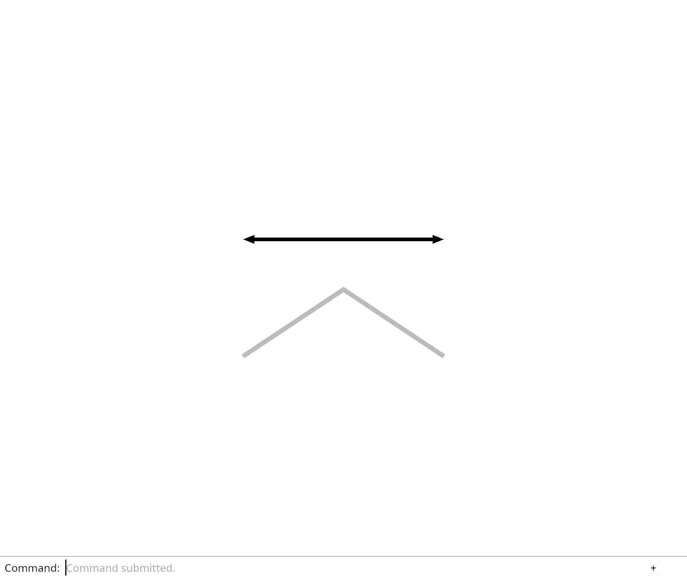

# 5.2 · Joined paths and headed ends

**Goal:** Insert source-backed joined paths and arrowheads through the real dock, then check their actual browser pixels. · **Steps:** 10 · **Source:** [app/walk/curves.rs](../../../src/app/walk/curves.rs) · [engine/gpu/segments.rs](../../../src/engine/gpu/segments.rs) · [shaders/ribbon.wgsl](../../../src/shaders/ribbon.wgsl) · [shaders/vector.wgsl](../../../src/shaders/vector.wgsl) · [app/walk/points.rs](../../../src/app/walk/points.rs) · [shaders/glyph.wgsl](../../../src/shaders/glyph.wgsl) · [shaders/ink_visibility.wgsl](../../../src/shaders/ink_visibility.wgsl) · [shaders/triangle.wgsl](../../../src/shaders/triangle.wgsl) · [shaders/grid.wgsl](../../../src/shaders/grid.wgsl) (`src/shaders/ribbon.wgsl,src/shaders/glyph.wgsl,src/engine/gpu/segments.rs`)

<div class="webgpu-schematic" style="width:100%;margin:6px auto;">
<svg xmlns="http://www.w3.org/2000/svg" width="1120" height="188" viewBox="0 0 1120 188" style="width:100%;max-width:100%;height:auto;display:block;margin:0 auto;" role="img">
  <defs>
    <marker id="arr" viewBox="0 0 10 10" refX="8" refY="5" markerWidth="6" markerHeight="6" orient="auto">
      <path d="M 0 1 L 9 5 L 0 9 z" fill="#111111"/>
    </marker>
    <marker id="arrR" viewBox="0 0 10 10" refX="8" refY="5" markerWidth="6" markerHeight="6" orient="auto">
      <path d="M 0 1 L 9 5 L 0 9 z" fill="#dc2626"/>
    </marker>
    <marker id="arrG" viewBox="0 0 10 10" refX="8" refY="5" markerWidth="6" markerHeight="6" orient="auto">
      <path d="M 0 1 L 9 5 L 0 9 z" fill="#16a34a"/>
    </marker>
    <marker id="arrB" viewBox="0 0 10 10" refX="8" refY="5" markerWidth="6" markerHeight="6" orient="auto">
      <path d="M 0 1 L 9 5 L 0 9 z" fill="#2563eb"/>
    </marker>
  </defs>
  <rect x="2" y="2" width="1116" height="184" rx="10" fill="#ffffff" stroke="#111111" stroke-width="2"/>
  <rect x="14" y="12" width="344" height="164" rx="8" fill="#ffffff" stroke="#111111" stroke-width="1.5"/>
  <text paint-order="stroke fill" stroke="#ffffff" stroke-width="5" stroke-linejoin="round" x="186" y="30" text-anchor="middle" font-family="monospace" font-size="10.5" font-weight="700" fill="#111111">Corner Tangents t0, t1 &amp; Miter Vector m = (n0+n1)/dot</text>
  <polyline points="58,136 164,66 270,136" fill="none" stroke="#111111" stroke-width="2" stroke-dasharray="4 3"/>
  <polygon points="48,122 164,44 280,122 260,150 164,88 68,150" fill="#dbeafe" fill-opacity="0.7" stroke="#2563eb" stroke-width="1.75"/>
  <line x1="164" y1="66" x2="164" y2="44" stroke="#dc2626" stroke-width="2.5" marker-end="url(#arrR)"/>
  <text paint-order="stroke fill" stroke="#ffffff" stroke-width="5" stroke-linejoin="round" x="192" y="54" font-family="monospace" font-size="9.5" font-weight="700" fill="#dc2626">m</text>
  <line x1="358" y1="94" x2="384" y2="94" stroke="#111111" stroke-width="2" marker-end="url(#arr)"/>
  <rect x="388" y="12" width="344" height="164" rx="8" fill="#ffffff" stroke="#111111" stroke-width="1.5"/>
  <text paint-order="stroke fill" stroke="#ffffff" stroke-width="5" stroke-linejoin="round" x="560" y="30" text-anchor="middle" font-family="monospace" font-size="10.5" font-weight="700" fill="#111111">Round Cap SDF (||uv|| &lt;= 1) + Arc-Length Dash Modulo</text>
  <circle cx="468" cy="102" r="28" fill="#dcfce7" stroke="#16a34a" stroke-width="2"/>
  <line x1="468" y1="102" x2="496" y2="102" stroke="#dc2626" stroke-width="2"/>
  <rect x="526" y="88" width="46" height="28" fill="#dbeafe" stroke="#111111" stroke-width="1.75"/>
  <rect x="592" y="88" width="24" height="28" fill="none" stroke="#94a3b8" stroke-width="1.5" stroke-dasharray="3 3"/>
  <rect x="636" y="88" width="46" height="28" fill="#dbeafe" stroke="#111111" stroke-width="1.75"/>
  <line x1="732" y1="94" x2="758" y2="94" stroke="#111111" stroke-width="2" marker-end="url(#arr)"/>
  <rect x="762" y="12" width="344" height="164" rx="8" fill="#ffffff" stroke="#111111" stroke-width="1.75"/>
  <text paint-order="stroke fill" stroke="#ffffff" stroke-width="5" stroke-linejoin="round" x="934" y="30" text-anchor="middle" font-family="monospace" font-size="10.5" font-weight="700" fill="#111111">Clean Mitered Corners &amp; Dashed CAD Strokes</text>
  <rect x="806" y="44" width="256" height="118" rx="4" fill="#ffffff" stroke="#111111" stroke-width="2"/>
  <polyline points="834,136 904,68 974,136" fill="none" stroke="#111111" stroke-width="6" stroke-linejoin="miter" stroke-linecap="round"/>
  <line x1="964" y1="74" x2="1044" y2="136" stroke="#2563eb" stroke-width="4" stroke-dasharray="10 6" stroke-linecap="round"/>
</svg>
</div>

## <a id="checkpoint-36-chain"></a>1. Retain connected source geometry

**What this code does:** Retain exact line or polyline owners while preparing checked shared display points.

### 1. `src/chain.rs`

Retain exact source geometry while deriving finite neighbour and head records.

Create the file and type:

```rust
use crate::stroke::PreparedLine;
use session_rust::{Arrowhead, Line, Polyline};
use std::rc::Rc;

#[derive(Clone)]
pub enum Source {
    Line(Rc<Line>),
    Polyline(Rc<Polyline>),
}

#[derive(Clone)]
pub struct PreparedChain {
    pub source: Source,
    pub points: Rc<Vec<[f32; 3]>>,
    pub colour: [f32; 4],
    pub width: f32,
    pub heads: u32,
}

impl Source {
    pub fn coordinates(&self) -> Vec<[f64; 3]> {
        match self {
            Self::Line(line) => [line.start(), line.end()]
                .map(|p| [p[0], p[1], p[2]])
                .to_vec(),
            Self::Polyline(line) => line
                .coords
                .chunks_exact(3)
                .map(|p| [p[0], p[1], p[2]])
                .collect(),
        }
    }
}

impl PreparedChain {
    pub fn line(source: Rc<Line>) -> Result<Self, &'static str> {
        let display = PreparedLine::new(Rc::clone(&source))?.display;
        Self::new(
            Source::Line(source),
            display.colour,
            display.width,
        )
    }

    pub fn polyline(source: Rc<Polyline>) -> Result<Self, &'static str> {
        if source.coords.len() % 3 != 0 || !(6..=30_000).contains(&source.coords.len())
        {
            return Err("Polyline needs 2–10,000 complete points");
        }
        let _ = source.guid();
        let mut line = Line::new(0.0, 0.0, 0.0, 1.0, 0.0, 0.0);
        line.linecolor = source.linecolor.clone();
        line.width = source.width;
        let display = PreparedLine::new(Rc::new(line))?.display;
        Self::new(
            Source::Polyline(source),
            display.colour,
            display.width,
        )
    }

    fn new(source: Source, colour: [f32; 4], width: f32) -> Result<Self, &'static str> {
        let heads = match &source {
            Source::Line(line) => line.arrowhead,
            Source::Polyline(line) => line.arrowhead,
        };
        let heads = match heads {
            Arrowhead::NONE => 0,
            Arrowhead::END => 1,
            Arrowhead::START => 2,
            Arrowhead::BOTH => 3,
        };
        let mut points = Vec::new();
        for p in source.coordinates() {
            let p = p.map(|v| v as f32);
            if p.iter().any(|v| !v.is_finite()) {
                return Err("Chain exceeds the display range");
            }
            if points.last() != Some(&p) {
                points.push(p);
            }
        }
        Ok(Self {
            source,
            points: Rc::new(points),
            colour,
            width,
            heads,
        })
    }
}
```

### 2. `src/lib.rs`

Register connected geometry and its checks.

**Locate this existing block:**

```rust
pub mod camera;
#[cfg(test)]
```

Edit the existing block to match this code; keep unchanged lines:

```rust
pub mod camera;
pub mod chain;
#[cfg(test)]
mod chain_tests;
#[cfg(test)]
```

### 3. `src/chain_tests.rs`

Copy source precision, links, degeneracy and packed-head checks.

Create the file and type:

```rust
use crate::chain::{PreparedChain, Source};
use session_rust::{Point, Polyline};
use std::rc::Rc;

#[test]
fn exact_sources_shared_display_points_and_invalid_input() {
    let source = Rc::new(Polyline::new(vec![
        Point::new(0.1234567890123, 0.0, 0.0),
        Point::new(1.0, 0.0, 0.0),
    ]));
    let weak = Rc::downgrade(&source);
    let prepared = PreparedChain::polyline(Rc::clone(&source)).unwrap();
    let Source::Polyline(owner) = &prepared.source else {
        panic!("Original polyline owner")
    };
    assert!(Rc::ptr_eq(owner, &source));
    assert_eq!(owner.coords, source.coords);
    assert_ne!(
        prepared.points[0][0] as f64,
        source.coords[0]
    );
    let shared = prepared.clone();
    assert!(Rc::ptr_eq(&prepared.points, &shared.points));
    drop(source);
    drop(prepared);
    assert!(weak.upgrade().is_some());
    drop(shared);
    assert!(weak.upgrade().is_none());
    assert!(
        PreparedChain::polyline(Rc::new(Polyline::from_coords(vec![0.0; 7]))).is_err()
    );
    assert!(
        PreparedChain::polyline(Rc::new(Polyline::from_coords(
            vec![f64::INFINITY; 6]
        )))
        .is_err()
    );
}
```

## <a id="checkpoint-36a-links"></a>2. Link adjacent spans and headed ends

**What this code does:** Link every nonzero span to its neighbours and identify free ends carrying arrowheads.

### 1. `src/chain.rs`

Describe neighbours and heads without modifying the original source.

**Locate this existing block:**

```rust
        })
    }
}
```

Edit the existing block to match this code; keep unchanged lines:

```rust
        })
    }
}
use crate::stroke::Stroke;
#[derive(Clone, Copy)]
pub struct Segment {
    pub stroke: Stroke,
    pub previous: [f32; 3],
    pub next: [f32; 3],
    pub heads: u32,
}

impl PreparedChain {
    pub fn segments(&self) -> Vec<Segment> {
        let points = &self.points;
        let last = points.len().saturating_sub(1);
        let closed = last > 1 && points.first() == points.last();
        points
            .windows(2)
            .enumerate()
            .map(|(i, ends)| Segment {
                stroke: Stroke {
                    start: ends[0],
                    end: ends[1],
                    colour: self.colour,
                    width: self.width,
                },
                previous: if i > 0 {
                    points[i - 1]
                } else if closed {
                    points[last - 1]
                } else {
                    ends[0]
                },
                next: if i + 2 <= last {
                    points[i + 2]
                } else if closed {
                    points[1]
                } else {
                    ends[1]
                },
                heads: if closed {
                    0
                } else {
                    (if i == 0 {
                        self.heads & 2
                    } else {
                        0
                    }) | (if i + 1 == last {
                        self.heads & 1
                    } else {
                        0
                    })
                },
            })
            .collect()
    }
}

impl Segment {
    pub fn bytes(&self) -> Vec<u8> {
        let mut bytes = self.stroke.bytes();
        bytes.extend(
            self.previous
                .into_iter()
                .chain(self.next)
                .flat_map(f32::to_ne_bytes),
        );
        bytes.extend(self.heads.to_ne_bytes());
        bytes
    }
}
```

### 2. `src/chain_link_tests.rs`

Copy closed-neighbour and headed-span checks.

Create the file and type:

```rust
use crate::chain::PreparedChain;
use session_rust::{Arrowhead, Line, Point, Polyline};
use std::rc::Rc;

#[test]
fn linked_repeated_points_closed_neighbours_and_exact_source_are_distinct() {
    let p = |x, y| Point::new(x, y, 0.0);
    let mut line = Polyline::new(vec![
        p(0.1234567890123, 0.0),
        p(1.0, 0.0),
        p(1.0, 0.0),
        p(1.0, 1.0),
        p(0.1234567890123, 0.0),
    ]);
    line.arrowhead = Arrowhead::BOTH;
    let source = Rc::new(line);
    let weak = Rc::downgrade(&source);
    let original = source.coords.clone();
    let prepared = PreparedChain::polyline(Rc::clone(&source)).unwrap();
    let segments = prepared.segments();
    assert_eq!(segments.len(), 3);
    assert_eq!(
        segments[0].previous,
        segments[2].stroke.start
    );
    assert_eq!(segments[2].next, segments[0].stroke.end);
    assert!(
        segments
            .iter()
            .all(|s| s.heads == 0 && s.bytes().len() == 72)
    );
    assert_eq!(source.coords, original);
    assert_ne!(prepared.points[0][0] as f64, original[0]);
    let shared = prepared.clone();
    assert!(Rc::ptr_eq(&prepared.points, &shared.points));
    drop(source);
    drop(prepared);
    assert!(weak.upgrade().is_some());
    drop(shared);
    assert!(weak.upgrade().is_none());
}

#[test]
fn heads_use_only_nonzero_free_spans_and_keep_original_line_identity() {
    for (heads, flags) in [
        (Arrowhead::NONE, 0),
        (Arrowhead::START, 2),
        (Arrowhead::END, 1),
        (Arrowhead::BOTH, 3),
    ] {
        let mut source = Line::new(0.0, 0.0, 0.0, 1.0, 0.0, 0.0);
        source.arrowhead = heads;
        let source = Rc::new(source);
        let guid = source.guid().to_owned();
        let chain = PreparedChain::line(Rc::clone(&source)).unwrap();
        let segment = chain.segments()[0];
        assert_eq!(segment.heads, flags);
        assert_eq!(
            u32::from_ne_bytes(segment.bytes()[68..72].try_into().unwrap()),
            flags
        );
        assert_eq!(source.guid(), guid);
    }
    assert!(
        PreparedChain::line(Rc::new(Line::new(
            0.0, 0.0, 0.0, 0.0, 0.0, 0.0
        )))
        .unwrap()
        .segments()
        .is_empty()
    );
    assert!(
        PreparedChain::polyline(Rc::new(Polyline::from_coords(vec![0.0; 7]))).is_err()
    );
    assert!(
        PreparedChain::polyline(Rc::new(Polyline::from_coords(
            vec![f64::INFINITY; 6]
        )))
        .is_err()
    );
}
```

### 3. `src/lib.rs`

Register the connected span checks.

**Locate this existing block:**

```rust
#[cfg(test)]
mod chain_tests;
```

Edit the existing block to match this code; keep unchanged lines:

```rust
#[cfg(test)]
mod chain_link_tests;
#[cfg(test)]
mod chain_tests;
```

## <a id="checkpoint-36b-join"></a>3. Project neighbours for bounded stroke joins

**What this code does:** Calculate a shared bounded cross-section from projected neighbour directions.

### 1. `src/chain.wgsl`

Share bounded projected joins while retaining near clipping and edge coverage.

Create the file and type:

```wgsl
struct View { transform: mat4x4<f32>, size: vec2<f32>, density: f32 }
@group(0) @binding(0) var<uniform> view: View;
struct Output {
    @builtin(position) position: vec4<f32>,
    @location(0) colour: vec4<f32>,
    @location(1) @interpolate(linear) pixel: vec2<f32>,
    @location(2) @interpolate(flat) origin: vec2<f32>,
    @location(3) @interpolate(flat) direction: vec2<f32>,
    @location(4) @interpolate(flat) half_width: f32,
}
fn screen(p: vec4<f32>) -> vec2<f32> { return p.xy / p.w * view.size * 0.5; }
fn perpendicular(d: vec2<f32>) -> vec2<f32> { return vec2<f32>(-d.y, d.x); }
fn joint(neighbour: vec4<f32>, endpoint: vec4<f32>, d: vec2<f32>, before: bool) -> vec2<f32> {
    let normal = perpendicular(d);
    if (neighbour.z < 0.0 || neighbour.w <= 0.0) { return normal; }
    let span = select(screen(neighbour) - screen(endpoint), screen(endpoint) - screen(neighbour), before);
    if (dot(span, span) < 0.000001) { return normal; }
    let other = normalize(span); let sum = normal + perpendicular(other);
    if (dot(sum, sum) < 0.000001) { return normal; }
    let bisector = normalize(sum);
    return bisector / max(dot(bisector, normal), 0.25);
}
```

### 2. `src/chain.rs`

Expose the actual connected shader source.

**Locate this existing block:**

```rust
use crate::stroke::PreparedLine;
use session_rust::{Arrowhead, Line, Polyline};
```

Edit the existing block to match this code; keep unchanged lines:

```rust
pub const SHADER: &str = include_str!("chain.wgsl");
use crate::stroke::PreparedLine;
use session_rust::{Arrowhead, Line, Polyline};
```

## <a id="checkpoint-36ba-body"></a>4. Extrude the joined stroke body

**What this code does:** Build joined stroke vertices and analytic coverage from the prepared projected cross-sections.

### 1. `src/chain.wgsl`

Clip before projection, meet bounded endpoint sections and cover the stroke analytically.

**Locate this existing block:**

```wgsl
    return bisector / max(dot(bisector, normal), 0.25);
}
```

Edit the existing block to match this code; keep unchanged lines:

```wgsl
    return bisector / max(dot(bisector, normal), 0.25);
}
@vertex
fn vertex(@location(0) start: vec3<f32>, @location(1) end: vec3<f32>,
    @location(2) colour: vec4<f32>, @location(3) width: f32,
    @location(4) previous: vec3<f32>, @location(5) next: vec3<f32>,
    @location(6) heads: u32, @builtin(vertex_index) index: u32) -> Output {
    var hidden: Output; hidden.position = vec4<f32>(2.0, 2.0, 2.0, 1.0);
    var a = view.transform * vec4<f32>(start, 1.0);
    var b = view.transform * vec4<f32>(end, 1.0);
    let clipped_a = a.z < 0.0; let clipped_b = b.z < 0.0;
    if (clipped_a && clipped_b) { return hidden; }
    if (clipped_a) { a = mix(a, b, -a.z / (b.z - a.z)); }
    if (clipped_b) { b = mix(b, a, -b.z / (a.z - b.z)); }
    if (a.w <= 0.0 || b.w <= 0.0) { return hidden; }
    let delta = screen(b) - screen(a);
    if (dot(delta, delta) < 0.000001) { return hidden; }
    let direction = normalize(delta); let normal = perpendicular(direction);
    let back = view.transform * vec4<f32>(previous, 1.0);
    let front = view.transform * vec4<f32>(next, 1.0);
    let left = select(joint(back, a, direction, true), normal, clipped_a);
    let right = select(joint(front, b, direction, false), normal, clipped_b);
    let corners = array<vec2<f32>, 6>(vec2<f32>(0.0, -1.0), vec2<f32>(1.0, -1.0), vec2<f32>(0.0, 1.0),
        vec2<f32>(0.0, 1.0), vec2<f32>(1.0, -1.0), vec2<f32>(1.0, 1.0));
    let corner = corners[index]; let half_width = width * view.density * 0.5;
    var position = select(a, b, corner.x > 0.5);
    let offset = select(left, right, corner.x > 0.5) * (half_width + 0.70711) * corner.y;
    position = vec4<f32>(position.xy + offset * 2.0 / view.size * position.w, position.zw);
    return Output(position, colour, screen(position), screen(a), direction, half_width);
}
@fragment
fn fragment(input: Output) -> @location(0) vec4<f32> {
    let distance = dot(input.pixel - input.origin, perpendicular(input.direction));
    let coverage = clamp(input.half_width + 0.5 - abs(distance), 0.0, 1.0);
    return vec4<f32>(input.colour.rgb, input.colour.a * coverage);
}
```

## <a id="checkpoint-36bb-heads"></a>5. Extrude free-end arrowheads

**What this code does:** Draw flagged arrowheads with stable screen dimensions and limit their share of short spans.

### 1. `src/chain.wgsl`

Carry head shape separately from body coverage. Shape real free-end heads and partition their shaft at the base. Identify body fragments independently of head triangles. Cover triangle edges while preserving a continuous, singly blended shaft seam.

**Locate this existing block:**

```wgsl
    @location(4) @interpolate(flat) half_width: f32,
}
fn screen(p: vec4<f32>) -> vec2<f32> { return p.xy / p.w * view.size * 0.5; }
fn perpendicular(d: vec2<f32>) -> vec2<f32> { return vec2<f32>(-d.y, d.x); }
fn joint(neighbour: vec4<f32>, endpoint: vec4<f32>, d: vec2<f32>, before: bool) -> vec2<f32> {
    let normal = perpendicular(d);
    if (neighbour.z < 0.0 || neighbour.w <= 0.0) { return normal; }
    let span = select(screen(neighbour) - screen(endpoint), screen(endpoint) - screen(neighbour), before);
    if (dot(span, span) < 0.000001) { return normal; }
    let other = normalize(span); let sum = normal + perpendicular(other);
    if (dot(sum, sum) < 0.000001) { return normal; }
    let bisector = normalize(sum);
    return bisector / max(dot(bisector, normal), 0.25);
}
@vertex
fn vertex(@location(0) start: vec3<f32>, @location(1) end: vec3<f32>,
    @location(2) colour: vec4<f32>, @location(3) width: f32,
    @location(4) previous: vec3<f32>, @location(5) next: vec3<f32>,
    @location(6) heads: u32, @builtin(vertex_index) index: u32) -> Output {
    var hidden: Output; hidden.position = vec4<f32>(2.0, 2.0, 2.0, 1.0);
    var a = view.transform * vec4<f32>(start, 1.0);
    var b = view.transform * vec4<f32>(end, 1.0);
    let clipped_a = a.z < 0.0; let clipped_b = b.z < 0.0;
    if (clipped_a && clipped_b) { return hidden; }
    if (clipped_a) { a = mix(a, b, -a.z / (b.z - a.z)); }
    if (clipped_b) { b = mix(b, a, -b.z / (a.z - b.z)); }
    if (a.w <= 0.0 || b.w <= 0.0) { return hidden; }
    let delta = screen(b) - screen(a);
    if (dot(delta, delta) < 0.000001) { return hidden; }
    let direction = normalize(delta); let normal = perpendicular(direction);
    let back = view.transform * vec4<f32>(previous, 1.0);
    let front = view.transform * vec4<f32>(next, 1.0);
    let left = select(joint(back, a, direction, true), normal, clipped_a);
    let right = select(joint(front, b, direction, false), normal, clipped_b);
    let corners = array<vec2<f32>, 6>(vec2<f32>(0.0, -1.0), vec2<f32>(1.0, -1.0), vec2<f32>(0.0, 1.0),
        vec2<f32>(0.0, 1.0), vec2<f32>(1.0, -1.0), vec2<f32>(1.0, 1.0));
    let corner = corners[index]; let half_width = width * view.density * 0.5;
    var position = select(a, b, corner.x > 0.5);
    let offset = select(left, right, corner.x > 0.5) * (half_width + 0.70711) * corner.y;
    position = vec4<f32>(position.xy + offset * 2.0 / view.size * position.w, position.zw);
    return Output(position, colour, screen(position), screen(a), direction, half_width);
}
@fragment
fn fragment(input: Output) -> @location(0) vec4<f32> {
    let distance = dot(input.pixel - input.origin, perpendicular(input.direction));
    let coverage = clamp(input.half_width + 0.5 - abs(distance), 0.0, 1.0);
    return vec4<f32>(input.colour.rgb, input.colour.a * coverage);
```

Edit the existing block to match this code; keep unchanged lines:

```wgsl
    @location(4) @interpolate(flat) half_width: f32,
    @location(5) @interpolate(flat) part: u32,
    @location(6) @interpolate(flat) head_length: f32,
}
fn screen(p: vec4<f32>) -> vec2<f32> { return p.xy / p.w * view.size * 0.5; }
fn perpendicular(d: vec2<f32>) -> vec2<f32> { return vec2<f32>(-d.y, d.x); }
fn joint(neighbour: vec4<f32>, endpoint: vec4<f32>, d: vec2<f32>, before: bool) -> vec2<f32> {
    let normal = perpendicular(d);
    if (neighbour.z < 0.0 || neighbour.w <= 0.0) { return normal; }
    let span = select(screen(neighbour) - screen(endpoint), screen(endpoint) - screen(neighbour), before);
    if (dot(span, span) < 0.000001) { return normal; }
    let other = normalize(span); let sum = normal + perpendicular(other);
    if (dot(sum, sum) < 0.000001) { return normal; }
    let bisector = normalize(sum);
    return bisector / max(dot(bisector, normal), 0.25);
}
@vertex
fn vertex(@location(0) start: vec3<f32>, @location(1) end: vec3<f32>,
    @location(2) colour: vec4<f32>, @location(3) width: f32,
    @location(4) previous: vec3<f32>, @location(5) next: vec3<f32>,
    @location(6) heads: u32, @builtin(vertex_index) index: u32) -> Output {
    var hidden: Output; hidden.position = vec4<f32>(2.0, 2.0, 2.0, 1.0);
    var a = view.transform * vec4<f32>(start, 1.0);
    var b = view.transform * vec4<f32>(end, 1.0);
    let clipped_a = a.z < 0.0; let clipped_b = b.z < 0.0;
    if (clipped_a && clipped_b) { return hidden; }
    if (clipped_a) { a = mix(a, b, -a.z / (b.z - a.z)); }
    if (clipped_b) { b = mix(b, a, -b.z / (a.z - b.z)); }
    if (a.w <= 0.0 || b.w <= 0.0) { return hidden; }
    let delta = screen(b) - screen(a);
    if (dot(delta, delta) < 0.000001) { return hidden; }
    let direction = normalize(delta); let normal = perpendicular(direction);
    let back = view.transform * vec4<f32>(previous, 1.0);
    let front = view.transform * vec4<f32>(next, 1.0);
    let left = select(joint(back, a, direction, true), normal, clipped_a);
    let right = select(joint(front, b, direction, false), normal, clipped_b);
    let corners = array<vec2<f32>, 6>(vec2<f32>(0.0, -1.0), vec2<f32>(1.0, -1.0), vec2<f32>(0.0, 1.0),
        vec2<f32>(0.0, 1.0), vec2<f32>(1.0, -1.0), vec2<f32>(1.0, 1.0));
    let corner = corners[index % 6u]; let half_width = width * view.density * 0.5;
    let at_start = (heads & 2u) != 0u && !clipped_a;
    let at_end = (heads & 1u) != 0u && !clipped_b;
    let share = select(1.0, 2.0, at_start && at_end);
    let head_length = min(max(10.0 * view.density, 6.0 * half_width), length(delta) * 0.6 / share);
    let part = index / 6u;
    if (part > 0u) {
        let is_start = part == 2u;
        if ((is_start && !at_start) || (!is_start && !at_end)) { return hidden; }
        let tip = select(b, a, is_start); let aim = select(direction, -direction, is_start);
        let offset = -aim * mix(-0.70711, head_length + 0.70711, corner.x)
            + perpendicular(aim) * (head_length * 0.4 + 0.70711) * corner.y;
        let position = vec4<f32>(tip.xy + offset * 2.0 / view.size * tip.w, tip.zw);
        return Output(position, colour, screen(position), screen(tip), aim, half_width, 1u, head_length);
    }
    let start_offset = direction * select(0.0, head_length, at_start);
    let end_offset = -direction * select(0.0, head_length, at_end);
    var position = select(a, b, corner.x > 0.5);
    position = vec4<f32>(position.xy + select(start_offset, end_offset, corner.x > 0.5)
        * 2.0 / view.size * position.w, position.zw);
    let offset = select(left, right, corner.x > 0.5) * (half_width + 0.70711) * corner.y;
    position = vec4<f32>(position.xy + offset * 2.0 / view.size * position.w, position.zw);
    return Output(position, colour, screen(position), screen(a), direction, half_width, 0u, 0.0);
}
@fragment
fn fragment(input: Output) -> @location(0) vec4<f32> {
    let local = input.pixel - input.origin;
    let distance = dot(local, perpendicular(input.direction));
    var coverage = clamp(input.half_width + 0.5 - abs(distance), 0.0, 1.0);
    if (input.part == 1u) {
        let back = -dot(local, input.direction);
        if (back >= input.head_length) { discard; }
        let side = (0.4 * back - abs(distance)) / sqrt(1.16);
        let base = select(input.head_length - back, 1e6, abs(distance) <= input.half_width);
        coverage = clamp(min(min(side, back), base) + 0.5, 0.0, 1.0);
    }
    return vec4<f32>(input.colour.rgb, input.colour.a * coverage);
```

## <a id="checkpoint-36c-lane"></a>6. Share instance drawing with connected strokes

**What this code does:** Reuse the stroke lane lifetime and view code with the connected 72-byte instance layout.

### 1. `src/stroke_gpu.rs`

Keep format-specific layout beside the shared lane resources. Validate each connected record, then reuse the same changed-byte transaction. Draw the correct number of vertices for either instance format. Count actual instances from their format-specific stride. Construct either layout using one pipeline and view implementation. Use the actual shader belonging to this instance layout. Bind the exact attributes and byte stride. Retain both layout parameters for synchronized draw and accounting. Keep the buffer initialization trait at the method that uses it.

**Locate this existing block:**

```rust
    data: Vec<u8>,
    pub uploads: u64,
    pub uploaded_bytes: u64,
}

impl Lane {
    pub fn set(
        &mut self,
        device: &wgpu::Device,
        strokes: impl IntoIterator<Item = crate::stroke::Stroke>,
    ) -> Result<(), &'static str> {
        use wgpu::util::DeviceExt;
        let mut data = Vec::new();
        for stroke in strokes {
            if stroke.width <= 0.0
                || stroke
                    .values()
                    .iter()
                    .any(|value| !value.is_finite())
            {
                return Err("Invalid stroke display data");
            }
            data.extend(stroke.bytes());
        }
        u32::try_from(data.len() / 44).map_err(|_| "Too many stroke instances")?;
        if data == self.data {
            return Ok(());
        }
        self.vertices = if data.is_empty() {
            None
        } else {
            self.uploads += 1;
            self.uploaded_bytes += data.len() as u64;
            Some(
                device.create_buffer_init(&wgpu::util::BufferInitDescriptor {
                    label: Some("stroke instances"),
                    contents: &data,
                    usage: wgpu::BufferUsages::VERTEX,
                }),
            )
        };
        self.data = data;
        Ok(())
    }

    pub fn view(
        &self,
        queue: &wgpu::Queue,
        transform: &[f32; 16],
        size: [u32; 2],
        density: f32,
    ) {
        if self.vertices.is_none() {
            return;
        }
        let bytes: Vec<u8> = transform
            .iter()
            .copied()
            .chain([size[0] as f32, size[1] as f32, density, 0.0])
            .flat_map(f32::to_ne_bytes)
            .collect();
        queue.write_buffer(&self.uniform, 0, &bytes);
    }

    pub fn draw(&self, pass: &mut wgpu::RenderPass<'_>) {
        let Some(vertices) = &self.vertices else {
            return;
        };
        pass.set_pipeline(&self.pipeline);
        pass.set_bind_group(0, &self.group, &[]);
        pass.set_vertex_buffer(0, vertices.slice(..));
        pass.draw(0..6, 0..(self.data.len() / 44) as u32);
    }

    pub fn usage(&self) -> [u64; 2] {
        [
            self.data.len() as u64 / 44,
            self.vertices
                .as_ref()
                .map_or(0, wgpu::Buffer::size),
        ]
    }

    pub fn new(device: &wgpu::Device, format: wgpu::TextureFormat) -> Self {
        let shader = device.create_shader_module(wgpu::ShaderModuleDescriptor {
            label: Some("stroke"),
            source: wgpu::ShaderSource::Wgsl(crate::stroke::SHADER.into()),
        });
        let pipeline = device.create_render_pipeline(&wgpu::RenderPipelineDescriptor {
            label: Some("stroke"), layout: None,
            vertex: wgpu::VertexState { module: &shader, entry_point: Some("vertex"),
                compilation_options: Default::default(),
                buffers: &[wgpu::VertexBufferLayout { array_stride: 44, step_mode: wgpu::VertexStepMode::Instance,
                    attributes: &wgpu::vertex_attr_array![0 => Float32x3, 1 => Float32x3, 2 => Float32x4, 3 => Float32] }],
            },
            fragment: Some(wgpu::FragmentState { module: &shader, entry_point: Some("fragment"),
                compilation_options: Default::default(),
                targets: &[Some(wgpu::ColorTargetState { format, blend: Some(wgpu::BlendState::ALPHA_BLENDING),
                    write_mask: wgpu::ColorWrites::ALL })],
            }),
            primitive: Default::default(),
            depth_stencil: Some(wgpu::DepthStencilState { format: wgpu::TextureFormat::Depth32Float,
                depth_write_enabled: Some(false), depth_compare: Some(wgpu::CompareFunction::LessEqual),
                stencil: Default::default(), bias: Default::default() }),
            multisample: Default::default(), multiview_mask: None, cache: None,
        });
        let uniform = device.create_buffer(&wgpu::BufferDescriptor {
            label: Some("stroke view"),
            size: 80,
            usage: wgpu::BufferUsages::UNIFORM | wgpu::BufferUsages::COPY_DST,
            mapped_at_creation: false,
        });
        let group = device.create_bind_group(&wgpu::BindGroupDescriptor {
            label: Some("stroke view"),
            layout: &pipeline.get_bind_group_layout(0),
            entries: &[wgpu::BindGroupEntry {
                binding: 0,
                resource: uniform.as_entire_binding(),
            }],
        });
        Self {
            pipeline,
            uniform,
            group,
            vertices: None,
            data: Vec::new(),
            uploads: 0,
```

Edit the existing block to match this code; keep unchanged lines:

```rust
    data: Vec<u8>,
    stride: u64,
    vertices_per_instance: u32,
    pub uploads: u64,
    pub uploaded_bytes: u64,
}

impl Lane {
    pub fn set(
        &mut self,
        device: &wgpu::Device,
        strokes: impl IntoIterator<Item = crate::stroke::Stroke>,
    ) -> Result<(), &'static str> {
        let mut data = Vec::new();
        for stroke in strokes {
            if stroke.width <= 0.0
                || stroke
                    .values()
                    .iter()
                    .any(|value| !value.is_finite())
            {
                return Err("Invalid stroke display data");
            }
            data.extend(stroke.bytes());
        }
        if self.stride != 44 {
            return Err("Stroke data needs the stroke layout");
        }
        self.set_bytes(device, data)
    }

    pub fn set_chains(
        &mut self,
        device: &wgpu::Device,
        segments: impl IntoIterator<Item = crate::chain::Segment>,
    ) -> Result<(), &'static str> {
        if self.stride != 72 {
            return Err("Connected data needs the connected layout");
        }
        let mut data = Vec::new();
        for segment in segments {
            if segment.stroke.width <= 0.0
                || segment.heads > 3
                || segment
                    .stroke
                    .values()
                    .iter()
                    .chain(segment.previous.iter())
                    .chain(segment.next.iter())
                    .any(|v| !v.is_finite())
            {
                return Err("Invalid connected display data");
            }
            data.extend(segment.bytes());
        }
        self.set_bytes(device, data)
    }

    fn set_bytes(
        &mut self,
        device: &wgpu::Device,
        data: Vec<u8>,
    ) -> Result<(), &'static str> {
        use wgpu::util::DeviceExt;
        u32::try_from(data.len() as u64 / self.stride)
            .map_err(|_| "Too many stroke instances")?;
        if data == self.data {
            return Ok(());
        }
        self.vertices = if data.is_empty() {
            None
        } else {
            self.uploads += 1;
            self.uploaded_bytes += data.len() as u64;
            Some(
                device.create_buffer_init(&wgpu::util::BufferInitDescriptor {
                    label: Some("stroke instances"),
                    contents: &data,
                    usage: wgpu::BufferUsages::VERTEX,
                }),
            )
        };
        self.data = data;
        Ok(())
    }

    pub fn view(
        &self,
        queue: &wgpu::Queue,
        transform: &[f32; 16],
        size: [u32; 2],
        density: f32,
    ) {
        if self.vertices.is_none() {
            return;
        }
        let bytes: Vec<u8> = transform
            .iter()
            .copied()
            .chain([size[0] as f32, size[1] as f32, density, 0.0])
            .flat_map(f32::to_ne_bytes)
            .collect();
        queue.write_buffer(&self.uniform, 0, &bytes);
    }

    pub fn draw(&self, pass: &mut wgpu::RenderPass<'_>) {
        let Some(vertices) = &self.vertices else {
            return;
        };
        pass.set_pipeline(&self.pipeline);
        pass.set_bind_group(0, &self.group, &[]);
        pass.set_vertex_buffer(0, vertices.slice(..));
        pass.draw(
            0..self.vertices_per_instance,
            0..(self.data.len() as u64 / self.stride) as u32,
        );
    }

    pub fn usage(&self) -> [u64; 2] {
        [
            self.data.len() as u64 / self.stride,
            self.vertices
                .as_ref()
                .map_or(0, wgpu::Buffer::size),
        ]
    }

    pub fn new(device: &wgpu::Device, format: wgpu::TextureFormat) -> Self {
        Self::layout(
            device,
            format,
            crate::stroke::SHADER,
            44,
            6,
            &wgpu::vertex_attr_array![0 => Float32x3, 1 => Float32x3, 2 => Float32x4, 3 => Float32],
        )
    }

    pub fn joined(device: &wgpu::Device, format: wgpu::TextureFormat) -> Self {
        Self::layout(
            device,
            format,
            crate::chain::SHADER,
            72,
            18,
            &wgpu::vertex_attr_array![0 => Float32x3, 1 => Float32x3, 2 => Float32x4, 3 => Float32,
                4 => Float32x3, 5 => Float32x3, 6 => Uint32],
        )
    }

    fn layout(
        device: &wgpu::Device,
        format: wgpu::TextureFormat,
        source: &'static str,
        stride: u64,
        vertices_per_instance: u32,
        attributes: &[wgpu::VertexAttribute],
    ) -> Self {
        let shader = device.create_shader_module(wgpu::ShaderModuleDescriptor {
            label: Some("stroke"),
            source: wgpu::ShaderSource::Wgsl(source.into()),
        });
        let pipeline = device.create_render_pipeline(&wgpu::RenderPipelineDescriptor {
            label: Some("stroke"),
            layout: None,
            vertex: wgpu::VertexState {
                module: &shader,
                entry_point: Some("vertex"),
                compilation_options: Default::default(),
                buffers: &[wgpu::VertexBufferLayout {
                    array_stride: stride,
                    step_mode: wgpu::VertexStepMode::Instance,
                    attributes,
                }],
            },
            fragment: Some(wgpu::FragmentState {
                module: &shader,
                entry_point: Some("fragment"),
                compilation_options: Default::default(),
                targets: &[Some(wgpu::ColorTargetState {
                    format,
                    blend: Some(wgpu::BlendState::ALPHA_BLENDING),
                    write_mask: wgpu::ColorWrites::ALL,
                })],
            }),
            primitive: Default::default(),
            depth_stencil: Some(wgpu::DepthStencilState {
                format: wgpu::TextureFormat::Depth32Float,
                depth_write_enabled: Some(false),
                depth_compare: Some(wgpu::CompareFunction::LessEqual),
                stencil: Default::default(),
                bias: Default::default(),
            }),
            multisample: Default::default(),
            multiview_mask: None,
            cache: None,
        });
        let uniform = device.create_buffer(&wgpu::BufferDescriptor {
            label: Some("stroke view"),
            size: 80,
            usage: wgpu::BufferUsages::UNIFORM | wgpu::BufferUsages::COPY_DST,
            mapped_at_creation: false,
        });
        let group = device.create_bind_group(&wgpu::BindGroupDescriptor {
            label: Some("stroke view"),
            layout: &pipeline.get_bind_group_layout(0),
            entries: &[wgpu::BindGroupEntry {
                binding: 0,
                resource: uniform.as_entire_binding(),
            }],
        });
        Self {
            pipeline,
            uniform,
            group,
            vertices: None,
            data: Vec::new(),
            stride,
            vertices_per_instance,
            uploads: 0,
```

## <a id="checkpoint-36d-document"></a>7. Retain connected paths in document history

**What this code does:** Retain exact connected source owners as independent document rows and history values.

### 1. `src/chain.rs`

Expose the original identity and allocation for document ownership accounting.

**Locate this existing block:**

```rust
impl Source {
    pub fn coordinates(&self) -> Vec<[f64; 3]> {
```

Edit the existing block to match this code; keep unchanged lines:

```rust
impl Source {
    pub fn guid(&self) -> &str {
        match self {
            Self::Line(line) => line.guid(),
            Self::Polyline(line) => line.guid(),
        }
    }

    pub fn coordinates(&self) -> Vec<[f64; 3]> {
```

### 2. `src/scene.rs`

Place original source points before producing connected world display spans. Initialize the connected row table independently of mesh and line tables. Include all original placed path points in world bounds. Allocate distinct saved identities and validate complete placement before changing a row. Drop connected row capacity along with the rest of the document.

Edit these blocks from bottom to top. Keep the surrounding lines unchanged.

**Locate this block:**

```rust
    }

    pub fn clear(&mut self) {
        self.lines = Vec::new();
```

Replace it with:

```rust
    }

    pub fn clear(&mut self) {
        self.paths = Vec::new();
        self.lines = Vec::new();
```

**Locate this block:**

```rust
        self.lines.capacity() * std::mem::size_of::<LineObject>()
    }

    pub fn lines(&self) -> &[LineObject] {
        &self.lines
    }
```

Replace it with:

```rust
        self.lines.capacity() * std::mem::size_of::<LineObject>()
    }

    pub fn paths(&self) -> &[PathObject] {
        &self.paths
    }

    pub fn path_capacity_bytes(&self) -> usize {
        self.paths.capacity() * std::mem::size_of::<PathObject>()
    }

    pub fn insert_path(
        &mut self,
        prepared: crate::chain::PreparedChain,
    ) -> Result<ObjectId, &'static str> {
        let next = self
            .next_id
            .checked_add(1)
            .ok_or("Object IDs exhausted")?;
        let mut guid = prepared.source.guid().to_owned();
        while self.paths.iter().any(|row| row.guid == guid)
            || self
                .objects
                .iter()
                .any(|row| row.guid == guid)
            || self
                .lines
                .iter()
                .any(|row| row.prepared.source.guid() == guid)
        {
            guid = uuid::Uuid::new_v4().to_string();
        }
        let id = ObjectId(self.next_id);
        self.next_id = next;
        self.paths.push(PathObject {
            id,
            guid,
            prepared,
            model: session_rust::Xform::identity(),
        });
        Ok(id)
    }

    pub fn lines(&self) -> &[LineObject] {
        &self.lines
    }
```

**Locate this block:**

```rust
                }
            }
        }
        bounds
    }
```

Replace it with:

```rust
                }
            }
        }
        for row in &self.paths {
            for point in row.points() {
                let point = [point[0], point[1], point[2]];
                match &mut bounds {
                    Some(bounds) => bounds.include(point),
                    None => bounds = Some(crate::bounds::Bounds::point(point)),
                }
            }
        }
        bounds
    }
```

**Locate this block:**

```rust
        .expect("Valid turquoise triangle");
        let mut scene = Self {
            objects: Vec::new(),
            lines: Vec::new(),
            next_id: 1,
            extra: None,
```

Replace it with:

```rust
        .expect("Valid turquoise triangle");
        let mut scene = Self {
            objects: Vec::new(),
            paths: Vec::new(),
            lines: Vec::new(),
            next_id: 1,
            extra: None,
```

**Locate this block:**

```rust
#[derive(Clone)]
pub struct Scene {
    lines: Vec<LineObject>,
    objects: Vec<Object>,
    next_id: u32,
```

Replace it with:

```rust
#[derive(Clone)]
pub struct PathObject {
    pub id: ObjectId,
    pub guid: String,
    pub prepared: crate::chain::PreparedChain,
    pub model: session_rust::Xform,
}

impl PathObject {
    pub fn points(&self) -> Vec<session_rust::Point> {
        self.prepared
            .source
            .coordinates()
            .into_iter()
            .map(|p| {
                self.model
                    .transform_point(&session_rust::Point::new(p[0], p[1], p[2]))
            })
            .collect()
    }
}

#[derive(Clone)]
pub struct Scene {
    paths: Vec<PathObject>,
    lines: Vec<LineObject>,
    objects: Vec<Object>,
    next_id: u32,
```

### 3. `src/document.rs`

Refuse unsupported mixed saving rather than silently omitting connected geometry.

**Locate this existing block:**

```rust
pub fn snapshot(scene: &crate::scene::Scene) -> Result<Vec<u8>, &'static str> {
    if !scene.lines().is_empty() {
        return Err("This checkpoint cannot save line objects yet");
```

Edit the existing block to match this code; keep unchanged lines:

```rust
pub fn snapshot(scene: &crate::scene::Scene) -> Result<Vec<u8>, &'static str> {
    if !scene.lines().is_empty() || !scene.paths().is_empty() {
        return Err("This checkpoint cannot save line objects yet");
```

### 4. `src/lib.rs`

Register the precise path-document checks.

**Locate this existing block:**

```rust
mod origin_tests;
pub mod picking;
```

Edit the existing block to match this code; keep unchanged lines:

```rust
mod origin_tests;
#[cfg(test)]
mod path_document_tests;
pub mod picking;
```

### 5. `src/path_document_tests.rs`

Copy precise placement, original identity, sharing and release checks.

Create the file and type:

```rust
use crate::{chain::PreparedChain, history::History, scene::Scene};
use session_rust::{Point, Polyline};
use std::rc::Rc;

#[test]
fn connected_identity_and_history_preserve_original_sources() {
    let mut scene = Scene::demo();
    let mut history = History::default();
    let source = Rc::new(Polyline::new(vec![
        Point::new(2.123456789, 0.0, 0.0),
        Point::new(4.0, 1.0, 2.0),
    ]));
    let weak = Rc::downgrade(&source);
    let prepared = PreparedChain::polyline(source).unwrap();
    let first = scene.insert_path(prepared.clone()).unwrap();
    let second = scene.insert_path(prepared).unwrap();
    assert_ne!(first, second);
    assert_ne!(scene.paths()[0].guid, scene.paths()[1].guid);
    assert_eq!(scene.paths()[0].points()[0][0], 2.123456789);
    history
        .try_edit(&mut scene, |scene| {
            scene.add_box().map(|_| ())
        })
        .unwrap();
    assert!(history.undo(&mut scene));
    assert!(history.redo(&mut scene));
    assert_eq!(scene.paths()[0].id, first);
    assert!(crate::document::snapshot(&scene).is_err());
    scene.clear();
    assert!(weak.upgrade().is_some());
    history.clear();
    assert!(weak.upgrade().is_none());
    assert!(scene.paths().is_empty());
    assert!(scene.bounds().is_none());
}
```

## <a id="checkpoint-36db-placement"></a>8. Place connected coordinates and count shared owners

**What this code does:** Place original path coordinates before display conversion and count shared source/display owners once.

### 1. `src/chain.rs`

Identify source allocations separately for each kernel type.

**Locate this existing block:**

```rust
    }

    pub fn coordinates(&self) -> Vec<[f64; 3]> {
```

Edit the existing block to match this code; keep unchanged lines:

```rust
    }

    pub fn owner(&self) -> (u8, usize) {
        match self {
            Self::Line(line) => (0, Rc::as_ptr(line) as usize),
            Self::Polyline(line) => (1, Rc::as_ptr(line) as usize),
        }
    }

    pub fn coordinates(&self) -> Vec<[f64; 3]> {
```

### 2. `src/scene.rs`

Convert placed original doubles to display records only at the drawing boundary. Validate every placed point before committing the row model.

Edit these blocks from bottom to top. Keep the surrounding lines unchanged.

**Locate this block:**

```rust
            guid,
            prepared,
            model: session_rust::Xform::identity(),
        });
        Ok(id)
    }
```

Replace it with:

```rust
            guid,
            prepared,
            model: session_rust::Xform::identity(),
        });
        Ok(id)
    }

    pub fn place_path(
        &mut self,
        id: ObjectId,
        model: session_rust::Xform,
    ) -> Result<(), &'static str> {
        if !crate::placement::valid(&model.m) {
            return Err("Invalid path placement");
        }
        let row = self
            .paths
            .iter_mut()
            .find(|row| row.id == id)
            .ok_or("Path not found")?;
        for p in row.prepared.source.coordinates() {
            let p = model.transform_point(&session_rust::Point::new(p[0], p[1], p[2]));
            if (0..3).any(|i| !(p[i] as f32).is_finite()) {
                return Err("Path placement exceeds the display range");
            }
        }
        row.model = model;
        Ok(())
    }
```

**Locate this block:**

```rust
impl PathObject {
    pub fn points(&self) -> Vec<session_rust::Point> {
        self.prepared
            .source
```

Replace it with:

```rust
impl PathObject {
    pub fn segments(&self) -> Vec<crate::chain::Segment> {
        let mut points = Vec::new();
        for p in self.points() {
            let p = std::array::from_fn(|i| p[i] as f32);
            if points.last() != Some(&p) {
                points.push(p);
            }
        }
        crate::chain::PreparedChain {
            points: Rc::new(points),
            ..self.prepared.clone()
        }
        .segments()
    }

    pub fn points(&self) -> Vec<session_rust::Point> {
        self.prepared
            .source
```

### 3. `src/memory.rs`

Count row capacity and shared display buffers once across active and history roots.

**Locate this existing block:**

```rust
}

pub fn lines<'a>(scenes: impl IntoIterator<Item = &'a Scene>) -> [usize; 3] {
```

Edit the existing block to match this code; keep unchanged lines:

```rust
}

pub fn paths<'a>(scenes: impl IntoIterator<Item = &'a Scene>) -> [usize; 5] {
    let mut sources = HashSet::new();
    let mut displays = HashSet::new();
    let mut usage = [0; 5];
    for scene in scenes {
        usage[0] += scene.paths().len();
        usage[3] += scene.path_capacity_bytes();
        for row in scene.paths() {
            sources.insert(row.prepared.source.owner());
            if displays.insert(Rc::as_ptr(&row.prepared.points)) {
                usage[4] += row.prepared.points.capacity() * 12;
            }
        }
    }
    usage[1] = sources.len();
    usage[2] = displays.len();
    usage
}

pub fn lines<'a>(scenes: impl IntoIterator<Item = &'a Scene>) -> [usize; 3] {
```

### 4. `src/path_placement_tests.rs`

Copy precise world placement, sharing, atomic refusal and release checks.

Create the file and type:

```rust
use crate::{chain::PreparedChain, history::History, memory, scene::Scene};
use session_rust::{Point, Polyline, Xform};
use std::rc::Rc;

#[test]
fn connected_rows_keep_exact_source_placement_shared_history_and_complete_release() {
    let mut scene = Scene::demo();
    let mut history = History::default();
    let source = Rc::new(Polyline::new(vec![
        Point::new(2.123456789, 0.0, 0.0),
        Point::new(4.0, 1.0, 2.0),
    ]));
    let weak = Rc::downgrade(&source);
    let prepared = PreparedChain::polyline(Rc::clone(&source)).unwrap();
    let first = scene.insert_path(prepared.clone()).unwrap();
    let second = scene.insert_path(prepared).unwrap();
    assert_ne!(first, second);
    assert_ne!(scene.paths()[0].guid, scene.paths()[1].guid);
    history
        .try_edit(&mut scene, |scene| {
            scene.place_path(first, Xform::translation(10.0, 0.0, 0.0))
        })
        .unwrap();
    assert!((scene.paths()[0].points()[0][0] - 12.123456789).abs() < 1e-12);
    assert_eq!(scene.bounds().unwrap().max[0], 14.0);
    assert_eq!(source.coords[0], 2.123456789);
    let usage = memory::paths(std::iter::once(&scene).chain(history.scenes()));
    assert_eq!(&usage[..3], &[4, 1, 1]);
    assert!(usage[3] > 0);
    assert_eq!(
        usage[4],
        scene.paths()[0].prepared.points.capacity() * 12
    );
    let model = scene.paths()[0].model.clone();
    let mut invalid = Xform::identity();
    invalid.m[0] = f64::NAN;
    assert!(scene.place_path(first, invalid).is_err());
    assert_eq!(scene.paths()[0].model.m, model.m);
    assert!(history.undo(&mut scene));
    assert_eq!(scene.paths()[0].points()[0][0], 2.123456789);
    assert!(history.redo(&mut scene));
    assert_eq!(scene.paths()[0].points()[0][0], 12.123456789);
    assert!(crate::document::snapshot(&scene).is_err());
    drop(source);
    scene.clear();
    assert!(weak.upgrade().is_some());
    history.clear();
    assert!(weak.upgrade().is_none());
    assert_eq!(memory::paths([&scene]), [0; 5]);
    assert!(scene.bounds().is_none());
}
```

### 5. `src/lib.rs`

Register precise placement and accounting checks.

**Locate this existing block:**

```rust
mod path_document_tests;
pub mod picking;
```

Edit the existing block to match this code; keep unchanged lines:

```rust
mod path_document_tests;
#[cfg(test)]
mod path_placement_tests;
pub mod picking;
```

## <a id="checkpoint-36da-render"></a>9. Draw connected document rows

**What this code does:** Synchronize placed connected paths into one shared lane and release every instance on Close.

### 1. `src/renderer.rs`

Retain one connected lane beside the independent stroke batch. Create the connected pipeline with the actual drawing device and target format. Retain the connected lane in renderer ownership. Reuse checked connected instances and expose their actual allocation counters. Include initialized connected payloads in upload phase measurements. Update camera uniforms independently of connected segment bytes. Draw connected bodies and heads in the existing shared depth pass.

Edit these blocks from bottom to top. Keep the surrounding lines unchanged.

**Locate this block:**

```rust
                mesh.draw(&mut pass);
            }
            self.strokes.draw(&mut pass);
        }
```

Replace it with:

```rust
                mesh.draw(&mut pass);
            }
            self.strokes.draw(&mut pass);
            self.paths.draw(&mut pass);
        }
```

**Locate this block:**

```rust
            self.size,
            self.density,
        );
        let [r, g, b] = background.rgb();
        let mut encoder = self
            .device
```

Replace it with:

```rust
            self.size,
            self.density,
        );
        self.paths.view(
            &self.queue,
            transform,
            self.size,
            self.density,
        );
        let [r, g, b] = background.rgb();
        let mut encoder = self
            .device
```

**Locate this block:**

```rust
            + self.settings_allocations as u64 * 80
            + self.settings_bytes as u64
            + self.strokes.uploaded_bytes
    }

    pub fn stats(&self) -> [usize; 4] {
```

Replace it with:

```rust
            + self.settings_allocations as u64 * 80
            + self.settings_bytes as u64
            + self.strokes.uploaded_bytes
            + self.paths.uploaded_bytes
    }

    pub fn stats(&self) -> [usize; 4] {
```

**Locate this block:**

```rust
        ]
    }

    pub fn set_scene(&mut self, scene: &Scene, selected: Option<ObjectId>) {
        self.strokes
            .set(
                &self.device,
```

Replace it with:

```rust
        ]
    }

    pub fn path_usage(&self) -> [u64; 4] {
        let [count, bytes] = self.paths.usage();
        [
            count,
            bytes,
            self.paths.uploads,
            self.paths.uploaded_bytes,
        ]
    }

    pub fn set_scene(&mut self, scene: &Scene, selected: Option<ObjectId>) {
        self.paths
            .set_chains(
                &self.device,
                scene
                    .paths()
                    .iter()
                    .flat_map(crate::scene::PathObject::segments),
            )
            .expect("Prepared path placement fits the display range");
        self.strokes
            .set(
                &self.device,
```

**Locate this block:**

```rust
            view_group,
            depth,
            strokes,
            size: [640, 480],
            density: 1.0,
        };
```

Replace it with:

```rust
            view_group,
            depth,
            strokes,
            paths,
            size: [640, 480],
            density: 1.0,
        };
```

**Locate this block:**

```rust
        });
        let depth = Self::depth(&device, 640, 480);
        let strokes = crate::stroke_gpu::Lane::new(&device, format);
        let mut renderer = Self {
            device,
            queue,
```

Replace it with:

```rust
        });
        let depth = Self::depth(&device, 640, 480);
        let strokes = crate::stroke_gpu::Lane::new(&device, format);
        let paths = crate::stroke_gpu::Lane::joined(&device, format);
        let mut renderer = Self {
            device,
            queue,
```

**Locate this block:**

```rust
    strokes: crate::stroke_gpu::Lane,
    size: [u32; 2],
    density: f32,
}
```

Replace it with:

```rust
    strokes: crate::stroke_gpu::Lane,
    paths: crate::stroke_gpu::Lane,
    size: [u32; 2],
    density: f32,
}
```

### 2. `src/browser.rs`

Inspect real path resources without changing the earlier mesh and line counter meanings.

**Locate this existing block:**

```rust
    canvas.set_attribute(
        "data-stroke-usage",
```

Edit the existing block to match this code; keep unchanged lines:

```rust
    canvas.set_attribute(
        "data-path-gpu",
        &serde_json::to_string(&renderer.path_usage()).unwrap(),
    )?;
    canvas.set_attribute(
        "data-path-cpu",
        &serde_json::to_string(&crate::memory::paths(editor.scenes())).unwrap(),
    )?;
    canvas.set_attribute(
        "data-stroke-usage",
```

## <a id="checkpoint-36e-input"></a>10. Insert connected paths and arrow examples

**What this code does:** Insert source-backed joined paths and arrowheads through the real dock, then check their actual browser pixels.

### 1. `src/editor.rs`

Expose connected examples as document actions. Prepare the original path or headed line before accepting one history transaction.

Edit these blocks from bottom to top. Keep the surrounding lines unchanged.

**Locate this block:**

```rust
                let loaded = crate::document::load_at(&bytes, Some(location))?;
                self.history
                    .try_edit(&mut self.scene, |scene| {
                        scene.replace(loaded)
                    })?;
```

Replace it with:

```rust
                let loaded = crate::document::load_at(&bytes, Some(location))?;
                self.history
                    .try_edit(&mut self.scene, |scene| {
                        scene.replace(loaded)
                    })?;
            }
            Action::AddPolyline | Action::AddArrow => {
                let prepared = if matches!(action, Action::AddPolyline) {
                    let mut line = session_rust::Polyline::new(vec![
                        session_rust::Point::new(-0.6, -0.4, 0.0),
                        session_rust::Point::new(0.0, 0.0, 0.0),
                        session_rust::Point::new(0.6, -0.4, 0.0),
                    ]);
                    line.width = 6.0;
                    line.linecolor = session_rust::Color::new(0.0, 0.0, 0.0, 0.5);
                    crate::chain::PreparedChain::polyline(std::rc::Rc::new(line))?
                } else {
                    let mut line =
                        session_rust::Line::new(-0.6, 0.3, 0.0, 0.6, 0.3, 0.0);
                    line.width = 5.0;
                    line.linecolor = session_rust::Color::new(0.0, 0.0, 0.0, 1.0);
                    line.arrowhead = session_rust::Arrowhead::BOTH;
                    crate::chain::PreparedChain::line(std::rc::Rc::new(line))?
                };
                self.history
                    .try_edit(&mut self.scene, |scene| {
                        scene.insert_path(prepared).map(|_| ())
                    })?;
```

**Locate this block:**

```rust
    AddLine,
    Translate([f64; 3]),
    ToggleExtra,
    SelectNext,
```

Replace it with:

```rust
    AddLine,
    AddPolyline,
    AddArrow,
    Translate([f64; 3]),
    ToggleExtra,
    SelectNext,
```

### 2. `src/browser.rs`

Expose the two source-backed examples in actual dock completion and Help. Dispatch accepted input through the editor.

Edit these blocks from bottom to top. Keep the surrounding lines unchanged.

**Locate this block:**

```rust
                    let action = match line.as_str() {
                        "example box" => Action::AddBox,
                        "example line" => Action::AddLine,
                        "example triangle" => Action::ToggleExtra,
```

Replace it with:

```rust
                    let action = match line.as_str() {
                        "example box" => Action::AddBox,
                        "example line" => Action::AddLine,
                        "example polyline" => Action::AddPolyline,
                        "example arrow" => Action::AddArrow,
                        "example triangle" => Action::ToggleExtra,
```

**Locate this block:**

```rust
            "Example Line",
            "Example Triangle",
            "Select Next",
            "Delete",
```

Replace it with:

```rust
            "Example Line",
            "Example Polyline",
            "Example Arrow",
            "Example Triangle",
            "Select Next",
            "Delete",
```

### 3. `src/lib.rs`

Register the undoable source-kind checks.

**Locate this existing block:**

```rust
#[cfg(test)]
mod path_placement_tests;
```

Edit the existing block to match this code; keep unchanged lines:

```rust
#[cfg(test)]
mod path_input_tests;
#[cfg(test)]
mod path_placement_tests;
```

### 4. `src/path_input_tests.rs`

Copy source-kind, one-step Undo/Redo, identity and Close checks.

Create the file and type:

```rust
use crate::{
    chain::Source,
    editor::{Action, Editor},
    memory,
};

#[test]
fn connected_examples_are_original_sources_in_single_history_steps() {
    let mut editor = Editor::default();
    editor.apply(Action::Close).unwrap();
    editor.apply(Action::AddPolyline).unwrap();
    let first = editor.scene.paths()[0].id;
    assert!(matches!(
        editor.scene.paths()[0].prepared.source,
        Source::Polyline(_)
    ));
    editor.apply(Action::AddArrow).unwrap();
    let second = editor.scene.paths()[1].id;
    let Source::Line(line) = &editor.scene.paths()[1].prepared.source else {
        panic!("Original arrow line")
    };
    assert_eq!(line.arrowhead, session_rust::Arrowhead::BOTH);
    let weak = std::rc::Rc::downgrade(line);
    editor.apply(Action::Zoom(2.0)).unwrap();
    editor.apply(Action::Undo).unwrap();
    assert_eq!(editor.scene.paths().len(), 1);
    assert!(weak.upgrade().is_some());
    editor.apply(Action::Redo).unwrap();
    assert_eq!(editor.scene.paths()[1].id, second);
    editor.apply(Action::Undo).unwrap();
    editor.apply(Action::Undo).unwrap();
    assert!(editor.scene.paths().is_empty());
    editor.apply(Action::Redo).unwrap();
    assert_eq!(editor.scene.paths()[0].id, first);
    editor.apply(Action::Close).unwrap();
    assert!(weak.upgrade().is_none());
    assert_eq!(memory::paths(editor.scenes()), [0; 5]);
}
```

## Build & Run



```sh
cd workspace/journey
REGEN_PROTO=0 cargo build --lib --locked --target wasm32-unknown-unknown -j1
REGEN_PROTO=0 CARGO_BUILD_JOBS=1 trunk serve --port 8780
cd ../..
npm --prefix ../session_tests run course -- check 5.2
npm --prefix ../session_tests run course -- save 5.2
```

Continue with [5.3 · Original point markers and curve control identities](37-point.md).
