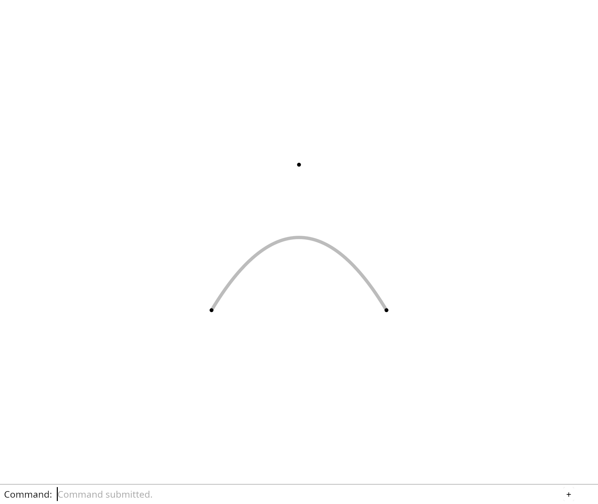

# 5.4 · NURBS source ownership and derived samples

**Steps:** 5 · **Source:** [app/walk/curves.rs](../../../src/app/walk/curves.rs) · [engine/gpu/segments.rs](../../../src/engine/gpu/segments.rs) · [shaders/ribbon.wgsl](../../../src/shaders/ribbon.wgsl) · [shaders/vector.wgsl](../../../src/shaders/vector.wgsl)

## <a id="checkpoint-38-layout"></a>1. Validate an NURBS curve before sampling

<div class="webgpu-schematic" style="width:100%;margin:6px auto;">
<svg xmlns="http://www.w3.org/2000/svg" width="1120" height="214" viewBox="0 0 1120 214" style="width:100%;max-width:100%;height:auto;display:block;margin:0 auto;" role="img">
  <defs>
    <marker id="arr-e7c65172" viewBox="0 0 10 10" refX="8" refY="5" markerWidth="6" markerHeight="6" orient="auto">
      <path d="M 0 1 L 9 5 L 0 9 z" fill="#111111"/>
    </marker>
    <marker id="arr-r-e7c65172" viewBox="0 0 10 10" refX="8" refY="5" markerWidth="6" markerHeight="6" orient="auto">
      <path d="M 0 1 L 9 5 L 0 9 z" fill="#dc2626"/>
    </marker>
    <marker id="arr-g-e7c65172" viewBox="0 0 10 10" refX="8" refY="5" markerWidth="6" markerHeight="6" orient="auto">
      <path d="M 0 1 L 9 5 L 0 9 z" fill="#16a34a"/>
    </marker>
    <marker id="arr-b-e7c65172" viewBox="0 0 10 10" refX="8" refY="5" markerWidth="6" markerHeight="6" orient="auto">
      <path d="M 0 1 L 9 5 L 0 9 z" fill="#2563eb"/>
    </marker>
    <pattern id="grid-e7c65172" width="20" height="20" patternUnits="userSpaceOnUse">
      <path d="M 20 0 L 0 0 0 20" fill="none" stroke="#f1f5f9" stroke-width="1"/>
    </pattern>
  </defs>
  <rect x="2" y="2" width="1116" height="210" rx="8" fill="#ffffff" stroke="#111111" stroke-width="2"/>
  <rect x="2" y="2" width="1116" height="28" rx="6" fill="#f8fafc" stroke="#111111" stroke-width="1.5"/>
  <line x1="2" y1="30" x2="1118" y2="30" stroke="#111111" stroke-width="1.5"/>
  <rect x="12" y="7" width="176" height="18" rx="3" fill="#111111"/>
  <text x="100" y="19.5" text-anchor="middle" font-family="monospace" font-size="9.5" font-weight="700" fill="#ffffff" paint-order="normal" stroke="none">38-NURBS · RATIONAL C(u)</text>
  <text paint-order="stroke fill" stroke="#ffffff" stroke-width="4.5" stroke-linejoin="round" x="518" y="20" text-anchor="middle" font-family="monospace" font-size="10.5" font-weight="700" fill="#111111">Non-Uniform Rational B-Spline Evaluation (Cox–de Boor Basis N_{i,p}(u) &amp; Homogeneous Weights w_i)</text>
  <rect x="838" y="7" width="268" height="18" rx="3" fill="#ffffff" stroke="#111111" stroke-width="1.2"/>
  <text paint-order="stroke fill" stroke="#ffffff" stroke-width="4.5" stroke-linejoin="round" x="972" y="19.5" text-anchor="middle" font-family="monospace" font-size="9" font-weight="700" fill="#2563eb">C(u) = (∑ N_{i,p}(u) w_i P_i) / (∑ N_{i,p}(u) w_i)</text>
  <rect x="14" y="38" width="344" height="164" rx="6" fill="url(#grid-e7c65172)" stroke="#111111" stroke-width="1.5"/>
  <line x1="14" y1="60" x2="358" y2="60" stroke="#cbd5e1" stroke-width="1"/>
  <text paint-order="stroke fill" stroke="#ffffff" stroke-width="4.5" stroke-linejoin="round" x="186" y="53" text-anchor="middle" font-family="monospace" font-size="10" font-weight="700" fill="#111111">1 · Control Points P_i, Weights w_i &amp; Knots U</text>
  <polyline points="56,168 132,76 238,76 314,168" fill="none" stroke="#94a3b8" stroke-width="1.75" stroke-dasharray="4 3"/>
  <path d="M 56 168 C 132 84, 238 84, 314 168" fill="none" stroke="#dc2626" stroke-width="3"/>
  <circle cx="56" cy="168" r="5" fill="#fef08a" stroke="#111111" stroke-width="1.5"/>
  <circle cx="132" cy="76" r="5" fill="#fef08a" stroke="#111111" stroke-width="1.5"/>
  <circle cx="238" cy="76" r="5" fill="#fef08a" stroke="#111111" stroke-width="1.5"/>
  <circle cx="314" cy="168" r="5" fill="#fef08a" stroke="#111111" stroke-width="1.5"/>
  <text paint-order="stroke fill" stroke="#ffffff" stroke-width="4.5" stroke-linejoin="round" x="186" y="186" text-anchor="middle" font-family="monospace" font-size="8.5" font-weight="700" fill="#111111">U = [0, 0, 0, 0, 1, 1, 1, 1]</text>
  <line x1="358" y1="120" x2="384" y2="120" stroke="#111111" stroke-width="2" marker-end="url(#arr-e7c65172)"/>
  <rect x="388" y="38" width="344" height="164" rx="6" fill="url(#grid-e7c65172)" stroke="#111111" stroke-width="1.5"/>
  <line x1="388" y1="60" x2="732" y2="60" stroke="#cbd5e1" stroke-width="1"/>
  <text paint-order="stroke fill" stroke="#ffffff" stroke-width="4.5" stroke-linejoin="round" x="560" y="53" text-anchor="middle" font-family="monospace" font-size="10" font-weight="700" fill="#111111">2 · 4D Homogeneous Divide [w*x, w*y, w*z, w]</text>
  <rect x="414" y="76" width="292" height="104" rx="4" fill="#ffffff" stroke="#111111" stroke-width="1.5"/>
  <text paint-order="stroke fill" stroke="#ffffff" stroke-width="4.5" stroke-linejoin="round" x="560" y="98" text-anchor="middle" font-family="monospace" font-size="9.5" font-weight="700" fill="#111111">De Boor Triangular Table in R⁴:</text>
  <text paint-order="stroke fill" stroke="#ffffff" stroke-width="4.5" stroke-linejoin="round" x="560" y="120" text-anchor="middle" font-family="monospace" font-size="9" fill="#2563eb">H_i = (w_i * P_i.x, w_i * P_i.y, w_i * P_i.z, w_i)</text>
  <text paint-order="stroke fill" stroke="#ffffff" stroke-width="4.5" stroke-linejoin="round" x="560" y="142" text-anchor="middle" font-family="monospace" font-size="9" fill="#16a34a">C(u) = H(u).xyz / H(u).w   (exact conics!)</text>
  <text paint-order="stroke fill" stroke="#ffffff" stroke-width="4.5" stroke-linejoin="round" x="560" y="164" text-anchor="middle" font-family="monospace" font-size="8.5" fill="#dc2626">Sampled into polyline ribbon for GPU display</text>
  <line x1="732" y1="120" x2="758" y2="120" stroke="#111111" stroke-width="2" marker-end="url(#arr-e7c65172)"/>
  <rect x="762" y="38" width="344" height="164" rx="6" fill="url(#grid-e7c65172)" stroke="#111111" stroke-width="1.75"/>
  <line x1="762" y1="60" x2="1106" y2="60" stroke="#cbd5e1" stroke-width="1"/>
  <text paint-order="stroke fill" stroke="#ffffff" stroke-width="4.5" stroke-linejoin="round" x="934" y="53" text-anchor="middle" font-family="monospace" font-size="10" font-weight="700" fill="#111111">3 · Smooth NURBS Curve + Control Cage</text>
  <rect x="806" y="68" width="256" height="122" rx="4" fill="#ffffff" stroke="#111111" stroke-width="2"/>
  <polyline points="834,166 894,82 982,82 1034,166" fill="none" stroke="#cbd5e1" stroke-width="1.5" stroke-dasharray="3 3"/>
  <path d="M 834 166 C 894 88, 982 88, 1034 166" fill="none" stroke="#dc2626" stroke-width="3"/>
  <circle cx="894" cy="82" r="5.5" fill="#fef08a" stroke="#dc2626" stroke-width="2"/>
  <circle cx="982" cy="82" r="5.5" fill="#dbeafe" stroke="#111111" stroke-width="1.5"/>
</svg>
</div>

### 1. `src/curve.rs`

Create the file and type:

```rust
use session_rust::NurbsCurve;

pub fn validate(source: &NurbsCurve) -> Result<(f64, f64), &'static str> {
    if !(2..=3).contains(&source.m_dim)
        || !(2..=10_000).contains(&source.m_cv_count)
        || !(2..=32).contains(&source.m_order)
        || source.m_order > source.m_cv_count
    {
        return Err("Curve dimension, count or order is invalid");
    }
    let size = source.m_dim + usize::from(source.m_is_rat);
    if source.m_cv_stride < size {
        return Err("Curve control stride is too short");
    }
    let end = (source.m_cv_count - 1)
        .checked_mul(source.m_cv_stride)
        .and_then(|offset| offset.checked_add(size))
        .ok_or("Curve control range overflows")?;
    if source.m_cv.len() < end {
        return Err("Curve control values are incomplete");
    }
    for index in 0..source.m_cv_count {
        let start = index * source.m_cv_stride;
        let values = &source.m_cv[start..start + size];
        if values.iter().any(|v| !v.is_finite()) {
            return Err("Curve controls must be finite");
        }
        if source.m_is_rat && values[source.m_dim] <= 0.0 {
            return Err("Curve display requires positive rational weights");
        }
    }
    let count = source.m_cv_count + source.m_order - 2;
    if source.m_nurbsknot.len() != count
        || source
            .m_nurbsknot
            .iter()
            .any(|v| !v.is_finite())
        || source
            .m_nurbsknot
            .windows(2)
            .any(|pair| pair[0] > pair[1])
    {
        return Err("Curve knot vector is incomplete or unordered");
    }
    let domain = source.domain();
    if domain.0 >= domain.1 || !(domain.1 - domain.0).is_finite() {
        return Err("Curve domain must have positive length");
    }
    Ok(domain)
}
```

### 2. `src/lib.rs`

**Locate this existing block:**

```rust
pub mod controls;
pub mod diagnostic;
```

Edit the existing block to match this code; keep unchanged lines:

```rust
pub mod controls;
pub mod curve;
#[cfg(test)]
mod curve_layout_tests;
pub mod diagnostic;
```

### 3. `src/curve_layout_tests.rs`

Create the file and type:

```rust
use crate::curve::validate;
use session_rust::{NurbsCurve, Point};

fn curve(periodic: bool) -> NurbsCurve {
    NurbsCurve::create(
        periodic,
        2,
        &[
            Point::new(-0.6, -0.4, 0.0),
            Point::new(0.0, 0.6, 0.0),
            Point::new(0.6, -0.4, 0.0),
        ],
    )
}

#[test]
fn valid_curve_domains_keep_original_knots_and_controls() {
    for periodic in [false, true] {
        let source = curve(periodic);
        let cvs = source.m_cv.clone();
        let knots = source.m_nurbsknot.clone();
        let domain = validate(&source).unwrap();
        assert!(domain.0 < domain.1);
        assert_eq!(source.m_cv, cvs);
        assert_eq!(source.m_nurbsknot, knots);
    }
    let mut rational = NurbsCurve::new(3, true, 2, 2);
    rational.m_cv = vec![0.0, 0.0, 0.0, 2.0, 2.0, 0.0, 0.0, 1.0];
    rational.m_nurbsknot = vec![0.0, 1.0];
    assert_eq!(validate(&rational).unwrap(), (0.0, 1.0));
}

#[test]
fn malicious_curve_layouts_return_errors_before_kernel_evaluation() {
    for case in 0..9 {
        let mut source = curve(false);
        match case {
            0 => source.m_cv_count = usize::MAX,
            1 => source.m_cv_stride = usize::MAX,
            2 => source.m_order = usize::MAX,
            3 => source.m_cv.clear(),
            4 => source.m_nurbsknot.clear(),
            5 => source.m_nurbsknot[0] = f64::NAN,
            6 => source.m_cv[0] = f64::INFINITY,
            7 => source.m_nurbsknot.fill(0.0),
            _ => source.m_nurbsknot[0] = 1e6,
        }
        assert!(validate(&source).is_err());
    }
    let mut rational = NurbsCurve::new(3, true, 2, 2);
    rational.m_nurbsknot = vec![0.0, 1.0];
    rational.m_cv = vec![0.0, 0.0, 0.0, 0.0, 2.0, 0.0, 0.0, 1.0];
    assert!(validate(&rational).is_err());
}
```

## <a id="checkpoint-38a-samples"></a>2. Sample a validated curve without replacing its source

<div class="webgpu-schematic" style="width:100%;margin:6px auto;">
<svg xmlns="http://www.w3.org/2000/svg" width="1120" height="188" viewBox="0 0 1120 188" style="width:100%;max-width:100%;height:auto;display:block;margin:0 auto;" role="img">
  <defs>
    <marker id="arr" viewBox="0 0 10 10" refX="8" refY="5" markerWidth="6" markerHeight="6" orient="auto">
      <path d="M 0 1 L 9 5 L 0 9 z" fill="#111111"/>
    </marker>
    <marker id="arrR" viewBox="0 0 10 10" refX="8" refY="5" markerWidth="6" markerHeight="6" orient="auto">
      <path d="M 0 1 L 9 5 L 0 9 z" fill="#dc2626"/>
    </marker>
    <marker id="arrG" viewBox="0 0 10 10" refX="8" refY="5" markerWidth="6" markerHeight="6" orient="auto">
      <path d="M 0 1 L 9 5 L 0 9 z" fill="#16a34a"/>
    </marker>
    <marker id="arrB" viewBox="0 0 10 10" refX="8" refY="5" markerWidth="6" markerHeight="6" orient="auto">
      <path d="M 0 1 L 9 5 L 0 9 z" fill="#2563eb"/>
    </marker>
  </defs>
  <rect x="2" y="2" width="1116" height="184" rx="10" fill="#ffffff" stroke="#111111" stroke-width="2"/>
  <rect x="14" y="12" width="344" height="164" rx="8" fill="#ffffff" stroke="#111111" stroke-width="1.5"/>
  <text paint-order="stroke fill" stroke="#ffffff" stroke-width="5" stroke-linejoin="round" x="186" y="30" text-anchor="middle" font-family="monospace" font-size="10.5" font-weight="700" fill="#111111">Control Polygon P0..P3 &amp; Knot Span</text>
  <polyline points="62,144 128,54 236,58 308,142" fill="none" stroke="#94a3b8" stroke-width="1.75" stroke-dasharray="4 3"/>
  <path d="M 62 144 C 128 54, 236 58, 308 142" fill="none" stroke="#2563eb" stroke-width="2.5"/>
  <circle cx="62" cy="144" r="4.5" fill="#dc2626"/><text paint-order="stroke fill" stroke="#ffffff" stroke-width="5" stroke-linejoin="round" x="62" y="160" text-anchor="middle" font-family="monospace" font-size="9" font-weight="700" fill="#111111">P0</text>
  <circle cx="128" cy="54" r="4.5" fill="#dc2626"/><text paint-order="stroke fill" stroke="#ffffff" stroke-width="5" stroke-linejoin="round" x="128" y="46" text-anchor="middle" font-family="monospace" font-size="9" font-weight="700" fill="#111111">P1</text>
  <circle cx="236" cy="58" r="4.5" fill="#dc2626"/><text paint-order="stroke fill" stroke="#ffffff" stroke-width="5" stroke-linejoin="round" x="236" y="50" text-anchor="middle" font-family="monospace" font-size="9" font-weight="700" fill="#111111">P2</text>
  <circle cx="308" cy="142" r="4.5" fill="#dc2626"/><text paint-order="stroke fill" stroke="#ffffff" stroke-width="5" stroke-linejoin="round" x="308" y="158" text-anchor="middle" font-family="monospace" font-size="9" font-weight="700" fill="#111111">P3</text>
  <line x1="358" y1="94" x2="384" y2="94" stroke="#111111" stroke-width="2" marker-end="url(#arr)"/>
  <rect x="388" y="12" width="344" height="164" rx="8" fill="#ffffff" stroke="#111111" stroke-width="1.5"/>
  <text paint-order="stroke fill" stroke="#ffffff" stroke-width="5" stroke-linejoin="round" x="560" y="30" text-anchor="middle" font-family="monospace" font-size="10.5" font-weight="700" fill="#111111">Marker Quad: d = length(uv) - radius</text>
  <rect x="496" y="48" width="128" height="112" fill="#f8fafc" stroke="#111111" stroke-width="1.5" stroke-dasharray="3 3"/>
  <circle cx="560" cy="104" r="44" fill="#fee2e2" stroke="#dc2626" stroke-width="2.25"/>
  <circle cx="560" cy="104" r="3" fill="#111111"/>
  <line x1="560" y1="104" x2="596" y2="78" stroke="#111111" stroke-width="1.75" marker-end="url(#arr)"/>
  <text paint-order="stroke fill" stroke="#ffffff" stroke-width="5" stroke-linejoin="round" x="578" y="86" font-family="monospace" font-size="9.5" font-weight="700" fill="#111111">r</text>
  <line x1="732" y1="94" x2="758" y2="94" stroke="#111111" stroke-width="2" marker-end="url(#arr)"/>
  <rect x="762" y="12" width="344" height="164" rx="8" fill="#ffffff" stroke="#111111" stroke-width="1.75"/>
  <text paint-order="stroke fill" stroke="#ffffff" stroke-width="5" stroke-linejoin="round" x="934" y="30" text-anchor="middle" font-family="monospace" font-size="10.5" font-weight="700" fill="#111111">Smooth Curve &amp; Disc Points in Viewer</text>
  <rect x="806" y="44" width="256" height="118" rx="4" fill="#ffffff" stroke="#111111" stroke-width="2"/>
  <path d="M 836 138 C 888 58, 978 58, 1032 138" fill="none" stroke="#2563eb" stroke-width="3"/>
  <circle cx="836" cy="138" r="6" fill="#dc2626" stroke="#111111" stroke-width="1.5"/>
  <circle cx="934" cy="78" r="6" fill="#dc2626" stroke="#111111" stroke-width="1.5"/>
  <circle cx="1032" cy="138" r="6" fill="#dc2626" stroke="#111111" stroke-width="1.5"/>
</svg>
</div>

### 1. `src/curve.rs`

**Locate this existing block:**

```rust
    Ok(domain)
}
```

Edit the existing block to match this code; keep unchanged lines:

```rust
    Ok(domain)
}

pub fn sample(source: &NurbsCurve) -> Result<Vec<[f64; 3]>, &'static str> {
    let (start, end) = validate(source)?;
    let mut turning = 0.0;
    let mut previous: Option<[f64; 3]> = None;
    let control = |index: usize| {
        let offset = index * source.m_cv_stride;
        let weight = if source.m_is_rat {
            source.m_cv[offset + source.m_dim]
        } else {
            1.0
        };
        std::array::from_fn::<_, 3, _>(|axis| {
            if axis < source.m_dim {
                source.m_cv[offset + axis] / weight
            } else {
                0.0
            }
        })
    };
    for index in 1..source.m_cv_count {
        let a = control(index - 1);
        let b = control(index);
        let direction: [f64; 3] = std::array::from_fn(|axis| b[axis] - a[axis]);
        let length = direction
            .iter()
            .map(|v| v * v)
            .sum::<f64>()
            .sqrt();
        if length <= 1e-12 {
            continue;
        }
        if !length.is_finite() {
            return Err("Curve control extent exceeds the display range");
        }
        let unit = direction.map(|v| v / length);
        if let Some(before) = previous {
            let dot = (0..3)
                .map(|axis| before[axis] * unit[axis])
                .sum::<f64>()
                .clamp(-1.0, 1.0);
            turning += dot.acos().to_degrees();
        }
        previous = Some(unit);
    }
    let count = ((turning / 3.0).ceil() as usize).clamp(1, 512);
    let mut parameters: Vec<_> = (0..=count)
        .map(|i| start + (end - start) * i as f64 / count as f64)
        .collect();
    parameters.extend(
        source
            .m_nurbsknot
            .iter()
            .copied()
            .filter(|&t| t > start && t < end),
    );
    parameters.sort_by(f64::total_cmp);
    parameters.dedup();
    let mut points = Vec::with_capacity(parameters.len());
    for parameter in parameters {
        let point = source.point_at(parameter);
        let point: [f64; 3] = std::array::from_fn(|axis| point[axis]);
        if point
            .iter()
            .any(|&v| !(v as f32).is_finite())
        {
            return Err("Sampled curve exceeds the display range");
        }
        points.push(point);
    }
    Ok(points)
}
```

### 2. `src/lib.rs`

**Locate this existing block:**

```rust
mod curve_layout_tests;
pub mod diagnostic;
```

Edit the existing block to match this code; keep unchanged lines:

```rust
mod curve_layout_tests;
#[cfg(test)]
mod curve_sample_tests;
pub mod diagnostic;
```

### 3. `src/curve_sample_tests.rs`

Create the file and type:

```rust
use crate::curve::sample;
use session_rust::{NurbsCurve, Point};

#[test]
fn sampling_draws_the_curve_and_keeps_exact_original_controls() {
    let controls = [
        Point::new(-0.6, -0.4, 0.0),
        Point::new(0.0, 0.6, 0.0),
        Point::new(0.6, -0.4, 0.0),
    ];
    let source = NurbsCurve::create(false, 2, &controls);
    let original = source.m_cv.clone();
    let points = sample(&source).unwrap();
    assert!(points.len() > 20 && points.len() <= 513);
    assert_eq!(source.m_cv, original);
    assert_eq!(points.first().unwrap(), &[-0.6, -0.4, 0.0]);
    assert_eq!(points.last().unwrap(), &[0.6, -0.4, 0.0]);
    let apex = points
        .iter()
        .map(|p| p[1])
        .fold(f64::NEG_INFINITY, f64::max);
    assert!((apex - 0.1).abs() < 0.001);
    assert!(apex < controls[1][1] - 0.4);
    let (a, b) = source.domain();
    for i in 0..=1000 {
        let p = source.point_at(a + (b - a) * i as f64 / 1000.0);
        let error = points
            .windows(2)
            .map(|pair| {
                let d = [
                    pair[1][0] - pair[0][0],
                    pair[1][1] - pair[0][1],
                ];
                let length = d[0] * d[0] + d[1] * d[1];
                let t = (((p[0] - pair[0][0]) * d[0] + (p[1] - pair[0][1]) * d[1])
                    / length)
                    .clamp(0.0, 1.0);
                (p[0] - pair[0][0] - d[0] * t).hypot(p[1] - pair[0][1] - d[1] * t)
            })
            .fold(f64::INFINITY, f64::min);
        assert!(
            error < 0.001,
            "Measured chord error: {error}"
        );
    }
}

#[test]
fn straight_and_periodic_curves_keep_required_endpoints_and_knots() {
    let source = NurbsCurve::create(
        false,
        2,
        &[
            Point::new(0.0, 0.0, 0.0),
            Point::new(0.5, 0.0, 0.0),
            Point::new(1.0, 0.0, 0.0),
        ],
    );
    assert_eq!(
        sample(&source).unwrap(),
        vec![[0.0; 3], [1.0, 0.0, 0.0]]
    );
    let points = [
        Point::new(-0.6, -0.4, 0.0),
        Point::new(0.0, 0.6, 0.0),
        Point::new(0.6, -0.4, 0.0),
    ];
    let periodic = NurbsCurve::create(true, 2, &points);
    let sampled = sample(&periodic).unwrap();
    assert!(sampled.len() <= 10_513);
    let first = sampled.first().unwrap();
    let last = sampled.last().unwrap();
    assert!((0..3).all(|axis| (first[axis] - last[axis]).abs() < 1e-10));
    let corners = NurbsCurve::create(false, 1, &points);
    let sampled = sample(&corners).unwrap();
    assert!(
        sampled
            .iter()
            .any(|p| (p[0] - points[1][0]).abs() < 1e-12
                && (p[1] - points[1][1]).abs() < 1e-12)
    );
    let mut invalid = corners.clone();
    invalid.m_cv_stride = usize::MAX;
    assert!(sample(&invalid).is_err());
}
```

## <a id="checkpoint-38b-source"></a>3. Retain curves beside their display samples

### 1. `src/chain.rs`

**Locate this existing block:**

```rust
    Polyline(Rc<Polyline>),
}

#[derive(Clone)]
pub struct PreparedChain {
    pub source: Source,
    pub points: Rc<Vec<[f32; 3]>>,
    pub colour: [f32; 4],
    pub width: f32,
    pub heads: u32,
}

impl Source {
    pub fn guid(&self) -> &str {
        match self {
            Self::Line(line) => line.guid(),
            Self::Polyline(line) => line.guid(),
        }
    }

    pub fn owner(&self) -> (u8, usize) {
        match self {
            Self::Line(line) => (0, Rc::as_ptr(line) as usize),
            Self::Polyline(line) => (1, Rc::as_ptr(line) as usize),
        }
    }

    pub fn coordinates(&self) -> Vec<[f64; 3]> {
        match self {
            Self::Line(line) => [line.start(), line.end()]
                .map(|p| [p[0], p[1], p[2]])
                .to_vec(),
            Self::Polyline(line) => line
                .coords
                .chunks_exact(3)
                .map(|p| [p[0], p[1], p[2]])
                .collect(),
        }
    }
}

impl PreparedChain {
    pub fn line(source: Rc<Line>) -> Result<Self, &'static str> {
        let display = PreparedLine::new(Rc::clone(&source))?.display;
        Self::new(
            Source::Line(source),
            display.colour,
            display.width,
        )
    }

    pub fn polyline(source: Rc<Polyline>) -> Result<Self, &'static str> {
        if source.coords.len() % 3 != 0 || !(6..=30_000).contains(&source.coords.len())
        {
            return Err("Polyline needs 2–10,000 complete points");
        }
        let _ = source.guid();
        let mut line = Line::new(0.0, 0.0, 0.0, 1.0, 0.0, 0.0);
        line.linecolor = source.linecolor.clone();
        line.width = source.width;
        let display = PreparedLine::new(Rc::new(line))?.display;
        Self::new(
            Source::Polyline(source),
            display.colour,
            display.width,
        )
    }

    fn new(source: Source, colour: [f32; 4], width: f32) -> Result<Self, &'static str> {
        let heads = match &source {
            Source::Line(line) => line.arrowhead,
            Source::Polyline(line) => line.arrowhead,
        };
```

Edit the existing block to match this code; keep unchanged lines:

```rust
    Polyline(Rc<Polyline>),
    Curve(
        Rc<session_rust::NurbsCurve>,
        Rc<Vec<[f64; 3]>>,
    ),
}

#[derive(Clone)]
pub struct PreparedChain {
    pub source: Source,
    pub points: Rc<Vec<[f32; 3]>>,
    pub colour: [f32; 4],
    pub width: f32,
    pub heads: u32,
}

impl Source {
    pub fn guid(&self) -> &str {
        match self {
            Self::Line(line) => line.guid(),
            Self::Polyline(line) => line.guid(),
            Self::Curve(curve, _) => curve.guid(),
        }
    }

    pub fn owner(&self) -> (u8, usize) {
        match self {
            Self::Line(line) => (0, Rc::as_ptr(line) as usize),
            Self::Polyline(line) => (1, Rc::as_ptr(line) as usize),
            Self::Curve(curve, _) => (2, Rc::as_ptr(curve) as usize),
        }
    }

    pub fn controls(&self) -> Vec<crate::controls::Control> {
        match self {
            Self::Curve(curve, _) => (0..curve.m_cv_count)
                .map(|index| {
                    crate::controls::Control::new(Rc::clone(curve), index)
                        .expect("Validated original curve control")
                })
                .collect(),
            _ => Vec::new(),
        }
    }

    pub fn bounds_coordinates(&self) -> Vec<[f64; 3]> {
        if matches!(self, Self::Curve(..)) {
            self.controls()
                .iter()
                .map(|c| c.position().unwrap())
                .collect()
        } else {
            self.coordinates()
        }
    }

    pub fn coordinates(&self) -> Vec<[f64; 3]> {
        match self {
            Self::Line(line) => [line.start(), line.end()]
                .map(|p| [p[0], p[1], p[2]])
                .to_vec(),
            Self::Polyline(line) => line
                .coords
                .chunks_exact(3)
                .map(|p| [p[0], p[1], p[2]])
                .collect(),
            Self::Curve(_, samples) => samples.as_ref().clone(),
        }
    }
}

impl PreparedChain {
    pub fn curve(source: Rc<session_rust::NurbsCurve>) -> Result<Self, &'static str> {
        let samples = Rc::new(crate::curve::sample(&source)?);
        let _ = source.guid();
        for index in 0..source.m_cv_count {
            crate::controls::Control::new(Rc::clone(&source), index)?.marker()?;
        }
        let mut line = Line::new(0.0, 0.0, 0.0, 1.0, 0.0, 0.0);
        line.width = source.width;
        line.linecolor = source
            .linecolors
            .first()
            .cloned()
            .unwrap_or_else(|| session_rust::Color::new(0.0, 0.0, 0.0, 1.0));
        let display = PreparedLine::new(Rc::new(line))?.display;
        Self::new(
            Source::Curve(source, samples),
            display.colour,
            display.width,
        )
    }

    pub fn line(source: Rc<Line>) -> Result<Self, &'static str> {
        let display = PreparedLine::new(Rc::clone(&source))?.display;
        Self::new(
            Source::Line(source),
            display.colour,
            display.width,
        )
    }

    pub fn polyline(source: Rc<Polyline>) -> Result<Self, &'static str> {
        if source.coords.len() % 3 != 0 || !(6..=30_000).contains(&source.coords.len())
        {
            return Err("Polyline needs 2–10,000 complete points");
        }
        let _ = source.guid();
        let mut line = Line::new(0.0, 0.0, 0.0, 1.0, 0.0, 0.0);
        line.linecolor = source.linecolor.clone();
        line.width = source.width;
        let display = PreparedLine::new(Rc::new(line))?.display;
        Self::new(
            Source::Polyline(source),
            display.colour,
            display.width,
        )
    }

    fn new(source: Source, colour: [f32; 4], width: f32) -> Result<Self, &'static str> {
        let heads = match &source {
            Source::Line(line) => line.arrowhead,
            Source::Polyline(line) => line.arrowhead,
            Source::Curve(curve, _) => curve.arrowhead,
        };
```

### 2. `src/scene.rs`

Edit these blocks from bottom to top. Keep the surrounding lines unchanged.

**Locate this block:**

```rust
            }
        }
        for row in &self.paths {
            for point in row.points() {
                let point = [point[0], point[1], point[2]];
```

Replace it with:

```rust
            }
        }
        for row in &self.paths {
            for point in row.bounds_points() {
                let point = [point[0], point[1], point[2]];
```

**Locate this block:**

```rust
    }

    pub fn points(&self) -> Vec<session_rust::Point> {
        self.prepared
            .source
```

Replace it with:

```rust
    }

    pub fn bounds_points(&self) -> Vec<session_rust::Point> {
        self.prepared
            .source
            .bounds_coordinates()
            .into_iter()
            .map(|p| {
                self.model
                    .transform_point(&session_rust::Point::new(p[0], p[1], p[2]))
            })
            .collect()
    }

    pub fn points(&self) -> Vec<session_rust::Point> {
        self.prepared
            .source
```

### 3. `src/memory.rs`

**Locate this existing block:**

```rust
}

pub fn paths<'a>(scenes: impl IntoIterator<Item = &'a Scene>) -> [usize; 5] {
```

Edit the existing block to match this code; keep unchanged lines:

```rust
}

pub fn curves<'a>(scenes: impl IntoIterator<Item = &'a Scene>) -> [usize; 4] {
    let mut sources = HashSet::new();
    let mut samples = HashSet::new();
    let mut usage = [0; 4];
    for scene in scenes {
        for row in scene.paths() {
            if let crate::chain::Source::Curve(source, points) = &row.prepared.source {
                usage[0] += 1;
                sources.insert(Rc::as_ptr(source));
                if samples.insert(Rc::as_ptr(points)) {
                    usage[3] += points.capacity() * 24;
                }
            }
        }
    }
    usage[1] = sources.len();
    usage[2] = samples.len();
    usage
}

pub fn paths<'a>(scenes: impl IntoIterator<Item = &'a Scene>) -> [usize; 5] {
```

### 4. `src/lib.rs`

**Locate this existing block:**

```rust
mod curve_sample_tests;
pub mod diagnostic;
```

Edit the existing block to match this code; keep unchanged lines:

```rust
mod curve_sample_tests;
#[cfg(test)]
mod curve_source_tests;
pub mod diagnostic;
```

### 5. `src/curve_source_tests.rs`

Create the file and type:

```rust
use crate::{
    chain::{PreparedChain, Source},
    memory,
    scene::Scene,
};
use session_rust::{NurbsCurve, Point, Xform};
use std::rc::Rc;

#[test]
fn curve_rows_share_original_sources_and_samples_with_distinct_ids() {
    let curve = NurbsCurve::create(
        false,
        2,
        &[
            Point::new(-0.6, -0.4, 0.0),
            Point::new(0.123456789012345, 0.6, 0.0),
            Point::new(0.6, -0.4, 0.0),
        ],
    );
    let source = Rc::new(curve);
    let weak = Rc::downgrade(&source);
    let guid = source.guid().to_owned();
    let prepared = PreparedChain::curve(source).unwrap();
    let Source::Curve(_, samples) = &prepared.source else {
        panic!("Original curve source")
    };
    let sample_weak = Rc::downgrade(samples);
    let mut scene = Scene::demo();
    scene.clear();
    let first = scene.insert_path(prepared.clone()).unwrap();
    let second = scene.insert_path(prepared).unwrap();
    assert_ne!(first, second);
    assert_eq!(scene.paths()[0].guid, guid);
    assert_ne!(scene.paths()[1].guid, guid);
    assert_eq!(&memory::curves([&scene])[..3], &[2, 1, 1]);
    let controls = scene.paths()[0].prepared.source.controls();
    assert_eq!(controls[1].index, 1);
    assert_eq!(
        controls[1].position().unwrap()[0],
        0.123456789012345
    );
    scene
        .place_path(first, Xform::translation(2.0, 3.0, 4.0))
        .unwrap();
    let bounds = scene.bounds().unwrap();
    assert!(bounds.max[1] >= 3.6);
    assert!(bounds.max[2] >= 4.0);
    assert!(scene.paths()[0].segments().len() > 20);
    assert_eq!(controls[1].source.m_cv[3], 0.123456789012345);
    drop(controls);
    scene.clear();
    assert!(weak.upgrade().is_none());
    assert!(sample_weak.upgrade().is_none());
    assert_eq!(memory::curves([&scene]), [0; 4]);
}
```

## <a id="checkpoint-38c-controls"></a>4. Draw controls with their curve parent and index

### 1. `src/scene.rs`

Edit these blocks from bottom to top. Keep the surrounding lines unchanged.

**Locate this block:**

```rust
            .iter_mut()
            .find(|row| row.id == id)
            .ok_or("Path not found")?;
        for p in row.prepared.source.coordinates() {
            let p = model.transform_point(&session_rust::Point::new(p[0], p[1], p[2]));
```

Replace it with:

```rust
            .iter_mut()
            .find(|row| row.id == id)
            .ok_or("Path not found")?;
        for p in row
            .prepared
            .source
            .coordinates()
            .into_iter()
            .chain(row.prepared.source.bounds_coordinates())
        {
            let p = model.transform_point(&session_rust::Point::new(p[0], p[1], p[2]));
```

**Locate this block:**

```rust
        let id = ObjectId(self.next_id);
        self.next_id = next;
        self.paths.push(PathObject {
            id,
            guid,
            prepared,
```

Replace it with:

```rust
        let id = ObjectId(self.next_id);
        self.next_id = next;
        self.paths.push(PathObject {
            controls_visible: false,
            id,
            guid,
            prepared,
```

**Locate this block:**

```rust
        Ok(())
    }

    pub fn paths(&self) -> &[PathObject] {
        &self.paths
    }
```

Replace it with:

```rust
        Ok(())
    }

    pub fn show_controls(&mut self, visible: bool) {
        for row in &mut self.paths {
            row.controls_visible = visible
                && matches!(
                    row.prepared.source,
                    crate::chain::Source::Curve(..)
                );
        }
    }

    pub fn control_markers(&self) -> Vec<ControlMarker> {
        let mut markers = Vec::new();
        for row in self
            .paths
            .iter()
            .filter(|row| row.controls_visible)
        {
            for control in row.prepared.source.controls() {
                let p = control
                    .position()
                    .expect("Validated original control");
                let p = row
                    .model
                    .transform_point(&session_rust::Point::new(p[0], p[1], p[2]));
                let display = crate::marker::Marker {
                    center: p.to_f32(),
                    ..control
                        .marker()
                        .expect("Prepared control marker")
                };
                markers.push(ControlMarker {
                    parent: row.id,
                    control,
                    display,
                });
            }
        }
        markers
    }

    pub fn paths(&self) -> &[PathObject] {
        &self.paths
    }
```

**Locate this block:**

```rust
    }
}

#[derive(Clone)]
pub struct PointObject {
    pub id: ObjectId,
```

Replace it with:

```rust
    }
}

pub struct ControlMarker {
    pub parent: ObjectId,
    pub control: crate::controls::Control,
    pub display: crate::marker::Marker,
}

#[derive(Clone)]
pub struct PointObject {
    pub id: ObjectId,
```

**Locate this block:**

```rust
pub struct PathObject {
    pub id: ObjectId,
    pub guid: String,
    pub prepared: crate::chain::PreparedChain,
```

Replace it with:

```rust
pub struct PathObject {
    pub controls_visible: bool,
    pub id: ObjectId,
    pub guid: String,
    pub prepared: crate::chain::PreparedChain,
```

### 2. `src/renderer.rs`

**Locate this existing block:**

```rust
                    .iter()
                    .map(crate::scene::PointObject::marker),
            )
```

Edit the existing block to match this code; keep unchanged lines:

```rust
                    .iter()
                    .map(crate::scene::PointObject::marker)
                    .chain(
                        scene
                            .control_markers()
                            .into_iter()
                            .map(|c| c.display),
                    ),
            )
```

### 3. `src/browser.rs`

**Locate this existing block:**

```rust
    canvas.set_attribute(
        "data-point-cpu",
```

Edit the existing block to match this code; keep unchanged lines:

```rust
    canvas.set_attribute(
        "data-curve-cpu",
        &serde_json::to_string(&crate::memory::curves(editor.scenes())).unwrap(),
    )?;
    canvas.set_attribute(
        "data-control-count",
        &editor
            .scene
            .control_markers()
            .len()
            .to_string(),
    )?;
    canvas.set_attribute(
        "data-point-cpu",
```

### 4. `src/lib.rs`

**Locate this existing block:**

```rust
#[cfg(test)]
mod control_tests;
```

Edit the existing block to match this code; keep unchanged lines:

```rust
#[cfg(test)]
mod control_parent_tests;
#[cfg(test)]
mod control_tests;
```

### 5. `src/control_parent_tests.rs`

Create the file and type:

```rust
use crate::{chain::PreparedChain, scene::Scene};
use session_rust::{NurbsCurve, Point, Xform};
use std::rc::Rc;

#[test]
fn placed_controls_share_the_original_curve_but_keep_distinct_document_parents() {
    let source = Rc::new(NurbsCurve::create(
        false,
        2,
        &[
            Point::new(-0.6, -0.4, 0.0),
            Point::new(0.0, 0.6, 0.0),
            Point::new(0.6, -0.4, 0.0),
        ],
    ));
    let weak = Rc::downgrade(&source);
    let prepared = PreparedChain::curve(source).unwrap();
    let mut scene = Scene::demo();
    scene.clear();
    let first = scene.insert_path(prepared.clone()).unwrap();
    let second = scene.insert_path(prepared).unwrap();
    assert!(scene.control_markers().is_empty());
    scene
        .place_path(second, Xform::translation(2.0, 3.0, 4.0))
        .unwrap();
    scene.show_controls(true);
    let markers = scene.control_markers();
    assert_eq!(markers.len(), 6);
    assert_eq!(markers[0].parent, first);
    assert_eq!(markers[3].parent, second);
    assert_eq!(markers[1].control.index, 1);
    assert_eq!(markers[4].control.index, 1);
    assert!(Rc::ptr_eq(
        &markers[1].control.source,
        &markers[4].control.source
    ));
    assert_eq!(markers[1].display.center, [0.0, 0.6, 0.0]);
    assert_eq!(markers[4].display.center, [2.0, 3.6, 4.0]);
    drop(markers);
    scene.show_controls(false);
    assert!(scene.control_markers().is_empty());
    scene.clear();
    assert!(weak.upgrade().is_none());
}
```

## <a id="checkpoint-38d-input"></a>5. Insert an curve and inspect its controls

### 1. `src/editor.rs`

Edit these blocks from bottom to top. Keep the surrounding lines unchanged.

**Locate this block:**

```rust
                    crate::chain::PreparedChain::line(std::rc::Rc::new(line))?
                };
                self.history
```

Replace it with:

```rust
                    crate::chain::PreparedChain::line(std::rc::Rc::new(line))?
                };
                self.history
                    .try_edit(&mut self.scene, |scene| {
                        scene.insert_path(prepared).map(|_| ())
                    })?;
            }
            Action::Controls(visible) => self.scene.show_controls(visible),
            Action::AddCurve => {
                let mut curve = session_rust::NurbsCurve::create(
                    false,
                    2,
                    &[
                        session_rust::Point::new(-0.6, -0.4, 0.0),
                        session_rust::Point::new(0.0, 0.6, 0.0),
                        session_rust::Point::new(0.6, -0.4, 0.0),
                    ],
                );
                curve.width = 5.0;
                curve.linecolors = vec![session_rust::Color::new(0.0, 0.0, 0.0, 0.5)];
                let prepared =
                    crate::chain::PreparedChain::curve(std::rc::Rc::new(curve))?;
                self.history
```

**Locate this block:**

```rust
    AddPoint,
    AddPolyline,
    AddArrow,
    Translate([f64; 3]),
```

Replace it with:

```rust
    AddPoint,
    AddCurve,
    Controls(bool),
    AddPolyline,
    AddArrow,
    Translate([f64; 3]),
```

### 2. `src/browser.rs`

Edit these blocks from bottom to top. Keep the surrounding lines unchanged.

**Locate this block:**

```rust
                        "example box" => Action::AddBox,
                        "example line" => Action::AddLine,
                        "example point" => Action::AddPoint,
                        "example polyline" => Action::AddPolyline,
```

Replace it with:

```rust
                        "example box" => Action::AddBox,
                        "example line" => Action::AddLine,
                        "example point" => Action::AddPoint,
                        "example curve" => Action::AddCurve,
                        "controls on" => Action::Controls(true),
                        "controls off" => Action::Controls(false),
                        "example polyline" => Action::AddPolyline,
```

**Locate this block:**

```rust
            "Example Point",
            "Example Polyline",
            "Example Arrow",
            "Example Triangle",
```

Replace it with:

```rust
            "Example Point",
            "Example Curve",
            "Controls On",
            "Controls Off",
            "Example Polyline",
            "Example Arrow",
            "Example Triangle",
```

### 3. `src/lib.rs`

**Locate this existing block:**

```rust
#[cfg(test)]
mod curve_layout_tests;
```

Edit the existing block to match this code; keep unchanged lines:

```rust
#[cfg(test)]
mod curve_input_tests;
#[cfg(test)]
mod curve_layout_tests;
```

### 4. `src/curve_input_tests.rs`

Create the file and type:

```rust
use crate::{
    chain::Source,
    editor::{Action, Editor},
    memory,
};

#[test]
fn curve_command_keeps_original_identity_and_control_visibility_does_not_consume_undo()
{
    let mut editor = Editor::default();
    editor.apply(Action::Close).unwrap();
    editor.apply(Action::AddCurve).unwrap();
    let id = editor.scene.paths()[0].id;
    let Source::Curve(source, _) = &editor.scene.paths()[0].prepared.source else {
        panic!("Original curve")
    };
    let weak = std::rc::Rc::downgrade(source);
    assert_eq!(source.m_order, 3);
    assert_eq!(source.width, 5.0);
    assert!(editor.scene.control_markers().is_empty());
    editor.apply(Action::Controls(true)).unwrap();
    assert_eq!(editor.scene.control_markers().len(), 3);
    editor
        .apply(Action::Controls(false))
        .unwrap();
    editor.apply(Action::Controls(true)).unwrap();
    editor.apply(Action::Undo).unwrap();
    assert!(editor.scene.paths().is_empty());
    assert!(weak.upgrade().is_some());
    editor.apply(Action::Redo).unwrap();
    assert_eq!(editor.scene.paths()[0].id, id);
    assert_eq!(editor.scene.control_markers().len(), 3);
    editor.apply(Action::Close).unwrap();
    assert!(weak.upgrade().is_none());
    assert_eq!(memory::curves(editor.scenes()), [0; 4]);
}
```

## Build & Run



```sh
cd workspace/journey
REGEN_PROTO=0 cargo build --lib --locked --target wasm32-unknown-unknown -j1
REGEN_PROTO=0 CARGO_BUILD_JOBS=1 trunk serve --port 8780
cd ../..
npm --prefix ../session_tests run course -- check 5.4
npm --prefix ../session_tests run course -- save 5.4
```

Continue with [5.5 · One visibility policy and shared surface depth](39-visible.md).
