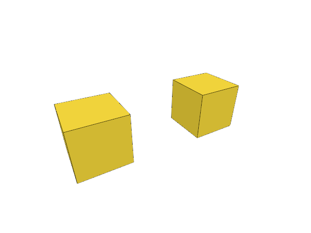

# 6.4 · Ordered multi-selection and atomic edits

**Section 4: Screen-Space Ink, Point Markers, NURBS Curves, and GPU Integer Picking** · **Checkpoints:** `45-order` → `45c-input` (5 steps) · **Production source:** [engine/gpu/pick.rs](../../../src/engine/gpu/pick.rs) · [app/selection.rs](../../../src/app/selection.rs) · [engine/gpu/faces.rs](../../../src/engine/gpu/faces.rs) · [app/walk/mesh_topology.rs](../../../src/app/walk/mesh_topology.rs)

> **Goal:** Collect multiple objects with Shift-click and commands.

## 1. Visual WebGPU Schematic

<svg xmlns="http://www.w3.org/2000/svg" width="840" height="220" viewBox="0 0 840 220" style="width:100%;max-width:840px;height:auto;display:block;margin:14px 0;" role="img">
  <defs>
    <marker id="arr" viewBox="0 0 10 10" refX="8" refY="5" markerWidth="6" markerHeight="6" orient="auto">
      <path d="M 0 1 L 9 5 L 0 9 z" fill="#111111"/>
    </marker>
    <pattern id="hatch" width="6" height="6" patternTransform="rotate(45 0 0)" patternUnits="userSpaceOnUse">
      <line x1="0" y1="0" x2="0" y2="6" stroke="#111111" stroke-width="1"/>
    </pattern>
    <pattern id="dots" width="8" height="8" patternUnits="userSpaceOnUse">
      <circle cx="2" cy="2" r="1" fill="#111111"/>
    </pattern>
  </defs>
  <rect x="2" y="2" width="836" height="216" rx="10" fill="#ffffff" stroke="#111111" stroke-width="2"/>
  <rect x="20" y="20" width="230" height="180" rx="8" fill="#ffffff" stroke="#111111" stroke-width="1.75"/>
  <text x="135" y="42" text-anchor="middle" font-family="monospace" font-size="12" font-weight="700" fill="#111111">1. Rg32Uint ID Map</text>
  <rect x="75" y="56" width="120" height="100" fill="#ffffff" stroke="#111111" stroke-width="1.5"/>
  <line x1="115" y1="56" x2="115" y2="156" stroke="#111111" stroke-width="1"/>
  <line x1="155" y1="56" x2="155" y2="156" stroke="#111111" stroke-width="1"/>
  <line x1="75" y1="90" x2="195" y2="90" stroke="#111111" stroke-width="1"/>
  <line x1="75" y1="123" x2="195" y2="123" stroke="#111111" stroke-width="1"/>
  <rect x="115" y="90" width="40" height="33" fill="url(#hatch)" stroke="#111111" stroke-width="2"/>
  <text x="135" y="110" text-anchor="middle" font-family="monospace" font-size="9" font-weight="700" fill="#111111">7, 3</text>
  <text x="135" y="186" text-anchor="middle" font-family="monospace" font-size="10" fill="#111111">[owner_id, sub_id]</text>
  <line x1="250" y1="110" x2="298" y2="110" stroke="#111111" stroke-width="2" marker-end="url(#arr)"/>
  <rect x="304" y="20" width="230" height="180" rx="8" fill="#ffffff" stroke="#111111" stroke-width="1.75"/>
  <text x="419" y="42" text-anchor="middle" font-family="monospace" font-size="12" font-weight="700" fill="#111111">2. 256-Byte Readback</text>
  <rect x="326" y="76" width="110" height="44" rx="4" fill="#ffffff" stroke="#111111" stroke-width="1.75"/>
  <rect x="436" y="76" width="74" height="44" rx="4" fill="url(#hatch)" stroke="#111111" stroke-width="1.5"/>
  <text x="381" y="102" text-anchor="middle" font-family="monospace" font-size="10" font-weight="700" fill="#111111">Crop Row</text>
  <text x="473" y="102" text-anchor="middle" font-family="monospace" font-size="10" fill="#111111">Pad</text>
  <text x="419" y="146" text-anchor="middle" font-family="monospace" font-size="10" font-weight="700" fill="#111111">|-- 256 Bytes --|</text>
  <text x="419" y="186" text-anchor="middle" font-family="monospace" font-size="10" fill="#111111">map_async(Read)</text>
  <line x1="534" y1="110" x2="582" y2="110" stroke="#111111" stroke-width="2" marker-end="url(#arr)"/>
  <rect x="588" y="20" width="232" height="180" rx="8" fill="#ffffff" stroke="#111111" stroke-width="1.75"/>
  <text x="704" y="42" text-anchor="middle" font-family="monospace" font-size="12" font-weight="700" fill="#111111">3. Priority &amp; Ticket</text>
  <rect x="614" y="64" width="180" height="32" rx="5" fill="url(#hatch)" stroke="#111111" stroke-width="1.5"/>
  <text x="704" y="84" text-anchor="middle" font-family="monospace" font-size="10" font-weight="700" fill="#111111">1. Point &gt; 2. Wire &gt; 3. Face</text>
  <rect x="614" y="110" width="180" height="42" rx="5" fill="#ffffff" stroke="#111111" stroke-width="1.5"/>
  <text x="704" y="135" text-anchor="middle" font-family="monospace" font-size="10" font-weight="700" fill="#111111">ticket.rev == view.rev</text>
  <text x="704" y="186" text-anchor="middle" font-family="sans-serif" font-size="10" fill="#111111">Drop Stale Picks</text>
</svg>

| Layer | Construct | Role |
| :--- | :--- | :--- |
| **WebGPU** | `Rg32Uint` (`[owner_id, sub_id]`) | Exact 2-channel 32-bit integer ID target (zero color quantization). |
| **WebGPU** | 256-Byte Aligned Crop Readback | Copies cursor window to staging buffer for async `map_async(Read)`. |
| **Rust (Picker)** | `Point > Wire > Face` + Ticket | Spiral search prioritizes points/wires and drops stale camera revisions. |



---

## 2. Complete Code Overview (All Steps Open)

<a id="checkpoint-45-order"></a>

### Step 1 of 5 · Preserve unique selections in pick order (`45-order`)

<svg xmlns="http://www.w3.org/2000/svg" width="840" height="64" viewBox="0 0 840 64" style="width:100%;max-width:840px;height:auto;display:block;margin:14px 0;" role="img">
  <defs>
    <marker id="arr" viewBox="0 0 10 10" refX="8" refY="5" markerWidth="6" markerHeight="6" orient="auto">
      <path d="M 0 1 L 9 5 L 0 9 z" fill="#111111"/>
    </marker>
    <pattern id="hatch" width="6" height="6" patternTransform="rotate(45 0 0)" patternUnits="userSpaceOnUse">
      <line x1="0" y1="0" x2="0" y2="6" stroke="#111111" stroke-width="1"/>
    </pattern>
    <pattern id="dots" width="8" height="8" patternUnits="userSpaceOnUse">
      <circle cx="2" cy="2" r="1" fill="#111111"/>
    </pattern>
  </defs>
  <rect x="2" y="2" width="836" height="60" rx="10" fill="#ffffff" stroke="#111111" stroke-width="2"/>
  <rect x="16" y="12" width="240" height="40" rx="6" fill="#ffffff" stroke="#111111" stroke-width="1.5"/>
  <text x="136" y="36" text-anchor="middle" font-family="monospace" font-size="11" font-weight="700" fill="#111111">src/object_selection.rs,…</text>
  <line x1="256" y1="32" x2="294" y2="32" stroke="#111111" stroke-width="1.75" marker-end="url(#arr)"/>
  <rect x="300" y="12" width="240" height="40" rx="6" fill="url(#hatch)" stroke="#111111" stroke-width="1.5"/>
  <text x="420" y="36" text-anchor="middle" font-family="monospace" font-size="11" font-weight="700" fill="#111111">original pick order</text>
  <line x1="540" y1="32" x2="578" y2="32" stroke="#111111" stroke-width="1.75" marker-end="url(#arr)"/>
  <rect x="584" y="12" width="240" height="40" rx="6" fill="#ffffff" stroke="#111111" stroke-width="1.5"/>
  <text x="704" y="36" text-anchor="middle" font-family="monospace" font-size="11" font-weight="700" fill="#111111">stable primary row</text>
</svg>

Keep object membership unique and preserve the order of valid picks. The primary object is the lowest row ID; it is independent of pick order.

> **Check:** *Should repeated Shift-clicks reorder an existing object?* — No. Additive selection keeps its first position and does not duplicate it.

### 1. `src/object_selection.rs`

Keep unique current owners in their original pick order.

Create the file and type:

```rust
--8<-- "journey/code/45-order-01.rs"
```

### 2. `src/lib.rs`

Register the component and copied checks.

After that block, type:

```rust
--8<-- "journey/code/45-order-02.rs" skip=35
```

### 3. `src/scene.rs`

Collect selected bounds and move mixed original row placements.

Edit the existing block to match this code; keep unchanged lines:

```rust
--8<-- "journey/code/45-order-03.rs"
```

**Supplied validation fixture:**

Copy this supplied authoring fixture once. Continue with the browser build below; the course does not require running native tests.

### 4. `src/object_selection_tests.rs`

Copy unique order and additive miss checks.

Copy this supplied file:

```text
--8<-- "journey/code/45-order-04.rs"
```

### 5. `src/lib.rs`

Register the component and copied checks.

After that block, type:

```rust
--8<-- "journey/code/45-order-05.rs" skip=48
```

**Result after `45-order`:** Run the copied ordering checks. The original face-selection exercise is unchanged.

---

<a id="checkpoint-45a-batch"></a>

### Step 2 of 5 · Commit mixed selection edits atomically (`45a-batch`)

<svg xmlns="http://www.w3.org/2000/svg" width="840" height="64" viewBox="0 0 840 64" style="width:100%;max-width:840px;height:auto;display:block;margin:14px 0;" role="img">
  <defs>
    <marker id="arr" viewBox="0 0 10 10" refX="8" refY="5" markerWidth="6" markerHeight="6" orient="auto">
      <path d="M 0 1 L 9 5 L 0 9 z" fill="#111111"/>
    </marker>
    <pattern id="hatch" width="6" height="6" patternTransform="rotate(45 0 0)" patternUnits="userSpaceOnUse">
      <line x1="0" y1="0" x2="0" y2="6" stroke="#111111" stroke-width="1"/>
    </pattern>
    <pattern id="dots" width="8" height="8" patternUnits="userSpaceOnUse">
      <circle cx="2" cy="2" r="1" fill="#111111"/>
    </pattern>
  </defs>
  <rect x="2" y="2" width="836" height="60" rx="10" fill="#ffffff" stroke="#111111" stroke-width="2"/>
  <rect x="16" y="12" width="240" height="40" rx="6" fill="#ffffff" stroke="#111111" stroke-width="1.5"/>
  <text x="136" y="36" text-anchor="middle" font-family="monospace" font-size="11" font-weight="700" fill="#111111">src/editor.rs, src/rehydr…</text>
  <line x1="256" y1="32" x2="294" y2="32" stroke="#111111" stroke-width="1.75" marker-end="url(#arr)"/>
  <rect x="300" y="12" width="240" height="40" rx="6" fill="url(#hatch)" stroke="#111111" stroke-width="1.5"/>
  <text x="420" y="36" text-anchor="middle" font-family="monospace" font-size="11" font-weight="700" fill="#111111">checked placements</text>
  <line x1="540" y1="32" x2="578" y2="32" stroke="#111111" stroke-width="1.75" marker-end="url(#arr)"/>
  <rect x="584" y="12" width="240" height="40" rx="6" fill="#ffffff" stroke="#111111" stroke-width="1.5"/>
  <text x="704" y="36" text-anchor="middle" font-family="monospace" font-size="11" font-weight="700" fill="#111111">complete commit or roll…</text>
</svg>

Validate and move every selected original row in one transaction. Refuse cold editable meshes until Reload Sources; any failure rolls back the whole batch.

> **Check:** *What happens if the second selected row cannot move?* — The first move is rolled back and no history entry or redo branch is consumed.

### 1. `src/editor.rs`

Own ordered selections and commit Move or Delete as one original-row transaction.

Edit these blocks from bottom to top. Keep the surrounding lines unchanged.

**Locate this block:**

```rust
            }
        }
        // Deletion and history travel can invalidate selection; repair it in one place.
        self.selected = self.selected.filter(|id| self.scene.contains(*id));
        if let (Some(owner), Some(part)) = (self.selected, self.selected_part) {
            if !(crate::pick_sources::Target { owner, part }).valid(&self.scene) { self.selected = None; }
```

Replace it with:

```rust
            }
        }
        // Deletion and history travel can invalidate selection; repair it in one place.
        self.repair_selection();
        self.selected = self.selected.filter(|id| self.scene.contains(*id));
        if let (Some(owner), Some(part)) = (self.selected, self.selected_part) {
            if !(crate::pick_sources::Target { owner, part }).valid(&self.scene) { self.selected = None; }
```

**Locate this block:**

```rust
                        }
                    }
                    Action::FitSelected => {
                        if let Some(bounds) = self.selected
                            .and_then(|id| self.scene.selected_bounds(id))
                        {
                            self.camera.fit(&bounds);
                        }
```

Replace it with:

```rust
                        }
                    }
                    Action::FitSelected => {
                        if let Some(bounds) = self.scene.bounds_of(&self.selected_objects()).or_else(|| self.selected_part.and(self.selected).and_then(|id| self.scene.selected_bounds(id)))
                        {
                            self.camera.fit(&bounds);
                        }
```

**Locate this block:**

```rust
            Action::AddBox => {
                self.history.try_edit(&mut self.scene, |scene| scene.add_box().map(|_| ()))?;
            }
            Action::Translate(offset) => {
                let id = self.whole_selection().ok_or("Select an object before Move")?;
                return self.move_object(id, offset);
            }
            Action::ToggleExtra => self.history.edit(&mut self.scene, Scene::toggle_extra),
            Action::SelectNext => { self.selected_part = None; self.selected = self.scene.next(self.selected); }
            Action::Delete => {
                if self.selected_part.is_some() { return Err("Use Select Object before Delete"); }
                return match self.selected {
                    Some(id) => self.delete_object(id),
                    None => Ok(Change::View),
                };
            }
            Action::Undo => { self.history.undo(&mut self.scene); }
            Action::Redo => { self.history.redo(&mut self.scene); }
            view => {
```

Replace it with:

```rust
            Action::AddBox => {
                self.history.try_edit(&mut self.scene, |scene| scene.add_box().map(|_| ()))?;
            }
            Action::Translate(offset) => return self.move_selection(offset),
            Action::ToggleExtra => self.history.edit(&mut self.scene, Scene::toggle_extra),
            Action::SelectNext => { self.selected_part = None; self.selected = self.scene.next(self.selected); }
            Action::Delete => return self.delete_selection(),
            Action::Undo => { self.history.undo(&mut self.scene); }
            Action::Redo => { self.history.redo(&mut self.scene); }
            view => {
```

**Locate this block:**

```rust
            Action::Close => {
                self.scene.clear();
                self.history.clear();
                self.selected = None;
            }
            Action::Replace(bytes) => {
                let loaded = crate::document::load(&bytes)?;
```

Replace it with:

```rust
            Action::Close => {
                self.scene.clear();
                self.history.clear();
                self.objects.clear(); self.selected = None;
            }
            Action::Replace(bytes) => {
                let loaded = crate::document::load(&bytes)?;
```

**Locate this block:**

```rust
            return Err("Reload editable sources before Delete");
        }
        self.history.edit(&mut self.scene, |scene| { scene.remove(id); });
        if self.selected == Some(id) { self.selected = None; self.selected_part = None; }
        Ok(Change::Scene)
    }

    pub fn selection(&self) -> Option<crate::pick_sources::Target> {
        self.selected.map(|owner| crate::pick_sources::Target { owner, part: self.selected_part.unwrap_or(crate::pick_sources::Part::Object) })
    }
```

Replace it with:

```rust
            return Err("Reload editable sources before Delete");
        }
        self.history.edit(&mut self.scene, |scene| { scene.remove(id); });
        self.objects.retain(&self.scene);
        if self.selected == Some(id) { self.selected = self.objects.primary(); self.selected_part = None; }
        Ok(Change::Scene)
    }

    pub fn selected_objects(&self) -> Vec<ObjectId> {
        if self.selected_part.is_some() { return Vec::new(); }
        if self.objects.primary() == self.selected { self.objects.rows().to_vec() }
        else { self.selected.into_iter().filter(|id| self.scene.pick_id(id.value()).is_some()).collect() }
    }

    pub fn select_objects(&mut self, rows: impl IntoIterator<Item = ObjectId>, additive: bool) {
        if additive { let old = self.selected_objects(); self.objects.set(&self.scene, old, false); }
        self.selected_part = None; self.objects.set(&self.scene, rows, additive); self.selected = self.objects.primary();
    }

    fn repair_selection(&mut self) {
        if self.objects.primary() == self.selected && self.selected_part.is_none() {
            self.objects.retain(&self.scene); self.selected = self.objects.primary();
        } else { self.objects.clear(); }
    }

    fn move_selection(&mut self, offset: [f64; 3]) -> Result<Change, &'static str> {
        if !offset.iter().all(|n| n.is_finite()) { return Err("Move needs finite coordinates"); }
        let ids = self.selected_objects(); if ids.is_empty() { return Err("Select an object before Move"); }
        if offset.iter().all(|&n| n == 0.) { return Ok(Change::View); }
        self.history.try_edit(&mut self.scene, |scene| {
            for id in ids { scene.translate(id, offset)?; } Ok(())
        })?; Ok(Change::Scene)
    }

    fn delete_selection(&mut self) -> Result<Change, &'static str> {
        if self.selected_part.is_some() { return Err("Use Select Object before Delete"); }
        let ids = self.selected_objects(); if ids.is_empty() { return Ok(Change::View); }
        if self.scene.objects().iter().any(|r| ids.contains(&r.id) && r.geometry().is_none()) {
            return Err("Reload editable sources before Delete");
        }
        self.history.edit(&mut self.scene, |scene| { for id in ids { scene.remove(id); } });
        self.objects.clear(); self.selected = None; Ok(Change::Scene)
    }

    pub fn selection(&self) -> Option<crate::pick_sources::Target> {
        self.selected.map(|owner| crate::pick_sources::Target { owner, part: self.selected_part.unwrap_or(crate::pick_sources::Part::Object) })
    }
```

**Locate this block:**

```rust
    fn default() -> Self {
        Self {
            scene: Scene::demo(),
            selected: None, selected_part: None, pick_mode: Default::default(),
            camera: Camera::default(),
            background: Background::default(),
            normal_view: false,
```

Replace it with:

```rust
    fn default() -> Self {
        Self {
            scene: Scene::demo(),
            selected: None, selected_part: None, pick_mode: Default::default(), objects: Default::default(),
            camera: Camera::default(),
            background: Background::default(),
            normal_view: false,
```

**Locate this block:**

```rust
    pub selected: Option<ObjectId>,
    pub selected_part: Option<crate::pick_sources::Part>,
    pub pick_mode: crate::pick_sources::Mode,
    pub camera: Camera,
    pub background: Background,
    pub normal_view: bool,
```

Replace it with:

```rust
    pub selected: Option<ObjectId>,
    pub selected_part: Option<crate::pick_sources::Part>,
    pub pick_mode: crate::pick_sources::Mode,
    objects: crate::object_selection::Objects,
    pub camera: Camera,
    pub background: Background,
    pub normal_view: bool,
```

**Complete updated block reference:**

```rust
use crate::{background::Background, camera::Camera, history::History, scene::{ObjectId, Scene}};

pub enum Action {
    Pick([f32; 2]),
    Picked(Option<ObjectId>),
    PickedTarget(Option<crate::pick_sources::Target>),
    PickMode(crate::pick_sources::Mode),
    Import(Vec<u8>),
    Replace(Vec<u8>),
    ImportAt(Vec<u8>, std::rc::Rc<crate::reload_url::ReloadUrl>),
    ReplaceAt(Vec<u8>, std::rc::Rc<crate::reload_url::ReloadUrl>),
    Close,
    UnloadSources,
    AddBox,
    AddLine,
    AddPoint,
    AddCurve,
    AddColours(crate::colour::Mode),
    NormalView(bool),
    Grid(Option<crate::grid::Settings>),
    AddNormals(crate::normal_example::Mode),
    Controls(bool),
    AddPolyline,
    AddArrow,
    Translate([f64; 3]),
    ToggleExtra,
    SelectNext,
    Delete,
    Undo,
    Redo,
    Background,
    Zoom(f32),
    Pan(f32, f32),
    Orbit(f64, f64),
    Isometric,
    ResetView,
    Fit,
    FitSelected,
    Projection(crate::camera::Projection),
}

#[derive(Debug, PartialEq, Eq)]
pub enum Change {
    View,
    Scene,
}

pub struct Editor {
    pub scene: Scene,
    pub selected: Option<ObjectId>,
    pub selected_part: Option<crate::pick_sources::Part>,
    pub pick_mode: crate::pick_sources::Mode,
    objects: crate::object_selection::Objects,
    pub camera: Camera,
    pub background: Background,
    pub normal_view: bool,
    history: History,
    last_release: u64,
}

impl Default for Editor {
    fn default() -> Self {
        Self {
            scene: Scene::demo(),
            selected: None, selected_part: None, pick_mode: Default::default(), objects: Default::default(),
            camera: Camera::default(),
            background: Background::default(),
            normal_view: false,
            history: History::default(),
            last_release: 0,
        }
    }
}

impl Editor {
    pub fn scenes(&self) -> impl Iterator<Item = &Scene> {
        std::iter::once(&self.scene).chain(self.history.scenes())
    }

    pub fn reload_keys(&self) -> Vec<crate::rehydrate::ReloadKey> {
        let mut seen = std::collections::HashSet::new();
        self.scene.objects().iter().filter_map(crate::rehydrate::ReloadKey::of)
            .filter(|key| seen.insert(key.origin.id)).collect()
    }

    fn scenes_mut(&mut self) -> impl Iterator<Item = &mut Scene> {
        std::iter::once(&mut self.scene).chain(self.history.scenes_mut())
    }

    pub fn hydrate(&mut self, values: Vec<(crate::rehydrate::ReloadKey, Vec<u8>)>) -> Result<bool, &'static str> {
        if values.is_empty() { return Ok(false); }
        let mut seen = std::collections::HashSet::new();
        for (key, _) in &values {
            if !seen.insert(key.origin.id) || !self.scene.objects().iter().any(|row| key.matches(row)) {
                return Ok(false);
            }
        }
        let prepared: Vec<_> = values.into_iter().map(|(key, bytes)|
            crate::rehydrate::PreparedReload::new(key, &bytes)).collect::<Result<_, _>>()?;
        for plan in &prepared {
            if self.scenes().flat_map(|scene| scene.objects()).filter(|row| plan.key.matches(row))
                .any(|row| !plan.validates(row)) { return Err("Reloaded source GUID or metadata does not match"); }
        }
        for scene in self.scenes_mut() {
            for plan in &prepared { scene.hydrate(plan); }
        }
        Ok(true)
    }

    fn unload_sources(&mut self) -> Result<(), &'static str> {
        let mut origins: std::collections::HashSet<_> = self.scenes().flat_map(|scene| scene.objects())
            .filter(|row| row.can_unload()).filter_map(|row| row.origin().map(|origin| origin.id)).collect();
        for row in self.scenes().flat_map(|scene| scene.objects()) {
            if let Some(origin) = row.origin() {
                if !row.can_unload() { origins.remove(&origin.id); }
            }
        }
        if origins.is_empty() { return Err("No eligible imported sources to unload"); }
        let epoch = self.last_release.checked_add(1).ok_or("Release epochs exhausted")?;
        for scene in self.scenes_mut() { scene.unload(&origins, epoch); }
        self.last_release = epoch;
        Ok(())
    }

    pub fn move_object(&mut self, id: ObjectId, offset: [f64; 3]) -> Result<Change, &'static str> {
        if !offset.iter().all(|value| value.is_finite()) { return Err("Move needs finite coordinates"); }
        let object = self.scene.objects().iter().find(|row| row.id == id).ok_or("Object not found")?;
        if offset.iter().all(|&value| value == 0.0) { return Ok(Change::View); }
        let shift = session_rust::Xform::translation(offset[0], offset[1], offset[2]);
        let model = &shift * &object.model;
        self.history.try_edit(&mut self.scene, |scene| scene.place(id, model))?;
        Ok(Change::Scene)
    }

    pub fn delete_object(&mut self, id: ObjectId) -> Result<Change, &'static str> {
        if !self.scene.contains(id) { return Err("Object not found"); }
        if self.scene.objects().iter().find(|row| row.id == id).is_some_and(|row| row.geometry().is_none()) {
            return Err("Reload editable sources before Delete");
        }
        self.history.edit(&mut self.scene, |scene| { scene.remove(id); });
        self.objects.retain(&self.scene);
        if self.selected == Some(id) { self.selected = self.objects.primary(); self.selected_part = None; }
        Ok(Change::Scene)
    }

    pub fn selected_objects(&self) -> Vec<ObjectId> {
        if self.selected_part.is_some() { return Vec::new(); }
        if self.objects.primary() == self.selected { self.objects.rows().to_vec() }
        else { self.selected.into_iter().filter(|id| self.scene.pick_id(id.value()).is_some()).collect() }
    }

    pub fn select_objects(&mut self, rows: impl IntoIterator<Item = ObjectId>, additive: bool) {
        if additive { let old = self.selected_objects(); self.objects.set(&self.scene, old, false); }
        self.selected_part = None; self.objects.set(&self.scene, rows, additive); self.selected = self.objects.primary();
    }

    fn repair_selection(&mut self) {
        if self.objects.primary() == self.selected && self.selected_part.is_none() {
            self.objects.retain(&self.scene); self.selected = self.objects.primary();
        } else { self.objects.clear(); }
    }

    fn move_selection(&mut self, offset: [f64; 3]) -> Result<Change, &'static str> {
        if !offset.iter().all(|n| n.is_finite()) { return Err("Move needs finite coordinates"); }
        let ids = self.selected_objects(); if ids.is_empty() { return Err("Select an object before Move"); }
        if offset.iter().all(|&n| n == 0.) { return Ok(Change::View); }
        self.history.try_edit(&mut self.scene, |scene| {
            for id in ids { scene.translate(id, offset)?; } Ok(())
        })?; Ok(Change::Scene)
    }

    fn delete_selection(&mut self) -> Result<Change, &'static str> {
        if self.selected_part.is_some() { return Err("Use Select Object before Delete"); }
        let ids = self.selected_objects(); if ids.is_empty() { return Ok(Change::View); }
        if self.scene.objects().iter().any(|r| ids.contains(&r.id) && r.geometry().is_none()) {
            return Err("Reload editable sources before Delete");
        }
        self.history.edit(&mut self.scene, |scene| { for id in ids { scene.remove(id); } });
        self.objects.clear(); self.selected = None; Ok(Change::Scene)
    }

    pub fn selection(&self) -> Option<crate::pick_sources::Target> {
        self.selected.map(|owner| crate::pick_sources::Target { owner, part: self.selected_part.unwrap_or(crate::pick_sources::Part::Object) })
    }

    pub fn whole_selection(&self) -> Option<ObjectId> { self.selected.filter(|_| self.selected_part.is_none()) }

    pub fn apply(&mut self, action: Action) -> Result<Change, &'static str> {
        match action {
            Action::Picked(id) => { self.selected = id.filter(|id| self.scene.pick_id(id.value()).is_some()); self.selected_part = None; }
            Action::PickedTarget(target) => {
                let target = target.filter(|target| target.valid(&self.scene));
                self.selected = target.map(|target| target.owner);
                self.selected_part = target.map(|target| target.part).filter(|part| *part != crate::pick_sources::Part::Object);
            }
            Action::PickMode(mode) => { self.pick_mode = mode; self.selected = None; self.selected_part = None; }
            Action::Pick(screen) => {
                self.selected_part = None;
                self.selected = self.camera.ray(screen)
                    .and_then(|ray| crate::picking::pick(&self.scene, &ray));
            }
            Action::UnloadSources => self.unload_sources()?,
            Action::Close => {
                self.scene.clear();
                self.history.clear();
                self.objects.clear(); self.selected = None;
            }
            Action::Replace(bytes) => {
                let loaded = crate::document::load(&bytes)?;
                self.history.try_edit(&mut self.scene, |scene| scene.replace(loaded))?;
            }
            Action::Import(bytes) => {
                let loaded = crate::document::load(&bytes)?;
                self.history.try_edit(&mut self.scene, |scene| scene.import(loaded))?;
            }
            Action::ImportAt(bytes, location) => {
                let loaded = crate::document::load_at(&bytes, Some(location))?;
                self.history.try_edit(&mut self.scene, |scene| scene.import(loaded))?;
            }
            Action::ReplaceAt(bytes, location) => {
                let loaded = crate::document::load_at(&bytes, Some(location))?;
                self.history.try_edit(&mut self.scene, |scene| scene.replace(loaded))?;
            }
            Action::AddPolyline | Action::AddArrow => {
                let prepared = if matches!(action, Action::AddPolyline) {
                    let mut line = session_rust::Polyline::new(vec![session_rust::Point::new(-0.6, -0.4, 0.0),
                        session_rust::Point::new(0.0, 0.0, 0.0), session_rust::Point::new(0.6, -0.4, 0.0)]);
                    line.width = 6.0; line.linecolor = session_rust::Color::new(0.0, 0.0, 0.0, 0.5);
                    crate::chain::PreparedChain::polyline(std::rc::Rc::new(line))?
                } else {
                    let mut line = session_rust::Line::new(-0.6, 0.3, 0.0, 0.6, 0.3, 0.0);
                    line.width = 5.0; line.linecolor = session_rust::Color::new(0.0, 0.0, 0.0, 1.0);
                    line.arrowhead = session_rust::Arrowhead::BOTH;
                    crate::chain::PreparedChain::line(std::rc::Rc::new(line))?
                };
                self.history.try_edit(&mut self.scene, |scene| scene.insert_path(prepared).map(|_| ()))?;
            }
            Action::Controls(visible) => self.scene.show_controls(visible),
            Action::AddNormals(mode) => {
                let prepared = crate::prepared::PreparedMesh::new(crate::normal_example::specimen(mode))?;
                self.history.try_edit(&mut self.scene, |scene| scene.insert(prepared).map(|_| ()))?;
            }
            Action::AddColours(mode) => {
                let prepared = crate::prepared::PreparedMesh::new(crate::colour::specimen(mode))?;
                self.history.try_edit(&mut self.scene, |scene| scene.insert(prepared).map(|_| ()))?;
            }
            Action::AddCurve => {
                let mut curve = session_rust::NurbsCurve::create(false, 2, &[session_rust::Point::new(-0.6, -0.4, 0.0),
                    session_rust::Point::new(0.0, 0.6, 0.0), session_rust::Point::new(0.6, -0.4, 0.0)]);
                curve.width = 5.0; curve.linecolors = vec![session_rust::Color::new(0.0, 0.0, 0.0, 0.5)];
                let prepared = crate::chain::PreparedChain::curve(std::rc::Rc::new(curve))?;
                self.history.try_edit(&mut self.scene, |scene| scene.insert_path(prepared).map(|_| ()))?;
            }
            Action::AddPoint => {
                let mut point = session_rust::Point::new(0.0, 0.0, 0.0);
                point.width = 12.0; point.pointcolor = session_rust::Color::new(0.0, 0.0, 0.0, 0.5);
                let prepared = crate::marker::PreparedPoint::new(std::rc::Rc::new(point))?;
                self.history.try_edit(&mut self.scene, |scene| scene.insert_point(prepared).map(|_| ()))?;
            }
            Action::AddLine => {
                let mut line = session_rust::Line::new(-0.6, 0.0, 0.0, 0.6, 0.0, 0.0);
                line.width = 5.0; line.linecolor = session_rust::Color::new(0.0, 0.0, 0.0, 1.0);
                let prepared = crate::stroke::PreparedLine::new(std::rc::Rc::new(line))?;
                self.history.try_edit(&mut self.scene, |scene| scene.insert_line(prepared).map(|_| ()))?;
            }
            Action::AddBox => {
                self.history.try_edit(&mut self.scene, |scene| scene.add_box().map(|_| ()))?;
            }
            Action::Translate(offset) => return self.move_selection(offset),
            Action::ToggleExtra => self.history.edit(&mut self.scene, Scene::toggle_extra),
            Action::SelectNext => { self.selected_part = None; self.selected = self.scene.next(self.selected); }
            Action::Delete => return self.delete_selection(),
            Action::Undo => { self.history.undo(&mut self.scene); }
            Action::Redo => { self.history.redo(&mut self.scene); }
            view => {
                match view {
                    Action::Background => self.background.toggle(),
                    Action::NormalView(visible) => self.normal_view = visible,
                    Action::Grid(settings) => {
                        if let Some(grid) = settings { grid.half()?; grid.reach(self.camera.target)?; }
                        self.camera.grid = settings;
                    }
                    Action::Zoom(factor) => self.camera.zoom(factor),
                    Action::Pan(dx, dy) => self.camera.pan(dx, dy),
                    Action::Orbit(yaw, pitch) => self.camera.orbit(yaw, pitch),
                    Action::Isometric => self.camera.isometric(),
                    Action::Projection(mode) => self.camera.projection = mode,
                    Action::Fit => {
                        if let Some(bounds) = self.scene.bounds() {
                            self.camera.fit(&bounds);
                        }
                    }
                    Action::FitSelected => {
                        if let Some(bounds) = self.scene.bounds_of(&self.selected_objects()).or_else(|| self.selected_part.and(self.selected).and_then(|id| self.scene.selected_bounds(id)))
                        {
                            self.camera.fit(&bounds);
                        }
                    }
                    Action::ResetView => {
                        let aspect = self.camera.aspect;
                        self.camera = Camera { aspect, grid: self.camera.grid, ..Camera::default() };
                    }
                    _ => unreachable!("Document actions were handled above"),
                }
                return Ok(Change::View);
            }
        }
        // Deletion and history travel can invalidate selection; repair it in one place.
        self.repair_selection();
        self.selected = self.selected.filter(|id| self.scene.contains(*id));
        if let (Some(owner), Some(part)) = (self.selected, self.selected_part) {
            if !(crate::pick_sources::Target { owner, part }).valid(&self.scene) { self.selected = None; }
        }
        if self.selected.is_none() { self.selected_part = None; }
        Ok(Change::Scene)
    }
}

#[cfg(test)]
mod tests {
    use super::*;

    #[test]
    fn a_modified_history_row_protects_only_its_own_import_origin() {
        use std::rc::Rc;
        let mut editor = Editor::default(); let bytes = crate::specimen::bytes();
        let first = Rc::new(crate::reload_url::ReloadUrl::new("test:first".into()));
        editor.apply(Action::ReplaceAt(bytes.clone(), first)).unwrap();
        let origin = editor.scene.objects()[0].origin().unwrap().id;
        let original = Rc::downgrade(editor.scene.objects()[0].geometry().unwrap());
        let second = Rc::new(crate::reload_url::ReloadUrl::new("test:second".into()));
        editor.apply(Action::ImportAt(bytes, second)).unwrap();
        let copy = Rc::downgrade(editor.scene.objects()[3].geometry().unwrap());
        editor.apply(Action::SelectNext).unwrap(); editor.apply(Action::Translate([0.25, 0.0, 0.0])).unwrap();
        editor.apply(Action::Undo).unwrap();
        let saved = editor.history.scenes_mut().last().unwrap();
        assert_eq!(saved.objects()[0].origin().unwrap().id, origin);
        Rc::make_mut(&mut saved.objects_mut()[0].metadata).is_locked = true;
        assert!(editor.scene.objects()[0].can_unload());
        editor.apply(Action::UnloadSources).unwrap();
        assert!(original.upgrade().is_some()); assert!(copy.upgrade().is_none());
        assert!(editor.scene.objects()[0].geometry().is_some());
        assert!(editor.scene.objects()[3].geometry().is_none());
        assert_eq!(editor.last_release, 1);
        assert!(editor.apply(Action::UnloadSources).is_err()); assert_eq!(editor.last_release, 1);
    }

    #[test]
    fn release_epochs_do_not_wrap_or_reset_on_close() {
        use std::rc::Rc;
        let mut editor = Editor::default(); let bytes = crate::specimen::bytes();
        let url = Rc::new(crate::reload_url::ReloadUrl::new("test:epoch".into()));
        editor.apply(Action::ReplaceAt(bytes.clone(), Rc::clone(&url))).unwrap();
        editor.last_release = u64::MAX;
        assert_eq!(editor.apply(Action::UnloadSources), Err("Release epochs exhausted"));
        assert!(editor.scene.objects()[0].geometry().is_some());
        editor.last_release = 0; editor.apply(Action::UnloadSources).unwrap();
        assert_eq!(editor.scene.objects()[0].release_epoch(), Some(1));
        editor.apply(Action::Close).unwrap();
        editor.apply(Action::ImportAt(bytes, url)).unwrap();
        editor.apply(Action::UnloadSources).unwrap();
        assert_eq!(editor.scene.objects()[0].release_epoch(), Some(2));
    }

    #[test]
    fn close_ends_history_and_keeps_issued_ids_and_view_settings() {
        let mut editor = Editor::default();
        editor.apply(Action::Import(crate::specimen::bytes())).unwrap();
        editor.apply(Action::AddBox).unwrap(); editor.apply(Action::Undo).unwrap();
        let old: Vec<_> = editor.scenes().flat_map(|scene| scene.objects().iter().map(|row| row.id)).collect();
        editor.apply(Action::SelectNext).unwrap();
        editor.apply(Action::Pan(0.2, 0.1)).unwrap(); editor.apply(Action::Background).unwrap();
        let view = editor.camera.uniform(); let background = editor.background.rgb();
        editor.apply(Action::Close).unwrap();
        assert!(editor.scene.objects().is_empty() && editor.selected.is_none());
        assert_eq!(editor.scenes().count(), 1);
        editor.apply(Action::Undo).unwrap(); editor.apply(Action::Redo).unwrap();
        assert!(editor.scene.objects().is_empty());
        assert_eq!(editor.camera.uniform(), view); assert_eq!(editor.background.rgb(), background);
        editor.apply(Action::AddBox).unwrap();
        assert!(!old.contains(&editor.scene.objects()[0].id));
    }

    #[test]
    fn repeated_close_is_empty_and_drops_sources_without_gpu_owners() {
        let mut editor = Editor::default();
        let display = std::rc::Rc::downgrade(&editor.scene.objects()[0].mesh);
        let source = std::rc::Rc::downgrade(editor.scene.objects()[0].geometry().unwrap());
        editor.apply(Action::Close).unwrap(); editor.apply(Action::Close).unwrap();
        assert!(display.upgrade().is_none() && source.upgrade().is_none());
        assert_eq!(crate::memory::cpu(editor.scenes(), std::iter::empty()), [0, 0, 0, 0, 0, 1]);
    }

    #[test]
    fn close_releases_imported_history_documents_and_reopening_uses_fresh_ids() {
        use std::rc::Rc;
        let mut editor = Editor::default();
        let bytes = crate::specimen::bytes();
        editor.apply(Action::Import(bytes.clone())).unwrap();
        editor.apply(Action::Replace(bytes.clone())).unwrap();
        let displays: Vec<_> = editor.scenes().flat_map(|scene| scene.objects().iter()
            .map(|row| Rc::downgrade(&row.mesh))).collect();
        let sources: Vec<_> = editor.scenes().flat_map(|scene| scene.objects().iter()
            .map(|row| Rc::downgrade(row.geometry().unwrap()))).collect();
        let documents: Vec<_> = editor.scenes().flat_map(|scene| scene.objects().iter()
            .filter_map(|row| row.source().map(|source| Rc::downgrade(&source.document)))).collect();
        let old: Vec<_> = editor.scenes().flat_map(|scene| scene.objects().iter().map(|row| row.id)).collect();
        assert!(!documents.is_empty());
        editor.apply(Action::Close).unwrap();
        assert!(displays.iter().all(|owner| owner.upgrade().is_none()));
        assert!(sources.iter().all(|owner| owner.upgrade().is_none()));
        assert!(documents.iter().all(|owner| owner.upgrade().is_none()));
        editor.apply(Action::Import(bytes)).unwrap();
        assert!(editor.scene.objects().iter().all(|row| !old.contains(&row.id)));
    }

    #[test]
    fn resetting_the_view_preserves_its_current_aspect() {
        let mut editor = Editor::default();
        editor.camera.aspect = 2.0;
        editor.apply(Action::Zoom(2.0)).unwrap();
        editor.apply(Action::ResetView).unwrap();
        assert_eq!(editor.camera.aspect, 2.0);
        assert_eq!(editor.camera.distance, 3.0);
    }

    #[test]
    fn undo_changes_the_document_without_rewinding_the_view() {
        let mut editor = Editor::default();
        editor.apply(Action::AddBox).unwrap();
        editor.apply(Action::Zoom(2.0)).unwrap();
        editor.apply(Action::Background).unwrap();
        editor.apply(Action::Undo).unwrap();
        assert_eq!(editor.scene.objects().len(), 2);
        assert_eq!(editor.camera.distance, 1.5);
        assert_eq!(editor.background.rgb(), [0.9, 0.9, 0.9]);
    }

    #[test]
    fn undo_repairs_selection_and_empty_delete_preserves_redo() {
        let mut editor = Editor::default();
        editor.apply(Action::AddBox).unwrap();
        for _ in 0..3 {
            editor.apply(Action::SelectNext).unwrap();
        }
        let box_id = editor.selected.unwrap();
        editor.apply(Action::Undo).unwrap();
        assert!(editor.selected.is_none());
        editor.apply(Action::Delete).unwrap();
        editor.apply(Action::Redo).unwrap();
        assert!(editor.scene.contains(box_id));
    }

    #[test]
    fn picking_a_moved_view_uses_the_editors_current_camera() {
        let mut editor = Editor::default();
        editor.apply(Action::Pan(0.2, 0.1)).unwrap();
        let point = session_rust::Point::new(0.2, 0.3, 0.75);
        let screen = editor.camera.view_projection().transform_point(&point);
        assert_eq!(editor.apply(Action::Pick([screen[0] as f32, screen[1] as f32])).unwrap(), Change::Scene);
        assert_eq!(editor.selected, Some(editor.scene.objects()[1].id));
        assert_eq!(editor.apply(Action::Zoom(2.0)).unwrap(), Change::View);
    }
}
```

**Supplied validation fixture:**

Copy this supplied authoring fixture once. Continue with the browser build below; the course does not require running native tests.

### 2. `src/rehydrate_tests.rs`

Copy the existing hydration precision proof using its explicit row fixture placement, without selecting a locked row through input.

Update the existing block with this supplied code; keep unchanged lines:

```text
--8<-- "journey/code/45a-batch-08.rs"
```

**Result after `45a-batch`:** Run the batch and original-source checks. The previous part modes remain available; multiple-click input follows at45c.

---

<a id="checkpoint-45b-membership"></a>

### Step 3 of 5 · Connect multi-hit state and highlight every selected row (`45b-membership`)

<svg xmlns="http://www.w3.org/2000/svg" width="840" height="64" viewBox="0 0 840 64" style="width:100%;max-width:840px;height:auto;display:block;margin:14px 0;" role="img">
  <defs>
    <marker id="arr" viewBox="0 0 10 10" refX="8" refY="5" markerWidth="6" markerHeight="6" orient="auto">
      <path d="M 0 1 L 9 5 L 0 9 z" fill="#111111"/>
    </marker>
    <pattern id="hatch" width="6" height="6" patternTransform="rotate(45 0 0)" patternUnits="userSpaceOnUse">
      <line x1="0" y1="0" x2="0" y2="6" stroke="#111111" stroke-width="1"/>
    </pattern>
    <pattern id="dots" width="8" height="8" patternUnits="userSpaceOnUse">
      <circle cx="2" cy="2" r="1" fill="#111111"/>
    </pattern>
  </defs>
  <rect x="2" y="2" width="836" height="60" rx="10" fill="#ffffff" stroke="#111111" stroke-width="2"/>
  <rect x="16" y="12" width="240" height="40" rx="6" fill="#ffffff" stroke="#111111" stroke-width="1.5"/>
  <text x="136" y="36" text-anchor="middle" font-family="monospace" font-size="11" font-weight="700" fill="#111111">src/editor.rs, src/highli…</text>
  <line x1="256" y1="32" x2="294" y2="32" stroke="#111111" stroke-width="1.75" marker-end="url(#arr)"/>
  <rect x="300" y="12" width="240" height="40" rx="6" fill="url(#hatch)" stroke="#111111" stroke-width="1.5"/>
  <text x="420" y="36" text-anchor="middle" font-family="monospace" font-size="11" font-weight="700" fill="#111111">exclusive part mode</text>
  <line x1="540" y1="32" x2="578" y2="32" stroke="#111111" stroke-width="1.75" marker-end="url(#arr)"/>
  <rect x="584" y="12" width="240" height="40" rx="6" fill="#ffffff" stroke="#111111" stroke-width="1.5"/>
  <text x="704" y="36" text-anchor="middle" font-family="monospace" font-size="11" font-weight="700" fill="#111111">shared geometry with se…</text>
</svg>

Replace selection on a plain hit; add valid object hits without duplication. Part selections stay exclusive. Highlight all selected meshes and original ink without reuploading primary geometry.

Select All changes selection membership without changing source geometry. Mark its GPU selection settings dirty before applying the action; the existing highlight update then shares the unchanged geometry buffers.

> **Check:** *Can a face and a whole-object set coexist?* — No. Entering a part mode clears the object set and keeps one original part target.

### 1. `src/editor.rs`

Adopt unique multi-hit membership and repair it after source changes.

Edit these blocks from bottom to top. Keep the surrounding lines unchanged.

**Locate this block:**

```rust
            }
            Action::Translate(offset) => return self.move_selection(offset),
            Action::ToggleExtra => self.history.edit(&mut self.scene, Scene::toggle_extra),
            Action::SelectNext => { self.selected_part = None; self.selected = self.scene.next(self.selected); }
            Action::Delete => return self.delete_selection(),
            Action::Undo => { self.history.undo(&mut self.scene); }
            Action::Redo => { self.history.redo(&mut self.scene); }
```

Replace it with:

```rust
            }
            Action::Translate(offset) => return self.move_selection(offset),
            Action::ToggleExtra => self.history.edit(&mut self.scene, Scene::toggle_extra),
            Action::SelectNext => { let id = self.scene.next(self.selected); self.select_objects(id, false); }
            Action::Delete => return self.delete_selection(),
            Action::Undo => { self.history.undo(&mut self.scene); }
            Action::Redo => { self.history.redo(&mut self.scene); }
```

**Locate this block:**

```rust

    pub fn apply(&mut self, action: Action) -> Result<Change, &'static str> {
        match action {
            Action::Picked(id) => { self.selected = id.filter(|id| self.scene.pick_id(id.value()).is_some()); self.selected_part = None; }
            Action::PickedTarget(target) => {
                let target = target.filter(|target| target.valid(&self.scene));
                self.selected = target.map(|target| target.owner);
                self.selected_part = target.map(|target| target.part).filter(|part| *part != crate::pick_sources::Part::Object);
            }
            Action::PickMode(mode) => { self.pick_mode = mode; self.selected = None; self.selected_part = None; }
            Action::Pick(screen) => {
                self.selected_part = None;
                self.selected = self.camera.ray(screen)
                    .and_then(|ray| crate::picking::pick(&self.scene, &ray));
            }
            Action::UnloadSources => self.unload_sources()?,
            Action::Close => {
```

Replace it with:

```rust

    pub fn apply(&mut self, action: Action) -> Result<Change, &'static str> {
        match action {
            Action::Picked(id) => self.select_objects(id, false),
            Action::PickedMany { target, additive } => {
                if self.pick_mode != crate::pick_sources::Mode::Object { return self.apply(Action::PickedTarget(target)); }
                self.select_objects(target.filter(|t| t.part == crate::pick_sources::Part::Object && t.valid(&self.scene)).map(|t| t.owner), additive);
            }
            Action::SelectAll => {
                let ids: Vec<_> = self.scene.objects().iter().map(|r| r.id).chain(self.scene.lines().iter().map(|r| r.id))
                    .chain(self.scene.paths().iter().map(|r| r.id)).chain(self.scene.points().iter().map(|r| r.id)).collect();
                self.select_objects(ids, false);
            }
            Action::PickedTarget(target) => {
                let target = target.filter(|target| target.valid(&self.scene));
                self.objects.clear();
                self.selected = target.map(|target| target.owner);
                if let Some(target) = target.filter(|t| t.part == crate::pick_sources::Part::Object) { self.objects.set(&self.scene, [target.owner], false); }
                self.selected_part = target.map(|target| target.part).filter(|part| *part != crate::pick_sources::Part::Object);
            }
            Action::PickMode(mode) => { self.pick_mode = mode; self.selected = None; self.selected_part = None; self.objects.clear(); }
            Action::Pick(screen) => {
                let id = self.camera.ray(screen).and_then(|ray| crate::picking::pick(&self.scene, &ray));
                self.select_objects(id, false);
            }
            Action::UnloadSources => self.unload_sources()?,
            Action::Close => {
```

**Locate this block:**

```rust
    Pick([f32; 2]),
    Picked(Option<ObjectId>),
    PickedTarget(Option<crate::pick_sources::Target>),
    PickMode(crate::pick_sources::Mode),
    Import(Vec<u8>),
    Replace(Vec<u8>),
```

Replace it with:

```rust
    Pick([f32; 2]),
    Picked(Option<ObjectId>),
    PickedTarget(Option<crate::pick_sources::Target>),
    PickedMany { target: Option<crate::pick_sources::Target>, additive: bool },
    SelectAll,
    PickMode(crate::pick_sources::Mode),
    Import(Vec<u8>),
    Replace(Vec<u8>),
```

**Complete updated block reference:**

```rust
use crate::{background::Background, camera::Camera, history::History, scene::{ObjectId, Scene}};

pub enum Action {
    Pick([f32; 2]),
    Picked(Option<ObjectId>),
    PickedTarget(Option<crate::pick_sources::Target>),
    PickedMany { target: Option<crate::pick_sources::Target>, additive: bool },
    SelectAll,
    PickMode(crate::pick_sources::Mode),
    Import(Vec<u8>),
    Replace(Vec<u8>),
    ImportAt(Vec<u8>, std::rc::Rc<crate::reload_url::ReloadUrl>),
    ReplaceAt(Vec<u8>, std::rc::Rc<crate::reload_url::ReloadUrl>),
    Close,
    UnloadSources,
    AddBox,
    AddLine,
    AddPoint,
    AddCurve,
    AddColours(crate::colour::Mode),
    NormalView(bool),
    Grid(Option<crate::grid::Settings>),
    AddNormals(crate::normal_example::Mode),
    Controls(bool),
    AddPolyline,
    AddArrow,
    Translate([f64; 3]),
    ToggleExtra,
    SelectNext,
    Delete,
    Undo,
    Redo,
    Background,
    Zoom(f32),
    Pan(f32, f32),
    Orbit(f64, f64),
    Isometric,
    ResetView,
    Fit,
    FitSelected,
    Projection(crate::camera::Projection),
}

#[derive(Debug, PartialEq, Eq)]
pub enum Change {
    View,
    Scene,
}

pub struct Editor {
    pub scene: Scene,
    pub selected: Option<ObjectId>,
    pub selected_part: Option<crate::pick_sources::Part>,
    pub pick_mode: crate::pick_sources::Mode,
    objects: crate::object_selection::Objects,
    pub camera: Camera,
    pub background: Background,
    pub normal_view: bool,
    history: History,
    last_release: u64,
}

impl Default for Editor {
    fn default() -> Self {
        Self {
            scene: Scene::demo(),
            selected: None, selected_part: None, pick_mode: Default::default(), objects: Default::default(),
            camera: Camera::default(),
            background: Background::default(),
            normal_view: false,
            history: History::default(),
            last_release: 0,
        }
    }
}

impl Editor {
    pub fn scenes(&self) -> impl Iterator<Item = &Scene> {
        std::iter::once(&self.scene).chain(self.history.scenes())
    }

    pub fn reload_keys(&self) -> Vec<crate::rehydrate::ReloadKey> {
        let mut seen = std::collections::HashSet::new();
        self.scene.objects().iter().filter_map(crate::rehydrate::ReloadKey::of)
            .filter(|key| seen.insert(key.origin.id)).collect()
    }

    fn scenes_mut(&mut self) -> impl Iterator<Item = &mut Scene> {
        std::iter::once(&mut self.scene).chain(self.history.scenes_mut())
    }

    pub fn hydrate(&mut self, values: Vec<(crate::rehydrate::ReloadKey, Vec<u8>)>) -> Result<bool, &'static str> {
        if values.is_empty() { return Ok(false); }
        let mut seen = std::collections::HashSet::new();
        for (key, _) in &values {
            if !seen.insert(key.origin.id) || !self.scene.objects().iter().any(|row| key.matches(row)) {
                return Ok(false);
            }
        }
        let prepared: Vec<_> = values.into_iter().map(|(key, bytes)|
            crate::rehydrate::PreparedReload::new(key, &bytes)).collect::<Result<_, _>>()?;
        for plan in &prepared {
            if self.scenes().flat_map(|scene| scene.objects()).filter(|row| plan.key.matches(row))
                .any(|row| !plan.validates(row)) { return Err("Reloaded source GUID or metadata does not match"); }
        }
        for scene in self.scenes_mut() {
            for plan in &prepared { scene.hydrate(plan); }
        }
        Ok(true)
    }

    fn unload_sources(&mut self) -> Result<(), &'static str> {
        let mut origins: std::collections::HashSet<_> = self.scenes().flat_map(|scene| scene.objects())
            .filter(|row| row.can_unload()).filter_map(|row| row.origin().map(|origin| origin.id)).collect();
        for row in self.scenes().flat_map(|scene| scene.objects()) {
            if let Some(origin) = row.origin() {
                if !row.can_unload() { origins.remove(&origin.id); }
            }
        }
        if origins.is_empty() { return Err("No eligible imported sources to unload"); }
        let epoch = self.last_release.checked_add(1).ok_or("Release epochs exhausted")?;
        for scene in self.scenes_mut() { scene.unload(&origins, epoch); }
        self.last_release = epoch;
        Ok(())
    }

    pub fn move_object(&mut self, id: ObjectId, offset: [f64; 3]) -> Result<Change, &'static str> {
        if !offset.iter().all(|value| value.is_finite()) { return Err("Move needs finite coordinates"); }
        let object = self.scene.objects().iter().find(|row| row.id == id).ok_or("Object not found")?;
        if offset.iter().all(|&value| value == 0.0) { return Ok(Change::View); }
        let shift = session_rust::Xform::translation(offset[0], offset[1], offset[2]);
        let model = &shift * &object.model;
        self.history.try_edit(&mut self.scene, |scene| scene.place(id, model))?;
        Ok(Change::Scene)
    }

    pub fn delete_object(&mut self, id: ObjectId) -> Result<Change, &'static str> {
        if !self.scene.contains(id) { return Err("Object not found"); }
        if self.scene.objects().iter().find(|row| row.id == id).is_some_and(|row| row.geometry().is_none()) {
            return Err("Reload editable sources before Delete");
        }
        self.history.edit(&mut self.scene, |scene| { scene.remove(id); });
        self.objects.retain(&self.scene);
        if self.selected == Some(id) { self.selected = self.objects.primary(); self.selected_part = None; }
        Ok(Change::Scene)
    }

    pub fn selected_objects(&self) -> Vec<ObjectId> {
        if self.selected_part.is_some() { return Vec::new(); }
        if self.objects.primary() == self.selected { self.objects.rows().to_vec() }
        else { self.selected.into_iter().filter(|id| self.scene.pick_id(id.value()).is_some()).collect() }
    }

    pub fn select_objects(&mut self, rows: impl IntoIterator<Item = ObjectId>, additive: bool) {
        if additive { let old = self.selected_objects(); self.objects.set(&self.scene, old, false); }
        self.selected_part = None; self.objects.set(&self.scene, rows, additive); self.selected = self.objects.primary();
    }

    fn repair_selection(&mut self) {
        if self.objects.primary() == self.selected && self.selected_part.is_none() {
            self.objects.retain(&self.scene); self.selected = self.objects.primary();
        } else { self.objects.clear(); }
    }

    fn move_selection(&mut self, offset: [f64; 3]) -> Result<Change, &'static str> {
        if !offset.iter().all(|n| n.is_finite()) { return Err("Move needs finite coordinates"); }
        let ids = self.selected_objects(); if ids.is_empty() { return Err("Select an object before Move"); }
        if offset.iter().all(|&n| n == 0.) { return Ok(Change::View); }
        self.history.try_edit(&mut self.scene, |scene| {
            for id in ids { scene.translate(id, offset)?; } Ok(())
        })?; Ok(Change::Scene)
    }

    fn delete_selection(&mut self) -> Result<Change, &'static str> {
        if self.selected_part.is_some() { return Err("Use Select Object before Delete"); }
        let ids = self.selected_objects(); if ids.is_empty() { return Ok(Change::View); }
        if self.scene.objects().iter().any(|r| ids.contains(&r.id) && r.geometry().is_none()) {
            return Err("Reload editable sources before Delete");
        }
        self.history.edit(&mut self.scene, |scene| { for id in ids { scene.remove(id); } });
        self.objects.clear(); self.selected = None; Ok(Change::Scene)
    }

    pub fn selection(&self) -> Option<crate::pick_sources::Target> {
        self.selected.map(|owner| crate::pick_sources::Target { owner, part: self.selected_part.unwrap_or(crate::pick_sources::Part::Object) })
    }

    pub fn whole_selection(&self) -> Option<ObjectId> { self.selected.filter(|_| self.selected_part.is_none()) }

    pub fn apply(&mut self, action: Action) -> Result<Change, &'static str> {
        match action {
            Action::Picked(id) => self.select_objects(id, false),
            Action::PickedMany { target, additive } => {
                if self.pick_mode != crate::pick_sources::Mode::Object { return self.apply(Action::PickedTarget(target)); }
                self.select_objects(target.filter(|t| t.part == crate::pick_sources::Part::Object && t.valid(&self.scene)).map(|t| t.owner), additive);
            }
            Action::SelectAll => {
                let ids: Vec<_> = self.scene.objects().iter().map(|r| r.id).chain(self.scene.lines().iter().map(|r| r.id))
                    .chain(self.scene.paths().iter().map(|r| r.id)).chain(self.scene.points().iter().map(|r| r.id)).collect();
                self.select_objects(ids, false);
            }
            Action::PickedTarget(target) => {
                let target = target.filter(|target| target.valid(&self.scene));
                self.objects.clear();
                self.selected = target.map(|target| target.owner);
                if let Some(target) = target.filter(|t| t.part == crate::pick_sources::Part::Object) { self.objects.set(&self.scene, [target.owner], false); }
                self.selected_part = target.map(|target| target.part).filter(|part| *part != crate::pick_sources::Part::Object);
            }
            Action::PickMode(mode) => { self.pick_mode = mode; self.selected = None; self.selected_part = None; self.objects.clear(); }
            Action::Pick(screen) => {
                let id = self.camera.ray(screen).and_then(|ray| crate::picking::pick(&self.scene, &ray));
                self.select_objects(id, false);
            }
            Action::UnloadSources => self.unload_sources()?,
            Action::Close => {
                self.scene.clear();
                self.history.clear();
                self.objects.clear(); self.selected = None;
            }
            Action::Replace(bytes) => {
                let loaded = crate::document::load(&bytes)?;
                self.history.try_edit(&mut self.scene, |scene| scene.replace(loaded))?;
            }
            Action::Import(bytes) => {
                let loaded = crate::document::load(&bytes)?;
                self.history.try_edit(&mut self.scene, |scene| scene.import(loaded))?;
            }
            Action::ImportAt(bytes, location) => {
                let loaded = crate::document::load_at(&bytes, Some(location))?;
                self.history.try_edit(&mut self.scene, |scene| scene.import(loaded))?;
            }
            Action::ReplaceAt(bytes, location) => {
                let loaded = crate::document::load_at(&bytes, Some(location))?;
                self.history.try_edit(&mut self.scene, |scene| scene.replace(loaded))?;
            }
            Action::AddPolyline | Action::AddArrow => {
                let prepared = if matches!(action, Action::AddPolyline) {
                    let mut line = session_rust::Polyline::new(vec![session_rust::Point::new(-0.6, -0.4, 0.0),
                        session_rust::Point::new(0.0, 0.0, 0.0), session_rust::Point::new(0.6, -0.4, 0.0)]);
                    line.width = 6.0; line.linecolor = session_rust::Color::new(0.0, 0.0, 0.0, 0.5);
                    crate::chain::PreparedChain::polyline(std::rc::Rc::new(line))?
                } else {
                    let mut line = session_rust::Line::new(-0.6, 0.3, 0.0, 0.6, 0.3, 0.0);
                    line.width = 5.0; line.linecolor = session_rust::Color::new(0.0, 0.0, 0.0, 1.0);
                    line.arrowhead = session_rust::Arrowhead::BOTH;
                    crate::chain::PreparedChain::line(std::rc::Rc::new(line))?
                };
                self.history.try_edit(&mut self.scene, |scene| scene.insert_path(prepared).map(|_| ()))?;
            }
            Action::Controls(visible) => self.scene.show_controls(visible),
            Action::AddNormals(mode) => {
                let prepared = crate::prepared::PreparedMesh::new(crate::normal_example::specimen(mode))?;
                self.history.try_edit(&mut self.scene, |scene| scene.insert(prepared).map(|_| ()))?;
            }
            Action::AddColours(mode) => {
                let prepared = crate::prepared::PreparedMesh::new(crate::colour::specimen(mode))?;
                self.history.try_edit(&mut self.scene, |scene| scene.insert(prepared).map(|_| ()))?;
            }
            Action::AddCurve => {
                let mut curve = session_rust::NurbsCurve::create(false, 2, &[session_rust::Point::new(-0.6, -0.4, 0.0),
                    session_rust::Point::new(0.0, 0.6, 0.0), session_rust::Point::new(0.6, -0.4, 0.0)]);
                curve.width = 5.0; curve.linecolors = vec![session_rust::Color::new(0.0, 0.0, 0.0, 0.5)];
                let prepared = crate::chain::PreparedChain::curve(std::rc::Rc::new(curve))?;
                self.history.try_edit(&mut self.scene, |scene| scene.insert_path(prepared).map(|_| ()))?;
            }
            Action::AddPoint => {
                let mut point = session_rust::Point::new(0.0, 0.0, 0.0);
                point.width = 12.0; point.pointcolor = session_rust::Color::new(0.0, 0.0, 0.0, 0.5);
                let prepared = crate::marker::PreparedPoint::new(std::rc::Rc::new(point))?;
                self.history.try_edit(&mut self.scene, |scene| scene.insert_point(prepared).map(|_| ()))?;
            }
            Action::AddLine => {
                let mut line = session_rust::Line::new(-0.6, 0.0, 0.0, 0.6, 0.0, 0.0);
                line.width = 5.0; line.linecolor = session_rust::Color::new(0.0, 0.0, 0.0, 1.0);
                let prepared = crate::stroke::PreparedLine::new(std::rc::Rc::new(line))?;
                self.history.try_edit(&mut self.scene, |scene| scene.insert_line(prepared).map(|_| ()))?;
            }
            Action::AddBox => {
                self.history.try_edit(&mut self.scene, |scene| scene.add_box().map(|_| ()))?;
            }
            Action::Translate(offset) => return self.move_selection(offset),
            Action::ToggleExtra => self.history.edit(&mut self.scene, Scene::toggle_extra),
            Action::SelectNext => { let id = self.scene.next(self.selected); self.select_objects(id, false); }
            Action::Delete => return self.delete_selection(),
            Action::Undo => { self.history.undo(&mut self.scene); }
            Action::Redo => { self.history.redo(&mut self.scene); }
            view => {
                match view {
                    Action::Background => self.background.toggle(),
                    Action::NormalView(visible) => self.normal_view = visible,
                    Action::Grid(settings) => {
                        if let Some(grid) = settings { grid.half()?; grid.reach(self.camera.target)?; }
                        self.camera.grid = settings;
                    }
                    Action::Zoom(factor) => self.camera.zoom(factor),
                    Action::Pan(dx, dy) => self.camera.pan(dx, dy),
                    Action::Orbit(yaw, pitch) => self.camera.orbit(yaw, pitch),
                    Action::Isometric => self.camera.isometric(),
                    Action::Projection(mode) => self.camera.projection = mode,
                    Action::Fit => {
                        if let Some(bounds) = self.scene.bounds() {
                            self.camera.fit(&bounds);
                        }
                    }
                    Action::FitSelected => {
                        if let Some(bounds) = self.scene.bounds_of(&self.selected_objects()).or_else(|| self.selected_part.and(self.selected).and_then(|id| self.scene.selected_bounds(id)))
                        {
                            self.camera.fit(&bounds);
                        }
                    }
                    Action::ResetView => {
                        let aspect = self.camera.aspect;
                        self.camera = Camera { aspect, grid: self.camera.grid, ..Camera::default() };
                    }
                    _ => unreachable!("Document actions were handled above"),
                }
                return Ok(Change::View);
            }
        }
        // Deletion and history travel can invalidate selection; repair it in one place.
        self.repair_selection();
        self.selected = self.selected.filter(|id| self.scene.contains(*id));
        if let (Some(owner), Some(part)) = (self.selected, self.selected_part) {
            if !(crate::pick_sources::Target { owner, part }).valid(&self.scene) { self.selected = None; }
        }
        if self.selected.is_none() { self.selected_part = None; }
        Ok(Change::Scene)
    }
}

#[cfg(test)]
mod tests {
    use super::*;

    #[test]
    fn a_modified_history_row_protects_only_its_own_import_origin() {
        use std::rc::Rc;
        let mut editor = Editor::default(); let bytes = crate::specimen::bytes();
        let first = Rc::new(crate::reload_url::ReloadUrl::new("test:first".into()));
        editor.apply(Action::ReplaceAt(bytes.clone(), first)).unwrap();
        let origin = editor.scene.objects()[0].origin().unwrap().id;
        let original = Rc::downgrade(editor.scene.objects()[0].geometry().unwrap());
        let second = Rc::new(crate::reload_url::ReloadUrl::new("test:second".into()));
        editor.apply(Action::ImportAt(bytes, second)).unwrap();
        let copy = Rc::downgrade(editor.scene.objects()[3].geometry().unwrap());
        editor.apply(Action::SelectNext).unwrap(); editor.apply(Action::Translate([0.25, 0.0, 0.0])).unwrap();
        editor.apply(Action::Undo).unwrap();
        let saved = editor.history.scenes_mut().last().unwrap();
        assert_eq!(saved.objects()[0].origin().unwrap().id, origin);
        Rc::make_mut(&mut saved.objects_mut()[0].metadata).is_locked = true;
        assert!(editor.scene.objects()[0].can_unload());
        editor.apply(Action::UnloadSources).unwrap();
        assert!(original.upgrade().is_some()); assert!(copy.upgrade().is_none());
        assert!(editor.scene.objects()[0].geometry().is_some());
        assert!(editor.scene.objects()[3].geometry().is_none());
        assert_eq!(editor.last_release, 1);
        assert!(editor.apply(Action::UnloadSources).is_err()); assert_eq!(editor.last_release, 1);
    }

    #[test]
    fn release_epochs_do_not_wrap_or_reset_on_close() {
        use std::rc::Rc;
        let mut editor = Editor::default(); let bytes = crate::specimen::bytes();
        let url = Rc::new(crate::reload_url::ReloadUrl::new("test:epoch".into()));
        editor.apply(Action::ReplaceAt(bytes.clone(), Rc::clone(&url))).unwrap();
        editor.last_release = u64::MAX;
        assert_eq!(editor.apply(Action::UnloadSources), Err("Release epochs exhausted"));
        assert!(editor.scene.objects()[0].geometry().is_some());
        editor.last_release = 0; editor.apply(Action::UnloadSources).unwrap();
        assert_eq!(editor.scene.objects()[0].release_epoch(), Some(1));
        editor.apply(Action::Close).unwrap();
        editor.apply(Action::ImportAt(bytes, url)).unwrap();
        editor.apply(Action::UnloadSources).unwrap();
        assert_eq!(editor.scene.objects()[0].release_epoch(), Some(2));
    }

    #[test]
    fn close_ends_history_and_keeps_issued_ids_and_view_settings() {
        let mut editor = Editor::default();
        editor.apply(Action::Import(crate::specimen::bytes())).unwrap();
        editor.apply(Action::AddBox).unwrap(); editor.apply(Action::Undo).unwrap();
        let old: Vec<_> = editor.scenes().flat_map(|scene| scene.objects().iter().map(|row| row.id)).collect();
        editor.apply(Action::SelectNext).unwrap();
        editor.apply(Action::Pan(0.2, 0.1)).unwrap(); editor.apply(Action::Background).unwrap();
        let view = editor.camera.uniform(); let background = editor.background.rgb();
        editor.apply(Action::Close).unwrap();
        assert!(editor.scene.objects().is_empty() && editor.selected.is_none());
        assert_eq!(editor.scenes().count(), 1);
        editor.apply(Action::Undo).unwrap(); editor.apply(Action::Redo).unwrap();
        assert!(editor.scene.objects().is_empty());
        assert_eq!(editor.camera.uniform(), view); assert_eq!(editor.background.rgb(), background);
        editor.apply(Action::AddBox).unwrap();
        assert!(!old.contains(&editor.scene.objects()[0].id));
    }

    #[test]
    fn repeated_close_is_empty_and_drops_sources_without_gpu_owners() {
        let mut editor = Editor::default();
        let display = std::rc::Rc::downgrade(&editor.scene.objects()[0].mesh);
        let source = std::rc::Rc::downgrade(editor.scene.objects()[0].geometry().unwrap());
        editor.apply(Action::Close).unwrap(); editor.apply(Action::Close).unwrap();
        assert!(display.upgrade().is_none() && source.upgrade().is_none());
        assert_eq!(crate::memory::cpu(editor.scenes(), std::iter::empty()), [0, 0, 0, 0, 0, 1]);
    }

    #[test]
    fn close_releases_imported_history_documents_and_reopening_uses_fresh_ids() {
        use std::rc::Rc;
        let mut editor = Editor::default();
        let bytes = crate::specimen::bytes();
        editor.apply(Action::Import(bytes.clone())).unwrap();
        editor.apply(Action::Replace(bytes.clone())).unwrap();
        let displays: Vec<_> = editor.scenes().flat_map(|scene| scene.objects().iter()
            .map(|row| Rc::downgrade(&row.mesh))).collect();
        let sources: Vec<_> = editor.scenes().flat_map(|scene| scene.objects().iter()
            .map(|row| Rc::downgrade(row.geometry().unwrap()))).collect();
        let documents: Vec<_> = editor.scenes().flat_map(|scene| scene.objects().iter()
            .filter_map(|row| row.source().map(|source| Rc::downgrade(&source.document)))).collect();
        let old: Vec<_> = editor.scenes().flat_map(|scene| scene.objects().iter().map(|row| row.id)).collect();
        assert!(!documents.is_empty());
        editor.apply(Action::Close).unwrap();
        assert!(displays.iter().all(|owner| owner.upgrade().is_none()));
        assert!(sources.iter().all(|owner| owner.upgrade().is_none()));
        assert!(documents.iter().all(|owner| owner.upgrade().is_none()));
        editor.apply(Action::Import(bytes)).unwrap();
        assert!(editor.scene.objects().iter().all(|row| !old.contains(&row.id)));
    }

    #[test]
    fn resetting_the_view_preserves_its_current_aspect() {
        let mut editor = Editor::default();
        editor.camera.aspect = 2.0;
        editor.apply(Action::Zoom(2.0)).unwrap();
        editor.apply(Action::ResetView).unwrap();
        assert_eq!(editor.camera.aspect, 2.0);
        assert_eq!(editor.camera.distance, 3.0);
    }

    #[test]
    fn undo_changes_the_document_without_rewinding_the_view() {
        let mut editor = Editor::default();
        editor.apply(Action::AddBox).unwrap();
        editor.apply(Action::Zoom(2.0)).unwrap();
        editor.apply(Action::Background).unwrap();
        editor.apply(Action::Undo).unwrap();
        assert_eq!(editor.scene.objects().len(), 2);
        assert_eq!(editor.camera.distance, 1.5);
        assert_eq!(editor.background.rgb(), [0.9, 0.9, 0.9]);
    }

    #[test]
    fn undo_repairs_selection_and_empty_delete_preserves_redo() {
        let mut editor = Editor::default();
        editor.apply(Action::AddBox).unwrap();
        for _ in 0..3 {
            editor.apply(Action::SelectNext).unwrap();
        }
        let box_id = editor.selected.unwrap();
        editor.apply(Action::Undo).unwrap();
        assert!(editor.selected.is_none());
        editor.apply(Action::Delete).unwrap();
        editor.apply(Action::Redo).unwrap();
        assert!(editor.scene.contains(box_id));
    }

    #[test]
    fn picking_a_moved_view_uses_the_editors_current_camera() {
        let mut editor = Editor::default();
        editor.apply(Action::Pan(0.2, 0.1)).unwrap();
        let point = session_rust::Point::new(0.2, 0.3, 0.75);
        let screen = editor.camera.view_projection().transform_point(&point);
        assert_eq!(editor.apply(Action::Pick([screen[0] as f32, screen[1] as f32])).unwrap(), Change::Scene);
        assert_eq!(editor.selected, Some(editor.scene.objects()[1].id));
        assert_eq!(editor.apply(Action::Zoom(2.0)).unwrap(), Change::View);
    }
}
```

### 2. `src/highlight.rs`

Present every selected original row while sharing primary geometry.

Edit the existing block to match this code; keep unchanged lines:

```rust
--8<-- "journey/code/45b-membership-04.rs"
```

### 3. `src/renderer.rs`

Present every selected original row while sharing primary geometry.

Edit the existing block to match this code; keep unchanged lines:

```rust
--8<-- "journey/code/45b-membership-05.rs"
```

**Supplied validation fixture:**

Copy this supplied authoring fixture once. Continue with the browser build below; the course does not require running native tests.

### 4. `src/multi_selection_tests.rs`

Copy ordering, exclusive parts, mixed transactions, rollback, eligibility and release checks.

Copy this supplied file:

```text
--8<-- "journey/code/45b-membership-06.rs"
```

### 5. `src/lib.rs`

Register the component and copied checks.

After that block, type:

```rust
--8<-- "journey/code/45b-membership-07.rs" skip=42
```

**Supplied validation fixture:**

Copy this supplied authoring fixture once. Continue with the browser build below; the course does not require running native tests.

### 6. `src/pick_gpu_tests.rs`

Copy actual multiple-mesh pixels, shared geometry and preserved pick ownership.

After that block, append this supplied code:

```text
--8<-- "journey/code/45b-membership-08.rs" skip=203
```

### 7. `src/browser.rs`

Refresh cached selection settings after Select All, even when the editor returns a view-only change.

After that block, type:

```rust
--8<-- "journey/code/45b-membership-09.rs" skip=39
```

**Result after `45b-membership`:** Selection membership now handles unique order, locked and hidden exclusions and transactional edits. Browser selection commands connect in the following lessons; the supplied fixture records mixed Move/Delete and rollback.

---

<a id="checkpoint-45bb-cycle"></a>

### Step 4 of 5 · Cycle every eligible original geometry owner (`45bb-cycle`)

<svg xmlns="http://www.w3.org/2000/svg" width="840" height="64" viewBox="0 0 840 64" style="width:100%;max-width:840px;height:auto;display:block;margin:14px 0;" role="img">
  <defs>
    <marker id="arr" viewBox="0 0 10 10" refX="8" refY="5" markerWidth="6" markerHeight="6" orient="auto">
      <path d="M 0 1 L 9 5 L 0 9 z" fill="#111111"/>
    </marker>
    <pattern id="hatch" width="6" height="6" patternTransform="rotate(45 0 0)" patternUnits="userSpaceOnUse">
      <line x1="0" y1="0" x2="0" y2="6" stroke="#111111" stroke-width="1"/>
    </pattern>
    <pattern id="dots" width="8" height="8" patternUnits="userSpaceOnUse">
      <circle cx="2" cy="2" r="1" fill="#111111"/>
    </pattern>
  </defs>
  <rect x="2" y="2" width="836" height="60" rx="10" fill="#ffffff" stroke="#111111" stroke-width="2"/>
  <rect x="16" y="12" width="240" height="40" rx="6" fill="#ffffff" stroke="#111111" stroke-width="1.5"/>
  <text x="136" y="36" text-anchor="middle" font-family="monospace" font-size="11" font-weight="700" fill="#111111">src/scene.rs, src/selecti…</text>
  <line x1="256" y1="32" x2="294" y2="32" stroke="#111111" stroke-width="1.75" marker-end="url(#arr)"/>
  <rect x="300" y="12" width="240" height="40" rx="6" fill="url(#hatch)" stroke="#111111" stroke-width="1.5"/>
  <text x="420" y="36" text-anchor="middle" font-family="monospace" font-size="11" font-weight="700" fill="#111111">stable ID order</text>
  <line x1="540" y1="32" x2="578" y2="32" stroke="#111111" stroke-width="1.75" marker-end="url(#arr)"/>
  <rect x="584" y="12" width="240" height="40" rx="6" fill="#ffffff" stroke="#111111" stroke-width="1.5"/>
  <text x="704" y="36" text-anchor="middle" font-family="monospace" font-size="11" font-weight="700" fill="#111111">next or wrap</text>
</svg>

Selection cycling uses current eligible original owners. Include every geometry lane, skip locked or hidden rows, and wrap in stable owner order so a locked first row cannot trap the command.

> **Check:** *Why filter eligibility before choosing the next owner?* — If the first visible row is locked, choosing it and then rejecting it repeatedly leaves selection stuck at nothing.

### 1. `src/scene.rs`

Cycle all original owners after applying visibility and locking.

Edit the existing block to match this code; keep unchanged lines:

```rust
--8<-- "journey/code/45bb-cycle-01.rs"
```

**Supplied validation fixture:**

Copy this supplied authoring fixture once. Continue with the browser build below; the course does not require running native tests.

### 2. `src/selection_cycle_tests.rs`

Copy mixed-owner, visibility, lock and wraparound checks.

Copy this supplied file:

```text
--8<-- "journey/code/45bb-cycle-02.rs"
```

### 3. `src/lib.rs`

Register the copied original-owner cycling check.

After that block, type:

```rust
--8<-- "journey/code/45bb-cycle-03.rs" skip=40
```

**Result after `45bb-cycle`:** Close; Example Line; Select Next; Selection. The original line can now be selected from the command field. Run the copied cycling checks for mixed rows, locks, hidden sources and wraparound.

---

<a id="checkpoint-45c-input"></a>

### Step 5 of 5 · Collect multiple objects with Shift-click and commands (`45c-input`)

<svg xmlns="http://www.w3.org/2000/svg" width="840" height="64" viewBox="0 0 840 64" style="width:100%;max-width:840px;height:auto;display:block;margin:14px 0;" role="img">
  <defs>
    <marker id="arr" viewBox="0 0 10 10" refX="8" refY="5" markerWidth="6" markerHeight="6" orient="auto">
      <path d="M 0 1 L 9 5 L 0 9 z" fill="#111111"/>
    </marker>
    <pattern id="hatch" width="6" height="6" patternTransform="rotate(45 0 0)" patternUnits="userSpaceOnUse">
      <line x1="0" y1="0" x2="0" y2="6" stroke="#111111" stroke-width="1"/>
    </pattern>
    <pattern id="dots" width="8" height="8" patternUnits="userSpaceOnUse">
      <circle cx="2" cy="2" r="1" fill="#111111"/>
    </pattern>
  </defs>
  <rect x="2" y="2" width="836" height="60" rx="10" fill="#ffffff" stroke="#111111" stroke-width="2"/>
  <rect x="16" y="12" width="240" height="40" rx="6" fill="#ffffff" stroke="#111111" stroke-width="1.5"/>
  <text x="136" y="36" text-anchor="middle" font-family="monospace" font-size="11" font-weight="700" fill="#111111">src/browser.rs</text>
  <line x1="256" y1="32" x2="294" y2="32" stroke="#111111" stroke-width="1.75" marker-end="url(#arr)"/>
  <rect x="300" y="12" width="240" height="40" rx="6" fill="url(#hatch)" stroke="#111111" stroke-width="1.5"/>
  <text x="420" y="36" text-anchor="middle" font-family="monospace" font-size="11" font-weight="700" fill="#111111">current original hit</text>
  <line x1="540" y1="32" x2="578" y2="32" stroke="#111111" stroke-width="1.75" marker-end="url(#arr)"/>
  <rect x="584" y="12" width="240" height="40" rx="6" fill="#ffffff" stroke="#111111" stroke-width="1.5"/>
  <text x="704" y="36" text-anchor="middle" font-family="monospace" font-size="11" font-weight="700" fill="#111111">one batch command</text>
</svg>

Capture Shift on the accepted pointer gesture, then apply it when the current GPU result completes. Select All and Select None act on eligible whole objects.

> **Check:** *Does releasing Shift before GPU mapping finishes change the accepted gesture?* — No. The modifier belongs to the queued gesture, not the keyboard state when its readback completes.

### 1. `src/browser.rs`

Capture additive pointer ownership and route ordered selection, batch edits and inspection.

Edit these blocks from bottom to top. Keep the surrounding lines unchanged.

**Locate this block:**

```rust
    canvas.set_attribute("data-selection-part", &editor.selection().map_or_else(String::new, |target| target.describe()))?;
    canvas.set_attribute("data-pick-mode", &format!("{:?}", editor.pick_mode))?;
    canvas.set_attribute("data-part-usage", &serde_json::to_string(&renderer.part_usage()).unwrap())?;
    canvas.set_attribute("data-selected-id", &editor.selected.map(|id| format!("{id:?}")).unwrap_or_default())?;
    canvas.set_attribute("data-grid-enabled", if editor.camera.grid.is_some() { "true" } else { "false" })?;
    canvas.set_attribute("data-grid-gpu", &serde_json::to_string(&renderer.grid_usage()).unwrap())?;
```

Replace it with:

```rust
    canvas.set_attribute("data-selection-part", &editor.selection().map_or_else(String::new, |target| target.describe()))?;
    canvas.set_attribute("data-pick-mode", &format!("{:?}", editor.pick_mode))?;
    canvas.set_attribute("data-part-usage", &serde_json::to_string(&renderer.part_usage()).unwrap())?;
    canvas.set_attribute("data-selected-ids", &serde_json::to_string(&editor.selected_objects().iter().map(|id| id.value()).collect::<Vec<_>>()).unwrap())?;
    canvas.set_attribute("data-selected-id", &editor.selected.map(|id| format!("{id:?}")).unwrap_or_default())?;
    canvas.set_attribute("data-grid-enabled", if editor.camera.grid.is_some() { "true" } else { "false" })?;
    canvas.set_attribute("data-grid-gpu", &serde_json::to_string(&renderer.grid_usage()).unwrap())?;
```

**Locate this block:**

```rust
            }
        }
        renderer.set_pick_mode(editor.pick_mode);
        if highlight_changed { if let Err(error) = renderer.set_highlight(&editor.scene, editor.selection()) { report(error); return; } }
        if let Err(error) = renderer.set_grid(editor.camera.grid) {
            report(error); return;
        }
```

Replace it with:

```rust
            }
        }
        renderer.set_pick_mode(editor.pick_mode);
        if highlight_changed {
            if let Err(error) = renderer.set_highlight(&editor.scene, editor.selection())
                .and_then(|()| renderer.select_objects(&editor.scene, &editor.selected_objects())) { report(error); return; }
        }
        if let Err(error) = renderer.set_grid(editor.camera.grid) {
            report(error); return;
        }
```

**Locate this block:**

```rust
            let replacement = matches!(&action, Action::Replace(_) | Action::ReplaceAt(_, _));
            let closing = matches!(&action, Action::Close);
            let unloading = matches!(&action, Action::UnloadSources);
            let waiting = crate::edit_intent::Intent::capture(&action, editor.whole_selection())
                .map_err(str::to_owned).and_then(|intent| match intent {
                    Some(intent) => crate::browser_reload::restore_for(intent, &editor,
                        std::rc::Rc::clone(&reload), std::rc::Rc::clone(&reload_delivery)),
```

Replace it with:

```rust
            let replacement = matches!(&action, Action::Replace(_) | Action::ReplaceAt(_, _));
            let closing = matches!(&action, Action::Close);
            let unloading = matches!(&action, Action::UnloadSources);
            let waiting = if editor.selected_objects().len() > 1 { Ok(None) }
                else { crate::edit_intent::Intent::capture(&action, editor.whole_selection()) }
                .map_err(str::to_owned).and_then(|intent| match intent {
                    Some(intent) => crate::browser_reload::restore_for(intent, &editor,
                        std::rc::Rc::clone(&reload), std::rc::Rc::clone(&reload_delivery)),
```

**Locate this block:**

```rust
        };
        let action = if event.type_() == "viewer-pick" {
            match renderer.take_pick(editor.camera.uniform()) {
                Some(Ok(hit)) => Some(Action::PickedTarget(hit.and_then(|hit| renderer.resolve_pick(&editor.scene, hit)))),
                Some(Err(error)) => { report(error); None },
                None => None,
            }
        } else { match action {
            Some(Action::Pick(screen)) => {
                if let Err(error) = renderer.request_pick(screen, editor.camera.uniform()) { report(error); }
                None
            }
```

Replace it with:

```rust
        };
        let action = if event.type_() == "viewer-pick" {
            match renderer.take_pick(editor.camera.uniform()) {
                Some(Ok(hit)) => Some(Action::PickedMany { target: hit.and_then(|hit| renderer.resolve_pick(&editor.scene, hit)), additive: pick_additive.get() }),
                Some(Err(error)) => { report(error); None },
                None => None,
            }
        } else { match action {
            Some(Action::Pick(screen)) => {
                pick_additive.set(event.dyn_ref::<web_sys::PointerEvent>().is_some_and(|p| p.shift_key() && !p.ctrl_key() && !p.meta_key()));
                if let Err(error) = renderer.request_pick(screen, editor.camera.uniform()) { report(error); }
                None
            }
```

**Locate this block:**

```rust
                    "example arrow" => Action::AddArrow,
                    "example triangle" => Action::ToggleExtra,
                    "select next" => Action::SelectNext,
                    "select object" => Action::PickMode(crate::pick_sources::Mode::Object),
                    "select face" => Action::PickMode(crate::pick_sources::Mode::Face),
                    "select edge" => Action::PickMode(crate::pick_sources::Mode::Edge),
```

Replace it with:

```rust
                    "example arrow" => Action::AddArrow,
                    "example triangle" => Action::ToggleExtra,
                    "select next" => Action::SelectNext,
                    "select all" => Action::SelectAll,
                    "select none" => Action::Picked(None),
                    "select object" => Action::PickMode(crate::pick_sources::Mode::Object),
                    "select face" => Action::PickMode(crate::pick_sources::Mode::Face),
                    "select edge" => Action::PickMode(crate::pick_sources::Mode::Edge),
```

**Locate this block:**

```rust
            }
        } else if let Some(line) = line {
            if line == "selection" {
                panel.result(&editor.selection().map_or_else(|| "Nothing selected".to_owned(), |target| target.describe()));
                None
            } else if line == "reload sources" {
                let result = crate::browser_reload::start(std::rc::Rc::clone(&reload), editor.reload_keys(), std::rc::Rc::clone(&reload_delivery));
```

Replace it with:

```rust
            }
        } else if let Some(line) = line {
            if line == "selection" {
                let rows = editor.selected_objects();
                panel.result(&if rows.len() > 1 { format!("Objects {:?}", rows.iter().map(|id| id.value()).collect::<Vec<_>>()) }
                    else { editor.selection().map_or_else(|| "Nothing selected".to_owned(), |target| target.describe()) });
                None
            } else if line == "reload sources" {
                let result = crate::browser_reload::start(std::rc::Rc::clone(&reload), editor.reload_keys(), std::rc::Rc::clone(&reload_delivery));
```

**Locate this block:**

```rust
    let browser_window = window.clone();
    let pointer_canvas = canvas.clone();
    let mut gesture = Gesture::default();
    let request = std::rc::Rc::new(std::cell::RefCell::new(crate::read_gate::ReadGate::default()));
    let read_mode = std::cell::Cell::new(crate::file_input::Mode::Append);
    let delivery: crate::file_input::Delivery = std::rc::Rc::new(std::cell::RefCell::new(None));
```

Replace it with:

```rust
    let browser_window = window.clone();
    let pointer_canvas = canvas.clone();
    let mut gesture = Gesture::default();
    let pick_additive = std::rc::Rc::new(std::cell::Cell::new(false));
    let request = std::rc::Rc::new(std::cell::RefCell::new(crate::read_gate::ReadGate::default()));
    let read_mode = std::cell::Cell::new(crate::file_input::Mode::Append);
    let delivery: crate::file_input::Delivery = std::rc::Rc::new(std::cell::RefCell::new(None));
```

**Locate this block:**

```rust
            "Example Polyline",
            "Example Arrow",
            "Example Triangle",
            "Select Next",
            "Select Object",
            "Select Face",
            "Select Edge",
```

Replace it with:

```rust
            "Example Polyline",
            "Example Arrow",
            "Example Triangle",
            "Select Next", "Select All", "Select None",
            "Select Object",
            "Select Face",
            "Select Edge",
```

**Complete updated block reference:**

```rust
use crate::background::Background;
use crate::editor::{Action, Change, Editor};
use crate::gesture::Gesture;
use crate::renderer::Renderer;
use crate::viewport::Viewport;
use wasm_bindgen::{JsCast, JsValue, closure::Closure};

pub fn report(message: &str) {
    if let Some(document) = web_sys::window().and_then(|window| window.document()) {
        if let Some(status) = document.get_element_by_id("status") {
            status.set_text_content(Some(message));
            if message.starts_with("Cannot draw:") { let _ = status.remove_attribute("hidden"); }
        }
    }
}

fn failed(fault: crate::gpu_fault::Fault, message: String) {
    if !fault.remember(message.clone()) { return; }
    wasm_bindgen_futures::spawn_local(async move {
        if crate::browser_runtime::stop_if(&fault) {
            crate::browser_report::fatal(&message);
            if crate::browser_recovery::request(&message) { return; }
            report(&format!("Cannot draw: {message}"));
        }
    });
}

fn save_result(bytes: &[u8]) -> Result<String, String> {
    crate::file_output::download(bytes)
        .map(|()| format!("Saved editable document ({} bytes)", bytes.len()))
        .map_err(|error| format!("Save failed: {error:?}"))
}

pub async fn run() -> Result<(), JsValue> { run_with(crate::drawing_document::new()).await }

pub async fn run_with(shared: crate::drawing_document::Shared) -> Result<(), JsValue> {
    let window = web_sys::window().ok_or("No browser window")?;
    let document = window.document().ok_or("No document")?;
    let canvas: web_sys::HtmlCanvasElement = document
        .get_element_by_id("canvas")
        .ok_or("Missing canvas")?
        .dyn_into()?;
    let recovery = crate::browser_recovery::adopt()?;
    crate::browser_report::start()?;
    let startup = crate::browser_startup::Guard::new()?;
    let instance = wgpu::Instance::new(wgpu::InstanceDescriptor {
        backends: wgpu::Backends::BROWSER_WEBGPU,
        flags: Default::default(),
        memory_budget_thresholds: Default::default(),
        backend_options: Default::default(),
        display: None,
    });
    let surface = instance
        .create_surface(wgpu::SurfaceTarget::Canvas(canvas.clone()))
        .map_err(|error| JsValue::from_str(&error.to_string()))?;
    let adapter_started = crate::browser_phase::now();
    let probe = crate::browser_adapter::Probe::new().ok();
    let adapter = instance
        .request_adapter(&wgpu::RequestAdapterOptions {
            compatible_surface: Some(&surface),
            ..Default::default()
        })
        .await;
    if !startup.permits() { return Ok(()); }
    crate::browser_phase::finish("adapter request", adapter_started, 0, "GPU");
    let adapter = adapter.map_err(|error| JsValue::from_str(&error.to_string()))?;
    if let Some(info) = probe.as_ref().and_then(|probe| probe.info()) { let _ = crate::browser_report::adapter(info); }
    else { let _ = crate::browser_report::observe("diagnostic", "Adapter identity unavailable"); }
    drop(probe);
    let device_started = crate::browser_phase::now();
    let device = adapter
        .request_device(&wgpu::DeviceDescriptor::default())
        .await;
    if !startup.permits() {
        if let Ok((device, _)) = device { device.destroy(); }
        return Ok(());
    }
    crate::browser_phase::finish("device request", device_started, 0, "GPU");
    let (device, queue) = device.map_err(|error| JsValue::from_str(&error.to_string()))?;
    let fault = crate::gpu_fault::Fault::default();
    let errors = fault.clone();
    device.on_uncaptured_error(std::sync::Arc::new(move |error| failed(errors.clone(), format!("WebGPU error: {error}"))));
    let lost = fault.clone();
    device.set_device_lost_callback(move |reason, message| failed(lost.clone(), format!("WebGPU device lost ({reason:?}): {message}")));
    let limit = device.limits().max_texture_dimension_2d;
    let width = (window.inner_width()?.as_f64().ok_or("No window width")? as u32).clamp(1, limit);
    let height = (window.inner_height()?.as_f64().ok_or("No window height")? as u32).clamp(1, limit);
    canvas.set_width(width);
    canvas.set_height(height);
    let mut config = surface
        .get_default_config(&adapter, width, height)
        .ok_or("No compatible surface format")?;
    config.view_formats = vec![config.format.add_srgb_suffix()];
    surface.configure(&device, &config);
    let mut editor = shared.borrow_mut();
    let pipeline_started = crate::browser_phase::now();
    let mut renderer = Renderer::new(
        device,
        queue,
        config.format.add_srgb_suffix(),
        &editor.scene,
    );
    crate::browser_phase::finish("renderer setup", pipeline_started, 0, "GPU");
    renderer.resize(Viewport { width, height });
    inspect(&editor, &renderer)?;
    let mut panel = crate::panel::Panel::new(
        &renderer,
        config.format.add_srgb_suffix(),
        &[
            "Help",
            "Open",
            "Open Replace",
            "Cancel Open",
            "Close",
            "Unload Sources",
            "Reload Sources",
            "Cancel Reload",
            "Save",
            "Report",
            "Report Previous",
            "Example Box",
            "Example Line",
            "Example Point",
            "Example Curve",
            "Example Object Color",
            "Example Point Colors",
            "Example Face Colors",
            "View Normals On",
            "View Normals Off",
            "View Grid On",
            "View Grid Off",
            "Example Sharp",
            "Example Smooth",
            "Example Winding",

            "Controls On",
            "Controls Off",
            "Example Polyline",
            "Example Arrow",
            "Example Triangle",
            "Select Next", "Select All", "Select None",
            "Select Object",
            "Select Face",
            "Select Edge",
            "Select Control",
            "Selection",
            "Delete",
            "Undo",
            "Redo",
            "Background",
            "Zoom In",
            "Zoom Out",
            "Pan Left",
            "Pan Right",
            "Orbit Right",
            "Orbit Up",
            "View Isometric",
            "View Perspective",
            "View Orthographic",
            "Fit",
            "Fit Selected",
            "Move",
            "View Reset",
        ],
    );
    if let Some(message) = crate::browser_report::previous_notice() { panel.result(message); }
    if let Some(message) = &recovery { panel.result(message); }
    panel.update(None, &canvas)?;
    if resize(
        &window,
        &canvas,
        &surface,
        &mut config,
        &mut renderer,
        &mut editor,
    ) {
        panel.update(None, &canvas)?;
        let frame_started = crate::browser_phase::now();
        present(
            &surface,
            &renderer,
            &editor.background,
            &editor.camera.uniform(),
            editor.normal_view,
            &mut panel,
        )?;
        let completing = fault.clone();
        // Queue completion runs after submitted GPU work; checking the current device prevents a late result from reviving an exited runtime.
        renderer.queue.on_submitted_work_done(move || {
            if crate::browser_runtime::owns(&completing) && completing.message().is_none() {
                crate::browser_phase::finish("first frame complete", frame_started, 0, "GPU");
                let _ = crate::browser_report::observe("milestone", "geometry on screen");
            }
        });
    }
    let input_canvas = canvas.clone();
    let browser_window = window.clone();
    let pointer_canvas = canvas.clone();
    let mut gesture = Gesture::default();
    let pick_additive = std::rc::Rc::new(std::cell::Cell::new(false));
    let request = std::rc::Rc::new(std::cell::RefCell::new(crate::read_gate::ReadGate::default()));
    let read_mode = std::cell::Cell::new(crate::file_input::Mode::Append);
    let delivery: crate::file_input::Delivery = std::rc::Rc::new(std::cell::RefCell::new(None));
    let reload: crate::browser_reload::Shared = std::rc::Rc::new(std::cell::RefCell::new(Default::default()));
    let reload_delivery: crate::browser_reload::Delivery = std::rc::Rc::new(std::cell::RefCell::new(None));
    let owned_request = std::rc::Rc::clone(&request);
    let owned_reload = std::rc::Rc::clone(&reload);
    let active_fault = fault.clone();
    drop(editor);
    let owned_editor = std::rc::Rc::clone(&shared);
    let update = Closure::<dyn FnMut(web_sys::Event)>::new(move |event: web_sys::Event| {
        if active_fault.message().is_some() { return; }
        let mut editor = shared.borrow_mut();
        if matches!(event.type_().as_str(), "blur" | "pagehide" | "viewer-reload") { renderer.cancel_pick(); }
        if event.type_() == "pagehide" {
            gesture.cancel();
            if event.dyn_ref::<web_sys::PageTransitionEvent>().is_some_and(|event| event.persisted()) { return; }
            wasm_bindgen_futures::spawn_local(async { crate::browser_runtime::stop(); });
            return;
        }
        let shortcut = event.dyn_ref::<web_sys::KeyboardEvent>().and_then(|key| panel.shortcut(key));
        let line = if let Some(shortcut) = shortcut {
            event.prevent_default();
            panel.answer(shortcut.command(), "");
            Some(shortcut.command().to_ascii_lowercase())
        } else { match panel.update(Some(&event), &input_canvas) {
            Ok(line) => line,
            Err(error) => {
                report(&format!("Cannot read command: {error:?}"));
                return;
            }
        } };

        let mut highlight_changed = false;
        let action = if event.type_() == "cancel" && event.target()
            .and_then(|target| target.dyn_into::<web_sys::HtmlInputElement>().ok())
            .is_some_and(|input| input.id() == "open")
        {
            request.borrow_mut().cancel();
            report("Open cancelled.");
            panel.answer("Open", "Open cancelled.");
            None
        } else if event.type_() == "change" {
            crate::file_input::choose(&event, std::rc::Rc::clone(&request), read_mode.get(), std::rc::Rc::clone(&delivery));
            None
        } else if event.type_() == "viewer-file-error" {
            if let Some(message) = event.dyn_ref::<web_sys::CustomEvent>().and_then(|event| event.detail().as_string()) {
                report(&message);
                panel.answer("Open", &message);
            }
            None
        } else if event.type_() == "viewer-reload" {
            if let Some(reply) = reload_delivery.borrow_mut().take() {
                let command = reply.intent.map_or("Reload Sources", |intent| intent.command());
                match reply.complete(&mut editor) {
                    Ok(Some(crate::edit_replay::Reply::Changed(_))) => {
                        highlight_changed = true;
                        crate::browser_upload::prepare(&mut renderer, &editor.scene, editor.whole_selection(), active_fault.clone());
                        crate::browser_phase::revision(&editor.scene);
                        let message = if command == "Reload Sources" {
                            "Editable sources restored; display retained.".to_owned()
                        } else { format!("{command} completed after source reload.") };
                        report(&message); panel.answer(command, &message);
                    }
                    Ok(Some(crate::edit_replay::Reply::Saved(bytes))) => {
                        let message = save_result(&bytes).unwrap_or_else(|error| error);
                        report(&message); panel.answer(command, &message);
                    }
                    Ok(None) => {}
                    Err(error) => { report(&error); panel.answer(command, &error); }
                }
            }
            None
        } else if event.type_() == "viewer-file" {
            match crate::file_input::action(&event, &delivery) {
                Ok(action) => action,
                Err(error) => { let message = format!("Cannot retain reload file: {error:?}");
                    report(&message); panel.answer("Open", &message); None }
            }
        } else if let Some(line) = line {
            if line == "selection" {
                let rows = editor.selected_objects();
                panel.result(&if rows.len() > 1 { format!("Objects {:?}", rows.iter().map(|id| id.value()).collect::<Vec<_>>()) }
                    else { editor.selection().map_or_else(|| "Nothing selected".to_owned(), |target| target.describe()) });
                None
            } else if line == "reload sources" {
                let result = crate::browser_reload::start(std::rc::Rc::clone(&reload), editor.reload_keys(), std::rc::Rc::clone(&reload_delivery));
                match result {
                    Ok(()) => panel.result("Reloading editable sources…"),
                    Err(error) => { report(&error); panel.result(&error); }
                }
                None
            } else if line == "cancel reload" {
                reload.borrow_mut().cancel();
                report("Reload cancelled."); panel.result("Reload cancelled.");
                None
            } else if line == "unload sources" {
                Some(Action::UnloadSources)
            } else if line == "close" {
                request.borrow_mut().cancel();
                Some(Action::Close)
            } else if line == "cancel open" {
                request.borrow_mut().cancel();
                report("Open cancelled.");
                panel.result("Open cancelled.");
                None
            } else if line == "open" || line == "open replace" {
                let ticket = request.borrow_mut().begin();
                if let Err(error) = ticket { report(error); panel.result(error); return; }
                if line == "open replace" { reload.borrow_mut().cancel(); }
                read_mode.set(if line == "open replace" { crate::file_input::Mode::Replace }
                    else { crate::file_input::Mode::Append });
                if let Some(input) = web_sys::window()
                    .and_then(|window| window.document())
                    .and_then(|document| document.get_element_by_id("open"))
                    .and_then(|element| element.dyn_into::<web_sys::HtmlInputElement>().ok())
                {
                    input.click();
                }
                None
            } else if line == "report" || line == "report previous" {
                let output = if line.ends_with(" previous") { crate::browser_report::download_previous() }
                    else { crate::browser_report::download() };
                let result = output.map(|()| "Diagnostic report downloaded.".to_owned())
                    .unwrap_or_else(|error| format!("Diagnostic report failed: {error:?}"));
                panel.result(&result);
                None
            } else if line == "save" {
                let result = crate::browser_reload::restore_for(crate::edit_intent::Intent::Save,
                    &editor, std::rc::Rc::clone(&reload), std::rc::Rc::clone(&reload_delivery))
                    .and_then(|waiting| {
                        if waiting { Ok("Reloading editable sources…".to_owned()) }
                        else { crate::document::snapshot(&editor.scene).map_err(str::to_owned)
                            .and_then(|bytes| save_result(&bytes)) }
                    });
                panel.result(&result.unwrap_or_else(|error| error));
                None
            } else if line == "move" || line.starts_with("move ") {
                match crate::offset::parse(&line) {
                    Ok(offset) => Some(Action::Translate(offset)),
                    Err(error) => { panel.result(error); None }
                }
            } else {
                let action = match line.as_str() {
                    "example box" => Action::AddBox,
                    "example line" => Action::AddLine,
                    "example point" => Action::AddPoint,
                    "example curve" => Action::AddCurve,
                    "example object color" => Action::AddColours(crate::colour::Mode::Object),
                    "example point colors" => Action::AddColours(crate::colour::Mode::Points),
                    "example face colors" => Action::AddColours(crate::colour::Mode::Faces),
                    "view normals on" => Action::NormalView(true),
                    "view normals off" => Action::NormalView(false),
                    "view grid on" => Action::Grid(Some(crate::grid::Settings::default())),
                    "view grid off" => Action::Grid(None),
                    "example sharp" => Action::AddNormals(crate::normal_example::Mode::Sharp),
                    "example smooth" => Action::AddNormals(crate::normal_example::Mode::Smooth),
                    "example winding" => Action::AddNormals(crate::normal_example::Mode::Winding),

                    "controls on" => Action::Controls(true),
                    "controls off" => Action::Controls(false),
                    "example polyline" => Action::AddPolyline,
                    "example arrow" => Action::AddArrow,
                    "example triangle" => Action::ToggleExtra,
                    "select next" => Action::SelectNext,
                    "select all" => Action::SelectAll,
                    "select none" => Action::Picked(None),
                    "select object" => Action::PickMode(crate::pick_sources::Mode::Object),
                    "select face" => Action::PickMode(crate::pick_sources::Mode::Face),
                    "select edge" => Action::PickMode(crate::pick_sources::Mode::Edge),
                    "select control" => Action::PickMode(crate::pick_sources::Mode::Control),
                    "delete" => Action::Delete,
                    "undo" => Action::Undo,
                    "redo" => Action::Redo,
                    "background" => Action::Background,
                    "zoom in" => Action::Zoom(2.0),
                    "zoom out" => Action::Zoom(0.5),
                    "pan left" => Action::Pan(-0.25, 0.0),
                    "pan right" => Action::Pan(0.25, 0.0),
                    "orbit right" => Action::Orbit(std::f64::consts::FRAC_PI_4, 0.0),
                    "orbit up" => Action::Orbit(0.0, std::f64::consts::FRAC_PI_6),
                    "view isometric" => Action::Isometric,
                    "view perspective" => {
                        Action::Projection(crate::camera::Projection::Perspective)
                    }
                    "view orthographic" => {
                        Action::Projection(crate::camera::Projection::Orthographic)
                    }
                    "fit" if shortcut.is_some() && editor.selected.is_some() => Action::FitSelected,
                    "fit" => Action::Fit,

                    "fit selected" => Action::FitSelected,
                    "view reset" => Action::ResetView,
                    _ => return,
                };
                Some(action)
            }
        } else if !panel.consumed {
            navigation_action(&event, &pointer_canvas, &mut gesture)
        } else {
            None
        };
        let action = if event.type_() == "viewer-pick" {
            match renderer.take_pick(editor.camera.uniform()) {
                Some(Ok(hit)) => Some(Action::PickedMany { target: hit.and_then(|hit| renderer.resolve_pick(&editor.scene, hit)), additive: pick_additive.get() }),
                Some(Err(error)) => { report(error); None },
                None => None,
            }
        } else { match action {
            Some(Action::Pick(screen)) => {
                pick_additive.set(event.dyn_ref::<web_sys::PointerEvent>().is_some_and(|p| p.shift_key() && !p.ctrl_key() && !p.meta_key()));
                if let Err(error) = renderer.request_pick(screen, editor.camera.uniform()) { report(error); }
                None
            }
            Some(action) => { renderer.cancel_pick(); Some(action) },
            None => None,
        } };
        if let Some(action) = action {
            highlight_changed |= matches!(&action, Action::SelectAll);
            if matches!(&action, Action::Close | Action::UnloadSources | Action::Undo | Action::Redo
                | Action::Replace(_) | Action::ReplaceAt(_, _)) { reload.borrow_mut().cancel(); }
            let replacement = matches!(&action, Action::Replace(_) | Action::ReplaceAt(_, _));
            let closing = matches!(&action, Action::Close);
            let unloading = matches!(&action, Action::UnloadSources);
            let waiting = if editor.selected_objects().len() > 1 { Ok(None) }
                else { crate::edit_intent::Intent::capture(&action, editor.whole_selection()) }
                .map_err(str::to_owned).and_then(|intent| match intent {
                    Some(intent) => crate::browser_reload::restore_for(intent, &editor,
                        std::rc::Rc::clone(&reload), std::rc::Rc::clone(&reload_delivery)),
                    None => Ok(false),
                });
            let change = waiting.and_then(|waiting| {
                if waiting { panel.result("Reloading editable sources…"); Ok(None) }
                else { editor.apply(action).map(Some).map_err(str::to_owned) }
            });
            match change {
                Ok(Some(Change::Scene)) => {
                    highlight_changed = true;
                    crate::browser_upload::prepare(&mut renderer, &editor.scene, editor.whole_selection(), active_fault.clone());
                    if unloading {
                        report("Editable sources unloaded; display retained.");
                        panel.result("Editable sources unloaded; display retained.");
                    } else if closing {
                        report("Document closed.");
                        panel.result("Document closed.");
                    } else if event.type_() == "viewer-file" {
                        crate::browser_phase::revision(&editor.scene);
                        let message = if replacement { "Document replaced. Undo restores the previous document." }
                            else { "File imported. Undo removes the entire import." };
                        report(message);
                        panel.answer(if replacement { "Open Replace" } else { "Open" }, message);
                    }
                }
                Ok(Some(Change::View)) | Ok(None) => {}
                Err(error) => {
                    report(&error);
                    if event.type_() == "viewer-file" { panel.answer("Open", &error); }
                    else { panel.result(&error); }
                }
            }
        }
        renderer.set_pick_mode(editor.pick_mode);
        if highlight_changed {
            if let Err(error) = renderer.set_highlight(&editor.scene, editor.selection())
                .and_then(|()| renderer.select_objects(&editor.scene, &editor.selected_objects())) { report(error); return; }
        }
        if let Err(error) = renderer.set_grid(editor.camera.grid) {
            report(error); return;
        }
        if let Err(error) = inspect(&editor, &renderer) {
            report(&format!("Cannot report projection: {error:?}"));
            return;
        }
        if resize(
            &browser_window,
            &pointer_canvas,
            &surface,
            &mut config,
            &mut renderer,
            &mut editor,
        ) {
            if let Err(error) = panel.update(None, &input_canvas) {
                report(&format!("Cannot lay out commands: {error:?}"));
                return;
            }
            if let Err(error) = present(
                &surface,
                &renderer,
                &editor.background,
                &editor.camera.uniform(),
                editor.normal_view,
                &mut panel,
            ) {
                report(&format!("Cannot redraw: {error:?}"));
            }
        }
    });
    let mut listeners = crate::listeners::Listeners::new(update);
    for name in [
        "pointerdown",
        "pointermove",
        "pointerup",
        "pointercancel",
        "lostpointercapture",
        "contextmenu",
        "keydown",
        "keyup",
        "blur",
    ] {
        listeners.listen(canvas.as_ref(), name)?;
    }
    listeners.listen(canvas.as_ref(), "wheel")?;
    listeners.listen(window.as_ref(), "resize")?;
    listeners.listen(window.as_ref(), "blur")?;
    listeners.listen(document.as_ref(), "change")?;
    listeners.listen(document.as_ref(), "cancel")?;
    listeners.listen(window.as_ref(), "viewer-pick")?;
    listeners.listen(window.as_ref(), "viewer-file")?;
    listeners.listen(window.as_ref(), "viewer-file-error")?;
    listeners.listen(window.as_ref(), "viewer-reload")?;
    listeners.listen(window.as_ref(), "pagehide")?;
    crate::browser_runtime::install(listeners, owned_request, owned_reload, fault, owned_editor);
    report(&recovery.unwrap_or_else(|| "Wheel zooms; type commands anywhere in the drawing. Escape cancels a drag.".into()));
    Ok(())
}

fn inspect(editor: &Editor, renderer: &Renderer) -> Result<(), JsValue> {
    let document = web_sys::window()
        .and_then(|window| window.document())
        .ok_or("No document")?;
    let canvas = document
        .get_element_by_id("canvas")
        .ok_or("Missing canvas")?;
    let placements: Vec<_> = editor.scene.objects().iter().map(|row| (format!("{:?}", row.id), row.model.m)).collect();
    canvas.set_attribute("data-row-placements", &serde_json::to_string(&placements).map_err(|error| JsValue::from_str(&error.to_string()))?)?;
    canvas.set_attribute("data-pick-gpu", &serde_json::to_string(&renderer.pick_usage()).unwrap())?;
    canvas.set_attribute("data-point-gpu", &serde_json::to_string(&renderer.point_usage()).unwrap())?;
    canvas.set_attribute("data-curve-cpu", &serde_json::to_string(&crate::memory::curves(editor.scenes())).unwrap())?;
    canvas.set_attribute("data-control-count", &editor.scene.control_markers().len().to_string())?;
    canvas.set_attribute("data-point-cpu", &serde_json::to_string(&crate::memory::points(editor.scenes())).unwrap())?;
    canvas.set_attribute("data-path-gpu", &serde_json::to_string(&renderer.path_usage()).unwrap())?;
    canvas.set_attribute("data-path-cpu", &serde_json::to_string(&crate::memory::paths(editor.scenes())).unwrap())?;
    canvas.set_attribute("data-stroke-usage", &serde_json::to_string(&renderer.stroke_usage()).unwrap())?;
    canvas.set_attribute("data-line-usage", &serde_json::to_string(&crate::memory::lines(editor.scenes())).unwrap())?;
    canvas.set_attribute("data-highlight-bytes", &renderer.highlight_bytes().to_string())?;
    canvas.set_attribute("data-selection-part", &editor.selection().map_or_else(String::new, |target| target.describe()))?;
    canvas.set_attribute("data-pick-mode", &format!("{:?}", editor.pick_mode))?;
    canvas.set_attribute("data-part-usage", &serde_json::to_string(&renderer.part_usage()).unwrap())?;
    canvas.set_attribute("data-selected-ids", &serde_json::to_string(&editor.selected_objects().iter().map(|id| id.value()).collect::<Vec<_>>()).unwrap())?;
    canvas.set_attribute("data-selected-id", &editor.selected.map(|id| format!("{id:?}")).unwrap_or_default())?;
    canvas.set_attribute("data-grid-enabled", if editor.camera.grid.is_some() { "true" } else { "false" })?;
    canvas.set_attribute("data-grid-gpu", &serde_json::to_string(&renderer.grid_usage()).unwrap())?;
    canvas.set_attribute("data-normal-view", if editor.normal_view { "true" } else { "false" })?;
    canvas.set_attribute("data-camera-matrix", &serde_json::to_string(&editor.camera.view_projection().m).map_err(|error| JsValue::from_str(&error.to_string()))?)?;
    canvas.set_attribute("data-object-count", &editor.scene.objects().len().to_string())?;
    let metadata: Vec<_> = editor.scene.objects().iter().map(|row| {
        let m = &row.metadata;
        (&row.guid, &m.source_guid, &m.name, m.is_visible, m.is_locked)
    }).collect();
    let origins: Vec<_> = editor.scene.objects().iter().filter_map(|row| row.origin().map(|origin|
        (&row.guid, origin.id.to_string(), origin.version.hex(),
            origin.location.as_ref().map(|location| location.value())))).collect();
    let residency: Vec<_> = editor.scene.objects().iter().map(|row|
        (&row.guid, row.geometry().is_some(), row.release_epoch())).collect();
    canvas.set_attribute("data-source-residency", &serde_json::to_string(&residency)
        .map_err(|error| JsValue::from_str(&error.to_string()))?)?;
    canvas.set_attribute("data-source-origins", &serde_json::to_string(&origins)
        .map_err(|error| JsValue::from_str(&error.to_string()))?)?;
    canvas.set_attribute("data-row-metadata", &serde_json::to_string(&metadata)
        .map_err(|error| JsValue::from_str(&error.to_string()))?)?;
    canvas.set_attribute("data-gpu-stats", &format!("{:?}", renderer.stats()))?;
    let cpu = crate::memory::cpu(editor.scenes(), renderer.geometry_owners().map(|owner| &owner.source));
    canvas.set_attribute("data-cpu-usage", &format!("{cpu:?}"))?;
    canvas.set_attribute("data-gpu-usage", &format!("{:?}", renderer.usage()))?;
    canvas.set_attribute("data-projection", &format!("{:?}", editor.camera.projection))
}

fn navigation_action(
    event: &web_sys::Event,
    canvas: &web_sys::HtmlCanvasElement,
    gesture: &mut Gesture,
) -> Option<Action> {
    let action = match event.type_().as_str() {
        "wheel" => {
            let wheel = event.dyn_ref::<web_sys::WheelEvent>()?;
            let mode = wheel.delta_mode();
            crate::navigation::wheel(
                wheel.delta_y(),
                mode,
                canvas.get_bounding_client_rect().height(),
            )
        }
        "keydown" => {
            let key = event.dyn_ref::<web_sys::KeyboardEvent>()?;
            if key.is_composing() || key.alt_key() {
                return None;
            }
            if key.key() == "Escape" {
                gesture.cancel();
                event.prevent_default();
                return None;
            }
            return None;
        }
        _ => return pointer_action(event, canvas, gesture),
    }?;
    event.prevent_default();
    Some(action)
}

fn pointer_action(
    event: &web_sys::Event,
    canvas: &web_sys::HtmlCanvasElement,
    gesture: &mut Gesture,
) -> Option<Action> {
    match event.type_().as_str() {
        "contextmenu" => {
            event.prevent_default();
            return None;
        }
        "blur" | "resize" => {
            gesture.cancel();
            return None;
        }
        _ => {}
    }
    let pointer = event.dyn_ref::<web_sys::PointerEvent>()?;
    let id = pointer.pointer_id();
    let position = [pointer.client_x() as f64, pointer.client_y() as f64];
    let motion = match event.type_().as_str() {
        "pointerdown" => {
            if pointer.is_primary() && gesture.press(id, pointer.button(), position) {
                event.prevent_default();
                let options = web_sys::FocusOptions::new();
                options.set_prevent_scroll(true);
                if canvas.focus_with_options(&options).is_err()
                    || canvas.set_pointer_capture(id).is_err()
                {
                    gesture.cancel();
                }
            }
            None
        }
        "pointermove" => gesture.move_to(id, position),
        "pointerup" => {
            let motion = gesture.release(id, position);
            let _ = canvas.release_pointer_capture(id);
            motion
        }
        "pointercancel" | "lostpointercapture" => {
            gesture.cancel_pointer(id);
            None
        }
        _ => None,
    }?;
    let rect = canvas.get_bounding_client_rect();
    motion.action([rect.left(), rect.top(), rect.width(), rect.height()])
}

fn resize(
    window: &web_sys::Window,
    canvas: &web_sys::HtmlCanvasElement,
    surface: &wgpu::Surface<'_>,
    config: &mut wgpu::SurfaceConfiguration,
    renderer: &mut Renderer,
    editor: &mut Editor,
) -> bool {
    let rect = canvas.get_bounding_client_rect();
    let limit = renderer.device.limits().max_texture_dimension_2d;
    let density = crate::browser_recovery::density(window.device_pixel_ratio());
    renderer.set_density(density as f32);
    let Some(size) = Viewport::from_css(
        rect.width(),
        rect.height(),
        density,
        limit,
    ) else {
        return false;
    };
    if size.width != config.width || size.height != config.height {
        canvas.set_width(size.width);
        canvas.set_height(size.height);
        config.width = size.width;
        config.height = size.height;
        surface.configure(&renderer.device, config);
        renderer.resize(size);
    }
    editor.camera.aspect = size.aspect();
    true
}

fn present(
    surface: &wgpu::Surface<'_>,
    renderer: &Renderer,
    background: &Background,
    transform: &[f32; 16],
    normals: bool,
    panel: &mut crate::panel::Panel,
) -> Result<(), JsValue> {
    let frame = match surface.get_current_texture() {
        wgpu::CurrentSurfaceTexture::Success(frame)
        | wgpu::CurrentSurfaceTexture::Suboptimal(frame) => frame,
        other => {
            return Err(JsValue::from_str(&format!(
                "Surface unavailable: {other:?}"
            )));
        }
    };
    let view = frame.texture.create_view(&wgpu::TextureViewDescriptor {
        format: Some(frame.texture.format().add_srgb_suffix()),
        ..Default::default()
    });
    renderer.draw_mode(&view, background, transform, normals);
    panel.draw(renderer, &view);
    frame.present();
    Ok(())
}
```

**Result after `45c-input`:** Close; Example Box; Select Next; Move -2,0,0; Example Box; Fit. Click one box and Shift-click the other. Type Selection, Move 0,0,1 and Undo. Select All, Delete and Undo must restore both.

---

## 3. Build, Verify & Save

```sh
cd workspace/journey
REGEN_PROTO=0 cargo build --lib --locked --target wasm32-unknown-unknown -j1
REGEN_PROTO=0 CARGO_BUILD_JOBS=1 trunk serve --port 8780
cd ../..
npm --prefix ../session_tests run course -- check 6.4
npm --prefix ../session_tests run course -- save 6.4
```

Open `http://127.0.0.1:8780/` to inspect the live WebGPU canvas, or use [checkpoint recovery](../recovery.md).

Continue with [7.1 · Active tools own their command input](46-tool-panel.md).
