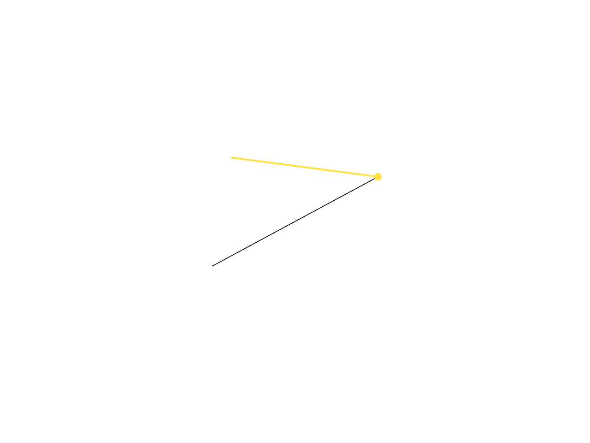

# 7.4 · Precise snapping with derived search caches

**Goal:** Snap actual drawing input through the command dock. · **Checkpoints:** `49-settings` → `49f-input` (8 steps) · **Source:** [app/command/mod.rs](../../../src/app/command/mod.rs) · [app/command/tool.rs](../../../src/app/command/tool.rs) · [app/cplane.rs](../../../src/app/cplane.rs) · [app/snap.rs](../../../src/app/snap.rs) · [app/gizmo.rs](../../../src/app/gizmo.rs) · [engine/gpu/widget.rs](../../../src/engine/gpu/widget.rs) · [app/deform.rs](../../../src/app/deform.rs) (`src/app/cplane.rs,src/app/gizmo.rs,src/app/gesture/gizmo.rs`)

<div class="webgpu-schematic" style="width:100%;margin:6px auto;">
<svg xmlns="http://www.w3.org/2000/svg" width="1120" height="200" viewBox="0 0 1120 200" style="width:100%;max-width:100%;height:auto;display:block;margin:0 auto;" role="img">
  <defs>
    <marker id="arr" viewBox="0 0 10 10" refX="8" refY="5" markerWidth="6" markerHeight="6" orient="auto">
      <path d="M 0 1 L 9 5 L 0 9 z" fill="#111111"/>
    </marker>
    <marker id="arrR" viewBox="0 0 10 10" refX="8" refY="5" markerWidth="6" markerHeight="6" orient="auto">
      <path d="M 0 1 L 9 5 L 0 9 z" fill="#dc2626"/>
    </marker>
    <marker id="arrG" viewBox="0 0 10 10" refX="8" refY="5" markerWidth="6" markerHeight="6" orient="auto">
      <path d="M 0 1 L 9 5 L 0 9 z" fill="#16a34a"/>
    </marker>
    <marker id="arrB" viewBox="0 0 10 10" refX="8" refY="5" markerWidth="6" markerHeight="6" orient="auto">
      <path d="M 0 1 L 9 5 L 0 9 z" fill="#2563eb"/>
    </marker>
  </defs>
  <rect x="2" y="2" width="1116" height="196" rx="10" fill="#ffffff" stroke="#111111" stroke-width="2"/>
  <rect x="16" y="14" width="248" height="172" rx="8" fill="#ffffff" stroke="#111111" stroke-width="1.75"/>
  <text paint-order="stroke fill" stroke="#ffffff" stroke-width="5" stroke-linejoin="round" x="140" y="34" text-anchor="middle" font-family="monospace" font-size="11.5" font-weight="700" fill="#111111">1. Lesson 7.4 Code</text>
  <rect x="34" y="48" width="212" height="24" rx="4" fill="#ffffff" stroke="#111111" stroke-width="1.25"/>
  <text paint-order="stroke fill" stroke="#ffffff" stroke-width="5" stroke-linejoin="round" x="140" y="64" text-anchor="middle" font-family="monospace" font-size="10" font-weight="700" fill="#111111">src/snap.rs</text>
  <rect x="34" y="78" width="212" height="24" rx="4" fill="#ffffff" stroke="#111111" stroke-width="1.5"/>
  <text paint-order="stroke fill" stroke="#ffffff" stroke-width="5" stroke-linejoin="round" x="140" y="94" text-anchor="middle" font-family="monospace" font-size="10" font-weight="700" fill="#111111">src/lib.rs</text>
  <rect x="34" y="108" width="212" height="24" rx="4" fill="#ffffff" stroke="#111111" stroke-width="1.25"/>
  <text paint-order="stroke fill" stroke="#ffffff" stroke-width="5" stroke-linejoin="round" x="140" y="124" text-anchor="middle" font-family="monospace" font-size="10" font-weight="700" fill="#111111">src/snap_math.rs</text>
  <text paint-order="stroke fill" stroke="#ffffff" stroke-width="5" stroke-linejoin="round" x="140" y="172" text-anchor="middle" font-family="monospace" font-size="9.5" fill="#111111">49-settings -&gt; 49f-input</text>
  <line x1="264" y1="100" x2="292" y2="100" stroke="#111111" stroke-width="2" marker-end="url(#arr)"/>
  <rect x="296" y="14" width="248" height="172" rx="8" fill="#ffffff" stroke="#111111" stroke-width="1.75"/>
  <text paint-order="stroke fill" stroke="#ffffff" stroke-width="5" stroke-linejoin="round" x="420" y="34" text-anchor="middle" font-family="monospace" font-size="11.5" font-weight="700" fill="#111111">2. session_viewer/src</text>
  <rect x="314" y="48" width="212" height="26" rx="4" fill="#ffffff" stroke="#111111" stroke-width="1.5"/>
  <text paint-order="stroke fill" stroke="#ffffff" stroke-width="5" stroke-linejoin="round" x="420" y="65" text-anchor="middle" font-family="monospace" font-size="10" font-weight="700" fill="#111111">src/app/cplane.rs</text>
  <rect x="314" y="80" width="212" height="26" rx="4" fill="#ffffff" stroke="#111111" stroke-width="1.5"/>
  <text paint-order="stroke fill" stroke="#ffffff" stroke-width="5" stroke-linejoin="round" x="420" y="97" text-anchor="middle" font-family="monospace" font-size="10" font-weight="700" fill="#111111">src/app/gizmo.rs</text>
  <rect x="314" y="112" width="212" height="24" rx="4" fill="#ffffff" stroke="#111111" stroke-width="1.5"/>
  <text paint-order="stroke fill" stroke="#ffffff" stroke-width="5" stroke-linejoin="round" x="420" y="128" text-anchor="middle" font-family="monospace" font-size="9.5" font-weight="700" fill="#111111">✓ cargo check (wasm32)</text>
  <text paint-order="stroke fill" stroke="#ffffff" stroke-width="5" stroke-linejoin="round" x="420" y="172" text-anchor="middle" font-family="sans-serif" font-size="10" fill="#111111">Separate object and grid…</text>
  <line x1="544" y1="100" x2="572" y2="100" stroke="#111111" stroke-width="2" marker-end="url(#arr)"/>
  <rect x="576" y="14" width="248" height="172" rx="8" fill="#ffffff" stroke="#111111" stroke-width="1.75"/>
  <text paint-order="stroke fill" stroke="#ffffff" stroke-width="5" stroke-linejoin="round" x="700" y="34" text-anchor="middle" font-family="monospace" font-size="11.5" font-weight="700" fill="#111111">3. C-Plane Snap &amp; Preview</text>
  <polygon points="602,128 652,72 798,72 748,128" fill="#f8fafc" stroke="#111111" stroke-width="1.5"/>
  <line x1="628" y1="50" x2="696" y2="100" stroke="#111111" stroke-width="2" marker-end="url(#arr)"/>
  <circle cx="700" cy="102" r="5" fill="#f59e0b" stroke="#111111" stroke-width="1.5"/>
  <circle cx="700" cy="102" r="10" fill="none" stroke="#d97706" stroke-width="2"/>
  <text paint-order="stroke fill" stroke="#ffffff" stroke-width="5" stroke-linejoin="round" x="700" y="172" text-anchor="middle" font-family="monospace" font-size="9.5" fill="#111111">Precise snapping with deriv…</text>
  <line x1="824" y1="100" x2="852" y2="100" stroke="#111111" stroke-width="2" marker-end="url(#arr)"/>
  <rect x="856" y="14" width="248" height="172" rx="8" fill="#ffffff" stroke="#111111" stroke-width="1.75"/>
  <text paint-order="stroke fill" stroke="#ffffff" stroke-width="5" stroke-linejoin="round" x="980" y="34" text-anchor="middle" font-family="monospace" font-size="11.5" font-weight="700" fill="#111111">4. RGB 3D Gumball Gizmo</text>
  <circle cx="956" cy="118" r="5" fill="#facc15" stroke="#111111" stroke-width="1.5"/>
  <line x1="956" y1="118" x2="956" y2="52" stroke="#2563eb" stroke-width="2.5" marker-end="url(#arrB)"/>
  <text paint-order="stroke fill" stroke="#ffffff" stroke-width="5" stroke-linejoin="round" x="940" y="60" font-family="monospace" font-size="10.5" font-weight="700" fill="#2563eb">Z</text>
  <line x1="956" y1="118" x2="1036" y2="118" stroke="#dc2626" stroke-width="2.5" marker-end="url(#arrR)"/>
  <text paint-order="stroke fill" stroke="#ffffff" stroke-width="5" stroke-linejoin="round" x="1044" y="122" font-family="monospace" font-size="10.5" font-weight="700" fill="#dc2626">X</text>
  <line x1="956" y1="118" x2="904" y2="144" stroke="#16a34a" stroke-width="2.5" marker-end="url(#arrG)"/>
  <text paint-order="stroke fill" stroke="#ffffff" stroke-width="5" stroke-linejoin="round" x="888" y="146" font-family="monospace" font-size="10.5" font-weight="700" fill="#16a34a">Y</text>
  <path d="M 956 80 A 38 38 0 0 1 994 118" fill="none" stroke="#dc2626" stroke-width="2"/>
  <text paint-order="stroke fill" stroke="#ffffff" stroke-width="5" stroke-linejoin="round" x="980" y="172" text-anchor="middle" font-family="sans-serif" font-size="10" font-weight="700" fill="#111111">Snap actual drawing input…</text>
</svg>
</div>

## <a id="checkpoint-49-settings"></a>Step 1 of 8 · Separate object and grid snapping (`49-settings`)

<div class="webgpu-schematic" style="width:100%;margin:6px auto;">
<svg xmlns="http://www.w3.org/2000/svg" width="1120" height="72" viewBox="0 0 1120 72" style="width:100%;max-width:100%;height:auto;display:block;margin:0 auto;" role="img">
  <defs>
    <marker id="arr" viewBox="0 0 10 10" refX="8" refY="5" markerWidth="6" markerHeight="6" orient="auto">
      <path d="M 0 1 L 9 5 L 0 9 z" fill="#111111"/>
    </marker>
    <marker id="arrR" viewBox="0 0 10 10" refX="8" refY="5" markerWidth="6" markerHeight="6" orient="auto">
      <path d="M 0 1 L 9 5 L 0 9 z" fill="#dc2626"/>
    </marker>
    <marker id="arrG" viewBox="0 0 10 10" refX="8" refY="5" markerWidth="6" markerHeight="6" orient="auto">
      <path d="M 0 1 L 9 5 L 0 9 z" fill="#16a34a"/>
    </marker>
    <marker id="arrB" viewBox="0 0 10 10" refX="8" refY="5" markerWidth="6" markerHeight="6" orient="auto">
      <path d="M 0 1 L 9 5 L 0 9 z" fill="#2563eb"/>
    </marker>
  </defs>
  <rect x="2" y="2" width="1116" height="68" rx="10" fill="#ffffff" stroke="#111111" stroke-width="2"/>
  <rect x="14" y="10" width="252" height="52" rx="6" fill="#ffffff" stroke="#111111" stroke-width="1.5"/>
  <text paint-order="stroke fill" stroke="#ffffff" stroke-width="5" stroke-linejoin="round" x="140" y="30" text-anchor="middle" font-family="monospace" font-size="10.5" font-weight="700" fill="#111111">Step 1/8: 49-settings</text>
  <text paint-order="stroke fill" stroke="#ffffff" stroke-width="5" stroke-linejoin="round" x="140" y="48" text-anchor="middle" font-family="monospace" font-size="9.5" fill="#111111">src/snap.rs, src/lib.rs</text>
  <line x1="266" y1="36" x2="292" y2="36" stroke="#111111" stroke-width="1.75" marker-end="url(#arr)"/>
  <rect x="296" y="10" width="252" height="52" rx="6" fill="#ffffff" stroke="#111111" stroke-width="1.5"/>
  <text paint-order="stroke fill" stroke="#ffffff" stroke-width="5" stroke-linejoin="round" x="422" y="30" text-anchor="middle" font-family="monospace" font-size="10" font-weight="700" fill="#111111">1. CPU / Rust Input</text>
  <text paint-order="stroke fill" stroke="#ffffff" stroke-width="5" stroke-linejoin="round" x="422" y="48" text-anchor="middle" font-family="sans-serif" font-size="9.5" fill="#111111">independent switches</text>
  <line x1="548" y1="36" x2="574" y2="36" stroke="#111111" stroke-width="1.75" marker-end="url(#arr)"/>
  <rect x="578" y="10" width="252" height="52" rx="6" fill="#ffffff" stroke="#111111" stroke-width="1.5"/>
  <text paint-order="stroke fill" stroke="#ffffff" stroke-width="5" stroke-linejoin="round" x="704" y="30" text-anchor="middle" font-family="monospace" font-size="10" font-weight="700" fill="#111111">2. WebGPU / WGSL</text>
  <text paint-order="stroke fill" stroke="#ffffff" stroke-width="5" stroke-linejoin="round" x="704" y="48" text-anchor="middle" font-family="sans-serif" font-size="9.5" fill="#111111">validated spacing</text>
  <line x1="830" y1="36" x2="856" y2="36" stroke="#111111" stroke-width="1.75" marker-end="url(#arr)"/>
  <rect x="860" y="10" width="246" height="52" rx="6" fill="#dcfce7" stroke="#111111" stroke-width="1.75"/>
  <text paint-order="stroke fill" stroke="#ffffff" stroke-width="5" stroke-linejoin="round" x="983" y="30" text-anchor="middle" font-family="monospace" font-size="10" font-weight="700" fill="#111111">3. -&gt; src/app/cplane.rs</text>
  <text paint-order="stroke fill" stroke="#ffffff" stroke-width="5" stroke-linejoin="round" x="983" y="48" text-anchor="middle" font-family="sans-serif" font-size="9.5" fill="#111111">current settings</text>
</svg>
</div>

**What this code does:** Separate object and grid snapping.

### 1. `src/snap.rs`

Define snap kinds, independent switches and validated current1000mm grid settings.

Create the file and type:

```rust
--8<-- "journey/code/49-settings-01.rs"
```

### 2. `src/lib.rs`

Register the snap component and supplied checks.

**Locate this existing block:**

```rust

#[cfg(test)]
mod selection_cycle_tests;
```

After that block, type:

```rust
--8<-- "journey/code/49-settings-02.rs" skip=41
```

## <a id="checkpoint-49a-math"></a>Step 2 of 8 · Keep snap math in world and plane coordinates (`49a-math`)

<div class="webgpu-schematic" style="width:100%;margin:6px auto;">
<svg xmlns="http://www.w3.org/2000/svg" width="1120" height="72" viewBox="0 0 1120 72" style="width:100%;max-width:100%;height:auto;display:block;margin:0 auto;" role="img">
  <defs>
    <marker id="arr" viewBox="0 0 10 10" refX="8" refY="5" markerWidth="6" markerHeight="6" orient="auto">
      <path d="M 0 1 L 9 5 L 0 9 z" fill="#111111"/>
    </marker>
    <marker id="arrR" viewBox="0 0 10 10" refX="8" refY="5" markerWidth="6" markerHeight="6" orient="auto">
      <path d="M 0 1 L 9 5 L 0 9 z" fill="#dc2626"/>
    </marker>
    <marker id="arrG" viewBox="0 0 10 10" refX="8" refY="5" markerWidth="6" markerHeight="6" orient="auto">
      <path d="M 0 1 L 9 5 L 0 9 z" fill="#16a34a"/>
    </marker>
    <marker id="arrB" viewBox="0 0 10 10" refX="8" refY="5" markerWidth="6" markerHeight="6" orient="auto">
      <path d="M 0 1 L 9 5 L 0 9 z" fill="#2563eb"/>
    </marker>
  </defs>
  <rect x="2" y="2" width="1116" height="68" rx="10" fill="#ffffff" stroke="#111111" stroke-width="2"/>
  <rect x="14" y="10" width="252" height="52" rx="6" fill="#ffffff" stroke="#111111" stroke-width="1.5"/>
  <text paint-order="stroke fill" stroke="#ffffff" stroke-width="5" stroke-linejoin="round" x="140" y="30" text-anchor="middle" font-family="monospace" font-size="10.5" font-weight="700" fill="#111111">Step 2/8: 49a-math</text>
  <text paint-order="stroke fill" stroke="#ffffff" stroke-width="5" stroke-linejoin="round" x="140" y="48" text-anchor="middle" font-family="monospace" font-size="9.5" fill="#111111">src/snap_math.rs, src/lib.rs</text>
  <line x1="266" y1="36" x2="292" y2="36" stroke="#111111" stroke-width="1.75" marker-end="url(#arr)"/>
  <rect x="296" y="10" width="252" height="52" rx="6" fill="#ffffff" stroke="#111111" stroke-width="1.5"/>
  <text paint-order="stroke fill" stroke="#ffffff" stroke-width="5" stroke-linejoin="round" x="422" y="30" text-anchor="middle" font-family="monospace" font-size="10" font-weight="700" fill="#111111">1. CPU / Rust Input</text>
  <text paint-order="stroke fill" stroke="#ffffff" stroke-width="5" stroke-linejoin="round" x="422" y="48" text-anchor="middle" font-family="sans-serif" font-size="9.5" fill="#111111">original world coordinates</text>
  <line x1="548" y1="36" x2="574" y2="36" stroke="#111111" stroke-width="1.75" marker-end="url(#arr)"/>
  <rect x="578" y="10" width="252" height="52" rx="6" fill="#ffffff" stroke="#111111" stroke-width="1.5"/>
  <text paint-order="stroke fill" stroke="#ffffff" stroke-width="5" stroke-linejoin="round" x="704" y="30" text-anchor="middle" font-family="monospace" font-size="10" font-weight="700" fill="#111111">2. WebGPU / WGSL</text>
  <text paint-order="stroke fill" stroke="#ffffff" stroke-width="5" stroke-linejoin="round" x="704" y="48" text-anchor="middle" font-family="sans-serif" font-size="9.5" fill="#111111">current projection or loc…</text>
  <line x1="830" y1="36" x2="856" y2="36" stroke="#111111" stroke-width="1.75" marker-end="url(#arr)"/>
  <rect x="860" y="10" width="246" height="52" rx="6" fill="#dcfce7" stroke="#111111" stroke-width="1.75"/>
  <text paint-order="stroke fill" stroke="#ffffff" stroke-width="5" stroke-linejoin="round" x="983" y="30" text-anchor="middle" font-family="monospace" font-size="10" font-weight="700" fill="#111111">3. -&gt; src/app/cplane.rs</text>
  <text paint-order="stroke fill" stroke="#ffffff" stroke-width="5" stroke-linejoin="round" x="983" y="48" text-anchor="middle" font-family="sans-serif" font-size="9.5" fill="#111111">finite snap point</text>
</svg>
</div>

**What this code does:** Keep snap math in world and plane coordinates.

### 1. `src/snap_math.rs`

Resolve screen projection, local-plane rounding and nearest/perpendicular segment points.

Create the file and type:

```rust
--8<-- "journey/code/49a-math-01.rs"
```

### 2. `src/lib.rs`

Register the snap component and supplied checks.

**Locate this existing block:**

```rust
mod selection_cycle_tests;

pub mod snap;
```

After that block, type:

```rust
--8<-- "journey/code/49a-math-02.rs" skip=42
```

## <a id="checkpoint-49b-sources"></a>Step 3 of 8 · Collect targets from original placed geometry (`49b-sources`)

<div class="webgpu-schematic" style="width:100%;margin:6px auto;">
<svg xmlns="http://www.w3.org/2000/svg" width="1120" height="72" viewBox="0 0 1120 72" style="width:100%;max-width:100%;height:auto;display:block;margin:0 auto;" role="img">
  <defs>
    <marker id="arr" viewBox="0 0 10 10" refX="8" refY="5" markerWidth="6" markerHeight="6" orient="auto">
      <path d="M 0 1 L 9 5 L 0 9 z" fill="#111111"/>
    </marker>
    <marker id="arrR" viewBox="0 0 10 10" refX="8" refY="5" markerWidth="6" markerHeight="6" orient="auto">
      <path d="M 0 1 L 9 5 L 0 9 z" fill="#dc2626"/>
    </marker>
    <marker id="arrG" viewBox="0 0 10 10" refX="8" refY="5" markerWidth="6" markerHeight="6" orient="auto">
      <path d="M 0 1 L 9 5 L 0 9 z" fill="#16a34a"/>
    </marker>
    <marker id="arrB" viewBox="0 0 10 10" refX="8" refY="5" markerWidth="6" markerHeight="6" orient="auto">
      <path d="M 0 1 L 9 5 L 0 9 z" fill="#2563eb"/>
    </marker>
  </defs>
  <rect x="2" y="2" width="1116" height="68" rx="10" fill="#ffffff" stroke="#111111" stroke-width="2"/>
  <rect x="14" y="10" width="252" height="52" rx="6" fill="#ffffff" stroke="#111111" stroke-width="1.5"/>
  <text paint-order="stroke fill" stroke="#ffffff" stroke-width="5" stroke-linejoin="round" x="140" y="30" text-anchor="middle" font-family="monospace" font-size="10.5" font-weight="700" fill="#111111">Step 3/8: 49b-sources</text>
  <text paint-order="stroke fill" stroke="#ffffff" stroke-width="5" stroke-linejoin="round" x="140" y="48" text-anchor="middle" font-family="monospace" font-size="9.5" fill="#111111">src/snap_sources.rs, src/li…</text>
  <line x1="266" y1="36" x2="292" y2="36" stroke="#111111" stroke-width="1.75" marker-end="url(#arr)"/>
  <rect x="296" y="10" width="252" height="52" rx="6" fill="#ffffff" stroke="#111111" stroke-width="1.5"/>
  <text paint-order="stroke fill" stroke="#ffffff" stroke-width="5" stroke-linejoin="round" x="422" y="30" text-anchor="middle" font-family="monospace" font-size="10" font-weight="700" fill="#111111">1. CPU / Rust Input</text>
  <text paint-order="stroke fill" stroke="#ffffff" stroke-width="5" stroke-linejoin="round" x="422" y="48" text-anchor="middle" font-family="sans-serif" font-size="9.5" fill="#111111">visible source</text>
  <line x1="548" y1="36" x2="574" y2="36" stroke="#111111" stroke-width="1.75" marker-end="url(#arr)"/>
  <rect x="578" y="10" width="252" height="52" rx="6" fill="#ffffff" stroke="#111111" stroke-width="1.5"/>
  <text paint-order="stroke fill" stroke="#ffffff" stroke-width="5" stroke-linejoin="round" x="704" y="30" text-anchor="middle" font-family="monospace" font-size="10" font-weight="700" fill="#111111">2. WebGPU / WGSL</text>
  <text paint-order="stroke fill" stroke="#ffffff" stroke-width="5" stroke-linejoin="round" x="704" y="48" text-anchor="middle" font-family="sans-serif" font-size="9.5" fill="#111111">row placement</text>
  <line x1="830" y1="36" x2="856" y2="36" stroke="#111111" stroke-width="1.75" marker-end="url(#arr)"/>
  <rect x="860" y="10" width="246" height="52" rx="6" fill="#ffffff" stroke="#111111" stroke-width="1.75"/>
  <text paint-order="stroke fill" stroke="#ffffff" stroke-width="5" stroke-linejoin="round" x="983" y="30" text-anchor="middle" font-family="monospace" font-size="10" font-weight="700" fill="#111111">3. -&gt; src/app/cplane.rs</text>
  <text paint-order="stroke fill" stroke="#ffffff" stroke-width="5" stroke-linejoin="round" x="983" y="48" text-anchor="middle" font-family="sans-serif" font-size="9.5" fill="#111111">derived candidates and wi…</text>
</svg>
</div>

**What this code does:** Collect targets from original placed geometry.

### 1. `src/snap_sources.rs`

Collect precise placed source candidates and original boundaries without retaining source owners.

Create the file and type:

```rust
--8<-- "journey/code/49b-sources-01.rs"
```

### 2. `src/lib.rs`

Register the snap component and supplied checks.

**Locate this existing block:**

```rust
pub mod snap;

pub mod snap_math;
```

After that block, type:

```rust
--8<-- "journey/code/49b-sources-02.rs" skip=34
```

## <a id="checkpoint-49c-bins"></a>Step 4 of 8 · Search nearby screen cells (`49c-bins`)

<div class="webgpu-schematic" style="width:100%;margin:6px auto;">
<svg xmlns="http://www.w3.org/2000/svg" width="1120" height="72" viewBox="0 0 1120 72" style="width:100%;max-width:100%;height:auto;display:block;margin:0 auto;" role="img">
  <defs>
    <marker id="arr" viewBox="0 0 10 10" refX="8" refY="5" markerWidth="6" markerHeight="6" orient="auto">
      <path d="M 0 1 L 9 5 L 0 9 z" fill="#111111"/>
    </marker>
    <marker id="arrR" viewBox="0 0 10 10" refX="8" refY="5" markerWidth="6" markerHeight="6" orient="auto">
      <path d="M 0 1 L 9 5 L 0 9 z" fill="#dc2626"/>
    </marker>
    <marker id="arrG" viewBox="0 0 10 10" refX="8" refY="5" markerWidth="6" markerHeight="6" orient="auto">
      <path d="M 0 1 L 9 5 L 0 9 z" fill="#16a34a"/>
    </marker>
    <marker id="arrB" viewBox="0 0 10 10" refX="8" refY="5" markerWidth="6" markerHeight="6" orient="auto">
      <path d="M 0 1 L 9 5 L 0 9 z" fill="#2563eb"/>
    </marker>
  </defs>
  <rect x="2" y="2" width="1116" height="68" rx="10" fill="#ffffff" stroke="#111111" stroke-width="2"/>
  <rect x="14" y="10" width="252" height="52" rx="6" fill="#ffffff" stroke="#111111" stroke-width="1.5"/>
  <text paint-order="stroke fill" stroke="#ffffff" stroke-width="5" stroke-linejoin="round" x="140" y="30" text-anchor="middle" font-family="monospace" font-size="10.5" font-weight="700" fill="#111111">Step 4/8: 49c-bins</text>
  <text paint-order="stroke fill" stroke="#ffffff" stroke-width="5" stroke-linejoin="round" x="140" y="48" text-anchor="middle" font-family="monospace" font-size="9.5" fill="#111111">src/snap_bins.rs, src/lib.rs</text>
  <line x1="266" y1="36" x2="292" y2="36" stroke="#111111" stroke-width="1.75" marker-end="url(#arr)"/>
  <rect x="296" y="10" width="252" height="52" rx="6" fill="#ffffff" stroke="#111111" stroke-width="1.5"/>
  <text paint-order="stroke fill" stroke="#ffffff" stroke-width="5" stroke-linejoin="round" x="422" y="30" text-anchor="middle" font-family="monospace" font-size="10" font-weight="700" fill="#111111">1. CPU / Rust Input</text>
  <text paint-order="stroke fill" stroke="#ffffff" stroke-width="5" stroke-linejoin="round" x="422" y="48" text-anchor="middle" font-family="sans-serif" font-size="9.5" fill="#111111">projected candidate or wi…</text>
  <line x1="548" y1="36" x2="574" y2="36" stroke="#111111" stroke-width="1.75" marker-end="url(#arr)"/>
  <rect x="578" y="10" width="252" height="52" rx="6" fill="#ffffff" stroke="#111111" stroke-width="1.5"/>
  <text paint-order="stroke fill" stroke="#ffffff" stroke-width="5" stroke-linejoin="round" x="704" y="30" text-anchor="middle" font-family="monospace" font-size="10" font-weight="700" fill="#111111">2. WebGPU / WGSL</text>
  <text paint-order="stroke fill" stroke="#ffffff" stroke-width="5" stroke-linejoin="round" x="704" y="48" text-anchor="middle" font-family="sans-serif" font-size="9.5" fill="#111111">small screen cells</text>
  <line x1="830" y1="36" x2="856" y2="36" stroke="#111111" stroke-width="1.75" marker-end="url(#arr)"/>
  <rect x="860" y="10" width="246" height="52" rx="6" fill="#ffffff" stroke="#111111" stroke-width="1.75"/>
  <text paint-order="stroke fill" stroke="#ffffff" stroke-width="5" stroke-linejoin="round" x="983" y="30" text-anchor="middle" font-family="monospace" font-size="10" font-weight="700" fill="#111111">3. -&gt; src/app/cplane.rs</text>
  <text paint-order="stroke fill" stroke="#ffffff" stroke-width="5" stroke-linejoin="round" x="983" y="48" text-anchor="middle" font-family="sans-serif" font-size="9.5" fill="#111111">nearby IDs plus conservat…</text>
</svg>
</div>

**What this code does:** Search nearby screen cells.

### 1. `src/snap_bins.rs`

Bound screen-cell insertion and deduplicate nearby candidate IDs.

Create the file and type:

```rust
--8<-- "journey/code/49c-bins-01.rs"
```

### 2. `src/lib.rs`

Register the snap component and supplied checks.

**Locate this existing block:**

```rust
pub mod snap_math;

pub mod snap_sources;
```

After that block, type:

```rust
--8<-- "journey/code/49c-bins-02.rs" skip=42
```

## <a id="checkpoint-49d-index"></a>Step 5 of 8 · Choose snap kinds before grid fallback (`49d-index`)

<div class="webgpu-schematic" style="width:100%;margin:6px auto;">
<svg xmlns="http://www.w3.org/2000/svg" width="1120" height="72" viewBox="0 0 1120 72" style="width:100%;max-width:100%;height:auto;display:block;margin:0 auto;" role="img">
  <defs>
    <marker id="arr" viewBox="0 0 10 10" refX="8" refY="5" markerWidth="6" markerHeight="6" orient="auto">
      <path d="M 0 1 L 9 5 L 0 9 z" fill="#111111"/>
    </marker>
    <marker id="arrR" viewBox="0 0 10 10" refX="8" refY="5" markerWidth="6" markerHeight="6" orient="auto">
      <path d="M 0 1 L 9 5 L 0 9 z" fill="#dc2626"/>
    </marker>
    <marker id="arrG" viewBox="0 0 10 10" refX="8" refY="5" markerWidth="6" markerHeight="6" orient="auto">
      <path d="M 0 1 L 9 5 L 0 9 z" fill="#16a34a"/>
    </marker>
    <marker id="arrB" viewBox="0 0 10 10" refX="8" refY="5" markerWidth="6" markerHeight="6" orient="auto">
      <path d="M 0 1 L 9 5 L 0 9 z" fill="#2563eb"/>
    </marker>
  </defs>
  <rect x="2" y="2" width="1116" height="68" rx="10" fill="#ffffff" stroke="#111111" stroke-width="2"/>
  <rect x="14" y="10" width="252" height="52" rx="6" fill="#ffffff" stroke="#111111" stroke-width="1.5"/>
  <text paint-order="stroke fill" stroke="#ffffff" stroke-width="5" stroke-linejoin="round" x="140" y="30" text-anchor="middle" font-family="monospace" font-size="10.5" font-weight="700" fill="#111111">Step 5/8: 49d-index</text>
  <text paint-order="stroke fill" stroke="#ffffff" stroke-width="5" stroke-linejoin="round" x="140" y="48" text-anchor="middle" font-family="monospace" font-size="9.5" fill="#111111">src/snap_index.rs, src/lib.…</text>
  <line x1="266" y1="36" x2="292" y2="36" stroke="#111111" stroke-width="1.75" marker-end="url(#arr)"/>
  <rect x="296" y="10" width="252" height="52" rx="6" fill="#ffffff" stroke="#111111" stroke-width="1.5"/>
  <text paint-order="stroke fill" stroke="#ffffff" stroke-width="5" stroke-linejoin="round" x="422" y="30" text-anchor="middle" font-family="monospace" font-size="10" font-weight="700" fill="#111111">1. CPU / Rust Input</text>
  <text paint-order="stroke fill" stroke="#ffffff" stroke-width="5" stroke-linejoin="round" x="422" y="48" text-anchor="middle" font-family="sans-serif" font-size="9.5" fill="#111111">nearby IDs</text>
  <line x1="548" y1="36" x2="574" y2="36" stroke="#111111" stroke-width="1.75" marker-end="url(#arr)"/>
  <rect x="578" y="10" width="252" height="52" rx="6" fill="#ffffff" stroke="#111111" stroke-width="1.5"/>
  <text paint-order="stroke fill" stroke="#ffffff" stroke-width="5" stroke-linejoin="round" x="704" y="30" text-anchor="middle" font-family="monospace" font-size="10" font-weight="700" fill="#111111">2. WebGPU / WGSL</text>
  <text paint-order="stroke fill" stroke="#ffffff" stroke-width="5" stroke-linejoin="round" x="704" y="48" text-anchor="middle" font-family="sans-serif" font-size="9.5" fill="#111111">kind priority and distance</text>
  <line x1="830" y1="36" x2="856" y2="36" stroke="#111111" stroke-width="1.75" marker-end="url(#arr)"/>
  <rect x="860" y="10" width="246" height="52" rx="6" fill="#dcfce7" stroke="#111111" stroke-width="1.75"/>
  <text paint-order="stroke fill" stroke="#ffffff" stroke-width="5" stroke-linejoin="round" x="983" y="30" text-anchor="middle" font-family="monospace" font-size="10" font-weight="700" fill="#111111">3. -&gt; src/app/cplane.rs</text>
  <text paint-order="stroke fill" stroke="#ffffff" stroke-width="5" stroke-linejoin="round" x="983" y="48" text-anchor="middle" font-family="sans-serif" font-size="9.5" fill="#111111">object hit or valid-plane…</text>
</svg>
</div>

**What this code does:** Choose snap kinds before grid fallback.

### 1. `src/snap_index.rs`

Rank nearby valid candidates and apply independent construction-plane grid fallback.

Create the file and type:

```rust
--8<-- "journey/code/49d-index-01.rs"
```

### 2. `src/lib.rs`

Register the snap component and supplied checks.

**Locate this existing block:**

```rust
pub mod snap_sources;

pub mod snap_bins;
```

After that block, type:

```rust
--8<-- "journey/code/49d-index-02.rs" skip=42
```

## <a id="checkpoint-49e-cache"></a>Step 6 of 8 · Invalidate snap caches after source edits (`49e-cache`)

<div class="webgpu-schematic" style="width:100%;margin:6px auto;">
<svg xmlns="http://www.w3.org/2000/svg" width="1120" height="72" viewBox="0 0 1120 72" style="width:100%;max-width:100%;height:auto;display:block;margin:0 auto;" role="img">
  <defs>
    <marker id="arr" viewBox="0 0 10 10" refX="8" refY="5" markerWidth="6" markerHeight="6" orient="auto">
      <path d="M 0 1 L 9 5 L 0 9 z" fill="#111111"/>
    </marker>
    <marker id="arrR" viewBox="0 0 10 10" refX="8" refY="5" markerWidth="6" markerHeight="6" orient="auto">
      <path d="M 0 1 L 9 5 L 0 9 z" fill="#dc2626"/>
    </marker>
    <marker id="arrG" viewBox="0 0 10 10" refX="8" refY="5" markerWidth="6" markerHeight="6" orient="auto">
      <path d="M 0 1 L 9 5 L 0 9 z" fill="#16a34a"/>
    </marker>
    <marker id="arrB" viewBox="0 0 10 10" refX="8" refY="5" markerWidth="6" markerHeight="6" orient="auto">
      <path d="M 0 1 L 9 5 L 0 9 z" fill="#2563eb"/>
    </marker>
  </defs>
  <rect x="2" y="2" width="1116" height="68" rx="10" fill="#ffffff" stroke="#111111" stroke-width="2"/>
  <rect x="14" y="10" width="252" height="52" rx="6" fill="#ffffff" stroke="#111111" stroke-width="1.5"/>
  <text paint-order="stroke fill" stroke="#ffffff" stroke-width="5" stroke-linejoin="round" x="140" y="30" text-anchor="middle" font-family="monospace" font-size="10.5" font-weight="700" fill="#111111">Step 6/8: 49e-cache</text>
  <text paint-order="stroke fill" stroke="#ffffff" stroke-width="5" stroke-linejoin="round" x="140" y="48" text-anchor="middle" font-family="monospace" font-size="9.5" fill="#111111">src/editor.rs</text>
  <line x1="266" y1="36" x2="292" y2="36" stroke="#111111" stroke-width="1.75" marker-end="url(#arr)"/>
  <rect x="296" y="10" width="252" height="52" rx="6" fill="#ffffff" stroke="#111111" stroke-width="1.5"/>
  <text paint-order="stroke fill" stroke="#ffffff" stroke-width="5" stroke-linejoin="round" x="422" y="30" text-anchor="middle" font-family="monospace" font-size="10" font-weight="700" fill="#111111">1. CPU / Rust Input</text>
  <text paint-order="stroke fill" stroke="#ffffff" stroke-width="5" stroke-linejoin="round" x="422" y="48" text-anchor="middle" font-family="sans-serif" font-size="9.5" fill="#111111">source or placement change</text>
  <line x1="548" y1="36" x2="574" y2="36" stroke="#111111" stroke-width="1.75" marker-end="url(#arr)"/>
  <rect x="578" y="10" width="252" height="52" rx="6" fill="#ffffff" stroke="#111111" stroke-width="1.5"/>
  <text paint-order="stroke fill" stroke="#ffffff" stroke-width="5" stroke-linejoin="round" x="704" y="30" text-anchor="middle" font-family="monospace" font-size="10" font-weight="700" fill="#111111">2. WebGPU / WGSL</text>
  <text paint-order="stroke fill" stroke="#ffffff" stroke-width="5" stroke-linejoin="round" x="704" y="48" text-anchor="middle" font-family="sans-serif" font-size="9.5" fill="#111111">current camera query</text>
  <line x1="830" y1="36" x2="856" y2="36" stroke="#111111" stroke-width="1.75" marker-end="url(#arr)"/>
  <rect x="860" y="10" width="246" height="52" rx="6" fill="#dcfce7" stroke="#111111" stroke-width="1.75"/>
  <text paint-order="stroke fill" stroke="#ffffff" stroke-width="5" stroke-linejoin="round" x="983" y="30" text-anchor="middle" font-family="monospace" font-size="10" font-weight="700" fill="#111111">3. -&gt; src/app/cplane.rs</text>
  <text paint-order="stroke fill" stroke="#ffffff" stroke-width="5" stroke-linejoin="round" x="983" y="48" text-anchor="middle" font-family="sans-serif" font-size="9.5" fill="#111111">derived cache</text>
</svg>
</div>

**What this code does:** Invalidate snap caches after source edits.

### 1. `src/editor.rs`

Own derived target caches and invalidate them after source and placement transactions.

Edit these blocks from bottom to top. Keep the surrounding lines unchanged.

**Locate this block:**

```rust
        self.draft = None; self.tool_status = format!("{name} created."); Ok(Change::Scene)
    }

    pub fn apply(&mut self, action: Action) -> Result<Change, &'static str> {
        if matches!(&action, Action::Close | Action::Undo | Action::Redo | Action::Import(_) | Action::Replace(_) | Action::ImportAt(_, _) | Action::ReplaceAt(_, _)) { self.draft = None; }
        match action {
            Action::BeginTool(shape) => { self.draft = Some(crate::tool::Draft::new(shape)); self.tool_status = self.draft.as_ref().unwrap().prompt(); return Ok(Change::View); }
            Action::ToolPoint(point) => return self.place_tool_point(point),
            Action::ToolHover(point) => { if let Some(draft) = self.draft.as_mut() { draft.hover(point)?; } return Ok(Change::View); }
            Action::CancelTool => { self.draft = None; self.tool_status = "Tool cancelled.".into(); return Ok(Change::View); }
```

Replace it with:

```rust
        self.draft = None; self.tool_status = format!("{name} created."); Ok(Change::Scene)
    }

    pub fn snap_point(&mut self, screen: [f32; 2], size: [f64; 2]) -> Option<crate::snap::Hit> {
        let ray = self.camera.ray(screen)?;
        let from = self.draft.as_ref()?.points.last().copied();
        let hit = if self.snapping.objects {
            let index = self.snap_index.get_or_insert_with(|| crate::snap_index::Index::new(&self.scene));
            let viewport = crate::snap_math::Screen { matrix: self.camera.view_projection().m, size };
            index.query(viewport, &ray, [(screen[0] as f64+1.)*size[0]/2., (1.-screen[1] as f64)*size[1]/2.], self.snapping.modes, from)
        } else { None };
        hit.or_else(|| crate::snap_index::fallback(self.snapping, &self.camera, screen))
    }

    pub fn snap_usage(&self) -> [u64; 2] { self.snap_index.as_ref().map_or([0,0], |index| [index.builds,index.visits as u64]) }

    pub fn apply(&mut self, action: Action) -> Result<Change, &'static str> {
        let change = self.apply_action(action)?;
        if change == Change::Scene { self.snap_index = None; }
        Ok(change)
    }

    fn apply_action(&mut self, action: Action) -> Result<Change, &'static str> {
        if matches!(&action, Action::Close | Action::Undo | Action::Redo | Action::Import(_) | Action::Replace(_) | Action::ImportAt(_, _) | Action::ReplaceAt(_, _)) { self.draft = None; }
        match action {
            Action::BeginTool(shape) => { self.snap_index = None; self.draft = Some(crate::tool::Draft::new(shape)); self.tool_status = self.draft.as_ref().unwrap().prompt(); return Ok(Change::View); }
            Action::ToolPoint(point) => return self.place_tool_point(point),
            Action::ToolHover(point) => { if let Some(draft) = self.draft.as_mut() { draft.hover(point)?; } return Ok(Change::View); }
            Action::CancelTool => { self.draft = None; self.tool_status = "Tool cancelled.".into(); return Ok(Change::View); }
```

**Locate this block:**

```rust
        self.history.edit(&mut self.scene, |scene| { scene.remove(id); });
        self.objects.retain(&self.scene);
        if self.selected == Some(id) { self.selected = self.objects.primary(); self.selected_part = None; }
        Ok(Change::Scene)
    }

    pub fn selected_objects(&self) -> Vec<ObjectId> {
```

Replace it with:

```rust
        self.history.edit(&mut self.scene, |scene| { scene.remove(id); });
        self.objects.retain(&self.scene);
        if self.selected == Some(id) { self.selected = self.objects.primary(); self.selected_part = None; }
        self.snap_index = None; Ok(Change::Scene)
    }

    pub fn selected_objects(&self) -> Vec<ObjectId> {
```

**Locate this block:**

```rust
        let shift = session_rust::Xform::translation(offset[0], offset[1], offset[2]);
        let model = &shift * &object.model;
        self.history.try_edit(&mut self.scene, |scene| scene.place(id, model))?;
        Ok(Change::Scene)
    }

    pub fn delete_object(&mut self, id: ObjectId) -> Result<Change, &'static str> {
```

Replace it with:

```rust
        let shift = session_rust::Xform::translation(offset[0], offset[1], offset[2]);
        let model = &shift * &object.model;
        self.history.try_edit(&mut self.scene, |scene| scene.place(id, model))?;
        self.snap_index = None; Ok(Change::Scene)
    }

    pub fn delete_object(&mut self, id: ObjectId) -> Result<Change, &'static str> {
```

**Locate this block:**

```rust
        for scene in self.scenes_mut() {
            for plan in &prepared { scene.hydrate(plan); }
        }
        Ok(true)
    }

    fn unload_sources(&mut self) -> Result<(), &'static str> {
```

Replace it with:

```rust
        for scene in self.scenes_mut() {
            for plan in &prepared { scene.hydrate(plan); }
        }
        self.snap_index = None; Ok(true)
    }

    fn unload_sources(&mut self) -> Result<(), &'static str> {
```

**Locate this block:**

```rust
impl Default for Editor {
    fn default() -> Self {
        Self {
            draft: None, tool_status: String::new(),
            scene: Scene::demo(),
            selected: None, selected_part: None, pick_mode: Default::default(), objects: Default::default(),
```

Replace it with:

```rust
impl Default for Editor {
    fn default() -> Self {
        Self {
            snapping: Default::default(), snap_index: None,
            draft: None, tool_status: String::new(),
            scene: Scene::demo(),
            selected: None, selected_part: None, pick_mode: Default::default(), objects: Default::default(),
```

**Locate this block:**

```rust
}

pub struct Editor {
    pub draft: Option<crate::tool::Draft>,
    pub tool_status: String,
    pub scene: Scene,
```

Replace it with:

```rust
}

pub struct Editor {
    pub snapping: crate::snap::Settings,
    snap_index: Option<crate::snap_index::Index>,
    pub draft: Option<crate::tool::Draft>,
    pub tool_status: String,
    pub scene: Scene,
```

## <a id="checkpoint-49ea-state"></a>Step 7 of 8 · Preserve drafts while snapping (`49ea-state`)

<div class="webgpu-schematic" style="width:100%;margin:6px auto;">
<svg xmlns="http://www.w3.org/2000/svg" width="1120" height="72" viewBox="0 0 1120 72" style="width:100%;max-width:100%;height:auto;display:block;margin:0 auto;" role="img">
  <defs>
    <marker id="arr" viewBox="0 0 10 10" refX="8" refY="5" markerWidth="6" markerHeight="6" orient="auto">
      <path d="M 0 1 L 9 5 L 0 9 z" fill="#111111"/>
    </marker>
    <marker id="arrR" viewBox="0 0 10 10" refX="8" refY="5" markerWidth="6" markerHeight="6" orient="auto">
      <path d="M 0 1 L 9 5 L 0 9 z" fill="#dc2626"/>
    </marker>
    <marker id="arrG" viewBox="0 0 10 10" refX="8" refY="5" markerWidth="6" markerHeight="6" orient="auto">
      <path d="M 0 1 L 9 5 L 0 9 z" fill="#16a34a"/>
    </marker>
    <marker id="arrB" viewBox="0 0 10 10" refX="8" refY="5" markerWidth="6" markerHeight="6" orient="auto">
      <path d="M 0 1 L 9 5 L 0 9 z" fill="#2563eb"/>
    </marker>
  </defs>
  <rect x="2" y="2" width="1116" height="68" rx="10" fill="#ffffff" stroke="#111111" stroke-width="2"/>
  <rect x="14" y="10" width="252" height="52" rx="6" fill="#ffffff" stroke="#111111" stroke-width="1.5"/>
  <text paint-order="stroke fill" stroke="#ffffff" stroke-width="5" stroke-linejoin="round" x="140" y="30" text-anchor="middle" font-family="monospace" font-size="10.5" font-weight="700" fill="#111111">Step 7/8: 49ea-state</text>
  <text paint-order="stroke fill" stroke="#ffffff" stroke-width="5" stroke-linejoin="round" x="140" y="48" text-anchor="middle" font-family="monospace" font-size="9.5" fill="#111111">src/tool.rs, src/editor.rs</text>
  <line x1="266" y1="36" x2="292" y2="36" stroke="#111111" stroke-width="1.75" marker-end="url(#arr)"/>
  <rect x="296" y="10" width="252" height="52" rx="6" fill="#ffffff" stroke="#111111" stroke-width="1.5"/>
  <text paint-order="stroke fill" stroke="#ffffff" stroke-width="5" stroke-linejoin="round" x="422" y="30" text-anchor="middle" font-family="monospace" font-size="10" font-weight="700" fill="#111111">1. CPU / Rust Input</text>
  <text paint-order="stroke fill" stroke="#ffffff" stroke-width="5" stroke-linejoin="round" x="422" y="48" text-anchor="middle" font-family="sans-serif" font-size="9.5" fill="#111111">settings or current scree…</text>
  <line x1="548" y1="36" x2="574" y2="36" stroke="#111111" stroke-width="1.75" marker-end="url(#arr)"/>
  <rect x="578" y="10" width="252" height="52" rx="6" fill="#ffffff" stroke="#111111" stroke-width="1.5"/>
  <text paint-order="stroke fill" stroke="#ffffff" stroke-width="5" stroke-linejoin="round" x="704" y="30" text-anchor="middle" font-family="monospace" font-size="10" font-weight="700" fill="#111111">2. WebGPU / WGSL</text>
  <text paint-order="stroke fill" stroke="#ffffff" stroke-width="5" stroke-linejoin="round" x="704" y="48" text-anchor="middle" font-family="sans-serif" font-size="9.5" fill="#111111">draft feedback</text>
  <line x1="830" y1="36" x2="856" y2="36" stroke="#111111" stroke-width="1.75" marker-end="url(#arr)"/>
  <rect x="860" y="10" width="246" height="52" rx="6" fill="#dcfce7" stroke="#111111" stroke-width="1.75"/>
  <text paint-order="stroke fill" stroke="#ffffff" stroke-width="5" stroke-linejoin="round" x="983" y="30" text-anchor="middle" font-family="monospace" font-size="10" font-weight="700" fill="#111111">3. -&gt; src/app/cplane.rs</text>
  <text paint-order="stroke fill" stroke="#ffffff" stroke-width="5" stroke-linejoin="round" x="983" y="48" text-anchor="middle" font-family="sans-serif" font-size="9.5" fill="#111111">one completed source tran…</text>
</svg>
</div>

**What this code does:** Preserve drafts while snapping.

### 1. `src/tool.rs`

Connect snap actions and feedback while preserving accepted draft points and history.

**Locate this existing block:**

```rust
}

// A draft owns unfinished points and a cursor, so preview motion cannot become saved geometry or an Undo transaction.
pub struct Draft { pub tool: Box<dyn Tool>, pub points: Vec<[f64; 3]>, pub cursor: Option<[f64; 3]> }

impl Draft {
    pub fn new(shape: Shape) -> Self { Self { tool: Box::new(shape), points: Vec::new(), cursor: None } }
    pub fn prompt(&self) -> String { format!("{} point {} of {} · Esc cancels", self.tool.name(), self.points.len()+1, self.tool.count()) }
    pub fn submit(&mut self, point: [f64; 3]) -> Result<Option<Built>, &'static str> {
        let point = crate::tool_coords::checked(point)?;
        let mut points = self.points.clone(); points.push(point);
        if points.len() == self.tool.count() { return self.tool.build(&points).map(Some); }
        if points.len() > self.tool.count() { return Err("The tool has enough points"); }
        self.points = points; self.cursor = None; Ok(None)
    }
    pub fn hover(&mut self, point: Option<[f64; 3]>) -> Result<(), &'static str> {
        self.cursor = point.map(crate::tool_coords::checked).transpose()?; Ok(())
```

Edit the existing block to match this code; keep unchanged lines:

```rust
--8<-- "journey/code/49ea-state-01.rs"
```

### 2. `src/editor.rs`

Connect snap actions and feedback while preserving accepted draft points and history.

Edit these blocks from bottom to top. Keep the surrounding lines unchanged.

**Locate this block:**

```rust
    fn apply_action(&mut self, action: Action) -> Result<Change, &'static str> {
        if matches!(&action, Action::Close | Action::Undo | Action::Redo | Action::Import(_) | Action::Replace(_) | Action::ImportAt(_, _) | Action::ReplaceAt(_, _)) { self.draft = None; }
        match action {
            Action::BeginTool(shape) => { self.snap_index = None; self.draft = Some(crate::tool::Draft::new(shape)); self.tool_status = self.draft.as_ref().unwrap().prompt(); return Ok(Change::View); }
            Action::ToolPoint(point) => return self.place_tool_point(point),
            Action::ToolHover(point) => { if let Some(draft) = self.draft.as_mut() { draft.hover(point)?; } return Ok(Change::View); }
            Action::CancelTool => { self.draft = None; self.tool_status = "Tool cancelled.".into(); return Ok(Change::View); }
            Action::Picked(id) => self.select_objects(id, false),
            Action::PickedMany { target, additive } => {
```

Replace it with:

```rust
    fn apply_action(&mut self, action: Action) -> Result<Change, &'static str> {
        if matches!(&action, Action::Close | Action::Undo | Action::Redo | Action::Import(_) | Action::Replace(_) | Action::ImportAt(_, _) | Action::ReplaceAt(_, _)) { self.draft = None; }
        match action {
            Action::Snap(setting) => {
                self.tool_status = self.snapping.apply(setting)?;
                if let Some(draft) = self.draft.as_mut() { draft.cursor = None; draft.snapped = None; }
                return Ok(Change::View);
            }
            Action::ToolScreen { screen, size, commit } => {
                let hit = self.snap_point(screen,size);
                if let Some(draft) = self.draft.as_mut() { draft.snapped = hit.filter(|h| h.owner.is_some() || h.kind == crate::snap::Kind::Grid).map(|h| h.kind); }
                if commit { return hit.map_or(Ok(Change::View), |hit| self.place_tool_point(hit.point)); }
                if let Some(draft) = self.draft.as_mut() { draft.hover(hit.map(|h| h.point))?; }
                return Ok(Change::View);
            }
            Action::BeginTool(shape) => { self.snap_index = None; self.draft = Some(crate::tool::Draft::new(shape)); self.tool_status = self.draft.as_ref().unwrap().prompt(); return Ok(Change::View); }
            Action::ToolPoint(point) => return self.place_tool_point(point),
            Action::ToolHover(point) => { if let Some(draft) = self.draft.as_mut() { draft.snapped = None; draft.hover(point)?; } return Ok(Change::View); }
            Action::CancelTool => { self.draft = None; self.tool_status = "Tool cancelled.".into(); return Ok(Change::View); }
            Action::Picked(id) => self.select_objects(id, false),
            Action::PickedMany { target, additive } => {
```

**Locate this block:**

```rust
use crate::{background::Background, camera::Camera, history::History, scene::{ObjectId, Scene}};

pub enum Action {
    BeginTool(crate::tool::Shape),
    ToolPoint([f64; 3]),
    ToolHover(Option<[f64; 3]>),
```

Replace it with:

```rust
use crate::{background::Background, camera::Camera, history::History, scene::{ObjectId, Scene}};

pub enum Action {
    Snap(crate::snap::Setting),
    ToolScreen { screen: [f32; 2], size: [f64; 2], commit: bool },
    BeginTool(crate::tool::Shape),
    ToolPoint([f64; 3]),
    ToolHover(Option<[f64; 3]>),
```

## <a id="checkpoint-49f-input"></a>Step 8 of 8 · Snap actual drawing input through the command dock (`49f-input`)

<div class="webgpu-schematic" style="width:100%;margin:6px auto;">
<svg xmlns="http://www.w3.org/2000/svg" width="1120" height="72" viewBox="0 0 1120 72" style="width:100%;max-width:100%;height:auto;display:block;margin:0 auto;" role="img">
  <defs>
    <marker id="arr" viewBox="0 0 10 10" refX="8" refY="5" markerWidth="6" markerHeight="6" orient="auto">
      <path d="M 0 1 L 9 5 L 0 9 z" fill="#111111"/>
    </marker>
    <marker id="arrR" viewBox="0 0 10 10" refX="8" refY="5" markerWidth="6" markerHeight="6" orient="auto">
      <path d="M 0 1 L 9 5 L 0 9 z" fill="#dc2626"/>
    </marker>
    <marker id="arrG" viewBox="0 0 10 10" refX="8" refY="5" markerWidth="6" markerHeight="6" orient="auto">
      <path d="M 0 1 L 9 5 L 0 9 z" fill="#16a34a"/>
    </marker>
    <marker id="arrB" viewBox="0 0 10 10" refX="8" refY="5" markerWidth="6" markerHeight="6" orient="auto">
      <path d="M 0 1 L 9 5 L 0 9 z" fill="#2563eb"/>
    </marker>
  </defs>
  <rect x="2" y="2" width="1116" height="68" rx="10" fill="#ffffff" stroke="#111111" stroke-width="2"/>
  <rect x="14" y="10" width="252" height="52" rx="6" fill="#ffffff" stroke="#111111" stroke-width="1.5"/>
  <text paint-order="stroke fill" stroke="#ffffff" stroke-width="5" stroke-linejoin="round" x="140" y="30" text-anchor="middle" font-family="monospace" font-size="10.5" font-weight="700" fill="#111111">Step 8/8: 49f-input</text>
  <text paint-order="stroke fill" stroke="#ffffff" stroke-width="5" stroke-linejoin="round" x="140" y="48" text-anchor="middle" font-family="monospace" font-size="9.5" fill="#111111">src/commands.rs, src/browse…</text>
  <line x1="266" y1="36" x2="292" y2="36" stroke="#111111" stroke-width="1.75" marker-end="url(#arr)"/>
  <rect x="296" y="10" width="252" height="52" rx="6" fill="#ffffff" stroke="#111111" stroke-width="1.5"/>
  <text paint-order="stroke fill" stroke="#ffffff" stroke-width="5" stroke-linejoin="round" x="422" y="30" text-anchor="middle" font-family="monospace" font-size="10" font-weight="700" fill="#111111">1. CPU / Rust Input</text>
  <text paint-order="stroke fill" stroke="#ffffff" stroke-width="5" stroke-linejoin="round" x="422" y="48" text-anchor="middle" font-family="sans-serif" font-size="9.5" fill="#111111">actual command or cursor</text>
  <line x1="548" y1="36" x2="574" y2="36" stroke="#111111" stroke-width="1.75" marker-end="url(#arr)"/>
  <rect x="578" y="10" width="252" height="52" rx="6" fill="#ffffff" stroke="#111111" stroke-width="1.5"/>
  <text paint-order="stroke fill" stroke="#ffffff" stroke-width="5" stroke-linejoin="round" x="704" y="30" text-anchor="middle" font-family="monospace" font-size="10" font-weight="700" fill="#111111">2. WebGPU / WGSL</text>
  <text paint-order="stroke fill" stroke="#ffffff" stroke-width="5" stroke-linejoin="round" x="704" y="48" text-anchor="middle" font-family="sans-serif" font-size="9.5" fill="#111111">precise hit</text>
  <line x1="830" y1="36" x2="856" y2="36" stroke="#111111" stroke-width="1.75" marker-end="url(#arr)"/>
  <rect x="860" y="10" width="246" height="52" rx="6" fill="#dcfce7" stroke="#111111" stroke-width="1.75"/>
  <text paint-order="stroke fill" stroke="#ffffff" stroke-width="5" stroke-linejoin="round" x="983" y="30" text-anchor="middle" font-family="monospace" font-size="10" font-weight="700" fill="#111111">3. -&gt; src/app/cplane.rs</text>
  <text paint-order="stroke fill" stroke="#ffffff" stroke-width="5" stroke-linejoin="round" x="983" y="48" text-anchor="middle" font-family="sans-serif" font-size="9.5" fill="#111111">temporary feedback or one…</text>
</svg>
</div>

**What this code does:** Snap actual drawing input through the command dock.

### 1. `src/commands.rs`

Route shared snap commands and current-camera CSS queries through tool-owned input.

Edit these blocks from bottom to top. Keep the surrounding lines unchanged.

**Locate this block:**

```rust
        return crate::offset::parse(&format!("Move {}", words[count..].join(" ")))
            .map(|offset| Command::Editor(Action::Translate(offset))).map_err(str::to_owned);
    }
    if words.len() != count { return Err(format!("{name} takes no arguments")); }
    if let Some((_, make)) = ACTIONS.iter().find(|(key, _)| *key == name) { return Ok(Command::Editor(make())); }
    let (_, host) = HOSTS.iter().find(|(key, _)| *key == name).ok_or("Command registry is incomplete")?;
```

Replace it with:

```rust
        return crate::offset::parse(&format!("Move {}", words[count..].join(" ")))
            .map(|offset| Command::Editor(Action::Translate(offset))).map_err(str::to_owned);
    }
    if name == "Grid Snap" && words.len() > count {
        if words.len() != count+1 { return Err("Grid Snap (On Off) or a spacing".into()); }
        let step = words[count].parse::<f64>().map_err(|_| "Grid Snap (On Off) or a spacing")?;
        if !step.is_finite() || step<=0. { return Err("The grid spacing must be above zero · Example: Grid Snap 50".into()); }
        return Ok(Command::Editor(Action::Snap(crate::snap::Setting::Spacing(step))));
    }
    if words.len() != count { return Err(format!("{name} takes no arguments")); }
    if let Some((_, make)) = ACTIONS.iter().find(|(key, _)| *key == name) { return Ok(Command::Editor(make())); }
    let (_, host) = HOSTS.iter().find(|(key, _)| *key == name).ok_or("Command registry is incomplete")?;
```

**Locate this block:**

```rust

pub type Factory = fn() -> Action;
pub const ACTIONS: &[(&str, Factory)] = &[
    ("Point", || Action::BeginTool(crate::tool::Shape::Point)),
    ("Line", || Action::BeginTool(crate::tool::Shape::Line)),
    ("Example Box", || Action::AddBox),
```

Replace it with:

```rust

pub type Factory = fn() -> Action;
pub const ACTIONS: &[(&str, Factory)] = &[
    ("Snap", || Action::Snap(crate::snap::Setting::Objects(None))),
    ("Snap On", || Action::Snap(crate::snap::Setting::Objects(Some(true)))),
    ("Snap Off", || Action::Snap(crate::snap::Setting::Objects(Some(false)))),
    ("Grid Snap", || Action::Snap(crate::snap::Setting::Grid(None))),
    ("Grid Snap On", || Action::Snap(crate::snap::Setting::Grid(Some(true)))),
    ("Grid Snap Off", || Action::Snap(crate::snap::Setting::Grid(Some(false)))),
    ("Snap End", || Action::Snap(crate::snap::Setting::Mode(crate::snap::END))),
    ("Snap Near", || Action::Snap(crate::snap::Setting::Mode(crate::snap::NEAR))),
    ("Snap Mid", || Action::Snap(crate::snap::Setting::Mode(crate::snap::MID))),
    ("Snap Center", || Action::Snap(crate::snap::Setting::Mode(crate::snap::CENTER))),
    ("Snap Perp", || Action::Snap(crate::snap::Setting::Mode(crate::snap::PERP))),
    ("Point", || Action::BeginTool(crate::tool::Shape::Point)),
    ("Line", || Action::BeginTool(crate::tool::Shape::Line)),
    ("Example Box", || Action::AddBox),
```

### 2. `src/browser.rs`

Route shared snap commands and current-camera CSS queries through tool-owned input.

Edit these blocks from bottom to top. Keep the surrounding lines unchanged.

**Locate this block:**

```rust
    canvas.set_attribute("data-path-cpu", &serde_json::to_string(&crate::memory::paths(editor.scenes())).unwrap())?;
    canvas.set_attribute("data-stroke-usage", &serde_json::to_string(&renderer.stroke_usage()).unwrap())?;
    canvas.set_attribute("data-line-usage", &serde_json::to_string(&crate::memory::lines(editor.scenes())).unwrap())?;
    canvas.set_attribute("data-tool", &editor.draft.as_ref().map_or_else(|| "null".into(), |d| serde_json::json!({"name":d.tool.name(),"points":d.points,"cursor":d.cursor}).to_string()))?;
    canvas.set_attribute("data-preview-bytes", &renderer.preview_bytes().to_string())?;
    canvas.set_attribute("data-highlight-bytes", &renderer.highlight_bytes().to_string())?;
    canvas.set_attribute("data-selection-part", &editor.selection().map_or_else(String::new, |target| target.describe()))?;
```

Replace it with:

```rust
    canvas.set_attribute("data-path-cpu", &serde_json::to_string(&crate::memory::paths(editor.scenes())).unwrap())?;
    canvas.set_attribute("data-stroke-usage", &serde_json::to_string(&renderer.stroke_usage()).unwrap())?;
    canvas.set_attribute("data-line-usage", &serde_json::to_string(&crate::memory::lines(editor.scenes())).unwrap())?;
    canvas.set_attribute("data-tool", &editor.draft.as_ref().map_or_else(|| "null".into(), |d| serde_json::json!({"name":d.tool.name(),"points":d.points,"cursor":d.cursor,"snap":d.snapped.map(|kind| format!("{kind:?}"))}).to_string()))?;
    canvas.set_attribute("data-snap-settings", &serde_json::json!({"objects":editor.snapping.objects,"modes":editor.snapping.modes,"grid":editor.snapping.grid,"step":editor.snapping.step}).to_string())?;
    canvas.set_attribute("data-snap-usage", &serde_json::to_string(&editor.snap_usage()).unwrap())?;
    canvas.set_attribute("data-preview-bytes", &renderer.preview_bytes().to_string())?;
    canvas.set_attribute("data-highlight-bytes", &renderer.highlight_bytes().to_string())?;
    canvas.set_attribute("data-selection-part", &editor.selection().map_or_else(String::new, |target| target.describe()))?;
```

**Locate this block:**

```rust
        } };
        if let Some(action) = action {
            highlight_changed |= matches!(&action, Action::SelectAll);
            let tool_action = matches!(&action, Action::BeginTool(_) | Action::ToolPoint(_) | Action::CancelTool);
            if matches!(&action, Action::CancelTool) { panel.cancel_input(); }
            if matches!(&action, Action::Close | Action::UnloadSources | Action::Undo | Action::Redo
                | Action::Replace(_) | Action::ReplaceAt(_, _)) { reload.borrow_mut().cancel(); }
```

Replace it with:

```rust
        } };
        if let Some(action) = action {
            highlight_changed |= matches!(&action, Action::SelectAll);
            let tool_action = matches!(&action, Action::BeginTool(_) | Action::ToolPoint(_) | Action::CancelTool | Action::Snap(_) | Action::ToolScreen { commit:true,.. });
            if matches!(&action, Action::CancelTool) { panel.cancel_input(); }
            if matches!(&action, Action::Close | Action::UnloadSources | Action::Undo | Action::Redo
                | Action::Replace(_) | Action::ReplaceAt(_, _)) { reload.borrow_mut().cancel(); }
```

**Locate this block:**

```rust
            }
        } else { match action {
            Some(Action::Pick(screen)) if editor.draft.is_some() => {
                crate::tool_coords::on_xy(&editor.camera, screen).map(Action::ToolPoint)
            }
            None if editor.draft.is_some() && matches!(event.type_().as_str(), "blur" | "resize" | "pointercancel" | "lostpointercapture") => Some(Action::ToolHover(None)),
            None if editor.draft.is_some() && !panel.consumed && event.type_() == "pointermove" => {
                event.dyn_ref::<web_sys::PointerEvent>().filter(|p| p.buttons() == 0).map(|p| {
                    let r = pointer_canvas.get_bounding_client_rect();
                    let screen = [(2. * (p.client_x() as f64-r.left())/r.width()-1.) as f32, (1.-2.*(p.client_y() as f64-r.top())/r.height()) as f32];
                    Action::ToolHover(crate::tool_coords::on_xy(&editor.camera, screen))
                })
            }
            Some(Action::Pick(screen)) => {
```

Replace it with:

```rust
            }
        } else { match action {
            Some(Action::Pick(screen)) if editor.draft.is_some() => {
                Some(Action::ToolScreen { screen,size:[pointer_canvas.get_bounding_client_rect().width(),pointer_canvas.get_bounding_client_rect().height()],commit:true })
            }
            None if editor.draft.is_some() && matches!(event.type_().as_str(), "blur" | "resize" | "pointercancel" | "lostpointercapture") => Some(Action::ToolHover(None)),
            None if editor.draft.is_some() && !panel.consumed && event.type_() == "pointermove" => {
                event.dyn_ref::<web_sys::PointerEvent>().filter(|p| p.buttons() == 0).map(|p| {
                    let r = pointer_canvas.get_bounding_client_rect();
                    let screen = [(2. * (p.client_x() as f64-r.left())/r.width()-1.) as f32, (1.-2.*(p.client_y() as f64-r.top())/r.height()) as f32];
                    Action::ToolScreen { screen,size:[r.width(),r.height()],commit:false }
                })
            }
            Some(Action::Pick(screen)) => {
```

**Supplied validation fixture:**

Copy this supplied authoring fixture once. Continue with the browser build below; the course does not require running native tests.

### 3. `src/snap_tests.rs`

Copy source precision, ranking, tilted-grid math, cache, draft and history regression checks.

Copy this supplied file:

```text
--8<-- "journey/code/49f-input-06.rs"
```

### 4. `src/lib.rs`

Register the snap component and supplied checks.

**Locate this existing block:**

```rust
pub mod snap_bins;

pub mod snap_index;
```

After that block, type:

```rust
--8<-- "journey/code/49f-input-07.rs" skip=40
```

## Build & Run



```sh
cd workspace/journey
REGEN_PROTO=0 cargo build --lib --locked --target wasm32-unknown-unknown -j1
REGEN_PROTO=0 CARGO_BUILD_JOBS=1 trunk serve --port 8780
cd ../..
npm --prefix ../session_tests run course -- check 7.4
npm --prefix ../session_tests run course -- save 7.4
```

Continue with [7.5 · Temporary transforms with a fixed baseline](50-placements.md).
