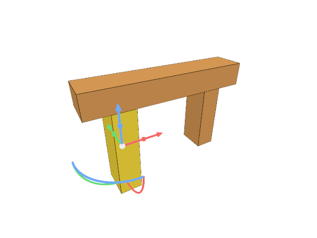

# 8.2 · Tree presentation with explicit input ownership

**Steps:** 5 · **Source:** [app/hierarchy.rs](../../../src/app/hierarchy.rs) · [app/layers.rs](../../../src/app/layers.rs) · [app/ui/layers.rs](../../../src/app/ui/layers.rs) · [app/gesture/mod.rs](../../../src/app/gesture/mod.rs)

<div class="webgpu-schematic" style="width:100%;margin:6px auto;">
<svg xmlns="http://www.w3.org/2000/svg" width="1120" height="188" viewBox="0 0 1120 188" style="width:100%;max-width:100%;height:auto;display:block;margin:0 auto;" role="img">
  <defs>
    <marker id="arr" viewBox="0 0 10 10" refX="8" refY="5" markerWidth="6" markerHeight="6" orient="auto">
      <path d="M 0 1 L 9 5 L 0 9 z" fill="#111111"/>
    </marker>
    <marker id="arrR" viewBox="0 0 10 10" refX="8" refY="5" markerWidth="6" markerHeight="6" orient="auto">
      <path d="M 0 1 L 9 5 L 0 9 z" fill="#dc2626"/>
    </marker>
    <marker id="arrG" viewBox="0 0 10 10" refX="8" refY="5" markerWidth="6" markerHeight="6" orient="auto">
      <path d="M 0 1 L 9 5 L 0 9 z" fill="#16a34a"/>
    </marker>
    <marker id="arrB" viewBox="0 0 10 10" refX="8" refY="5" markerWidth="6" markerHeight="6" orient="auto">
      <path d="M 0 1 L 9 5 L 0 9 z" fill="#2563eb"/>
    </marker>
  </defs>
  <rect x="2" y="2" width="1116" height="184" rx="10" fill="#ffffff" stroke="#111111" stroke-width="2"/>
  <rect x="14" y="12" width="344" height="164" rx="8" fill="#ffffff" stroke="#111111" stroke-width="1.5"/>
  <text paint-order="stroke fill" stroke="#ffffff" stroke-width="5" stroke-linejoin="round" x="186" y="30" text-anchor="middle" font-family="monospace" font-size="10.5" font-weight="700" fill="#111111">Hierarchy: M_world = M_parent * M_child</text>
  <g transform="translate(88,122)">
    <line x1="0" y1="0" x2="48" y2="0" stroke="#dc2626" stroke-width="2.5" marker-end="url(#arrR)"/>
    <line x1="0" y1="0" x2="0" y2="-44" stroke="#16a34a" stroke-width="2.5" marker-end="url(#arrG)"/>
    <circle cx="0" cy="0" r="4" fill="#111111"/>
    <text paint-order="stroke fill" stroke="#ffffff" stroke-width="5" stroke-linejoin="round" x="-10" y="18" font-family="monospace" font-size="9.5" font-weight="700" fill="#111111">Parent</text>
  </g>
  <path d="M 116 106 Q 168 68 214 86" fill="none" stroke="#111111" stroke-width="1.75" stroke-dasharray="4 3" marker-end="url(#arr)"/>
  <g transform="translate(230,94) rotate(-22)">
    <rect x="-18" y="-14" width="36" height="28" fill="#dbeafe" stroke="#111111" stroke-width="1.75"/>
    <line x1="0" y1="0" x2="34" y2="0" stroke="#dc2626" stroke-width="2" marker-end="url(#arrR)"/>
    <line x1="0" y1="0" x2="0" y2="-30" stroke="#16a34a" stroke-width="2" marker-end="url(#arrG)"/>
  </g>
  <line x1="358" y1="94" x2="384" y2="94" stroke="#111111" stroke-width="2" marker-end="url(#arr)"/>
  <rect x="388" y="12" width="344" height="164" rx="8" fill="#ffffff" stroke="#111111" stroke-width="1.5"/>
  <text paint-order="stroke fill" stroke="#ffffff" stroke-width="5" stroke-linejoin="round" x="560" y="30" text-anchor="middle" font-family="monospace" font-size="10.5" font-weight="700" fill="#111111">Window (Inside) vs Crossing (Intersect) Rect</text>
  <rect x="424" y="54" width="118" height="88" fill="#dbeafe" fill-opacity="0.35" stroke="#2563eb" stroke-width="2"/>
  <polygon points="454,122 484,76 516,122" fill="#bbf7d0" stroke="#16a34a" stroke-width="2"/>
  <rect x="572" y="54" width="118" height="88" fill="#dcfce7" fill-opacity="0.35" stroke="#16a34a" stroke-width="2" stroke-dasharray="5 3"/>
  <polygon points="642,124 678,72 714,124" fill="#fef08a" stroke="#dc2626" stroke-width="2"/>
  <line x1="732" y1="94" x2="758" y2="94" stroke="#111111" stroke-width="2" marker-end="url(#arr)"/>
  <rect x="762" y="12" width="344" height="164" rx="8" fill="#ffffff" stroke="#111111" stroke-width="1.75"/>
  <text paint-order="stroke fill" stroke="#ffffff" stroke-width="5" stroke-linejoin="round" x="934" y="30" text-anchor="middle" font-family="monospace" font-size="10.5" font-weight="700" fill="#111111">Selected Subtree &amp; Isolated Visibility</text>
  <rect x="806" y="44" width="256" height="118" rx="4" fill="#ffffff" stroke="#111111" stroke-width="2"/>
  <polygon points="846,138 882,84 918,138" fill="#e2e8f0" stroke="#94a3b8" stroke-width="1.2" stroke-dasharray="3 3"/>
  <polygon points="942,138 986,68 1030,138" fill="#fef08a" stroke="#dc2626" stroke-width="2.5"/>
</svg>
</div>

## <a id="checkpoint-52g-rows"></a>1. Expose stable tree rows across geometry lanes

### 1. `src/hierarchy.rs`

**Locate this existing block:**

```rust
    Ok(Some(node))
}
```

Edit the existing block to match this code; keep unchanged lines:

```rust
    Ok(Some(node))
}

#[derive(Clone)]
pub struct Row {
    pub key: String,
    pub label: String,
    pub depth: usize,
    pub end: usize,
    pub ids: Vec<ObjectId>,
    pub readonly: bool,
}
pub fn rows(scene: &Scene) -> Vec<Row> {
    let mut rows = Vec::new();
    let mut placed = HashSet::new();
    for doc in &scene.forest.documents {
        let mut visible = Vec::new();
        let mut index = 0;
        while index < doc.nodes.len() {
            let node = &doc.nodes[index];
            if node
                .object
                .is_some_and(|id| !scene.contains(id))
            {
                index = node.end;
                continue;
            }
            visible.push(index);
            index += 1;
        }
        let start = rows.len();
        for &index in &visible {
            let node = &doc.nodes[index];
            let ids = doc.nodes[index..node.end]
                .iter()
                .filter_map(|n| n.object)
                .filter(|id| scene.contains(*id))
                .collect::<Vec<_>>();
            placed.extend(node.object);
            let end = start + visible.partition_point(|i| *i < node.end);
            rows.push(Row {
                key: format!("{}/{}", doc.key, node.source.guid),
                label: if index == 0 {
                    doc.label.clone()
                } else {
                    node.label.clone()
                },
                depth: node.depth,
                end,
                ids,
                readonly: node.readonly,
            });
        }
    }
    for row in scene
        .objects()
        .iter()
        .filter(|r| !placed.contains(&r.id))
    {
        let index = rows.len();
        rows.push(Row {
            key: format!("created/{}", row.id.value()),
            label: row.metadata.name.clone(),
            depth: 0,
            end: index + 1,
            ids: vec![row.id],
            readonly: false,
        });
    }
    let other = scene
        .lines()
        .iter()
        .map(|r| (r.id, r.prepared.source.name.as_str()))
        .chain(
            scene
                .paths()
                .iter()
                .map(|r| (r.id, r.prepared.source.name())),
        )
        .chain(
            scene
                .points()
                .iter()
                .map(|r| (r.id, r.prepared.source.name.as_str())),
        );
    for (id, label) in other {
        let index = rows.len();
        rows.push(Row {
            key: format!("created/{}", id.value()),
            label: label.to_owned(),
            depth: 0,
            end: index + 1,
            ids: vec![id],
            readonly: false,
        });
    }
    rows
}
```

### 2. `src/chain.rs`

**Locate this existing block:**

```rust
impl Source {
    pub fn locked(&self) -> bool {
```

Edit the existing block to match this code; keep unchanged lines:

```rust
impl Source {
    pub fn name(&self) -> &str {
        match self {
            Self::Line(source) => &source.name,
            Self::Polyline(source) => &source.name,
            Self::Curve(source, _) => &source.name,
        }
    }
    pub fn locked(&self) -> bool {
```

## <a id="checkpoint-52h-expansion"></a>2. Keep expansion and paging as presentation state

### 1. `src/tree_panel.rs`

Create the file and type:

```rust
#[cfg(any(test, target_arch = "wasm32"))]
use crate::command_dock::{Control, record};
use crate::{hierarchy::Row, scene::ObjectId};
use std::collections::HashSet;

#[derive(Default)]
pub struct TreePanel {
    pub open: bool,
    pub rows: Vec<Row>,
    pub selected: Vec<ObjectId>,
    expanded: HashSet<String>,
    pub rect: Option<egui::Rect>,
    pub action: Option<(Vec<ObjectId>, bool)>,
    page: usize,
}
impl TreePanel {
    pub fn refresh(&mut self, scene: &crate::scene::Scene, selected: Vec<ObjectId>) {
        self.rows = crate::hierarchy::rows(scene);
        self.selected = selected;
    }
    pub fn all(&mut self) {
        self.open = true;
        self.expanded.extend(
            self.rows
                .iter()
                .enumerate()
                .filter(|(index, r)| r.end > *index + 1)
                .map(|(_, r)| r.key.clone()),
        );
        self.page = 0;
    }
    pub fn visible(&self) -> Vec<usize> {
        let mut out = Vec::new();
        let mut index = 0;
        while index < self.rows.len() {
            out.push(index);
            let row = &self.rows[index];
            index = if self.expanded.contains(&row.key) {
                index + 1
            } else {
                row.end.max(index + 1)
            };
        }
        out
    }
}
```

### 2. `src/lib.rs`

**Locate this existing block:**

```rust
mod number_box_tests;

pub mod hierarchy;
```

Edit the existing block to match this code; keep unchanged lines:

```rust
mod number_box_tests;

pub mod hierarchy;

pub mod tree_panel;
```

## <a id="checkpoint-52i-panel"></a>3. Draw indented original-source tree controls

### 1. `src/tree_panel.rs`

**Locate this existing block:**

```rust
    }
}
```

Edit the existing block to match this code; keep unchanged lines:

```rust
    }
}

#[cfg(any(test, target_arch = "wasm32"))]
pub fn draw(
    root: &mut egui::Ui,
    model: &mut TreePanel,
    controls: &mut Option<Vec<Control>>,
) {
    model.rect = None;
    if !model.open {
        return;
    }
    let visible = model.visible();
    let pages = visible.len().div_ceil(128).max(1);
    model.page = model.page.min(pages - 1);
    let response=egui::Area::new("session-tree".into()).anchor(egui::Align2::RIGHT_TOP,egui::vec2(-8.,8.)).order(egui::Order::Foreground).show(root.ctx(),|ui| {
        egui::Frame::group(ui.style()).fill(egui::Color32::from_rgb(248,248,248)).show(ui,|ui| {
            ui.set_width(240.);ui.horizontal(|ui| {ui.strong("Layers");let close=ui.button("×");record(controls,"tree/close","Close Layers",&close);if close.clicked() {model.open=false;}});
            if pages>1 {ui.horizontal(|ui| {if ui.button("Previous").clicked() {model.page=model.page.saturating_sub(1);}ui.label(format!("{} / {pages}",model.page+1));if ui.button("Next").clicked() {model.page=(model.page+1).min(pages-1);}});}
            let height=(root.max_rect().height()-100.).max(60.);
            egui::ScrollArea::vertical().max_height(height).show(ui,|ui| {
                for &index in visible.iter().skip(model.page*128).take(128) {
                    let row=&model.rows[index];ui.horizontal(|ui| {
                        ui.add_space(row.depth.min(12) as f32*12.);
                        if row.end>index+1 {let arrow=ui.small_button(if model.expanded.contains(&row.key) {"▾"} else {"▸"});record(controls,&format!("tree/open/{}",row.key),"Expand or collapse",&arrow);if arrow.clicked() {if !model.expanded.insert(row.key.clone()) {model.expanded.remove(&row.key);}}} else {ui.add_space(18.);}
                        let selected=row.ids.iter().any(|id|model.selected.contains(id));
                        let label=if row.label.is_empty() {row.ids.first().map_or("Group".into(),|id|format!("Object {}",id.value()))} else {row.label.clone()};
                        let button=ui.add_enabled(!row.readonly && !row.ids.is_empty(),egui::Button::new(format!("{label} ({})",row.ids.len())).selected(selected)).on_disabled_hover_text("Source attribute: read only; edit its parent");
                        record(controls,&format!("tree/select/{}",row.key),&label,&button);
                        if button.clicked() {model.action=Some((row.ids.clone(),ui.input(|input|input.modifiers.shift)));}
                    });
                }
            });
        });
    });
    model.rect = model.open.then_some(response.response.rect);
}
```

## <a id="checkpoint-52j-input"></a>4. Connect tree controls before canvas picking

### 1. `src/panel.rs`

Edit these blocks from bottom to top. Keep the surrounding lines unchanged.

**Locate this block:**

```rust
        self.controls = Some(Vec::new());
        let mut line = None;
        let output = self.context.run_ui(input, |root| {
            crate::number_box::draw(root, &mut self.number, &mut self.controls);
```

Replace it with:

```rust
        self.controls = Some(Vec::new());
        let mut line = None;
        let output = self.context.run_ui(input, |root| {
            crate::tree_panel::draw(root, &mut self.tree, &mut self.controls);
            crate::number_box::draw(root, &mut self.number, &mut self.controls);
```

**Locate this block:**

```rust
    }

    pub fn inspect(&self) -> String {
        serde_json::json!({"number":self.number.number,"number_error":self.number.number_error,"number_rect":self.number.number_rect.map(|r|[r.min.x,r.min.y,r.max.x,r.max.y]),"controls": self.controls, "command": self.model.command, "history": self.model.history, "status": self.model.status,
            "pointer_owned": self.pointer_owned,
            "top": self.top, "focused": self.context.egui_wants_keyboard_input(),
            "completion_rect": self.model.completion_rect.map(|r| [r.min.x, r.min.y, r.max.x, r.max.y]),
```

Replace it with:

```rust
    }

    pub fn inspect(&self) -> String {
        serde_json::json!({"tree_rect":self.tree.rect.map(|r|[r.min.x,r.min.y,r.max.x,r.max.y]),"tree_open":self.tree.open,"number":self.number.number,"number_error":self.number.number_error,"number_rect":self.number.number_rect.map(|r|[r.min.x,r.min.y,r.max.x,r.max.y]),"controls": self.controls, "command": self.model.command, "history": self.model.history, "status": self.model.status,
            "pointer_owned": self.pointer_owned,
            "top": self.top, "focused": self.context.egui_wants_keyboard_input(),
            "completion_rect": self.model.completion_rect.map(|r| [r.min.x, r.min.y, r.max.x, r.max.y]),
```

**Locate this block:**

```rust
            modifiers: Default::default(),
        });
        let over = self
            .number
            .number_rect
            .is_some_and(|r| r.contains(pos))
            || pos.y >= self.top
            || (self
                .model
```

Replace it with:

```rust
            modifiers: Default::default(),
        });
        let over = self
            .tree
            .rect
            .is_some_and(|r| r.contains(pos))
            || self
                .number
                .number_rect
                .is_some_and(|r| r.contains(pos))
            || pos.y >= self.top
            || (self
                .model
```

**Locate this block:**

```rust
            (event.client_y() as f64 - rect.top()) as f32,
        );
        let over = self
            .number
            .number_rect
            .is_some_and(|r| r.contains(pos))
            || pos.y >= self.top
            || (self
                .model
```

Replace it with:

```rust
            (event.client_y() as f64 - rect.top()) as f32,
        );
        let over = self
            .tree
            .rect
            .is_some_and(|r| r.contains(pos))
            || self
                .number
                .number_rect
                .is_some_and(|r| r.contains(pos))
            || pos.y >= self.top
            || (self
                .model
```

**Locate this block:**

```rust
        let painter =
            egui_wgpu::Renderer::new(&renderer.device, format, Default::default());
        Self {
            number: Default::default(),
            commands: Commands(commands),
            consumed: false,
```

Replace it with:

```rust
        let painter =
            egui_wgpu::Renderer::new(&renderer.device, format, Default::default());
        Self {
            tree: Default::default(),
            number: Default::default(),
            commands: Commands(commands),
            consumed: false,
```

**Locate this block:**

```rust
pub struct Panel {
    number: crate::number_box::NumberBox,
    commands: Commands,
    pub consumed: bool,
```

Replace it with:

```rust
pub struct Panel {
    pub tree: crate::tree_panel::TreePanel,
    number: crate::number_box::NumberBox,
    commands: Commands,
    pub consumed: bool,
```

### 2. `src/commands.rs`

Edit these blocks from bottom to top. Keep the surrounding lines unchanged.

**Locate this block:**

```rust
];

pub const HOSTS: &[(&str, Host)] = &[
    ("Help", Host::Help),
```

Replace it with:

```rust
];

pub const HOSTS: &[(&str, Host)] = &[
    ("Layers On", Host::LayersOn),
    ("Layers Off", Host::LayersOff),
    ("Layers All", Host::LayersAll),
    ("Help", Host::Help),
```

**Locate this block:**

```rust
    Selection,
}

pub enum Command {
```

Replace it with:

```rust
    Selection,
    LayersOn,
    LayersOff,
    LayersAll,
}

pub enum Command {
```

### 3. `src/browser.rs`

Edit these blocks from bottom to top. Keep the surrounding lines unchanged.

**Locate this block:**

```rust
        .iter()
        .map(|row| (format!("{:?}", row.id), row.model.m))
        .collect();
    canvas.set_attribute("data-gizmo",&serde_json::json!({"origin":editor.gizmo_origin(),"active":editor.gizmo_active(),"pointer":editor.gizmo_edit.as_ref().and_then(|e|e.pointer),"typing":editor.gizmo_edit.as_ref().and_then(|e|e.gizmo.typing).map(|h|h.title()),"matrix":editor.gizmo_edit.as_ref().map(|e|e.preview.matrix()),"gpu":renderer.gizmo_usage()}).to_string())?;
```

Replace it with:

```rust
        .iter()
        .map(|row| (format!("{:?}", row.id), row.model.m))
        .collect();
    canvas.set_attribute("data-tree",&serde_json::json!(crate::hierarchy::rows(&editor.scene).iter().map(|r|serde_json::json!({"key":r.key,"label":r.label,"depth":r.depth,"end":r.end,"readonly":r.readonly,"ids":r.ids.iter().map(|id|id.value()).collect::<Vec<_>>()})).collect::<Vec<_>>()).to_string())?;
    canvas.set_attribute("data-gizmo",&serde_json::json!({"origin":editor.gizmo_origin(),"active":editor.gizmo_active(),"pointer":editor.gizmo_edit.as_ref().and_then(|e|e.pointer),"typing":editor.gizmo_edit.as_ref().and_then(|e|e.gizmo.typing).map(|h|h.title()),"matrix":editor.gizmo_edit.as_ref().map(|e|e.preview.matrix()),"gpu":renderer.gizmo_usage()}).to_string())?;
```

**Locate this block:**

```rust
                }
            }
            panel.number(number);
            if let Err(error) = renderer.set_preview(editor.draft.as_ref()) {
                panel.result(error);
            }
```

Replace it with:

```rust
                }
            }
            panel.number(number);
            panel
                .tree
                .refresh(&editor.scene, editor.selected_objects());
            if let Err(error) = renderer.set_preview(editor.draft.as_ref()) {
                panel.result(error);
            }
```

**Locate this block:**

```rust
                &editor,
                panel.consumed,
            );
            let action = if let Some(handle_action) = handle_action {
                renderer.cancel_pick();
                gesture.cancel();
                Some(handle_action)
```

Replace it with:

```rust
                &editor,
                panel.consumed,
            );
            let action = if let Some((ids, additive)) = panel.tree.action.take() {
                renderer.cancel_pick();
                gesture.cancel();
                Some(Action::TreePick { ids, additive })
            } else if let Some(handle_action) = handle_action {
                renderer.cancel_pick();
                gesture.cancel();
                Some(handle_action)
```

**Locate this block:**

```rust
                            }
                            Host::Save => {
                                let result = crate::browser_reload::restore_for(
                                    crate::edit_intent::Intent::Save,
```

Replace it with:

```rust
                            }
                            Host::LayersOn => {
                                panel.tree.open = true;
                                None
                            }
                            Host::LayersOff => {
                                panel.tree.open = false;
                                None
                            }
                            Host::LayersAll => {
                                panel.tree.all();
                                None
                            }
                            Host::Save => {
                                let result = crate::browser_reload::restore_for(
                                    crate::edit_intent::Intent::Save,
```

## <a id="checkpoint-52k-tree"></a>5. Exercise nested source ownership and exact undo

### 1. `src/tree_specimen.rs`

Create the file and type:

```rust
use prost::Message;
use session_rust::{Xform, proto};

pub fn nested(attribute: bool) -> Vec<u8> {
    let mut message =
        proto::Session::decode(crate::specimen::bytes().as_slice()).unwrap();
    let guids = message
        .objects
        .as_ref()
        .unwrap()
        .meshes
        .iter()
        .map(|m| m.guid.clone())
        .collect::<Vec<_>>();
    let mut child = proto::TreeNode {
        name: guids[1].clone(),
        ..Default::default()
    };
    if attribute {
        child = proto::TreeNode {
            name: "attributes".into(),
            children: vec![child],
            ..Default::default()
        };
    }
    message.tree = Some(proto::Tree {
        root: Some(proto::TreeNode {
            name: "Frame".into(),
            children: vec![
                proto::TreeNode {
                    name: "Posts".into(),
                    children: vec![proto::TreeNode {
                        name: guids[0].clone(),
                        children: vec![child],
                        ..Default::default()
                    }],
                    ..Default::default()
                },
                proto::TreeNode {
                    name: guids[2].clone(),
                    ..Default::default()
                },
            ],
            ..Default::default()
        }),
        ..Default::default()
    });
    message.xforms = vec![
        proto::XformEntry {
            guid: guids[0].clone(),
            xform: Some(Xform::translation(0.123456789012345, 0., 0.).to_proto()),
        },
        proto::XformEntry {
            guid: guids[1].clone(),
            xform: Some(Xform::translation(0., 0.25, 0.).to_proto()),
        },
    ];
    message.encode_to_vec()
}
```

### 2. `src/lib.rs`

**Locate this existing block:**

```rust
pub mod hierarchy;

pub mod tree_panel;
```

Edit the existing block to match this code; keep unchanged lines:

```rust
pub mod hierarchy;

pub mod tree_panel;

pub mod tree_specimen;
```

### 3. `src/editor.rs`

Edit these blocks from bottom to top. Keep the surrounding lines unchanged.

**Locate this block:**

```rust
                self.objects.clear();
                self.selected = None;
            }
```

Replace it with:

```rust
                self.objects.clear();
                self.selected = None;
            }
            Action::AddNested => {
                let loaded =
                    crate::document::load(&crate::tree_specimen::nested(true))?;
                self.history
                    .try_edit(&mut self.scene, |scene| scene.import(loaded))?;
            }
```

**Locate this block:**

```rust
    AddBox,
    AddLine,
    AddPoint,
    AddCurve,
```

Replace it with:

```rust
    AddBox,
    AddNested,
    AddLine,
    AddPoint,
    AddCurve,
```

### 4. `src/commands.rs`

**Locate this existing block:**

```rust
    ("Example Box", || Action::AddBox),
    ("Example Line", || Action::AddLine),
```

Edit the existing block to match this code; keep unchanged lines:

```rust
    ("Example Box", || Action::AddBox),
    ("Example Nested", || Action::AddNested),
    ("Example Line", || Action::AddLine),
```

### 5. `src/hierarchy_tests.rs`

Create the file and type:

```rust
use crate::{
    document,
    editor::{Action, Editor},
    hierarchy,
    scene::ObjectId,
};
use prost::Message;
use session_rust::{Xform, proto};
use std::rc::Rc;

use crate::tree_specimen::nested;
fn editor(attribute: bool) -> Editor {
    let mut e = Editor::default();
    e.apply(Action::Replace(nested(attribute)))
        .unwrap();
    e
}
fn ids(e: &Editor) -> Vec<ObjectId> {
    e.scene
        .objects()
        .iter()
        .map(|r| r.id)
        .collect()
}
fn models(e: &Editor) -> Vec<[f64; 16]> {
    e.scene
        .objects()
        .iter()
        .map(|r| r.model.m)
        .collect()
}

#[test]
fn nested_tree_rows_keep_original_guids_precise_world_placements_and_readonly_attributes()
 {
    let mut e = editor(true);
    let id = ids(&e);
    let rows = hierarchy::rows(&e.scene);
    assert_eq!(
        rows.iter()
            .map(|r| r.depth)
            .collect::<Vec<_>>(),
        vec![0, 1, 2, 3, 4, 1]
    );
    assert_eq!(rows[1].ids, vec![id[0], id[1]]);
    assert!(rows[4].readonly);
    assert!(!rows[2].readonly);
    let model = models(&e);
    assert_eq!(model[0][12], 0.123456789012345);
    assert_eq!(model[1][12], model[0][12]);
    assert_eq!(model[1][13], 0.25);
    assert!(e.scene.visible(id[1]));
    assert_eq!(e.scene.pick_id(id[1].value()), None);
    let before = e.scene.objects()[1]
        .geometry()
        .unwrap()
        .to_proto();
    assert!(
        e.apply(Action::TreePick {
            ids: vec![id[1]],
            additive: false
        })
        .is_err()
    );
    assert!(
        e.scene
            .place(id[1], Xform::identity())
            .is_err()
    );
    assert!(
        e.scene
            .translate(id[1], [1., 0., 0.])
            .is_err()
    );
    assert!(e.delete_object(id[1]).is_err());
    assert_eq!(
        e.scene.objects()[1]
            .geometry()
            .unwrap()
            .to_proto(),
        before
    );
}

#[test]
fn parent_and_child_selection_preview_moves_each_descendant_once_and_commits_one_undo()
{
    for attribute in [false, true] {
        let mut e = editor(attribute);
        let id = ids(&e);
        let before = models(&e);
        let roots = if attribute {
            vec![id[0]]
        } else {
            vec![id[0], id[1]]
        };
        let mut preview = crate::edit_preview::Preview::new(&e.scene, roots).unwrap();
        assert_eq!(preview.ids(), &id[..2]);
        preview
            .set(Xform::translation(0.5, 0., 0.))
            .unwrap();
        assert_eq!(models(&e), before);
        for index in 0..2 {
            assert_eq!(
                preview.scene.objects()[index].model.m[12],
                before[index][12] + 0.5
            );
            assert!(Rc::ptr_eq(
                preview.scene.objects()[index]
                    .geometry()
                    .unwrap(),
                e.scene.objects()[index].geometry().unwrap()
            ));
        }
        e.apply(Action::TreePick {
            ids: if attribute {
                vec![id[0]]
            } else {
                vec![id[0], id[1]]
            },
            additive: false,
        })
        .unwrap();
        e.apply(Action::Translate([0.5, 0., 0.]))
            .unwrap();
        let after = models(&e);
        assert_eq!(after[2], before[2]);
        e.apply(Action::Undo).unwrap();
        assert_eq!(models(&e), before);
        e.apply(Action::Redo).unwrap();
        assert_eq!(models(&e), after);
        e.apply(Action::Undo).unwrap();
        e.apply(Action::Undo).unwrap();
        assert_eq!(
            e.scene.objects().len(),
            2,
            "One parent drag added one transaction after Replace"
        );
    }
}

#[test]
fn nested_save_reopen_preserves_source_metadata_hierarchy_and_world_placements() {
    let mut e = editor(true);
    let id = ids(&e);
    e.apply(Action::TreePick {
        ids: vec![id[0]],
        additive: false,
    })
    .unwrap();
    e.apply(Action::Translate([0.5, 0., 0.]))
        .unwrap();
    let before = models(&e);
    let original = e
        .scene
        .objects()
        .iter()
        .map(|r| r.geometry().unwrap().to_proto())
        .collect::<Vec<_>>();
    let saved = document::snapshot(&e.scene).unwrap();
    let mut reopened = Editor::default();
    reopened
        .apply(Action::Replace(saved))
        .unwrap();
    assert_eq!(models(&reopened), before);
    let rows = hierarchy::rows(&reopened.scene);
    assert!(rows.iter().any(|r| r.label == "Posts"));
    assert!(rows.iter().any(|r| r.label == "attributes"));
    for (index, row) in reopened.scene.objects().iter().enumerate() {
        assert_eq!(
            row.geometry().unwrap().to_proto(),
            original[index]
        );
    }
    assert!(
        reopened
            .scene
            .forest
            .readonly(reopened.scene.objects()[1].id)
    );
    for expected in [
        reopened.scene.objects()[0].id,
        reopened.scene.objects()[2].id,
        reopened.scene.objects()[0].id,
    ] {
        reopened.apply(Action::SelectNext).unwrap();
        assert_eq!(reopened.selected, Some(expected));
    }
}

#[test]
fn repeated_documents_keep_distinct_tree_keys_and_undo_keeps_expansion_identity() {
    let mut e = editor(true);
    let first = Rc::clone(&e.scene.forest.documents[0]);
    let keys = hierarchy::rows(&e.scene)
        .iter()
        .map(|r| r.key.clone())
        .collect::<Vec<_>>();
    e.apply(Action::Import(nested(true)))
        .unwrap();
    assert_eq!(e.scene.forest.documents.len(), 2);
    assert_ne!(
        e.scene.forest.documents[0].key,
        e.scene.forest.documents[1].key
    );
    let rows = hierarchy::rows(&e.scene);
    let unique = rows
        .iter()
        .map(|r| &r.key)
        .collect::<std::collections::HashSet<_>>();
    assert_eq!(unique.len(), rows.len());
    e.apply(Action::Undo).unwrap();
    assert!(Rc::ptr_eq(
        &first,
        &e.scene.forest.documents[0]
    ));
    assert_eq!(
        hierarchy::rows(&e.scene)
            .iter()
            .map(|r| r.key.clone())
            .collect::<Vec<_>>(),
        keys
    );
}

#[test]
fn deleting_a_parent_removes_attached_attributes_and_undo_restores_the_same_sources() {
    let mut e = editor(true);
    let id = ids(&e);
    let source = Rc::clone(e.scene.objects()[1].geometry().unwrap());
    let tree = Rc::clone(&e.scene.forest.documents[0]);
    e.apply(Action::TreePick {
        ids: vec![id[0]],
        additive: false,
    })
    .unwrap();
    e.apply(Action::Delete).unwrap();
    assert_eq!(e.scene.objects().len(), 1);
    assert!(
        hierarchy::rows(&e.scene)
            .iter()
            .all(|r| !r.ids.contains(&id[0]) && !r.ids.contains(&id[1]))
    );
    e.apply(Action::Undo).unwrap();
    assert_eq!(ids(&e), id);
    assert!(Rc::ptr_eq(
        &source,
        e.scene.objects()[1].geometry().unwrap()
    ));
    assert!(Rc::ptr_eq(
        &tree,
        &e.scene.forest.documents[0]
    ));
}

#[test]
fn nested_validation_rejects_missing_duplicate_and_excessively_deep_source_rows() {
    let original = proto::Session::decode(nested(true).as_slice()).unwrap();
    for case in 0..3 {
        let mut m = original.clone();
        let root = m
            .tree
            .as_mut()
            .unwrap()
            .root
            .as_mut()
            .unwrap();
        match case {
            0 => {
                root.children.pop();
            }
            1 => {
                root.children.push(root.children[1].clone());
            }
            _ => {
                let mut node = root.children.pop().unwrap();
                for _ in 0..=hierarchy::MAX_DEPTH {
                    node = proto::TreeNode {
                        name: "group".into(),
                        children: vec![node],
                        ..Default::default()
                    };
                }
                root.children.push(node);
            }
        }
        assert!(document::load(&m.encode_to_vec()).is_err());
    }
}

#[test]
fn tree_metadata_does_not_pin_a_closed_document_or_source_mesh() {
    let mut e = editor(true);
    let tree = Rc::clone(&e.scene.forest.documents[0]);
    let doc = Rc::downgrade(
        &e.scene.objects()[0]
            .source()
            .unwrap()
            .document,
    );
    let source = Rc::downgrade(e.scene.objects()[0].geometry().unwrap());
    e.apply(Action::Close).unwrap();
    assert!(doc.upgrade().is_none());
    assert!(source.upgrade().is_none());
    assert!(!tree.nodes.is_empty());
    assert!(e.scene.forest.documents.is_empty());
}

#[test]
fn actual_tree_panel_expands_indents_and_refuses_readonly_source_rows() {
    let e = editor(true);
    let mut model = crate::tree_panel::TreePanel::default();
    model.refresh(&e.scene, vec![]);
    model.open = true;
    assert_eq!(model.visible(), vec![0]);
    model.all();
    assert_eq!(model.visible().len(), 6);
    let context = egui::Context::default();
    let mut controls = Some(Vec::new());
    let mut drawn = egui::Rect::NOTHING;
    for _ in 0..2 {
        controls = Some(Vec::new());
        let input = egui::RawInput {
            screen_rect: Some(egui::Rect::from_min_size(
                egui::Pos2::ZERO,
                egui::vec2(640., 480.),
            )),
            ..Default::default()
        };
        let _ = context.run_ui(input, |ui| {
            crate::tree_panel::draw(ui, &mut model, &mut controls)
        });
        drawn = model.rect.unwrap();
    }
    assert!(drawn.width() >= 240. && drawn.height() > 100.);
    let controls = controls.unwrap();
    let select = controls
        .iter()
        .filter(|c| c.key.starts_with("tree/select/"))
        .collect::<Vec<_>>();
    assert_eq!(select.len(), 6);
    assert!(
        select[4].rect[0] > select[2].rect[0],
        "Nested original rows are indented in the actual egui layout"
    );
    let at = egui::pos2(
        (select[4].rect[0] + select[4].rect[2]) / 2.,
        (select[4].rect[1] + select[4].rect[3]) / 2.,
    );
    for pressed in [true, false] {
        let input = egui::RawInput {
            events: vec![
                egui::Event::PointerMoved(at),
                egui::Event::PointerButton {
                    pos: at,
                    button: egui::PointerButton::Primary,
                    pressed,
                    modifiers: Default::default(),
                },
            ],
            screen_rect: Some(egui::Rect::from_min_size(
                egui::Pos2::ZERO,
                egui::vec2(640., 480.),
            )),
            ..Default::default()
        };
        let _ = context.run_ui(input, |ui| {
            crate::tree_panel::draw(ui, &mut model, &mut Some(Vec::new()))
        });
    }
    assert!(
        model.action.is_none(),
        "Actual disabled attribute button cannot select its source"
    );
    model.open = false;
    let _ = context.run_ui(egui::RawInput::default(), |ui| {
        crate::tree_panel::draw(ui, &mut model, &mut Some(Vec::new()))
    });
    assert!(model.rect.is_none());
}
```

### 6. `src/lib.rs`

**Locate this existing block:**

```rust
pub mod tree_panel;

pub mod tree_specimen;
```

Edit the existing block to match this code; keep unchanged lines:

```rust
pub mod tree_panel;

pub mod tree_specimen;

#[cfg(test)]
mod hierarchy_tests;
```

## Build & Run



```sh
cd workspace/journey
REGEN_PROTO=0 cargo build --lib --locked --target wasm32-unknown-unknown -j1
REGEN_PROTO=0 CARGO_BUILD_JOBS=1 trunk serve --port 8780
cd ../..
npm --prefix ../session_tests run course -- check 8.2
npm --prefix ../session_tests run course -- save 8.2
```

Continue with [8.3 · Layers, visibility and source-preserving properties](53-flags.md).
