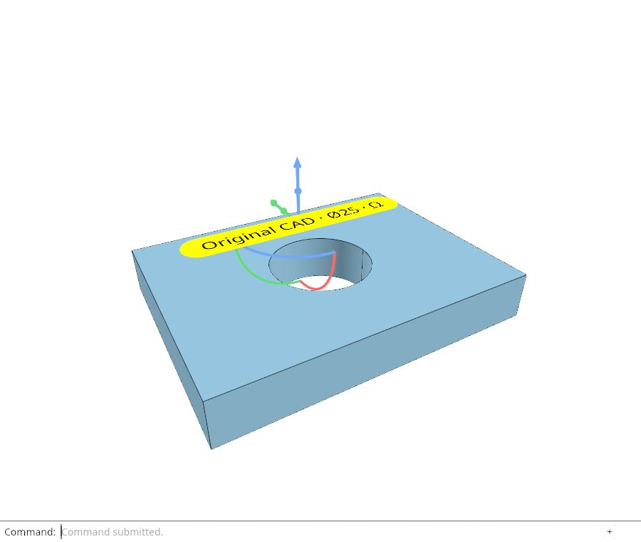

# 10.4 · Original world labels, plates and integer picks

**Goal:** Create pick move and delete the original scene labels. · **Steps:** 37 · **Source:** [engine/text.rs](../../../src/engine/text.rs) · [engine/gpu/text.rs](../../../src/engine/gpu/text.rs) · [engine/gpu/text_plane.rs](../../../src/engine/gpu/text_plane.rs) · [engine/gpu/text_plate.rs](../../../src/engine/gpu/text_plate.rs) · [app/scene_text.rs](../../../src/app/scene_text.rs) · [app/fonts.rs](../../../src/app/fonts.rs) (`src/app/fonts.rs,src/shaders/matrix.wgsl,src/engine/gpu/matrices.rs`)

<div class="webgpu-schematic" style="width:100%;margin:6px auto;">
<svg xmlns="http://www.w3.org/2000/svg" width="1120" height="200" viewBox="0 0 1120 200" style="width:100%;max-width:100%;height:auto;display:block;margin:0 auto;" role="img">
  <defs>
    <marker id="arr" viewBox="0 0 10 10" refX="8" refY="5" markerWidth="6" markerHeight="6" orient="auto">
      <path d="M 0 1 L 9 5 L 0 9 z" fill="#111111"/>
    </marker>
    <marker id="arrR" viewBox="0 0 10 10" refX="8" refY="5" markerWidth="6" markerHeight="6" orient="auto">
      <path d="M 0 1 L 9 5 L 0 9 z" fill="#dc2626"/>
    </marker>
    <marker id="arrG" viewBox="0 0 10 10" refX="8" refY="5" markerWidth="6" markerHeight="6" orient="auto">
      <path d="M 0 1 L 9 5 L 0 9 z" fill="#16a34a"/>
    </marker>
    <marker id="arrB" viewBox="0 0 10 10" refX="8" refY="5" markerWidth="6" markerHeight="6" orient="auto">
      <path d="M 0 1 L 9 5 L 0 9 z" fill="#2563eb"/>
    </marker>
  </defs>
  <rect x="2" y="2" width="1116" height="196" rx="10" fill="#ffffff" stroke="#111111" stroke-width="2"/>
  <rect x="16" y="14" width="248" height="172" rx="8" fill="#ffffff" stroke="#111111" stroke-width="1.75"/>
  <text paint-order="stroke fill" stroke="#ffffff" stroke-width="5" stroke-linejoin="round" x="140" y="34" text-anchor="middle" font-family="monospace" font-size="11.5" font-weight="700" fill="#111111">1. Lesson 10.4 Code</text>
  <rect x="34" y="48" width="212" height="24" rx="4" fill="#ffffff" stroke="#111111" stroke-width="1.25"/>
  <text paint-order="stroke fill" stroke="#ffffff" stroke-width="5" stroke-linejoin="round" x="140" y="64" text-anchor="middle" font-family="monospace" font-size="10" font-weight="700" fill="#111111">src/scene_label.rs</text>
  <rect x="34" y="78" width="212" height="24" rx="4" fill="#ffffff" stroke="#111111" stroke-width="1.5"/>
  <text paint-order="stroke fill" stroke="#ffffff" stroke-width="5" stroke-linejoin="round" x="140" y="94" text-anchor="middle" font-family="monospace" font-size="10" font-weight="700" fill="#111111">src/lib.rs</text>
  <rect x="34" y="108" width="212" height="24" rx="4" fill="#ffffff" stroke="#111111" stroke-width="1.25"/>
  <text paint-order="stroke fill" stroke="#ffffff" stroke-width="5" stroke-linejoin="round" x="140" y="124" text-anchor="middle" font-family="monospace" font-size="10" font-weight="700" fill="#111111">src/text.rs</text>
  <text paint-order="stroke fill" stroke="#ffffff" stroke-width="5" stroke-linejoin="round" x="140" y="172" text-anchor="middle" font-family="monospace" font-size="9.5" fill="#111111">37 Coding Steps</text>
  <line x1="264" y1="100" x2="292" y2="100" stroke="#111111" stroke-width="2" marker-end="url(#arr)"/>
  <rect x="296" y="14" width="248" height="172" rx="8" fill="#ffffff" stroke="#111111" stroke-width="1.75"/>
  <text paint-order="stroke fill" stroke="#ffffff" stroke-width="5" stroke-linejoin="round" x="420" y="34" text-anchor="middle" font-family="monospace" font-size="11.5" font-weight="700" fill="#111111">2. session_viewer/src</text>
  <rect x="314" y="48" width="212" height="26" rx="4" fill="#ffffff" stroke="#111111" stroke-width="1.5"/>
  <text paint-order="stroke fill" stroke="#ffffff" stroke-width="5" stroke-linejoin="round" x="420" y="65" text-anchor="middle" font-family="monospace" font-size="10" font-weight="700" fill="#111111">src/app/fonts.rs</text>
  <rect x="314" y="80" width="212" height="26" rx="4" fill="#ffffff" stroke="#111111" stroke-width="1.5"/>
  <text paint-order="stroke fill" stroke="#ffffff" stroke-width="5" stroke-linejoin="round" x="420" y="97" text-anchor="middle" font-family="monospace" font-size="10" font-weight="700" fill="#111111">src/shaders/matrix.wgsl</text>
  <rect x="314" y="112" width="212" height="24" rx="4" fill="#ffffff" stroke="#111111" stroke-width="1.5"/>
  <text paint-order="stroke fill" stroke="#ffffff" stroke-width="5" stroke-linejoin="round" x="420" y="128" text-anchor="middle" font-family="monospace" font-size="9.5" font-weight="700" fill="#111111">✓ cargo check (wasm32)</text>
  <text paint-order="stroke fill" stroke="#ffffff" stroke-width="5" stroke-linejoin="round" x="420" y="172" text-anchor="middle" font-family="sans-serif" font-size="10" fill="#111111">Own scene words and font…</text>
  <line x1="544" y1="100" x2="572" y2="100" stroke="#111111" stroke-width="2" marker-end="url(#arr)"/>
  <rect x="576" y="14" width="248" height="172" rx="8" fill="#ffffff" stroke="#111111" stroke-width="1.75"/>
  <text paint-order="stroke fill" stroke="#ffffff" stroke-width="5" stroke-linejoin="round" x="700" y="34" text-anchor="middle" font-family="monospace" font-size="11.5" font-weight="700" fill="#111111">3. R8Unorm Glyph Atlas (B&amp;W)</text>
  <rect x="616" y="54" width="168" height="84" rx="4" fill="#ffffff" stroke="#111111" stroke-width="1.5"/>
  <rect x="628" y="64" width="34" height="36" rx="3" fill="#ffffff" stroke="#111111" stroke-width="1.5"/><text paint-order="stroke fill" stroke="#ffffff" stroke-width="5" stroke-linejoin="round" x="645" y="88" text-anchor="middle" font-family="monospace" font-size="15" font-weight="700" fill="#111111">A</text>
  <rect x="670" y="64" width="34" height="36" rx="3" fill="#ffffff" stroke="#111111" stroke-width="1.5"/><text paint-order="stroke fill" stroke="#ffffff" stroke-width="5" stroke-linejoin="round" x="687" y="88" text-anchor="middle" font-family="monospace" font-size="15" font-weight="700" fill="#111111">B</text>
  <rect x="712" y="64" width="34" height="36" rx="3" fill="#ffffff" stroke="#111111" stroke-width="1.5"/><text paint-order="stroke fill" stroke="#ffffff" stroke-width="5" stroke-linejoin="round" x="729" y="88" text-anchor="middle" font-family="monospace" font-size="15" font-weight="700" fill="#111111">7</text>
  <text paint-order="stroke fill" stroke="#ffffff" stroke-width="5" stroke-linejoin="round" x="700" y="124" text-anchor="middle" font-family="monospace" font-size="9.5" fill="#111111">1px Padded Shelves</text>
  <text paint-order="stroke fill" stroke="#ffffff" stroke-width="5" stroke-linejoin="round" x="700" y="172" text-anchor="middle" font-family="monospace" font-size="9.5" fill="#111111">Original world labels, plat…</text>
  <line x1="824" y1="100" x2="852" y2="100" stroke="#111111" stroke-width="2" marker-end="url(#arr)"/>
  <rect x="856" y="14" width="248" height="172" rx="8" fill="#ffffff" stroke="#111111" stroke-width="1.75"/>
  <text paint-order="stroke fill" stroke="#ffffff" stroke-width="5" stroke-linejoin="round" x="980" y="34" text-anchor="middle" font-family="monospace" font-size="11.5" font-weight="700" fill="#111111">4. Procedural matrix.wgsl</text>
  <rect x="914" y="54" width="120" height="84" fill="#ffffff" stroke="#111111" stroke-width="1.75"/>
  <rect x="914" y="54" width="40" height="28" fill="#fdba74"/><text paint-order="stroke fill" stroke="#ffffff" stroke-width="5" stroke-linejoin="round" x="934" y="72" text-anchor="middle" font-family="monospace" font-size="9" font-weight="700" fill="#111111">+1.0</text>
  <rect x="954" y="82" width="40" height="28" fill="#f97316"/><text paint-order="stroke fill" stroke="#ffffff" stroke-width="5" stroke-linejoin="round" x="974" y="100" text-anchor="middle" font-family="monospace" font-size="9" font-weight="700" fill="#111111">+2.4</text>
  <rect x="994" y="54" width="40" height="28" fill="#93c5fd"/><text paint-order="stroke fill" stroke="#ffffff" stroke-width="5" stroke-linejoin="round" x="1014" y="72" text-anchor="middle" font-family="monospace" font-size="9" font-weight="700" fill="#111111">-0.8</text>
  <rect x="994" y="110" width="40" height="28" fill="#fdba74"/><text paint-order="stroke fill" stroke="#ffffff" stroke-width="5" stroke-linejoin="round" x="1014" y="128" text-anchor="middle" font-family="monospace" font-size="9" font-weight="700" fill="#111111">+1.0</text>
  <line x1="954" y1="54" x2="954" y2="138" stroke="#111111" stroke-width="1"/>
  <line x1="994" y1="54" x2="994" y2="138" stroke="#111111" stroke-width="1"/>
  <line x1="914" y1="82" x2="1034" y2="82" stroke="#111111" stroke-width="1"/>
  <line x1="914" y1="110" x2="1034" y2="110" stroke="#111111" stroke-width="1"/>
  <text paint-order="stroke fill" stroke="#ffffff" stroke-width="5" stroke-linejoin="round" x="980" y="172" text-anchor="middle" font-family="sans-serif" font-size="10" font-weight="700" fill="#111111">Create pick move and dele…</text>
</svg>
</div>

## <a id="checkpoint-62-source"></a>1. Own scene words and font metrics

<div class="webgpu-schematic" style="width:100%;margin:6px auto;">
<svg xmlns="http://www.w3.org/2000/svg" width="1120" height="72" viewBox="0 0 1120 72" style="width:100%;max-width:100%;height:auto;display:block;margin:0 auto;" role="img">
  <defs>
    <marker id="arr" viewBox="0 0 10 10" refX="8" refY="5" markerWidth="6" markerHeight="6" orient="auto">
      <path d="M 0 1 L 9 5 L 0 9 z" fill="#111111"/>
    </marker>
    <marker id="arrR" viewBox="0 0 10 10" refX="8" refY="5" markerWidth="6" markerHeight="6" orient="auto">
      <path d="M 0 1 L 9 5 L 0 9 z" fill="#dc2626"/>
    </marker>
    <marker id="arrG" viewBox="0 0 10 10" refX="8" refY="5" markerWidth="6" markerHeight="6" orient="auto">
      <path d="M 0 1 L 9 5 L 0 9 z" fill="#16a34a"/>
    </marker>
    <marker id="arrB" viewBox="0 0 10 10" refX="8" refY="5" markerWidth="6" markerHeight="6" orient="auto">
      <path d="M 0 1 L 9 5 L 0 9 z" fill="#2563eb"/>
    </marker>
  </defs>
  <rect x="2" y="2" width="1116" height="68" rx="10" fill="#ffffff" stroke="#111111" stroke-width="2"/>
  <rect x="14" y="10" width="252" height="52" rx="6" fill="#ffffff" stroke="#111111" stroke-width="1.5"/>
  <text paint-order="stroke fill" stroke="#ffffff" stroke-width="5" stroke-linejoin="round" x="140" y="30" text-anchor="middle" font-family="monospace" font-size="10.5" font-weight="700" fill="#111111">Step 1 of 37</text>
  <text paint-order="stroke fill" stroke="#ffffff" stroke-width="5" stroke-linejoin="round" x="140" y="48" text-anchor="middle" font-family="monospace" font-size="9.5" fill="#111111">src/scene_label.rs, src/lib…</text>
  <line x1="266" y1="36" x2="292" y2="36" stroke="#111111" stroke-width="1.75" marker-end="url(#arr)"/>
  <rect x="296" y="10" width="252" height="52" rx="6" fill="#ffffff" stroke="#111111" stroke-width="1.5"/>
  <text paint-order="stroke fill" stroke="#ffffff" stroke-width="5" stroke-linejoin="round" x="422" y="30" text-anchor="middle" font-family="monospace" font-size="10" font-weight="700" fill="#111111">1. CPU / Rust Input</text>
  <text paint-order="stroke fill" stroke="#ffffff" stroke-width="5" stroke-linejoin="round" x="422" y="48" text-anchor="middle" font-family="sans-serif" font-size="9.5" fill="#111111">original words and placem…</text>
  <line x1="548" y1="36" x2="574" y2="36" stroke="#111111" stroke-width="1.75" marker-end="url(#arr)"/>
  <rect x="578" y="10" width="252" height="52" rx="6" fill="#ffffff" stroke="#111111" stroke-width="1.5"/>
  <text paint-order="stroke fill" stroke="#ffffff" stroke-width="5" stroke-linejoin="round" x="704" y="30" text-anchor="middle" font-family="monospace" font-size="10" font-weight="700" fill="#111111">2. WebGPU / WGSL</text>
  <text paint-order="stroke fill" stroke="#ffffff" stroke-width="5" stroke-linejoin="round" x="704" y="48" text-anchor="middle" font-family="sans-serif" font-size="9.5" fill="#111111">checked shaping</text>
  <line x1="830" y1="36" x2="856" y2="36" stroke="#111111" stroke-width="1.75" marker-end="url(#arr)"/>
  <rect x="860" y="10" width="246" height="52" rx="6" fill="#ffffff" stroke="#111111" stroke-width="1.75"/>
  <text paint-order="stroke fill" stroke="#ffffff" stroke-width="5" stroke-linejoin="round" x="983" y="30" text-anchor="middle" font-family="monospace" font-size="10" font-weight="700" fill="#111111">3. -&gt; src/app/fonts.rs</text>
  <text paint-order="stroke fill" stroke="#ffffff" stroke-width="5" stroke-linejoin="round" x="983" y="48" text-anchor="middle" font-family="sans-serif" font-size="9.5" fill="#111111">derived extent</text>
</svg>
</div>

**What this code does:** Own original scene words and font metrics.

### 1. `src/scene_label.rs`

Own immutable original label data and derive measured bounds separately.

Create the file and type:

```rust
--8<-- "journey/code/62-source-01.rs"
```

### 2. `src/lib.rs`

Register the source component.

**Locate this existing block:**

```rust
#[cfg(test)]
mod text_atlas_tests;
```

After that block, type:

```rust
--8<-- "journey/code/62-source-02.rs" skip=35
```

## <a id="checkpoint-62a-placements"></a>2. Transform the label frame without changing its source

<div class="webgpu-schematic" style="width:100%;margin:6px auto;">
<svg xmlns="http://www.w3.org/2000/svg" width="1120" height="72" viewBox="0 0 1120 72" style="width:100%;max-width:100%;height:auto;display:block;margin:0 auto;" role="img">
  <defs>
    <marker id="arr" viewBox="0 0 10 10" refX="8" refY="5" markerWidth="6" markerHeight="6" orient="auto">
      <path d="M 0 1 L 9 5 L 0 9 z" fill="#111111"/>
    </marker>
    <marker id="arrR" viewBox="0 0 10 10" refX="8" refY="5" markerWidth="6" markerHeight="6" orient="auto">
      <path d="M 0 1 L 9 5 L 0 9 z" fill="#dc2626"/>
    </marker>
    <marker id="arrG" viewBox="0 0 10 10" refX="8" refY="5" markerWidth="6" markerHeight="6" orient="auto">
      <path d="M 0 1 L 9 5 L 0 9 z" fill="#16a34a"/>
    </marker>
    <marker id="arrB" viewBox="0 0 10 10" refX="8" refY="5" markerWidth="6" markerHeight="6" orient="auto">
      <path d="M 0 1 L 9 5 L 0 9 z" fill="#2563eb"/>
    </marker>
  </defs>
  <rect x="2" y="2" width="1116" height="68" rx="10" fill="#ffffff" stroke="#111111" stroke-width="2"/>
  <rect x="14" y="10" width="252" height="52" rx="6" fill="#ffffff" stroke="#111111" stroke-width="1.5"/>
  <text paint-order="stroke fill" stroke="#ffffff" stroke-width="5" stroke-linejoin="round" x="140" y="30" text-anchor="middle" font-family="monospace" font-size="10.5" font-weight="700" fill="#111111">Step 2 of 37</text>
  <text paint-order="stroke fill" stroke="#ffffff" stroke-width="5" stroke-linejoin="round" x="140" y="48" text-anchor="middle" font-family="monospace" font-size="9.5" fill="#111111">src/text.rs, src/scene_labe…</text>
  <line x1="266" y1="36" x2="292" y2="36" stroke="#111111" stroke-width="1.75" marker-end="url(#arr)"/>
  <rect x="296" y="10" width="252" height="52" rx="6" fill="#ffffff" stroke="#111111" stroke-width="1.5"/>
  <text paint-order="stroke fill" stroke="#ffffff" stroke-width="5" stroke-linejoin="round" x="422" y="30" text-anchor="middle" font-family="monospace" font-size="10" font-weight="700" fill="#111111">1. CPU / Rust Input</text>
  <text paint-order="stroke fill" stroke="#ffffff" stroke-width="5" stroke-linejoin="round" x="422" y="48" text-anchor="middle" font-family="sans-serif" font-size="9.5" fill="#111111">shared original placement</text>
  <line x1="548" y1="36" x2="574" y2="36" stroke="#111111" stroke-width="1.75" marker-end="url(#arr)"/>
  <rect x="578" y="10" width="252" height="52" rx="6" fill="#ffffff" stroke="#111111" stroke-width="1.5"/>
  <text paint-order="stroke fill" stroke="#ffffff" stroke-width="5" stroke-linejoin="round" x="704" y="30" text-anchor="middle" font-family="monospace" font-size="10" font-weight="700" fill="#111111">2. WebGPU / WGSL</text>
  <text paint-order="stroke fill" stroke="#ffffff" stroke-width="5" stroke-linejoin="round" x="704" y="48" text-anchor="middle" font-family="sans-serif" font-size="9.5" fill="#111111">checked world frame</text>
  <line x1="830" y1="36" x2="856" y2="36" stroke="#111111" stroke-width="1.75" marker-end="url(#arr)"/>
  <rect x="860" y="10" width="246" height="52" rx="6" fill="#ffffff" stroke="#111111" stroke-width="1.75"/>
  <text paint-order="stroke fill" stroke="#ffffff" stroke-width="5" stroke-linejoin="round" x="983" y="30" text-anchor="middle" font-family="monospace" font-size="10" font-weight="700" fill="#111111">3. -&gt; src/app/fonts.rs</text>
  <text paint-order="stroke fill" stroke="#ffffff" stroke-width="5" stroke-linejoin="round" x="983" y="48" text-anchor="middle" font-family="sans-serif" font-size="9.5" fill="#111111">presentation label</text>
</svg>
</div>

**What this code does:** Transform the label frame without changing its source.

### 1. `src/text.rs`

Reuse the checked current label validator for placed labels.

**Locate this existing block:**

```rust
}

fn validate_label(label: &TextLabel) -> anyhow::Result<()> {
    anyhow::ensure!(
        label.font_size.is_finite() && (1.0..=256.0).contains(&label.font_size),
```

Edit the existing block to match this code; keep unchanged lines:

```rust
--8<-- "journey/code/62a-placements-01.rs"
```

### 2. `src/scene_label.rs`

Derive world labels and GPU addresses from stable source and instance identities.

**Locate this existing block:**

```rust
 }
}
pub fn example(placement:TextPlacement)->Source {let mut label=crate::text_example::label();label.text="Original CAD · Ø25 · Ω".into();label.color=[255;4];label.placement=placement;Source {guid:uuid::Uuid::new_v4().to_string(),name:"Original CAD label".into(),visible:true,locked:false,label}}
```

Edit the existing block to match this code; keep unchanged lines:

```rust
--8<-- "journey/code/62a-placements-02.rs"
```

## <a id="checkpoint-62b-bounds"></a>3. Measure the world-sized label and its padded plate

<div class="webgpu-schematic" style="width:100%;margin:6px auto;">
<svg xmlns="http://www.w3.org/2000/svg" width="1120" height="72" viewBox="0 0 1120 72" style="width:100%;max-width:100%;height:auto;display:block;margin:0 auto;" role="img">
  <defs>
    <marker id="arr" viewBox="0 0 10 10" refX="8" refY="5" markerWidth="6" markerHeight="6" orient="auto">
      <path d="M 0 1 L 9 5 L 0 9 z" fill="#111111"/>
    </marker>
    <marker id="arrR" viewBox="0 0 10 10" refX="8" refY="5" markerWidth="6" markerHeight="6" orient="auto">
      <path d="M 0 1 L 9 5 L 0 9 z" fill="#dc2626"/>
    </marker>
    <marker id="arrG" viewBox="0 0 10 10" refX="8" refY="5" markerWidth="6" markerHeight="6" orient="auto">
      <path d="M 0 1 L 9 5 L 0 9 z" fill="#16a34a"/>
    </marker>
    <marker id="arrB" viewBox="0 0 10 10" refX="8" refY="5" markerWidth="6" markerHeight="6" orient="auto">
      <path d="M 0 1 L 9 5 L 0 9 z" fill="#2563eb"/>
    </marker>
  </defs>
  <rect x="2" y="2" width="1116" height="68" rx="10" fill="#ffffff" stroke="#111111" stroke-width="2"/>
  <rect x="14" y="10" width="252" height="52" rx="6" fill="#ffffff" stroke="#111111" stroke-width="1.5"/>
  <text paint-order="stroke fill" stroke="#ffffff" stroke-width="5" stroke-linejoin="round" x="140" y="30" text-anchor="middle" font-family="monospace" font-size="10.5" font-weight="700" fill="#111111">Step 3 of 37</text>
  <text paint-order="stroke fill" stroke="#ffffff" stroke-width="5" stroke-linejoin="round" x="140" y="48" text-anchor="middle" font-family="monospace" font-size="9.5" fill="#111111">src/scene_label.rs</text>
  <line x1="266" y1="36" x2="292" y2="36" stroke="#111111" stroke-width="1.75" marker-end="url(#arr)"/>
  <rect x="296" y="10" width="252" height="52" rx="6" fill="#ffffff" stroke="#111111" stroke-width="1.5"/>
  <text paint-order="stroke fill" stroke="#ffffff" stroke-width="5" stroke-linejoin="round" x="422" y="30" text-anchor="middle" font-family="monospace" font-size="10" font-weight="700" fill="#111111">1. CPU / Rust Input</text>
  <text paint-order="stroke fill" stroke="#ffffff" stroke-width="5" stroke-linejoin="round" x="422" y="48" text-anchor="middle" font-family="sans-serif" font-size="9.5" fill="#111111">font-unit extent</text>
  <line x1="548" y1="36" x2="574" y2="36" stroke="#111111" stroke-width="1.75" marker-end="url(#arr)"/>
  <rect x="578" y="10" width="252" height="52" rx="6" fill="#ffffff" stroke="#111111" stroke-width="1.5"/>
  <text paint-order="stroke fill" stroke="#ffffff" stroke-width="5" stroke-linejoin="round" x="704" y="30" text-anchor="middle" font-family="monospace" font-size="10" font-weight="700" fill="#111111">2. WebGPU / WGSL</text>
  <text paint-order="stroke fill" stroke="#ffffff" stroke-width="5" stroke-linejoin="round" x="704" y="48" text-anchor="middle" font-family="sans-serif" font-size="9.5" fill="#111111">padded corners</text>
  <line x1="830" y1="36" x2="856" y2="36" stroke="#111111" stroke-width="1.75" marker-end="url(#arr)"/>
  <rect x="860" y="10" width="246" height="52" rx="6" fill="#ffffff" stroke="#111111" stroke-width="1.75"/>
  <text paint-order="stroke fill" stroke="#ffffff" stroke-width="5" stroke-linejoin="round" x="983" y="30" text-anchor="middle" font-family="monospace" font-size="10" font-weight="700" fill="#111111">3. -&gt; src/app/fonts.rs</text>
  <text paint-order="stroke fill" stroke="#ffffff" stroke-width="5" stroke-linejoin="round" x="983" y="48" text-anchor="middle" font-family="sans-serif" font-size="9.5" fill="#111111">fit bounds</text>
</svg>
</div>

**What this code does:** Measure the world-sized label and its padded plate.

### 1. `src/scene_label.rs`

Derive source-owned world bounds without replacing f64 coordinates by display floats.

**Locate this existing block:**

```rust
  crate::text::validate_label(&label).map_err(|_|"Text placement is invalid")?;Ok(label)
 }
}
pub fn example(placement:TextPlacement)->Source {let mut label=crate::text_example::label();label.text="Original CAD · Ø25 · Ω".into();label.color=[255;4];label.placement=placement;Source {guid:uuid::Uuid::new_v4().to_string(),name:"Original CAD label".into(),visible:true,locked:false,label}}
```

Edit the existing block to match this code; keep unchanged lines:

```rust
--8<-- "journey/code/62b-bounds-01.rs"
```

## <a id="checkpoint-62c-rows"></a>4. Register text rows and release them with the scene

<div class="webgpu-schematic" style="width:100%;margin:6px auto;">
<svg xmlns="http://www.w3.org/2000/svg" width="1120" height="72" viewBox="0 0 1120 72" style="width:100%;max-width:100%;height:auto;display:block;margin:0 auto;" role="img">
  <defs>
    <marker id="arr" viewBox="0 0 10 10" refX="8" refY="5" markerWidth="6" markerHeight="6" orient="auto">
      <path d="M 0 1 L 9 5 L 0 9 z" fill="#111111"/>
    </marker>
    <marker id="arrR" viewBox="0 0 10 10" refX="8" refY="5" markerWidth="6" markerHeight="6" orient="auto">
      <path d="M 0 1 L 9 5 L 0 9 z" fill="#dc2626"/>
    </marker>
    <marker id="arrG" viewBox="0 0 10 10" refX="8" refY="5" markerWidth="6" markerHeight="6" orient="auto">
      <path d="M 0 1 L 9 5 L 0 9 z" fill="#16a34a"/>
    </marker>
    <marker id="arrB" viewBox="0 0 10 10" refX="8" refY="5" markerWidth="6" markerHeight="6" orient="auto">
      <path d="M 0 1 L 9 5 L 0 9 z" fill="#2563eb"/>
    </marker>
  </defs>
  <rect x="2" y="2" width="1116" height="68" rx="10" fill="#ffffff" stroke="#111111" stroke-width="2"/>
  <rect x="14" y="10" width="252" height="52" rx="6" fill="#ffffff" stroke="#111111" stroke-width="1.5"/>
  <text paint-order="stroke fill" stroke="#ffffff" stroke-width="5" stroke-linejoin="round" x="140" y="30" text-anchor="middle" font-family="monospace" font-size="10.5" font-weight="700" fill="#111111">Step 4 of 37</text>
  <text paint-order="stroke fill" stroke="#ffffff" stroke-width="5" stroke-linejoin="round" x="140" y="48" text-anchor="middle" font-family="monospace" font-size="9.5" fill="#111111">src/scene.rs</text>
  <line x1="266" y1="36" x2="292" y2="36" stroke="#111111" stroke-width="1.75" marker-end="url(#arr)"/>
  <rect x="296" y="10" width="252" height="52" rx="6" fill="#ffffff" stroke="#111111" stroke-width="1.5"/>
  <text paint-order="stroke fill" stroke="#ffffff" stroke-width="5" stroke-linejoin="round" x="422" y="30" text-anchor="middle" font-family="monospace" font-size="10" font-weight="700" fill="#111111">1. CPU / Rust Input</text>
  <text paint-order="stroke fill" stroke="#ffffff" stroke-width="5" stroke-linejoin="round" x="422" y="48" text-anchor="middle" font-family="sans-serif" font-size="9.5" fill="#111111">validated text</text>
  <line x1="548" y1="36" x2="574" y2="36" stroke="#111111" stroke-width="1.75" marker-end="url(#arr)"/>
  <rect x="578" y="10" width="252" height="52" rx="6" fill="#ffffff" stroke="#111111" stroke-width="1.5"/>
  <text paint-order="stroke fill" stroke="#ffffff" stroke-width="5" stroke-linejoin="round" x="704" y="30" text-anchor="middle" font-family="monospace" font-size="10" font-weight="700" fill="#111111">2. WebGPU / WGSL</text>
  <text paint-order="stroke fill" stroke="#ffffff" stroke-width="5" stroke-linejoin="round" x="704" y="48" text-anchor="middle" font-family="sans-serif" font-size="9.5" fill="#111111">current layer</text>
  <line x1="830" y1="36" x2="856" y2="36" stroke="#111111" stroke-width="1.75" marker-end="url(#arr)"/>
  <rect x="860" y="10" width="246" height="52" rx="6" fill="#ffffff" stroke="#111111" stroke-width="1.75"/>
  <text paint-order="stroke fill" stroke="#ffffff" stroke-width="5" stroke-linejoin="round" x="983" y="30" text-anchor="middle" font-family="monospace" font-size="10" font-weight="700" fill="#111111">3. -&gt; src/app/fonts.rs</text>
  <text paint-order="stroke fill" stroke="#ffffff" stroke-width="5" stroke-linejoin="round" x="983" y="48" text-anchor="middle" font-family="sans-serif" font-size="9.5" fill="#111111">explicit scene release</text>
</svg>
</div>

**What this code does:** Register text rows and release them with the scene.

### 1. `src/scene.rs`

Add checked text rows, stable allocation and explicit source cleanup.

Edit these blocks from bottom to top. Keep the surrounding lines unchanged.

**Locate this block:**

```rust
        self.ids=Default::default();
        self.view=Default::default();
        self.forest=Default::default();
        self.points = Vec::new();
        self.paths = Vec::new();
        self.lines = Vec::new();
```

Replace it with:

```rust
        self.ids=Default::default();
        self.view=Default::default();
        self.forest=Default::default();
        self.texts=Vec::new();
        self.points = Vec::new();
        self.paths = Vec::new();
        self.lines = Vec::new();
```

**Locate this block:**

```rust

    pub fn line_capacity_bytes(&self) -> usize { self.lines.capacity() * std::mem::size_of::<LineObject>() }

    pub fn points(&self) -> &[PointObject] { &self.points }

    pub fn point_capacity_bytes(&self) -> usize { self.points.capacity() * std::mem::size_of::<PointObject>() }
```

Replace it with:

```rust

    pub fn line_capacity_bytes(&self) -> usize { self.lines.capacity() * std::mem::size_of::<LineObject>() }

    pub fn texts(&self)->&[crate::scene_label::Row] {&self.texts}
    pub(crate) fn texts_mut(&mut self)->&mut [crate::scene_label::Row] {&mut self.texts}
    pub fn insert_text(&mut self,prepared:crate::scene_label::Prepared)->Result<ObjectId,&'static str> {
        let next=self.next_id.checked_add(1).ok_or("Object IDs exhausted")?;let id=ObjectId(self.next_id);let mut guid=prepared.source.guid.clone();while self.texts.iter().any(|row|row.guid==guid) {guid=uuid::Uuid::new_v4().to_string();}let label=prepared.source.name.clone();let row=crate::scene_label::Row {id,guid:guid.clone(),prepared,model:session_rust::Xform::identity()};row.label(false,true)?;if row.bounds().is_some_and(|b|b.min.into_iter().chain(b.max).any(|v|!(v as f32).is_finite())) {return Err("Text bounds exceed the display range");}
        self.next_id=next;Rc::make_mut(&mut self.ids).insert(id);Rc::make_mut(&mut self.view).initial(id,row.prepared.source.visible,row.prepared.source.locked);self.texts.push(row);crate::layer_edit::attach_generated(self,id,guid,label)?;Ok(id)
    }
    pub fn place_text(&mut self,id:ObjectId,model:session_rust::Xform)->Result<(),&'static str> {
        if !crate::placement::valid(&model.m) {return Err("Invalid text placement");}let row=self.texts.iter_mut().find(|row|row.id==id).ok_or("Text object not found")?;let mut candidate=row.clone();candidate.model=model;candidate.label(false,true)?;if candidate.bounds().is_some_and(|b|b.min.into_iter().chain(b.max).any(|v|!(v as f32).is_finite())) {return Err("Text bounds exceed the display range");}*row=candidate;Ok(())
    }
    pub fn text_labels(&self,selected:&[ObjectId])->Result<Vec<crate::text::TextLabel>,&'static str> {self.texts.iter().filter(|row|self.visible(row.id)).map(|row|row.label(selected.contains(&row.id),self.pick_id(row.id.value()).is_some())).collect()}
    pub fn points(&self) -> &[PointObject] { &self.points }

    pub fn point_capacity_bytes(&self) -> usize { self.points.capacity() * std::mem::size_of::<PointObject>() }
```

**Locate this block:**

```rust
        let turquoise = PreparedMesh::triangle([
            [-0.4, -0.2, 0.75], [0.8, -0.2, 0.75], [0.2, 0.8, 0.75],
        ], [0.05, 0.7, 0.7]).expect("Valid turquoise triangle");
        let mut scene = Self { created:None,ids:Default::default(), view:Default::default(), forest:Default::default(), objects: Vec::new(), points: Vec::new(), paths: Vec::new(), lines: Vec::new(), next_id: 1, extra: None };
        scene.insert(pink).expect("ID available");
        scene.insert(turquoise).expect("ID available");
        scene
```

Replace it with:

```rust
        let turquoise = PreparedMesh::triangle([
            [-0.4, -0.2, 0.75], [0.8, -0.2, 0.75], [0.2, 0.8, 0.75],
        ], [0.05, 0.7, 0.7]).expect("Valid turquoise triangle");
        let mut scene = Self { created:None,ids:Default::default(), view:Default::default(), forest:Default::default(), texts:Vec::new(),objects: Vec::new(), points: Vec::new(), paths: Vec::new(), lines: Vec::new(), next_id: 1, extra: None };
        scene.insert(pink).expect("ID available");
        scene.insert(turquoise).expect("ID available");
        scene
```

**Locate this block:**

```rust
    ids:Rc<std::collections::HashSet<ObjectId>>,
    pub view:Rc<crate::view_flags::Flags>,
    pub forest:crate::hierarchy::Forest,
    points: Vec<PointObject>,
    paths: Vec<PathObject>,
    lines: Vec<LineObject>,
```

Replace it with:

```rust
    ids:Rc<std::collections::HashSet<ObjectId>>,
    pub view:Rc<crate::view_flags::Flags>,
    pub forest:crate::hierarchy::Forest,
    texts:Vec<crate::scene_label::Row>,
    points: Vec<PointObject>,
    paths: Vec<PathObject>,
    lines: Vec<LineObject>,
```

## <a id="checkpoint-62d-identity"></a>5. Include label owners in selection layers and history

<div class="webgpu-schematic" style="width:100%;margin:6px auto;">
<svg xmlns="http://www.w3.org/2000/svg" width="1120" height="72" viewBox="0 0 1120 72" style="width:100%;max-width:100%;height:auto;display:block;margin:0 auto;" role="img">
  <defs>
    <marker id="arr" viewBox="0 0 10 10" refX="8" refY="5" markerWidth="6" markerHeight="6" orient="auto">
      <path d="M 0 1 L 9 5 L 0 9 z" fill="#111111"/>
    </marker>
    <marker id="arrR" viewBox="0 0 10 10" refX="8" refY="5" markerWidth="6" markerHeight="6" orient="auto">
      <path d="M 0 1 L 9 5 L 0 9 z" fill="#dc2626"/>
    </marker>
    <marker id="arrG" viewBox="0 0 10 10" refX="8" refY="5" markerWidth="6" markerHeight="6" orient="auto">
      <path d="M 0 1 L 9 5 L 0 9 z" fill="#16a34a"/>
    </marker>
    <marker id="arrB" viewBox="0 0 10 10" refX="8" refY="5" markerWidth="6" markerHeight="6" orient="auto">
      <path d="M 0 1 L 9 5 L 0 9 z" fill="#2563eb"/>
    </marker>
  </defs>
  <rect x="2" y="2" width="1116" height="68" rx="10" fill="#ffffff" stroke="#111111" stroke-width="2"/>
  <rect x="14" y="10" width="252" height="52" rx="6" fill="#ffffff" stroke="#111111" stroke-width="1.5"/>
  <text paint-order="stroke fill" stroke="#ffffff" stroke-width="5" stroke-linejoin="round" x="140" y="30" text-anchor="middle" font-family="monospace" font-size="10.5" font-weight="700" fill="#111111">Step 5 of 37</text>
  <text paint-order="stroke fill" stroke="#ffffff" stroke-width="5" stroke-linejoin="round" x="140" y="48" text-anchor="middle" font-family="monospace" font-size="9.5" fill="#111111">src/scene.rs, src/hierarchy…</text>
  <line x1="266" y1="36" x2="292" y2="36" stroke="#111111" stroke-width="1.75" marker-end="url(#arr)"/>
  <rect x="296" y="10" width="252" height="52" rx="6" fill="#ffffff" stroke="#111111" stroke-width="1.5"/>
  <text paint-order="stroke fill" stroke="#ffffff" stroke-width="5" stroke-linejoin="round" x="422" y="30" text-anchor="middle" font-family="monospace" font-size="10" font-weight="700" fill="#111111">1. CPU / Rust Input</text>
  <text paint-order="stroke fill" stroke="#ffffff" stroke-width="5" stroke-linejoin="round" x="422" y="48" text-anchor="middle" font-family="sans-serif" font-size="9.5" fill="#111111">stable label owner</text>
  <line x1="548" y1="36" x2="574" y2="36" stroke="#111111" stroke-width="1.75" marker-end="url(#arr)"/>
  <rect x="578" y="10" width="252" height="52" rx="6" fill="#ffffff" stroke="#111111" stroke-width="1.5"/>
  <text paint-order="stroke fill" stroke="#ffffff" stroke-width="5" stroke-linejoin="round" x="704" y="30" text-anchor="middle" font-family="monospace" font-size="10" font-weight="700" fill="#111111">2. WebGPU / WGSL</text>
  <text paint-order="stroke fill" stroke="#ffffff" stroke-width="5" stroke-linejoin="round" x="704" y="48" text-anchor="middle" font-family="sans-serif" font-size="9.5" fill="#111111">one history transaction</text>
  <line x1="830" y1="36" x2="856" y2="36" stroke="#111111" stroke-width="1.75" marker-end="url(#arr)"/>
  <rect x="860" y="10" width="246" height="52" rx="6" fill="#fef9c3" stroke="#111111" stroke-width="1.75"/>
  <text paint-order="stroke fill" stroke="#ffffff" stroke-width="5" stroke-linejoin="round" x="983" y="30" text-anchor="middle" font-family="monospace" font-size="10" font-weight="700" fill="#111111">3. -&gt; src/app/fonts.rs</text>
  <text paint-order="stroke fill" stroke="#ffffff" stroke-width="5" stroke-linejoin="round" x="983" y="48" text-anchor="middle" font-family="sans-serif" font-size="9.5" fill="#111111">shared source reuse</text>
</svg>
</div>

**What this code does:** Include label owners in selection layers and history.

### 1. `src/scene.rs`

Connect text to the existing owner, bounds, placement, copy and removal routes.

Edit these blocks from bottom to top. Keep the surrounding lines unchanged.

**Locate this block:**

```rust
    pub fn contains(&self,id:ObjectId)->bool {self.ids.contains(&id)}

    pub fn next(&self,current:Option<ObjectId>)->Option<ObjectId> {
        let mut ids=self.objects.iter().map(|r|r.id).chain(self.lines.iter().map(|r|r.id)).chain(self.paths.iter().map(|r|r.id)).chain(self.points.iter().map(|r|r.id)).filter(|id|self.pick_id(id.value()).is_some()).collect::<Vec<_>>();
        ids.sort_unstable_by_key(|id|id.value());if ids.is_empty() {return None;}
        let start=ids.iter().position(|id|Some(*id)==current).map_or(0,|i|i+1);Some(ids[start%ids.len()])
    }
```

Replace it with:

```rust
    pub fn contains(&self,id:ObjectId)->bool {self.ids.contains(&id)}

    pub fn next(&self,current:Option<ObjectId>)->Option<ObjectId> {
        let mut ids=self.objects.iter().map(|r|r.id).chain(self.lines.iter().map(|r|r.id)).chain(self.paths.iter().map(|r|r.id)).chain(self.points.iter().map(|r|r.id)).chain(self.texts.iter().map(|r|r.id)).filter(|id|self.pick_id(id.value()).is_some()).collect::<Vec<_>>();
        ids.sort_unstable_by_key(|id|id.value());if ids.is_empty() {return None;}
        let start=ids.iter().position(|id|Some(*id)==current).map_or(0,|i|i+1);Some(ids[start%ids.len()])
    }
```

**Locate this block:**

```rust
    pub fn remove(&mut self, id: ObjectId) -> bool {
        let existed = Rc::make_mut(&mut self.ids).remove(&id);
        self.objects.retain(|row| row.id != id); self.lines.retain(|row| row.id != id);
        self.paths.retain(|row| row.id != id); self.points.retain(|row| row.id != id);
        if self.extra == Some(id) { self.extra = None; }
        existed
    }
```

Replace it with:

```rust
    pub fn remove(&mut self, id: ObjectId) -> bool {
        let existed = Rc::make_mut(&mut self.ids).remove(&id);
        self.objects.retain(|row| row.id != id); self.lines.retain(|row| row.id != id);
        self.paths.retain(|row| row.id != id); self.points.retain(|row| row.id != id);self.texts.retain(|row|row.id!=id);
        if self.extra == Some(id) { self.extra = None; }
        existed
    }
```

**Locate this block:**

```rust
            .or_else(||self.paths.iter().find(|row|row.id==id).map(|row|row.guid.as_str()))
            .or_else(||self.points.iter().find(|row|row.id==id).map(|row|row.guid.as_str()))
            .or_else(||self.lines.iter().find(|row|row.id==id).map(|row|row.prepared.source.guid()))
    }

    pub fn clear(&mut self) {
```

Replace it with:

```rust
            .or_else(||self.paths.iter().find(|row|row.id==id).map(|row|row.guid.as_str()))
            .or_else(||self.points.iter().find(|row|row.id==id).map(|row|row.guid.as_str()))
            .or_else(||self.lines.iter().find(|row|row.id==id).map(|row|row.prepared.source.guid()))
            .or_else(||self.texts.iter().find(|row|row.id==id).map(|row|row.guid.as_str()))
    }

    pub fn clear(&mut self) {
```

**Locate this block:**

```rust
        else if let Some(row)=self.lines.iter().find(|row|row.id==id) {let mut row=row.clone();row.id=copy;self.lines.push(row);}
        else if let Some(row)=self.paths.iter().find(|row|row.id==id) {let mut row=row.clone();row.id=copy;row.guid=guid;self.paths.push(row);}
        else if let Some(row)=self.points.iter().find(|row|row.id==id) {let mut row=row.clone();row.id=copy;row.guid=guid;self.points.push(row);}
        self.next_id=next;Rc::make_mut(&mut self.ids).insert(copy);
        let view=Rc::make_mut(&mut self.view);if all {view.hide(&[copy],view.is_hidden(&id));view.lock(&[copy],view.locked.contains(&id));}
        for channel in [&mut view.faces,&mut view.edges] {if let Some(rgb)=channel.get(&id).copied() {channel.insert(copy,rgb);}}
```

Replace it with:

```rust
        else if let Some(row)=self.lines.iter().find(|row|row.id==id) {let mut row=row.clone();row.id=copy;self.lines.push(row);}
        else if let Some(row)=self.paths.iter().find(|row|row.id==id) {let mut row=row.clone();row.id=copy;row.guid=guid;self.paths.push(row);}
        else if let Some(row)=self.points.iter().find(|row|row.id==id) {let mut row=row.clone();row.id=copy;row.guid=guid;self.points.push(row);}
        else if let Some(row)=self.texts.iter().find(|row|row.id==id) {let mut row=row.clone();row.id=copy;row.guid=guid;self.texts.push(row);}
        self.next_id=next;Rc::make_mut(&mut self.ids).insert(copy);
        let view=Rc::make_mut(&mut self.view);if all {view.hide(&[copy],view.is_hidden(&id));view.lock(&[copy],view.locked.contains(&id));}
        for channel in [&mut view.faces,&mut view.edges] {if let Some(rgb)=channel.get(&id).copied() {channel.insert(copy,rgb);}}
```

**Locate this block:**

```rust
        if let Some(row) = self.lines().iter().find(|r| r.id == id) { let model = &shift * &row.model; return self.place_line(id, model); }
        if let Some(row) = self.paths().iter().find(|r| r.id == id) { let model = &shift * &row.model; return self.place_path(id, model); }
        if let Some(row) = self.points().iter().find(|r| r.id == id) { let model = &shift * &row.model; return self.place_point(id, model); }
        Err("Object not found")
    }

    pub fn selected_bounds(&self, id: ObjectId) -> Option<crate::bounds::Bounds> {
        if !self.visible(id) { return None; }
        let object = self.objects.iter().find(|object| object.id == id)?;
        let mut vertices = object.mesh.vertices().iter();
        let first = vertices.next()?;
```

Replace it with:

```rust
        if let Some(row) = self.lines().iter().find(|r| r.id == id) { let model = &shift * &row.model; return self.place_line(id, model); }
        if let Some(row) = self.paths().iter().find(|r| r.id == id) { let model = &shift * &row.model; return self.place_path(id, model); }
        if let Some(row) = self.points().iter().find(|r| r.id == id) { let model = &shift * &row.model; return self.place_point(id, model); }
        if let Some(row)=self.texts.iter().find(|r|r.id==id) {let model=&shift*&row.model;return self.place_text(id,model);}
        Err("Object not found")
    }

    pub fn selected_bounds(&self, id: ObjectId) -> Option<crate::bounds::Bounds> {
        if !self.visible(id) { return None; }
        if let Some(row)=self.texts.iter().find(|row|row.id==id) {return row.bounds();}
        let object = self.objects.iter().find(|object| object.id == id)?;
        let mut vertices = object.mesh.vertices().iter();
        let first = vertices.next()?;
```

**Locate this block:**

```rust
        if self.objects.iter().any(|r| r.id==id) { self.place_mesh(id,model) }
        else if self.lines.iter().any(|r| r.id==id) { self.place_line(id,model) }
        else if self.paths.iter().any(|r| r.id==id) { self.place_path(id,model) }
        else { self.place_point(id,model) }
    }
```

Replace it with:

```rust
        if self.objects.iter().any(|r| r.id==id) { self.place_mesh(id,model) }
        else if self.lines.iter().any(|r| r.id==id) { self.place_line(id,model) }
        else if self.paths.iter().any(|r| r.id==id) { self.place_path(id,model) }
        else if self.texts.iter().any(|r|r.id==id) {self.place_text(id,model)}
        else { self.place_point(id,model) }
    }
```

**Locate this block:**

```rust
            .or_else(|| self.lines.iter().find(|r| r.id==id).map(|r| r.model.clone()))
            .or_else(|| self.paths.iter().find(|r| r.id==id).map(|r| r.model.clone()))
            .or_else(|| self.points.iter().find(|r| r.id==id).map(|r| r.model.clone()))
    }

    pub fn with_descendants(&self,ids:&[ObjectId])->Vec<ObjectId> {self.forest.descendants(ids).into_iter().filter(|id|self.contains(*id)).collect()}
```

Replace it with:

```rust
            .or_else(|| self.lines.iter().find(|r| r.id==id).map(|r| r.model.clone()))
            .or_else(|| self.paths.iter().find(|r| r.id==id).map(|r| r.model.clone()))
            .or_else(|| self.points.iter().find(|r| r.id==id).map(|r| r.model.clone()))
            .or_else(|| self.texts.iter().find(|r| r.id==id).map(|r| r.model.clone()))
    }

    pub fn with_descendants(&self,ids:&[ObjectId])->Vec<ObjectId> {self.forest.descendants(ids).into_iter().filter(|id|self.contains(*id)).collect()}
```

**Locate this block:**

```rust
            let p = row.point(); let p = [p[0], p[1], p[2]];
            match &mut bounds { Some(bounds) => bounds.include(p), None => bounds = Some(crate::bounds::Bounds::point(p)) }
        }
        bounds
    }
```

Replace it with:

```rust
            let p = row.point(); let p = [p[0], p[1], p[2]];
            match &mut bounds { Some(bounds) => bounds.include(p), None => bounds = Some(crate::bounds::Bounds::point(p)) }
        }
        for row in self.texts.iter().filter(|row|self.visible(row.id)) {if let Some(next)=row.bounds() {if let Some(bounds)=&mut bounds {bounds.include(next.min);bounds.include(next.max);} else {bounds=Some(next);}}}
        bounds
    }
```

### 2. `src/hierarchy.rs`

Include text identities and truthful source capacity; reject incomplete mixed saves.

**Locate this existing block:**

```rust
    }
    for row in scene.objects().iter().filter(|r|!placed.contains(&r.id)) {let index=rows.len();rows.push(Row {key:format!("created/{}",row.id.value()),label:row.metadata.name.clone(),depth:0,end:index+1,ids:vec![row.id],readonly:false});}
    let other=scene.lines().iter().map(|r|(r.id,r.prepared.source.name.as_str())).chain(scene.paths().iter().map(|r|(r.id,r.prepared.source.name()))).chain(scene.points().iter().map(|r|(r.id,r.prepared.source.name.as_str())));
    for (id,label) in other.filter(|(id,_)|!placed.contains(id)) {let index=rows.len();rows.push(Row {key:format!("created/{}",id.value()),label:label.to_owned(),depth:0,end:index+1,ids:vec![id],readonly:false});}
    rows
```

Edit the existing block to match this code; keep unchanged lines:

```rust
--8<-- "journey/code/62d-identity-10.rs"
```

### 3. `src/document.rs`

Include text identities and truthful source capacity; reject incomplete mixed saves.

**Locate this existing block:**

```rust
pub fn snapshot(scene: &crate::scene::Scene) -> Result<Vec<u8>, &'static str> {
    if scene.objects().iter().any(|row|row.surface.is_some()||row.cad.is_some()) {return Err("This checkpoint cannot save CAD surface objects yet");}
    if !scene.points().is_empty() { return Err("This checkpoint cannot save point objects yet"); }
    if !scene.lines().is_empty() || !scene.paths().is_empty() { return Err("This checkpoint cannot save line objects yet"); }
```

Edit the existing block to match this code; keep unchanged lines:

```rust
--8<-- "journey/code/62d-identity-11.rs"
```

### 4. `src/memory.rs`

Include text identities and truthful source capacity; reject incomplete mixed saves.

**Locate this existing block:**

```rust
    counts[1]=sources.len();counts[2]=prepared.len();counts
}
```

After that block, type:

```rust
--8<-- "journey/code/62d-identity-12.rs" skip=62
```

### 5. `src/editor.rs`

Make generic whole-owner Move and Select All include the text lane.

Edit these blocks from bottom to top. Keep the surrounding lines unchanged.

**Locate this block:**

```rust
            }
            Action::SelectAll => {
                let ids: Vec<_> = self.scene.objects().iter().map(|r| r.id).chain(self.scene.lines().iter().map(|r| r.id))
                    .chain(self.scene.paths().iter().map(|r| r.id)).chain(self.scene.points().iter().map(|r| r.id)).collect();
                self.select_objects(ids, false);return Ok(Change::View);
            }
            Action::PickedTarget(target) => {
```

Replace it with:

```rust
            }
            Action::SelectAll => {
                let ids: Vec<_> = self.scene.objects().iter().map(|r| r.id).chain(self.scene.lines().iter().map(|r| r.id))
                    .chain(self.scene.paths().iter().map(|r| r.id)).chain(self.scene.points().iter().map(|r| r.id)).chain(self.scene.texts().iter().map(|r|r.id)).collect();
                self.select_objects(ids, false);return Ok(Change::View);
            }
            Action::PickedTarget(target) => {
```

**Locate this block:**

```rust

    pub fn move_object(&mut self, id: ObjectId, offset: [f64; 3]) -> Result<Change, &'static str> {
        if !offset.iter().all(|value| value.is_finite()) { return Err("Move needs finite coordinates"); }
        let object=self.scene.objects().iter().find(|row|row.id==id).ok_or("Object not found")?;
        if self.scene.forest.readonly(id) {return Err("Object attributes follow their parent and are read only");}
        if object.geometry().is_none() {return Err("Reload editable sources before Move");}
        if offset.iter().all(|&value| value == 0.0) { return Ok(Change::View); }
        let ids=self.scene.with_descendants(&[id]);let delta=session_rust::Xform::translation(offset[0],offset[1],offset[2]);
        self.history.try_edit(&mut self.scene,|scene| {for id in ids {let matrix=&delta*&scene.placement(id).ok_or("Object not found")?;scene.place_following(id,matrix)?;}Ok(())})?;
```

Replace it with:

```rust

    pub fn move_object(&mut self, id: ObjectId, offset: [f64; 3]) -> Result<Change, &'static str> {
        if !offset.iter().all(|value| value.is_finite()) { return Err("Move needs finite coordinates"); }
        if !self.scene.contains(id) {return Err("Object not found");}
        let object=self.scene.objects().iter().find(|row|row.id==id);
        if self.scene.forest.readonly(id) {return Err("Object attributes follow their parent and are read only");}
        if object.is_some_and(|object|object.geometry().is_none()) {return Err("Reload editable sources before Move");}
        if offset.iter().all(|&value| value == 0.0) { return Ok(Change::View); }
        let ids=self.scene.with_descendants(&[id]);let delta=session_rust::Xform::translation(offset[0],offset[1],offset[2]);
        self.history.try_edit(&mut self.scene,|scene| {for id in ids {let matrix=&delta*&scene.placement(id).ok_or("Object not found")?;scene.place_following(id,matrix)?;}Ok(())})?;
```

## <a id="checkpoint-62e-rectangles"></a>6. Select a label through its projected plate

<div class="webgpu-schematic" style="width:100%;margin:6px auto;">
<svg xmlns="http://www.w3.org/2000/svg" width="1120" height="72" viewBox="0 0 1120 72" style="width:100%;max-width:100%;height:auto;display:block;margin:0 auto;" role="img">
  <defs>
    <marker id="arr" viewBox="0 0 10 10" refX="8" refY="5" markerWidth="6" markerHeight="6" orient="auto">
      <path d="M 0 1 L 9 5 L 0 9 z" fill="#111111"/>
    </marker>
    <marker id="arrR" viewBox="0 0 10 10" refX="8" refY="5" markerWidth="6" markerHeight="6" orient="auto">
      <path d="M 0 1 L 9 5 L 0 9 z" fill="#dc2626"/>
    </marker>
    <marker id="arrG" viewBox="0 0 10 10" refX="8" refY="5" markerWidth="6" markerHeight="6" orient="auto">
      <path d="M 0 1 L 9 5 L 0 9 z" fill="#16a34a"/>
    </marker>
    <marker id="arrB" viewBox="0 0 10 10" refX="8" refY="5" markerWidth="6" markerHeight="6" orient="auto">
      <path d="M 0 1 L 9 5 L 0 9 z" fill="#2563eb"/>
    </marker>
  </defs>
  <rect x="2" y="2" width="1116" height="68" rx="10" fill="#ffffff" stroke="#111111" stroke-width="2"/>
  <rect x="14" y="10" width="252" height="52" rx="6" fill="#ffffff" stroke="#111111" stroke-width="1.5"/>
  <text paint-order="stroke fill" stroke="#ffffff" stroke-width="5" stroke-linejoin="round" x="140" y="30" text-anchor="middle" font-family="monospace" font-size="10.5" font-weight="700" fill="#111111">Step 6 of 37</text>
  <text paint-order="stroke fill" stroke="#ffffff" stroke-width="5" stroke-linejoin="round" x="140" y="48" text-anchor="middle" font-family="monospace" font-size="9.5" fill="#111111">src/scene_label_screen.rs,…</text>
  <line x1="266" y1="36" x2="292" y2="36" stroke="#111111" stroke-width="1.75" marker-end="url(#arr)"/>
  <rect x="296" y="10" width="252" height="52" rx="6" fill="#ffffff" stroke="#111111" stroke-width="1.5"/>
  <text paint-order="stroke fill" stroke="#ffffff" stroke-width="5" stroke-linejoin="round" x="422" y="30" text-anchor="middle" font-family="monospace" font-size="10" font-weight="700" fill="#111111">1. CPU / Rust Input</text>
  <text paint-order="stroke fill" stroke="#ffffff" stroke-width="5" stroke-linejoin="round" x="422" y="48" text-anchor="middle" font-family="sans-serif" font-size="9.5" fill="#111111">original placed label</text>
  <line x1="548" y1="36" x2="574" y2="36" stroke="#111111" stroke-width="1.75" marker-end="url(#arr)"/>
  <rect x="578" y="10" width="252" height="52" rx="6" fill="#ffffff" stroke="#111111" stroke-width="1.5"/>
  <text paint-order="stroke fill" stroke="#ffffff" stroke-width="5" stroke-linejoin="round" x="704" y="30" text-anchor="middle" font-family="monospace" font-size="10" font-weight="700" fill="#111111">2. WebGPU / WGSL</text>
  <text paint-order="stroke fill" stroke="#ffffff" stroke-width="5" stroke-linejoin="round" x="704" y="48" text-anchor="middle" font-family="sans-serif" font-size="9.5" fill="#111111">window or crossing rectan…</text>
  <line x1="830" y1="36" x2="856" y2="36" stroke="#111111" stroke-width="1.75" marker-end="url(#arr)"/>
  <rect x="860" y="10" width="246" height="52" rx="6" fill="#fef9c3" stroke="#111111" stroke-width="1.75"/>
  <text paint-order="stroke fill" stroke="#ffffff" stroke-width="5" stroke-linejoin="round" x="983" y="30" text-anchor="middle" font-family="monospace" font-size="10" font-weight="700" fill="#111111">3. -&gt; src/app/fonts.rs</text>
  <text paint-order="stroke fill" stroke="#ffffff" stroke-width="5" stroke-linejoin="round" x="983" y="48" text-anchor="middle" font-family="sans-serif" font-size="9.5" fill="#111111">eligible owner</text>
</svg>
</div>

**What this code does:** Select a label through its projected plate.

### 1. `src/scene_label_screen.rs`

Project source-owned plate extents for rectangle selection.

Create the file and type:

```rust
--8<-- "journey/code/62e-rectangles-01.rs"
```

### 2. `src/lib.rs`

Register the source component.

**Locate this existing block:**

```rust

pub mod scene_label;
```

After that block, type:

```rust
--8<-- "journey/code/62e-rectangles-02.rs" skip=22
```

### 3. `src/rect_select.rs`

Include only eligible original label owners in rectangle results.

**Locate this existing block:**

```rust
    for row in scene.paths().iter().filter(|row|eligible(row.id)) {if matches(matrix,size,rectangle,vec![row.points().into_iter().map(|point|[point[0],point[1],point[2]]).collect()]) {found.push(row.id);}}
    for row in scene.points().iter().filter(|row|eligible(row.id)) {let point=row.point();if matches(matrix,size,rectangle,vec![vec![[point[0],point[1],point[2]]]]) {found.push(row.id);}}
    found.sort_unstable_by_key(|id|id.value());found.dedup();found
}
```

Edit the existing block to match this code; keep unchanged lines:

```rust
--8<-- "journey/code/62e-rectangles-03.rs"
```

## <a id="checkpoint-62f-gpu-support"></a>7. Supply the text buffer and target adapters

<div class="webgpu-schematic" style="width:100%;margin:6px auto;">
<svg xmlns="http://www.w3.org/2000/svg" width="1120" height="72" viewBox="0 0 1120 72" style="width:100%;max-width:100%;height:auto;display:block;margin:0 auto;" role="img">
  <defs>
    <marker id="arr" viewBox="0 0 10 10" refX="8" refY="5" markerWidth="6" markerHeight="6" orient="auto">
      <path d="M 0 1 L 9 5 L 0 9 z" fill="#111111"/>
    </marker>
    <marker id="arrR" viewBox="0 0 10 10" refX="8" refY="5" markerWidth="6" markerHeight="6" orient="auto">
      <path d="M 0 1 L 9 5 L 0 9 z" fill="#dc2626"/>
    </marker>
    <marker id="arrG" viewBox="0 0 10 10" refX="8" refY="5" markerWidth="6" markerHeight="6" orient="auto">
      <path d="M 0 1 L 9 5 L 0 9 z" fill="#16a34a"/>
    </marker>
    <marker id="arrB" viewBox="0 0 10 10" refX="8" refY="5" markerWidth="6" markerHeight="6" orient="auto">
      <path d="M 0 1 L 9 5 L 0 9 z" fill="#2563eb"/>
    </marker>
  </defs>
  <rect x="2" y="2" width="1116" height="68" rx="10" fill="#ffffff" stroke="#111111" stroke-width="2"/>
  <rect x="14" y="10" width="252" height="52" rx="6" fill="#ffffff" stroke="#111111" stroke-width="1.5"/>
  <text paint-order="stroke fill" stroke="#ffffff" stroke-width="5" stroke-linejoin="round" x="140" y="30" text-anchor="middle" font-family="monospace" font-size="10.5" font-weight="700" fill="#111111">Step 7 of 37</text>
  <text paint-order="stroke fill" stroke="#ffffff" stroke-width="5" stroke-linejoin="round" x="140" y="48" text-anchor="middle" font-family="monospace" font-size="9.5" fill="#111111">src/text_gpu_support.rs, sr…</text>
  <line x1="266" y1="36" x2="292" y2="36" stroke="#111111" stroke-width="1.75" marker-end="url(#arr)"/>
  <rect x="296" y="10" width="252" height="52" rx="6" fill="#ffffff" stroke="#111111" stroke-width="1.5"/>
  <text paint-order="stroke fill" stroke="#ffffff" stroke-width="5" stroke-linejoin="round" x="422" y="30" text-anchor="middle" font-family="monospace" font-size="10" font-weight="700" fill="#111111">1. CPU / Rust Input</text>
  <text paint-order="stroke fill" stroke="#ffffff" stroke-width="5" stroke-linejoin="round" x="422" y="48" text-anchor="middle" font-family="sans-serif" font-size="9.5" fill="#111111">current text vertices</text>
  <line x1="548" y1="36" x2="574" y2="36" stroke="#111111" stroke-width="1.75" marker-end="url(#arr)"/>
  <rect x="578" y="10" width="252" height="52" rx="6" fill="#ffffff" stroke="#111111" stroke-width="1.5"/>
  <text paint-order="stroke fill" stroke="#ffffff" stroke-width="5" stroke-linejoin="round" x="704" y="30" text-anchor="middle" font-family="monospace" font-size="10" font-weight="700" fill="#111111">2. WebGPU / WGSL</text>
  <text paint-order="stroke fill" stroke="#ffffff" stroke-width="5" stroke-linejoin="round" x="704" y="48" text-anchor="middle" font-family="sans-serif" font-size="9.5" fill="#111111">explicit bindings</text>
  <line x1="830" y1="36" x2="856" y2="36" stroke="#111111" stroke-width="1.75" marker-end="url(#arr)"/>
  <rect x="860" y="10" width="246" height="52" rx="6" fill="#ffffff" stroke="#111111" stroke-width="1.75"/>
  <text paint-order="stroke fill" stroke="#ffffff" stroke-width="5" stroke-linejoin="round" x="983" y="30" text-anchor="middle" font-family="monospace" font-size="10" font-weight="700" fill="#111111">3. -&gt; src/app/fonts.rs</text>
  <text paint-order="stroke fill" stroke="#ffffff" stroke-width="5" stroke-linejoin="round" x="983" y="48" text-anchor="middle" font-family="sans-serif" font-size="9.5" fill="#111111">colour and integer targets</text>
</svg>
</div>

**What this code does:** Supply the text buffer and target adapters.

### 1. `src/text_gpu_support.rs`

Adapt current text buffers and bindings to this cumulative renderer.

Create the file and type:

```rust
--8<-- "journey/code/62f-gpu-support-01.rs"
```

### 2. `src/lib.rs`

Register the source component.

**Locate this existing block:**

```rust

pub mod scene_label_screen;
```

After that block, type:

```rust
--8<-- "journey/code/62f-gpu-support-02.rs" skip=29
```

## <a id="checkpoint-62g-plane-shader"></a>8. Keep plane clipping correct in a small pick window

<div class="webgpu-schematic" style="width:100%;margin:6px auto;">
<svg xmlns="http://www.w3.org/2000/svg" width="1120" height="72" viewBox="0 0 1120 72" style="width:100%;max-width:100%;height:auto;display:block;margin:0 auto;" role="img">
  <defs>
    <marker id="arr" viewBox="0 0 10 10" refX="8" refY="5" markerWidth="6" markerHeight="6" orient="auto">
      <path d="M 0 1 L 9 5 L 0 9 z" fill="#111111"/>
    </marker>
    <marker id="arrR" viewBox="0 0 10 10" refX="8" refY="5" markerWidth="6" markerHeight="6" orient="auto">
      <path d="M 0 1 L 9 5 L 0 9 z" fill="#dc2626"/>
    </marker>
    <marker id="arrG" viewBox="0 0 10 10" refX="8" refY="5" markerWidth="6" markerHeight="6" orient="auto">
      <path d="M 0 1 L 9 5 L 0 9 z" fill="#16a34a"/>
    </marker>
    <marker id="arrB" viewBox="0 0 10 10" refX="8" refY="5" markerWidth="6" markerHeight="6" orient="auto">
      <path d="M 0 1 L 9 5 L 0 9 z" fill="#2563eb"/>
    </marker>
  </defs>
  <rect x="2" y="2" width="1116" height="68" rx="10" fill="#ffffff" stroke="#111111" stroke-width="2"/>
  <rect x="14" y="10" width="252" height="52" rx="6" fill="#ffffff" stroke="#111111" stroke-width="1.5"/>
  <text paint-order="stroke fill" stroke="#ffffff" stroke-width="5" stroke-linejoin="round" x="140" y="30" text-anchor="middle" font-family="monospace" font-size="10.5" font-weight="700" fill="#111111">Step 8 of 37</text>
  <text paint-order="stroke fill" stroke="#ffffff" stroke-width="5" stroke-linejoin="round" x="140" y="48" text-anchor="middle" font-family="monospace" font-size="9.5" fill="#111111">src/text_plane.wgsl</text>
  <line x1="266" y1="36" x2="292" y2="36" stroke="#111111" stroke-width="1.75" marker-end="url(#arr)"/>
  <rect x="296" y="10" width="252" height="52" rx="6" fill="#ffffff" stroke="#111111" stroke-width="1.5"/>
  <text paint-order="stroke fill" stroke="#ffffff" stroke-width="5" stroke-linejoin="round" x="422" y="30" text-anchor="middle" font-family="monospace" font-size="10" font-weight="700" fill="#111111">1. CPU / Rust Input</text>
  <text paint-order="stroke fill" stroke="#ffffff" stroke-width="5" stroke-linejoin="round" x="422" y="48" text-anchor="middle" font-family="sans-serif" font-size="9.5" fill="#111111">original clip position</text>
  <line x1="548" y1="36" x2="574" y2="36" stroke="#111111" stroke-width="1.75" marker-end="url(#arr)"/>
  <rect x="578" y="10" width="252" height="52" rx="6" fill="#ffffff" stroke="#111111" stroke-width="1.5"/>
  <text paint-order="stroke fill" stroke="#ffffff" stroke-width="5" stroke-linejoin="round" x="704" y="30" text-anchor="middle" font-family="monospace" font-size="10" font-weight="700" fill="#111111">2. WebGPU / WGSL</text>
  <text paint-order="stroke fill" stroke="#ffffff" stroke-width="5" stroke-linejoin="round" x="704" y="48" text-anchor="middle" font-family="sans-serif" font-size="9.5" fill="#111111">original canvas clip</text>
  <line x1="830" y1="36" x2="856" y2="36" stroke="#111111" stroke-width="1.75" marker-end="url(#arr)"/>
  <rect x="860" y="10" width="246" height="52" rx="6" fill="#fef9c3" stroke="#111111" stroke-width="1.75"/>
  <text paint-order="stroke fill" stroke="#ffffff" stroke-width="5" stroke-linejoin="round" x="983" y="30" text-anchor="middle" font-family="monospace" font-size="10" font-weight="700" fill="#111111">3. -&gt; src/app/fonts.rs</text>
  <text paint-order="stroke fill" stroke="#ffffff" stroke-width="5" stroke-linejoin="round" x="983" y="48" text-anchor="middle" font-family="sans-serif" font-size="9.5" fill="#111111">original row id</text>
</svg>
</div>

**What this code does:** Keep plane clipping correct in a small pick window.

### 1. `src/text_plane.wgsl`

Keep original clip coordinates through the bounded pick crop and shade actual rounded coverage.

Create the file and type:

```wgsl
--8<-- "journey/code/62g-plane-shader-01.rs"
```

## <a id="checkpoint-62h-plate-shader"></a>9. Draw the current rounded nameplate and its ID

<div class="webgpu-schematic" style="width:100%;margin:6px auto;">
<svg xmlns="http://www.w3.org/2000/svg" width="1120" height="72" viewBox="0 0 1120 72" style="width:100%;max-width:100%;height:auto;display:block;margin:0 auto;" role="img">
  <defs>
    <marker id="arr" viewBox="0 0 10 10" refX="8" refY="5" markerWidth="6" markerHeight="6" orient="auto">
      <path d="M 0 1 L 9 5 L 0 9 z" fill="#111111"/>
    </marker>
    <marker id="arrR" viewBox="0 0 10 10" refX="8" refY="5" markerWidth="6" markerHeight="6" orient="auto">
      <path d="M 0 1 L 9 5 L 0 9 z" fill="#dc2626"/>
    </marker>
    <marker id="arrG" viewBox="0 0 10 10" refX="8" refY="5" markerWidth="6" markerHeight="6" orient="auto">
      <path d="M 0 1 L 9 5 L 0 9 z" fill="#16a34a"/>
    </marker>
    <marker id="arrB" viewBox="0 0 10 10" refX="8" refY="5" markerWidth="6" markerHeight="6" orient="auto">
      <path d="M 0 1 L 9 5 L 0 9 z" fill="#2563eb"/>
    </marker>
  </defs>
  <rect x="2" y="2" width="1116" height="68" rx="10" fill="#ffffff" stroke="#111111" stroke-width="2"/>
  <rect x="14" y="10" width="252" height="52" rx="6" fill="#ffffff" stroke="#111111" stroke-width="1.5"/>
  <text paint-order="stroke fill" stroke="#ffffff" stroke-width="5" stroke-linejoin="round" x="140" y="30" text-anchor="middle" font-family="monospace" font-size="10.5" font-weight="700" fill="#111111">Step 9 of 37</text>
  <text paint-order="stroke fill" stroke="#ffffff" stroke-width="5" stroke-linejoin="round" x="140" y="48" text-anchor="middle" font-family="monospace" font-size="9.5" fill="#111111">src/text_plate.wgsl</text>
  <line x1="266" y1="36" x2="292" y2="36" stroke="#111111" stroke-width="1.75" marker-end="url(#arr)"/>
  <rect x="296" y="10" width="252" height="52" rx="6" fill="#ffffff" stroke="#111111" stroke-width="1.5"/>
  <text paint-order="stroke fill" stroke="#ffffff" stroke-width="5" stroke-linejoin="round" x="422" y="30" text-anchor="middle" font-family="monospace" font-size="10" font-weight="700" fill="#111111">1. CPU / Rust Input</text>
  <text paint-order="stroke fill" stroke="#ffffff" stroke-width="5" stroke-linejoin="round" x="422" y="48" text-anchor="middle" font-family="sans-serif" font-size="9.5" fill="#111111">projected plate</text>
  <line x1="548" y1="36" x2="574" y2="36" stroke="#111111" stroke-width="1.75" marker-end="url(#arr)"/>
  <rect x="578" y="10" width="252" height="52" rx="6" fill="#ffffff" stroke="#111111" stroke-width="1.5"/>
  <text paint-order="stroke fill" stroke="#ffffff" stroke-width="5" stroke-linejoin="round" x="704" y="30" text-anchor="middle" font-family="monospace" font-size="10" font-weight="700" fill="#111111">2. WebGPU / WGSL</text>
  <text paint-order="stroke fill" stroke="#ffffff" stroke-width="5" stroke-linejoin="round" x="704" y="48" text-anchor="middle" font-family="sans-serif" font-size="9.5" fill="#111111">rounded distance</text>
  <line x1="830" y1="36" x2="856" y2="36" stroke="#111111" stroke-width="1.75" marker-end="url(#arr)"/>
  <rect x="860" y="10" width="246" height="52" rx="6" fill="#ffffff" stroke="#111111" stroke-width="1.75"/>
  <text paint-order="stroke fill" stroke="#ffffff" stroke-width="5" stroke-linejoin="round" x="983" y="30" text-anchor="middle" font-family="monospace" font-size="10" font-weight="700" fill="#111111">3. -&gt; src/app/fonts.rs</text>
  <text paint-order="stroke fill" stroke="#ffffff" stroke-width="5" stroke-linejoin="round" x="983" y="48" text-anchor="middle" font-family="sans-serif" font-size="9.5" fill="#111111">colour coverage or origin…</text>
</svg>
</div>

**What this code does:** Draw the current rounded nameplate and its original ID.

### 1. `src/text_plate.wgsl`

Shade current rounded plates and preserve integer coverage ownership.

Create the file and type:

```wgsl
--8<-- "journey/code/62h-plate-shader-01.rs"
```

## <a id="checkpoint-62i-coverage"></a>10. Keep CSS pixels separate from framebuffer pixels

<div class="webgpu-schematic" style="width:100%;margin:6px auto;">
<svg xmlns="http://www.w3.org/2000/svg" width="1120" height="72" viewBox="0 0 1120 72" style="width:100%;max-width:100%;height:auto;display:block;margin:0 auto;" role="img">
  <defs>
    <marker id="arr" viewBox="0 0 10 10" refX="8" refY="5" markerWidth="6" markerHeight="6" orient="auto">
      <path d="M 0 1 L 9 5 L 0 9 z" fill="#111111"/>
    </marker>
    <marker id="arrR" viewBox="0 0 10 10" refX="8" refY="5" markerWidth="6" markerHeight="6" orient="auto">
      <path d="M 0 1 L 9 5 L 0 9 z" fill="#dc2626"/>
    </marker>
    <marker id="arrG" viewBox="0 0 10 10" refX="8" refY="5" markerWidth="6" markerHeight="6" orient="auto">
      <path d="M 0 1 L 9 5 L 0 9 z" fill="#16a34a"/>
    </marker>
    <marker id="arrB" viewBox="0 0 10 10" refX="8" refY="5" markerWidth="6" markerHeight="6" orient="auto">
      <path d="M 0 1 L 9 5 L 0 9 z" fill="#2563eb"/>
    </marker>
  </defs>
  <rect x="2" y="2" width="1116" height="68" rx="10" fill="#ffffff" stroke="#111111" stroke-width="2"/>
  <rect x="14" y="10" width="252" height="52" rx="6" fill="#ffffff" stroke="#111111" stroke-width="1.5"/>
  <text paint-order="stroke fill" stroke="#ffffff" stroke-width="5" stroke-linejoin="round" x="140" y="30" text-anchor="middle" font-family="monospace" font-size="10.5" font-weight="700" fill="#111111">Step 10 of 37</text>
  <text paint-order="stroke fill" stroke="#ffffff" stroke-width="5" stroke-linejoin="round" x="140" y="48" text-anchor="middle" font-family="monospace" font-size="9.5" fill="#111111">src/scene_text_gpu.rs, src/…</text>
  <line x1="266" y1="36" x2="292" y2="36" stroke="#111111" stroke-width="1.75" marker-end="url(#arr)"/>
  <rect x="296" y="10" width="252" height="52" rx="6" fill="#ffffff" stroke="#111111" stroke-width="1.5"/>
  <text paint-order="stroke fill" stroke="#ffffff" stroke-width="5" stroke-linejoin="round" x="422" y="30" text-anchor="middle" font-family="monospace" font-size="10" font-weight="700" fill="#111111">1. CPU / Rust Input</text>
  <text paint-order="stroke fill" stroke="#ffffff" stroke-width="5" stroke-linejoin="round" x="422" y="48" text-anchor="middle" font-family="sans-serif" font-size="9.5" fill="#111111">keep css pixels separate…</text>
  <line x1="548" y1="36" x2="574" y2="36" stroke="#111111" stroke-width="1.75" marker-end="url(#arr)"/>
  <rect x="578" y="10" width="252" height="52" rx="6" fill="#ffffff" stroke="#111111" stroke-width="1.5"/>
  <text paint-order="stroke fill" stroke="#ffffff" stroke-width="5" stroke-linejoin="round" x="704" y="30" text-anchor="middle" font-family="monospace" font-size="10" font-weight="700" fill="#111111">2. WebGPU / WGSL</text>
  <text paint-order="stroke fill" stroke="#ffffff" stroke-width="5" stroke-linejoin="round" x="704" y="48" text-anchor="middle" font-family="sans-serif" font-size="9.5" fill="#111111">keep css pixels separate…</text>
  <line x1="830" y1="36" x2="856" y2="36" stroke="#111111" stroke-width="1.75" marker-end="url(#arr)"/>
  <rect x="860" y="10" width="246" height="52" rx="6" fill="#ffffff" stroke="#111111" stroke-width="1.75"/>
  <text paint-order="stroke fill" stroke="#ffffff" stroke-width="5" stroke-linejoin="round" x="983" y="30" text-anchor="middle" font-family="monospace" font-size="10" font-weight="700" fill="#111111">3. -&gt; src/app/fonts.rs</text>
  <text paint-order="stroke fill" stroke="#ffffff" stroke-width="5" stroke-linejoin="round" x="983" y="48" text-anchor="middle" font-family="sans-serif" font-size="9.5" fill="#111111">keep css pixels separate…</text>
</svg>
</div>

**What this code does:** Validate one uniform device scale before allocating or positioning text. Keep world origins in f64 and GPU matrices in f32.

### 1. `src/scene_text_gpu.rs`

Add this part of keep css pixels separate from framebuffer pixels.

Create the file and type:

```rust
--8<-- "journey/code/62i-coverage-01.rs"
```

### 2. `src/lib.rs`

Compile the text-frame preparation in the cumulative browser crate.

**Locate this existing block:**

```rust

pub mod text_gpu_support;
```

After that block, type:

```rust
--8<-- "journey/code/62i-coverage-02.rs" skip=27
```

## <a id="checkpoint-62ia-project-an-original-label-into-framebuffer-coordinates"></a>11. Project an label into framebuffer coordinates

<div class="webgpu-schematic" style="width:100%;margin:6px auto;">
<svg xmlns="http://www.w3.org/2000/svg" width="1120" height="72" viewBox="0 0 1120 72" style="width:100%;max-width:100%;height:auto;display:block;margin:0 auto;" role="img">
  <defs>
    <marker id="arr" viewBox="0 0 10 10" refX="8" refY="5" markerWidth="6" markerHeight="6" orient="auto">
      <path d="M 0 1 L 9 5 L 0 9 z" fill="#111111"/>
    </marker>
    <marker id="arrR" viewBox="0 0 10 10" refX="8" refY="5" markerWidth="6" markerHeight="6" orient="auto">
      <path d="M 0 1 L 9 5 L 0 9 z" fill="#dc2626"/>
    </marker>
    <marker id="arrG" viewBox="0 0 10 10" refX="8" refY="5" markerWidth="6" markerHeight="6" orient="auto">
      <path d="M 0 1 L 9 5 L 0 9 z" fill="#16a34a"/>
    </marker>
    <marker id="arrB" viewBox="0 0 10 10" refX="8" refY="5" markerWidth="6" markerHeight="6" orient="auto">
      <path d="M 0 1 L 9 5 L 0 9 z" fill="#2563eb"/>
    </marker>
  </defs>
  <rect x="2" y="2" width="1116" height="68" rx="10" fill="#ffffff" stroke="#111111" stroke-width="2"/>
  <rect x="14" y="10" width="252" height="52" rx="6" fill="#ffffff" stroke="#111111" stroke-width="1.5"/>
  <text paint-order="stroke fill" stroke="#ffffff" stroke-width="5" stroke-linejoin="round" x="140" y="30" text-anchor="middle" font-family="monospace" font-size="10.5" font-weight="700" fill="#111111">Step 11 of 37</text>
  <text paint-order="stroke fill" stroke="#ffffff" stroke-width="5" stroke-linejoin="round" x="140" y="48" text-anchor="middle" font-family="monospace" font-size="9.5" fill="#111111">src/scene_text_gpu.rs</text>
  <line x1="266" y1="36" x2="292" y2="36" stroke="#111111" stroke-width="1.75" marker-end="url(#arr)"/>
  <rect x="296" y="10" width="252" height="52" rx="6" fill="#ffffff" stroke="#111111" stroke-width="1.5"/>
  <text paint-order="stroke fill" stroke="#ffffff" stroke-width="5" stroke-linejoin="round" x="422" y="30" text-anchor="middle" font-family="monospace" font-size="10" font-weight="700" fill="#111111">1. CPU / Rust Input</text>
  <text paint-order="stroke fill" stroke="#ffffff" stroke-width="5" stroke-linejoin="round" x="422" y="48" text-anchor="middle" font-family="sans-serif" font-size="9.5" fill="#111111">project an original label…</text>
  <line x1="548" y1="36" x2="574" y2="36" stroke="#111111" stroke-width="1.75" marker-end="url(#arr)"/>
  <rect x="578" y="10" width="252" height="52" rx="6" fill="#ffffff" stroke="#111111" stroke-width="1.5"/>
  <text paint-order="stroke fill" stroke="#ffffff" stroke-width="5" stroke-linejoin="round" x="704" y="30" text-anchor="middle" font-family="monospace" font-size="10" font-weight="700" fill="#111111">2. WebGPU / WGSL</text>
  <text paint-order="stroke fill" stroke="#ffffff" stroke-width="5" stroke-linejoin="round" x="704" y="48" text-anchor="middle" font-family="sans-serif" font-size="9.5" fill="#111111">project an original label…</text>
  <line x1="830" y1="36" x2="856" y2="36" stroke="#111111" stroke-width="1.75" marker-end="url(#arr)"/>
  <rect x="860" y="10" width="246" height="52" rx="6" fill="#ffffff" stroke="#111111" stroke-width="1.75"/>
  <text paint-order="stroke fill" stroke="#ffffff" stroke-width="5" stroke-linejoin="round" x="983" y="30" text-anchor="middle" font-family="monospace" font-size="10" font-weight="700" fill="#111111">3. -&gt; src/app/fonts.rs</text>
  <text paint-order="stroke fill" stroke="#ffffff" stroke-width="5" stroke-linejoin="round" x="983" y="48" text-anchor="middle" font-family="sans-serif" font-size="9.5" fill="#111111">project an original label…</text>
</svg>
</div>

**What this code does:** Subtract the declared scene origin before projection. Cull invalid depth and apply the CSS/device scale once.

### 1. `src/scene_text_gpu.rs`

Add this part of project an original label into framebuffer coordinates.

**Locate this existing block:**

```rust
    }
}
```

After that block, type:

```rust
--8<-- "journey/code/62ia-project-an-original-label-into-framebuffer-coordinates-01.rs" skip=8
```

## <a id="checkpoint-62ib-give-nameplate-vertices-one-gpu-owner"></a>12. Give nameplate vertices one GPU owner

<div class="webgpu-schematic" style="width:100%;margin:6px auto;">
<svg xmlns="http://www.w3.org/2000/svg" width="1120" height="72" viewBox="0 0 1120 72" style="width:100%;max-width:100%;height:auto;display:block;margin:0 auto;" role="img">
  <defs>
    <marker id="arr" viewBox="0 0 10 10" refX="8" refY="5" markerWidth="6" markerHeight="6" orient="auto">
      <path d="M 0 1 L 9 5 L 0 9 z" fill="#111111"/>
    </marker>
    <marker id="arrR" viewBox="0 0 10 10" refX="8" refY="5" markerWidth="6" markerHeight="6" orient="auto">
      <path d="M 0 1 L 9 5 L 0 9 z" fill="#dc2626"/>
    </marker>
    <marker id="arrG" viewBox="0 0 10 10" refX="8" refY="5" markerWidth="6" markerHeight="6" orient="auto">
      <path d="M 0 1 L 9 5 L 0 9 z" fill="#16a34a"/>
    </marker>
    <marker id="arrB" viewBox="0 0 10 10" refX="8" refY="5" markerWidth="6" markerHeight="6" orient="auto">
      <path d="M 0 1 L 9 5 L 0 9 z" fill="#2563eb"/>
    </marker>
  </defs>
  <rect x="2" y="2" width="1116" height="68" rx="10" fill="#ffffff" stroke="#111111" stroke-width="2"/>
  <rect x="14" y="10" width="252" height="52" rx="6" fill="#ffffff" stroke="#111111" stroke-width="1.5"/>
  <text paint-order="stroke fill" stroke="#ffffff" stroke-width="5" stroke-linejoin="round" x="140" y="30" text-anchor="middle" font-family="monospace" font-size="10.5" font-weight="700" fill="#111111">Step 12 of 37</text>
  <text paint-order="stroke fill" stroke="#ffffff" stroke-width="5" stroke-linejoin="round" x="140" y="48" text-anchor="middle" font-family="monospace" font-size="9.5" fill="#111111">src/text_plate.rs, src/scen…</text>
  <line x1="266" y1="36" x2="292" y2="36" stroke="#111111" stroke-width="1.75" marker-end="url(#arr)"/>
  <rect x="296" y="10" width="252" height="52" rx="6" fill="#ffffff" stroke="#111111" stroke-width="1.5"/>
  <text paint-order="stroke fill" stroke="#ffffff" stroke-width="5" stroke-linejoin="round" x="422" y="30" text-anchor="middle" font-family="monospace" font-size="10" font-weight="700" fill="#111111">1. CPU / Rust Input</text>
  <text paint-order="stroke fill" stroke="#ffffff" stroke-width="5" stroke-linejoin="round" x="422" y="48" text-anchor="middle" font-family="sans-serif" font-size="9.5" fill="#111111">give nameplate vertices o…</text>
  <line x1="548" y1="36" x2="574" y2="36" stroke="#111111" stroke-width="1.75" marker-end="url(#arr)"/>
  <rect x="578" y="10" width="252" height="52" rx="6" fill="#ffffff" stroke="#111111" stroke-width="1.5"/>
  <text paint-order="stroke fill" stroke="#ffffff" stroke-width="5" stroke-linejoin="round" x="704" y="30" text-anchor="middle" font-family="monospace" font-size="10" font-weight="700" fill="#111111">2. WebGPU / WGSL</text>
  <text paint-order="stroke fill" stroke="#ffffff" stroke-width="5" stroke-linejoin="round" x="704" y="48" text-anchor="middle" font-family="sans-serif" font-size="9.5" fill="#111111">give nameplate vertices o…</text>
  <line x1="830" y1="36" x2="856" y2="36" stroke="#111111" stroke-width="1.75" marker-end="url(#arr)"/>
  <rect x="860" y="10" width="246" height="52" rx="6" fill="#dbeafe" stroke="#111111" stroke-width="1.75"/>
  <text paint-order="stroke fill" stroke="#ffffff" stroke-width="5" stroke-linejoin="round" x="983" y="30" text-anchor="middle" font-family="monospace" font-size="10" font-weight="700" fill="#111111">3. -&gt; src/app/fonts.rs</text>
  <text paint-order="stroke fill" stroke="#ffffff" stroke-width="5" stroke-linejoin="round" x="983" y="48" text-anchor="middle" font-family="sans-serif" font-size="9.5" fill="#111111">give nameplate vertices o…</text>
</svg>
</div>

**What this code does:** Keep the rectangle input separate from the retained vertex buffer and its color/ID pipelines.

### 1. `src/text_plate.rs`

Add this part of give nameplate vertices one gpu owner.

Create the file and type:

```rust
--8<-- "journey/code/62ib-give-nameplate-vertices-one-gpu-owner-01.rs"
```

### 2. `src/scene_text_gpu.rs`

Compile the already-created child owner in the text lane.

**Locate this existing block:**

```rust
        },
    }
}
```

After that block, type:

```rust
--8<-- "journey/code/62ib-give-nameplate-vertices-one-gpu-owner-02.rs" skip=19
```

## <a id="checkpoint-62ic-build-nameplate-color-and-object-id-pipelines"></a>13. Build nameplate color and object-ID pipelines

<div class="webgpu-schematic" style="width:100%;margin:6px auto;">
<svg xmlns="http://www.w3.org/2000/svg" width="1120" height="72" viewBox="0 0 1120 72" style="width:100%;max-width:100%;height:auto;display:block;margin:0 auto;" role="img">
  <defs>
    <marker id="arr" viewBox="0 0 10 10" refX="8" refY="5" markerWidth="6" markerHeight="6" orient="auto">
      <path d="M 0 1 L 9 5 L 0 9 z" fill="#111111"/>
    </marker>
    <marker id="arrR" viewBox="0 0 10 10" refX="8" refY="5" markerWidth="6" markerHeight="6" orient="auto">
      <path d="M 0 1 L 9 5 L 0 9 z" fill="#dc2626"/>
    </marker>
    <marker id="arrG" viewBox="0 0 10 10" refX="8" refY="5" markerWidth="6" markerHeight="6" orient="auto">
      <path d="M 0 1 L 9 5 L 0 9 z" fill="#16a34a"/>
    </marker>
    <marker id="arrB" viewBox="0 0 10 10" refX="8" refY="5" markerWidth="6" markerHeight="6" orient="auto">
      <path d="M 0 1 L 9 5 L 0 9 z" fill="#2563eb"/>
    </marker>
  </defs>
  <rect x="2" y="2" width="1116" height="68" rx="10" fill="#ffffff" stroke="#111111" stroke-width="2"/>
  <rect x="14" y="10" width="252" height="52" rx="6" fill="#ffffff" stroke="#111111" stroke-width="1.5"/>
  <text paint-order="stroke fill" stroke="#ffffff" stroke-width="5" stroke-linejoin="round" x="140" y="30" text-anchor="middle" font-family="monospace" font-size="10.5" font-weight="700" fill="#111111">Step 13 of 37</text>
  <text paint-order="stroke fill" stroke="#ffffff" stroke-width="5" stroke-linejoin="round" x="140" y="48" text-anchor="middle" font-family="monospace" font-size="9.5" fill="#111111">src/text_plate.rs</text>
  <line x1="266" y1="36" x2="292" y2="36" stroke="#111111" stroke-width="1.75" marker-end="url(#arr)"/>
  <rect x="296" y="10" width="252" height="52" rx="6" fill="#ffffff" stroke="#111111" stroke-width="1.5"/>
  <text paint-order="stroke fill" stroke="#ffffff" stroke-width="5" stroke-linejoin="round" x="422" y="30" text-anchor="middle" font-family="monospace" font-size="10" font-weight="700" fill="#111111">1. CPU / Rust Input</text>
  <text paint-order="stroke fill" stroke="#ffffff" stroke-width="5" stroke-linejoin="round" x="422" y="48" text-anchor="middle" font-family="sans-serif" font-size="9.5" fill="#111111">build nameplate color and…</text>
  <line x1="548" y1="36" x2="574" y2="36" stroke="#111111" stroke-width="1.75" marker-end="url(#arr)"/>
  <rect x="578" y="10" width="252" height="52" rx="6" fill="#ffffff" stroke="#111111" stroke-width="1.5"/>
  <text paint-order="stroke fill" stroke="#ffffff" stroke-width="5" stroke-linejoin="round" x="704" y="30" text-anchor="middle" font-family="monospace" font-size="10" font-weight="700" fill="#111111">2. WebGPU / WGSL</text>
  <text paint-order="stroke fill" stroke="#ffffff" stroke-width="5" stroke-linejoin="round" x="704" y="48" text-anchor="middle" font-family="sans-serif" font-size="9.5" fill="#111111">build nameplate color and…</text>
  <line x1="830" y1="36" x2="856" y2="36" stroke="#111111" stroke-width="1.75" marker-end="url(#arr)"/>
  <rect x="860" y="10" width="246" height="52" rx="6" fill="#dbeafe" stroke="#111111" stroke-width="1.75"/>
  <text paint-order="stroke fill" stroke="#ffffff" stroke-width="5" stroke-linejoin="round" x="983" y="30" text-anchor="middle" font-family="monospace" font-size="10" font-weight="700" fill="#111111">3. -&gt; src/app/fonts.rs</text>
  <text paint-order="stroke fill" stroke="#ffffff" stroke-width="5" stroke-linejoin="round" x="983" y="48" text-anchor="middle" font-family="sans-serif" font-size="9.5" fill="#111111">build nameplate color and…</text>
</svg>
</div>

**What this code does:** Prepare color and original-ID pipelines for nameplate geometry.

### 1. `src/text_plate.rs`

Add this part of build nameplate color and object-id pipelines.

**Locate this existing block:**

```rust
    physical_vertices: u32,
}
```

After that block, type:

```rust
--8<-- "journey/code/62ic-build-nameplate-color-and-object-id-pipelines-01.rs" skip=30
```

## <a id="checkpoint-62id-own-and-release-nameplate-draw-resources"></a>14. Own and release nameplate draw resources

<div class="webgpu-schematic" style="width:100%;margin:6px auto;">
<svg xmlns="http://www.w3.org/2000/svg" width="1120" height="72" viewBox="0 0 1120 72" style="width:100%;max-width:100%;height:auto;display:block;margin:0 auto;" role="img">
  <defs>
    <marker id="arr" viewBox="0 0 10 10" refX="8" refY="5" markerWidth="6" markerHeight="6" orient="auto">
      <path d="M 0 1 L 9 5 L 0 9 z" fill="#111111"/>
    </marker>
    <marker id="arrR" viewBox="0 0 10 10" refX="8" refY="5" markerWidth="6" markerHeight="6" orient="auto">
      <path d="M 0 1 L 9 5 L 0 9 z" fill="#dc2626"/>
    </marker>
    <marker id="arrG" viewBox="0 0 10 10" refX="8" refY="5" markerWidth="6" markerHeight="6" orient="auto">
      <path d="M 0 1 L 9 5 L 0 9 z" fill="#16a34a"/>
    </marker>
    <marker id="arrB" viewBox="0 0 10 10" refX="8" refY="5" markerWidth="6" markerHeight="6" orient="auto">
      <path d="M 0 1 L 9 5 L 0 9 z" fill="#2563eb"/>
    </marker>
  </defs>
  <rect x="2" y="2" width="1116" height="68" rx="10" fill="#ffffff" stroke="#111111" stroke-width="2"/>
  <rect x="14" y="10" width="252" height="52" rx="6" fill="#ffffff" stroke="#111111" stroke-width="1.5"/>
  <text paint-order="stroke fill" stroke="#ffffff" stroke-width="5" stroke-linejoin="round" x="140" y="30" text-anchor="middle" font-family="monospace" font-size="10.5" font-weight="700" fill="#111111">Step 14 of 37</text>
  <text paint-order="stroke fill" stroke="#ffffff" stroke-width="5" stroke-linejoin="round" x="140" y="48" text-anchor="middle" font-family="monospace" font-size="9.5" fill="#111111">src/text_plate.rs</text>
  <line x1="266" y1="36" x2="292" y2="36" stroke="#111111" stroke-width="1.75" marker-end="url(#arr)"/>
  <rect x="296" y="10" width="252" height="52" rx="6" fill="#ffffff" stroke="#111111" stroke-width="1.5"/>
  <text paint-order="stroke fill" stroke="#ffffff" stroke-width="5" stroke-linejoin="round" x="422" y="30" text-anchor="middle" font-family="monospace" font-size="10" font-weight="700" fill="#111111">1. CPU / Rust Input</text>
  <text paint-order="stroke fill" stroke="#ffffff" stroke-width="5" stroke-linejoin="round" x="422" y="48" text-anchor="middle" font-family="sans-serif" font-size="9.5" fill="#111111">own and release nameplate…</text>
  <line x1="548" y1="36" x2="574" y2="36" stroke="#111111" stroke-width="1.75" marker-end="url(#arr)"/>
  <rect x="578" y="10" width="252" height="52" rx="6" fill="#ffffff" stroke="#111111" stroke-width="1.5"/>
  <text paint-order="stroke fill" stroke="#ffffff" stroke-width="5" stroke-linejoin="round" x="704" y="30" text-anchor="middle" font-family="monospace" font-size="10" font-weight="700" fill="#111111">2. WebGPU / WGSL</text>
  <text paint-order="stroke fill" stroke="#ffffff" stroke-width="5" stroke-linejoin="round" x="704" y="48" text-anchor="middle" font-family="sans-serif" font-size="9.5" fill="#111111">own and release nameplate…</text>
  <line x1="830" y1="36" x2="856" y2="36" stroke="#111111" stroke-width="1.75" marker-end="url(#arr)"/>
  <rect x="860" y="10" width="246" height="52" rx="6" fill="#ffffff" stroke="#111111" stroke-width="1.75"/>
  <text paint-order="stroke fill" stroke="#ffffff" stroke-width="5" stroke-linejoin="round" x="983" y="30" text-anchor="middle" font-family="monospace" font-size="10" font-weight="700" fill="#111111">3. -&gt; src/app/fonts.rs</text>
  <text paint-order="stroke fill" stroke="#ffffff" stroke-width="5" stroke-linejoin="round" x="983" y="48" text-anchor="middle" font-family="sans-serif" font-size="9.5" fill="#111111">own and release nameplate…</text>
</svg>
</div>

**What this code does:** Construct the buffers and pipelines once, draw physical and overlay plates in their declared phases, and reset logical vertex counts independently of capacity.

### 1. `src/text_plate.rs`

Add this part of own and release nameplate draw resources.

**Locate this existing block:**

```rust
    }
}
```

After that block, type:

```rust
--8<-- "journey/code/62id-own-and-release-nameplate-draw-resources-01.rs" skip=8
```

## <a id="checkpoint-62ie-upload-nameplate-rectangles-in-one-physical-coordinate-system"></a>15. Upload nameplate rectangles in one physical coordinate system

<div class="webgpu-schematic" style="width:100%;margin:6px auto;">
<svg xmlns="http://www.w3.org/2000/svg" width="1120" height="72" viewBox="0 0 1120 72" style="width:100%;max-width:100%;height:auto;display:block;margin:0 auto;" role="img">
  <defs>
    <marker id="arr" viewBox="0 0 10 10" refX="8" refY="5" markerWidth="6" markerHeight="6" orient="auto">
      <path d="M 0 1 L 9 5 L 0 9 z" fill="#111111"/>
    </marker>
    <marker id="arrR" viewBox="0 0 10 10" refX="8" refY="5" markerWidth="6" markerHeight="6" orient="auto">
      <path d="M 0 1 L 9 5 L 0 9 z" fill="#dc2626"/>
    </marker>
    <marker id="arrG" viewBox="0 0 10 10" refX="8" refY="5" markerWidth="6" markerHeight="6" orient="auto">
      <path d="M 0 1 L 9 5 L 0 9 z" fill="#16a34a"/>
    </marker>
    <marker id="arrB" viewBox="0 0 10 10" refX="8" refY="5" markerWidth="6" markerHeight="6" orient="auto">
      <path d="M 0 1 L 9 5 L 0 9 z" fill="#2563eb"/>
    </marker>
  </defs>
  <rect x="2" y="2" width="1116" height="68" rx="10" fill="#ffffff" stroke="#111111" stroke-width="2"/>
  <rect x="14" y="10" width="252" height="52" rx="6" fill="#ffffff" stroke="#111111" stroke-width="1.5"/>
  <text paint-order="stroke fill" stroke="#ffffff" stroke-width="5" stroke-linejoin="round" x="140" y="30" text-anchor="middle" font-family="monospace" font-size="10.5" font-weight="700" fill="#111111">Step 15 of 37</text>
  <text paint-order="stroke fill" stroke="#ffffff" stroke-width="5" stroke-linejoin="round" x="140" y="48" text-anchor="middle" font-family="monospace" font-size="9.5" fill="#111111">src/text_plate.rs</text>
  <line x1="266" y1="36" x2="292" y2="36" stroke="#111111" stroke-width="1.75" marker-end="url(#arr)"/>
  <rect x="296" y="10" width="252" height="52" rx="6" fill="#ffffff" stroke="#111111" stroke-width="1.5"/>
  <text paint-order="stroke fill" stroke="#ffffff" stroke-width="5" stroke-linejoin="round" x="422" y="30" text-anchor="middle" font-family="monospace" font-size="10" font-weight="700" fill="#111111">1. CPU / Rust Input</text>
  <text paint-order="stroke fill" stroke="#ffffff" stroke-width="5" stroke-linejoin="round" x="422" y="48" text-anchor="middle" font-family="sans-serif" font-size="9.5" fill="#111111">upload nameplate rectangl…</text>
  <line x1="548" y1="36" x2="574" y2="36" stroke="#111111" stroke-width="1.75" marker-end="url(#arr)"/>
  <rect x="578" y="10" width="252" height="52" rx="6" fill="#ffffff" stroke="#111111" stroke-width="1.5"/>
  <text paint-order="stroke fill" stroke="#ffffff" stroke-width="5" stroke-linejoin="round" x="704" y="30" text-anchor="middle" font-family="monospace" font-size="10" font-weight="700" fill="#111111">2. WebGPU / WGSL</text>
  <text paint-order="stroke fill" stroke="#ffffff" stroke-width="5" stroke-linejoin="round" x="704" y="48" text-anchor="middle" font-family="sans-serif" font-size="9.5" fill="#111111">upload nameplate rectangl…</text>
  <line x1="830" y1="36" x2="856" y2="36" stroke="#111111" stroke-width="1.75" marker-end="url(#arr)"/>
  <rect x="860" y="10" width="246" height="52" rx="6" fill="#ffffff" stroke="#111111" stroke-width="1.75"/>
  <text paint-order="stroke fill" stroke="#ffffff" stroke-width="5" stroke-linejoin="round" x="983" y="30" text-anchor="middle" font-family="monospace" font-size="10" font-weight="700" fill="#111111">3. -&gt; src/app/fonts.rs</text>
  <text paint-order="stroke fill" stroke="#ffffff" stroke-width="5" stroke-linejoin="round" x="983" y="48" text-anchor="middle" font-family="sans-serif" font-size="9.5" fill="#111111">upload nameplate rectangl…</text>
</svg>
</div>

**What this code does:** Generate the packed rectangle vertices once and retain the split between depth-tested plates and screen overlays.

### 1. `src/text_plate.rs`

Add this part of upload nameplate rectangles in one physical coordinate system.

**Locate this existing block:**

```rust
        self.vertices.buf.size()
    }
}
```

After that block, type:

```rust
--8<-- "journey/code/62ie-upload-nameplate-rectangles-in-one-physical-coordinate-system-01.rs" skip=41
```

## <a id="checkpoint-62if-place-the-plate-around-the-shaped-label"></a>16. Place the plate around the shaped label

<div class="webgpu-schematic" style="width:100%;margin:6px auto;">
<svg xmlns="http://www.w3.org/2000/svg" width="1120" height="72" viewBox="0 0 1120 72" style="width:100%;max-width:100%;height:auto;display:block;margin:0 auto;" role="img">
  <defs>
    <marker id="arr" viewBox="0 0 10 10" refX="8" refY="5" markerWidth="6" markerHeight="6" orient="auto">
      <path d="M 0 1 L 9 5 L 0 9 z" fill="#111111"/>
    </marker>
    <marker id="arrR" viewBox="0 0 10 10" refX="8" refY="5" markerWidth="6" markerHeight="6" orient="auto">
      <path d="M 0 1 L 9 5 L 0 9 z" fill="#dc2626"/>
    </marker>
    <marker id="arrG" viewBox="0 0 10 10" refX="8" refY="5" markerWidth="6" markerHeight="6" orient="auto">
      <path d="M 0 1 L 9 5 L 0 9 z" fill="#16a34a"/>
    </marker>
    <marker id="arrB" viewBox="0 0 10 10" refX="8" refY="5" markerWidth="6" markerHeight="6" orient="auto">
      <path d="M 0 1 L 9 5 L 0 9 z" fill="#2563eb"/>
    </marker>
  </defs>
  <rect x="2" y="2" width="1116" height="68" rx="10" fill="#ffffff" stroke="#111111" stroke-width="2"/>
  <rect x="14" y="10" width="252" height="52" rx="6" fill="#ffffff" stroke="#111111" stroke-width="1.5"/>
  <text paint-order="stroke fill" stroke="#ffffff" stroke-width="5" stroke-linejoin="round" x="140" y="30" text-anchor="middle" font-family="monospace" font-size="10.5" font-weight="700" fill="#111111">Step 16 of 37</text>
  <text paint-order="stroke fill" stroke="#ffffff" stroke-width="5" stroke-linejoin="round" x="140" y="48" text-anchor="middle" font-family="monospace" font-size="9.5" fill="#111111">src/scene_text_gpu.rs</text>
  <line x1="266" y1="36" x2="292" y2="36" stroke="#111111" stroke-width="1.75" marker-end="url(#arr)"/>
  <rect x="296" y="10" width="252" height="52" rx="6" fill="#ffffff" stroke="#111111" stroke-width="1.5"/>
  <text paint-order="stroke fill" stroke="#ffffff" stroke-width="5" stroke-linejoin="round" x="422" y="30" text-anchor="middle" font-family="monospace" font-size="10" font-weight="700" fill="#111111">1. CPU / Rust Input</text>
  <text paint-order="stroke fill" stroke="#ffffff" stroke-width="5" stroke-linejoin="round" x="422" y="48" text-anchor="middle" font-family="sans-serif" font-size="9.5" fill="#111111">place the plate around th…</text>
  <line x1="548" y1="36" x2="574" y2="36" stroke="#111111" stroke-width="1.75" marker-end="url(#arr)"/>
  <rect x="578" y="10" width="252" height="52" rx="6" fill="#ffffff" stroke="#111111" stroke-width="1.5"/>
  <text paint-order="stroke fill" stroke="#ffffff" stroke-width="5" stroke-linejoin="round" x="704" y="30" text-anchor="middle" font-family="monospace" font-size="10" font-weight="700" fill="#111111">2. WebGPU / WGSL</text>
  <text paint-order="stroke fill" stroke="#ffffff" stroke-width="5" stroke-linejoin="round" x="704" y="48" text-anchor="middle" font-family="sans-serif" font-size="9.5" fill="#111111">place the plate around th…</text>
  <line x1="830" y1="36" x2="856" y2="36" stroke="#111111" stroke-width="1.75" marker-end="url(#arr)"/>
  <rect x="860" y="10" width="246" height="52" rx="6" fill="#ffffff" stroke="#111111" stroke-width="1.75"/>
  <text paint-order="stroke fill" stroke="#ffffff" stroke-width="5" stroke-linejoin="round" x="983" y="30" text-anchor="middle" font-family="monospace" font-size="10" font-weight="700" fill="#111111">3. -&gt; src/app/fonts.rs</text>
  <text paint-order="stroke fill" stroke="#ffffff" stroke-width="5" stroke-linejoin="round" x="983" y="48" text-anchor="middle" font-family="sans-serif" font-size="9.5" fill="#111111">place the plate around th…</text>
</svg>
</div>

**What this code does:** Compute padding and rounded bounds in the same coordinate system as glyph placement. Define text statistics as observations, not source data.

### 1. `src/scene_text_gpu.rs`

Add this part of place the plate around the shaped label.

**Locate this existing block:**

```rust
#[path = "text_plate.rs"]
mod plate;
```

After that block, type:

```rust
--8<-- "journey/code/62if-place-the-plate-around-the-shaped-label-01.rs" skip=37
```

## <a id="checkpoint-62ig-give-world-text-a-bounded-coverage-cache"></a>17. Give world text a bounded coverage cache

<div class="webgpu-schematic" style="width:100%;margin:6px auto;">
<svg xmlns="http://www.w3.org/2000/svg" width="1120" height="72" viewBox="0 0 1120 72" style="width:100%;max-width:100%;height:auto;display:block;margin:0 auto;" role="img">
  <defs>
    <marker id="arr" viewBox="0 0 10 10" refX="8" refY="5" markerWidth="6" markerHeight="6" orient="auto">
      <path d="M 0 1 L 9 5 L 0 9 z" fill="#111111"/>
    </marker>
    <marker id="arrR" viewBox="0 0 10 10" refX="8" refY="5" markerWidth="6" markerHeight="6" orient="auto">
      <path d="M 0 1 L 9 5 L 0 9 z" fill="#dc2626"/>
    </marker>
    <marker id="arrG" viewBox="0 0 10 10" refX="8" refY="5" markerWidth="6" markerHeight="6" orient="auto">
      <path d="M 0 1 L 9 5 L 0 9 z" fill="#16a34a"/>
    </marker>
    <marker id="arrB" viewBox="0 0 10 10" refX="8" refY="5" markerWidth="6" markerHeight="6" orient="auto">
      <path d="M 0 1 L 9 5 L 0 9 z" fill="#2563eb"/>
    </marker>
  </defs>
  <rect x="2" y="2" width="1116" height="68" rx="10" fill="#ffffff" stroke="#111111" stroke-width="2"/>
  <rect x="14" y="10" width="252" height="52" rx="6" fill="#ffffff" stroke="#111111" stroke-width="1.5"/>
  <text paint-order="stroke fill" stroke="#ffffff" stroke-width="5" stroke-linejoin="round" x="140" y="30" text-anchor="middle" font-family="monospace" font-size="10.5" font-weight="700" fill="#111111">Step 17 of 37</text>
  <text paint-order="stroke fill" stroke="#ffffff" stroke-width="5" stroke-linejoin="round" x="140" y="48" text-anchor="middle" font-family="monospace" font-size="9.5" fill="#111111">src/text_plane.rs, src/scen…</text>
  <line x1="266" y1="36" x2="292" y2="36" stroke="#111111" stroke-width="1.75" marker-end="url(#arr)"/>
  <rect x="296" y="10" width="252" height="52" rx="6" fill="#ffffff" stroke="#111111" stroke-width="1.5"/>
  <text paint-order="stroke fill" stroke="#ffffff" stroke-width="5" stroke-linejoin="round" x="422" y="30" text-anchor="middle" font-family="monospace" font-size="10" font-weight="700" fill="#111111">1. CPU / Rust Input</text>
  <text paint-order="stroke fill" stroke="#ffffff" stroke-width="5" stroke-linejoin="round" x="422" y="48" text-anchor="middle" font-family="sans-serif" font-size="9.5" fill="#111111">give world text a bounded…</text>
  <line x1="548" y1="36" x2="574" y2="36" stroke="#111111" stroke-width="1.75" marker-end="url(#arr)"/>
  <rect x="578" y="10" width="252" height="52" rx="6" fill="#ffffff" stroke="#111111" stroke-width="1.5"/>
  <text paint-order="stroke fill" stroke="#ffffff" stroke-width="5" stroke-linejoin="round" x="704" y="30" text-anchor="middle" font-family="monospace" font-size="10" font-weight="700" fill="#111111">2. WebGPU / WGSL</text>
  <text paint-order="stroke fill" stroke="#ffffff" stroke-width="5" stroke-linejoin="round" x="704" y="48" text-anchor="middle" font-family="sans-serif" font-size="9.5" fill="#111111">give world text a bounded…</text>
  <line x1="830" y1="36" x2="856" y2="36" stroke="#111111" stroke-width="1.75" marker-end="url(#arr)"/>
  <rect x="860" y="10" width="246" height="52" rx="6" fill="#ffffff" stroke="#111111" stroke-width="1.75"/>
  <text paint-order="stroke fill" stroke="#ffffff" stroke-width="5" stroke-linejoin="round" x="983" y="30" text-anchor="middle" font-family="monospace" font-size="10" font-weight="700" fill="#111111">3. -&gt; src/app/fonts.rs</text>
  <text paint-order="stroke fill" stroke="#ffffff" stroke-width="5" stroke-linejoin="round" x="983" y="48" text-anchor="middle" font-family="sans-serif" font-size="9.5" fill="#111111">give world text a bounded…</text>
</svg>
</div>

**What this code does:** A cached plane owns its texture and bind group. Drop destroys the texture; a changed placement may reuse the raster while font/text changes invalidate it.

### 1. `src/text_plane.rs`

Add this part of give world text a bounded coverage cache.

Create the file and type:

```rust
--8<-- "journey/code/62ig-give-world-text-a-bounded-coverage-cache-01.rs"
```

### 2. `src/scene_text_gpu.rs`

Compile the already-created child owner in the text lane.

**Locate this existing block:**

```rust
        object: run.label.object,
    })
}
```

After that block, type:

```rust
--8<-- "journey/code/62ig-give-world-text-a-bounded-coverage-cache-02.rs" skip=43
```

## <a id="checkpoint-62ih-choose-bounded-glyph-raster-resolution"></a>18. Choose bounded glyph raster resolution

<div class="webgpu-schematic" style="width:100%;margin:6px auto;">
<svg xmlns="http://www.w3.org/2000/svg" width="1120" height="72" viewBox="0 0 1120 72" style="width:100%;max-width:100%;height:auto;display:block;margin:0 auto;" role="img">
  <defs>
    <marker id="arr" viewBox="0 0 10 10" refX="8" refY="5" markerWidth="6" markerHeight="6" orient="auto">
      <path d="M 0 1 L 9 5 L 0 9 z" fill="#111111"/>
    </marker>
    <marker id="arrR" viewBox="0 0 10 10" refX="8" refY="5" markerWidth="6" markerHeight="6" orient="auto">
      <path d="M 0 1 L 9 5 L 0 9 z" fill="#dc2626"/>
    </marker>
    <marker id="arrG" viewBox="0 0 10 10" refX="8" refY="5" markerWidth="6" markerHeight="6" orient="auto">
      <path d="M 0 1 L 9 5 L 0 9 z" fill="#16a34a"/>
    </marker>
    <marker id="arrB" viewBox="0 0 10 10" refX="8" refY="5" markerWidth="6" markerHeight="6" orient="auto">
      <path d="M 0 1 L 9 5 L 0 9 z" fill="#2563eb"/>
    </marker>
  </defs>
  <rect x="2" y="2" width="1116" height="68" rx="10" fill="#ffffff" stroke="#111111" stroke-width="2"/>
  <rect x="14" y="10" width="252" height="52" rx="6" fill="#ffffff" stroke="#111111" stroke-width="1.5"/>
  <text paint-order="stroke fill" stroke="#ffffff" stroke-width="5" stroke-linejoin="round" x="140" y="30" text-anchor="middle" font-family="monospace" font-size="10.5" font-weight="700" fill="#111111">Step 18 of 37</text>
  <text paint-order="stroke fill" stroke="#ffffff" stroke-width="5" stroke-linejoin="round" x="140" y="48" text-anchor="middle" font-family="monospace" font-size="9.5" fill="#111111">src/text_plane.rs</text>
  <line x1="266" y1="36" x2="292" y2="36" stroke="#111111" stroke-width="1.75" marker-end="url(#arr)"/>
  <rect x="296" y="10" width="252" height="52" rx="6" fill="#ffffff" stroke="#111111" stroke-width="1.5"/>
  <text paint-order="stroke fill" stroke="#ffffff" stroke-width="5" stroke-linejoin="round" x="422" y="30" text-anchor="middle" font-family="monospace" font-size="10" font-weight="700" fill="#111111">1. CPU / Rust Input</text>
  <text paint-order="stroke fill" stroke="#ffffff" stroke-width="5" stroke-linejoin="round" x="422" y="48" text-anchor="middle" font-family="sans-serif" font-size="9.5" fill="#111111">choose bounded glyph rast…</text>
  <line x1="548" y1="36" x2="574" y2="36" stroke="#111111" stroke-width="1.75" marker-end="url(#arr)"/>
  <rect x="578" y="10" width="252" height="52" rx="6" fill="#ffffff" stroke="#111111" stroke-width="1.5"/>
  <text paint-order="stroke fill" stroke="#ffffff" stroke-width="5" stroke-linejoin="round" x="704" y="30" text-anchor="middle" font-family="monospace" font-size="10" font-weight="700" fill="#111111">2. WebGPU / WGSL</text>
  <text paint-order="stroke fill" stroke="#ffffff" stroke-width="5" stroke-linejoin="round" x="704" y="48" text-anchor="middle" font-family="sans-serif" font-size="9.5" fill="#111111">choose bounded glyph rast…</text>
  <line x1="830" y1="36" x2="856" y2="36" stroke="#111111" stroke-width="1.75" marker-end="url(#arr)"/>
  <rect x="860" y="10" width="246" height="52" rx="6" fill="#dbeafe" stroke="#111111" stroke-width="1.75"/>
  <text paint-order="stroke fill" stroke="#ffffff" stroke-width="5" stroke-linejoin="round" x="983" y="30" text-anchor="middle" font-family="monospace" font-size="10" font-weight="700" fill="#111111">3. -&gt; src/app/fonts.rs</text>
  <text paint-order="stroke fill" stroke="#ffffff" stroke-width="5" stroke-linejoin="round" x="983" y="48" text-anchor="middle" font-family="sans-serif" font-size="9.5" fill="#111111">choose bounded glyph rast…</text>
</svg>
</div>

**What this code does:** Relate projected world height to framebuffer pixels, fit the shaped extent within the texture limit, and read mask/color/subpixel coverage consistently.

### 1. `src/text_plane.rs`

Add this part of choose bounded glyph raster resolution.

**Locate this existing block:**

```rust
    clip
}
```

After that block, type:

```rust
--8<-- "journey/code/62ih-choose-bounded-glyph-raster-resolution-01.rs" skip=11
```

## <a id="checkpoint-62ii-rasterize-the-shaped-run-into-owned-coverage-bytes"></a>19. Rasterize the shaped run into owned coverage bytes

<div class="webgpu-schematic" style="width:100%;margin:6px auto;">
<svg xmlns="http://www.w3.org/2000/svg" width="1120" height="72" viewBox="0 0 1120 72" style="width:100%;max-width:100%;height:auto;display:block;margin:0 auto;" role="img">
  <defs>
    <marker id="arr" viewBox="0 0 10 10" refX="8" refY="5" markerWidth="6" markerHeight="6" orient="auto">
      <path d="M 0 1 L 9 5 L 0 9 z" fill="#111111"/>
    </marker>
    <marker id="arrR" viewBox="0 0 10 10" refX="8" refY="5" markerWidth="6" markerHeight="6" orient="auto">
      <path d="M 0 1 L 9 5 L 0 9 z" fill="#dc2626"/>
    </marker>
    <marker id="arrG" viewBox="0 0 10 10" refX="8" refY="5" markerWidth="6" markerHeight="6" orient="auto">
      <path d="M 0 1 L 9 5 L 0 9 z" fill="#16a34a"/>
    </marker>
    <marker id="arrB" viewBox="0 0 10 10" refX="8" refY="5" markerWidth="6" markerHeight="6" orient="auto">
      <path d="M 0 1 L 9 5 L 0 9 z" fill="#2563eb"/>
    </marker>
  </defs>
  <rect x="2" y="2" width="1116" height="68" rx="10" fill="#ffffff" stroke="#111111" stroke-width="2"/>
  <rect x="14" y="10" width="252" height="52" rx="6" fill="#ffffff" stroke="#111111" stroke-width="1.5"/>
  <text paint-order="stroke fill" stroke="#ffffff" stroke-width="5" stroke-linejoin="round" x="140" y="30" text-anchor="middle" font-family="monospace" font-size="10.5" font-weight="700" fill="#111111">Step 19 of 37</text>
  <text paint-order="stroke fill" stroke="#ffffff" stroke-width="5" stroke-linejoin="round" x="140" y="48" text-anchor="middle" font-family="monospace" font-size="9.5" fill="#111111">src/text_plane.rs</text>
  <line x1="266" y1="36" x2="292" y2="36" stroke="#111111" stroke-width="1.75" marker-end="url(#arr)"/>
  <rect x="296" y="10" width="252" height="52" rx="6" fill="#ffffff" stroke="#111111" stroke-width="1.5"/>
  <text paint-order="stroke fill" stroke="#ffffff" stroke-width="5" stroke-linejoin="round" x="422" y="30" text-anchor="middle" font-family="monospace" font-size="10" font-weight="700" fill="#111111">1. CPU / Rust Input</text>
  <text paint-order="stroke fill" stroke="#ffffff" stroke-width="5" stroke-linejoin="round" x="422" y="48" text-anchor="middle" font-family="sans-serif" font-size="9.5" fill="#111111">rasterize the shaped run…</text>
  <line x1="548" y1="36" x2="574" y2="36" stroke="#111111" stroke-width="1.75" marker-end="url(#arr)"/>
  <rect x="578" y="10" width="252" height="52" rx="6" fill="#ffffff" stroke="#111111" stroke-width="1.5"/>
  <text paint-order="stroke fill" stroke="#ffffff" stroke-width="5" stroke-linejoin="round" x="704" y="30" text-anchor="middle" font-family="monospace" font-size="10" font-weight="700" fill="#111111">2. WebGPU / WGSL</text>
  <text paint-order="stroke fill" stroke="#ffffff" stroke-width="5" stroke-linejoin="round" x="704" y="48" text-anchor="middle" font-family="sans-serif" font-size="9.5" fill="#111111">rasterize the shaped run…</text>
  <line x1="830" y1="36" x2="856" y2="36" stroke="#111111" stroke-width="1.75" marker-end="url(#arr)"/>
  <rect x="860" y="10" width="246" height="52" rx="6" fill="#ffffff" stroke="#111111" stroke-width="1.75"/>
  <text paint-order="stroke fill" stroke="#ffffff" stroke-width="5" stroke-linejoin="round" x="983" y="30" text-anchor="middle" font-family="monospace" font-size="10" font-weight="700" fill="#111111">3. -&gt; src/app/fonts.rs</text>
  <text paint-order="stroke fill" stroke="#ffffff" stroke-width="5" stroke-linejoin="round" x="983" y="48" text-anchor="middle" font-family="sans-serif" font-size="9.5" fill="#111111">rasterize the shaped run…</text>
</svg>
</div>

**What this code does:** Allocate bounded coverage storage from the shaped glyph bounds.

### 1. `src/text_plane.rs`

Add this part of rasterize the shaped run into owned coverage bytes.

**Locate this existing block:**

```rust
        }
    }
}
```

After that block, type:

```rust
--8<-- "journey/code/62ii-rasterize-the-shaped-run-into-owned-coverage-bytes-01.rs" skip=18
```

## <a id="checkpoint-62ij-upload-and-bind-one-world-text-coverage-texture"></a>20. Upload and bind one world-text coverage texture

<div class="webgpu-schematic" style="width:100%;margin:6px auto;">
<svg xmlns="http://www.w3.org/2000/svg" width="1120" height="72" viewBox="0 0 1120 72" style="width:100%;max-width:100%;height:auto;display:block;margin:0 auto;" role="img">
  <defs>
    <marker id="arr" viewBox="0 0 10 10" refX="8" refY="5" markerWidth="6" markerHeight="6" orient="auto">
      <path d="M 0 1 L 9 5 L 0 9 z" fill="#111111"/>
    </marker>
    <marker id="arrR" viewBox="0 0 10 10" refX="8" refY="5" markerWidth="6" markerHeight="6" orient="auto">
      <path d="M 0 1 L 9 5 L 0 9 z" fill="#dc2626"/>
    </marker>
    <marker id="arrG" viewBox="0 0 10 10" refX="8" refY="5" markerWidth="6" markerHeight="6" orient="auto">
      <path d="M 0 1 L 9 5 L 0 9 z" fill="#16a34a"/>
    </marker>
    <marker id="arrB" viewBox="0 0 10 10" refX="8" refY="5" markerWidth="6" markerHeight="6" orient="auto">
      <path d="M 0 1 L 9 5 L 0 9 z" fill="#2563eb"/>
    </marker>
  </defs>
  <rect x="2" y="2" width="1116" height="68" rx="10" fill="#ffffff" stroke="#111111" stroke-width="2"/>
  <rect x="14" y="10" width="252" height="52" rx="6" fill="#ffffff" stroke="#111111" stroke-width="1.5"/>
  <text paint-order="stroke fill" stroke="#ffffff" stroke-width="5" stroke-linejoin="round" x="140" y="30" text-anchor="middle" font-family="monospace" font-size="10.5" font-weight="700" fill="#111111">Step 20 of 37</text>
  <text paint-order="stroke fill" stroke="#ffffff" stroke-width="5" stroke-linejoin="round" x="140" y="48" text-anchor="middle" font-family="monospace" font-size="9.5" fill="#111111">src/text_plane.rs</text>
  <line x1="266" y1="36" x2="292" y2="36" stroke="#111111" stroke-width="1.75" marker-end="url(#arr)"/>
  <rect x="296" y="10" width="252" height="52" rx="6" fill="#ffffff" stroke="#111111" stroke-width="1.5"/>
  <text paint-order="stroke fill" stroke="#ffffff" stroke-width="5" stroke-linejoin="round" x="422" y="30" text-anchor="middle" font-family="monospace" font-size="10" font-weight="700" fill="#111111">1. CPU / Rust Input</text>
  <text paint-order="stroke fill" stroke="#ffffff" stroke-width="5" stroke-linejoin="round" x="422" y="48" text-anchor="middle" font-family="sans-serif" font-size="9.5" fill="#111111">upload and bind one world…</text>
  <line x1="548" y1="36" x2="574" y2="36" stroke="#111111" stroke-width="1.75" marker-end="url(#arr)"/>
  <rect x="578" y="10" width="252" height="52" rx="6" fill="#ffffff" stroke="#111111" stroke-width="1.5"/>
  <text paint-order="stroke fill" stroke="#ffffff" stroke-width="5" stroke-linejoin="round" x="704" y="30" text-anchor="middle" font-family="monospace" font-size="10" font-weight="700" fill="#111111">2. WebGPU / WGSL</text>
  <text paint-order="stroke fill" stroke="#ffffff" stroke-width="5" stroke-linejoin="round" x="704" y="48" text-anchor="middle" font-family="sans-serif" font-size="9.5" fill="#111111">upload and bind one world…</text>
  <line x1="830" y1="36" x2="856" y2="36" stroke="#111111" stroke-width="1.75" marker-end="url(#arr)"/>
  <rect x="860" y="10" width="246" height="52" rx="6" fill="#ffffff" stroke="#111111" stroke-width="1.75"/>
  <text paint-order="stroke fill" stroke="#ffffff" stroke-width="5" stroke-linejoin="round" x="983" y="30" text-anchor="middle" font-family="monospace" font-size="10" font-weight="700" fill="#111111">3. -&gt; src/app/fonts.rs</text>
  <text paint-order="stroke fill" stroke="#ffffff" stroke-width="5" stroke-linejoin="round" x="983" y="48" text-anchor="middle" font-family="sans-serif" font-size="9.5" fill="#111111">upload and bind one world…</text>
</svg>
</div>

**What this code does:** Create the R8 coverage texture, upload rows with the declared byte layout, and bind the texture/sampler into one cached owner.

### 1. `src/text_plane.rs`

Add this part of upload and bind one world-text coverage texture.

**Locate this existing block:**

```rust
    ))
}
```

After that block, type:

```rust
--8<-- "journey/code/62ij-upload-and-bind-one-world-text-coverage-texture-01.rs" skip=9
```

## <a id="checkpoint-62ik-build-the-world-plane-text-quad"></a>21. Build the world-plane text quad

<div class="webgpu-schematic" style="width:100%;margin:6px auto;">
<svg xmlns="http://www.w3.org/2000/svg" width="1120" height="72" viewBox="0 0 1120 72" style="width:100%;max-width:100%;height:auto;display:block;margin:0 auto;" role="img">
  <defs>
    <marker id="arr" viewBox="0 0 10 10" refX="8" refY="5" markerWidth="6" markerHeight="6" orient="auto">
      <path d="M 0 1 L 9 5 L 0 9 z" fill="#111111"/>
    </marker>
    <marker id="arrR" viewBox="0 0 10 10" refX="8" refY="5" markerWidth="6" markerHeight="6" orient="auto">
      <path d="M 0 1 L 9 5 L 0 9 z" fill="#dc2626"/>
    </marker>
    <marker id="arrG" viewBox="0 0 10 10" refX="8" refY="5" markerWidth="6" markerHeight="6" orient="auto">
      <path d="M 0 1 L 9 5 L 0 9 z" fill="#16a34a"/>
    </marker>
    <marker id="arrB" viewBox="0 0 10 10" refX="8" refY="5" markerWidth="6" markerHeight="6" orient="auto">
      <path d="M 0 1 L 9 5 L 0 9 z" fill="#2563eb"/>
    </marker>
  </defs>
  <rect x="2" y="2" width="1116" height="68" rx="10" fill="#ffffff" stroke="#111111" stroke-width="2"/>
  <rect x="14" y="10" width="252" height="52" rx="6" fill="#ffffff" stroke="#111111" stroke-width="1.5"/>
  <text paint-order="stroke fill" stroke="#ffffff" stroke-width="5" stroke-linejoin="round" x="140" y="30" text-anchor="middle" font-family="monospace" font-size="10.5" font-weight="700" fill="#111111">Step 21 of 37</text>
  <text paint-order="stroke fill" stroke="#ffffff" stroke-width="5" stroke-linejoin="round" x="140" y="48" text-anchor="middle" font-family="monospace" font-size="9.5" fill="#111111">src/text_plane.rs</text>
  <line x1="266" y1="36" x2="292" y2="36" stroke="#111111" stroke-width="1.75" marker-end="url(#arr)"/>
  <rect x="296" y="10" width="252" height="52" rx="6" fill="#ffffff" stroke="#111111" stroke-width="1.5"/>
  <text paint-order="stroke fill" stroke="#ffffff" stroke-width="5" stroke-linejoin="round" x="422" y="30" text-anchor="middle" font-family="monospace" font-size="10" font-weight="700" fill="#111111">1. CPU / Rust Input</text>
  <text paint-order="stroke fill" stroke="#ffffff" stroke-width="5" stroke-linejoin="round" x="422" y="48" text-anchor="middle" font-family="sans-serif" font-size="9.5" fill="#111111">build the world-plane tex…</text>
  <line x1="548" y1="36" x2="574" y2="36" stroke="#111111" stroke-width="1.75" marker-end="url(#arr)"/>
  <rect x="578" y="10" width="252" height="52" rx="6" fill="#ffffff" stroke="#111111" stroke-width="1.5"/>
  <text paint-order="stroke fill" stroke="#ffffff" stroke-width="5" stroke-linejoin="round" x="704" y="30" text-anchor="middle" font-family="monospace" font-size="10" font-weight="700" fill="#111111">2. WebGPU / WGSL</text>
  <text paint-order="stroke fill" stroke="#ffffff" stroke-width="5" stroke-linejoin="round" x="704" y="48" text-anchor="middle" font-family="sans-serif" font-size="9.5" fill="#111111">build the world-plane tex…</text>
  <line x1="830" y1="36" x2="856" y2="36" stroke="#111111" stroke-width="1.75" marker-end="url(#arr)"/>
  <rect x="860" y="10" width="246" height="52" rx="6" fill="#dbeafe" stroke="#111111" stroke-width="1.75"/>
  <text paint-order="stroke fill" stroke="#ffffff" stroke-width="5" stroke-linejoin="round" x="983" y="30" text-anchor="middle" font-family="monospace" font-size="10" font-weight="700" fill="#111111">3. -&gt; src/app/fonts.rs</text>
  <text paint-order="stroke fill" stroke="#ffffff" stroke-width="5" stroke-linejoin="round" x="983" y="48" text-anchor="middle" font-family="sans-serif" font-size="9.5" fill="#111111">build the world-plane tex…</text>
</svg>
</div>

**What this code does:** Transform the original text plane into rebased GPU vertices. Keep original label placement and color independent of the generated quad.

### 1. `src/text_plane.rs`

Add this part of build the world-plane text quad.

**Locate this existing block:**

```rust
        bind,
    }
}
```

After that block, type:

```rust
--8<-- "journey/code/62ik-build-the-world-plane-text-quad-01.rs" skip=22
```

## <a id="checkpoint-62il-build-world-text-color-and-id-pipelines"></a>22. Build world-text color and ID pipelines

<div class="webgpu-schematic" style="width:100%;margin:6px auto;">
<svg xmlns="http://www.w3.org/2000/svg" width="1120" height="72" viewBox="0 0 1120 72" style="width:100%;max-width:100%;height:auto;display:block;margin:0 auto;" role="img">
  <defs>
    <marker id="arr" viewBox="0 0 10 10" refX="8" refY="5" markerWidth="6" markerHeight="6" orient="auto">
      <path d="M 0 1 L 9 5 L 0 9 z" fill="#111111"/>
    </marker>
    <marker id="arrR" viewBox="0 0 10 10" refX="8" refY="5" markerWidth="6" markerHeight="6" orient="auto">
      <path d="M 0 1 L 9 5 L 0 9 z" fill="#dc2626"/>
    </marker>
    <marker id="arrG" viewBox="0 0 10 10" refX="8" refY="5" markerWidth="6" markerHeight="6" orient="auto">
      <path d="M 0 1 L 9 5 L 0 9 z" fill="#16a34a"/>
    </marker>
    <marker id="arrB" viewBox="0 0 10 10" refX="8" refY="5" markerWidth="6" markerHeight="6" orient="auto">
      <path d="M 0 1 L 9 5 L 0 9 z" fill="#2563eb"/>
    </marker>
  </defs>
  <rect x="2" y="2" width="1116" height="68" rx="10" fill="#ffffff" stroke="#111111" stroke-width="2"/>
  <rect x="14" y="10" width="252" height="52" rx="6" fill="#ffffff" stroke="#111111" stroke-width="1.5"/>
  <text paint-order="stroke fill" stroke="#ffffff" stroke-width="5" stroke-linejoin="round" x="140" y="30" text-anchor="middle" font-family="monospace" font-size="10.5" font-weight="700" fill="#111111">Step 22 of 37</text>
  <text paint-order="stroke fill" stroke="#ffffff" stroke-width="5" stroke-linejoin="round" x="140" y="48" text-anchor="middle" font-family="monospace" font-size="9.5" fill="#111111">src/text_plane.rs</text>
  <line x1="266" y1="36" x2="292" y2="36" stroke="#111111" stroke-width="1.75" marker-end="url(#arr)"/>
  <rect x="296" y="10" width="252" height="52" rx="6" fill="#ffffff" stroke="#111111" stroke-width="1.5"/>
  <text paint-order="stroke fill" stroke="#ffffff" stroke-width="5" stroke-linejoin="round" x="422" y="30" text-anchor="middle" font-family="monospace" font-size="10" font-weight="700" fill="#111111">1. CPU / Rust Input</text>
  <text paint-order="stroke fill" stroke="#ffffff" stroke-width="5" stroke-linejoin="round" x="422" y="48" text-anchor="middle" font-family="sans-serif" font-size="9.5" fill="#111111">build world-text color an…</text>
  <line x1="548" y1="36" x2="574" y2="36" stroke="#111111" stroke-width="1.75" marker-end="url(#arr)"/>
  <rect x="578" y="10" width="252" height="52" rx="6" fill="#ffffff" stroke="#111111" stroke-width="1.5"/>
  <text paint-order="stroke fill" stroke="#ffffff" stroke-width="5" stroke-linejoin="round" x="704" y="30" text-anchor="middle" font-family="monospace" font-size="10" font-weight="700" fill="#111111">2. WebGPU / WGSL</text>
  <text paint-order="stroke fill" stroke="#ffffff" stroke-width="5" stroke-linejoin="round" x="704" y="48" text-anchor="middle" font-family="sans-serif" font-size="9.5" fill="#111111">build world-text color an…</text>
  <line x1="830" y1="36" x2="856" y2="36" stroke="#111111" stroke-width="1.75" marker-end="url(#arr)"/>
  <rect x="860" y="10" width="246" height="52" rx="6" fill="#dbeafe" stroke="#111111" stroke-width="1.75"/>
  <text paint-order="stroke fill" stroke="#ffffff" stroke-width="5" stroke-linejoin="round" x="983" y="30" text-anchor="middle" font-family="monospace" font-size="10" font-weight="700" fill="#111111">3. -&gt; src/app/fonts.rs</text>
  <text paint-order="stroke fill" stroke="#ffffff" stroke-width="5" stroke-linejoin="round" x="983" y="48" text-anchor="middle" font-family="sans-serif" font-size="9.5" fill="#111111">build world-text color an…</text>
</svg>
</div>

**What this code does:** The plane shader reads coverage while color and integer targets retain their distinct fragment contracts. Declare the same vertex layout for both passes.

### 1. `src/text_plane.rs`

Add this part of build world-text color and id pipelines.

**Locate this existing block:**

```rust
        ]);
    }
}
```

After that block, type:

```rust
--8<-- "journey/code/62il-build-world-text-color-and-id-pipelines-01.rs" skip=20
```

## <a id="checkpoint-62im-own-the-world-text-buffer-and-pipeline-lifetime"></a>23. Own the world-text buffer and pipeline lifetime

<div class="webgpu-schematic" style="width:100%;margin:6px auto;">
<svg xmlns="http://www.w3.org/2000/svg" width="1120" height="72" viewBox="0 0 1120 72" style="width:100%;max-width:100%;height:auto;display:block;margin:0 auto;" role="img">
  <defs>
    <marker id="arr" viewBox="0 0 10 10" refX="8" refY="5" markerWidth="6" markerHeight="6" orient="auto">
      <path d="M 0 1 L 9 5 L 0 9 z" fill="#111111"/>
    </marker>
    <marker id="arrR" viewBox="0 0 10 10" refX="8" refY="5" markerWidth="6" markerHeight="6" orient="auto">
      <path d="M 0 1 L 9 5 L 0 9 z" fill="#dc2626"/>
    </marker>
    <marker id="arrG" viewBox="0 0 10 10" refX="8" refY="5" markerWidth="6" markerHeight="6" orient="auto">
      <path d="M 0 1 L 9 5 L 0 9 z" fill="#16a34a"/>
    </marker>
    <marker id="arrB" viewBox="0 0 10 10" refX="8" refY="5" markerWidth="6" markerHeight="6" orient="auto">
      <path d="M 0 1 L 9 5 L 0 9 z" fill="#2563eb"/>
    </marker>
  </defs>
  <rect x="2" y="2" width="1116" height="68" rx="10" fill="#ffffff" stroke="#111111" stroke-width="2"/>
  <rect x="14" y="10" width="252" height="52" rx="6" fill="#ffffff" stroke="#111111" stroke-width="1.5"/>
  <text paint-order="stroke fill" stroke="#ffffff" stroke-width="5" stroke-linejoin="round" x="140" y="30" text-anchor="middle" font-family="monospace" font-size="10.5" font-weight="700" fill="#111111">Step 23 of 37</text>
  <text paint-order="stroke fill" stroke="#ffffff" stroke-width="5" stroke-linejoin="round" x="140" y="48" text-anchor="middle" font-family="monospace" font-size="9.5" fill="#111111">src/text_plane.rs</text>
  <line x1="266" y1="36" x2="292" y2="36" stroke="#111111" stroke-width="1.75" marker-end="url(#arr)"/>
  <rect x="296" y="10" width="252" height="52" rx="6" fill="#ffffff" stroke="#111111" stroke-width="1.5"/>
  <text paint-order="stroke fill" stroke="#ffffff" stroke-width="5" stroke-linejoin="round" x="422" y="30" text-anchor="middle" font-family="monospace" font-size="10" font-weight="700" fill="#111111">1. CPU / Rust Input</text>
  <text paint-order="stroke fill" stroke="#ffffff" stroke-width="5" stroke-linejoin="round" x="422" y="48" text-anchor="middle" font-family="sans-serif" font-size="9.5" fill="#111111">own the world-text buffer…</text>
  <line x1="548" y1="36" x2="574" y2="36" stroke="#111111" stroke-width="1.75" marker-end="url(#arr)"/>
  <rect x="578" y="10" width="252" height="52" rx="6" fill="#ffffff" stroke="#111111" stroke-width="1.5"/>
  <text paint-order="stroke fill" stroke="#ffffff" stroke-width="5" stroke-linejoin="round" x="704" y="30" text-anchor="middle" font-family="monospace" font-size="10" font-weight="700" fill="#111111">2. WebGPU / WGSL</text>
  <text paint-order="stroke fill" stroke="#ffffff" stroke-width="5" stroke-linejoin="round" x="704" y="48" text-anchor="middle" font-family="sans-serif" font-size="9.5" fill="#111111">own the world-text buffer…</text>
  <line x1="830" y1="36" x2="856" y2="36" stroke="#111111" stroke-width="1.75" marker-end="url(#arr)"/>
  <rect x="860" y="10" width="246" height="52" rx="6" fill="#ffffff" stroke="#111111" stroke-width="1.75"/>
  <text paint-order="stroke fill" stroke="#ffffff" stroke-width="5" stroke-linejoin="round" x="983" y="30" text-anchor="middle" font-family="monospace" font-size="10" font-weight="700" fill="#111111">3. -&gt; src/app/fonts.rs</text>
  <text paint-order="stroke fill" stroke="#ffffff" stroke-width="5" stroke-linejoin="round" x="983" y="48" text-anchor="middle" font-family="sans-serif" font-size="9.5" fill="#111111">own the world-text buffer…</text>
</svg>
</div>

**What this code does:** Create retained GPU resources, replace target-dependent pipelines on retarget, and distinguish reset, release and capacity accounting.

### 1. `src/text_plane.rs`

Add this part of own the world-text buffer and pipeline lifetime.

**Locate this existing block:**

```rust
        })
    }
}
```

After that block, type:

```rust
--8<-- "journey/code/62im-own-the-world-text-buffer-and-pipeline-lifetime-01.rs" skip=19
```

## <a id="checkpoint-62in-rebuild-only-invalid-world-text-cache-entries"></a>24. Rebuild only invalid world-text cache entries

<div class="webgpu-schematic" style="width:100%;margin:6px auto;">
<svg xmlns="http://www.w3.org/2000/svg" width="1120" height="72" viewBox="0 0 1120 72" style="width:100%;max-width:100%;height:auto;display:block;margin:0 auto;" role="img">
  <defs>
    <marker id="arr" viewBox="0 0 10 10" refX="8" refY="5" markerWidth="6" markerHeight="6" orient="auto">
      <path d="M 0 1 L 9 5 L 0 9 z" fill="#111111"/>
    </marker>
    <marker id="arrR" viewBox="0 0 10 10" refX="8" refY="5" markerWidth="6" markerHeight="6" orient="auto">
      <path d="M 0 1 L 9 5 L 0 9 z" fill="#dc2626"/>
    </marker>
    <marker id="arrG" viewBox="0 0 10 10" refX="8" refY="5" markerWidth="6" markerHeight="6" orient="auto">
      <path d="M 0 1 L 9 5 L 0 9 z" fill="#16a34a"/>
    </marker>
    <marker id="arrB" viewBox="0 0 10 10" refX="8" refY="5" markerWidth="6" markerHeight="6" orient="auto">
      <path d="M 0 1 L 9 5 L 0 9 z" fill="#2563eb"/>
    </marker>
  </defs>
  <rect x="2" y="2" width="1116" height="68" rx="10" fill="#ffffff" stroke="#111111" stroke-width="2"/>
  <rect x="14" y="10" width="252" height="52" rx="6" fill="#ffffff" stroke="#111111" stroke-width="1.5"/>
  <text paint-order="stroke fill" stroke="#ffffff" stroke-width="5" stroke-linejoin="round" x="140" y="30" text-anchor="middle" font-family="monospace" font-size="10.5" font-weight="700" fill="#111111">Step 24 of 37</text>
  <text paint-order="stroke fill" stroke="#ffffff" stroke-width="5" stroke-linejoin="round" x="140" y="48" text-anchor="middle" font-family="monospace" font-size="9.5" fill="#111111">src/text_plane.rs</text>
  <line x1="266" y1="36" x2="292" y2="36" stroke="#111111" stroke-width="1.75" marker-end="url(#arr)"/>
  <rect x="296" y="10" width="252" height="52" rx="6" fill="#ffffff" stroke="#111111" stroke-width="1.5"/>
  <text paint-order="stroke fill" stroke="#ffffff" stroke-width="5" stroke-linejoin="round" x="422" y="30" text-anchor="middle" font-family="monospace" font-size="10" font-weight="700" fill="#111111">1. CPU / Rust Input</text>
  <text paint-order="stroke fill" stroke="#ffffff" stroke-width="5" stroke-linejoin="round" x="422" y="48" text-anchor="middle" font-family="sans-serif" font-size="9.5" fill="#111111">rebuild only invalid worl…</text>
  <line x1="548" y1="36" x2="574" y2="36" stroke="#111111" stroke-width="1.75" marker-end="url(#arr)"/>
  <rect x="578" y="10" width="252" height="52" rx="6" fill="#ffffff" stroke="#111111" stroke-width="1.5"/>
  <text paint-order="stroke fill" stroke="#ffffff" stroke-width="5" stroke-linejoin="round" x="704" y="30" text-anchor="middle" font-family="monospace" font-size="10" font-weight="700" fill="#111111">2. WebGPU / WGSL</text>
  <text paint-order="stroke fill" stroke="#ffffff" stroke-width="5" stroke-linejoin="round" x="704" y="48" text-anchor="middle" font-family="sans-serif" font-size="9.5" fill="#111111">rebuild only invalid worl…</text>
  <line x1="830" y1="36" x2="856" y2="36" stroke="#111111" stroke-width="1.75" marker-end="url(#arr)"/>
  <rect x="860" y="10" width="246" height="52" rx="6" fill="#ffffff" stroke="#111111" stroke-width="1.75"/>
  <text paint-order="stroke fill" stroke="#ffffff" stroke-width="5" stroke-linejoin="round" x="983" y="30" text-anchor="middle" font-family="monospace" font-size="10" font-weight="700" fill="#111111">3. -&gt; src/app/fonts.rs</text>
  <text paint-order="stroke fill" stroke="#ffffff" stroke-width="5" stroke-linejoin="round" x="983" y="48" text-anchor="middle" font-family="sans-serif" font-size="9.5" fill="#111111">rebuild only invalid worl…</text>
</svg>
</div>

**What this code does:** Match a label to its cache entry, validate the total texture budget before upload, and replace or append one owned entry.

### 1. `src/text_plane.rs`

Add this part of rebuild only invalid world-text cache entries.

**Locate this existing block:**

```rust
        total
    }
}
```

After that block, type:

```rust
--8<-- "journey/code/62in-rebuild-only-invalid-world-text-cache-entries-01.rs" skip=22
```

## <a id="checkpoint-62io-prepare-and-draw-the-retained-world-text-planes"></a>25. Prepare and draw the retained world-text planes

<div class="webgpu-schematic" style="width:100%;margin:6px auto;">
<svg xmlns="http://www.w3.org/2000/svg" width="1120" height="72" viewBox="0 0 1120 72" style="width:100%;max-width:100%;height:auto;display:block;margin:0 auto;" role="img">
  <defs>
    <marker id="arr" viewBox="0 0 10 10" refX="8" refY="5" markerWidth="6" markerHeight="6" orient="auto">
      <path d="M 0 1 L 9 5 L 0 9 z" fill="#111111"/>
    </marker>
    <marker id="arrR" viewBox="0 0 10 10" refX="8" refY="5" markerWidth="6" markerHeight="6" orient="auto">
      <path d="M 0 1 L 9 5 L 0 9 z" fill="#dc2626"/>
    </marker>
    <marker id="arrG" viewBox="0 0 10 10" refX="8" refY="5" markerWidth="6" markerHeight="6" orient="auto">
      <path d="M 0 1 L 9 5 L 0 9 z" fill="#16a34a"/>
    </marker>
    <marker id="arrB" viewBox="0 0 10 10" refX="8" refY="5" markerWidth="6" markerHeight="6" orient="auto">
      <path d="M 0 1 L 9 5 L 0 9 z" fill="#2563eb"/>
    </marker>
  </defs>
  <rect x="2" y="2" width="1116" height="68" rx="10" fill="#ffffff" stroke="#111111" stroke-width="2"/>
  <rect x="14" y="10" width="252" height="52" rx="6" fill="#ffffff" stroke="#111111" stroke-width="1.5"/>
  <text paint-order="stroke fill" stroke="#ffffff" stroke-width="5" stroke-linejoin="round" x="140" y="30" text-anchor="middle" font-family="monospace" font-size="10.5" font-weight="700" fill="#111111">Step 25 of 37</text>
  <text paint-order="stroke fill" stroke="#ffffff" stroke-width="5" stroke-linejoin="round" x="140" y="48" text-anchor="middle" font-family="monospace" font-size="9.5" fill="#111111">src/text_plane.rs</text>
  <line x1="266" y1="36" x2="292" y2="36" stroke="#111111" stroke-width="1.75" marker-end="url(#arr)"/>
  <rect x="296" y="10" width="252" height="52" rx="6" fill="#ffffff" stroke="#111111" stroke-width="1.5"/>
  <text paint-order="stroke fill" stroke="#ffffff" stroke-width="5" stroke-linejoin="round" x="422" y="30" text-anchor="middle" font-family="monospace" font-size="10" font-weight="700" fill="#111111">1. CPU / Rust Input</text>
  <text paint-order="stroke fill" stroke="#ffffff" stroke-width="5" stroke-linejoin="round" x="422" y="48" text-anchor="middle" font-family="sans-serif" font-size="9.5" fill="#111111">prepare and draw the reta…</text>
  <line x1="548" y1="36" x2="574" y2="36" stroke="#111111" stroke-width="1.75" marker-end="url(#arr)"/>
  <rect x="578" y="10" width="252" height="52" rx="6" fill="#ffffff" stroke="#111111" stroke-width="1.5"/>
  <text paint-order="stroke fill" stroke="#ffffff" stroke-width="5" stroke-linejoin="round" x="704" y="30" text-anchor="middle" font-family="monospace" font-size="10" font-weight="700" fill="#111111">2. WebGPU / WGSL</text>
  <text paint-order="stroke fill" stroke="#ffffff" stroke-width="5" stroke-linejoin="round" x="704" y="48" text-anchor="middle" font-family="sans-serif" font-size="9.5" fill="#111111">prepare and draw the reta…</text>
  <line x1="830" y1="36" x2="856" y2="36" stroke="#111111" stroke-width="1.75" marker-end="url(#arr)"/>
  <rect x="860" y="10" width="246" height="52" rx="6" fill="#ffffff" stroke="#111111" stroke-width="1.75"/>
  <text paint-order="stroke fill" stroke="#ffffff" stroke-width="5" stroke-linejoin="round" x="983" y="30" text-anchor="middle" font-family="monospace" font-size="10" font-weight="700" fill="#111111">3. -&gt; src/app/fonts.rs</text>
  <text paint-order="stroke fill" stroke="#ffffff" stroke-width="5" stroke-linejoin="round" x="983" y="48" text-anchor="middle" font-family="sans-serif" font-size="9.5" fill="#111111">prepare and draw the reta…</text>
</svg>
</div>

**What this code does:** Prune expired labels, skip clipped/empty planes, reuse valid rasters, build the current quads and issue draws from retained cache indices.

### 1. `src/text_plane.rs`

Add this part of prepare and draw the retained world-text planes.

**Locate this existing block:**

```rust
        Ok(index.expect("a prepared world plane has a cache entry"))
    }
}
```

After that block, type:

```rust
--8<-- "journey/code/62io-prepare-and-draw-the-retained-world-text-planes-01.rs" skip=77
```

## <a id="checkpoint-62ip-collect-anchored-and-overlay-glyph-work-separately"></a>26. Collect anchored and overlay glyph work separately

<div class="webgpu-schematic" style="width:100%;margin:6px auto;">
<svg xmlns="http://www.w3.org/2000/svg" width="1120" height="72" viewBox="0 0 1120 72" style="width:100%;max-width:100%;height:auto;display:block;margin:0 auto;" role="img">
  <defs>
    <marker id="arr" viewBox="0 0 10 10" refX="8" refY="5" markerWidth="6" markerHeight="6" orient="auto">
      <path d="M 0 1 L 9 5 L 0 9 z" fill="#111111"/>
    </marker>
    <marker id="arrR" viewBox="0 0 10 10" refX="8" refY="5" markerWidth="6" markerHeight="6" orient="auto">
      <path d="M 0 1 L 9 5 L 0 9 z" fill="#dc2626"/>
    </marker>
    <marker id="arrG" viewBox="0 0 10 10" refX="8" refY="5" markerWidth="6" markerHeight="6" orient="auto">
      <path d="M 0 1 L 9 5 L 0 9 z" fill="#16a34a"/>
    </marker>
    <marker id="arrB" viewBox="0 0 10 10" refX="8" refY="5" markerWidth="6" markerHeight="6" orient="auto">
      <path d="M 0 1 L 9 5 L 0 9 z" fill="#2563eb"/>
    </marker>
  </defs>
  <rect x="2" y="2" width="1116" height="68" rx="10" fill="#ffffff" stroke="#111111" stroke-width="2"/>
  <rect x="14" y="10" width="252" height="52" rx="6" fill="#ffffff" stroke="#111111" stroke-width="1.5"/>
  <text paint-order="stroke fill" stroke="#ffffff" stroke-width="5" stroke-linejoin="round" x="140" y="30" text-anchor="middle" font-family="monospace" font-size="10.5" font-weight="700" fill="#111111">Step 26 of 37</text>
  <text paint-order="stroke fill" stroke="#ffffff" stroke-width="5" stroke-linejoin="round" x="140" y="48" text-anchor="middle" font-family="monospace" font-size="9.5" fill="#111111">src/scene_text_gpu.rs</text>
  <line x1="266" y1="36" x2="292" y2="36" stroke="#111111" stroke-width="1.75" marker-end="url(#arr)"/>
  <rect x="296" y="10" width="252" height="52" rx="6" fill="#ffffff" stroke="#111111" stroke-width="1.5"/>
  <text paint-order="stroke fill" stroke="#ffffff" stroke-width="5" stroke-linejoin="round" x="422" y="30" text-anchor="middle" font-family="monospace" font-size="10" font-weight="700" fill="#111111">1. CPU / Rust Input</text>
  <text paint-order="stroke fill" stroke="#ffffff" stroke-width="5" stroke-linejoin="round" x="422" y="48" text-anchor="middle" font-family="sans-serif" font-size="9.5" fill="#111111">collect anchored and over…</text>
  <line x1="548" y1="36" x2="574" y2="36" stroke="#111111" stroke-width="1.75" marker-end="url(#arr)"/>
  <rect x="578" y="10" width="252" height="52" rx="6" fill="#ffffff" stroke="#111111" stroke-width="1.5"/>
  <text paint-order="stroke fill" stroke="#ffffff" stroke-width="5" stroke-linejoin="round" x="704" y="30" text-anchor="middle" font-family="monospace" font-size="10" font-weight="700" fill="#111111">2. WebGPU / WGSL</text>
  <text paint-order="stroke fill" stroke="#ffffff" stroke-width="5" stroke-linejoin="round" x="704" y="48" text-anchor="middle" font-family="sans-serif" font-size="9.5" fill="#111111">collect anchored and over…</text>
  <line x1="830" y1="36" x2="856" y2="36" stroke="#111111" stroke-width="1.75" marker-end="url(#arr)"/>
  <rect x="860" y="10" width="246" height="52" rx="6" fill="#ffffff" stroke="#111111" stroke-width="1.75"/>
  <text paint-order="stroke fill" stroke="#ffffff" stroke-width="5" stroke-linejoin="round" x="983" y="30" text-anchor="middle" font-family="monospace" font-size="10" font-weight="700" fill="#111111">3. -&gt; src/app/fonts.rs</text>
  <text paint-order="stroke fill" stroke="#ffffff" stroke-width="5" stroke-linejoin="round" x="983" y="48" text-anchor="middle" font-family="sans-serif" font-size="9.5" fill="#111111">collect anchored and over…</text>
</svg>
</div>

**What this code does:** Return borrow-scoped TextAreas alongside plate inputs and per-label depths. The borrowed runs survive through preparation; no new source owner is created.

### 1. `src/scene_text_gpu.rs`

Add this part of collect anchored and overlay glyph work separately.

**Locate this existing block:**

```rust
#[path = "text_plane.rs"]
mod plane;
```

After that block, type:

```rust
--8<-- "journey/code/62ip-collect-anchored-and-overlay-glyph-work-separately-01.rs" skip=37
```

## <a id="checkpoint-62iq-give-the-text-lane-its-retained-resource-owners"></a>27. Give the text lane its retained resource owners

<div class="webgpu-schematic" style="width:100%;margin:6px auto;">
<svg xmlns="http://www.w3.org/2000/svg" width="1120" height="72" viewBox="0 0 1120 72" style="width:100%;max-width:100%;height:auto;display:block;margin:0 auto;" role="img">
  <defs>
    <marker id="arr" viewBox="0 0 10 10" refX="8" refY="5" markerWidth="6" markerHeight="6" orient="auto">
      <path d="M 0 1 L 9 5 L 0 9 z" fill="#111111"/>
    </marker>
    <marker id="arrR" viewBox="0 0 10 10" refX="8" refY="5" markerWidth="6" markerHeight="6" orient="auto">
      <path d="M 0 1 L 9 5 L 0 9 z" fill="#dc2626"/>
    </marker>
    <marker id="arrG" viewBox="0 0 10 10" refX="8" refY="5" markerWidth="6" markerHeight="6" orient="auto">
      <path d="M 0 1 L 9 5 L 0 9 z" fill="#16a34a"/>
    </marker>
    <marker id="arrB" viewBox="0 0 10 10" refX="8" refY="5" markerWidth="6" markerHeight="6" orient="auto">
      <path d="M 0 1 L 9 5 L 0 9 z" fill="#2563eb"/>
    </marker>
  </defs>
  <rect x="2" y="2" width="1116" height="68" rx="10" fill="#ffffff" stroke="#111111" stroke-width="2"/>
  <rect x="14" y="10" width="252" height="52" rx="6" fill="#ffffff" stroke="#111111" stroke-width="1.5"/>
  <text paint-order="stroke fill" stroke="#ffffff" stroke-width="5" stroke-linejoin="round" x="140" y="30" text-anchor="middle" font-family="monospace" font-size="10.5" font-weight="700" fill="#111111">Step 27 of 37</text>
  <text paint-order="stroke fill" stroke="#ffffff" stroke-width="5" stroke-linejoin="round" x="140" y="48" text-anchor="middle" font-family="monospace" font-size="9.5" fill="#111111">src/scene_text_gpu.rs</text>
  <line x1="266" y1="36" x2="292" y2="36" stroke="#111111" stroke-width="1.75" marker-end="url(#arr)"/>
  <rect x="296" y="10" width="252" height="52" rx="6" fill="#ffffff" stroke="#111111" stroke-width="1.5"/>
  <text paint-order="stroke fill" stroke="#ffffff" stroke-width="5" stroke-linejoin="round" x="422" y="30" text-anchor="middle" font-family="monospace" font-size="10" font-weight="700" fill="#111111">1. CPU / Rust Input</text>
  <text paint-order="stroke fill" stroke="#ffffff" stroke-width="5" stroke-linejoin="round" x="422" y="48" text-anchor="middle" font-family="sans-serif" font-size="9.5" fill="#111111">give the text lane its re…</text>
  <line x1="548" y1="36" x2="574" y2="36" stroke="#111111" stroke-width="1.75" marker-end="url(#arr)"/>
  <rect x="578" y="10" width="252" height="52" rx="6" fill="#ffffff" stroke="#111111" stroke-width="1.5"/>
  <text paint-order="stroke fill" stroke="#ffffff" stroke-width="5" stroke-linejoin="round" x="704" y="30" text-anchor="middle" font-family="monospace" font-size="10" font-weight="700" fill="#111111">2. WebGPU / WGSL</text>
  <text paint-order="stroke fill" stroke="#ffffff" stroke-width="5" stroke-linejoin="round" x="704" y="48" text-anchor="middle" font-family="sans-serif" font-size="9.5" fill="#111111">give the text lane its re…</text>
  <line x1="830" y1="36" x2="856" y2="36" stroke="#111111" stroke-width="1.75" marker-end="url(#arr)"/>
  <rect x="860" y="10" width="246" height="52" rx="6" fill="#ffffff" stroke="#111111" stroke-width="1.75"/>
  <text paint-order="stroke fill" stroke="#ffffff" stroke-width="5" stroke-linejoin="round" x="983" y="30" text-anchor="middle" font-family="monospace" font-size="10" font-weight="700" fill="#111111">3. -&gt; src/app/fonts.rs</text>
  <text paint-order="stroke fill" stroke="#ffffff" stroke-width="5" stroke-linejoin="round" x="983" y="48" text-anchor="middle" font-family="sans-serif" font-size="9.5" fill="#111111">give the text lane its re…</text>
</svg>
</div>

**What this code does:** Declare the lane and its caches, atlas, viewport, pipelines and preparation witness. Build glyph renderers against the appropriate depth predicates.

### 1. `src/scene_text_gpu.rs`

Add this part of give the text lane its retained resource owners.

**Locate this existing block:**

```rust
        anchored,
    }
}
```

After that block, type:

```rust
--8<-- "journey/code/62iq-give-the-text-lane-its-retained-resource-owners-01.rs" skip=26
```

## <a id="checkpoint-62ir-construct-and-rebuild-the-text-lane-once"></a>28. Construct and rebuild the text lane once

<div class="webgpu-schematic" style="width:100%;margin:6px auto;">
<svg xmlns="http://www.w3.org/2000/svg" width="1120" height="72" viewBox="0 0 1120 72" style="width:100%;max-width:100%;height:auto;display:block;margin:0 auto;" role="img">
  <defs>
    <marker id="arr" viewBox="0 0 10 10" refX="8" refY="5" markerWidth="6" markerHeight="6" orient="auto">
      <path d="M 0 1 L 9 5 L 0 9 z" fill="#111111"/>
    </marker>
    <marker id="arrR" viewBox="0 0 10 10" refX="8" refY="5" markerWidth="6" markerHeight="6" orient="auto">
      <path d="M 0 1 L 9 5 L 0 9 z" fill="#dc2626"/>
    </marker>
    <marker id="arrG" viewBox="0 0 10 10" refX="8" refY="5" markerWidth="6" markerHeight="6" orient="auto">
      <path d="M 0 1 L 9 5 L 0 9 z" fill="#16a34a"/>
    </marker>
    <marker id="arrB" viewBox="0 0 10 10" refX="8" refY="5" markerWidth="6" markerHeight="6" orient="auto">
      <path d="M 0 1 L 9 5 L 0 9 z" fill="#2563eb"/>
    </marker>
  </defs>
  <rect x="2" y="2" width="1116" height="68" rx="10" fill="#ffffff" stroke="#111111" stroke-width="2"/>
  <rect x="14" y="10" width="252" height="52" rx="6" fill="#ffffff" stroke="#111111" stroke-width="1.5"/>
  <text paint-order="stroke fill" stroke="#ffffff" stroke-width="5" stroke-linejoin="round" x="140" y="30" text-anchor="middle" font-family="monospace" font-size="10.5" font-weight="700" fill="#111111">Step 28 of 37</text>
  <text paint-order="stroke fill" stroke="#ffffff" stroke-width="5" stroke-linejoin="round" x="140" y="48" text-anchor="middle" font-family="monospace" font-size="9.5" fill="#111111">src/scene_text_gpu.rs</text>
  <line x1="266" y1="36" x2="292" y2="36" stroke="#111111" stroke-width="1.75" marker-end="url(#arr)"/>
  <rect x="296" y="10" width="252" height="52" rx="6" fill="#ffffff" stroke="#111111" stroke-width="1.5"/>
  <text paint-order="stroke fill" stroke="#ffffff" stroke-width="5" stroke-linejoin="round" x="422" y="30" text-anchor="middle" font-family="monospace" font-size="10" font-weight="700" fill="#111111">1. CPU / Rust Input</text>
  <text paint-order="stroke fill" stroke="#ffffff" stroke-width="5" stroke-linejoin="round" x="422" y="48" text-anchor="middle" font-family="sans-serif" font-size="9.5" fill="#111111">construct and rebuild the…</text>
  <line x1="548" y1="36" x2="574" y2="36" stroke="#111111" stroke-width="1.75" marker-end="url(#arr)"/>
  <rect x="578" y="10" width="252" height="52" rx="6" fill="#ffffff" stroke="#111111" stroke-width="1.5"/>
  <text paint-order="stroke fill" stroke="#ffffff" stroke-width="5" stroke-linejoin="round" x="704" y="30" text-anchor="middle" font-family="monospace" font-size="10" font-weight="700" fill="#111111">2. WebGPU / WGSL</text>
  <text paint-order="stroke fill" stroke="#ffffff" stroke-width="5" stroke-linejoin="round" x="704" y="48" text-anchor="middle" font-family="sans-serif" font-size="9.5" fill="#111111">construct and rebuild the…</text>
  <line x1="830" y1="36" x2="856" y2="36" stroke="#111111" stroke-width="1.75" marker-end="url(#arr)"/>
  <rect x="860" y="10" width="246" height="52" rx="6" fill="#ffffff" stroke="#111111" stroke-width="1.75"/>
  <text paint-order="stroke fill" stroke="#ffffff" stroke-width="5" stroke-linejoin="round" x="983" y="30" text-anchor="middle" font-family="monospace" font-size="10" font-weight="700" fill="#111111">3. -&gt; src/app/fonts.rs</text>
  <text paint-order="stroke fill" stroke="#ffffff" stroke-width="5" stroke-linejoin="round" x="983" y="48" text-anchor="middle" font-family="sans-serif" font-size="9.5" fill="#111111">construct and rebuild the…</text>
</svg>
</div>

**What this code does:** Initialize font/raster resources and world/plate owners. Rebuild atlas-dependent resources when fonts change while keeping original labels in the document.

### 1. `src/scene_text_gpu.rs`

Add this part of construct and rebuild the text lane once.

**Locate this existing block:**

```rust
    depths.get(&id).copied().unwrap_or(0.0)
}
```

After that block, type:

```rust
--8<-- "journey/code/62ir-construct-and-rebuild-the-text-lane-once-01.rs" skip=46
```

## <a id="checkpoint-62is-reset-the-text-lane-and-record-scoped-preparation-costs"></a>29. Reset the text lane and record scoped preparation costs

<div class="webgpu-schematic" style="width:100%;margin:6px auto;">
<svg xmlns="http://www.w3.org/2000/svg" width="1120" height="72" viewBox="0 0 1120 72" style="width:100%;max-width:100%;height:auto;display:block;margin:0 auto;" role="img">
  <defs>
    <marker id="arr" viewBox="0 0 10 10" refX="8" refY="5" markerWidth="6" markerHeight="6" orient="auto">
      <path d="M 0 1 L 9 5 L 0 9 z" fill="#111111"/>
    </marker>
    <marker id="arrR" viewBox="0 0 10 10" refX="8" refY="5" markerWidth="6" markerHeight="6" orient="auto">
      <path d="M 0 1 L 9 5 L 0 9 z" fill="#dc2626"/>
    </marker>
    <marker id="arrG" viewBox="0 0 10 10" refX="8" refY="5" markerWidth="6" markerHeight="6" orient="auto">
      <path d="M 0 1 L 9 5 L 0 9 z" fill="#16a34a"/>
    </marker>
    <marker id="arrB" viewBox="0 0 10 10" refX="8" refY="5" markerWidth="6" markerHeight="6" orient="auto">
      <path d="M 0 1 L 9 5 L 0 9 z" fill="#2563eb"/>
    </marker>
  </defs>
  <rect x="2" y="2" width="1116" height="68" rx="10" fill="#ffffff" stroke="#111111" stroke-width="2"/>
  <rect x="14" y="10" width="252" height="52" rx="6" fill="#ffffff" stroke="#111111" stroke-width="1.5"/>
  <text paint-order="stroke fill" stroke="#ffffff" stroke-width="5" stroke-linejoin="round" x="140" y="30" text-anchor="middle" font-family="monospace" font-size="10.5" font-weight="700" fill="#111111">Step 29 of 37</text>
  <text paint-order="stroke fill" stroke="#ffffff" stroke-width="5" stroke-linejoin="round" x="140" y="48" text-anchor="middle" font-family="monospace" font-size="9.5" fill="#111111">src/scene_text_gpu.rs</text>
  <line x1="266" y1="36" x2="292" y2="36" stroke="#111111" stroke-width="1.75" marker-end="url(#arr)"/>
  <rect x="296" y="10" width="252" height="52" rx="6" fill="#ffffff" stroke="#111111" stroke-width="1.5"/>
  <text paint-order="stroke fill" stroke="#ffffff" stroke-width="5" stroke-linejoin="round" x="422" y="30" text-anchor="middle" font-family="monospace" font-size="10" font-weight="700" fill="#111111">1. CPU / Rust Input</text>
  <text paint-order="stroke fill" stroke="#ffffff" stroke-width="5" stroke-linejoin="round" x="422" y="48" text-anchor="middle" font-family="sans-serif" font-size="9.5" fill="#111111">reset the text lane and r…</text>
  <line x1="548" y1="36" x2="574" y2="36" stroke="#111111" stroke-width="1.75" marker-end="url(#arr)"/>
  <rect x="578" y="10" width="252" height="52" rx="6" fill="#ffffff" stroke="#111111" stroke-width="1.5"/>
  <text paint-order="stroke fill" stroke="#ffffff" stroke-width="5" stroke-linejoin="round" x="704" y="30" text-anchor="middle" font-family="monospace" font-size="10" font-weight="700" fill="#111111">2. WebGPU / WGSL</text>
  <text paint-order="stroke fill" stroke="#ffffff" stroke-width="5" stroke-linejoin="round" x="704" y="48" text-anchor="middle" font-family="sans-serif" font-size="9.5" fill="#111111">reset the text lane and r…</text>
  <line x1="830" y1="36" x2="856" y2="36" stroke="#111111" stroke-width="1.75" marker-end="url(#arr)"/>
  <rect x="860" y="10" width="246" height="52" rx="6" fill="#ffffff" stroke="#111111" stroke-width="1.75"/>
  <text paint-order="stroke fill" stroke="#ffffff" stroke-width="5" stroke-linejoin="round" x="983" y="30" text-anchor="middle" font-family="monospace" font-size="10" font-weight="700" fill="#111111">3. -&gt; src/app/fonts.rs</text>
  <text paint-order="stroke fill" stroke="#ffffff" stroke-width="5" stroke-linejoin="round" x="983" y="48" text-anchor="middle" font-family="sans-serif" font-size="9.5" fill="#111111">reset the text lane and r…</text>
</svg>
</div>

**What this code does:** Retarget pipelines, clear logical work and release owned world/plate resources. Report raster images and buffer capacities with their actual scope.

### 1. `src/scene_text_gpu.rs`

Add this part of reset the text lane and record scoped preparation costs.

**Locate this existing block:**

```rust
        self.document.set_labels(labels)
    }
}
```

After that block, type:

```rust
--8<-- "journey/code/62is-reset-the-text-lane-and-record-scoped-preparation-costs-01.rs" skip=49
```

## <a id="checkpoint-62it-prepare-glyphs-only-when-the-witness-changes"></a>30. Prepare glyphs only when the witness changes

<div class="webgpu-schematic" style="width:100%;margin:6px auto;">
<svg xmlns="http://www.w3.org/2000/svg" width="1120" height="72" viewBox="0 0 1120 72" style="width:100%;max-width:100%;height:auto;display:block;margin:0 auto;" role="img">
  <defs>
    <marker id="arr" viewBox="0 0 10 10" refX="8" refY="5" markerWidth="6" markerHeight="6" orient="auto">
      <path d="M 0 1 L 9 5 L 0 9 z" fill="#111111"/>
    </marker>
    <marker id="arrR" viewBox="0 0 10 10" refX="8" refY="5" markerWidth="6" markerHeight="6" orient="auto">
      <path d="M 0 1 L 9 5 L 0 9 z" fill="#dc2626"/>
    </marker>
    <marker id="arrG" viewBox="0 0 10 10" refX="8" refY="5" markerWidth="6" markerHeight="6" orient="auto">
      <path d="M 0 1 L 9 5 L 0 9 z" fill="#16a34a"/>
    </marker>
    <marker id="arrB" viewBox="0 0 10 10" refX="8" refY="5" markerWidth="6" markerHeight="6" orient="auto">
      <path d="M 0 1 L 9 5 L 0 9 z" fill="#2563eb"/>
    </marker>
  </defs>
  <rect x="2" y="2" width="1116" height="68" rx="10" fill="#ffffff" stroke="#111111" stroke-width="2"/>
  <rect x="14" y="10" width="252" height="52" rx="6" fill="#ffffff" stroke="#111111" stroke-width="1.5"/>
  <text paint-order="stroke fill" stroke="#ffffff" stroke-width="5" stroke-linejoin="round" x="140" y="30" text-anchor="middle" font-family="monospace" font-size="10.5" font-weight="700" fill="#111111">Step 30 of 37</text>
  <text paint-order="stroke fill" stroke="#ffffff" stroke-width="5" stroke-linejoin="round" x="140" y="48" text-anchor="middle" font-family="monospace" font-size="9.5" fill="#111111">src/scene_text_gpu.rs</text>
  <line x1="266" y1="36" x2="292" y2="36" stroke="#111111" stroke-width="1.75" marker-end="url(#arr)"/>
  <rect x="296" y="10" width="252" height="52" rx="6" fill="#ffffff" stroke="#111111" stroke-width="1.5"/>
  <text paint-order="stroke fill" stroke="#ffffff" stroke-width="5" stroke-linejoin="round" x="422" y="30" text-anchor="middle" font-family="monospace" font-size="10" font-weight="700" fill="#111111">1. CPU / Rust Input</text>
  <text paint-order="stroke fill" stroke="#ffffff" stroke-width="5" stroke-linejoin="round" x="422" y="48" text-anchor="middle" font-family="sans-serif" font-size="9.5" fill="#111111">prepare glyphs only when…</text>
  <line x1="548" y1="36" x2="574" y2="36" stroke="#111111" stroke-width="1.75" marker-end="url(#arr)"/>
  <rect x="578" y="10" width="252" height="52" rx="6" fill="#ffffff" stroke="#111111" stroke-width="1.5"/>
  <text paint-order="stroke fill" stroke="#ffffff" stroke-width="5" stroke-linejoin="round" x="704" y="30" text-anchor="middle" font-family="monospace" font-size="10" font-weight="700" fill="#111111">2. WebGPU / WGSL</text>
  <text paint-order="stroke fill" stroke="#ffffff" stroke-width="5" stroke-linejoin="round" x="704" y="48" text-anchor="middle" font-family="sans-serif" font-size="9.5" fill="#111111">prepare glyphs only when…</text>
  <line x1="830" y1="36" x2="856" y2="36" stroke="#111111" stroke-width="1.75" marker-end="url(#arr)"/>
  <rect x="860" y="10" width="246" height="52" rx="6" fill="#ffffff" stroke="#111111" stroke-width="1.75"/>
  <text paint-order="stroke fill" stroke="#ffffff" stroke-width="5" stroke-linejoin="round" x="983" y="30" text-anchor="middle" font-family="monospace" font-size="10" font-weight="700" fill="#111111">3. -&gt; src/app/fonts.rs</text>
  <text paint-order="stroke fill" stroke="#ffffff" stroke-width="5" stroke-linejoin="round" x="983" y="48" text-anchor="middle" font-family="sans-serif" font-size="9.5" fill="#111111">prepare glyphs only when…</text>
</svg>
</div>

**What this code does:** Skip text preparation when its complete frame witness is unchanged.

### 1. `src/scene_text_gpu.rs`

Add this part of prepare glyphs only when the witness changes.

**Locate this existing block:**

```rust
        self.rebuild_resources(ctx);
    }
}
```

After that block, type:

```rust
--8<-- "journey/code/62it-prepare-glyphs-only-when-the-witness-changes-01.rs" skip=45
```

## <a id="checkpoint-62iu-draw-the-prepared-text-passes-in-order"></a>31. Draw the prepared text passes in order

<div class="webgpu-schematic" style="width:100%;margin:6px auto;">
<svg xmlns="http://www.w3.org/2000/svg" width="1120" height="72" viewBox="0 0 1120 72" style="width:100%;max-width:100%;height:auto;display:block;margin:0 auto;" role="img">
  <defs>
    <marker id="arr" viewBox="0 0 10 10" refX="8" refY="5" markerWidth="6" markerHeight="6" orient="auto">
      <path d="M 0 1 L 9 5 L 0 9 z" fill="#111111"/>
    </marker>
    <marker id="arrR" viewBox="0 0 10 10" refX="8" refY="5" markerWidth="6" markerHeight="6" orient="auto">
      <path d="M 0 1 L 9 5 L 0 9 z" fill="#dc2626"/>
    </marker>
    <marker id="arrG" viewBox="0 0 10 10" refX="8" refY="5" markerWidth="6" markerHeight="6" orient="auto">
      <path d="M 0 1 L 9 5 L 0 9 z" fill="#16a34a"/>
    </marker>
    <marker id="arrB" viewBox="0 0 10 10" refX="8" refY="5" markerWidth="6" markerHeight="6" orient="auto">
      <path d="M 0 1 L 9 5 L 0 9 z" fill="#2563eb"/>
    </marker>
  </defs>
  <rect x="2" y="2" width="1116" height="68" rx="10" fill="#ffffff" stroke="#111111" stroke-width="2"/>
  <rect x="14" y="10" width="252" height="52" rx="6" fill="#ffffff" stroke="#111111" stroke-width="1.5"/>
  <text paint-order="stroke fill" stroke="#ffffff" stroke-width="5" stroke-linejoin="round" x="140" y="30" text-anchor="middle" font-family="monospace" font-size="10.5" font-weight="700" fill="#111111">Step 31 of 37</text>
  <text paint-order="stroke fill" stroke="#ffffff" stroke-width="5" stroke-linejoin="round" x="140" y="48" text-anchor="middle" font-family="monospace" font-size="9.5" fill="#111111">src/scene_text_gpu.rs</text>
  <line x1="266" y1="36" x2="292" y2="36" stroke="#111111" stroke-width="1.75" marker-end="url(#arr)"/>
  <rect x="296" y="10" width="252" height="52" rx="6" fill="#ffffff" stroke="#111111" stroke-width="1.5"/>
  <text paint-order="stroke fill" stroke="#ffffff" stroke-width="5" stroke-linejoin="round" x="422" y="30" text-anchor="middle" font-family="monospace" font-size="10" font-weight="700" fill="#111111">1. CPU / Rust Input</text>
  <text paint-order="stroke fill" stroke="#ffffff" stroke-width="5" stroke-linejoin="round" x="422" y="48" text-anchor="middle" font-family="sans-serif" font-size="9.5" fill="#111111">draw the prepared text pa…</text>
  <line x1="548" y1="36" x2="574" y2="36" stroke="#111111" stroke-width="1.75" marker-end="url(#arr)"/>
  <rect x="578" y="10" width="252" height="52" rx="6" fill="#ffffff" stroke="#111111" stroke-width="1.5"/>
  <text paint-order="stroke fill" stroke="#ffffff" stroke-width="5" stroke-linejoin="round" x="704" y="30" text-anchor="middle" font-family="monospace" font-size="10" font-weight="700" fill="#111111">2. WebGPU / WGSL</text>
  <text paint-order="stroke fill" stroke="#ffffff" stroke-width="5" stroke-linejoin="round" x="704" y="48" text-anchor="middle" font-family="sans-serif" font-size="9.5" fill="#111111">draw the prepared text pa…</text>
  <line x1="830" y1="36" x2="856" y2="36" stroke="#111111" stroke-width="1.75" marker-end="url(#arr)"/>
  <rect x="860" y="10" width="246" height="52" rx="6" fill="#ffffff" stroke="#111111" stroke-width="1.75"/>
  <text paint-order="stroke fill" stroke="#ffffff" stroke-width="5" stroke-linejoin="round" x="983" y="30" text-anchor="middle" font-family="monospace" font-size="10" font-weight="700" fill="#111111">3. -&gt; src/app/fonts.rs</text>
  <text paint-order="stroke fill" stroke="#ffffff" stroke-width="5" stroke-linejoin="round" x="983" y="48" text-anchor="middle" font-family="sans-serif" font-size="9.5" fill="#111111">draw the prepared text pa…</text>
</svg>
</div>

**What this code does:** Draw world planes, depth-tested plates and anchored glyphs before overlay plates/glyphs. Connect this completed lane to the frame in the next existing lesson.

### 1. `src/scene_text_gpu.rs`

Add this part of draw the prepared text passes in order.

**Locate this existing block:**

```rust
        Ok(())
    }
}
```

After that block, type:

```rust
--8<-- "journey/code/62iu-draw-the-prepared-text-passes-in-order-01.rs" skip=23
```

**Supplied validation fixture:**

Copy this supplied authoring fixture once. Continue with the browser build below; the course does not require running native tests.

### 2. `src/scene_text_gpu.rs`

Keep the existing numerical regression fixtures as supplied validation.

**Locate this existing block:**

```text
        Ok(draws)
    }
}
```

After that block, append this supplied code:

```text
--8<-- "journey/code/62iu-draw-the-prepared-text-passes-in-order-02.rs" skip=26
```

## <a id="checkpoint-62j-frame-pass"></a>32. Prepare the full text frame and load the scene depth

<div class="webgpu-schematic" style="width:100%;margin:6px auto;">
<svg xmlns="http://www.w3.org/2000/svg" width="1120" height="72" viewBox="0 0 1120 72" style="width:100%;max-width:100%;height:auto;display:block;margin:0 auto;" role="img">
  <defs>
    <marker id="arr" viewBox="0 0 10 10" refX="8" refY="5" markerWidth="6" markerHeight="6" orient="auto">
      <path d="M 0 1 L 9 5 L 0 9 z" fill="#111111"/>
    </marker>
    <marker id="arrR" viewBox="0 0 10 10" refX="8" refY="5" markerWidth="6" markerHeight="6" orient="auto">
      <path d="M 0 1 L 9 5 L 0 9 z" fill="#dc2626"/>
    </marker>
    <marker id="arrG" viewBox="0 0 10 10" refX="8" refY="5" markerWidth="6" markerHeight="6" orient="auto">
      <path d="M 0 1 L 9 5 L 0 9 z" fill="#16a34a"/>
    </marker>
    <marker id="arrB" viewBox="0 0 10 10" refX="8" refY="5" markerWidth="6" markerHeight="6" orient="auto">
      <path d="M 0 1 L 9 5 L 0 9 z" fill="#2563eb"/>
    </marker>
  </defs>
  <rect x="2" y="2" width="1116" height="68" rx="10" fill="#ffffff" stroke="#111111" stroke-width="2"/>
  <rect x="14" y="10" width="252" height="52" rx="6" fill="#ffffff" stroke="#111111" stroke-width="1.5"/>
  <text paint-order="stroke fill" stroke="#ffffff" stroke-width="5" stroke-linejoin="round" x="140" y="30" text-anchor="middle" font-family="monospace" font-size="10.5" font-weight="700" fill="#111111">Step 32 of 37</text>
  <text paint-order="stroke fill" stroke="#ffffff" stroke-width="5" stroke-linejoin="round" x="140" y="48" text-anchor="middle" font-family="monospace" font-size="9.5" fill="#111111">src/renderer.rs</text>
  <line x1="266" y1="36" x2="292" y2="36" stroke="#111111" stroke-width="1.75" marker-end="url(#arr)"/>
  <rect x="296" y="10" width="252" height="52" rx="6" fill="#ffffff" stroke="#111111" stroke-width="1.5"/>
  <text paint-order="stroke fill" stroke="#ffffff" stroke-width="5" stroke-linejoin="round" x="422" y="30" text-anchor="middle" font-family="monospace" font-size="10" font-weight="700" fill="#111111">1. CPU / Rust Input</text>
  <text paint-order="stroke fill" stroke="#ffffff" stroke-width="5" stroke-linejoin="round" x="422" y="48" text-anchor="middle" font-family="sans-serif" font-size="9.5" fill="#111111">camera and CSS density</text>
  <line x1="548" y1="36" x2="574" y2="36" stroke="#111111" stroke-width="1.75" marker-end="url(#arr)"/>
  <rect x="578" y="10" width="252" height="52" rx="6" fill="#ffffff" stroke="#111111" stroke-width="1.5"/>
  <text paint-order="stroke fill" stroke="#ffffff" stroke-width="5" stroke-linejoin="round" x="704" y="30" text-anchor="middle" font-family="monospace" font-size="10" font-weight="700" fill="#111111">2. WebGPU / WGSL</text>
  <text paint-order="stroke fill" stroke="#ffffff" stroke-width="5" stroke-linejoin="round" x="704" y="48" text-anchor="middle" font-family="sans-serif" font-size="9.5" fill="#111111">current lane preparation</text>
  <line x1="830" y1="36" x2="856" y2="36" stroke="#111111" stroke-width="1.75" marker-end="url(#arr)"/>
  <rect x="860" y="10" width="246" height="52" rx="6" fill="#ffffff" stroke="#111111" stroke-width="1.75"/>
  <text paint-order="stroke fill" stroke="#ffffff" stroke-width="5" stroke-linejoin="round" x="983" y="30" text-anchor="middle" font-family="monospace" font-size="10" font-weight="700" fill="#111111">3. -&gt; src/app/fonts.rs</text>
  <text paint-order="stroke fill" stroke="#ffffff" stroke-width="5" stroke-linejoin="round" x="983" y="48" text-anchor="middle" font-family="sans-serif" font-size="9.5" fill="#111111">colour/depth load pass</text>
</svg>
</div>

**What this code does:** Prepare the full text frame and load the scene depth.

### 1. `src/renderer.rs`

Prepare the complete current text frame and preserve already-rendered scene depth.

Edit these blocks from bottom to top. Keep the surrounding lines unchanged.

**Locate this block:**

```rust
        self.widget.draw(&mut encoder,view);
        self.text_error.borrow_mut().take();
        if let Some(lane)=self.text.borrow_mut().as_mut() {
            match lane.prepare(&self.device,&self.queue,self.size,self.density) {
            Ok(())=>{
                let mut pass=encoder.begin_render_pass(&wgpu::RenderPassDescriptor {label:Some("screen glyphs"),color_attachments:&[Some(wgpu::RenderPassColorAttachment {view,depth_slice:None,resolve_target:None,ops:wgpu::Operations {load:wgpu::LoadOp::Load,store:wgpu::StoreOp::Store}})],..Default::default()});if let Err(error)=lane.draw(&mut pass) {*self.text_error.borrow_mut()=Some(error.to_string());}
            }
            Err(error)=>{*self.text_error.borrow_mut()=Some(error.to_string());}
            }
```

Replace it with:

```rust
        self.widget.draw(&mut encoder,view);
        self.text_error.borrow_mut().take();
        if let Some(lane)=self.text.borrow_mut().as_mut() {
            match lane.prepare(&self.text_context(),&self.text_frame(*transform)) {
            Ok(())=>{
                let mut pass=encoder.begin_render_pass(&wgpu::RenderPassDescriptor {label:Some("scene glyphs"),depth_stencil_attachment:Some(wgpu::RenderPassDepthStencilAttachment {view:&self.depth,depth_ops:Some(wgpu::Operations {load:wgpu::LoadOp::Load,store:wgpu::StoreOp::Store}),stencil_ops:None}),color_attachments:&[Some(wgpu::RenderPassColorAttachment {view,depth_slice:None,resolve_target:None,ops:wgpu::Operations {load:wgpu::LoadOp::Load,store:wgpu::StoreOp::Store}})],..Default::default()});if let Err(error)=lane.draw(&mut pass) {*self.text_error.borrow_mut()=Some(error.to_string());}
            }
            Err(error)=>{*self.text_error.borrow_mut()=Some(error.to_string());}
            }
```

**Locate this block:**

```rust
    pub fn gizmo_usage(&self) -> [u64;4] { self.widget.usage() }
    pub fn gizmo_extent(&self) -> Option<[u32;2]> {self.widget.extent()}

    pub fn set_text(&self,labels:Vec<crate::text::TextLabel>)->anyhow::Result<()> {
        if labels.is_empty() {self.text.borrow_mut().take();return Ok(());}
        let mut lane=self.text.borrow_mut();let lane=lane.get_or_insert_with(||crate::text_atlas::Lane::new(&self.device,&self.queue,self.format));lane.document.set_labels(labels)
    }
    pub fn text_error(&self)->Option<String> {self.text_error.borrow().clone()}
    pub fn text_usage(&self)->[u64;6] {self.text.borrow().as_ref().map_or([0;6],|lane|{let [rasters,bytes]=lane.raster_usage();[lane.document.shape_count,lane.preparations,lane.skips,rasters as u64,bytes as u64,lane.resets]})}
    pub fn text_demo(&self)->anyhow::Result<()> {self.set_text(vec![crate::text_example::label()])}

    pub fn highlight_bytes(&self) -> u64 { self.highlight.bytes() }
```

Replace it with:

```rust
    pub fn gizmo_usage(&self) -> [u64;4] { self.widget.usage() }
    pub fn gizmo_extent(&self) -> Option<[u32;2]> {self.widget.extent()}

    fn text_context(&self)->crate::text_gpu_support::GpuCtx {crate::text_gpu_support::GpuCtx::new(&self.device,&self.queue)}
    fn text_frame(&self,transform:[f32;16])->crate::scene_text_gpu::TextFrame {crate::scene_text_gpu::TextFrame {mvp:transform,origin:[0.;3],framebuffer:self.size,logical:[self.size[0] as f64/self.density as f64,self.size[1] as f64/self.density as f64],ortho_half_height:0.,clip:[[0.;4];4]}}
    pub fn set_text(&self,labels:Vec<crate::text::TextLabel>)->anyhow::Result<()> {
        if labels.is_empty() {self.text.borrow_mut().take();return Ok(());}
        let mut lane=self.text.borrow_mut();let lane=lane.get_or_insert_with(||crate::scene_text_gpu::Lane::new(&self.text_context(),crate::text_gpu_support::Target {format:self.format,samples:1}));lane.document.set_labels(labels)
    }
    pub fn text_error(&self)->Option<String> {self.text_error.borrow().clone()}
    pub fn text_usage(&self)->[u64;6] {self.text.borrow().as_ref().map_or([0;6],|lane|{[lane.document.shape_count,lane.stats.preparations,lane.stats.skipped_preparations,lane.stats.raster_images as u64,lane.stats.raster_image_capacity_bytes as u64,lane.stats.atlas_resets]})}
    pub fn text_demo(&self)->anyhow::Result<()> {self.set_text(vec![crate::text_example::label()])}

    pub fn highlight_bytes(&self) -> u64 { self.highlight.bytes() }
```

**Locate this block:**

```rust
use crate::{gpu_mesh::GpuMesh, scene::{ObjectId, Scene}};

pub struct Renderer {
    text:std::cell::RefCell<Option<crate::text_atlas::Lane>>,
    text_error:std::cell::RefCell<Option<String>>,
    format:wgpu::TextureFormat,
    pub device: wgpu::Device,
```

Replace it with:

```rust
use crate::{gpu_mesh::GpuMesh, scene::{ObjectId, Scene}};

pub struct Renderer {
    text:std::cell::RefCell<Option<crate::scene_text_gpu::Lane>>,
    text_error:std::cell::RefCell<Option<String>>,
    format:wgpu::TextureFormat,
    pub device: wgpu::Device,
```

## <a id="checkpoint-62k-lane-labels"></a>33. Merge scene labels with the screen specimen

<div class="webgpu-schematic" style="width:100%;margin:6px auto;">
<svg xmlns="http://www.w3.org/2000/svg" width="1120" height="72" viewBox="0 0 1120 72" style="width:100%;max-width:100%;height:auto;display:block;margin:0 auto;" role="img">
  <defs>
    <marker id="arr" viewBox="0 0 10 10" refX="8" refY="5" markerWidth="6" markerHeight="6" orient="auto">
      <path d="M 0 1 L 9 5 L 0 9 z" fill="#111111"/>
    </marker>
    <marker id="arrR" viewBox="0 0 10 10" refX="8" refY="5" markerWidth="6" markerHeight="6" orient="auto">
      <path d="M 0 1 L 9 5 L 0 9 z" fill="#dc2626"/>
    </marker>
    <marker id="arrG" viewBox="0 0 10 10" refX="8" refY="5" markerWidth="6" markerHeight="6" orient="auto">
      <path d="M 0 1 L 9 5 L 0 9 z" fill="#16a34a"/>
    </marker>
    <marker id="arrB" viewBox="0 0 10 10" refX="8" refY="5" markerWidth="6" markerHeight="6" orient="auto">
      <path d="M 0 1 L 9 5 L 0 9 z" fill="#2563eb"/>
    </marker>
  </defs>
  <rect x="2" y="2" width="1116" height="68" rx="10" fill="#ffffff" stroke="#111111" stroke-width="2"/>
  <rect x="14" y="10" width="252" height="52" rx="6" fill="#ffffff" stroke="#111111" stroke-width="1.5"/>
  <text paint-order="stroke fill" stroke="#ffffff" stroke-width="5" stroke-linejoin="round" x="140" y="30" text-anchor="middle" font-family="monospace" font-size="10.5" font-weight="700" fill="#111111">Step 33 of 37</text>
  <text paint-order="stroke fill" stroke="#ffffff" stroke-width="5" stroke-linejoin="round" x="140" y="48" text-anchor="middle" font-family="monospace" font-size="9.5" fill="#111111">src/renderer.rs</text>
  <line x1="266" y1="36" x2="292" y2="36" stroke="#111111" stroke-width="1.75" marker-end="url(#arr)"/>
  <rect x="296" y="10" width="252" height="52" rx="6" fill="#ffffff" stroke="#111111" stroke-width="1.5"/>
  <text paint-order="stroke fill" stroke="#ffffff" stroke-width="5" stroke-linejoin="round" x="422" y="30" text-anchor="middle" font-family="monospace" font-size="10" font-weight="700" fill="#111111">1. CPU / Rust Input</text>
  <text paint-order="stroke fill" stroke="#ffffff" stroke-width="5" stroke-linejoin="round" x="422" y="48" text-anchor="middle" font-family="sans-serif" font-size="9.5" fill="#111111">visible source labels and…</text>
  <line x1="548" y1="36" x2="574" y2="36" stroke="#111111" stroke-width="1.75" marker-end="url(#arr)"/>
  <rect x="578" y="10" width="252" height="52" rx="6" fill="#ffffff" stroke="#111111" stroke-width="1.5"/>
  <text paint-order="stroke fill" stroke="#ffffff" stroke-width="5" stroke-linejoin="round" x="704" y="30" text-anchor="middle" font-family="monospace" font-size="10" font-weight="700" fill="#111111">2. WebGPU / WGSL</text>
  <text paint-order="stroke fill" stroke="#ffffff" stroke-width="5" stroke-linejoin="round" x="704" y="48" text-anchor="middle" font-family="sans-serif" font-size="9.5" fill="#111111">one lazy document</text>
  <line x1="830" y1="36" x2="856" y2="36" stroke="#111111" stroke-width="1.75" marker-end="url(#arr)"/>
  <rect x="860" y="10" width="246" height="52" rx="6" fill="#ffffff" stroke="#111111" stroke-width="1.75"/>
  <text paint-order="stroke fill" stroke="#ffffff" stroke-width="5" stroke-linejoin="round" x="983" y="30" text-anchor="middle" font-family="monospace" font-size="10" font-weight="700" fill="#111111">3. -&gt; src/app/fonts.rs</text>
  <text paint-order="stroke fill" stroke="#ffffff" stroke-width="5" stroke-linejoin="round" x="983" y="48" text-anchor="middle" font-family="sans-serif" font-size="9.5" fill="#111111">reused shaping</text>
</svg>
</div>

**What this code does:** Merge original scene labels with the screen specimen.

### 1. `src/renderer.rs`

Adopt visible source-owned labels and presentation text in one cached lane.

Edit these blocks from bottom to top. Keep the surrounding lines unchanged.

**Locate this block:**

```rust

    fn text_context(&self)->crate::text_gpu_support::GpuCtx {crate::text_gpu_support::GpuCtx::new(&self.device,&self.queue)}
    fn text_frame(&self,transform:[f32;16])->crate::scene_text_gpu::TextFrame {crate::scene_text_gpu::TextFrame {mvp:transform,origin:[0.;3],framebuffer:self.size,logical:[self.size[0] as f64/self.density as f64,self.size[1] as f64/self.density as f64],ortho_half_height:0.,clip:[[0.;4];4]}}
    pub fn set_text(&self,labels:Vec<crate::text::TextLabel>)->anyhow::Result<()> {
        if labels.is_empty() {self.text.borrow_mut().take();return Ok(());}
        let mut lane=self.text.borrow_mut();let lane=lane.get_or_insert_with(||crate::scene_text_gpu::Lane::new(&self.text_context(),crate::text_gpu_support::Target {format:self.format,samples:1}));lane.document.set_labels(labels)
    }
    pub fn text_error(&self)->Option<String> {self.text_error.borrow().clone()}
    pub fn text_usage(&self)->[u64;6] {self.text.borrow().as_ref().map_or([0;6],|lane|{[lane.document.shape_count,lane.stats.preparations,lane.stats.skipped_preparations,lane.stats.raster_images as u64,lane.stats.raster_image_capacity_bytes as u64,lane.stats.atlas_resets]})}
```

Replace it with:

```rust

    fn text_context(&self)->crate::text_gpu_support::GpuCtx {crate::text_gpu_support::GpuCtx::new(&self.device,&self.queue)}
    fn text_frame(&self,transform:[f32;16])->crate::scene_text_gpu::TextFrame {crate::scene_text_gpu::TextFrame {mvp:transform,origin:[0.;3],framebuffer:self.size,logical:[self.size[0] as f64/self.density as f64,self.size[1] as f64/self.density as f64],ortho_half_height:0.,clip:[[0.;4];4]}}
    fn adopt_text(&self,labels:Vec<crate::text::TextLabel>)->anyhow::Result<()> {
        if labels.is_empty() {self.text.borrow_mut().take();self.text_error.borrow_mut().take();return Ok(());}
        let mut lane=self.text.borrow_mut();if lane.is_none() {let mut new=crate::scene_text_gpu::Lane::new(&self.text_context(),crate::text_gpu_support::Target {format:self.format,samples:1});if let Some(fonts)=self.full_text_fonts.borrow().as_ref() {new.document.replace_fonts(fonts.clone())?;}*lane=Some(new);}lane.as_mut().unwrap().set_labels(labels)
    }
    pub fn set_text(&self,mut labels:Vec<crate::text::TextLabel>)->anyhow::Result<()> {
        for (i,label) in labels.iter_mut().enumerate() {label.id=u32::MAX-i as u32;label.object=None;}
        let mut merged=self.scene_text.borrow().clone();merged.extend(labels.clone());self.adopt_text(merged)?;*self.presentation_text.borrow_mut()=labels;Ok(())
    }
    fn set_scene_text(&self,scene:&Scene,selected:&[ObjectId])->anyhow::Result<()> {
        let labels=scene.text_labels(selected).map_err(anyhow::Error::msg)?;let mut merged=labels.clone();merged.extend(self.presentation_text.borrow().clone());self.adopt_text(merged)?;*self.scene_text.borrow_mut()=labels;Ok(())
    }
    pub fn text_error(&self)->Option<String> {self.text_error.borrow().clone()}
    pub fn text_usage(&self)->[u64;6] {self.text.borrow().as_ref().map_or([0;6],|lane|{[lane.document.shape_count,lane.stats.preparations,lane.stats.skipped_preparations,lane.stats.raster_images as u64,lane.stats.raster_image_capacity_bytes as u64,lane.stats.atlas_resets]})}
```

**Locate this block:**

```rust
            let [calls, bytes] = mesh.update(&self.queue, row,style(scene,row.id,ids.contains(&row.id)));
            self.settings_writes += calls; self.settings_bytes += bytes;
        } }
        if !ids.is_empty() { self.highlight.objects(&self.device, scene, ids)?; } Ok(())
    }

    pub fn set_preview(&mut self, draft: Option<&crate::tool::Draft>) -> Result<(), &'static str> { self.preview.set(&self.device, draft) }
```

Replace it with:

```rust
            let [calls, bytes] = mesh.update(&self.queue, row,style(scene,row.id,ids.contains(&row.id)));
            self.settings_writes += calls; self.settings_bytes += bytes;
        } }
        if !ids.is_empty() { self.highlight.objects(&self.device, scene, ids)?; }self.set_scene_text(scene,ids).map_err(|_|"Cannot prepare scene labels")?; Ok(())
    }

    pub fn set_preview(&mut self, draft: Option<&crate::tool::Draft>) -> Result<(), &'static str> { self.preview.set(&self.device, draft) }
```

**Locate this block:**

```rust
        }
        drop(old);
        self.geometry.prune();
    }

    pub fn request_pick(&mut self, screen: [f32; 2], transform: [f32; 16]) -> Result<(), &'static str> {
```

Replace it with:

```rust
        }
        drop(old);
        self.geometry.prune();
        if let Err(error)=self.set_scene_text(scene,selected.as_slice()) {*self.text_error.borrow_mut()=Some(error.to_string());}
    }

    pub fn request_pick(&mut self, screen: [f32; 2], transform: [f32; 16]) -> Result<(), &'static str> {
```

**Locate this block:**

```rust
        let picker = crate::pick_gpu::Picker::new(&device, &view_layout, &model_layout);
        let faces = crate::face_pick::Faces::new(&device);
        let mesh_ink = crate::stroke_gpu::Lane::new(&device, format);
        let mut renderer = Self { text:std::cell::RefCell::new(None),text_error:std::cell::RefCell::new(None),format,device, queue, pipeline, highlight_pipeline, highlight, preview, widget, meshes: Vec::new(),
            geometry: Default::default(), settings_allocations: 0, settings_writes: 0,
            settings_bytes: 0, uniform, view_group, depth, strokes, paths, markers, grid, grid_settings: None, size: [640, 480], density: 1.0, picker, faces, mesh_ink, sources: Default::default(), pick_mode: Default::default() };
        renderer.set_scene(scene, None);
```

Replace it with:

```rust
        let picker = crate::pick_gpu::Picker::new(&device, &view_layout, &model_layout);
        let faces = crate::face_pick::Faces::new(&device);
        let mesh_ink = crate::stroke_gpu::Lane::new(&device, format);
        let mut renderer = Self {full_text_fonts:Default::default(),presentation_text:Default::default(),scene_text:Default::default(), text:std::cell::RefCell::new(None),text_error:std::cell::RefCell::new(None),format,device, queue, pipeline, highlight_pipeline, highlight, preview, widget, meshes: Vec::new(),
            geometry: Default::default(), settings_allocations: 0, settings_writes: 0,
            settings_bytes: 0, uniform, view_group, depth, strokes, paths, markers, grid, grid_settings: None, size: [640, 480], density: 1.0, picker, faces, mesh_ink, sources: Default::default(), pick_mode: Default::default() };
        renderer.set_scene(scene, None);
```

**Locate this block:**

```rust
pub struct Renderer {
    text:std::cell::RefCell<Option<crate::scene_text_gpu::Lane>>,
    text_error:std::cell::RefCell<Option<String>>,
    format:wgpu::TextureFormat,
    pub device: wgpu::Device,
    pub queue: wgpu::Queue,
```

Replace it with:

```rust
pub struct Renderer {
    text:std::cell::RefCell<Option<crate::scene_text_gpu::Lane>>,
    text_error:std::cell::RefCell<Option<String>>,
    scene_text:std::cell::RefCell<Vec<crate::text::TextLabel>>,
    presentation_text:std::cell::RefCell<Vec<crate::text::TextLabel>>,
    full_text_fonts:std::cell::RefCell<Option<Vec<Vec<u8>>>>,
    format:wgpu::TextureFormat,
    pub device: wgpu::Device,
    pub queue: wgpu::Queue,
```

## <a id="checkpoint-62l-picking"></a>34. Draw text IDs through bounded readback

<div class="webgpu-schematic" style="width:100%;margin:6px auto;">
<svg xmlns="http://www.w3.org/2000/svg" width="1120" height="72" viewBox="0 0 1120 72" style="width:100%;max-width:100%;height:auto;display:block;margin:0 auto;" role="img">
  <defs>
    <marker id="arr" viewBox="0 0 10 10" refX="8" refY="5" markerWidth="6" markerHeight="6" orient="auto">
      <path d="M 0 1 L 9 5 L 0 9 z" fill="#111111"/>
    </marker>
    <marker id="arrR" viewBox="0 0 10 10" refX="8" refY="5" markerWidth="6" markerHeight="6" orient="auto">
      <path d="M 0 1 L 9 5 L 0 9 z" fill="#dc2626"/>
    </marker>
    <marker id="arrG" viewBox="0 0 10 10" refX="8" refY="5" markerWidth="6" markerHeight="6" orient="auto">
      <path d="M 0 1 L 9 5 L 0 9 z" fill="#16a34a"/>
    </marker>
    <marker id="arrB" viewBox="0 0 10 10" refX="8" refY="5" markerWidth="6" markerHeight="6" orient="auto">
      <path d="M 0 1 L 9 5 L 0 9 z" fill="#2563eb"/>
    </marker>
  </defs>
  <rect x="2" y="2" width="1116" height="68" rx="10" fill="#ffffff" stroke="#111111" stroke-width="2"/>
  <rect x="14" y="10" width="252" height="52" rx="6" fill="#ffffff" stroke="#111111" stroke-width="1.5"/>
  <text paint-order="stroke fill" stroke="#ffffff" stroke-width="5" stroke-linejoin="round" x="140" y="30" text-anchor="middle" font-family="monospace" font-size="10.5" font-weight="700" fill="#111111">Step 34 of 37</text>
  <text paint-order="stroke fill" stroke="#ffffff" stroke-width="5" stroke-linejoin="round" x="140" y="48" text-anchor="middle" font-family="monospace" font-size="9.5" fill="#111111">src/renderer.rs, src/pick_g…</text>
  <line x1="266" y1="36" x2="292" y2="36" stroke="#111111" stroke-width="1.75" marker-end="url(#arr)"/>
  <rect x="296" y="10" width="252" height="52" rx="6" fill="#ffffff" stroke="#111111" stroke-width="1.5"/>
  <text paint-order="stroke fill" stroke="#ffffff" stroke-width="5" stroke-linejoin="round" x="422" y="30" text-anchor="middle" font-family="monospace" font-size="10" font-weight="700" fill="#111111">1. CPU / Rust Input</text>
  <text paint-order="stroke fill" stroke="#ffffff" stroke-width="5" stroke-linejoin="round" x="422" y="48" text-anchor="middle" font-family="sans-serif" font-size="9.5" fill="#111111">current camera text prepa…</text>
  <line x1="548" y1="36" x2="574" y2="36" stroke="#111111" stroke-width="1.75" marker-end="url(#arr)"/>
  <rect x="578" y="10" width="252" height="52" rx="6" fill="#ffffff" stroke="#111111" stroke-width="1.5"/>
  <text paint-order="stroke fill" stroke="#ffffff" stroke-width="5" stroke-linejoin="round" x="704" y="30" text-anchor="middle" font-family="monospace" font-size="10" font-weight="700" fill="#111111">2. WebGPU / WGSL</text>
  <text paint-order="stroke fill" stroke="#ffffff" stroke-width="5" stroke-linejoin="round" x="704" y="48" text-anchor="middle" font-family="sans-serif" font-size="9.5" fill="#111111">original owner</text>
  <line x1="830" y1="36" x2="856" y2="36" stroke="#111111" stroke-width="1.75" marker-end="url(#arr)"/>
  <rect x="860" y="10" width="246" height="52" rx="6" fill="#fef9c3" stroke="#111111" stroke-width="1.75"/>
  <text paint-order="stroke fill" stroke="#ffffff" stroke-width="5" stroke-linejoin="round" x="983" y="30" text-anchor="middle" font-family="monospace" font-size="10" font-weight="700" fill="#111111">3. -&gt; src/app/fonts.rs</text>
  <text paint-order="stroke fill" stroke="#ffffff" stroke-width="5" stroke-linejoin="round" x="983" y="48" text-anchor="middle" font-family="sans-serif" font-size="9.5" fill="#111111">current derived bounds</text>
</svg>
</div>

**What this code does:** Draw original text IDs through bounded readback.

### 1. `src/renderer.rs`

Connect bounded text IDs, current metrics and atomic accepted-font adoption.

Edit these blocks from bottom to top. Keep the surrounding lines unchanged.

**Locate this block:**

```rust
    fn set_scene_text(&self,scene:&Scene,selected:&[ObjectId])->anyhow::Result<()> {
        let labels=scene.text_labels(selected).map_err(anyhow::Error::msg)?;let mut merged=labels.clone();merged.extend(self.presentation_text.borrow().clone());self.adopt_text(merged)?;*self.scene_text.borrow_mut()=labels;Ok(())
    }
    pub fn text_error(&self)->Option<String> {self.text_error.borrow().clone()}
    pub fn text_usage(&self)->[u64;6] {self.text.borrow().as_ref().map_or([0;6],|lane|{[lane.document.shape_count,lane.stats.preparations,lane.stats.skipped_preparations,lane.stats.raster_images as u64,lane.stats.raster_image_capacity_bytes as u64,lane.stats.atlas_resets]})}
    pub fn text_demo(&self)->anyhow::Result<()> {self.set_text(vec![crate::text_example::label()])}
```

Replace it with:

```rust
    fn set_scene_text(&self,scene:&Scene,selected:&[ObjectId])->anyhow::Result<()> {
        let labels=scene.text_labels(selected).map_err(anyhow::Error::msg)?;let mut merged=labels.clone();merged.extend(self.presentation_text.borrow().clone());self.adopt_text(merged)?;*self.scene_text.borrow_mut()=labels;Ok(())
    }
    pub fn refresh_text_bounds(&self,scene:&mut Scene) {
        if let Some(lane)=self.text.borrow().as_ref() {for row in scene.texts_mut() {if let Some(run)=lane.document.runs.iter().find(|run|run.label.id==row.id.value()) {row.prepared.extent=run.buffer.layout_runs().fold([0f64;2],|[w,h],line|[w.max(line.line_w as f64),h.max((line.line_top+line.line_height) as f64)]);}}}
    }
    pub fn text_stats(&self)->Option<crate::scene_text_gpu::TextStats> {self.text.borrow().as_ref().map(|lane|lane.stats.clone())}
    pub fn text_scene_usage(&self)->[u64;4] {self.text.borrow().as_ref().map_or([0;4],|lane|[lane.allocated_bytes(),lane.texture_bytes(),lane.stats.world_plane_rasterizations,lane.document.runs.len() as u64])}
    pub fn replace_text_fonts(&self,fonts:Vec<Vec<u8>>)->anyhow::Result<()> {if let Some(lane)=self.text.borrow_mut().as_mut() {lane.document.replace_fonts(fonts.clone())?;} else {let mut document=crate::text::TextDocument::new();document.replace_fonts(fonts.clone())?;}*self.full_text_fonts.borrow_mut()=Some(fonts);Ok(())}
    pub fn clear_text_fonts(&self) {self.full_text_fonts.borrow_mut().take();}

    pub fn text_error(&self)->Option<String> {self.text_error.borrow().clone()}
    pub fn text_usage(&self)->[u64;6] {self.text.borrow().as_ref().map_or([0;6],|lane|{[lane.document.shape_count,lane.stats.preparations,lane.stats.skipped_preparations,lane.stats.raster_images as u64,lane.stats.raster_image_capacity_bytes as u64,lane.stats.atlas_resets]})}
    pub fn text_demo(&self)->anyhow::Result<()> {self.set_text(vec![crate::text_example::label()])}
```

**Locate this block:**

```rust
        if self.pick_mode == crate::pick_sources::Mode::Face && !self.faces.ready(self.meshes.len()) {
            self.faces.set(&self.device, &self.meshes, &self.sources.mesh_bases);
        }
        if let Some(request) = self.picker.next(view) { self.picker.submit(&self.device, &self.queue, request,
            &self.meshes, &[&self.mesh_ink, &self.strokes, &self.paths, &self.markers], &self.faces); }
    }

    pub fn take_pick(&mut self, transform: [f32; 16]) -> Option<Result<Option<[u32; 2]>, &'static str>> {
```

Replace it with:

```rust
        if self.pick_mode == crate::pick_sources::Mode::Face && !self.faces.ready(self.meshes.len()) {
            self.faces.set(&self.device, &self.meshes, &self.sources.mesh_bases);
        }
        if let Some(lane)=self.text.borrow_mut().as_mut() {if let Err(error)=lane.prepare(&self.text_context(),&self.text_frame(transform)) {*self.text_error.borrow_mut()=Some(error.to_string());return;}}
        if let Some(request) = self.picker.next(view) { self.picker.submit(&self.device, &self.queue, request,
            &self.meshes, &[&self.mesh_ink, &self.strokes, &self.paths, &self.markers], &self.faces,self.text.borrow().as_ref()); }
    }

    pub fn take_pick(&mut self, transform: [f32; 16]) -> Option<Result<Option<[u32; 2]>, &'static str>> {
```

**Locate this block:**

```rust
pub struct Renderer {
    text:std::cell::RefCell<Option<crate::scene_text_gpu::Lane>>,
    text_error:std::cell::RefCell<Option<String>>,
    scene_text:std::cell::RefCell<Vec<crate::text::TextLabel>>,
    presentation_text:std::cell::RefCell<Vec<crate::text::TextLabel>>,
    full_text_fonts:std::cell::RefCell<Option<Vec<Vec<u8>>>>,
    format:wgpu::TextureFormat,
    pub device: wgpu::Device,
    pub queue: wgpu::Queue,
```

Replace it with:

```rust
pub struct Renderer {
    text:std::cell::RefCell<Option<crate::scene_text_gpu::Lane>>,
    text_error:std::cell::RefCell<Option<String>>,
    full_text_fonts:std::cell::RefCell<Option<Vec<Vec<u8>>>>,
    presentation_text:std::cell::RefCell<Vec<crate::text::TextLabel>>,
    scene_text:std::cell::RefCell<Vec<crate::text::TextLabel>>,
    format:wgpu::TextureFormat,
    pub device: wgpu::Device,
    pub queue: wgpu::Queue,
```

### 2. `src/pick_gpu.rs`

Draw existing text plate and plane integer IDs in the bounded pick window.

Edit these blocks from bottom to top. Keep the surrounding lines unchanged.

**Locate this block:**

```rust
        bytes.extend((request.mode as u32).to_ne_bytes()); bytes.resize(80, 0); queue.write_buffer(&self.crop, 0, &bytes);
        for lane in ink { lane.view(queue, &request.transform, window.full, request.density); }
        queue.submit([crate::pick_encode::draw(device, image, window, &self.pipeline,
            &self.view_group, &self.crop_group, meshes, ink, faces, request.mode)]);
        let ready = Arc::new(AtomicU8::new(0)); self.active = Some(Flight { ready: Arc::clone(&ready), ticket: queued.ticket, view: queued.view }); let alive = Arc::clone(&self.alive);
        // Mapping finishes asynchronously; the callback publishes readiness, and the owner reads the bytes without blocking browser input.
        image.readback.slice(..).map_async(wgpu::MapMode::Read, move |result| {
```

Replace it with:

```rust
        bytes.extend((request.mode as u32).to_ne_bytes()); bytes.resize(80, 0); queue.write_buffer(&self.crop, 0, &bytes);
        for lane in ink { lane.view(queue, &request.transform, window.full, request.density); }
        queue.submit([crate::pick_encode::draw(device, image, window, &self.pipeline,
            &self.view_group, &self.crop_group, meshes, ink, faces, request.mode,text)]);
        let ready = Arc::new(AtomicU8::new(0)); self.active = Some(Flight { ready: Arc::clone(&ready), ticket: queued.ticket, view: queued.view }); let alive = Arc::clone(&self.alive);
        // Mapping finishes asynchronously; the callback publishes readiness, and the owner reads the bytes without blocking browser input.
        image.readback.slice(..).map_async(wgpu::MapMode::Read, move |result| {
```

**Locate this block:**

```rust
    }


    pub(crate) fn submit(&mut self, device: &wgpu::Device, queue: &wgpu::Queue, queued: Queued, meshes: &[GpuMesh], ink: &[&Lane], faces: &crate::face_pick::Faces) {
        assert!(self.active.is_none(), "Only one pick may be in flight");
        let request = queued.request; let window = request.window;
        if self.image.as_ref().is_none_or(|image| image.window.draw[2..] != window.draw[2..] || image.readback.size() != window.bytes()) {
```

Replace it with:

```rust
    }


    pub(crate) fn submit(&mut self, device: &wgpu::Device, queue: &wgpu::Queue, queued: Queued, meshes: &[GpuMesh], ink: &[&Lane], faces: &crate::face_pick::Faces,text:Option<&crate::scene_text_gpu::Lane>) {
        assert!(self.active.is_none(), "Only one pick may be in flight");
        let request = queued.request; let window = request.window;
        if self.image.as_ref().is_none_or(|image| image.window.draw[2..] != window.draw[2..] || image.readback.size() != window.bytes()) {
```

### 3. `src/pick_encode.rs`

Draw existing text plate and plane integer IDs in the bounded pick window.

Replace the entire file with:

```rust
use crate::{gpu_mesh::GpuMesh, pick_image::Image, pick_window::Window, stroke_gpu::Lane};

pub(crate) fn draw(device: &wgpu::Device, image: &Image, window: Window, pipeline: &wgpu::RenderPipeline,
    view_group: &wgpu::BindGroup, crop_group: &wgpu::BindGroup, meshes: &[GpuMesh], ink: &[&Lane], faces: &crate::face_pick::Faces, mode: crate::pick_sources::Mode,text:Option<&crate::scene_text_gpu::Lane>) -> wgpu::CommandBuffer {
        let mut encoder = device.create_command_encoder(&Default::default());
        {
            let mut pass = encoder.begin_render_pass(&wgpu::RenderPassDescriptor { label: Some("IDs"),
                color_attachments: &[Some(wgpu::RenderPassColorAttachment { view: &image.colour, depth_slice: None, resolve_target: None,
                    ops: wgpu::Operations { load: wgpu::LoadOp::Clear(wgpu::Color::TRANSPARENT), store: wgpu::StoreOp::Store } })],
                depth_stencil_attachment: Some(wgpu::RenderPassDepthStencilAttachment { view: &image.depth,
                    depth_ops: Some(wgpu::Operations { load: wgpu::LoadOp::Clear(1.0), store: wgpu::StoreOp::Store }), stencil_ops: None }), ..Default::default() });
            pass.set_pipeline(pipeline); pass.set_bind_group(0, view_group, &[]); pass.set_bind_group(2, crop_group, &[]);
            for mesh in meshes { mesh.draw(&mut pass); }
            if mode == crate::pick_sources::Mode::Face { faces.draw(&mut pass, meshes, view_group, crop_group); }
            for lane in ink { lane.pick(&mut pass, crop_group); }
            if let Some(text)=text {text.draw_ids(&mut pass,crop_group);}
        }
        // The surrounding halo supports rasterization; only the smaller cursor window is copied back for hit testing.
        encoder.copy_texture_to_buffer(wgpu::TexelCopyTextureInfo { texture: &image.texture, mip_level: 0,
            origin: wgpu::Origin3d { x: window.copy[0] - window.draw[0], y: window.copy[1] - window.draw[1], z: 0 }, aspect: wgpu::TextureAspect::All },
            wgpu::TexelCopyBufferInfo { buffer: &image.readback, layout: wgpu::TexelCopyBufferLayout { offset: 0,
                bytes_per_row: Some(window.row_bytes()), rows_per_image: Some(window.copy[3]) } },
            wgpu::Extent3d { width: window.copy[2], height: window.copy[3], depth_or_array_layers: 1 });
        encoder.finish()
}
```

## <a id="checkpoint-62m-whole-fonts"></a>35. Fetch missing whole fonts as one checked set

<div class="webgpu-schematic" style="width:100%;margin:6px auto;">
<svg xmlns="http://www.w3.org/2000/svg" width="1120" height="72" viewBox="0 0 1120 72" style="width:100%;max-width:100%;height:auto;display:block;margin:0 auto;" role="img">
  <defs>
    <marker id="arr" viewBox="0 0 10 10" refX="8" refY="5" markerWidth="6" markerHeight="6" orient="auto">
      <path d="M 0 1 L 9 5 L 0 9 z" fill="#111111"/>
    </marker>
    <marker id="arrR" viewBox="0 0 10 10" refX="8" refY="5" markerWidth="6" markerHeight="6" orient="auto">
      <path d="M 0 1 L 9 5 L 0 9 z" fill="#dc2626"/>
    </marker>
    <marker id="arrG" viewBox="0 0 10 10" refX="8" refY="5" markerWidth="6" markerHeight="6" orient="auto">
      <path d="M 0 1 L 9 5 L 0 9 z" fill="#16a34a"/>
    </marker>
    <marker id="arrB" viewBox="0 0 10 10" refX="8" refY="5" markerWidth="6" markerHeight="6" orient="auto">
      <path d="M 0 1 L 9 5 L 0 9 z" fill="#2563eb"/>
    </marker>
  </defs>
  <rect x="2" y="2" width="1116" height="68" rx="10" fill="#ffffff" stroke="#111111" stroke-width="2"/>
  <rect x="14" y="10" width="252" height="52" rx="6" fill="#ffffff" stroke="#111111" stroke-width="1.5"/>
  <text paint-order="stroke fill" stroke="#ffffff" stroke-width="5" stroke-linejoin="round" x="140" y="30" text-anchor="middle" font-family="monospace" font-size="10.5" font-weight="700" fill="#111111">Step 35 of 37</text>
  <text paint-order="stroke fill" stroke="#ffffff" stroke-width="5" stroke-linejoin="round" x="140" y="48" text-anchor="middle" font-family="monospace" font-size="9.5" fill="#111111">src/text_fonts.rs, src/lib.…</text>
  <line x1="266" y1="36" x2="292" y2="36" stroke="#111111" stroke-width="1.75" marker-end="url(#arr)"/>
  <rect x="296" y="10" width="252" height="52" rx="6" fill="#ffffff" stroke="#111111" stroke-width="1.5"/>
  <text paint-order="stroke fill" stroke="#ffffff" stroke-width="5" stroke-linejoin="round" x="422" y="30" text-anchor="middle" font-family="monospace" font-size="10" font-weight="700" fill="#111111">1. CPU / Rust Input</text>
  <text paint-order="stroke fill" stroke="#ffffff" stroke-width="5" stroke-linejoin="round" x="422" y="48" text-anchor="middle" font-family="sans-serif" font-size="9.5" fill="#111111">subset coverage miss</text>
  <line x1="548" y1="36" x2="574" y2="36" stroke="#111111" stroke-width="1.75" marker-end="url(#arr)"/>
  <rect x="578" y="10" width="252" height="52" rx="6" fill="#ffffff" stroke="#111111" stroke-width="1.5"/>
  <text paint-order="stroke fill" stroke="#ffffff" stroke-width="5" stroke-linejoin="round" x="704" y="30" text-anchor="middle" font-family="monospace" font-size="10" font-weight="700" fill="#111111">2. WebGPU / WGSL</text>
  <text paint-order="stroke fill" stroke="#ffffff" stroke-width="5" stroke-linejoin="round" x="704" y="48" text-anchor="middle" font-family="sans-serif" font-size="9.5" fill="#111111">complete font set</text>
  <line x1="830" y1="36" x2="856" y2="36" stroke="#111111" stroke-width="1.75" marker-end="url(#arr)"/>
  <rect x="860" y="10" width="246" height="52" rx="6" fill="#ffffff" stroke="#111111" stroke-width="1.75"/>
  <text paint-order="stroke fill" stroke="#ffffff" stroke-width="5" stroke-linejoin="round" x="983" y="30" text-anchor="middle" font-family="monospace" font-size="10" font-weight="700" fill="#111111">3. -&gt; src/app/fonts.rs</text>
  <text paint-order="stroke fill" stroke="#ffffff" stroke-width="5" stroke-linejoin="round" x="983" y="48" text-anchor="middle" font-family="sans-serif" font-size="9.5" fill="#111111">atomic adoption</text>
</svg>
</div>

**What this code does:** Fetch missing whole fonts as one checked set.

### 1. `src/text_fonts.rs`

Fetch and validate the current whole fonts without letting stale replies survive Close.

Create the file and type:

```rust
--8<-- "journey/code/62m-whole-fonts-01.rs"
```

### 2. `src/lib.rs`

Register the source component.

**Locate this existing block:**

```rust

pub mod scene_text_gpu;
```

After that block, type:

```rust
--8<-- "journey/code/62m-whole-fonts-02.rs" skip=25
```

## <a id="checkpoint-62n-diagnostics"></a>36. Show current text sources metrics and preparation errors

<div class="webgpu-schematic" style="width:100%;margin:6px auto;">
<svg xmlns="http://www.w3.org/2000/svg" width="1120" height="72" viewBox="0 0 1120 72" style="width:100%;max-width:100%;height:auto;display:block;margin:0 auto;" role="img">
  <defs>
    <marker id="arr" viewBox="0 0 10 10" refX="8" refY="5" markerWidth="6" markerHeight="6" orient="auto">
      <path d="M 0 1 L 9 5 L 0 9 z" fill="#111111"/>
    </marker>
    <marker id="arrR" viewBox="0 0 10 10" refX="8" refY="5" markerWidth="6" markerHeight="6" orient="auto">
      <path d="M 0 1 L 9 5 L 0 9 z" fill="#dc2626"/>
    </marker>
    <marker id="arrG" viewBox="0 0 10 10" refX="8" refY="5" markerWidth="6" markerHeight="6" orient="auto">
      <path d="M 0 1 L 9 5 L 0 9 z" fill="#16a34a"/>
    </marker>
    <marker id="arrB" viewBox="0 0 10 10" refX="8" refY="5" markerWidth="6" markerHeight="6" orient="auto">
      <path d="M 0 1 L 9 5 L 0 9 z" fill="#2563eb"/>
    </marker>
  </defs>
  <rect x="2" y="2" width="1116" height="68" rx="10" fill="#ffffff" stroke="#111111" stroke-width="2"/>
  <rect x="14" y="10" width="252" height="52" rx="6" fill="#ffffff" stroke="#111111" stroke-width="1.5"/>
  <text paint-order="stroke fill" stroke="#ffffff" stroke-width="5" stroke-linejoin="round" x="140" y="30" text-anchor="middle" font-family="monospace" font-size="10.5" font-weight="700" fill="#111111">Step 36 of 37</text>
  <text paint-order="stroke fill" stroke="#ffffff" stroke-width="5" stroke-linejoin="round" x="140" y="48" text-anchor="middle" font-family="monospace" font-size="9.5" fill="#111111">src/browser.rs</text>
  <line x1="266" y1="36" x2="292" y2="36" stroke="#111111" stroke-width="1.75" marker-end="url(#arr)"/>
  <rect x="296" y="10" width="252" height="52" rx="6" fill="#ffffff" stroke="#111111" stroke-width="1.5"/>
  <text paint-order="stroke fill" stroke="#ffffff" stroke-width="5" stroke-linejoin="round" x="422" y="30" text-anchor="middle" font-family="monospace" font-size="10" font-weight="700" fill="#111111">1. CPU / Rust Input</text>
  <text paint-order="stroke fill" stroke="#ffffff" stroke-width="5" stroke-linejoin="round" x="422" y="48" text-anchor="middle" font-family="sans-serif" font-size="9.5" fill="#111111">font delivery</text>
  <line x1="548" y1="36" x2="574" y2="36" stroke="#111111" stroke-width="1.75" marker-end="url(#arr)"/>
  <rect x="578" y="10" width="252" height="52" rx="6" fill="#ffffff" stroke="#111111" stroke-width="1.5"/>
  <text paint-order="stroke fill" stroke="#ffffff" stroke-width="5" stroke-linejoin="round" x="704" y="30" text-anchor="middle" font-family="monospace" font-size="10" font-weight="700" fill="#111111">2. WebGPU / WGSL</text>
  <text paint-order="stroke fill" stroke="#ffffff" stroke-width="5" stroke-linejoin="round" x="704" y="48" text-anchor="middle" font-family="sans-serif" font-size="9.5" fill="#111111">truthful diagnostics</text>
  <line x1="830" y1="36" x2="856" y2="36" stroke="#111111" stroke-width="1.75" marker-end="url(#arr)"/>
  <rect x="860" y="10" width="246" height="52" rx="6" fill="#ffffff" stroke="#111111" stroke-width="1.75"/>
  <text paint-order="stroke fill" stroke="#ffffff" stroke-width="5" stroke-linejoin="round" x="983" y="30" text-anchor="middle" font-family="monospace" font-size="10" font-weight="700" fill="#111111">3. -&gt; src/app/fonts.rs</text>
  <text paint-order="stroke fill" stroke="#ffffff" stroke-width="5" stroke-linejoin="round" x="983" y="48" text-anchor="middle" font-family="sans-serif" font-size="9.5" fill="#111111">visible error status</text>
</svg>
</div>

**What this code does:** Show current text sources metrics and preparation errors.

### 1. `src/browser.rs`

Connect epoch-guarded fonts, current source/resource diagnostics and visible text errors.

Edit these blocks from bottom to top. Keep the surrounding lines unchanged.

**Locate this block:**

```rust
        ..Default::default()
    });
    renderer.draw_mode(&view, background, transform, normals);
    panel.draw(renderer, &view);
    frame.present();
    Ok(())
```

Replace it with:

```rust
        ..Default::default()
    });
    renderer.draw_mode(&view, background, transform, normals);
    if let Some(error)=renderer.text_error() {panel.result(&format!("Text: {error}"));}
    panel.draw(renderer, &view);
    frame.present();
    Ok(())
```

**Locate this block:**

```rust
    canvas.set_attribute("data-row-placements", &serde_json::to_string(&placements).map_err(|error| JsValue::from_str(&error.to_string()))?)?;
    canvas.set_attribute("data-pick-gpu", &serde_json::to_string(&renderer.pick_usage()).unwrap())?;
    canvas.set_attribute("data-point-gpu", &serde_json::to_string(&renderer.point_usage()).unwrap())?;
    canvas.set_attribute("data-text-error",&renderer.text_error().unwrap_or_default())?;
    canvas.set_attribute("data-text-atlas",&serde_json::to_string(&renderer.text_usage()).unwrap())?;
    canvas.set_attribute("data-cad-cache",&serde_json::to_string(&crate::memory::cads(editor.presentation_scenes())).unwrap())?;
```

Replace it with:

```rust
    canvas.set_attribute("data-row-placements", &serde_json::to_string(&placements).map_err(|error| JsValue::from_str(&error.to_string()))?)?;
    canvas.set_attribute("data-pick-gpu", &serde_json::to_string(&renderer.pick_usage()).unwrap())?;
    canvas.set_attribute("data-point-gpu", &serde_json::to_string(&renderer.point_usage()).unwrap())?;
    canvas.set_attribute("data-scene-text-stats",&serde_json::to_string(&renderer.text_stats()).unwrap())?;
    canvas.set_attribute("data-scene-text-cpu",&serde_json::to_string(&crate::memory::texts(editor.presentation_scenes())).unwrap())?;
    canvas.set_attribute("data-scene-text-gpu",&serde_json::to_string(&renderer.text_scene_usage()).unwrap())?;
    canvas.set_attribute("data-scene-texts",&serde_json::json!(editor.scene.texts().iter().map(|row|serde_json::json!({"id":row.id.value(),"guid":row.guid,"source":row.prepared.source,"model":row.model.m})).collect::<Vec<_>>()).to_string())?;
    canvas.set_attribute("data-text-error",&renderer.text_error().unwrap_or_default())?;
    canvas.set_attribute("data-text-atlas",&serde_json::to_string(&renderer.text_usage()).unwrap())?;
    canvas.set_attribute("data-cad-cache",&serde_json::to_string(&crate::memory::cads(editor.presentation_scenes())).unwrap())?;
```

**Locate this block:**

```rust
        .get_element_by_id("canvas")
        .ok_or("Missing canvas")?;
    let placements: Vec<_> = editor.scene.objects().iter().map(|row| (format!("{:?}", row.id), row.model.m)).collect();
    let view_ids=editor.scene.objects().iter().map(|row|row.id).chain(editor.scene.lines().iter().map(|row|row.id)).chain(editor.scene.paths().iter().map(|row|row.id)).chain(editor.scene.points().iter().map(|row|row.id));
    let view_rows=view_ids.map(|id|serde_json::json!({"id":id.value(),"visible":editor.scene.visible(id),"locked":editor.scene.view.locked.contains(&id),"faces":editor.scene.view.faces.get(&id),"edges":editor.scene.view.edges.get(&id)})).collect::<Vec<_>>();
    canvas.set_attribute("data-canvas-drag",&editor.canvas_drag.as_ref().map_or_else(||"null".into(),|d|serde_json::json!({"from":d.from,"to":d.to,"released":d.released,"missed":d.missed,"preview":d.preview.as_ref().map(|p|p.matrix())}).to_string()))?;
    canvas.set_attribute("data-camera-frame",&serde_json::to_string(&editor.camera.frame).unwrap())?;
```

Replace it with:

```rust
        .get_element_by_id("canvas")
        .ok_or("Missing canvas")?;
    let placements: Vec<_> = editor.scene.objects().iter().map(|row| (format!("{:?}", row.id), row.model.m)).collect();
    let view_ids=editor.scene.objects().iter().map(|row|row.id).chain(editor.scene.lines().iter().map(|row|row.id)).chain(editor.scene.paths().iter().map(|row|row.id)).chain(editor.scene.points().iter().map(|row|row.id)).chain(editor.scene.texts().iter().map(|row|row.id));
    let view_rows=view_ids.map(|id|serde_json::json!({"id":id.value(),"visible":editor.scene.visible(id),"locked":editor.scene.view.locked.contains(&id),"faces":editor.scene.view.faces.get(&id),"edges":editor.scene.view.edges.get(&id)})).collect::<Vec<_>>();
    canvas.set_attribute("data-canvas-drag",&editor.canvas_drag.as_ref().map_or_else(||"null".into(),|d|serde_json::json!({"from":d.from,"to":d.to,"released":d.released,"missed":d.missed,"preview":d.preview.as_ref().map(|p|p.matrix())}).to_string()))?;
    canvas.set_attribute("data-camera-frame",&serde_json::to_string(&editor.camera.frame).unwrap())?;
```

**Locate this block:**

```rust
        }
        if let Some(draft) = editor.draft.as_ref() { panel.tool(draft.prompt(), draft.tool.buttons()); }
        else { panel.tool(String::new(), Vec::new()); }
        let rect=pointer_canvas.get_bounding_client_rect();
        let number=editor.number_prompt([rect.width(),rect.height()]);
        if editor.gizmo_edit.as_ref().is_some_and(|e|e.gizmo.typing.is_some()) && number.is_none() {
```

Replace it with:

```rust
        }
        if let Some(draft) = editor.draft.as_ref() { panel.tool(draft.prompt(), draft.tool.buttons()); }
        else { panel.tool(String::new(), Vec::new()); }
        if let Some(reply)=text_fonts.reply.borrow_mut().take() {match reply {Ok(fonts)=>{if let Err(error)=renderer.replace_text_fonts(fonts) {text_fonts.failed();panel.result(&format!("Text: {error}"));}},Err(error)=>panel.result(&format!("Text: {error}"))}}
        renderer.refresh_text_bounds(&mut editor.scene);
        text_fonts.need(editor.scene.texts().iter().filter(|row|editor.scene.visible(row.id)).map(|row|row.prepared.source.label.text.as_str()));
        let rect=pointer_canvas.get_bounding_client_rect();
        let number=editor.number_prompt([rect.width(),rect.height()]);
        if editor.gizmo_edit.as_ref().is_some_and(|e|e.gizmo.typing.is_some()) && number.is_none() {
```

**Locate this block:**

```rust
            match command {
            Err(error) => { panel.result(&error); None }
            Ok(crate::commands::Command::Editor(mut action)) => {
                if matches!(action, Action::Close) { request.borrow_mut().cancel();let _=renderer.set_text(Vec::new()); }
                if shortcut.is_some() && editor.selected.is_some() && matches!(action, Action::Fit) { action = Action::FitSelected; }
                Some(action)
            }
```

Replace it with:

```rust
            match command {
            Err(error) => { panel.result(&error); None }
            Ok(crate::commands::Command::Editor(mut action)) => {
                if matches!(action, Action::Close) { request.borrow_mut().cancel();let _={text_fonts.clear();renderer.clear_text_fonts();renderer.set_text(Vec::new())}; }
                if shortcut.is_some() && editor.selected.is_some() && matches!(action, Action::Fit) { action = Action::FitSelected; }
                Some(action)
            }
```

**Locate this block:**

```rust
    surface.configure(&device, &config);
    let mut editor = shared.borrow_mut();
    let pipeline_started = crate::browser_phase::now();
    let mut renderer = Renderer::new(
        device,
        queue,
```

Replace it with:

```rust
    surface.configure(&device, &config);
    let mut editor = shared.borrow_mut();
    let pipeline_started = crate::browser_phase::now();
    let text_fonts=std::rc::Rc::new(crate::text_fonts::Inbox::default());
    let mut renderer = Renderer::new(
        device,
        queue,
```

## <a id="checkpoint-62o-labels"></a>37. Create pick move and delete the scene labels

<div class="webgpu-schematic" style="width:100%;margin:6px auto;">
<svg xmlns="http://www.w3.org/2000/svg" width="1120" height="72" viewBox="0 0 1120 72" style="width:100%;max-width:100%;height:auto;display:block;margin:0 auto;" role="img">
  <defs>
    <marker id="arr" viewBox="0 0 10 10" refX="8" refY="5" markerWidth="6" markerHeight="6" orient="auto">
      <path d="M 0 1 L 9 5 L 0 9 z" fill="#111111"/>
    </marker>
    <marker id="arrR" viewBox="0 0 10 10" refX="8" refY="5" markerWidth="6" markerHeight="6" orient="auto">
      <path d="M 0 1 L 9 5 L 0 9 z" fill="#dc2626"/>
    </marker>
    <marker id="arrG" viewBox="0 0 10 10" refX="8" refY="5" markerWidth="6" markerHeight="6" orient="auto">
      <path d="M 0 1 L 9 5 L 0 9 z" fill="#16a34a"/>
    </marker>
    <marker id="arrB" viewBox="0 0 10 10" refX="8" refY="5" markerWidth="6" markerHeight="6" orient="auto">
      <path d="M 0 1 L 9 5 L 0 9 z" fill="#2563eb"/>
    </marker>
  </defs>
  <rect x="2" y="2" width="1116" height="68" rx="10" fill="#ffffff" stroke="#111111" stroke-width="2"/>
  <rect x="14" y="10" width="252" height="52" rx="6" fill="#ffffff" stroke="#111111" stroke-width="1.5"/>
  <text paint-order="stroke fill" stroke="#ffffff" stroke-width="5" stroke-linejoin="round" x="140" y="30" text-anchor="middle" font-family="monospace" font-size="10.5" font-weight="700" fill="#111111">Step 37 of 37</text>
  <text paint-order="stroke fill" stroke="#ffffff" stroke-width="5" stroke-linejoin="round" x="140" y="48" text-anchor="middle" font-family="monospace" font-size="9.5" fill="#111111">src/editor.rs, src/commands…</text>
  <line x1="266" y1="36" x2="292" y2="36" stroke="#111111" stroke-width="1.75" marker-end="url(#arr)"/>
  <rect x="296" y="10" width="252" height="52" rx="6" fill="#ffffff" stroke="#111111" stroke-width="1.5"/>
  <text paint-order="stroke fill" stroke="#ffffff" stroke-width="5" stroke-linejoin="round" x="422" y="30" text-anchor="middle" font-family="monospace" font-size="10" font-weight="700" fill="#111111">1. CPU / Rust Input</text>
  <text paint-order="stroke fill" stroke="#ffffff" stroke-width="5" stroke-linejoin="round" x="422" y="48" text-anchor="middle" font-family="sans-serif" font-size="9.5" fill="#111111">original text example</text>
  <line x1="548" y1="36" x2="574" y2="36" stroke="#111111" stroke-width="1.75" marker-end="url(#arr)"/>
  <rect x="578" y="10" width="252" height="52" rx="6" fill="#ffffff" stroke="#111111" stroke-width="1.5"/>
  <text paint-order="stroke fill" stroke="#ffffff" stroke-width="5" stroke-linejoin="round" x="704" y="30" text-anchor="middle" font-family="monospace" font-size="10" font-weight="700" fill="#111111">2. WebGPU / WGSL</text>
  <text paint-order="stroke fill" stroke="#ffffff" stroke-width="5" stroke-linejoin="round" x="704" y="48" text-anchor="middle" font-family="sans-serif" font-size="9.5" fill="#111111">original integer pick</text>
  <line x1="830" y1="36" x2="856" y2="36" stroke="#111111" stroke-width="1.75" marker-end="url(#arr)"/>
  <rect x="860" y="10" width="246" height="52" rx="6" fill="#fef9c3" stroke="#111111" stroke-width="1.75"/>
  <text paint-order="stroke fill" stroke="#ffffff" stroke-width="5" stroke-linejoin="round" x="983" y="30" text-anchor="middle" font-family="monospace" font-size="10" font-weight="700" fill="#111111">3. -&gt; src/app/fonts.rs</text>
  <text paint-order="stroke fill" stroke="#ffffff" stroke-width="5" stroke-linejoin="round" x="983" y="48" text-anchor="middle" font-family="sans-serif" font-size="9.5" fill="#111111">one reversible edit</text>
</svg>
</div>

**What this code does:** Create pick move and delete the original scene labels.

### 1. `src/editor.rs`

Connect original label examples through the existing scene transactions and command dock.

Edit these blocks from bottom to top. Keep the surrounding lines unchanged.

**Locate this block:**

```rust
                self.history.clear();
                self.objects.clear(); self.selected = None;
            }
            Action::AddCad=>{let source=std::rc::Rc::new(crate::cad_display::example());self.history.try_edit(&mut self.scene,|scene|scene.insert_cad(source).map(|_|()))?;},
            Action::AddSurface=>{let source=std::rc::Rc::new(crate::surface::example());self.history.try_edit(&mut self.scene,|scene|scene.insert_surface(source).map(|_|()))?;},
            Action::AddNested=>{let loaded=crate::document::load(&crate::tree_specimen::nested(true))?;self.history.try_edit(&mut self.scene,|scene|scene.import(loaded))?;},
```

Replace it with:

```rust
                self.history.clear();
                self.objects.clear(); self.selected = None;
            }
            Action::AddText(placement)=>{let source=std::rc::Rc::new(crate::scene_label::example(placement));let prepared=crate::scene_label::Prepared::new(source)?;self.history.try_edit(&mut self.scene,|scene|scene.insert_text(prepared).map(|_|()))?;},
            Action::AddCad=>{let source=std::rc::Rc::new(crate::cad_display::example());self.history.try_edit(&mut self.scene,|scene|scene.insert_cad(source).map(|_|()))?;},
            Action::AddSurface=>{let source=std::rc::Rc::new(crate::surface::example());self.history.try_edit(&mut self.scene,|scene|scene.insert_surface(source).map(|_|()))?;},
            Action::AddNested=>{let loaded=crate::document::load(&crate::tree_specimen::nested(true))?;self.history.try_edit(&mut self.scene,|scene|scene.import(loaded))?;},
```

**Locate this block:**

```rust
    AddBox,
    AddNested,
    AddCad,
    AddSurface,
    AddLine,
    AddPoint,
```

Replace it with:

```rust
    AddBox,
    AddNested,
    AddCad,
    AddText(crate::text::TextPlacement),
    AddSurface,
    AddLine,
    AddPoint,
```

### 2. `src/commands.rs`

Connect original label examples through the existing scene transactions and command dock.

**Locate this existing block:**

```rust
    ("Example Box", || Action::AddBox),
    ("Example CAD",||Action::AddCad),
    ("Example Surface",||Action::AddSurface),
    ("Example Nested",||Action::AddNested),
```

Edit the existing block to match this code; keep unchanged lines:

```rust
--8<-- "journey/code/62o-labels-03.rs"
```

**Supplied validation fixture:**

Copy this supplied authoring fixture once. Continue with the browser build below; the course does not require running native tests.

### 3. `src/scene_label_tests.rs`

Copy original-word/f64 placement, source sharing, layer/copy/delete/Undo/Close, bounds, rectangle and invalid-source regressions.

Copy this supplied file:

```text
--8<-- "journey/code/62o-labels-04.rs"
```

**Supplied validation fixture:**

Copy this supplied authoring fixture once. Continue with the browser build below; the course does not require running native tests.

### 4. `src/lib.rs`

Register the source component.

**Locate this existing block:**

```text

pub mod text_fonts;
```

After that block, append this supplied code:

```text
--8<-- "journey/code/62o-labels-05.rs" skip=21
```

**Supplied validation fixture:**

Copy this supplied authoring fixture once. Continue with the browser build below; the course does not require running native tests.

### 5. `src/pick_gpu_tests.rs`

Copy actual plane/anchor/billboard/nameplate depth, integer IDs, rounded styles, clip-window agreement, atomic fonts and resource-release checks.

**Locate this existing block:**

```text
    renderer.request_pick([0.,0.],identity()).unwrap();assert_eq!(finish(&mut renderer).unwrap()[0],id.value());renderer.request_pick([-0.85,0.8],identity()).unwrap();assert!(finish(&mut renderer).is_none());assert_eq!(renderer.text_usage()[0],1);renderer.set_text(Vec::new()).unwrap();assert_eq!(renderer.text_usage(),[0;6]);assert_eq!(colour_pixels(&mut renderer),before);
}
```

After that block, append this supplied code:

```text
--8<-- "journey/code/62o-labels-06.rs" skip=377
```

## Build & Run



```sh
npm --prefix ../session_tests run course -- dependencies 10.4
cd workspace/journey
REGEN_PROTO=0 cargo build --lib --locked --target wasm32-unknown-unknown -j1
REGEN_PROTO=0 CARGO_BUILD_JOBS=1 trunk serve --port 8780
cd ../..
npm --prefix ../session_tests run course -- check 10.4
npm --prefix ../session_tests run course -- save 10.4
```

Continue with [11.1 · Coverage-based screen-space outlines](63-radius.md).
