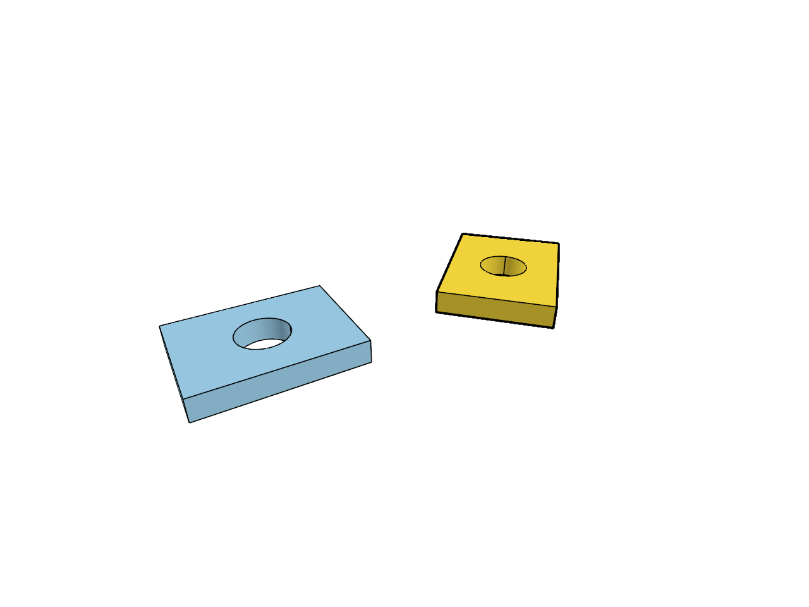

# 13.2 · Independent presentation and reusable CAD preparation

**Goal:** Exercise independent original CAD reuse. · **Steps:** 15 · **Source:** [app/scene_instances.rs](../../../src/app/scene_instances.rs) · [engine/gpu/instanced.rs](../../../src/engine/gpu/instanced.rs) · [engine/gpu/slots.rs](../../../src/engine/gpu/slots.rs) · [app/walk/brep_shapes.rs](../../../src/app/walk/brep_shapes.rs) · [app/hierarchy.rs](../../../src/app/hierarchy.rs) · [app/sheet_query.rs](../../../src/app/sheet_query.rs) (`src/app/instances.rs,src/app/sheets.rs,src/engine/gpu/instances.rs`)

<div class="webgpu-schematic" style="width:100%;margin:6px auto;">
<svg xmlns="http://www.w3.org/2000/svg" width="1120" height="188" viewBox="0 0 1120 188" style="width:100%;max-width:100%;height:auto;display:block;margin:0 auto;" role="img">
  <defs>
    <marker id="arr" viewBox="0 0 10 10" refX="8" refY="5" markerWidth="6" markerHeight="6" orient="auto">
      <path d="M 0 1 L 9 5 L 0 9 z" fill="#111111"/>
    </marker>
    <marker id="arrR" viewBox="0 0 10 10" refX="8" refY="5" markerWidth="6" markerHeight="6" orient="auto">
      <path d="M 0 1 L 9 5 L 0 9 z" fill="#dc2626"/>
    </marker>
    <marker id="arrG" viewBox="0 0 10 10" refX="8" refY="5" markerWidth="6" markerHeight="6" orient="auto">
      <path d="M 0 1 L 9 5 L 0 9 z" fill="#16a34a"/>
    </marker>
    <marker id="arrB" viewBox="0 0 10 10" refX="8" refY="5" markerWidth="6" markerHeight="6" orient="auto">
      <path d="M 0 1 L 9 5 L 0 9 z" fill="#2563eb"/>
    </marker>
  </defs>
  <rect x="2" y="2" width="1116" height="184" rx="10" fill="#ffffff" stroke="#111111" stroke-width="2"/>
  <rect x="14" y="12" width="344" height="164" rx="8" fill="#ffffff" stroke="#111111" stroke-width="1.5"/>
  <text paint-order="stroke fill" stroke="#ffffff" stroke-width="5" stroke-linejoin="round" x="186" y="30" text-anchor="middle" font-family="monospace" font-size="10.5" font-weight="700" fill="#111111">1 Prototype Mesh Def -&gt; N Instance Matrices M_0..M_k</text>
  <polygon points="64,132 104,64 144,132" fill="#dbeafe" stroke="#111111" stroke-width="2"/>
  <text paint-order="stroke fill" stroke="#ffffff" stroke-width="5" stroke-linejoin="round" x="104" y="150" text-anchor="middle" font-family="monospace" font-size="9.5" font-weight="700" fill="#111111">Def #0</text>
  <line x1="150" y1="98" x2="214" y2="68" stroke="#2563eb" stroke-width="1.75" marker-end="url(#arrB)"/>
  <line x1="150" y1="98" x2="214" y2="104" stroke="#16a34a" stroke-width="1.75" marker-end="url(#arrG)"/>
  <line x1="150" y1="98" x2="214" y2="140" stroke="#dc2626" stroke-width="1.75" marker-end="url(#arrR)"/>
  <text paint-order="stroke fill" stroke="#ffffff" stroke-width="5" stroke-linejoin="round" x="256" y="72" font-family="monospace" font-size="9.5" font-weight="700" fill="#2563eb">M_0</text>
  <text paint-order="stroke fill" stroke="#ffffff" stroke-width="5" stroke-linejoin="round" x="256" y="108" font-family="monospace" font-size="9.5" font-weight="700" fill="#16a34a">M_1</text>
  <text paint-order="stroke fill" stroke="#ffffff" stroke-width="5" stroke-linejoin="round" x="256" y="144" font-family="monospace" font-size="9.5" font-weight="700" fill="#dc2626">M_2</text>
  <line x1="358" y1="94" x2="384" y2="94" stroke="#111111" stroke-width="2" marker-end="url(#arr)"/>
  <rect x="388" y="12" width="344" height="164" rx="8" fill="#ffffff" stroke="#111111" stroke-width="1.5"/>
  <text paint-order="stroke fill" stroke="#ffffff" stroke-width="5" stroke-linejoin="round" x="560" y="30" text-anchor="middle" font-family="monospace" font-size="10.5" font-weight="700" fill="#111111">3D World Space vs 2D Sheet Paper Space (mm)</text>
  <polygon points="434,138 468,78 502,138" fill="#dbeafe" stroke="#2563eb" stroke-width="1.75"/>
  <polygon points="494,138 528,78 562,138" fill="#bbf7d0" stroke="#16a34a" stroke-width="1.75"/>
  <rect x="588" y="54" width="112" height="96" fill="#ffffff" stroke="#111111" stroke-width="2"/>
  <rect x="598" y="64" width="92" height="56" fill="#f8fafc" stroke="#64748b" stroke-width="1.2"/>
  <rect x="646" y="126" width="44" height="16" fill="#fef08a" stroke="#111111" stroke-width="1"/>
  <line x1="732" y1="94" x2="758" y2="94" stroke="#111111" stroke-width="2" marker-end="url(#arr)"/>
  <rect x="762" y="12" width="344" height="164" rx="8" fill="#ffffff" stroke="#111111" stroke-width="1.75"/>
  <text paint-order="stroke fill" stroke="#ffffff" stroke-width="5" stroke-linejoin="round" x="934" y="30" text-anchor="middle" font-family="monospace" font-size="10.5" font-weight="700" fill="#111111">Instanced Scene + 2D Detail Sheet Viewport</text>
  <rect x="806" y="44" width="256" height="118" rx="4" fill="#ffffff" stroke="#111111" stroke-width="2"/>
  <polygon points="832,138 860,82 888,138" fill="#dbeafe" stroke="#111111" stroke-width="1.75"/>
  <polygon points="888,138 916,82 944,138" fill="#bbf7d0" stroke="#111111" stroke-width="1.75"/>
  <polygon points="944,138 972,82 1000,138" fill="#fee2e2" stroke="#111111" stroke-width="1.75"/>
  <rect x="1008" y="56" width="42" height="92" fill="#f8fafc" stroke="#111111" stroke-width="1.5"/>
</svg>
</div>

## <a id="checkpoint-69j-preserve-per-instance-original-colours"></a>1. Preserve per-instance colours

**What this code does:** Preserve per instance original colours.

### 1. `src/gpu_mesh.rs`

Resolve instance colours without mutating original shared geometry.

Edit these blocks from bottom to top. Keep the surrounding lines unchanged.

**Locate this block:**

```rust
        }
    }

    pub fn selected(&self) -> bool {
```

Replace it with:

```rust
        }
    }

    pub(crate) fn packed(&self) -> [u8; 160] {
        self.previous
    }
    pub fn selected(&self) -> bool {
```

**Locate this block:**

```rust
        bytes[80 + index * 4..84 + index * 4].copy_from_slice(&value.to_ne_bytes());
    }
    if let Some(colour) = style.colour {
        for (index, value) in colour
            .into_iter()
            .map(|v| v as f32 / 255.)
            .chain([1.])
            .enumerate()
        {
```

Replace it with:

```rust
        bytes[80 + index * 4..84 + index * 4].copy_from_slice(&value.to_ne_bytes());
    }
    if let Some(colour) = style.colour {
        for (index, value) in colour[..3]
            .iter()
            .copied()
            .chain([1.])
            .enumerate()
        {
```

**Locate this block:**

```rust
    pub pickable: bool,
    pub colour: Option<[u8; 3]>,
}

fn settings(object: &Object, style: Style) -> [u8; 160] {
```

Replace it with:

```rust
    pub pickable: bool,
    pub colour: Option<[f32; 4]>,
}

fn settings(object: &Object, style: Style) -> [u8; 160] {
```

### 2. `src/cloud_gpu.rs`

Resolve instance colours without mutating original shared geometry.

Edit these blocks from bottom to top. Keep the surrounding lines unchanged.

**Locate this block:**

```rust
    ];
    let rgb = draw
        .color
        .map_or([1., 1., 1.], |c| c.map(|v| v as f32 / 255.));
    let px = row.point_px;
```

Replace it with:

```rust
    ];
    let rgb = draw
        .color
        .map_or([1., 1., 1.], |c| [c[0], c[1], c[2]]);
    let px = row.point_px;
```

**Locate this block:**

```rust
                visible: scene.visible(id),
                pickable: scene.pick_id(id.value()).is_some(),
                selected: selected.contains(&id),
                color: scene.view.faces.get(&id).copied(),
                total: 0,
            });
        }
```

Replace it with:

```rust
                visible: scene.visible(id),
                pickable: scene.pick_id(id.value()).is_some(),
                selected: selected.contains(&id),
                color: scene.face_rgba(id),
                total: 0,
            });
        }
```

**Locate this block:**

```rust
    selected: bool,
    color: Option<[u8; 3]>,
    total: u32,
}
struct Image {
```

Replace it with:

```rust
    selected: bool,
    color: Option<[f32; 4]>,
    total: u32,
}
struct Image {
```

### 3. `src/renderer.rs`

Apply per-instance original colour to mesh, point, path and line lanes.

Edit these blocks from bottom to top. Keep the surrounding lines unchanged.

**Locate this block:**

```rust
    crate::gpu_mesh::Style {
        selected,
        pickable: scene.pick_id(id.value()).is_some(),
        colour: scene.view.faces.get(&id).copied(),
    }
```

Replace it with:

```rust
    crate::gpu_mesh::Style {
        selected,
        pickable: scene.pick_id(id.value()).is_some(),
        colour: scene.face_rgba(id),
    }
```

**Locate this block:**

```rust
                    .filter(|row| scene.visible(row.id))
                    .map(|row| {
                        let mut stroke = row.stroke();
                        if let Some(colour) = scene.view.faces.get(&row.id) {
                            stroke.colour = rgba(*colour);
                        }
                        stroke
                    }),
```

Replace it with:

```rust
                    .filter(|row| scene.visible(row.id))
                    .map(|row| {
                        let mut stroke = row.stroke();
                        if let Some(colour) = scene.face_rgba(row.id) {
                            stroke.colour = colour;
                        }
                        stroke
                    }),
```

**Locate this block:**

```rust
                    .filter(|row| scene.visible(row.id))
                    .flat_map(|row| {
                        let mut segments = row.segments();
                        if let Some(colour) = scene.view.faces.get(&row.id) {
                            for segment in &mut segments {
                                segment.stroke.colour = rgba(*colour);
                            }
                        }
                        segments
```

Replace it with:

```rust
                    .filter(|row| scene.visible(row.id))
                    .flat_map(|row| {
                        let mut segments = row.segments();
                        if let Some(colour) = scene.face_rgba(row.id) {
                            for segment in &mut segments {
                                segment.stroke.colour = colour;
                            }
                        }
                        segments
```

**Locate this block:**

```rust
                        let mut marker = row.marker();
                        if let Some(colour) = scene.view.faces.get(&row.id) {
                            marker.colour = rgba(*colour);
                        }
                        marker
                    })
```

Replace it with:

```rust
                        let mut marker = row.marker();
                        if let Some(colour) = scene.face_rgba(row.id) {
                            marker.colour = colour;
                        }
                        marker
                    })
```

### 4. `src/gpu_geometry.rs`

Draw shared indexed geometry with a bounded instance count.

**Locate this existing block:**

```rust
    pub fn draw(&self, pass: &mut wgpu::RenderPass<'_>) {
        pass.set_vertex_buffer(0, self.vertices.slice(..));
        pass.set_vertex_buffer(1, self.normals.slice(..));
        pass.set_index_buffer(
            self.indices.slice(..),
            wgpu::IndexFormat::Uint32,
        );
        pass.draw_indexed(0..self.index_count, 0, 0..1);
    }
```

Edit the existing block to match this code; keep unchanged lines:

```rust
    pub fn draw(&self, pass: &mut wgpu::RenderPass<'_>) {
        self.draw_instances(pass, 1);
    }

    pub fn draw_instances(&self, pass: &mut wgpu::RenderPass<'_>, count: u32) {
        pass.set_vertex_buffer(0, self.vertices.slice(..));
        pass.set_vertex_buffer(1, self.normals.slice(..));
        pass.set_index_buffer(
            self.indices.slice(..),
            wgpu::IndexFormat::Uint32,
        );
        pass.draw_indexed(0..self.index_count, 0, 0..count);
    }
```

## <a id="checkpoint-69k-create-a-shared-definition-face-pipeline"></a>2. Create a shared definition face pipeline

**What this code does:** Create a shared definition face pipeline.

### 1. `src/instance_gpu.rs`

Create a storage-backed shared-definition colour pipeline.

Create the file and type:

```rust
use crate::{gpu_geometry::GpuGeometry, gpu_mesh::GpuMesh};
use std::{
    collections::{BTreeMap, HashMap},
    rc::Rc,
};
use wgpu::util::DeviceExt;

struct Batch {
    geometry: Rc<GpuGeometry>,
    records: wgpu::Buffer,
    group: wgpu::BindGroup,
    bytes: Vec<u8>,
    count: u32,
}
pub struct Lane {
    pipeline: wgpu::RenderPipeline,
    layout: wgpu::BindGroupLayout,
    batches: BTreeMap<(usize, usize), Batch>,
    pub writes: u64,
    pub written_bytes: u64,
}
impl Lane {
    pub fn new(
        device: &wgpu::Device,
        format: wgpu::TextureFormat,
        view: &wgpu::BindGroupLayout,
    ) -> Self {
        let layout =
            device.create_bind_group_layout(&wgpu::BindGroupLayoutDescriptor {
                label: Some("shared instance records"),
                entries: &[wgpu::BindGroupLayoutEntry {
                    binding: 0,
                    visibility: wgpu::ShaderStages::VERTEX,
                    ty: wgpu::BindingType::Buffer {
                        ty: wgpu::BufferBindingType::Storage { read_only: true },
                        has_dynamic_offset: false,
                        min_binding_size: std::num::NonZeroU64::new(160),
                    },
                    count: None,
                }],
            });
        let source=include_str!("triangle.wgsl").replace("var<uniform> object: ObjectSettings;","var<storage, read> objects: array<ObjectSettings>;").replace("fn geometry(position: vec3<f32>, colour: vec3<f32>, normal: vec3<f32>)","fn geometry(position: vec3<f32>, colour: vec3<f32>, normal: vec3<f32>, object: ObjectSettings)").replace("@location(2) normal: vec3<f32>) -> VertexOutput { return geometry(position, colour, normal); }","@location(2) normal: vec3<f32>, @builtin(instance_index) instance: u32) -> VertexOutput { return geometry(position, colour, normal, objects[instance]); }");
        let shader = device.create_shader_module(wgpu::ShaderModuleDescriptor {
            label: Some("shared definition placements"),
            source: wgpu::ShaderSource::Wgsl(source.into()),
        });
        let pipeline_layout =
            device.create_pipeline_layout(&wgpu::PipelineLayoutDescriptor {
                label: Some("shared instance settings"),
                bind_group_layouts: &[Some(view), Some(&layout)],
                immediate_size: 0,
            });
        let pipeline=device.create_render_pipeline(&wgpu::RenderPipelineDescriptor {label:Some("shared original definition drawing"),layout:Some(&pipeline_layout),vertex:wgpu::VertexState {module:&shader,entry_point:Some("vertex"),compilation_options:Default::default(),buffers:&[wgpu::VertexBufferLayout {array_stride:24,step_mode:wgpu::VertexStepMode::Vertex,attributes:&wgpu::vertex_attr_array![0=>Float32x3,1=>Float32x3]},wgpu::VertexBufferLayout {array_stride:12,step_mode:wgpu::VertexStepMode::Vertex,attributes:&wgpu::vertex_attr_array![2=>Float32x3]}]},fragment:Some(wgpu::FragmentState {module:&shader,entry_point:Some("fragment"),compilation_options:Default::default(),targets:&[Some(format.into())]}),primitive:Default::default(),depth_stencil:Some(crate::depth::surface()),multisample:Default::default(),multiview_mask:None,cache:None});
        Self {
            pipeline,
            layout,
            batches: BTreeMap::new(),
            writes: 0,
            written_bytes: 0,
        }
    }
}
```

### 2. `src/lib.rs`

Register the source component.

**Locate this existing block:**

```rust
mod instance_scene_tests;

#[cfg(target_arch = "wasm32")]
```

Edit the existing block to match this code; keep unchanged lines:

```rust
mod instance_scene_tests;

pub mod instance_gpu;

#[cfg(target_arch = "wasm32")]
```

## <a id="checkpoint-69l-reuse-bounded-independent-draw-records"></a>3. Reuse bounded independent draw records

**What this code does:** Reuse bounded independent draw records.

### 1. `src/instance_gpu.rs`

Reuse bounded shared-definition draw batches and changed-only record uploads.

**Locate this existing block:**

```rust
    }
}
```

Edit the existing block to match this code; keep unchanged lines:

```rust
    }
    pub fn set<'a>(
        &mut self,
        device: &wgpu::Device,
        queue: &wgpu::Queue,
        rows: impl IntoIterator<Item = &'a GpuMesh>,
    ) -> Result<(), &'static str> {
        let limit = (u64::from(
            device
                .limits()
                .max_storage_buffer_binding_size,
        )
        .min(device.limits().max_buffer_size)
            / 160) as usize;
        if limit == 0 {
            return Err("Device cannot hold one instance record");
        }
        let mut groups: HashMap<usize, (Rc<GpuGeometry>, Vec<[u8; 160]>)> =
            HashMap::new();
        for row in rows {
            let key = Rc::as_ptr(&row.geometry) as usize;
            groups
                .entry(key)
                .or_insert_with(|| (row.geometry.clone(), Vec::new()))
                .1
                .push(row.packed());
        }
        let mut old = std::mem::take(&mut self.batches);
        let mut batches = BTreeMap::new();
        for (source, (geometry, records)) in groups {
            for (part, records) in records.chunks(limit).enumerate() {
                let key = (source, part);
                let bytes = records
                    .iter()
                    .flatten()
                    .copied()
                    .collect::<Vec<_>>();
                let batch = if let Some(mut batch) = old.remove(&key).filter(|b| {
                    Rc::ptr_eq(&b.geometry, &geometry)
                        && b.records.size() >= bytes.len() as u64
                }) {
                    if batch.bytes != bytes {
                        queue.write_buffer(&batch.records, 0, &bytes);
                        self.writes += 1;
                        self.written_bytes += bytes.len() as u64;
                        batch.bytes = bytes;
                    }
                    batch.count = records.len() as u32;
                    batch
                } else {
                    let buffer =
                        device.create_buffer_init(&wgpu::util::BufferInitDescriptor {
                            label: Some("independent source placements"),
                            contents: &bytes,
                            usage: wgpu::BufferUsages::STORAGE
                                | wgpu::BufferUsages::COPY_DST,
                        });
                    let group = crate::gpu_layout::group(device, &self.layout, &buffer);
                    self.writes += 1;
                    self.written_bytes += bytes.len() as u64;
                    Batch {
                        geometry: geometry.clone(),
                        records: buffer,
                        group,
                        bytes,
                        count: records.len() as u32,
                    }
                };
                batches.insert(key, batch);
            }
        }
        self.batches = batches;
        Ok(())
    }
    pub fn draw(&self, pass: &mut wgpu::RenderPass<'_>) {
        pass.set_pipeline(&self.pipeline);
        for batch in self.batches.values() {
            pass.set_bind_group(1, &batch.group, &[]);
            batch
                .geometry
                .draw_instances(pass, batch.count);
        }
    }
    pub fn usage(&self) -> [u64; 5] {
        [
            self.batches.len() as u64,
            self.batches
                .values()
                .map(|b| u64::from(b.count))
                .sum(),
            self.batches
                .values()
                .map(|b| b.records.size())
                .sum(),
            self.writes,
            self.written_bytes,
        ]
    }
}
```

## <a id="checkpoint-69m-draw-batched-faces-with-independent-integer-owners"></a>4. Draw batched faces with independent integer owners

**What this code does:** Draw batched faces with independent integer owners.

### 1. `src/renderer.rs`

Draw original definition faces in shared batches while retaining independent source picking.

Edit these blocks from bottom to top. Keep the surrounding lines unchanged.

**Locate this block:**

```rust
            });
            pass.set_pipeline(&self.pipeline);
            pass.set_bind_group(0, &self.view_group, &[]);
            for mesh in &self.meshes {
                mesh.draw(&mut pass);
            }
            if let Some(clouds) = self.clouds.borrow().as_ref() {
```

Replace it with:

```rust
            });
            pass.set_pipeline(&self.pipeline);
            pass.set_bind_group(0, &self.view_group, &[]);
            for mesh in self
                .meshes
                .iter()
                .filter(|row| !self.instance_rows.contains(&row.id))
            {
                mesh.draw(&mut pass);
            }
            self.instances.draw(&mut pass);
            if let Some(clouds) = self.clouds.borrow().as_ref() {
```

**Locate this block:**

```rust
        self.highlight.bytes()
    }

    pub fn stats(&self) -> [usize; 4] {
        [
            self.geometry.uploads,
```

Replace it with:

```rust
        self.highlight.bytes()
    }

    pub fn instance_usage(&self) -> [u64; 5] {
        self.instances.usage()
    }
    pub fn stats(&self) -> [usize; 4] {
        [
            self.geometry.uploads,
```

**Locate this block:**

```rust
                self.settings_bytes += bytes;
            }
        }
        if !self.meshes.iter().any(GpuMesh::selected) {
            self.outline.borrow_mut().take();
        }
```

Replace it with:

```rust
                self.settings_bytes += bytes;
            }
        }
        self.instances.set(
            &self.device,
            &self.queue,
            self.meshes
                .iter()
                .filter(|row| self.instance_rows.contains(&row.id)),
        )?;
        if !self.meshes.iter().any(GpuMesh::selected) {
            self.outline.borrow_mut().take();
        }
```

**Locate this block:**

```rust
    }

    pub fn uploaded_bytes(&self) -> u64 {
        self.geometry.uploaded_bytes
            + self.settings_allocations as u64 * 160
            + self.settings_bytes as u64
            + self.strokes.uploaded_bytes
```

Replace it with:

```rust
    }

    pub fn uploaded_bytes(&self) -> u64 {
        self.instances.written_bytes
            + self.geometry.uploaded_bytes
            + self.settings_allocations as u64 * 160
            + self.settings_bytes as u64
            + self.strokes.uploaded_bytes
```

**Locate this block:**

```rust
            self.meshes.push(row);
        }
        drop(old);
        self.geometry.prune();
        if !self.meshes.iter().any(GpuMesh::selected) {
            self.outline.borrow_mut().take();
```

Replace it with:

```rust
            self.meshes.push(row);
        }
        drop(old);
        self.instance_rows = scene.instances.keys().copied().collect();
        self.instances
            .set(
                &self.device,
                &self.queue,
                self.meshes
                    .iter()
                    .filter(|row| self.instance_rows.contains(&row.id)),
            )
            .expect("Validated instance records fit device limits");
        self.geometry.prune();
        if !self.meshes.iter().any(GpuMesh::selected) {
            self.outline.borrow_mut().take();
```

**Locate this block:**

```rust
        let faces = crate::face_pick::Faces::new(&device);
        let mesh_ink = crate::stroke_gpu::Lane::new(&device, format);
        let mut renderer = Self {
            clouds: Default::default(),
            cloud_view: Default::default(),
            cloud_error: Default::default(),
```

Replace it with:

```rust
        let faces = crate::face_pick::Faces::new(&device);
        let mesh_ink = crate::stroke_gpu::Lane::new(&device, format);
        let mut renderer = Self {
            instances,
            instance_rows: Default::default(),
            clouds: Default::default(),
            cloud_view: Default::default(),
            cloud_error: Default::default(),
```

**Locate this block:**

```rust
        })
        };
        let pipeline = mesh_pipeline(crate::depth::surface());
        let highlight_pipeline = mesh_pipeline(crate::depth::ink());
        let highlight = crate::highlight::Highlight::new(&device, format);
        let preview = crate::tool_preview::Preview::new(&device, format);
```

Replace it with:

```rust
        })
        };
        let pipeline = mesh_pipeline(crate::depth::surface());
        let instances = crate::instance_gpu::Lane::new(&device, format, &view_layout);
        let highlight_pipeline = mesh_pipeline(crate::depth::ink());
        let highlight = crate::highlight::Highlight::new(&device, format);
        let preview = crate::tool_preview::Preview::new(&device, format);
```

**Locate this block:**

```rust
    pub queue: wgpu::Queue,
    pipeline: wgpu::RenderPipeline,
    highlight_pipeline: wgpu::RenderPipeline,
    highlight: crate::highlight::Highlight,
```

Replace it with:

```rust
    pub queue: wgpu::Queue,
    instances: crate::instance_gpu::Lane,
    instance_rows: std::collections::HashSet<ObjectId>,
    pipeline: wgpu::RenderPipeline,
    highlight_pipeline: wgpu::RenderPipeline,
    highlight: crate::highlight::Highlight,
```

### 2. `src/pick_gpu_tests.rs`

Copy actual GPU batching, full integer owner IDs, source colour, reuse and release regressions.

**Locate this existing block:**

```rust
    drop(prepared);
    assert_eq!(renderer.cloud_usage(), [0; 5]);
    assert!(weak.upgrade().is_none());
}
```

Edit the existing block to match this code; keep unchanged lines:

```rust
    drop(prepared);
    assert_eq!(renderer.cloud_usage(), [0; 5]);
    assert!(weak.upgrade().is_none());
}

#[test]
fn actual_definition_instances_batch_one_geometry_keep_integer_picks_and_release_records()
 {
    let mut original = crate::instance_specimen::message();
    original.objects.as_mut().unwrap().instances[0].xform = None;
    original.objects.as_mut().unwrap().instances[1].flags = 0;
    original.xforms = vec![
        session_rust::proto::XformEntry {
            guid: "first".into(),
            xform: Some(session_rust::Xform::translation(-0.5, 0., 0.3).to_proto()),
        },
        session_rust::proto::XformEntry {
            guid: "second".into(),
            xform: Some(session_rust::Xform::translation(0.5, 0., 0.3).to_proto()),
        },
    ];
    let mut scene = Scene::empty();
    scene.next_id = 16_777_217;
    crate::scene_document::import(
        &mut scene,
        &prost::Message::encode_to_vec(&original),
        "",
        &session_rust::Xform::identity(),
        0.,
    )
    .unwrap();
    let a = scene.objects()[0].id;
    let b = scene.objects()[1].id;
    let weak = Rc::downgrade(scene.objects()[0].geometry().unwrap());
    let mut renderer = renderer(&scene);
    assert_eq!(&renderer.instance_usage()[..3], &[1, 2, 320]);
    let source_uploads = renderer.stats()[0];
    let pixels = colour_pixels(&mut renderer);
    assert!(pixels.chunks_exact(4).filter(|p|p[2]>p[0].saturating_add(20)&&p[2]>p[1].saturating_add(10)).count()>1000);
    for (cursor, id) in [([-0.5, -0.1], a), ([0.5, -0.1], b)] {
        renderer
            .request_pick(cursor, identity())
            .unwrap();
        assert_eq!(finish(&mut renderer).unwrap()[0], id.value());
    }
    let mut coloured = original.clone();
    let first = &mut coloured.objects.as_mut().unwrap().instances[0];
    first.flags |= session_rust::InstanceRef::FLAG_COLOR;
    first.color = Some(session_rust::proto::Color {
        r: 0.9,
        g: 0.08,
        b: 0.05,
        a: 0.5,
        ..Default::default()
    });
    let mut colour_scene = Scene::empty();
    crate::scene_document::import(
        &mut colour_scene,
        &prost::Message::encode_to_vec(&coloured),
        "",
        &session_rust::Xform::identity(),
        0.,
    )
    .unwrap();
    let mut colour_renderer = super::pick_gpu_tests::renderer(&colour_scene);
    let colours = colour_pixels(&mut colour_renderer);
    assert!(colours.chunks_exact(4).filter(|p|p[0]>p[1].saturating_add(50)&&p[0]>p[2].saturating_add(50)).count()>500);
    assert!(
        colours
            .chunks_exact(4)
            .filter(|p| p[2] > p[0].saturating_add(20))
            .count()
            > 500
    );
    let writes = renderer.instance_usage()[3];
    colour_pixels(&mut renderer);
    assert_eq!(renderer.instance_usage()[3], writes);
    scene.translate(a, [0., 0.2, 0.]).unwrap();
    renderer.set_scene(&scene, None);
    assert_eq!(renderer.stats()[0], source_uploads);
    assert!(renderer.instance_usage()[3] > writes);
    renderer
        .select_objects(&scene, &[a])
        .unwrap();
    let selected = colour_pixels(&mut renderer);
    assert!(
        selected
            .chunks_exact(4)
            .any(|p| p[0] > 140 && p[1] > 90 && p[2] < 40)
    );
    Rc::make_mut(&mut scene.view).hide(&[b], true);
    renderer.set_scene(&scene, None);
    assert_eq!(renderer.instance_usage()[1], 1);
    scene.clear();
    renderer.set_scene(&scene, None);
    assert_eq!(&renderer.instance_usage()[..3], &[0, 0, 0]);
    assert!(weak.upgrade().is_none());
}
```

## <a id="checkpoint-69n-inspect-and-exercise-original-definition-instances"></a>5. Inspect and exercise definition instances

**What this code does:** Inspect and exercise original definition instances.

### 1. `src/editor.rs`

Connect original instance examples and separate source, placement and GPU diagnostics.

Edit these blocks from bottom to top. Keep the surrounding lines unchanged.

**Locate this block:**

```rust
                let source = std::rc::Rc::new(crate::cloud::example());
                let prepared = crate::cloud::Prepared::new(source)?;
                self.history
                    .try_edit(&mut self.scene, |scene| {
                        scene.insert_cloud(prepared).map(|_| ())
                    })?;
```

Replace it with:

```rust
                let source = std::rc::Rc::new(crate::cloud::example());
                let prepared = crate::cloud::Prepared::new(source)?;
                self.history
                    .try_edit(&mut self.scene, |scene| {
                        scene.insert_cloud(prepared).map(|_| ())
                    })?;
            }
            Action::AddInstances => {
                self.history
                    .try_edit(&mut self.scene, |scene| {
                        crate::scene_document::import(
                            scene,
                            &crate::instance_specimen::display_bytes(),
                            "",
                            &session_rust::Xform::identity(),
                            0.,
                        )
                        .map(|_| ())
                        .map_err(|_| "Cannot prepare original definition instances")
                    })?;
```

**Locate this block:**

```rust
    AddCad,
    AddText(crate::text::TextPlacement),
    AddSurface,
    AddLine,
```

Replace it with:

```rust
    AddCad,
    AddInstances,
    AddText(crate::text::TextPlacement),
    AddSurface,
    AddLine,
```

### 2. `src/commands.rs`

Connect original instance examples and separate source, placement and GPU diagnostics.

**Locate this existing block:**

```rust
    ("Example CAD", || Action::AddCad),
    ("Example Scene Text", || {
```

Edit the existing block to match this code; keep unchanged lines:

```rust
    ("Example CAD", || Action::AddCad),
    ("Example Instances", || Action::AddInstances),
    ("Example Scene Text", || {
```

### 3. `src/browser.rs`

Connect original instance examples and separate source, placement and GPU diagnostics.

**Locate this existing block:**

```rust
    )?;
    let stream_usage = crate::memory::streams(editor.scenes());
```

Edit the existing block to match this code; keep unchanged lines:

```rust
    )?;
    canvas.set_attribute(
        "data-instance-cpu",
        &serde_json::to_string(&crate::memory::instances(editor.scenes())).unwrap(),
    )?;
    canvas.set_attribute(
        "data-instance-gpu",
        &serde_json::to_string(&renderer.instance_usage()).unwrap(),
    )?;
    let instances=editor.scene.instances.iter().map(|(id,owner)|serde_json::json!({"id":id.value(),"guid":editor.scene.row_guid(*id),"source_guid":owner.instance.guid(),"definition_guid":owner.definition.guid(),"document_guid":owner.document.guid(),"model":editor.scene.placement(*id).map(|m|m.m),"flags":owner.instance.flags,"colour":editor.scene.face_rgba(*id)})).collect::<Vec<_>>();
    canvas.set_attribute(
        "data-instances",
        &serde_json::to_string(&instances).unwrap(),
    )?;
    let stream_usage = crate::memory::streams(editor.scenes());
```

## <a id="checkpoint-69zza-move-between-original-rigid-frames"></a>6. Move between rigid frames

**What this code does:** Write local coordinates and the rotation between two right-handed frames.

### 1. `src/cad_shape_key.rs`

Type the whole original helpers introduced today.

Create the file and type:

```rust
use session_rust::brep::BRepRef;
use session_rust::{BRep, Color, NurbsCurve};

pub const SAME_POINT: f64 = 1e-6;

/// Weights and knots this close, relative to one or to the knot span, count as the same.
const SAME_NUMBER: f64 = 1e-9;

/// A point at least this far from the first one, relative to the shape's size, sets an axis.
const AXIS_SPAN: f64 = 1e-3;

/// A rigid frame of a BRep, found from its own control points: origin and three unit axes.
#[derive(Clone, Copy)]
pub struct Frame {
    origin: [f64; 3],    // the first surface control point
    axes: [[f64; 3]; 3], // x, y, z as rows, right-handed
}

impl Frame {
    /// Coordinates of `p` along the axes.
    fn local(&self, p: [f64; 3]) -> [f64; 3] {
        let d = sub(p, self.origin);
        [
            dot(d, self.axes[0]),
            dot(d, self.axes[1]),
            dot(d, self.axes[2]),
        ]
    }

    /// The motion that carries a shape placed at `self` onto the same shape placed at `to`.
    pub fn motion_to(&self, to: &Frame) -> Motion {
        let mut turn = [[0.0; 3]; 3];

        for (i, row) in turn.iter_mut().enumerate() {
            for (j, value) in row.iter_mut().enumerate() {
                *value = (0..3)
                    .map(|k| to.axes[k][i] * self.axes[k][j])
                    .sum();
            }
        }

        Motion {
            from: self.origin,
            to: to.origin,
            turn,
        }
    }
}

/// A rotation about `from` followed by the move to `to`.
pub struct Motion {
    from: [f64; 3],      // origin of the walked shape
    to: [f64; 3],        // origin of the copy
    turn: [[f64; 3]; 3], // rotation matrix
}

impl Motion {
    /// A direction turned.
    pub fn turn(&self, v: [f64; 3]) -> [f64; 3] {
        [
            dot(self.turn[0], v),
            dot(self.turn[1], v),
            dot(self.turn[2], v),
        ]
    }

    /// A point moved.
    pub fn point(&self, p: [f64; 3]) -> [f64; 3] {
        let t = self.turn(sub(p, self.from));
        [
            t[0] + self.to[0],
            t[1] + self.to[1],
            t[2] + self.to[2],
        ]
    }

    /// A render position moved.
    pub fn position(&self, p: [f32; 3]) -> [f32; 3] {
        let q = self.point([p[0] as f64, p[1] as f64, p[2] as f64]);
        [q[0] as f32, q[1] as f32, q[2] as f32]
    }

    /// A render normal turned.
    pub fn normal(&self, n: [f32; 3]) -> [f32; 3] {
        let t = self.turn([n[0] as f64, n[1] as f64, n[2] as f64]);
        [t[0] as f32, t[1] as f32, t[2] as f32]
    }
}

fn sub(a: [f64; 3], b: [f64; 3]) -> [f64; 3] {
    [a[0] - b[0], a[1] - b[1], a[2] - b[2]]
}

fn dot(a: [f64; 3], b: [f64; 3]) -> f64 {
    a[0] * b[0] + a[1] * b[1] + a[2] * b[2]
}

fn cross(a: [f64; 3], b: [f64; 3]) -> [f64; 3] {
    [
        a[1] * b[2] - a[2] * b[1],
        a[2] * b[0] - a[0] * b[2],
        a[0] * b[1] - a[1] * b[0],
    ]
}

fn unit(a: [f64; 3]) -> [f64; 3] {
    let length = dot(a, a).sqrt();
    [a[0] / length, a[1] / length, a[2] / length]
}
```

### 2. `src/lib.rs`

Register the original rigid-frame and shape-key owner.

**Locate this existing block:**

```rust
pub mod instance_gpu;

#[cfg(target_arch = "wasm32")]
```

Edit the existing block to match this code; keep unchanged lines:

```rust
pub mod instance_gpu;

pub mod cad_shape_key;

#[cfg(target_arch = "wasm32")]
```

## <a id="checkpoint-69zzb-find-an-original-frame-and-pack-key-words"></a>7. Find an frame and pack key words

**What this code does:** Choose well-separated original surface control points for a right-handed frame.

### 1. `src/cad_shape_key.rs`

Extend this original owner with today’s complete helper.

**Locate this existing block:**

```rust
    [a[0] / length, a[1] / length, a[2] / length]
}
```

Edit the existing block to match this code; keep unchanged lines:

```rust
    [a[0] / length, a[1] / length, a[2] / length]
}

/// Every surface control point of a BRep, in storage order.
fn surface_points(b: &BRep) -> Vec<[f64; 3]> {
    let mut points = Vec::new();

    for surface in &b.m_surfaces {
        for i in 0..surface.cv_count(0) {
            for j in 0..surface.cv_count(1) {
                let p = surface.get_cv(i, j).unwrap_or_default();
                points.push([p[0], p[1], p[2]]);
            }
        }
    }

    points
}

/// The frame of a BRep and its size: the first control point, the first one clearly away from
/// it for x, the first one clearly off that line for z. None for a flat line or nothing.
fn frame_of(points: &[[f64; 3]]) -> Option<(Frame, f64)> {
    let origin = *points.first()?;
    let size = points
        .iter()
        .map(|p| dot(sub(*p, origin), sub(*p, origin)).sqrt())
        .fold(0.0, f64::max);

    if !(size.is_finite() && size > 0.0) {
        return None;
    }

    let x = points
        .iter()
        .map(|p| sub(*p, origin))
        .find(|d| dot(*d, *d).sqrt() > AXIS_SPAN * size)?;
    let x = unit(x);
    let z = points
        .iter()
        .map(|p| cross(x, sub(*p, origin)))
        .find(|c| dot(*c, *c).sqrt() > AXIS_SPAN * size)?;
    let z = unit(z);
    let y = cross(z, x);
    let frame = Frame {
        origin,
        axes: [x, y, z],
    };

    Some((frame, size))
}

/// What makes two BReps the same shape: their topology, parameters, weights, colours and widths
/// exactly, and their 3D points in their own frames up to `SAME_POINT`.
pub struct ShapeKey {
    pub words: Vec<u64>, // the shape, word by word
    pub frame: Frame,    // where this BRep lies
    pub step: f64,       // the length one point word counts
}

impl ShapeKey {
    fn push_words(&mut self, words: &[u64]) {
        self.words.extend_from_slice(words);
    }

    fn push_float(&mut self, value: f64) {
        self.words.push(value.to_bits());
    }

    /// A weight, rounded to `SAME_NUMBER`.
    fn push_number(&mut self, value: f64) {
        self.words
            .push((value / SAME_NUMBER).round() as i64 as u64);
    }

    fn push_color(&mut self, color: &Color) {
        for value in [color.r, color.g, color.b, color.a] {
            self.words.push(value.to_bits() as u64);
        }
    }

    fn push_refs(&mut self, refs: &[BRepRef]) {
        self.words.push(refs.len() as u64);

        for r in refs {
            self.push_words(&[r.index as i64 as u64, r.orientation as u64]);
        }
    }

    fn push_counts(&mut self, b: &BRep) {
        self.push_words(&[
            b.m_surfaces.len() as u64,
            b.m_curves_3d.len() as u64,
            b.m_curves_2d.len() as u64,
            b.m_vertices.len() as u64,
            b.m_edges.len() as u64,
            b.m_wires.len() as u64,
            b.m_faces.len() as u64,
            b.m_shells.len() as u64,
            b.m_solids.len() as u64,
        ]);
    }
}
```

## <a id="checkpoint-69zzc-encode-original-parameters-and-topology"></a>8. Encode parameters and topology

**What this code does:** Encode knots, local points, pcurve values and curve descriptors.

### 1. `src/cad_shape_key.rs`

Extend this original owner with today’s complete helper.

**Locate this existing block:**

```rust
    }

    fn push_color(&mut self, color: &Color) {
        for value in [color.r, color.g, color.b, color.a] {
            self.words.push(value.to_bits() as u64);
        }
    }

    fn push_refs(&mut self, refs: &[BRepRef]) {
        self.words.push(refs.len() as u64);

        for r in refs {
            self.push_words(&[r.index as i64 as u64, r.orientation as u64]);
        }
    }

    fn push_counts(&mut self, b: &BRep) {
        self.push_words(&[
            b.m_surfaces.len() as u64,
            b.m_curves_3d.len() as u64,
            b.m_curves_2d.len() as u64,
            b.m_vertices.len() as u64,
            b.m_edges.len() as u64,
            b.m_wires.len() as u64,
            b.m_faces.len() as u64,
            b.m_shells.len() as u64,
            b.m_solids.len() as u64,
        ]);
    }
```

Edit the existing block to match this code; keep unchanged lines:

```rust
    }

    /// A knot vector, each knot rounded to `SAME_NUMBER` of the whole span.
    fn push_knots(&mut self, knots: &[f64]) {
        let span = knots
            .last()
            .zip(knots.first())
            .map_or(0.0, |(z, a)| z - a);
        self.words.push(knots.len() as u64);

        if !(span.is_finite() && span > 0.0) {
            self.words
                .extend(knots.iter().map(|k| k.to_bits()));
            return;
        }

        for knot in knots {
            self.words
                .push(((knot - knots[0]) / (span * SAME_NUMBER)).round() as i64 as u64);
        }

        self.push_number(knots[0] / span);
        self.push_number(span);
    }

    /// Pcurve control values, rounded to `SAME_NUMBER` of the largest of them.
    fn push_parameters(&mut self, values: &[f64]) {
        let size = values
            .iter()
            .fold(1.0, |m: f64, v| m.max(v.abs()));
        self.words.push(values.len() as u64);
        self.words.extend(
            values
                .iter()
                .map(|v| (v / (size * SAME_NUMBER)).round() as i64 as u64),
        );
    }

    /// A 3D point in the BRep's frame, rounded to the step.
    fn push_point(&mut self, p: [f64; 3]) {
        for value in self.frame.local(p) {
            self.words
                .push((value / self.step).round() as i64 as u64);
        }
    }

    fn push_color(&mut self, color: &Color) {
        for value in [color.r, color.g, color.b, color.a] {
            self.words.push(value.to_bits() as u64);
        }
    }

    fn push_curve_shape(&mut self, curve: &NurbsCurve) {
        self.push_words(&[
            curve.m_dim as u64,
            curve.m_is_rat as u64,
            curve.m_order as u64,
            curve.m_cv_count as u64,
        ]);
        self.push_knots(&curve.m_nurbsknot);
    }

    fn push_refs(&mut self, refs: &[BRepRef]) {
        self.words.push(refs.len() as u64);

        for r in refs {
            self.push_words(&[r.index as i64 as u64, r.orientation as u64]);
        }
    }

    fn push_counts(&mut self, b: &BRep) {
        self.push_words(&[
            b.m_surfaces.len() as u64,
            b.m_curves_3d.len() as u64,
            b.m_curves_2d.len() as u64,
            b.m_vertices.len() as u64,
            b.m_edges.len() as u64,
            b.m_wires.len() as u64,
            b.m_faces.len() as u64,
            b.m_shells.len() as u64,
            b.m_solids.len() as u64,
        ]);
    }

    fn push_topology(&mut self, b: &BRep) {
        for edge in &b.m_edges {
            self.push_words(&[
                edge.curve_3d_index as i64 as u64,
                edge.start_vertex as i64 as u64,
                edge.end_vertex as i64 as u64,
                edge.degenerated as u64,
                edge.pcurves.len() as u64,
            ]);

            for pcurve in &edge.pcurves {
                self.push_words(&[
                    pcurve.surface_index as i64 as u64,
                    pcurve.curve_2d_index as i64 as u64,
                    pcurve.curve_2d_index_2 as i64 as u64,
                ]);
            }
        }

        for wire in &b.m_wires {
            self.push_refs(&wire.edges);
        }

        for face in &b.m_faces {
            self.words
                .push(face.surface_index as i64 as u64);
            self.push_refs(&face.wires);

            match &face.facecolor {
                Some(color) => self.push_color(color),
                None => self.words.push(u64::MAX),
            }
        }

        for shell in &b.m_shells {
            self.push_refs(&shell.faces);
        }

        for solid in &b.m_solids {
            self.push_refs(&solid.shells);
        }
    }
```

## <a id="checkpoint-69a-describe-a-rigid-frame-and-original-shape-key"></a>9. Assemble an rigid shape key

**What this code does:** Assemble the existing encoders for every original surface, curve, vertex and topology record.

### 1. `src/cad_shape_key.rs`

Extend this original owner with today’s complete helper.

**Locate this existing block:**

```rust
impl ShapeKey {
    fn push_words(&mut self, words: &[u64]) {
```

Edit the existing block to match this code; keep unchanged lines:

```rust
impl ShapeKey {
    /// The key of `b`; None when it has no frame.
    pub fn of(b: &BRep) -> Option<Self> {
        let (frame, size) = frame_of(&surface_points(b))?;
        let mut key = Self {
            words: Vec::new(),
            frame,
            step: size * SAME_POINT,
        };
        key.push_counts(b);
        key.push_float(b.width);
        key.push_color(&b.surfacecolor);

        for surface in &b.m_surfaces {
            key.push_words(&[
                surface.m_dim as u64,
                surface.m_is_rat as u64,
                surface.m_order[0] as u64,
                surface.m_order[1] as u64,
                surface.m_cv_count[0] as u64,
                surface.m_cv_count[1] as u64,
            ]);
            key.push_knots(&surface.m_nurbsknot[0]);
            key.push_knots(&surface.m_nurbsknot[1]);

            for i in 0..surface.cv_count(0) {
                for j in 0..surface.cv_count(1) {
                    let p = surface.get_cv(i, j).unwrap_or_default();
                    key.push_point([p[0], p[1], p[2]]);
                    key.push_number(surface.weight(i, j));
                }
            }
        }

        for curve in &b.m_curves_3d {
            key.push_curve_shape(curve);

            for i in 0..curve.cv_count() {
                let p = curve.get_cv(i).unwrap_or_default();
                key.push_point([p[0], p[1], p[2]]);
                key.push_number(curve.weight(i));
            }
        }

        for curve in &b.m_curves_2d {
            key.push_curve_shape(curve);
            key.push_parameters(&curve.m_cv);
        }

        for vertex in &b.m_vertices {
            key.push_point([
                vertex.point[0],
                vertex.point[1],
                vertex.point[2],
            ]);
        }

        key.push_topology(b);
        Some(key)
    }

    fn push_words(&mut self, words: &[u64]) {
```

## <a id="checkpoint-69aa-retain-cloneable-derived-cad-values"></a>10. Retain cloneable derived CAD values

**What this code does:** Retain cloneable derived CAD values.

### 1. `src/mesh.rs`

Separate original validation and cloneable derived CAD values.

**Locate this existing block:**

```rust
pub struct Mesh {
    vertices: Vec<[f32; 6]>,
```

Edit the existing block to match this code; keep unchanged lines:

```rust
#[derive(Clone)]
pub struct Mesh {
    vertices: Vec<[f32; 6]>,
```

### 2. `src/mesh_parts.rs`

Separate original validation and cloneable derived CAD values.

**Locate this existing block:**

```rust
#[derive(Default)]
pub struct Parts {
```

Edit the existing block to match this code; keep unchanged lines:

```rust
#[derive(Clone, Default)]
pub struct Parts {
```

### 3. `src/cad_face.rs`

Separate original validation and cloneable derived CAD values.

**Locate this existing block:**

```rust
use session_rust::Point;
pub struct Sample {
```

Edit the existing block to match this code; keep unchanged lines:

```rust
use session_rust::Point;
#[derive(Clone)]
pub struct Sample {
```

### 4. `src/cad_display.rs`

Separate original validation and cloneable derived CAD values.

**Locate this existing block:**

```rust
use std::rc::Rc;

pub struct Boundary {
    pub edge: usize,
    pub points: Vec<[f64; 3]>,
}
pub struct Prepared {
```

Edit the existing block to match this code; keep unchanged lines:

```rust
use std::rc::Rc;

#[derive(Clone)]
pub struct Boundary {
    pub edge: usize,
    pub points: Vec<[f64; 3]>,
}
#[derive(Clone)]
pub struct Prepared {
```

### 5. `src/cad_boundary.rs`

Separate original validation and cloneable derived CAD values.

**Locate this existing block:**

```rust
    pub fn new(source: Rc<BRep>) -> Result<Self, &'static str> {
        if !source.is_valid() {
            return Err("BRep topology contains an invalid reference");
        }
        if source.m_faces.len() > 65_536 || source.m_edges.len() > 262_144 {
            return Err("BRep topology exceeds the display budget");
        }
        for surface in &source.m_surfaces {
            crate::surface::validate(surface)?;
        }
        for curve in source
            .m_curves_3d
            .iter()
            .chain(&source.m_curves_2d)
        {
            crate::curve::validate(curve)?;
        }
        let _ = source.guid();
        let faces = source.face_meshes_q(Some(QUALITY));
        if faces.len() != source.m_faces.len()
            || faces.iter().any(|face| face.face.is_empty())
        {
            return Err("BRep face could not be tessellated");
        }
        let chains = crate::cad_edges::edge_chains(&source, &faces);
        for (index, (edge, chain)) in source
            .m_edges
            .iter()
            .zip(&chains)
            .enumerate()
        {
            if !edge.degenerated
                && !source.edge_faces(index).is_empty()
                && chain.is_none()
            {
                return Err("A CAD edge has no coherent face boundary");
            }
        }
        Ok(Self {
            source,
            faces,
            chains,
        })
    }
    pub fn points(&self, edge: usize) -> Option<Vec<[f64; 3]>> {
        let chain = self.chains.get(edge)?.as_ref()?;
        let face = self.faces.get(chain.face)?;
        chain
            .keys
            .iter()
            .map(|key| face.vertex.get(key).map(|v| [v.x, v.y, v.z]))
            .collect()
    }
}
```

Edit the existing block to match this code; keep unchanged lines:

```rust
    pub fn new(source: Rc<BRep>) -> Result<Self, &'static str> {
        validate(&source)?;
        let _ = source.guid();
        let faces = source.face_meshes_q(Some(QUALITY));
        if faces.len() != source.m_faces.len()
            || faces.iter().any(|face| face.face.is_empty())
        {
            return Err("BRep face could not be tessellated");
        }
        let chains = crate::cad_edges::edge_chains(&source, &faces);
        for (index, (edge, chain)) in source
            .m_edges
            .iter()
            .zip(&chains)
            .enumerate()
        {
            if !edge.degenerated
                && !source.edge_faces(index).is_empty()
                && chain.is_none()
            {
                return Err("A CAD edge has no coherent face boundary");
            }
        }
        Ok(Self {
            source,
            faces,
            chains,
        })
    }
    pub fn points(&self, edge: usize) -> Option<Vec<[f64; 3]>> {
        let chain = self.chains.get(edge)?.as_ref()?;
        let face = self.faces.get(chain.face)?;
        chain
            .keys
            .iter()
            .map(|key| face.vertex.get(key).map(|v| [v.x, v.y, v.z]))
            .collect()
    }
}

pub fn validate(source: &BRep) -> Result<(), &'static str> {
    if !source.is_valid() {
        return Err("BRep topology contains an invalid reference");
    }
    if source.m_faces.len() > 65_536 || source.m_edges.len() > 262_144 {
        return Err("BRep topology exceeds the display budget");
    }
    for surface in &source.m_surfaces {
        crate::surface::validate(surface)?;
    }
    for curve in source
        .m_curves_3d
        .iter()
        .chain(&source.m_curves_2d)
    {
        crate::curve::validate(curve)?;
    }
    Ok(())
}
```

## <a id="checkpoint-69ab-replay-sampled-geometry-in-the-new-rigid-frame"></a>11. Replay sampled geometry in the new rigid frame

**What this code does:** Replay sampled geometry in the new rigid frame.

### 1. `src/cad_shape_cache.rs`

Replay recorded display values with the correct independent original owner.

Create the file and type:

```rust
use crate::{
    cad_display::Prepared,
    cad_shape_key::{Frame, SAME_POINT, ShapeKey},
    mesh::Mesh,
    prepared::PreparedMesh,
};
use session_rust::{BRep, Xform};
use std::{collections::HashMap, rc::Rc};

struct Recording {
    frame: Frame,
    size: f64,
    prepared: Prepared,
    mesh: Rc<Mesh>,
    proxy: Rc<session_rust::Mesh>,
}
#[derive(Default)]
pub struct Cache {
    records: HashMap<Vec<u64>, Vec<Recording>>,
    pub walks: usize,
    pub replays: usize,
}
impl Recording {
    fn replay(
        &self,
        source: Rc<BRep>,
        frame: &Frame,
    ) -> Result<(Prepared, PreparedMesh), &'static str> {
        let motion = self.frame.motion_to(frame);
        let mut prepared = self.prepared.clone();
        prepared.source = source.clone();
        for edge in &mut prepared.edges {
            for p in &mut edge.points {
                *p = motion.point(*p);
            }
        }
        let vertices = self
            .mesh
            .vertices()
            .iter()
            .map(|v| {
                let p = motion.position([v[0], v[1], v[2]]);
                [p[0], p[1], p[2], v[3], v[4], v[5]]
            })
            .collect();
        let normals = self
            .mesh
            .normals()
            .iter()
            .map(|n| motion.normal(*n))
            .collect();
        let mut display =
            Mesh::new(vertices, self.mesh.indices().to_vec())?.with_normals(normals)?;
        display.parts = self.mesh.parts.clone();
        for edge in &mut display.parts.endpoints {
            for p in edge {
                *p = motion.point(*p);
            }
        }
        let columns = [
            motion.turn([1., 0., 0.]),
            motion.turn([0., 1., 0.]),
            motion.turn([0., 0., 1.]),
        ];
        let origin = motion.point([0.; 3]);
        let matrix = Xform::from_matrix([
            columns[0][0],
            columns[0][1],
            columns[0][2],
            0.,
            columns[1][0],
            columns[1][1],
            columns[1][2],
            0.,
            columns[2][0],
            columns[2][1],
            columns[2][2],
            0.,
            origin[0],
            origin[1],
            origin[2],
            1.,
        ]);
        let mut proxy = (*self.proxy).clone();
        proxy.transform(&matrix);
        proxy.set_guid(source.guid().into());
        proxy.name = source.name.clone();
        proxy.is_visible = source.is_visible;
        proxy.is_locked = source.is_locked;
        Ok((
            prepared,
            PreparedMesh {
                geometry: Rc::new(proxy),
                display,
                source: None,
                model: Xform::identity(),
            },
        ))
    }
}
```

### 2. `src/lib.rs`

Register the CAD preparation component.

**Locate this existing block:**

```rust
pub mod cad_shape_key;

#[cfg(target_arch = "wasm32")]
```

Edit the existing block to match this code; keep unchanged lines:

```rust
pub mod cad_shape_key;

pub mod cad_shape_cache;

#[cfg(target_arch = "wasm32")]
```

## <a id="checkpoint-69ac-guard-reusable-walks-with-source-validity-and-size"></a>12. Guard reusable walks with source validity and size

**What this code does:** Guard reusable walks with source validity and size.

### 1. `src/cad_shape_cache.rs`

Validate original sources and physical size before reusing a display walk. Copy congruent-source, chord/normal, shape-refusal and scoped-release regressions.

**Locate this existing block:**

```rust
    }
}
```

Edit the existing block to match this code; keep unchanged lines:

```rust
    }
}
impl Cache {
    // Rigid-frame keys normalize coordinates, so additionally compare physical size before accepting a reusable walk of another original BRep.
    pub fn prepare(
        &mut self,
        source: Rc<BRep>,
    ) -> Result<(Prepared, PreparedMesh), &'static str> {
        crate::cad_boundary::validate(&source)?;
        let key = ShapeKey::of(&source);
        if let Some(key) = key.as_ref() {
            let size = key.step / SAME_POINT;
            if let Some(record) = self
                .records
                .get(&key.words)
                .and_then(|records| {
                    records.iter().find(|r| {
                        (r.size - size).abs() <= SAME_POINT * r.size.max(size)
                    })
                })
            {
                self.replays += 1;
                return record.replay(source, &key.frame);
            }
        }
        self.walks += 1;
        let (prepared, mesh) = crate::cad_display::prepare(source)?;
        if let Some(key) = key {
            self.records
                .entry(key.words)
                .or_default()
                .push(Recording {
                    frame: key.frame,
                    size: key.step / SAME_POINT,
                    prepared: prepared.clone(),
                    mesh: Rc::new(mesh.display.clone()),
                    proxy: mesh.geometry.clone(),
                });
        }
        Ok((prepared, mesh))
    }
    pub fn recordings(&self) -> usize {
        self.records.values().map(Vec::len).sum()
    }
}

#[cfg(test)]
mod tests {
    use super::*;
    use session_rust::Vector;
    fn source() -> BRep {
        crate::cad_display::example()
    }
    fn assert_display(record: &PreparedMesh, independent: &PreparedMesh) {
        assert_eq!(
            record.display.indices(),
            independent.display.indices()
        );
        assert_eq!(
            record.display.parts.triangles,
            independent.display.parts.triangles
        );
        assert_eq!(
            record.display.parts.edges.len(),
            independent.display.parts.edges.len()
        );
        assert_eq!(
            record.display.vertices().len(),
            independent.display.vertices().len()
        );
        for (a, b) in record
            .display
            .vertices()
            .iter()
            .zip(independent.display.vertices())
        {
            for i in 0..3 {
                assert!(
                    (a[i] - b[i]).abs() < 1e-3,
                    "Original display position: {a:?} {b:?}"
                );
            }
        }
        for (a, b) in record
            .display
            .normals()
            .iter()
            .zip(independent.display.normals())
        {
            for i in 0..3 {
                assert!(
                    (a[i] - b[i]).abs() < 1e-5,
                    "Original facing normal: {a:?} {b:?}"
                );
            }
        }
    }
    #[test]
    fn rigid_originals_replay_their_display_with_distinct_sources_and_exact_topology() {
        let original = Rc::new(source());
        let _ = original.guid();
        let before = original.to_proto();
        let mut cache = Cache::default();
        let (first, _) = cache.prepare(original.clone()).unwrap();
        for turn in [
            Xform::rotation_z(90., true),
            Xform::rotation(&Vector::new(0.3, -0.5, 0.8), 37., true),
        ] {
            let motion = &Xform::translation(25., -12., 9.) * &turn;
            let mut copy = original.transformed(&motion);
            copy.set_guid(uuid::Uuid::new_v4().to_string());
            let copy = Rc::new(copy);
            let before_copy = copy.to_proto();
            let (replayed, mesh) = cache.prepare(copy.clone()).unwrap();
            let (_, independent) = crate::cad_display::prepare(copy.clone()).unwrap();
            assert_display(&mesh, &independent);
            assert!(Rc::ptr_eq(&replayed.source, &copy));
            assert_ne!(first.source.guid(), replayed.source.guid());
            assert_eq!(replayed.edge_ids, first.edge_ids);
            assert_eq!(replayed.samples.len(), first.samples.len());
            assert_eq!(copy.to_proto(), before_copy);
            for (a, b) in first.edges.iter().zip(&replayed.edges) {
                assert_eq!(a.edge, b.edge);
                for (a, b) in a.points.iter().zip(&b.points) {
                    let p = motion
                        .transform_point(&session_rust::Point::new(a[0], a[1], a[2]));
                    for i in 0..3 {
                        assert!((p[i] - b[i]).abs() < 1e-10);
                    }
                }
            }
        }
        assert_eq!(cache.walks, 1);
        assert_eq!(cache.replays, 2);
        assert_eq!(original.to_proto(), before);
    }
    #[test]
    fn mirrored_scaled_and_changed_originals_walk_independently_and_invalid_sources_are_refused()
     {
        let first = Rc::new(source());
        let mut cache = Cache::default();
        cache.prepare(first.clone()).unwrap();
        let mut scaled = first.transformed(&Xform::scale_xyz(2., 2., 2.));
        scaled.set_guid("scaled".into());
        let (_, a) = cache
            .prepare(Rc::new(scaled.clone()))
            .unwrap();
        let (_, b) = crate::cad_display::prepare(Rc::new(scaled)).unwrap();
        assert_display(&a, &b);
        let mirror = first.transformed(&Xform::scale_xyz(-1., 1., 1.));
        cache.prepare(Rc::new(mirror)).unwrap();
        let changed = Rc::new(BRep::create_block_with_hole(
            4., 3., 0.6, 0.8,
        ));
        cache.prepare(changed).unwrap();
        assert_eq!(cache.walks, 4);
        assert_eq!(cache.replays, 0);
        let mut invalid = (*first).clone();
        invalid.m_faces[0].surface_index = usize::MAX as i32;
        assert!(cache.prepare(Rc::new(invalid)).is_err());
    }
    #[test]
    fn scoped_recordings_release_original_owners_when_document_preparation_ends() {
        let source = Rc::new(source());
        let weak = Rc::downgrade(&source);
        let mut cache = Cache::default();
        let output = cache.prepare(source.clone()).unwrap();
        assert_eq!(cache.recordings(), 1);
        drop(source);
        drop(output);
        assert!(weak.upgrade().is_some());
        drop(cache);
        assert!(weak.upgrade().is_none());
    }
}
```

## <a id="checkpoint-69ad-share-recordings-only-during-document-preparation"></a>13. Share recordings only during document preparation

**What this code does:** Share recordings only during document preparation.

### 1. `src/scene.rs`

Reuse scoped CAD recordings across original objects and definition templates.

**Locate this existing block:**

```rust
pub struct Scene {
    pub(crate) instances:
        std::collections::HashMap<ObjectId, crate::instance_plan::Owner>,
    pub(crate) created: Option<u32>,
    ids: Rc<std::collections::HashSet<ObjectId>>,
    pub view: Rc<crate::view_flags::Flags>,
    pub forest: crate::hierarchy::Forest,
    streamed: Vec<crate::range_cloud::Row>,
    clouds: Vec<crate::cloud::Row>,
    texts: Vec<crate::scene_label::Row>,
    points: Vec<PointObject>,
    paths: Vec<PathObject>,
    lines: Vec<LineObject>,
    objects: Vec<Object>,
    next_id: u32,
    extra: Option<ObjectId>,
}

impl Scene {
    pub fn pick_id(&self, value: u32) -> Option<ObjectId> {
        let id = ObjectId(value);
        (self.visible(id)
            && !self.view.locked.contains(&id)
            && !self.forest.readonly(id))
        .then_some(id)
    }

    pub fn empty() -> Self {
        Self {
            instances: Default::default(),
            created: None,
            ids: Default::default(),
            view: Default::default(),
            forest: Default::default(),
            streamed: Vec::new(),
            clouds: Vec::new(),
            texts: Vec::new(),
            objects: Vec::new(),
            points: Vec::new(),
            paths: Vec::new(),
            lines: Vec::new(),
            next_id: 1,
            extra: None,
        }
    }

    pub fn demo() -> Self {
        let pink = PreparedMesh::triangle(
            [
                [-0.7, -0.6, 0.25],
                [0.5, -0.6, 0.25],
                [-0.1, 0.6, 0.25],
            ],
            [0.9, 0.25, 0.45],
        )
        .expect("Valid pink triangle");
        let turquoise = PreparedMesh::triangle(
            [
                [-0.4, -0.2, 0.75],
                [0.8, -0.2, 0.75],
                [0.2, 0.8, 0.75],
            ],
            [0.05, 0.7, 0.7],
        )
        .expect("Valid turquoise triangle");
        let mut scene = Self::empty();
        scene.insert(pink).expect("ID available");
        scene
            .insert(turquoise)
            .expect("ID available");
        scene
    }

    pub fn restore(&mut self, mut saved: Self) {
        saved.next_id = saved.next_id.max(self.next_id);
        *self = saved;
    }

    pub fn visible(&self, id: ObjectId) -> bool {
        self.contains(id) && !self.view.is_hidden(&id)
    }

    pub(crate) fn restore_view(&mut self, mut saved: Self) {
        saved.view = Rc::clone(&self.view);
        self.restore(saved);
        Rc::make_mut(&mut self.view).refresh(&self.forest);
    }

    pub fn bounds(&self) -> Option<crate::bounds::Bounds> {
        let mut bounds: Option<crate::bounds::Bounds> = None;
        for object in self
            .objects
            .iter()
            .filter(|row| self.visible(row.id))
        {
            for vertex in object.mesh.vertices() {
                let point = object.world_point(*vertex);
                match &mut bounds {
                    Some(bounds) => bounds.include(point),
                    None => bounds = Some(crate::bounds::Bounds::point(point)),
                }
            }
        }
        for line in self
            .lines
            .iter()
            .filter(|line| self.visible(line.id))
        {
            for point in line.endpoints() {
                let point = [point[0], point[1], point[2]];
                match &mut bounds {
                    Some(bounds) => bounds.include(point),
                    None => bounds = Some(crate::bounds::Bounds::point(point)),
                }
            }
        }
        for row in self
            .paths
            .iter()
            .filter(|row| self.visible(row.id))
        {
            for point in row.bounds_points() {
                let point = [point[0], point[1], point[2]];
                match &mut bounds {
                    Some(bounds) => bounds.include(point),
                    None => bounds = Some(crate::bounds::Bounds::point(point)),
                }
            }
        }
        for row in self
            .points
            .iter()
            .filter(|row| self.visible(row.id))
        {
            let p = row.point();
            let p = [p[0], p[1], p[2]];
            match &mut bounds {
                Some(bounds) => bounds.include(p),
                None => bounds = Some(crate::bounds::Bounds::point(p)),
            }
        }
        for row in self
            .texts
            .iter()
            .filter(|row| self.visible(row.id))
        {
            if let Some(next) = row.bounds() {
                if let Some(bounds) = &mut bounds {
                    bounds.include(next.min);
                    bounds.include(next.max);
                } else {
                    bounds = Some(next);
                }
            }
        }
        for row in self
            .streamed
            .iter()
            .filter(|r| self.visible(r.id))
        {
            let next = row.bounds();
            if let Some(bounds) = &mut bounds {
                bounds.include(next.min);
                bounds.include(next.max);
            } else {
                bounds = Some(next);
            }
        }
        for row in self
            .clouds
            .iter()
            .filter(|r| self.visible(r.id))
        {
            let next = row.bounds();
            if let Some(bounds) = &mut bounds {
                bounds.include(next.min);
                bounds.include(next.max);
            } else {
                bounds = Some(next);
            }
        }
        bounds
    }

    pub fn bounds_of(&self, ids: &[ObjectId]) -> Option<crate::bounds::Bounds> {
        let mut bounds: Option<crate::bounds::Bounds> = None;
        for id in ids {
            if let Some(next) = self.selected_bounds(*id) {
                if let Some(b) = &mut bounds {
                    b.include(next.min);
                    b.include(next.max);
                } else {
                    bounds = Some(next);
                }
            }
        }
        bounds
    }

    pub fn placement(&self, id: ObjectId) -> Option<session_rust::Xform> {
        self.objects
            .iter()
            .find(|r| r.id == id)
            .map(|r| r.model.clone())
            .or_else(|| {
                self.lines
                    .iter()
                    .find(|r| r.id == id)
                    .map(|r| r.model.clone())
            })
            .or_else(|| {
                self.paths
                    .iter()
                    .find(|r| r.id == id)
                    .map(|r| r.model.clone())
            })
            .or_else(|| {
                self.points
                    .iter()
                    .find(|r| r.id == id)
                    .map(|r| r.model.clone())
            })
            .or_else(|| {
                self.clouds
                    .iter()
                    .find(|r| r.id == id)
                    .map(|r| r.model.clone())
            })
            .or_else(|| {
                self.streamed
                    .iter()
                    .find(|r| r.id == id)
                    .map(|r| r.model.clone())
            })
            .or_else(|| {
                self.texts
                    .iter()
                    .find(|r| r.id == id)
                    .map(|r| r.model.clone())
            })
    }

    pub fn with_descendants(&self, ids: &[ObjectId]) -> Vec<ObjectId> {
        self.forest
            .descendants(ids)
            .into_iter()
            .filter(|id| self.contains(*id))
            .collect()
    }

    pub fn place_owner(
        &mut self,
        id: ObjectId,
        model: session_rust::Xform,
    ) -> Result<(), &'static str> {
        if self.forest.readonly(id) {
            return Err("Object attributes follow their parent and are read only");
        }
        self.place_following(id, model)
    }

    pub(crate) fn place_following(
        &mut self,
        id: ObjectId,
        model: session_rust::Xform,
    ) -> Result<(), &'static str> {
        if self.objects.iter().any(|r| r.id == id) {
            self.place_mesh(id, model)
        } else if self.lines.iter().any(|r| r.id == id) {
            self.place_line(id, model)
        } else if self.paths.iter().any(|r| r.id == id) {
            self.place_path(id, model)
        } else if self.clouds.iter().any(|r| r.id == id) {
            self.place_cloud(id, model)
        } else if self.streamed.iter().any(|r| r.id == id) {
            self.place_stream(id, model)
        } else if self.texts.iter().any(|r| r.id == id) {
            self.place_text(id, model)
        } else {
            self.place_point(id, model)
        }
    }

    pub fn translate(
        &mut self,
        id: ObjectId,
        offset: [f64; 3],
    ) -> Result<(), &'static str> {
        let shift = session_rust::Xform::translation(offset[0], offset[1], offset[2]);
        if let Some(row) = self.objects().iter().find(|r| r.id == id) {
            if row.geometry().is_none() {
                return Err("Reload editable sources before Move");
            }
            let model = &shift * &row.model;
            return self.place(id, model);
        }
        if let Some(row) = self.lines().iter().find(|r| r.id == id) {
            let model = &shift * &row.model;
            return self.place_line(id, model);
        }
        if let Some(row) = self.paths().iter().find(|r| r.id == id) {
            let model = &shift * &row.model;
            return self.place_path(id, model);
        }
        if let Some(row) = self.points().iter().find(|r| r.id == id) {
            let model = &shift * &row.model;
            return self.place_point(id, model);
        }
        if let Some(row) = self.streamed.iter().find(|r| r.id == id) {
            let model = &shift * &row.model;
            return self.place_stream(id, model);
        }
        if let Some(row) = self.clouds.iter().find(|r| r.id == id) {
            let model = &shift * &row.model;
            return self.place_cloud(id, model);
        }
        if let Some(row) = self.texts.iter().find(|r| r.id == id) {
            let model = &shift * &row.model;
            return self.place_text(id, model);
        }
        Err("Object not found")
    }

    pub fn selected_bounds(&self, id: ObjectId) -> Option<crate::bounds::Bounds> {
        if !self.visible(id) {
            return None;
        }
        if let Some(row) = self.clouds.iter().find(|row| row.id == id) {
            return Some(row.bounds());
        }
        if let Some(row) = self.streamed.iter().find(|row| row.id == id) {
            return Some(row.bounds());
        }
        if let Some(row) = self.texts.iter().find(|row| row.id == id) {
            return row.bounds();
        }
        let object = self
            .objects
            .iter()
            .find(|object| object.id == id)?;
        let mut vertices = object.mesh.vertices().iter();
        let first = vertices.next()?;
        let mut bounds = crate::bounds::Bounds::point(object.world_point(*first));
        for vertex in vertices {
            bounds.include(object.world_point(*vertex));
        }
        Some(bounds)
    }

    pub fn line_capacity_bytes(&self) -> usize {
        self.lines.capacity() * std::mem::size_of::<LineObject>()
    }

    pub fn cloud_controls(&mut self, parent: Option<ObjectId>) {
        let parent = parent.filter(|id| self.pick_id(id.value()).is_some());
        for row in &mut self.clouds {
            row.controls_visible = Some(row.id) == parent;
        }
        for row in &mut self.streamed {
            row.controls_visible = Some(row.id) == parent;
        }
    }
    pub fn streams(&self) -> &[crate::range_cloud::Row] {
        &self.streamed
    }
    pub fn insert_stream(
        &mut self,
        prepared: Rc<crate::range_cloud::Prepared>,
        model: session_rust::Xform,
        point_px: f32,
    ) -> Result<ObjectId, &'static str> {
        if !crate::placement::valid(&model.m) || !point_px.is_finite() || point_px < 0.
        {
            return Err("Invalid streamed source placement or point size");
        }
        let next = self
            .next_id
            .checked_add(1)
            .ok_or("Object IDs exhausted")?;
        let id = ObjectId(self.next_id);
        let mut guid = prepared.source.guid.clone();
        while self
            .streamed
            .iter()
            .any(|row| row.guid == guid)
        {
            guid = uuid::Uuid::new_v4().to_string();
        }
        let row = crate::range_cloud::Row {
            id,
            guid: guid.clone(),
            prepared,
            model,
            point_px,
            controls_visible: false,
        };
        if row
            .bounds()
            .min
            .into_iter()
            .chain(row.bounds().max)
            .any(|v| !v.is_finite() || !(v as f32).is_finite())
        {
            return Err("Streamed source placement exceeds display range");
        }
        let name = row.prepared.source.name.clone();
        let properties = row.prepared.source.properties;
        self.next_id = next;
        Rc::make_mut(&mut self.ids).insert(id);
        Rc::make_mut(&mut self.view).initial(id, properties.visible, properties.locked);
        self.streamed.push(row);
        crate::layer_edit::attach_generated(self, id, guid, name)?;
        Ok(id)
    }
    pub fn place_stream(
        &mut self,
        id: ObjectId,
        model: session_rust::Xform,
    ) -> Result<(), &'static str> {
        if !crate::placement::valid(&model.m) {
            return Err("Invalid streamed source placement");
        }
        let row = self
            .streamed
            .iter_mut()
            .find(|row| row.id == id)
            .ok_or("Streamed source is gone")?;
        let mut candidate = row.clone();
        candidate.model = model;
        if candidate
            .bounds()
            .min
            .into_iter()
            .chain(candidate.bounds().max)
            .any(|v| !v.is_finite() || !(v as f32).is_finite())
        {
            return Err("Streamed source placement exceeds display range");
        }
        *row = candidate;
        Ok(())
    }
    pub fn clouds(&self) -> &[crate::cloud::Row] {
        &self.clouds
    }
    pub fn insert_cloud(
        &mut self,
        prepared: crate::cloud::Prepared,
    ) -> Result<ObjectId, &'static str> {
        let next = self
            .next_id
            .checked_add(1)
            .ok_or("Object IDs exhausted")?;
        let id = ObjectId(self.next_id);
        let mut guid = prepared.source.guid().to_string();
        while self.clouds.iter().any(|r| r.guid == guid) {
            guid = uuid::Uuid::new_v4().to_string();
        }
        let name = prepared.source.name.clone();
        let visible = prepared.source.is_visible;
        let locked = prepared.source.is_locked;
        let row = crate::cloud::Row {
            point_px: 0.,
            controls_visible: false,
            id,
            guid: guid.clone(),
            prepared,
            model: session_rust::Xform::identity(),
        };
        self.next_id = next;
        Rc::make_mut(&mut self.ids).insert(id);
        Rc::make_mut(&mut self.view).initial(id, visible, locked);
        self.clouds.push(row);
        crate::layer_edit::attach_generated(self, id, guid, name)?;
        Ok(id)
    }
    pub fn place_cloud(
        &mut self,
        id: ObjectId,
        model: session_rust::Xform,
    ) -> Result<(), &'static str> {
        if !crate::placement::valid(&model.m) {
            return Err("Invalid cloud placement");
        }
        let row = self
            .clouds
            .iter_mut()
            .find(|r| r.id == id)
            .ok_or("Cloud object not found")?;
        let mut candidate = row.clone();
        candidate.model = model;
        if candidate
            .bounds()
            .min
            .into_iter()
            .chain(candidate.bounds().max)
            .any(|v| !(v as f32).is_finite())
        {
            return Err("Cloud placement exceeds display range");
        }
        *row = candidate;
        Ok(())
    }
    pub fn texts(&self) -> &[crate::scene_label::Row] {
        &self.texts
    }
    pub(crate) fn texts_mut(&mut self) -> &mut [crate::scene_label::Row] {
        &mut self.texts
    }
    pub fn insert_text(
        &mut self,
        prepared: crate::scene_label::Prepared,
    ) -> Result<ObjectId, &'static str> {
        let next = self
            .next_id
            .checked_add(1)
            .ok_or("Object IDs exhausted")?;
        let id = ObjectId(self.next_id);
        let mut guid = prepared.source.guid.clone();
        while self.texts.iter().any(|row| row.guid == guid) {
            guid = uuid::Uuid::new_v4().to_string();
        }
        let label = prepared.source.name.clone();
        let row = crate::scene_label::Row {
            id,
            guid: guid.clone(),
            prepared,
            model: session_rust::Xform::identity(),
        };
        row.label(false, true)?;
        if row.bounds().is_some_and(|b| {
            b.min
                .into_iter()
                .chain(b.max)
                .any(|v| !(v as f32).is_finite())
        }) {
            return Err("Text bounds exceed the display range");
        }
        self.next_id = next;
        Rc::make_mut(&mut self.ids).insert(id);
        Rc::make_mut(&mut self.view).initial(
            id,
            row.prepared.source.visible,
            row.prepared.source.locked,
        );
        self.texts.push(row);
        crate::layer_edit::attach_generated(self, id, guid, label)?;
        Ok(id)
    }
    pub fn place_text(
        &mut self,
        id: ObjectId,
        model: session_rust::Xform,
    ) -> Result<(), &'static str> {
        if !crate::placement::valid(&model.m) {
            return Err("Invalid text placement");
        }
        let row = self
            .texts
            .iter_mut()
            .find(|row| row.id == id)
            .ok_or("Text object not found")?;
        let mut candidate = row.clone();
        candidate.model = model;
        candidate.label(false, true)?;
        if candidate.bounds().is_some_and(|b| {
            b.min
                .into_iter()
                .chain(b.max)
                .any(|v| !(v as f32).is_finite())
        }) {
            return Err("Text bounds exceed the display range");
        }
        *row = candidate;
        Ok(())
    }
    pub fn text_labels(
        &self,
        selected: &[ObjectId],
    ) -> Result<Vec<crate::text::TextLabel>, &'static str> {
        self.texts
            .iter()
            .filter(|row| self.visible(row.id))
            .map(|row| {
                row.label(
                    selected.contains(&row.id),
                    self.pick_id(row.id.value()).is_some(),
                )
            })
            .collect()
    }
    pub fn points(&self) -> &[PointObject] {
        &self.points
    }

    pub fn point_capacity_bytes(&self) -> usize {
        self.points.capacity() * std::mem::size_of::<PointObject>()
    }

    pub fn insert_point(
        &mut self,
        prepared: crate::marker::PreparedPoint,
    ) -> Result<ObjectId, &'static str> {
        let next = self
            .next_id
            .checked_add(1)
            .ok_or("Object IDs exhausted")?;
        let mut guid = prepared.source.guid().to_owned();
        while self
            .points
            .iter()
            .any(|row| row.guid == guid)
            || self.paths.iter().any(|row| row.guid == guid)
            || self
                .objects
                .iter()
                .any(|row| row.guid == guid)
            || self.lines.iter().any(|row| row.guid == guid)
        {
            guid = uuid::Uuid::new_v4().to_string();
        }
        let id = ObjectId(self.next_id);
        self.next_id = next;
        Rc::make_mut(&mut self.ids).insert(id);
        Rc::make_mut(&mut self.view).initial(
            id,
            prepared.source.is_visible,
            prepared.source.is_locked,
        );
        let label = prepared.source.name.clone();
        let node_guid = guid.clone();
        self.points.push(PointObject {
            id,
            guid,
            prepared,
            model: session_rust::Xform::identity(),
        });
        crate::layer_edit::attach_generated(self, id, node_guid, label)?;
        Ok(id)
    }

    pub fn place_point(
        &mut self,
        id: ObjectId,
        model: session_rust::Xform,
    ) -> Result<(), &'static str> {
        if !crate::placement::valid(&model.m) {
            return Err("Invalid point placement");
        }
        let row = self
            .points
            .iter_mut()
            .find(|row| row.id == id)
            .ok_or("Point not found")?;
        let point = model.transform_point(&row.prepared.source);
        if (0..3).any(|i| !(point[i] as f32).is_finite()) {
            return Err("Point placement exceeds the display range");
        }
        row.model = model;
        Ok(())
    }

    pub fn show_controls(&mut self, visible: bool) {
        for row in &mut self.paths {
            row.controls_visible = visible
                && matches!(
                    row.prepared.source,
                    crate::chain::Source::Curve(..)
                );
        }
    }

    pub fn control_markers(&self) -> Vec<ControlMarker> {
        let mut markers = Vec::new();
        for row in self
            .paths
            .iter()
            .filter(|row| row.controls_visible && self.visible(row.id))
        {
            for control in row.prepared.source.controls() {
                let p = control
                    .position()
                    .expect("Validated original control");
                let p = row
                    .model
                    .transform_point(&session_rust::Point::new(p[0], p[1], p[2]));
                let display = crate::marker::Marker {
                    center: p.to_f32(),
                    ..control
                        .marker()
                        .expect("Prepared control marker")
                };
                markers.push(ControlMarker {
                    parent: row.id,
                    control,
                    display,
                });
            }
        }
        markers
    }

    pub fn paths(&self) -> &[PathObject] {
        &self.paths
    }

    pub fn path_capacity_bytes(&self) -> usize {
        self.paths.capacity() * std::mem::size_of::<PathObject>()
    }

    pub fn insert_path(
        &mut self,
        prepared: crate::chain::PreparedChain,
    ) -> Result<ObjectId, &'static str> {
        let next = self
            .next_id
            .checked_add(1)
            .ok_or("Object IDs exhausted")?;
        let mut guid = prepared.source.guid().to_owned();
        while self.paths.iter().any(|row| row.guid == guid)
            || self
                .objects
                .iter()
                .any(|row| row.guid == guid)
            || self.lines.iter().any(|row| row.guid == guid)
        {
            guid = uuid::Uuid::new_v4().to_string();
        }
        let id = ObjectId(self.next_id);
        self.next_id = next;
        Rc::make_mut(&mut self.ids).insert(id);
        Rc::make_mut(&mut self.view).initial(
            id,
            prepared.source.visible(),
            prepared.source.locked(),
        );
        let label = prepared.source.name().to_owned();
        let node_guid = guid.clone();
        self.paths.push(PathObject {
            controls_visible: false,
            id,
            guid,
            prepared,
            model: session_rust::Xform::identity(),
        });
        crate::layer_edit::attach_generated(self, id, node_guid, label)?;
        Ok(id)
    }

    pub fn place_path(
        &mut self,
        id: ObjectId,
        model: session_rust::Xform,
    ) -> Result<(), &'static str> {
        if !crate::placement::valid(&model.m) {
            return Err("Invalid path placement");
        }
        let row = self
            .paths
            .iter_mut()
            .find(|row| row.id == id)
            .ok_or("Path not found")?;
        for p in row
            .prepared
            .source
            .coordinates()
            .into_iter()
            .chain(row.prepared.source.bounds_coordinates())
        {
            let p = model.transform_point(&session_rust::Point::new(p[0], p[1], p[2]));
            if (0..3).any(|i| !(p[i] as f32).is_finite()) {
                return Err("Path placement exceeds the display range");
            }
        }
        row.model = model;
        Ok(())
    }

    pub fn lines(&self) -> &[LineObject] {
        &self.lines
    }

    pub fn insert_line(
        &mut self,
        prepared: crate::stroke::PreparedLine,
    ) -> Result<ObjectId, &'static str> {
        let next = self
            .next_id
            .checked_add(1)
            .ok_or("Object IDs exhausted")?;
        let id = ObjectId(self.next_id);
        self.next_id = next;
        Rc::make_mut(&mut self.ids).insert(id);
        Rc::make_mut(&mut self.view).initial(
            id,
            prepared.source.is_visible,
            prepared.source.is_locked,
        );
        let mut guid = prepared.source.guid().to_owned();
        while self.lines.iter().any(|row| row.guid == guid) {
            guid = uuid::Uuid::new_v4().to_string();
        }
        let label = prepared.source.name.clone();
        self.lines.push(LineObject {
            guid: guid.clone(),
            id,
            prepared,
            model: session_rust::Xform::identity(),
        });
        crate::layer_edit::attach_generated(self, id, guid, label)?;
        Ok(id)
    }

    pub fn place_line(
        &mut self,
        id: ObjectId,
        model: session_rust::Xform,
    ) -> Result<(), &'static str> {
        if !crate::placement::valid(&model.m) {
            return Err("Invalid line placement");
        }
        let row = self
            .lines
            .iter_mut()
            .find(|row| row.id == id)
            .ok_or("Line not found")?;
        for point in [
            row.prepared.source.start(),
            row.prepared.source.end(),
        ] {
            let placed = model.transform_point(&point);
            if (0..3).any(|i| !(placed[i] as f32).is_finite()) {
                return Err("Line placement exceeds the display range");
            }
        }
        row.model = model;
        Ok(())
    }

    pub fn objects(&self) -> &[Object] {
        &self.objects
    }

    pub(crate) fn objects_mut(&mut self) -> &mut [Object] {
        &mut self.objects
    }

    pub(crate) fn unload(
        &mut self,
        origins: &std::collections::HashSet<uuid::Uuid>,
        epoch: u64,
    ) {
        for row in &mut self.objects {
            if let Some(origin) = row
                .origin()
                .filter(|origin| origins.contains(&origin.id))
                .cloned()
            {
                row.editable =
                    crate::edit_source::EditSource::Released { origin, epoch };
            }
        }
    }

    pub(crate) fn hydrate(&mut self, prepared: &crate::rehydrate::PreparedReload) {
        for row in &mut self.objects {
            if !prepared.key.matches(row) {
                continue;
            }
            let Some(geometry) = prepared
                .geometry(&row.metadata.source_guid)
                .cloned()
            else {
                continue;
            };
            let source = crate::document::Source {
                document: Rc::clone(&prepared.document),
                guid: row.metadata.source_guid.clone(),
                origin: Rc::clone(&prepared.key.origin),
            };
            row.editable = crate::edit_source::EditSource::Loaded {
                geometry,
                source: Some(source),
            };
        }
    }

    pub fn insert(&mut self, prepared: PreparedMesh) -> Result<ObjectId, &'static str> {
        if !crate::placement::valid(&prepared.model.m) {
            return Err("Placement must be finite, affine and fit the display range");
        }
        let next = self
            .next_id
            .checked_add(1)
            .ok_or("Object IDs exhausted")?;
        let id = ObjectId(self.next_id);
        self.next_id = next;
        let mut guid = prepared.geometry.guid().to_owned();
        while self
            .objects
            .iter()
            .any(|object| object.guid == guid)
        {
            guid = uuid::Uuid::new_v4().to_string();
        }
        Rc::make_mut(&mut self.ids).insert(id);
        Rc::make_mut(&mut self.view).initial(
            id,
            prepared.geometry.is_visible,
            prepared.geometry.is_locked,
        );
        let metadata = Rc::new(crate::row_metadata::RowMetadata::from_mesh(
            &prepared.geometry,
        ));
        let generated = prepared.source.is_none();
        let editable = crate::edit_source::EditSource::Loaded {
            geometry: prepared.geometry,
            source: prepared.source,
        };
        let label = metadata.name.clone();
        let node_guid = guid.clone();
        self.objects.push(Object {
            cad: None,
            surface: None,
            id,
            guid,
            metadata,
            mesh: Rc::new(prepared.display),
            model: prepared.model,
            editable,
        });
        if generated {
            crate::layer_edit::attach_generated(self, id, node_guid, label)?;
        }
        Ok(id)
    }

    pub fn insert_cad(
        &mut self,
        source: Rc<session_rust::BRep>,
    ) -> Result<ObjectId, &'static str> {
        let (prepared, mesh) = crate::cad_display::prepare(source)?;
        let prepared = Rc::new(prepared);
        let id = self.insert(mesh)?;
        self.objects
            .iter_mut()
            .find(|row| row.id == id)
            .unwrap()
            .cad = Some(prepared);
        Ok(id)
    }

    pub fn insert_surface(
        &mut self,
        source: Rc<session_rust::NurbsSurface>,
    ) -> Result<ObjectId, &'static str> {
        let prepared = Rc::new(crate::surface::Prepared::new(source)?);
        let mesh = prepared.mesh()?;
        let id = self.insert(mesh)?;
        self.objects
            .iter_mut()
            .find(|row| row.id == id)
            .unwrap()
            .surface = Some(prepared);
        Ok(id)
    }

    pub(crate) fn copy_row(
        &mut self,
        id: ObjectId,
        all: bool,
    ) -> Result<ObjectId, &'static str> {
        if self
            .objects
            .iter()
            .any(|row| row.id == id && row.geometry().is_none())
        {
            return Err("Reload editable sources before copying");
        }
        if !self.contains(id) {
            return Err("Object is gone");
        }
        let next = self
            .next_id
            .checked_add(1)
            .ok_or("Object IDs exhausted")?;
        let copy = ObjectId(self.next_id);
        let guid = uuid::Uuid::new_v4().to_string();
        if let Some(row) = self.objects.iter().find(|row| row.id == id) {
            let mut row = row.clone();
            row.id = copy;
            row.guid = guid;
            self.objects.push(row);
        } else if let Some(row) = self.lines.iter().find(|row| row.id == id) {
            let mut row = row.clone();
            row.id = copy;
            row.guid = guid;
            self.lines.push(row);
        } else if let Some(row) = self.paths.iter().find(|row| row.id == id) {
            let mut row = row.clone();
            row.id = copy;
            row.guid = guid;
            self.paths.push(row);
        } else if let Some(row) = self.points.iter().find(|row| row.id == id) {
            let mut row = row.clone();
            row.id = copy;
            row.guid = guid;
            self.points.push(row);
        } else if let Some(row) = self.streamed.iter().find(|row| row.id == id) {
            let mut row = row.clone();
            row.id = copy;
            row.guid = guid;
            row.controls_visible = false;
            self.streamed.push(row);
        } else if let Some(row) = self.clouds.iter().find(|row| row.id == id) {
            let mut row = row.clone();
            row.id = copy;
            row.guid = guid;
            row.controls_visible = false;
            self.clouds.push(row);
        } else if let Some(row) = self.texts.iter().find(|row| row.id == id) {
            let mut row = row.clone();
            row.id = copy;
            row.guid = guid;
            self.texts.push(row);
        }
        if let Some(owner) = self.instances.get(&id).cloned() {
            self.instances.insert(copy, owner);
        }
        self.next_id = next;
        Rc::make_mut(&mut self.ids).insert(copy);
        let view = Rc::make_mut(&mut self.view);
        if all {
            view.hide(&[copy], view.is_hidden(&id));
            view.lock(&[copy], view.locked.contains(&id));
        }
        for channel in [&mut view.faces, &mut view.edges] {
            if let Some(rgb) = channel.get(&id).copied() {
                channel.insert(copy, rgb);
            }
        }
        Ok(copy)
    }

    pub(crate) fn row_guid(&self, id: ObjectId) -> Option<&str> {
        self.objects
            .iter()
            .find(|row| row.id == id)
            .map(|row| row.guid.as_str())
            .or_else(|| {
                self.paths
                    .iter()
                    .find(|row| row.id == id)
                    .map(|row| row.guid.as_str())
            })
            .or_else(|| {
                self.points
                    .iter()
                    .find(|row| row.id == id)
                    .map(|row| row.guid.as_str())
            })
            .or_else(|| {
                self.lines
                    .iter()
                    .find(|row| row.id == id)
                    .map(|row| row.guid.as_str())
            })
            .or_else(|| {
                self.clouds
                    .iter()
                    .find(|row| row.id == id)
                    .map(|row| row.guid.as_str())
            })
            .or_else(|| {
                self.streamed
                    .iter()
                    .find(|row| row.id == id)
                    .map(|row| row.guid.as_str())
            })
            .or_else(|| {
                self.texts
                    .iter()
                    .find(|row| row.id == id)
                    .map(|row| row.guid.as_str())
            })
    }

    pub(crate) fn append_document(
        &mut self,
        source: &Scene,
        name: &str,
        place: &session_rust::Xform,
        point_px: f32,
    ) -> Result<(), &'static str> {
        if !crate::placement::valid(&place.m) || !point_px.is_finite() {
            return Err("Invalid document placement or point size");
        }
        let mut candidate = self.clone();
        let mut ids = source
            .ids
            .iter()
            .copied()
            .collect::<Vec<_>>();
        ids.sort_unstable_by_key(|id| id.value());
        let mut remap = std::collections::HashMap::new();
        let mut names = std::collections::HashMap::new();
        let mut used = candidate
            .ids
            .iter()
            .filter_map(|id| candidate.row_guid(*id).map(str::to_owned))
            .collect::<std::collections::HashSet<_>>();
        for old in &ids {
            let id = ObjectId(candidate.reserve_document_key()?);
            remap.insert(*old, id);
            Rc::make_mut(&mut candidate.ids).insert(id);
            let mut guid = source
                .row_guid(*old)
                .ok_or("Original source owner is missing")?
                .to_owned();
            while !used.insert(guid.clone()) {
                guid = uuid::Uuid::new_v4().to_string();
            }
            names.insert(*old, guid);
        }
        macro_rules! rows {
            ($field:ident) => {
                for row in &source.$field {
                    let mut row = row.clone();
                    let old = row.id;
                    row.id = remap[&old];
                    row.guid = names[&old].clone();
                    candidate.$field.push(row);
                }
            };
        }
        rows!(objects);
        rows!(lines);
        rows!(paths);
        rows!(points);
        rows!(clouds);
        rows!(streamed);
        rows!(texts);
        for old in &ids {
            let id = remap[old];
            if let Some(owner) = source.instances.get(old) {
                candidate.instances.insert(id, owner.clone());
            }
            candidate.place_following(
                id,
                place
                    * &source
                        .placement(*old)
                        .ok_or("Original placement is missing")?,
            )?;
            let view = Rc::make_mut(&mut candidate.view);
            view.initial(
                id,
                source.visible(*old),
                source.view.locked.contains(old),
            );
            if let Some(rgb) = source.view.faces.get(old) {
                view.faces.insert(id, *rgb);
            }
            if let Some(rgb) = source.view.edges.get(old) {
                view.edges.insert(id, *rgb);
            }
            if source
                .clouds
                .iter()
                .any(|row| row.id == *old)
                && point_px > 0.
            {
                candidate.cloud_point_size(id, point_px)?;
            }
            if source
                .streamed
                .iter()
                .any(|row| row.id == *old)
                && point_px > 0.
            {
                candidate
                    .streamed
                    .iter_mut()
                    .find(|row| row.id == id)
                    .unwrap()
                    .point_px = point_px;
            }
        }
        for doc in &source.forest.documents {
            let mut doc = (**doc).clone();
            let old_key = doc.key;
            doc.key = candidate.reserve_document_key()?;
            if !name.is_empty() {
                doc.label = name.to_owned();
            }
            let guids = doc
                .nodes
                .iter()
                .map(|node| {
                    (
                        node.source.guid.clone(),
                        uuid::Uuid::new_v4().to_string(),
                    )
                })
                .collect::<std::collections::HashMap<_, _>>();
            for node in &mut doc.nodes {
                node.object = node.object.map(|id| remap[&id]);
                node.source.guid = guids[&node.source.guid].clone();
                node.portable_guid = node.source.guid.clone();
                node.source.parent_guid = guids
                    .get(&node.source.parent_guid)
                    .cloned()
                    .unwrap_or_default();
            }
            if source.created == Some(old_key) && candidate.created.is_none() {
                candidate.created = Some(doc.key);
            }
            candidate.forest.push(doc);
        }
        self.restore(candidate);
        Ok(())
    }

    pub fn face_rgba(&self, id: ObjectId) -> Option<[f32; 4]> {
        if let Some(rgb) = self.view.faces.get(&id) {
            return Some([
                rgb[0] as f32 / 255.,
                rgb[1] as f32 / 255.,
                rgb[2] as f32 / 255.,
                1.,
            ]);
        }
        let owner = self.instances.get(&id)?;
        (owner.instance.flags & session_rust::InstanceRef::FLAG_COLOR != 0).then(|| {
            let c = &owner.instance.color;
            [
                c.r as f32, c.g as f32, c.b as f32, c.a as f32,
            ]
        })
    }

    pub(crate) fn used_guids(&self) -> std::collections::HashSet<String> {
        self.objects
            .iter()
            .map(|r| r.guid.clone())
            .chain(self.lines.iter().map(|r| r.guid.clone()))
            .chain(self.paths.iter().map(|r| r.guid.clone()))
            .chain(self.points.iter().map(|r| r.guid.clone()))
            .chain(self.clouds.iter().map(|r| r.guid.clone()))
            .chain(self.streamed.iter().map(|r| r.guid.clone()))
            .chain(self.texts.iter().map(|r| r.guid.clone()))
            .collect()
    }

    // Prepare a single placed row before appending it; repeated instances share geometry without cloning the growing destination scene.
    pub(crate) fn append_instance(
        &mut self,
        template: &Scene,
        owner: crate::instance_plan::Owner,
        model: session_rust::Xform,
        guid: String,
        point_px: f32,
    ) -> Result<ObjectId, &'static str> {
        let mut placed = template.clone();
        let original = placed
            .ids
            .iter()
            .copied()
            .next()
            .ok_or("Missing definition display owner")?;
        if placed.ids.len() != 1 {
            return Err("One definition must create one drawable owner");
        }
        placed.place_following(original, model)?;
        if !placed.clouds.is_empty() && point_px > 0. {
            placed.cloud_point_size(original, point_px)?;
        }
        let next = self
            .next_id
            .checked_add(1)
            .ok_or("Object IDs exhausted")?;
        let id = ObjectId(self.next_id);
        let visible =
            owner.instance.flags & session_rust::InstanceRef::FLAG_HIDDEN == 0;
        let locked = owner.instance.flags & session_rust::InstanceRef::FLAG_LOCKED != 0;
        if let Some(row) = placed.objects.first_mut() {
            row.metadata = Rc::new(crate::row_metadata::RowMetadata {
                source_guid: owner.instance.guid().into(),
                name: owner.instance.name.clone(),
                is_visible: visible,
                is_locked: locked,
            });
        }
        macro_rules! append {
            ($field:ident) => {
                if let Some(mut row) = placed.$field.pop() {
                    row.id = id;
                    row.guid = guid.clone();
                    self.$field.push(row);
                }
            };
        }
        append!(objects);
        append!(lines);
        append!(paths);
        append!(points);
        append!(clouds);
        self.next_id = next;
        Rc::make_mut(&mut self.ids).insert(id);
        Rc::make_mut(&mut self.view).initial(id, visible, locked);
        self.instances.insert(id, owner);
        Ok(id)
    }

    pub(crate) fn reserve_document_key(&mut self) -> Result<u32, &'static str> {
        let key = self.next_id;
        self.next_id = self
            .next_id
            .checked_add(1)
            .ok_or("Object IDs exhausted")?;
        Ok(key)
    }

    pub(crate) fn cloud_point_size(
        &mut self,
        id: ObjectId,
        px: f32,
    ) -> Result<(), &'static str> {
        if !px.is_finite() {
            return Err("Non-finite cloud point size");
        }
        self.clouds
            .iter_mut()
            .find(|row| row.id == id)
            .ok_or("Cloud object not found")?
            .point_px = px;
        Ok(())
    }

    pub fn clear(&mut self) {
        self.instances.clear();
```

Edit the existing block to match this code; keep unchanged lines:

```rust
pub struct Scene {
    pub cad_walks: [usize; 2],
    pub(crate) instances:
        std::collections::HashMap<ObjectId, crate::instance_plan::Owner>,
    pub(crate) created: Option<u32>,
    ids: Rc<std::collections::HashSet<ObjectId>>,
    pub view: Rc<crate::view_flags::Flags>,
    pub forest: crate::hierarchy::Forest,
    streamed: Vec<crate::range_cloud::Row>,
    clouds: Vec<crate::cloud::Row>,
    texts: Vec<crate::scene_label::Row>,
    points: Vec<PointObject>,
    paths: Vec<PathObject>,
    lines: Vec<LineObject>,
    objects: Vec<Object>,
    next_id: u32,
    extra: Option<ObjectId>,
}

impl Scene {
    pub fn pick_id(&self, value: u32) -> Option<ObjectId> {
        let id = ObjectId(value);
        (self.visible(id)
            && !self.view.locked.contains(&id)
            && !self.forest.readonly(id))
        .then_some(id)
    }

    pub fn empty() -> Self {
        Self {
            cad_walks: [0; 2],
            instances: Default::default(),
            created: None,
            ids: Default::default(),
            view: Default::default(),
            forest: Default::default(),
            streamed: Vec::new(),
            clouds: Vec::new(),
            texts: Vec::new(),
            objects: Vec::new(),
            points: Vec::new(),
            paths: Vec::new(),
            lines: Vec::new(),
            next_id: 1,
            extra: None,
        }
    }

    pub fn demo() -> Self {
        let pink = PreparedMesh::triangle(
            [
                [-0.7, -0.6, 0.25],
                [0.5, -0.6, 0.25],
                [-0.1, 0.6, 0.25],
            ],
            [0.9, 0.25, 0.45],
        )
        .expect("Valid pink triangle");
        let turquoise = PreparedMesh::triangle(
            [
                [-0.4, -0.2, 0.75],
                [0.8, -0.2, 0.75],
                [0.2, 0.8, 0.75],
            ],
            [0.05, 0.7, 0.7],
        )
        .expect("Valid turquoise triangle");
        let mut scene = Self::empty();
        scene.insert(pink).expect("ID available");
        scene
            .insert(turquoise)
            .expect("ID available");
        scene
    }

    pub fn restore(&mut self, mut saved: Self) {
        saved.next_id = saved.next_id.max(self.next_id);
        *self = saved;
    }

    pub fn visible(&self, id: ObjectId) -> bool {
        self.contains(id) && !self.view.is_hidden(&id)
    }

    pub(crate) fn restore_view(&mut self, mut saved: Self) {
        saved.view = Rc::clone(&self.view);
        self.restore(saved);
        Rc::make_mut(&mut self.view).refresh(&self.forest);
    }

    pub fn bounds(&self) -> Option<crate::bounds::Bounds> {
        let mut bounds: Option<crate::bounds::Bounds> = None;
        for object in self
            .objects
            .iter()
            .filter(|row| self.visible(row.id))
        {
            for vertex in object.mesh.vertices() {
                let point = object.world_point(*vertex);
                match &mut bounds {
                    Some(bounds) => bounds.include(point),
                    None => bounds = Some(crate::bounds::Bounds::point(point)),
                }
            }
        }
        for line in self
            .lines
            .iter()
            .filter(|line| self.visible(line.id))
        {
            for point in line.endpoints() {
                let point = [point[0], point[1], point[2]];
                match &mut bounds {
                    Some(bounds) => bounds.include(point),
                    None => bounds = Some(crate::bounds::Bounds::point(point)),
                }
            }
        }
        for row in self
            .paths
            .iter()
            .filter(|row| self.visible(row.id))
        {
            for point in row.bounds_points() {
                let point = [point[0], point[1], point[2]];
                match &mut bounds {
                    Some(bounds) => bounds.include(point),
                    None => bounds = Some(crate::bounds::Bounds::point(point)),
                }
            }
        }
        for row in self
            .points
            .iter()
            .filter(|row| self.visible(row.id))
        {
            let p = row.point();
            let p = [p[0], p[1], p[2]];
            match &mut bounds {
                Some(bounds) => bounds.include(p),
                None => bounds = Some(crate::bounds::Bounds::point(p)),
            }
        }
        for row in self
            .texts
            .iter()
            .filter(|row| self.visible(row.id))
        {
            if let Some(next) = row.bounds() {
                if let Some(bounds) = &mut bounds {
                    bounds.include(next.min);
                    bounds.include(next.max);
                } else {
                    bounds = Some(next);
                }
            }
        }
        for row in self
            .streamed
            .iter()
            .filter(|r| self.visible(r.id))
        {
            let next = row.bounds();
            if let Some(bounds) = &mut bounds {
                bounds.include(next.min);
                bounds.include(next.max);
            } else {
                bounds = Some(next);
            }
        }
        for row in self
            .clouds
            .iter()
            .filter(|r| self.visible(r.id))
        {
            let next = row.bounds();
            if let Some(bounds) = &mut bounds {
                bounds.include(next.min);
                bounds.include(next.max);
            } else {
                bounds = Some(next);
            }
        }
        bounds
    }

    pub fn bounds_of(&self, ids: &[ObjectId]) -> Option<crate::bounds::Bounds> {
        let mut bounds: Option<crate::bounds::Bounds> = None;
        for id in ids {
            if let Some(next) = self.selected_bounds(*id) {
                if let Some(b) = &mut bounds {
                    b.include(next.min);
                    b.include(next.max);
                } else {
                    bounds = Some(next);
                }
            }
        }
        bounds
    }

    pub fn placement(&self, id: ObjectId) -> Option<session_rust::Xform> {
        self.objects
            .iter()
            .find(|r| r.id == id)
            .map(|r| r.model.clone())
            .or_else(|| {
                self.lines
                    .iter()
                    .find(|r| r.id == id)
                    .map(|r| r.model.clone())
            })
            .or_else(|| {
                self.paths
                    .iter()
                    .find(|r| r.id == id)
                    .map(|r| r.model.clone())
            })
            .or_else(|| {
                self.points
                    .iter()
                    .find(|r| r.id == id)
                    .map(|r| r.model.clone())
            })
            .or_else(|| {
                self.clouds
                    .iter()
                    .find(|r| r.id == id)
                    .map(|r| r.model.clone())
            })
            .or_else(|| {
                self.streamed
                    .iter()
                    .find(|r| r.id == id)
                    .map(|r| r.model.clone())
            })
            .or_else(|| {
                self.texts
                    .iter()
                    .find(|r| r.id == id)
                    .map(|r| r.model.clone())
            })
    }

    pub fn with_descendants(&self, ids: &[ObjectId]) -> Vec<ObjectId> {
        self.forest
            .descendants(ids)
            .into_iter()
            .filter(|id| self.contains(*id))
            .collect()
    }

    pub fn place_owner(
        &mut self,
        id: ObjectId,
        model: session_rust::Xform,
    ) -> Result<(), &'static str> {
        if self.forest.readonly(id) {
            return Err("Object attributes follow their parent and are read only");
        }
        self.place_following(id, model)
    }

    pub(crate) fn place_following(
        &mut self,
        id: ObjectId,
        model: session_rust::Xform,
    ) -> Result<(), &'static str> {
        if self.objects.iter().any(|r| r.id == id) {
            self.place_mesh(id, model)
        } else if self.lines.iter().any(|r| r.id == id) {
            self.place_line(id, model)
        } else if self.paths.iter().any(|r| r.id == id) {
            self.place_path(id, model)
        } else if self.clouds.iter().any(|r| r.id == id) {
            self.place_cloud(id, model)
        } else if self.streamed.iter().any(|r| r.id == id) {
            self.place_stream(id, model)
        } else if self.texts.iter().any(|r| r.id == id) {
            self.place_text(id, model)
        } else {
            self.place_point(id, model)
        }
    }

    pub fn translate(
        &mut self,
        id: ObjectId,
        offset: [f64; 3],
    ) -> Result<(), &'static str> {
        let shift = session_rust::Xform::translation(offset[0], offset[1], offset[2]);
        if let Some(row) = self.objects().iter().find(|r| r.id == id) {
            if row.geometry().is_none() {
                return Err("Reload editable sources before Move");
            }
            let model = &shift * &row.model;
            return self.place(id, model);
        }
        if let Some(row) = self.lines().iter().find(|r| r.id == id) {
            let model = &shift * &row.model;
            return self.place_line(id, model);
        }
        if let Some(row) = self.paths().iter().find(|r| r.id == id) {
            let model = &shift * &row.model;
            return self.place_path(id, model);
        }
        if let Some(row) = self.points().iter().find(|r| r.id == id) {
            let model = &shift * &row.model;
            return self.place_point(id, model);
        }
        if let Some(row) = self.streamed.iter().find(|r| r.id == id) {
            let model = &shift * &row.model;
            return self.place_stream(id, model);
        }
        if let Some(row) = self.clouds.iter().find(|r| r.id == id) {
            let model = &shift * &row.model;
            return self.place_cloud(id, model);
        }
        if let Some(row) = self.texts.iter().find(|r| r.id == id) {
            let model = &shift * &row.model;
            return self.place_text(id, model);
        }
        Err("Object not found")
    }

    pub fn selected_bounds(&self, id: ObjectId) -> Option<crate::bounds::Bounds> {
        if !self.visible(id) {
            return None;
        }
        if let Some(row) = self.clouds.iter().find(|row| row.id == id) {
            return Some(row.bounds());
        }
        if let Some(row) = self.streamed.iter().find(|row| row.id == id) {
            return Some(row.bounds());
        }
        if let Some(row) = self.texts.iter().find(|row| row.id == id) {
            return row.bounds();
        }
        let object = self
            .objects
            .iter()
            .find(|object| object.id == id)?;
        let mut vertices = object.mesh.vertices().iter();
        let first = vertices.next()?;
        let mut bounds = crate::bounds::Bounds::point(object.world_point(*first));
        for vertex in vertices {
            bounds.include(object.world_point(*vertex));
        }
        Some(bounds)
    }

    pub fn line_capacity_bytes(&self) -> usize {
        self.lines.capacity() * std::mem::size_of::<LineObject>()
    }

    pub fn cloud_controls(&mut self, parent: Option<ObjectId>) {
        let parent = parent.filter(|id| self.pick_id(id.value()).is_some());
        for row in &mut self.clouds {
            row.controls_visible = Some(row.id) == parent;
        }
        for row in &mut self.streamed {
            row.controls_visible = Some(row.id) == parent;
        }
    }
    pub fn streams(&self) -> &[crate::range_cloud::Row] {
        &self.streamed
    }
    pub fn insert_stream(
        &mut self,
        prepared: Rc<crate::range_cloud::Prepared>,
        model: session_rust::Xform,
        point_px: f32,
    ) -> Result<ObjectId, &'static str> {
        if !crate::placement::valid(&model.m) || !point_px.is_finite() || point_px < 0.
        {
            return Err("Invalid streamed source placement or point size");
        }
        let next = self
            .next_id
            .checked_add(1)
            .ok_or("Object IDs exhausted")?;
        let id = ObjectId(self.next_id);
        let mut guid = prepared.source.guid.clone();
        while self
            .streamed
            .iter()
            .any(|row| row.guid == guid)
        {
            guid = uuid::Uuid::new_v4().to_string();
        }
        let row = crate::range_cloud::Row {
            id,
            guid: guid.clone(),
            prepared,
            model,
            point_px,
            controls_visible: false,
        };
        if row
            .bounds()
            .min
            .into_iter()
            .chain(row.bounds().max)
            .any(|v| !v.is_finite() || !(v as f32).is_finite())
        {
            return Err("Streamed source placement exceeds display range");
        }
        let name = row.prepared.source.name.clone();
        let properties = row.prepared.source.properties;
        self.next_id = next;
        Rc::make_mut(&mut self.ids).insert(id);
        Rc::make_mut(&mut self.view).initial(id, properties.visible, properties.locked);
        self.streamed.push(row);
        crate::layer_edit::attach_generated(self, id, guid, name)?;
        Ok(id)
    }
    pub fn place_stream(
        &mut self,
        id: ObjectId,
        model: session_rust::Xform,
    ) -> Result<(), &'static str> {
        if !crate::placement::valid(&model.m) {
            return Err("Invalid streamed source placement");
        }
        let row = self
            .streamed
            .iter_mut()
            .find(|row| row.id == id)
            .ok_or("Streamed source is gone")?;
        let mut candidate = row.clone();
        candidate.model = model;
        if candidate
            .bounds()
            .min
            .into_iter()
            .chain(candidate.bounds().max)
            .any(|v| !v.is_finite() || !(v as f32).is_finite())
        {
            return Err("Streamed source placement exceeds display range");
        }
        *row = candidate;
        Ok(())
    }
    pub fn clouds(&self) -> &[crate::cloud::Row] {
        &self.clouds
    }
    pub fn insert_cloud(
        &mut self,
        prepared: crate::cloud::Prepared,
    ) -> Result<ObjectId, &'static str> {
        let next = self
            .next_id
            .checked_add(1)
            .ok_or("Object IDs exhausted")?;
        let id = ObjectId(self.next_id);
        let mut guid = prepared.source.guid().to_string();
        while self.clouds.iter().any(|r| r.guid == guid) {
            guid = uuid::Uuid::new_v4().to_string();
        }
        let name = prepared.source.name.clone();
        let visible = prepared.source.is_visible;
        let locked = prepared.source.is_locked;
        let row = crate::cloud::Row {
            point_px: 0.,
            controls_visible: false,
            id,
            guid: guid.clone(),
            prepared,
            model: session_rust::Xform::identity(),
        };
        self.next_id = next;
        Rc::make_mut(&mut self.ids).insert(id);
        Rc::make_mut(&mut self.view).initial(id, visible, locked);
        self.clouds.push(row);
        crate::layer_edit::attach_generated(self, id, guid, name)?;
        Ok(id)
    }
    pub fn place_cloud(
        &mut self,
        id: ObjectId,
        model: session_rust::Xform,
    ) -> Result<(), &'static str> {
        if !crate::placement::valid(&model.m) {
            return Err("Invalid cloud placement");
        }
        let row = self
            .clouds
            .iter_mut()
            .find(|r| r.id == id)
            .ok_or("Cloud object not found")?;
        let mut candidate = row.clone();
        candidate.model = model;
        if candidate
            .bounds()
            .min
            .into_iter()
            .chain(candidate.bounds().max)
            .any(|v| !(v as f32).is_finite())
        {
            return Err("Cloud placement exceeds display range");
        }
        *row = candidate;
        Ok(())
    }
    pub fn texts(&self) -> &[crate::scene_label::Row] {
        &self.texts
    }
    pub(crate) fn texts_mut(&mut self) -> &mut [crate::scene_label::Row] {
        &mut self.texts
    }
    pub fn insert_text(
        &mut self,
        prepared: crate::scene_label::Prepared,
    ) -> Result<ObjectId, &'static str> {
        let next = self
            .next_id
            .checked_add(1)
            .ok_or("Object IDs exhausted")?;
        let id = ObjectId(self.next_id);
        let mut guid = prepared.source.guid.clone();
        while self.texts.iter().any(|row| row.guid == guid) {
            guid = uuid::Uuid::new_v4().to_string();
        }
        let label = prepared.source.name.clone();
        let row = crate::scene_label::Row {
            id,
            guid: guid.clone(),
            prepared,
            model: session_rust::Xform::identity(),
        };
        row.label(false, true)?;
        if row.bounds().is_some_and(|b| {
            b.min
                .into_iter()
                .chain(b.max)
                .any(|v| !(v as f32).is_finite())
        }) {
            return Err("Text bounds exceed the display range");
        }
        self.next_id = next;
        Rc::make_mut(&mut self.ids).insert(id);
        Rc::make_mut(&mut self.view).initial(
            id,
            row.prepared.source.visible,
            row.prepared.source.locked,
        );
        self.texts.push(row);
        crate::layer_edit::attach_generated(self, id, guid, label)?;
        Ok(id)
    }
    pub fn place_text(
        &mut self,
        id: ObjectId,
        model: session_rust::Xform,
    ) -> Result<(), &'static str> {
        if !crate::placement::valid(&model.m) {
            return Err("Invalid text placement");
        }
        let row = self
            .texts
            .iter_mut()
            .find(|row| row.id == id)
            .ok_or("Text object not found")?;
        let mut candidate = row.clone();
        candidate.model = model;
        candidate.label(false, true)?;
        if candidate.bounds().is_some_and(|b| {
            b.min
                .into_iter()
                .chain(b.max)
                .any(|v| !(v as f32).is_finite())
        }) {
            return Err("Text bounds exceed the display range");
        }
        *row = candidate;
        Ok(())
    }
    pub fn text_labels(
        &self,
        selected: &[ObjectId],
    ) -> Result<Vec<crate::text::TextLabel>, &'static str> {
        self.texts
            .iter()
            .filter(|row| self.visible(row.id))
            .map(|row| {
                row.label(
                    selected.contains(&row.id),
                    self.pick_id(row.id.value()).is_some(),
                )
            })
            .collect()
    }
    pub fn points(&self) -> &[PointObject] {
        &self.points
    }

    pub fn point_capacity_bytes(&self) -> usize {
        self.points.capacity() * std::mem::size_of::<PointObject>()
    }

    pub fn insert_point(
        &mut self,
        prepared: crate::marker::PreparedPoint,
    ) -> Result<ObjectId, &'static str> {
        let next = self
            .next_id
            .checked_add(1)
            .ok_or("Object IDs exhausted")?;
        let mut guid = prepared.source.guid().to_owned();
        while self
            .points
            .iter()
            .any(|row| row.guid == guid)
            || self.paths.iter().any(|row| row.guid == guid)
            || self
                .objects
                .iter()
                .any(|row| row.guid == guid)
            || self.lines.iter().any(|row| row.guid == guid)
        {
            guid = uuid::Uuid::new_v4().to_string();
        }
        let id = ObjectId(self.next_id);
        self.next_id = next;
        Rc::make_mut(&mut self.ids).insert(id);
        Rc::make_mut(&mut self.view).initial(
            id,
            prepared.source.is_visible,
            prepared.source.is_locked,
        );
        let label = prepared.source.name.clone();
        let node_guid = guid.clone();
        self.points.push(PointObject {
            id,
            guid,
            prepared,
            model: session_rust::Xform::identity(),
        });
        crate::layer_edit::attach_generated(self, id, node_guid, label)?;
        Ok(id)
    }

    pub fn place_point(
        &mut self,
        id: ObjectId,
        model: session_rust::Xform,
    ) -> Result<(), &'static str> {
        if !crate::placement::valid(&model.m) {
            return Err("Invalid point placement");
        }
        let row = self
            .points
            .iter_mut()
            .find(|row| row.id == id)
            .ok_or("Point not found")?;
        let point = model.transform_point(&row.prepared.source);
        if (0..3).any(|i| !(point[i] as f32).is_finite()) {
            return Err("Point placement exceeds the display range");
        }
        row.model = model;
        Ok(())
    }

    pub fn show_controls(&mut self, visible: bool) {
        for row in &mut self.paths {
            row.controls_visible = visible
                && matches!(
                    row.prepared.source,
                    crate::chain::Source::Curve(..)
                );
        }
    }

    pub fn control_markers(&self) -> Vec<ControlMarker> {
        let mut markers = Vec::new();
        for row in self
            .paths
            .iter()
            .filter(|row| row.controls_visible && self.visible(row.id))
        {
            for control in row.prepared.source.controls() {
                let p = control
                    .position()
                    .expect("Validated original control");
                let p = row
                    .model
                    .transform_point(&session_rust::Point::new(p[0], p[1], p[2]));
                let display = crate::marker::Marker {
                    center: p.to_f32(),
                    ..control
                        .marker()
                        .expect("Prepared control marker")
                };
                markers.push(ControlMarker {
                    parent: row.id,
                    control,
                    display,
                });
            }
        }
        markers
    }

    pub fn paths(&self) -> &[PathObject] {
        &self.paths
    }

    pub fn path_capacity_bytes(&self) -> usize {
        self.paths.capacity() * std::mem::size_of::<PathObject>()
    }

    pub fn insert_path(
        &mut self,
        prepared: crate::chain::PreparedChain,
    ) -> Result<ObjectId, &'static str> {
        let next = self
            .next_id
            .checked_add(1)
            .ok_or("Object IDs exhausted")?;
        let mut guid = prepared.source.guid().to_owned();
        while self.paths.iter().any(|row| row.guid == guid)
            || self
                .objects
                .iter()
                .any(|row| row.guid == guid)
            || self.lines.iter().any(|row| row.guid == guid)
        {
            guid = uuid::Uuid::new_v4().to_string();
        }
        let id = ObjectId(self.next_id);
        self.next_id = next;
        Rc::make_mut(&mut self.ids).insert(id);
        Rc::make_mut(&mut self.view).initial(
            id,
            prepared.source.visible(),
            prepared.source.locked(),
        );
        let label = prepared.source.name().to_owned();
        let node_guid = guid.clone();
        self.paths.push(PathObject {
            controls_visible: false,
            id,
            guid,
            prepared,
            model: session_rust::Xform::identity(),
        });
        crate::layer_edit::attach_generated(self, id, node_guid, label)?;
        Ok(id)
    }

    pub fn place_path(
        &mut self,
        id: ObjectId,
        model: session_rust::Xform,
    ) -> Result<(), &'static str> {
        if !crate::placement::valid(&model.m) {
            return Err("Invalid path placement");
        }
        let row = self
            .paths
            .iter_mut()
            .find(|row| row.id == id)
            .ok_or("Path not found")?;
        for p in row
            .prepared
            .source
            .coordinates()
            .into_iter()
            .chain(row.prepared.source.bounds_coordinates())
        {
            let p = model.transform_point(&session_rust::Point::new(p[0], p[1], p[2]));
            if (0..3).any(|i| !(p[i] as f32).is_finite()) {
                return Err("Path placement exceeds the display range");
            }
        }
        row.model = model;
        Ok(())
    }

    pub fn lines(&self) -> &[LineObject] {
        &self.lines
    }

    pub fn insert_line(
        &mut self,
        prepared: crate::stroke::PreparedLine,
    ) -> Result<ObjectId, &'static str> {
        let next = self
            .next_id
            .checked_add(1)
            .ok_or("Object IDs exhausted")?;
        let id = ObjectId(self.next_id);
        self.next_id = next;
        Rc::make_mut(&mut self.ids).insert(id);
        Rc::make_mut(&mut self.view).initial(
            id,
            prepared.source.is_visible,
            prepared.source.is_locked,
        );
        let mut guid = prepared.source.guid().to_owned();
        while self.lines.iter().any(|row| row.guid == guid) {
            guid = uuid::Uuid::new_v4().to_string();
        }
        let label = prepared.source.name.clone();
        self.lines.push(LineObject {
            guid: guid.clone(),
            id,
            prepared,
            model: session_rust::Xform::identity(),
        });
        crate::layer_edit::attach_generated(self, id, guid, label)?;
        Ok(id)
    }

    pub fn place_line(
        &mut self,
        id: ObjectId,
        model: session_rust::Xform,
    ) -> Result<(), &'static str> {
        if !crate::placement::valid(&model.m) {
            return Err("Invalid line placement");
        }
        let row = self
            .lines
            .iter_mut()
            .find(|row| row.id == id)
            .ok_or("Line not found")?;
        for point in [
            row.prepared.source.start(),
            row.prepared.source.end(),
        ] {
            let placed = model.transform_point(&point);
            if (0..3).any(|i| !(placed[i] as f32).is_finite()) {
                return Err("Line placement exceeds the display range");
            }
        }
        row.model = model;
        Ok(())
    }

    pub fn objects(&self) -> &[Object] {
        &self.objects
    }

    pub(crate) fn objects_mut(&mut self) -> &mut [Object] {
        &mut self.objects
    }

    pub(crate) fn unload(
        &mut self,
        origins: &std::collections::HashSet<uuid::Uuid>,
        epoch: u64,
    ) {
        for row in &mut self.objects {
            if let Some(origin) = row
                .origin()
                .filter(|origin| origins.contains(&origin.id))
                .cloned()
            {
                row.editable =
                    crate::edit_source::EditSource::Released { origin, epoch };
            }
        }
    }

    pub(crate) fn hydrate(&mut self, prepared: &crate::rehydrate::PreparedReload) {
        for row in &mut self.objects {
            if !prepared.key.matches(row) {
                continue;
            }
            let Some(geometry) = prepared
                .geometry(&row.metadata.source_guid)
                .cloned()
            else {
                continue;
            };
            let source = crate::document::Source {
                document: Rc::clone(&prepared.document),
                guid: row.metadata.source_guid.clone(),
                origin: Rc::clone(&prepared.key.origin),
            };
            row.editable = crate::edit_source::EditSource::Loaded {
                geometry,
                source: Some(source),
            };
        }
    }

    pub fn insert(&mut self, prepared: PreparedMesh) -> Result<ObjectId, &'static str> {
        if !crate::placement::valid(&prepared.model.m) {
            return Err("Placement must be finite, affine and fit the display range");
        }
        let next = self
            .next_id
            .checked_add(1)
            .ok_or("Object IDs exhausted")?;
        let id = ObjectId(self.next_id);
        self.next_id = next;
        let mut guid = prepared.geometry.guid().to_owned();
        while self
            .objects
            .iter()
            .any(|object| object.guid == guid)
        {
            guid = uuid::Uuid::new_v4().to_string();
        }
        Rc::make_mut(&mut self.ids).insert(id);
        Rc::make_mut(&mut self.view).initial(
            id,
            prepared.geometry.is_visible,
            prepared.geometry.is_locked,
        );
        let metadata = Rc::new(crate::row_metadata::RowMetadata::from_mesh(
            &prepared.geometry,
        ));
        let generated = prepared.source.is_none();
        let editable = crate::edit_source::EditSource::Loaded {
            geometry: prepared.geometry,
            source: prepared.source,
        };
        let label = metadata.name.clone();
        let node_guid = guid.clone();
        self.objects.push(Object {
            cad: None,
            surface: None,
            id,
            guid,
            metadata,
            mesh: Rc::new(prepared.display),
            model: prepared.model,
            editable,
        });
        if generated {
            crate::layer_edit::attach_generated(self, id, node_guid, label)?;
        }
        Ok(id)
    }

    pub fn insert_cad(
        &mut self,
        source: Rc<session_rust::BRep>,
    ) -> Result<ObjectId, &'static str> {
        self.insert_prepared_cad(crate::cad_display::prepare(source)?)
    }

    pub(crate) fn insert_prepared_cad(
        &mut self,
        (prepared, mesh): (
            crate::cad_display::Prepared,
            crate::prepared::PreparedMesh,
        ),
    ) -> Result<ObjectId, &'static str> {
        let prepared = Rc::new(prepared);
        let id = self.insert(mesh)?;
        self.objects
            .iter_mut()
            .find(|row| row.id == id)
            .unwrap()
            .cad = Some(prepared);
        Ok(id)
    }

    pub fn insert_surface(
        &mut self,
        source: Rc<session_rust::NurbsSurface>,
    ) -> Result<ObjectId, &'static str> {
        let prepared = Rc::new(crate::surface::Prepared::new(source)?);
        let mesh = prepared.mesh()?;
        let id = self.insert(mesh)?;
        self.objects
            .iter_mut()
            .find(|row| row.id == id)
            .unwrap()
            .surface = Some(prepared);
        Ok(id)
    }

    pub(crate) fn copy_row(
        &mut self,
        id: ObjectId,
        all: bool,
    ) -> Result<ObjectId, &'static str> {
        if self
            .objects
            .iter()
            .any(|row| row.id == id && row.geometry().is_none())
        {
            return Err("Reload editable sources before copying");
        }
        if !self.contains(id) {
            return Err("Object is gone");
        }
        let next = self
            .next_id
            .checked_add(1)
            .ok_or("Object IDs exhausted")?;
        let copy = ObjectId(self.next_id);
        let guid = uuid::Uuid::new_v4().to_string();
        if let Some(row) = self.objects.iter().find(|row| row.id == id) {
            let mut row = row.clone();
            row.id = copy;
            row.guid = guid;
            self.objects.push(row);
        } else if let Some(row) = self.lines.iter().find(|row| row.id == id) {
            let mut row = row.clone();
            row.id = copy;
            row.guid = guid;
            self.lines.push(row);
        } else if let Some(row) = self.paths.iter().find(|row| row.id == id) {
            let mut row = row.clone();
            row.id = copy;
            row.guid = guid;
            self.paths.push(row);
        } else if let Some(row) = self.points.iter().find(|row| row.id == id) {
            let mut row = row.clone();
            row.id = copy;
            row.guid = guid;
            self.points.push(row);
        } else if let Some(row) = self.streamed.iter().find(|row| row.id == id) {
            let mut row = row.clone();
            row.id = copy;
            row.guid = guid;
            row.controls_visible = false;
            self.streamed.push(row);
        } else if let Some(row) = self.clouds.iter().find(|row| row.id == id) {
            let mut row = row.clone();
            row.id = copy;
            row.guid = guid;
            row.controls_visible = false;
            self.clouds.push(row);
        } else if let Some(row) = self.texts.iter().find(|row| row.id == id) {
            let mut row = row.clone();
            row.id = copy;
            row.guid = guid;
            self.texts.push(row);
        }
        if let Some(owner) = self.instances.get(&id).cloned() {
            self.instances.insert(copy, owner);
        }
        self.next_id = next;
        Rc::make_mut(&mut self.ids).insert(copy);
        let view = Rc::make_mut(&mut self.view);
        if all {
            view.hide(&[copy], view.is_hidden(&id));
            view.lock(&[copy], view.locked.contains(&id));
        }
        for channel in [&mut view.faces, &mut view.edges] {
            if let Some(rgb) = channel.get(&id).copied() {
                channel.insert(copy, rgb);
            }
        }
        Ok(copy)
    }

    pub(crate) fn row_guid(&self, id: ObjectId) -> Option<&str> {
        self.objects
            .iter()
            .find(|row| row.id == id)
            .map(|row| row.guid.as_str())
            .or_else(|| {
                self.paths
                    .iter()
                    .find(|row| row.id == id)
                    .map(|row| row.guid.as_str())
            })
            .or_else(|| {
                self.points
                    .iter()
                    .find(|row| row.id == id)
                    .map(|row| row.guid.as_str())
            })
            .or_else(|| {
                self.lines
                    .iter()
                    .find(|row| row.id == id)
                    .map(|row| row.guid.as_str())
            })
            .or_else(|| {
                self.clouds
                    .iter()
                    .find(|row| row.id == id)
                    .map(|row| row.guid.as_str())
            })
            .or_else(|| {
                self.streamed
                    .iter()
                    .find(|row| row.id == id)
                    .map(|row| row.guid.as_str())
            })
            .or_else(|| {
                self.texts
                    .iter()
                    .find(|row| row.id == id)
                    .map(|row| row.guid.as_str())
            })
    }

    pub(crate) fn append_document(
        &mut self,
        source: &Scene,
        name: &str,
        place: &session_rust::Xform,
        point_px: f32,
    ) -> Result<(), &'static str> {
        if !crate::placement::valid(&place.m) || !point_px.is_finite() {
            return Err("Invalid document placement or point size");
        }
        let mut candidate = self.clone();
        let mut ids = source
            .ids
            .iter()
            .copied()
            .collect::<Vec<_>>();
        ids.sort_unstable_by_key(|id| id.value());
        let mut remap = std::collections::HashMap::new();
        let mut names = std::collections::HashMap::new();
        let mut used = candidate
            .ids
            .iter()
            .filter_map(|id| candidate.row_guid(*id).map(str::to_owned))
            .collect::<std::collections::HashSet<_>>();
        for old in &ids {
            let id = ObjectId(candidate.reserve_document_key()?);
            remap.insert(*old, id);
            Rc::make_mut(&mut candidate.ids).insert(id);
            let mut guid = source
                .row_guid(*old)
                .ok_or("Original source owner is missing")?
                .to_owned();
            while !used.insert(guid.clone()) {
                guid = uuid::Uuid::new_v4().to_string();
            }
            names.insert(*old, guid);
        }
        macro_rules! rows {
            ($field:ident) => {
                for row in &source.$field {
                    let mut row = row.clone();
                    let old = row.id;
                    row.id = remap[&old];
                    row.guid = names[&old].clone();
                    candidate.$field.push(row);
                }
            };
        }
        rows!(objects);
        rows!(lines);
        rows!(paths);
        rows!(points);
        rows!(clouds);
        rows!(streamed);
        rows!(texts);
        for old in &ids {
            let id = remap[old];
            if let Some(owner) = source.instances.get(old) {
                candidate.instances.insert(id, owner.clone());
            }
            candidate.place_following(
                id,
                place
                    * &source
                        .placement(*old)
                        .ok_or("Original placement is missing")?,
            )?;
            let view = Rc::make_mut(&mut candidate.view);
            view.initial(
                id,
                source.visible(*old),
                source.view.locked.contains(old),
            );
            if let Some(rgb) = source.view.faces.get(old) {
                view.faces.insert(id, *rgb);
            }
            if let Some(rgb) = source.view.edges.get(old) {
                view.edges.insert(id, *rgb);
            }
            if source
                .clouds
                .iter()
                .any(|row| row.id == *old)
                && point_px > 0.
            {
                candidate.cloud_point_size(id, point_px)?;
            }
            if source
                .streamed
                .iter()
                .any(|row| row.id == *old)
                && point_px > 0.
            {
                candidate
                    .streamed
                    .iter_mut()
                    .find(|row| row.id == id)
                    .unwrap()
                    .point_px = point_px;
            }
        }
        for doc in &source.forest.documents {
            let mut doc = (**doc).clone();
            let old_key = doc.key;
            doc.key = candidate.reserve_document_key()?;
            if !name.is_empty() {
                doc.label = name.to_owned();
            }
            let guids = doc
                .nodes
                .iter()
                .map(|node| {
                    (
                        node.source.guid.clone(),
                        uuid::Uuid::new_v4().to_string(),
                    )
                })
                .collect::<std::collections::HashMap<_, _>>();
            for node in &mut doc.nodes {
                node.object = node.object.map(|id| remap[&id]);
                node.source.guid = guids[&node.source.guid].clone();
                node.portable_guid = node.source.guid.clone();
                node.source.parent_guid = guids
                    .get(&node.source.parent_guid)
                    .cloned()
                    .unwrap_or_default();
            }
            if source.created == Some(old_key) && candidate.created.is_none() {
                candidate.created = Some(doc.key);
            }
            candidate.forest.push(doc);
        }
        self.restore(candidate);
        Ok(())
    }

    pub fn face_rgba(&self, id: ObjectId) -> Option<[f32; 4]> {
        if let Some(rgb) = self.view.faces.get(&id) {
            return Some([
                rgb[0] as f32 / 255.,
                rgb[1] as f32 / 255.,
                rgb[2] as f32 / 255.,
                1.,
            ]);
        }
        let owner = self.instances.get(&id)?;
        (owner.instance.flags & session_rust::InstanceRef::FLAG_COLOR != 0).then(|| {
            let c = &owner.instance.color;
            [
                c.r as f32, c.g as f32, c.b as f32, c.a as f32,
            ]
        })
    }

    pub(crate) fn used_guids(&self) -> std::collections::HashSet<String> {
        self.objects
            .iter()
            .map(|r| r.guid.clone())
            .chain(self.lines.iter().map(|r| r.guid.clone()))
            .chain(self.paths.iter().map(|r| r.guid.clone()))
            .chain(self.points.iter().map(|r| r.guid.clone()))
            .chain(self.clouds.iter().map(|r| r.guid.clone()))
            .chain(self.streamed.iter().map(|r| r.guid.clone()))
            .chain(self.texts.iter().map(|r| r.guid.clone()))
            .collect()
    }

    // Prepare a single placed row before appending it; repeated instances share geometry without cloning the growing destination scene.
    pub(crate) fn append_instance(
        &mut self,
        template: &Scene,
        owner: crate::instance_plan::Owner,
        model: session_rust::Xform,
        guid: String,
        point_px: f32,
    ) -> Result<ObjectId, &'static str> {
        let mut placed = template.clone();
        let original = placed
            .ids
            .iter()
            .copied()
            .next()
            .ok_or("Missing definition display owner")?;
        if placed.ids.len() != 1 {
            return Err("One definition must create one drawable owner");
        }
        placed.place_following(original, model)?;
        if !placed.clouds.is_empty() && point_px > 0. {
            placed.cloud_point_size(original, point_px)?;
        }
        let next = self
            .next_id
            .checked_add(1)
            .ok_or("Object IDs exhausted")?;
        let id = ObjectId(self.next_id);
        let visible =
            owner.instance.flags & session_rust::InstanceRef::FLAG_HIDDEN == 0;
        let locked = owner.instance.flags & session_rust::InstanceRef::FLAG_LOCKED != 0;
        if let Some(row) = placed.objects.first_mut() {
            row.metadata = Rc::new(crate::row_metadata::RowMetadata {
                source_guid: owner.instance.guid().into(),
                name: owner.instance.name.clone(),
                is_visible: visible,
                is_locked: locked,
            });
        }
        macro_rules! append {
            ($field:ident) => {
                if let Some(mut row) = placed.$field.pop() {
                    row.id = id;
                    row.guid = guid.clone();
                    self.$field.push(row);
                }
            };
        }
        append!(objects);
        append!(lines);
        append!(paths);
        append!(points);
        append!(clouds);
        self.next_id = next;
        Rc::make_mut(&mut self.ids).insert(id);
        Rc::make_mut(&mut self.view).initial(id, visible, locked);
        self.instances.insert(id, owner);
        Ok(id)
    }

    pub(crate) fn reserve_document_key(&mut self) -> Result<u32, &'static str> {
        let key = self.next_id;
        self.next_id = self
            .next_id
            .checked_add(1)
            .ok_or("Object IDs exhausted")?;
        Ok(key)
    }

    pub(crate) fn cloud_point_size(
        &mut self,
        id: ObjectId,
        px: f32,
    ) -> Result<(), &'static str> {
        if !px.is_finite() {
            return Err("Non-finite cloud point size");
        }
        self.clouds
            .iter_mut()
            .find(|row| row.id == id)
            .ok_or("Cloud object not found")?
            .point_px = px;
        Ok(())
    }

    pub fn clear(&mut self) {
        self.cad_walks = [0; 2];
        self.instances.clear();
```

### 2. `src/document_geometry.rs`

Reuse scoped CAD recordings across original objects and definition templates.

Edit these blocks from bottom to top. Keep the surrounding lines unchanged.

**Locate this block:**

```rust
            instance.name.clone(),
        ));
    }
    Ok(owners)
```

Replace it with:

```rust
            instance.name.clone(),
        ));
    }
    scene.cad_walks = [shapes.walks, shapes.replays];
    Ok(owners)
```

**Locate this block:**

```rust
            .cloud_point_size(id, point_px)
            .map_err(str::to_owned)?;
    }
    let templates = crate::instance_definition::templates(loaded.document.clone())
        .map_err(str::to_owned)?;
    let mut used = scene.used_guids();
    for instance in &loaded.document.objects.instances {
        let template = &templates[&instance.definition_guid];
```

Replace it with:

```rust
            .cloud_point_size(id, point_px)
            .map_err(str::to_owned)?;
    }
    let templates =
        crate::instance_definition::templates(loaded.document.clone(), &mut shapes)
            .map_err(str::to_owned)?;
    let mut used = scene.used_guids();
    for instance in &loaded.document.objects.instances {
        let template = &templates[&instance.definition_guid];
```

**Locate this block:**

```rust
        add!(source, scene.insert_surface(source.clone()));
    }
    for source in &loaded.document.objects.breps {
        add!(source, scene.insert_cad(source.clone()));
    }
    for source in &loaded.document.objects.pointclouds {
        let id = add!(
```

Replace it with:

```rust
        add!(source, scene.insert_surface(source.clone()));
    }
    for source in &loaded.document.objects.breps {
        add!(
            source,
            scene.insert_prepared_cad(
                shapes
                    .prepare(source.clone())
                    .map_err(str::to_owned)?
            )
        );
    }
    for source in &loaded.document.objects.pointclouds {
        let id = add!(
```

**Locate this block:**

```rust
    let mut owners = Vec::new();
    macro_rules! add {
        ($source:expr,$insert:expr) => {{
            let source = $source;
```

Replace it with:

```rust
    let mut owners = Vec::new();
    let mut shapes = crate::cad_shape_cache::Cache::default();
    macro_rules! add {
        ($source:expr,$insert:expr) => {{
            let source = $source;
```

### 3. `src/instance_definition.rs`

Reuse scoped CAD recordings across original objects and definition templates.

**Locate this existing block:**

```rust
use std::{collections::HashMap, rc::Rc};

pub fn prepare(owner: &Owner) -> Result<Scene, &'static str> {
    let mut scene = Scene::empty();
    match &owner.definition {
        Geometry::Mesh(source) => {
            scene.insert(crate::prepared::PreparedMesh::from_shared(
                source.clone(),
            )?)?;
        }
        Geometry::BRep(source) => {
            scene.insert_cad(source.clone())?;
        }
        Geometry::NurbsSurface(source) => {
            scene.insert_surface(source.clone())?;
        }
        Geometry::NurbsCurve(source) => {
            scene.insert_path(crate::chain::PreparedChain::curve(
                source.clone(),
            )?)?;
        }
        Geometry::Polyline(source) => {
            scene.insert_path(crate::chain::PreparedChain::polyline(
                source.clone(),
            )?)?;
        }
        Geometry::Line(source) => {
            scene.insert_line(crate::stroke::PreparedLine::new(
                source.clone(),
            )?)?;
        }
        Geometry::Point(source) => {
            scene.insert_point(crate::marker::PreparedPoint::new(
                source.clone(),
            )?)?;
        }
        Geometry::PointCloud(source) => {
            scene.insert_cloud(crate::cloud::Prepared::new(source.clone())?)?;
        }
        _ => return Err("This definition family connects in a later subject"),
    }
    Ok(scene)
}

pub fn templates(
    document: Rc<session_rust::Session>,
) -> Result<HashMap<String, Scene>, &'static str> {
    let mut templates = HashMap::new();
    for instance in &document.objects.instances {
        if !templates.contains_key(&instance.definition_guid) {
            let owner = Owner::new(document.clone(), instance.clone())?;
            templates.insert(
                instance.definition_guid.clone(),
                prepare(&owner)?,
            );
```

Edit the existing block to match this code; keep unchanged lines:

```rust
use std::{collections::HashMap, rc::Rc};

pub fn prepare(
    owner: &Owner,
    shapes: &mut crate::cad_shape_cache::Cache,
) -> Result<Scene, &'static str> {
    let mut scene = Scene::empty();
    match &owner.definition {
        Geometry::Mesh(source) => {
            scene.insert(crate::prepared::PreparedMesh::from_shared(
                source.clone(),
            )?)?;
        }
        Geometry::BRep(source) => {
            scene.insert_prepared_cad(shapes.prepare(source.clone())?)?;
        }
        Geometry::NurbsSurface(source) => {
            scene.insert_surface(source.clone())?;
        }
        Geometry::NurbsCurve(source) => {
            scene.insert_path(crate::chain::PreparedChain::curve(
                source.clone(),
            )?)?;
        }
        Geometry::Polyline(source) => {
            scene.insert_path(crate::chain::PreparedChain::polyline(
                source.clone(),
            )?)?;
        }
        Geometry::Line(source) => {
            scene.insert_line(crate::stroke::PreparedLine::new(
                source.clone(),
            )?)?;
        }
        Geometry::Point(source) => {
            scene.insert_point(crate::marker::PreparedPoint::new(
                source.clone(),
            )?)?;
        }
        Geometry::PointCloud(source) => {
            scene.insert_cloud(crate::cloud::Prepared::new(source.clone())?)?;
        }
        _ => return Err("This definition family connects in a later subject"),
    }
    Ok(scene)
}

pub fn templates(
    document: Rc<session_rust::Session>,
    shapes: &mut crate::cad_shape_cache::Cache,
) -> Result<HashMap<String, Scene>, &'static str> {
    let mut templates = HashMap::new();
    for instance in &document.objects.instances {
        if !templates.contains_key(&instance.definition_guid) {
            let owner = Owner::new(document.clone(), instance.clone())?;
            templates.insert(
                instance.definition_guid.clone(),
                prepare(&owner, shapes)?,
            );
```

## <a id="checkpoint-69ae-compare-actual-replay-pixels-and-integer-owners"></a>14. Compare actual replay pixels and integer owners

**What this code does:** Compare actual replay pixels and integer owners.

### 1. `src/pick_gpu_tests.rs`

Copy actual GPU independent face, boundary ink, integer ownership and source-release comparison.

**Locate this existing block:**

```rust
    assert_eq!(&renderer.instance_usage()[..3], &[0, 0, 0]);
    assert!(weak.upgrade().is_none());
}
```

Edit the existing block to match this code; keep unchanged lines:

```rust
    assert_eq!(&renderer.instance_usage()[..3], &[0, 0, 0]);
    assert!(weak.upgrade().is_none());
}

#[test]
fn actual_congruent_cad_replay_matches_independent_faces_ink_and_owner_picks() {
    let first = Rc::new(
        session_rust::BRep::create_block_with_hole(0.7, 0.6, 0.2, 0.12).transformed(
            &session_rust::Xform::translation(-0.35, -0.3, 0.3),
        ),
    );
    let mut cache = crate::cad_shape_cache::Cache::default();
    cache.prepare(first.clone()).unwrap();
    let motion = &session_rust::Xform::translation(0.1, -0.1, 0.)
        * &session_rust::Xform::rotation_z(90., true);
    let copy = Rc::new(first.transformed(&motion));
    let mut shared = Scene::empty();
    let id = shared
        .insert_prepared_cad(cache.prepare(copy.clone()).unwrap())
        .unwrap();
    assert_eq!(cache.replays, 1);
    let mut alone = Scene::empty();
    alone.insert_cad(copy.clone()).unwrap();
    let mut shared_renderer = renderer(&shared);
    let mut independent_renderer = renderer(&alone);
    let a = colour_pixels(&mut shared_renderer);
    let b = colour_pixels(&mut independent_renderer);
    let changed = a
        .chunks_exact(4)
        .zip(b.chunks_exact(4))
        .filter(|(a, b)| {
            a[..3]
                .iter()
                .zip(&b[..3])
                .any(|(a, b)| a.abs_diff(*b) > 3)
        })
        .count();
    assert!(
        changed < 100,
        "Congruent faces and source ink differed at {changed} pixels"
    );
    assert!(
        a.chunks_exact(4)
            .filter(|p| p[0] < 180 && p[1] < 180 && p[2] < 180)
            .count()
            > 500
    );
    let mut hits = 0;
    for point in [[-0.1, -0.05], [0.25, -0.05], [0.1, 0.15]] {
        shared_renderer
            .request_pick(point, identity())
            .unwrap();
        independent_renderer
            .request_pick(point, identity())
            .unwrap();
        let actual = finish(&mut shared_renderer);
        let independent = finish(&mut independent_renderer);
        assert_eq!(actual, independent);
        if let Some(actual) = actual {
            assert_eq!(actual[0], id.value());
            hits += 1;
        }
    }
    assert!(
        hits > 0,
        "Actual original CAD ownership must be picked"
    );
    let weak = Rc::downgrade(&copy);
    drop(copy);
    shared.clear();
    alone.clear();
    shared_renderer.set_scene(&shared, None);
    independent_renderer.set_scene(&alone, None);
    drop(cache);
    assert!(weak.upgrade().is_none());
}
```

## <a id="checkpoint-69af-exercise-independent-original-cad-reuse"></a>15. Exercise independent CAD reuse

**What this code does:** Exercise independent original CAD reuse.

### 1. `src/cad_shape_example.rs`

Copy congruent original CAD and document persistence/release fixtures.

Create the file and type:

```rust
use prost::Message;
use session_rust::{Xform, proto};
pub fn bytes() -> Vec<u8> {
    let mut first = crate::cad_display::example();
    first.set_guid("first-cad".into());
    first.name = "First original".into();
    let motion = &Xform::translation(7., 0., 0.) * &Xform::rotation_z(45., true);
    let mut second = first.transformed(&motion);
    second.set_guid("second-cad".into());
    second.name = "Moved original".into();
    proto::Session {
        name: "Congruent original CAD".into(),
        guid: "shape-reuse-document".into(),
        objects: Some(proto::Objects {
            breps: vec![first.to_proto(), second.to_proto()],
            ..Default::default()
        }),
        ..Default::default()
    }
    .encode_to_vec()
}

#[cfg(test)]
mod tests {
    use super::*;
    #[test]
    fn document_import_reuses_one_walk_preserves_both_original_breps_and_releases_them_on_close()
     {
        let bytes = bytes();
        let original = proto::Session::decode(bytes.as_slice())
            .unwrap()
            .objects
            .unwrap()
            .breps;
        let mut scene = crate::scene::Scene::empty();
        crate::scene_document::import(
            &mut scene,
            &bytes,
            "",
            &Xform::identity(),
            0.,
        )
        .unwrap();
        assert_eq!(scene.cad_walks, [1, 1]);
        assert_eq!(scene.objects().len(), 2);
        let a = scene.objects()[0].cad.as_ref().unwrap();
        let b = scene.objects()[1].cad.as_ref().unwrap();
        assert_ne!(a.source.guid(), b.source.guid());
        assert_eq!(a.source.to_proto(), original[0]);
        assert_eq!(b.source.to_proto(), original[1]);
        assert_ne!(scene.objects()[0].id, scene.objects()[1].id);
        let weak = [
            std::rc::Rc::downgrade(&a.source),
            std::rc::Rc::downgrade(&b.source),
        ];
        let archive = crate::scene_archive::save(&scene).unwrap();
        let mut restored = crate::scene::Scene::empty();
        crate::scene_document::open(&mut restored, &archive).unwrap();
        assert_eq!(restored.cad_walks, [1, 1]);
        for (row, original) in restored.objects().iter().zip(&original) {
            assert_eq!(
                row.cad.as_ref().unwrap().source.to_proto(),
                *original
            );
        }
        scene.clear();
        assert_eq!(scene.cad_walks, [0; 2]);
        assert!(
            weak.iter()
                .all(|weak| weak.upgrade().is_none())
        );
    }
}
```

### 2. `src/lib.rs`

Register the CAD preparation component.

**Locate this existing block:**

```rust
pub mod cad_shape_cache;

#[cfg(target_arch = "wasm32")]
```

Edit the existing block to match this code; keep unchanged lines:

```rust
pub mod cad_shape_cache;

pub mod cad_shape_example;

#[cfg(target_arch = "wasm32")]
```

### 3. `src/editor.rs`

Connect congruent original CAD examples and document-scoped preparation counters.

Edit these blocks from bottom to top. Keep the surrounding lines unchanged.

**Locate this block:**

```rust
                let source = std::rc::Rc::new(crate::cloud::example());
                let prepared = crate::cloud::Prepared::new(source)?;
                self.history
                    .try_edit(&mut self.scene, |scene| {
                        scene.insert_cloud(prepared).map(|_| ())
                    })?;
```

Replace it with:

```rust
                let source = std::rc::Rc::new(crate::cloud::example());
                let prepared = crate::cloud::Prepared::new(source)?;
                self.history
                    .try_edit(&mut self.scene, |scene| {
                        scene.insert_cloud(prepared).map(|_| ())
                    })?;
            }
            Action::AddShapeReuse => {
                self.history
                    .try_edit(&mut self.scene, |scene| {
                        crate::scene_document::import(
                            scene,
                            &crate::cad_shape_example::bytes(),
                            "",
                            &session_rust::Xform::identity(),
                            0.,
                        )
                        .map(|_| ())
                        .map_err(|_| "Cannot prepare congruent original CAD")
                    })?;
```

**Locate this block:**

```rust
    AddInstances,
    AddText(crate::text::TextPlacement),
    AddSurface,
    AddLine,
```

Replace it with:

```rust
    AddInstances,
    AddShapeReuse,
    AddText(crate::text::TextPlacement),
    AddSurface,
    AddLine,
```

### 4. `src/commands.rs`

Connect congruent original CAD examples and document-scoped preparation counters.

**Locate this existing block:**

```rust
    ("Example Instances", || Action::AddInstances),
    ("Example Scene Text", || {
```

Edit the existing block to match this code; keep unchanged lines:

```rust
    ("Example Instances", || Action::AddInstances),
    ("Example Shape Reuse", || {
        Action::AddShapeReuse
    }),
    ("Example Scene Text", || {
```

### 5. `src/browser.rs`

Connect congruent original CAD examples and document-scoped preparation counters.

**Locate this existing block:**

```rust
        &serde_json::to_string(&renderer.text_usage()).unwrap(),
    )?;
    canvas.set_attribute(
        "data-cad-cache",
```

Edit the existing block to match this code; keep unchanged lines:

```rust
        &serde_json::to_string(&renderer.text_usage()).unwrap(),
    )?;
    canvas.set_attribute("data-cad-walks",&serde_json::json!({"scope":"last imported original document","walks":editor.scene.cad_walks[0],"replays":editor.scene.cad_walks[1]}).to_string())?;
    canvas.set_attribute(
        "data-cad-cache",
```

## Build & Run



```sh
npm --prefix ../session_tests run course -- dependencies 13.2
cd workspace/journey
REGEN_PROTO=0 cargo build --lib --locked --target wasm32-unknown-unknown -j1
REGEN_PROTO=0 CARGO_BUILD_JOBS=1 trunk serve --port 8780
cd ../..
npm --prefix ../session_tests run course -- check 13.2
npm --prefix ../session_tests run course -- save 13.2
```

Continue with [13.3 · Feature ancestry and canonical local-to-world placement](70-evaluate-source-ancestry-once-per-document.md).
