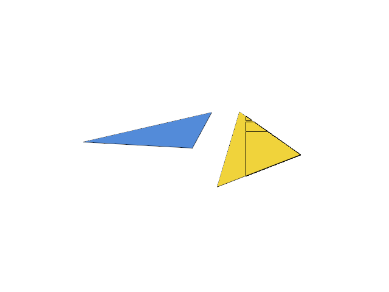

# 13.3 · Feature ancestry and canonical local-to-world placement

**Goal:** Describe the original sheet side-table layout and entity identity fields. · **Steps:** 6 · **Source:** [app/scene_instances.rs](../../../src/app/scene_instances.rs) · [engine/gpu/instanced.rs](../../../src/engine/gpu/instanced.rs) · [engine/gpu/slots.rs](../../../src/engine/gpu/slots.rs) · [app/walk/brep_shapes.rs](../../../src/app/walk/brep_shapes.rs) · [app/hierarchy.rs](../../../src/app/hierarchy.rs) · [app/sheet_query.rs](../../../src/app/sheet_query.rs) (`src/app/instances.rs,src/app/sheets.rs,src/engine/gpu/instances.rs`)

<div class="webgpu-schematic" style="width:100%;margin:6px auto;">
<svg xmlns="http://www.w3.org/2000/svg" width="1120" height="200" viewBox="0 0 1120 200" style="width:100%;max-width:100%;height:auto;display:block;margin:0 auto;" role="img">
  <defs>
    <marker id="arr" viewBox="0 0 10 10" refX="8" refY="5" markerWidth="6" markerHeight="6" orient="auto">
      <path d="M 0 1 L 9 5 L 0 9 z" fill="#111111"/>
    </marker>
    <marker id="arrR" viewBox="0 0 10 10" refX="8" refY="5" markerWidth="6" markerHeight="6" orient="auto">
      <path d="M 0 1 L 9 5 L 0 9 z" fill="#dc2626"/>
    </marker>
    <marker id="arrG" viewBox="0 0 10 10" refX="8" refY="5" markerWidth="6" markerHeight="6" orient="auto">
      <path d="M 0 1 L 9 5 L 0 9 z" fill="#16a34a"/>
    </marker>
    <marker id="arrB" viewBox="0 0 10 10" refX="8" refY="5" markerWidth="6" markerHeight="6" orient="auto">
      <path d="M 0 1 L 9 5 L 0 9 z" fill="#2563eb"/>
    </marker>
  </defs>
  <rect x="2" y="2" width="1116" height="196" rx="10" fill="#ffffff" stroke="#111111" stroke-width="2"/>
  <rect x="16" y="14" width="248" height="172" rx="8" fill="#ffffff" stroke="#111111" stroke-width="1.75"/>
  <text paint-order="stroke fill" stroke="#ffffff" stroke-width="5" stroke-linejoin="round" x="140" y="34" text-anchor="middle" font-family="monospace" font-size="11.5" font-weight="700" fill="#111111">1. Lesson 13.3 Code</text>
  <rect x="34" y="48" width="212" height="24" rx="4" fill="#ffffff" stroke="#111111" stroke-width="1.25"/>
  <text paint-order="stroke fill" stroke="#ffffff" stroke-width="5" stroke-linejoin="round" x="140" y="64" text-anchor="middle" font-family="monospace" font-size="10" font-weight="700" fill="#111111">src/nested_placement.rs</text>
  <rect x="34" y="78" width="212" height="24" rx="4" fill="#ffffff" stroke="#111111" stroke-width="1.5"/>
  <text paint-order="stroke fill" stroke="#ffffff" stroke-width="5" stroke-linejoin="round" x="140" y="94" text-anchor="middle" font-family="monospace" font-size="10" font-weight="700" fill="#111111">src/lib.rs</text>
  <rect x="34" y="108" width="212" height="24" rx="4" fill="#ffffff" stroke="#111111" stroke-width="1.25"/>
  <text paint-order="stroke fill" stroke="#ffffff" stroke-width="5" stroke-linejoin="round" x="140" y="124" text-anchor="middle" font-family="monospace" font-size="10" font-weight="700" fill="#111111">src/hierarchy.rs</text>
  <text paint-order="stroke fill" stroke="#ffffff" stroke-width="5" stroke-linejoin="round" x="140" y="172" text-anchor="middle" font-family="monospace" font-size="9.5" fill="#111111">6 Coding Steps</text>
  <line x1="264" y1="100" x2="292" y2="100" stroke="#111111" stroke-width="2" marker-end="url(#arr)"/>
  <rect x="296" y="14" width="248" height="172" rx="8" fill="#ffffff" stroke="#111111" stroke-width="1.75"/>
  <text paint-order="stroke fill" stroke="#ffffff" stroke-width="5" stroke-linejoin="round" x="420" y="34" text-anchor="middle" font-family="monospace" font-size="11.5" font-weight="700" fill="#111111">2. session_viewer/src</text>
  <rect x="314" y="48" width="212" height="26" rx="4" fill="#ffffff" stroke="#111111" stroke-width="1.5"/>
  <text paint-order="stroke fill" stroke="#ffffff" stroke-width="5" stroke-linejoin="round" x="420" y="65" text-anchor="middle" font-family="monospace" font-size="10" font-weight="700" fill="#111111">src/app/instances.rs</text>
  <rect x="314" y="80" width="212" height="26" rx="4" fill="#ffffff" stroke="#111111" stroke-width="1.5"/>
  <text paint-order="stroke fill" stroke="#ffffff" stroke-width="5" stroke-linejoin="round" x="420" y="97" text-anchor="middle" font-family="monospace" font-size="10" font-weight="700" fill="#111111">src/app/sheets.rs</text>
  <rect x="314" y="112" width="212" height="24" rx="4" fill="#ffffff" stroke="#111111" stroke-width="1.5"/>
  <text paint-order="stroke fill" stroke="#ffffff" stroke-width="5" stroke-linejoin="round" x="420" y="128" text-anchor="middle" font-family="monospace" font-size="9.5" font-weight="700" fill="#111111">✓ cargo check (wasm32)</text>
  <text paint-order="stroke fill" stroke="#ffffff" stroke-width="5" stroke-linejoin="round" x="420" y="172" text-anchor="middle" font-family="sans-serif" font-size="10" fill="#111111">Evaluate source ancestry…</text>
  <line x1="544" y1="100" x2="572" y2="100" stroke="#111111" stroke-width="2" marker-end="url(#arr)"/>
  <rect x="576" y="14" width="248" height="172" rx="8" fill="#ffffff" stroke="#111111" stroke-width="1.75"/>
  <text paint-order="stroke fill" stroke="#ffffff" stroke-width="5" stroke-linejoin="round" x="700" y="34" text-anchor="middle" font-family="monospace" font-size="11.5" font-weight="700" fill="#111111">3. Shared Block Definition DAG</text>
  <rect x="644" y="48" width="112" height="28" rx="5" fill="#dbeafe" stroke="#111111" stroke-width="1.75"/>
  <text paint-order="stroke fill" stroke="#ffffff" stroke-width="5" stroke-linejoin="round" x="700" y="66" text-anchor="middle" font-family="monospace" font-size="9.5" font-weight="700" fill="#111111">Def #0 (1 Mesh)</text>
  <line x1="674" y1="76" x2="634" y2="106" stroke="#111111" stroke-width="1.5" marker-end="url(#arr)"/>
  <line x1="726" y1="76" x2="766" y2="106" stroke="#111111" stroke-width="1.5" marker-end="url(#arr)"/>
  <rect x="594" y="110" width="92" height="28" rx="4" fill="#ffffff" stroke="#111111" stroke-width="1.5"/>
  <text paint-order="stroke fill" stroke="#ffffff" stroke-width="5" stroke-linejoin="round" x="640" y="128" text-anchor="middle" font-family="monospace" font-size="9" font-weight="700" fill="#111111">Inst A (M0)</text>
  <rect x="714" y="110" width="92" height="28" rx="4" fill="#ffffff" stroke="#111111" stroke-width="1.5"/>
  <text paint-order="stroke fill" stroke="#ffffff" stroke-width="5" stroke-linejoin="round" x="760" y="128" text-anchor="middle" font-family="monospace" font-size="9" font-weight="700" fill="#111111">Inst B (M1)</text>
  <text paint-order="stroke fill" stroke="#ffffff" stroke-width="5" stroke-linejoin="round" x="700" y="172" text-anchor="middle" font-family="monospace" font-size="9.5" fill="#111111">Feature ancestry and canoni…</text>
  <line x1="824" y1="100" x2="852" y2="100" stroke="#111111" stroke-width="2" marker-end="url(#arr)"/>
  <rect x="856" y="14" width="248" height="172" rx="8" fill="#ffffff" stroke="#111111" stroke-width="1.75"/>
  <text paint-order="stroke fill" stroke="#ffffff" stroke-width="5" stroke-linejoin="round" x="980" y="34" text-anchor="middle" font-family="monospace" font-size="11.5" font-weight="700" fill="#111111">4. 2D Drawing Sheet &amp; Views</text>
  <rect x="888" y="48" width="176" height="92" rx="4" fill="#ffffff" stroke="#111111" stroke-width="2"/>
  <rect x="898" y="56" width="96" height="54" rx="2" fill="#f8fafc" stroke="#111111" stroke-width="1.25"/>
  <text paint-order="stroke fill" stroke="#ffffff" stroke-width="5" stroke-linejoin="round" x="946" y="86" text-anchor="middle" font-family="monospace" font-size="9" font-weight="700" fill="#111111">Detail View</text>
  <rect x="984" y="116" width="72" height="18" rx="2" fill="#fef9c3" stroke="#111111" stroke-width="1.25"/>
  <text paint-order="stroke fill" stroke="#ffffff" stroke-width="5" stroke-linejoin="round" x="1020" y="129" text-anchor="middle" font-family="monospace" font-size="8.5" font-weight="700" fill="#111111">Title Block</text>
  <text paint-order="stroke fill" stroke="#ffffff" stroke-width="5" stroke-linejoin="round" x="980" y="172" text-anchor="middle" font-family="sans-serif" font-size="10" font-weight="700" fill="#111111">Read sheet metadata recor…</text>
</svg>
</div>

## <a id="checkpoint-70-evaluate-source-ancestry-once-per-document"></a>1. Evaluate source ancestry once per document

<div class="webgpu-schematic" style="width:100%;margin:6px auto;">
<svg xmlns="http://www.w3.org/2000/svg" width="1120" height="72" viewBox="0 0 1120 72" style="width:100%;max-width:100%;height:auto;display:block;margin:0 auto;" role="img">
  <defs>
    <marker id="arr" viewBox="0 0 10 10" refX="8" refY="5" markerWidth="6" markerHeight="6" orient="auto">
      <path d="M 0 1 L 9 5 L 0 9 z" fill="#111111"/>
    </marker>
    <marker id="arrR" viewBox="0 0 10 10" refX="8" refY="5" markerWidth="6" markerHeight="6" orient="auto">
      <path d="M 0 1 L 9 5 L 0 9 z" fill="#dc2626"/>
    </marker>
    <marker id="arrG" viewBox="0 0 10 10" refX="8" refY="5" markerWidth="6" markerHeight="6" orient="auto">
      <path d="M 0 1 L 9 5 L 0 9 z" fill="#16a34a"/>
    </marker>
    <marker id="arrB" viewBox="0 0 10 10" refX="8" refY="5" markerWidth="6" markerHeight="6" orient="auto">
      <path d="M 0 1 L 9 5 L 0 9 z" fill="#2563eb"/>
    </marker>
  </defs>
  <rect x="2" y="2" width="1116" height="68" rx="10" fill="#ffffff" stroke="#111111" stroke-width="2"/>
  <rect x="14" y="10" width="252" height="52" rx="6" fill="#ffffff" stroke="#111111" stroke-width="1.5"/>
  <text paint-order="stroke fill" stroke="#ffffff" stroke-width="5" stroke-linejoin="round" x="140" y="30" text-anchor="middle" font-family="monospace" font-size="10.5" font-weight="700" fill="#111111">Step 1 of 6</text>
  <text paint-order="stroke fill" stroke="#ffffff" stroke-width="5" stroke-linejoin="round" x="140" y="48" text-anchor="middle" font-family="monospace" font-size="9.5" fill="#111111">src/nested_placement.rs, sr…</text>
  <line x1="266" y1="36" x2="292" y2="36" stroke="#111111" stroke-width="1.75" marker-end="url(#arr)"/>
  <rect x="296" y="10" width="252" height="52" rx="6" fill="#ffffff" stroke="#111111" stroke-width="1.5"/>
  <text paint-order="stroke fill" stroke="#ffffff" stroke-width="5" stroke-linejoin="round" x="422" y="30" text-anchor="middle" font-family="monospace" font-size="10" font-weight="700" fill="#111111">1. CPU / Rust Input</text>
  <text paint-order="stroke fill" stroke="#ffffff" stroke-width="5" stroke-linejoin="round" x="422" y="48" text-anchor="middle" font-family="sans-serif" font-size="9.5" fill="#111111">canonical Session transfo…</text>
  <line x1="548" y1="36" x2="574" y2="36" stroke="#111111" stroke-width="1.75" marker-end="url(#arr)"/>
  <rect x="578" y="10" width="252" height="52" rx="6" fill="#ffffff" stroke="#111111" stroke-width="1.5"/>
  <text paint-order="stroke fill" stroke="#ffffff" stroke-width="5" stroke-linejoin="round" x="704" y="30" text-anchor="middle" font-family="monospace" font-size="10" font-weight="700" fill="#111111">2. WebGPU / WGSL</text>
  <text paint-order="stroke fill" stroke="#ffffff" stroke-width="5" stroke-linejoin="round" x="704" y="48" text-anchor="middle" font-family="sans-serif" font-size="9.5" fill="#111111">document model</text>
  <line x1="830" y1="36" x2="856" y2="36" stroke="#111111" stroke-width="1.75" marker-end="url(#arr)"/>
  <rect x="860" y="10" width="246" height="52" rx="6" fill="#ffffff" stroke="#111111" stroke-width="1.75"/>
  <text paint-order="stroke fill" stroke="#ffffff" stroke-width="5" stroke-linejoin="round" x="983" y="30" text-anchor="middle" font-family="monospace" font-size="10" font-weight="700" fill="#111111">3. -&gt; src/app/instances.rs</text>
  <text paint-order="stroke fill" stroke="#ffffff" stroke-width="5" stroke-linejoin="round" x="983" y="48" text-anchor="middle" font-family="sans-serif" font-size="9.5" fill="#111111">checked owner lookup</text>
</svg>
</div>

**What this code does:** Evaluate source ancestry once per document.

### 1. `src/nested_placement.rs`

Evaluate canonical source ancestry once before deriving placed display rows.

Create the file and type:

```rust
use session_rust::{Session, Xform};
use std::collections::HashMap;

// Evaluate source ancestry once per document; every original owner then reads its canonical world placement without walking the tree again.
pub fn prepare(
    document: &Session,
    place: &Xform,
) -> Result<HashMap<String, Xform>, &'static str> {
    if !crate::placement::valid(&place.m) {
        return Err("Invalid document placement");
    }
    document
        .world_xforms()
        .into_iter()
        .map(|(guid, matrix)| {
            let matrix = place * &matrix;
            if !crate::placement::valid(&matrix.m) {
                return Err("Nested source placement exceeds the display range");
            }
            Ok((guid, matrix))
        })
        .collect()
}
pub fn model(world: &HashMap<String, Xform>, place: &Xform, guid: &str) -> Xform {
    world
        .get(guid)
        .cloned()
        .unwrap_or_else(|| place.clone())
}
```

### 2. `src/lib.rs`

Register the placement component.

**Locate this existing block:**

```rust
pub mod cad_shape_example;

#[cfg(target_arch = "wasm32")]
```

Edit the existing block to match this code; keep unchanged lines:

```rust
pub mod cad_shape_example;

pub mod nested_placement;

#[cfg(target_arch = "wasm32")]
```

## <a id="checkpoint-70a-keep-original-local-parent-and-world-matrices"></a>2. Keep local, parent, and world matrices

<div class="webgpu-schematic" style="width:100%;margin:6px auto;">
<svg xmlns="http://www.w3.org/2000/svg" width="1120" height="72" viewBox="0 0 1120 72" style="width:100%;max-width:100%;height:auto;display:block;margin:0 auto;" role="img">
  <defs>
    <marker id="arr" viewBox="0 0 10 10" refX="8" refY="5" markerWidth="6" markerHeight="6" orient="auto">
      <path d="M 0 1 L 9 5 L 0 9 z" fill="#111111"/>
    </marker>
    <marker id="arrR" viewBox="0 0 10 10" refX="8" refY="5" markerWidth="6" markerHeight="6" orient="auto">
      <path d="M 0 1 L 9 5 L 0 9 z" fill="#dc2626"/>
    </marker>
    <marker id="arrG" viewBox="0 0 10 10" refX="8" refY="5" markerWidth="6" markerHeight="6" orient="auto">
      <path d="M 0 1 L 9 5 L 0 9 z" fill="#16a34a"/>
    </marker>
    <marker id="arrB" viewBox="0 0 10 10" refX="8" refY="5" markerWidth="6" markerHeight="6" orient="auto">
      <path d="M 0 1 L 9 5 L 0 9 z" fill="#2563eb"/>
    </marker>
  </defs>
  <rect x="2" y="2" width="1116" height="68" rx="10" fill="#ffffff" stroke="#111111" stroke-width="2"/>
  <rect x="14" y="10" width="252" height="52" rx="6" fill="#ffffff" stroke="#111111" stroke-width="1.5"/>
  <text paint-order="stroke fill" stroke="#ffffff" stroke-width="5" stroke-linejoin="round" x="140" y="30" text-anchor="middle" font-family="monospace" font-size="10.5" font-weight="700" fill="#111111">Step 2 of 6</text>
  <text paint-order="stroke fill" stroke="#ffffff" stroke-width="5" stroke-linejoin="round" x="140" y="48" text-anchor="middle" font-family="monospace" font-size="9.5" fill="#111111">src/nested_placement.rs, sr…</text>
  <line x1="266" y1="36" x2="292" y2="36" stroke="#111111" stroke-width="1.75" marker-end="url(#arr)"/>
  <rect x="296" y="10" width="252" height="52" rx="6" fill="#ffffff" stroke="#111111" stroke-width="1.5"/>
  <text paint-order="stroke fill" stroke="#ffffff" stroke-width="5" stroke-linejoin="round" x="422" y="30" text-anchor="middle" font-family="monospace" font-size="10" font-weight="700" fill="#111111">1. CPU / Rust Input</text>
  <text paint-order="stroke fill" stroke="#ffffff" stroke-width="5" stroke-linejoin="round" x="422" y="48" text-anchor="middle" font-family="sans-serif" font-size="9.5" fill="#111111">source local matrix</text>
  <line x1="548" y1="36" x2="574" y2="36" stroke="#111111" stroke-width="1.75" marker-end="url(#arr)"/>
  <rect x="578" y="10" width="252" height="52" rx="6" fill="#ffffff" stroke="#111111" stroke-width="1.5"/>
  <text paint-order="stroke fill" stroke="#ffffff" stroke-width="5" stroke-linejoin="round" x="704" y="30" text-anchor="middle" font-family="monospace" font-size="10" font-weight="700" fill="#111111">2. WebGPU / WGSL</text>
  <text paint-order="stroke fill" stroke="#ffffff" stroke-width="5" stroke-linejoin="round" x="704" y="48" text-anchor="middle" font-family="sans-serif" font-size="9.5" fill="#111111">original world frame</text>
  <line x1="830" y1="36" x2="856" y2="36" stroke="#111111" stroke-width="1.75" marker-end="url(#arr)"/>
  <rect x="860" y="10" width="246" height="52" rx="6" fill="#ffffff" stroke="#111111" stroke-width="1.75"/>
  <text paint-order="stroke fill" stroke="#ffffff" stroke-width="5" stroke-linejoin="round" x="983" y="30" text-anchor="middle" font-family="monospace" font-size="10" font-weight="700" fill="#111111">3. -&gt; src/app/instances.rs</text>
  <text paint-order="stroke fill" stroke="#ffffff" stroke-width="5" stroke-linejoin="round" x="983" y="48" text-anchor="middle" font-family="sans-serif" font-size="9.5" fill="#111111">independent tree node</text>
</svg>
</div>

**What this code does:** Keep original local parent and world matrices.

### 1. `src/nested_placement.rs`

Preserve exact original local transforms and derive changed locals from the current parent.

**Locate this existing block:**

```rust
        .unwrap_or_else(|| place.clone())
}
```

Edit the existing block to match this code; keep unchanged lines:

```rust
        .unwrap_or_else(|| place.clone())
}

#[derive(Clone)]
pub struct Node {
    pub local: Xform,
    pub world: Xform,
    pub parent: Xform,
}
impl Default for Node {
    fn default() -> Self {
        Self {
            local: Xform::identity(),
            world: Xform::identity(),
            parent: Xform::identity(),
        }
    }
}
// Preserve unchanged canonical local transforms exactly; inverse-derived locals are needed only after a row or its parent placement changes.
pub fn saved_local(
    original: &Node,
    parent: &Xform,
    world: &Xform,
) -> Result<Xform, &'static str> {
    if original.parent.m == parent.m && original.world.m == world.m {
        return Ok(original.local.clone());
    }
    Ok(&parent
        .inverse()
        .ok_or("Parent placement cannot be inverted for Save")?
        * world)
}
```

### 2. `src/hierarchy.rs`

Own original local, parent and world matrices alongside tree identities.

Edit these blocks from bottom to top. Keep the surrounding lines unchanged.

**Locate this block:**

```rust
            nodes,
        }));
    }
```

Replace it with:

```rust
            nodes,
        }));
    }

    pub(crate) fn original_placements(
        &mut self,
        key: u32,
        source: &session_rust::Session,
        place: &Xform,
        world: &HashMap<String, Xform>,
    ) {
        let doc = Rc::make_mut(
            self.documents
                .iter_mut()
                .find(|doc| doc.key == key)
                .unwrap(),
        );
        for i in 0..doc.nodes.len() {
            let node = &doc.nodes[i];
            let parent = node
                .parent
                .map_or_else(Xform::identity, |p| {
                    doc.nodes[p].placement.world.clone()
                });
            let local = source
                .xforms
                .get(&node.source.name)
                .cloned()
                .unwrap_or_else(Xform::identity);
            let local = if node.parent.is_none() {
                place * &local
            } else {
                local
            };
            let matrix = world
                .get(&node.source.name)
                .cloned()
                .unwrap_or_else(|| &parent * &local);
            doc.nodes[i].placement = crate::nested_placement::Node {
                local,
                world: matrix,
                parent,
            };
        }
    }
```

**Locate this block:**

```rust
                children: Vec::new(),
            };
            nodes.push(Node {
                portable_guid: uuid::Uuid::new_v4().to_string(),
                source,
                object: object.map(|v| v.0),
```

Replace it with:

```rust
                children: Vec::new(),
            };
            nodes.push(Node {
                placement: Default::default(),
                portable_guid: uuid::Uuid::new_v4().to_string(),
                source,
                object: object.map(|v| v.0),
```

**Locate this block:**

```rust
pub struct Node {
    pub portable_guid: String,
    pub source: proto::TreeNode,
    pub object: Option<ObjectId>,
```

Replace it with:

```rust
pub struct Node {
    pub placement: crate::nested_placement::Node,
    pub portable_guid: String,
    pub source: proto::TreeNode,
    pub object: Option<ObjectId>,
```

### 3. `src/layer_edit.rs`

Give generated layer and geometry nodes explicit identity placement defaults.

Edit these blocks from bottom to top. Keep the surrounding lines unchanged.

**Locate this block:**

```rust
    };
    let child = Branch {
        node: Node {
            portable_guid: source.guid.clone(),
```

Replace it with:

```rust
    };
    let child = Branch {
        node: Node {
            placement: Default::default(),
            portable_guid: source.guid.clone(),
```

**Locate this block:**

```rust
            node: Node {
                portable_guid: source.guid.clone(),
                source,
                object: Some(id),
```

Replace it with:

```rust
            node: Node {
                placement: Default::default(),
                portable_guid: source.guid.clone(),
                source,
                object: Some(id),
```

## <a id="checkpoint-70b-connect-canonical-cached-models-to-every-source-owner"></a>3. Connect canonical cached models to every source owner

<div class="webgpu-schematic" style="width:100%;margin:6px auto;">
<svg xmlns="http://www.w3.org/2000/svg" width="1120" height="72" viewBox="0 0 1120 72" style="width:100%;max-width:100%;height:auto;display:block;margin:0 auto;" role="img">
  <defs>
    <marker id="arr" viewBox="0 0 10 10" refX="8" refY="5" markerWidth="6" markerHeight="6" orient="auto">
      <path d="M 0 1 L 9 5 L 0 9 z" fill="#111111"/>
    </marker>
    <marker id="arrR" viewBox="0 0 10 10" refX="8" refY="5" markerWidth="6" markerHeight="6" orient="auto">
      <path d="M 0 1 L 9 5 L 0 9 z" fill="#dc2626"/>
    </marker>
    <marker id="arrG" viewBox="0 0 10 10" refX="8" refY="5" markerWidth="6" markerHeight="6" orient="auto">
      <path d="M 0 1 L 9 5 L 0 9 z" fill="#16a34a"/>
    </marker>
    <marker id="arrB" viewBox="0 0 10 10" refX="8" refY="5" markerWidth="6" markerHeight="6" orient="auto">
      <path d="M 0 1 L 9 5 L 0 9 z" fill="#2563eb"/>
    </marker>
  </defs>
  <rect x="2" y="2" width="1116" height="68" rx="10" fill="#ffffff" stroke="#111111" stroke-width="2"/>
  <rect x="14" y="10" width="252" height="52" rx="6" fill="#ffffff" stroke="#111111" stroke-width="1.5"/>
  <text paint-order="stroke fill" stroke="#ffffff" stroke-width="5" stroke-linejoin="round" x="140" y="30" text-anchor="middle" font-family="monospace" font-size="10.5" font-weight="700" fill="#111111">Step 3 of 6</text>
  <text paint-order="stroke fill" stroke="#ffffff" stroke-width="5" stroke-linejoin="round" x="140" y="48" text-anchor="middle" font-family="monospace" font-size="9.5" fill="#111111">src/document_source.rs, src…</text>
  <line x1="266" y1="36" x2="292" y2="36" stroke="#111111" stroke-width="1.75" marker-end="url(#arr)"/>
  <rect x="296" y="10" width="252" height="52" rx="6" fill="#ffffff" stroke="#111111" stroke-width="1.5"/>
  <text paint-order="stroke fill" stroke="#ffffff" stroke-width="5" stroke-linejoin="round" x="422" y="30" text-anchor="middle" font-family="monospace" font-size="10" font-weight="700" fill="#111111">1. CPU / Rust Input</text>
  <text paint-order="stroke fill" stroke="#ffffff" stroke-width="5" stroke-linejoin="round" x="422" y="48" text-anchor="middle" font-family="sans-serif" font-size="9.5" fill="#111111">prepared source world map</text>
  <line x1="548" y1="36" x2="574" y2="36" stroke="#111111" stroke-width="1.75" marker-end="url(#arr)"/>
  <rect x="578" y="10" width="252" height="52" rx="6" fill="#ffffff" stroke="#111111" stroke-width="1.5"/>
  <text paint-order="stroke fill" stroke="#ffffff" stroke-width="5" stroke-linejoin="round" x="704" y="30" text-anchor="middle" font-family="monospace" font-size="10" font-weight="700" fill="#111111">2. WebGPU / WGSL</text>
  <text paint-order="stroke fill" stroke="#ffffff" stroke-width="5" stroke-linejoin="round" x="704" y="48" text-anchor="middle" font-family="sans-serif" font-size="9.5" fill="#111111">source rows</text>
  <line x1="830" y1="36" x2="856" y2="36" stroke="#111111" stroke-width="1.75" marker-end="url(#arr)"/>
  <rect x="860" y="10" width="246" height="52" rx="6" fill="#ffffff" stroke="#111111" stroke-width="1.75"/>
  <text paint-order="stroke fill" stroke="#ffffff" stroke-width="5" stroke-linejoin="round" x="983" y="30" text-anchor="middle" font-family="monospace" font-size="10" font-weight="700" fill="#111111">3. -&gt; src/app/instances.rs</text>
  <text paint-order="stroke fill" stroke="#ffffff" stroke-width="5" stroke-linejoin="round" x="983" y="48" text-anchor="middle" font-family="sans-serif" font-size="9.5" fill="#111111">original tree records</text>
</svg>
</div>

**What this code does:** Connect canonical cached models to every source owner.

### 1. `src/document_source.rs`

Connect cached canonical models and exact original tree placement records.

Edit these blocks from bottom to top. Keep the surrounding lines unchanged.

**Locate this block:**

```rust
        || !objects.components.is_empty()
        || !objects.sheets.is_empty()
    {
        return Err("This subject cannot open planes, boxes, assemblies, sheets or instances yet".into());
    }
```

Replace it with:

```rust
        || !objects.components.is_empty()
        || !objects.sheets.is_empty()
    {
        return Err(
            "This subject cannot open planes, boxes, assemblies or sheets yet".into(),
        );
    }
```

**Locate this block:**

```rust
    }
    let origin = Rc::new(crate::origin::Origin::new(&message, bytes));
    let document = Rc::new(Session::from_proto(message).map_err(|e| e.to_string())?);
    Ok(Source {
        document,
        origin,
        tree,
    })
}
```

Replace it with:

```rust
    }
    let origin = Rc::new(crate::origin::Origin::new(&message, bytes));
    let document = Rc::new(Session::from_proto(message).map_err(|e| e.to_string())?);
    let world =
        crate::nested_placement::prepare(&document, place).map_err(str::to_owned)?;
    Ok(Source {
        document,
        origin,
        tree,
        world,
    })
}
```

**Locate this block:**

```rust
use session_rust::{Session, Xform, proto};
use std::{collections::HashSet, rc::Rc};

pub(crate) struct Source {
    pub document: Rc<Session>,
    pub origin: Rc<crate::origin::Origin>,
    pub tree: Option<proto::TreeNode>,
}
pub(crate) fn prepare(
    bytes: &[u8],
```

Replace it with:

```rust
use session_rust::{Session, Xform, proto};
use std::{
    collections::{HashMap, HashSet},
    rc::Rc,
};

pub(crate) struct Source {
    pub document: Rc<Session>,
    pub origin: Rc<crate::origin::Origin>,
    pub tree: Option<proto::TreeNode>,
    pub world: HashMap<String, Xform>,
}
pub(crate) fn prepare(
    bytes: &[u8],
```

### 2. `src/document_geometry.rs`

Connect cached canonical models and exact original tree placement records.

Edit these blocks from bottom to top. Keep the surrounding lines unchanged.

**Locate this block:**

```rust
            guid = uuid::Uuid::new_v4().to_string();
        }
        // The kernel folds legacy instance placement into Session.xforms; combine that canonical placement with tree ancestry once, without another instance transform.
        let model = place
            * &crate::hierarchy::world(
                loaded.tree.as_ref(),
                &loaded.document.xforms,
                instance.guid(),
            );
        let owner =
```

Replace it with:

```rust
            guid = uuid::Uuid::new_v4().to_string();
        }
        // The kernel folds legacy instance placement into Session.xforms; combine that canonical placement with tree ancestry once, without another instance transform.
        let model =
            crate::nested_placement::model(&loaded.world, place, instance.guid());
        let owner =
```

**Locate this block:**

```rust
            let label = source.name.clone();
            let model = place
                * &crate::hierarchy::world(
                    loaded.tree.as_ref(),
                    &loaded.document.xforms,
                    &guid,
                );
            let id = $insert.map_err(str::to_owned)?;
            scene
                .place_following(id, model)
```

Replace it with:

```rust
            let label = source.name.clone();
            let model = crate::nested_placement::model(&loaded.world, place, &guid);
            let id = $insert.map_err(str::to_owned)?;
            scene
                .place_following(id, model)
```

### 3. `src/scene_document.rs`

Connect cached canonical models and exact original tree placement records.

**Locate this existing block:**

```rust
    );
    Rc::make_mut(
```

Edit the existing block to match this code; keep unchanged lines:

```rust
    );
    candidate
        .forest
        .original_placements(key, &source.document, place, &source.world);
    Rc::make_mut(
```

## <a id="checkpoint-70c-save-nested-local-frames-without-flattening"></a>4. Save nested local frames without flattening

<div class="webgpu-schematic" style="width:100%;margin:6px auto;">
<svg xmlns="http://www.w3.org/2000/svg" width="1120" height="72" viewBox="0 0 1120 72" style="width:100%;max-width:100%;height:auto;display:block;margin:0 auto;" role="img">
  <defs>
    <marker id="arr" viewBox="0 0 10 10" refX="8" refY="5" markerWidth="6" markerHeight="6" orient="auto">
      <path d="M 0 1 L 9 5 L 0 9 z" fill="#111111"/>
    </marker>
    <marker id="arrR" viewBox="0 0 10 10" refX="8" refY="5" markerWidth="6" markerHeight="6" orient="auto">
      <path d="M 0 1 L 9 5 L 0 9 z" fill="#dc2626"/>
    </marker>
    <marker id="arrG" viewBox="0 0 10 10" refX="8" refY="5" markerWidth="6" markerHeight="6" orient="auto">
      <path d="M 0 1 L 9 5 L 0 9 z" fill="#16a34a"/>
    </marker>
    <marker id="arrB" viewBox="0 0 10 10" refX="8" refY="5" markerWidth="6" markerHeight="6" orient="auto">
      <path d="M 0 1 L 9 5 L 0 9 z" fill="#2563eb"/>
    </marker>
  </defs>
  <rect x="2" y="2" width="1116" height="68" rx="10" fill="#ffffff" stroke="#111111" stroke-width="2"/>
  <rect x="14" y="10" width="252" height="52" rx="6" fill="#ffffff" stroke="#111111" stroke-width="1.5"/>
  <text paint-order="stroke fill" stroke="#ffffff" stroke-width="5" stroke-linejoin="round" x="140" y="30" text-anchor="middle" font-family="monospace" font-size="10.5" font-weight="700" fill="#111111">Step 4 of 6</text>
  <text paint-order="stroke fill" stroke="#ffffff" stroke-width="5" stroke-linejoin="round" x="140" y="48" text-anchor="middle" font-family="monospace" font-size="9.5" fill="#111111">src/hierarchy.rs, src/neste…</text>
  <line x1="266" y1="36" x2="292" y2="36" stroke="#111111" stroke-width="1.75" marker-end="url(#arr)"/>
  <rect x="296" y="10" width="252" height="52" rx="6" fill="#ffffff" stroke="#111111" stroke-width="1.5"/>
  <text paint-order="stroke fill" stroke="#ffffff" stroke-width="5" stroke-linejoin="round" x="422" y="30" text-anchor="middle" font-family="monospace" font-size="10" font-weight="700" fill="#111111">1. CPU / Rust Input</text>
  <text paint-order="stroke fill" stroke="#ffffff" stroke-width="5" stroke-linejoin="round" x="422" y="48" text-anchor="middle" font-family="sans-serif" font-size="9.5" fill="#111111">current world row</text>
  <line x1="548" y1="36" x2="574" y2="36" stroke="#111111" stroke-width="1.75" marker-end="url(#arr)"/>
  <rect x="578" y="10" width="252" height="52" rx="6" fill="#ffffff" stroke="#111111" stroke-width="1.5"/>
  <text paint-order="stroke fill" stroke="#ffffff" stroke-width="5" stroke-linejoin="round" x="704" y="30" text-anchor="middle" font-family="monospace" font-size="10" font-weight="700" fill="#111111">2. WebGPU / WGSL</text>
  <text paint-order="stroke fill" stroke="#ffffff" stroke-width="5" stroke-linejoin="round" x="704" y="48" text-anchor="middle" font-family="sans-serif" font-size="9.5" fill="#111111">changed-local inverse</text>
  <line x1="830" y1="36" x2="856" y2="36" stroke="#111111" stroke-width="1.75" marker-end="url(#arr)"/>
  <rect x="860" y="10" width="246" height="52" rx="6" fill="#ffffff" stroke="#111111" stroke-width="1.75"/>
  <text paint-order="stroke fill" stroke="#ffffff" stroke-width="5" stroke-linejoin="round" x="983" y="30" text-anchor="middle" font-family="monospace" font-size="10" font-weight="700" fill="#111111">3. -&gt; src/app/instances.rs</text>
  <text paint-order="stroke fill" stroke="#ffffff" stroke-width="5" stroke-linejoin="round" x="983" y="48" text-anchor="middle" font-family="sans-serif" font-size="9.5" fill="#111111">nested saved tree</text>
</svg>
</div>

**What this code does:** Save nested local frames without flattening.

### 1. `src/hierarchy.rs`

Save exact unchanged local frames while preserving current world placement after edits.

**Locate this existing block:**

```rust
    node.parent_guid = parent_guid.to_owned();
    let mut matrix = parent.clone();
    if let Some(id) = original.object {
        let Some(guid) = scene.row_guid(id) else {
            return Ok(None);
        };
        node.name = guid.to_owned();
        matrix = scene
            .placement(id)
            .ok_or("Saved source placement is missing")?;
        let local = &parent
            .inverse()
            .ok_or("Parent placement cannot be inverted for Save")?
            * &matrix;
        if local.m != Xform::identity().m {
            xforms.push(proto::XformEntry {
                guid: guid.to_owned(),
                xform: Some(local.to_proto()),
            });
        }
        placed.insert(id);
    }
```

Edit the existing block to match this code; keep unchanged lines:

```rust
    node.parent_guid = parent_guid.to_owned();
    let mut matrix = parent * &original.placement.local;
    let mut local = original.placement.local.clone();
    if let Some(id) = original.object {
        let Some(guid) = scene.row_guid(id) else {
            return Ok(None);
        };
        node.name = guid.to_owned();
        matrix = scene
            .placement(id)
            .ok_or("Saved source placement is missing")?;
        local =
            crate::nested_placement::saved_local(&original.placement, parent, &matrix)?;
        placed.insert(id);
    }
    if local.m != Xform::identity().m {
        let guid = node.name.clone();
        if let Some(previous) = xforms
            .iter()
            .find(|entry| entry.guid == guid)
        {
            if previous.xform.as_ref() != Some(&local.to_proto()) {
                return Err("Different saved tree placements share a name");
            }
        } else {
            xforms.push(proto::XformEntry {
                guid,
                xform: Some(local.to_proto()),
            });
        }
    }
```

### 2. `src/nested_example.rs`

Copy precise and visible nested original-reference specimens.

Create the file and type:

```rust
use prost::Message;
use session_rust::{Xform, proto};
pub fn message() -> proto::Session {
    let mut mesh = crate::prepared::PreparedMesh::triangle(
        [
            [0.123456789012345, 0., 0.],
            [0.8, 0., 0.],
            [0., 0.8, 0.],
        ],
        [0.1, 0.3, 0.8],
    )
    .unwrap()
    .geometry
    .to_proto();
    mesh.guid = "original-definition".into();
    proto::Session {
        guid: "nested-source".into(),
        name: "Nested placements".into(),
        objects: Some(proto::Objects {
            instances: vec![
                proto::InstanceRef {
                    guid: "turned".into(),
                    definition_guid: mesh.guid.clone(),
                    xform: Some(Xform::translation(0.25, 0., 0.).to_proto()),
                    ..Default::default()
                },
                proto::InstanceRef {
                    guid: "mirrored".into(),
                    definition_guid: mesh.guid.clone(),
                    ..Default::default()
                },
            ],
            ..Default::default()
        }),
        definitions: Some(proto::Objects {
            meshes: vec![mesh],
            ..Default::default()
        }),
        tree: Some(proto::Tree {
            root: Some(proto::TreeNode {
                name: "assembly".into(),
                children: vec![
                    proto::TreeNode {
                        name: "branch".into(),
                        children: vec![proto::TreeNode {
                            name: "turned".into(),
                            ..Default::default()
                        }],
                        ..Default::default()
                    },
                    proto::TreeNode {
                        name: "mirror-branch".into(),
                        children: vec![proto::TreeNode {
                            name: "mirrored".into(),
                            ..Default::default()
                        }],
                        ..Default::default()
                    },
                ],
                ..Default::default()
            }),
            ..Default::default()
        }),
        xforms: vec![
            proto::XformEntry {
                guid: "assembly".into(),
                xform: Some(Xform::translation(1_000_000_000.125, 0., 0.).to_proto()),
            },
            proto::XformEntry {
                guid: "branch".into(),
                xform: Some(Xform::rotation_z(90., true).to_proto()),
            },
            proto::XformEntry {
                guid: "turned".into(),
                xform: Some(Xform::translation(2., 0., 0.).to_proto()),
            },
            proto::XformEntry {
                guid: "mirror-branch".into(),
                xform: Some(Xform::scale_xyz(-1., 1., 1.).to_proto()),
            },
            proto::XformEntry {
                guid: "mirrored".into(),
                xform: Some(Xform::translation(1., 0., 0.).to_proto()),
            },
        ],
        ..Default::default()
    }
}

pub fn visible() -> proto::Session {
    let mut source = message();
    source.xforms[0].xform = Some(Xform::identity().to_proto());
    source.xforms[1].xform = Some(
        (&Xform::translation(-0.7, -0.3, 0.3) * &Xform::rotation_z(45., true))
            .to_proto(),
    );
    source.xforms[2].xform = Some(Xform::translation(0.25, 0., 0.).to_proto());
    source.xforms[3].xform = Some(
        (&Xform::translation(0.7, -0.3, 0.3) * &Xform::scale_xyz(-1., 1., 1.))
            .to_proto(),
    );
    source.xforms[4].xform = Some(Xform::translation(0.25, 0., 0.).to_proto());
    source
}
pub fn bytes() -> Vec<u8> {
    visible().encode_to_vec()
}
```

### 3. `src/lib.rs`

Register the placement component.

**Locate this existing block:**

```rust
pub mod nested_placement;

#[cfg(target_arch = "wasm32")]
```

Edit the existing block to match this code; keep unchanged lines:

```rust
pub mod nested_placement;

pub mod nested_example;

#[cfg(target_arch = "wasm32")]
```

### 4. `src/nested_placement_tests.rs`

Copy exact canonical ancestry, local persistence, overflow, fallback, history and release fixtures.

Create the file and type:

```rust
use crate::{scene::Scene, scene_document};
use prost::Message;
use session_rust::{Xform, proto};
use std::rc::Rc;

#[test]
fn nested_rotated_mirrored_and_legacy_placements_apply_once_and_roundtrip_precise_originals()
 {
    let source = crate::nested_example::message();
    let original = source.definitions.as_ref().unwrap().meshes[0].clone();
    let mut scene = Scene::empty();
    let document_place = Xform::translation(0.125, 0., 0.);
    scene_document::import(
        &mut scene,
        &source.encode_to_vec(),
        "",
        &document_place,
        0.,
    )
    .unwrap();
    let a = &scene.objects()[0];
    let b = &scene.objects()[1];
    assert!(Rc::ptr_eq(&a.mesh, &b.mesh));
    assert_eq!(a.model.m[12], 1_000_000_000.25);
    assert!((a.model.m[13] - 2.25).abs() < 1e-12);
    assert_eq!(b.model.m[12], 999_999_999.25);
    assert_eq!(b.model.m[0], -1.);
    assert_eq!(a.geometry().unwrap().to_proto(), original);
    let bytes = crate::scene_archive::save(&scene).unwrap();
    let bundle = crate::archive::Bundle::decode(&bytes).unwrap();
    let saved = proto::Session::decode(bundle.documents[0].as_slice()).unwrap();
    assert_eq!(
        saved
            .xforms
            .iter()
            .find(|entry| entry.guid == "assembly")
            .unwrap()
            .xform
            .as_ref()
            .unwrap()
            .matrix[12],
        1_000_000_000.25
    );
    assert_eq!(
        saved
            .xforms
            .iter()
            .find(|entry| entry.guid == "branch")
            .unwrap()
            .xform
            .as_ref()
            .unwrap()
            .matrix,
        Xform::rotation_z(90., true).m
    );
    let mut restored = Scene::empty();
    scene_document::open(&mut restored, &bytes).unwrap();
    assert_eq!(restored.objects().len(), 2);
    for before in scene.objects() {
        let guid = scene.instances[&before.id].instance.guid();
        let after = restored
            .objects()
            .iter()
            .find(|row| restored.instances[&row.id].instance.guid() == guid)
            .unwrap();
        for (a, b) in before.model.m.iter().zip(&after.model.m) {
            assert!(
                (a - b).abs() < 1e-12,
                "Canonical placement for {guid}: {a} {b}"
            );
        }
        assert_eq!(
            after.geometry().unwrap().to_proto(),
            original
        );
    }
}
#[test]
fn invalid_composed_placements_are_rejected_before_adoption_and_fallback_uses_document_model_once()
 {
    let mut source = crate::nested_example::message();
    source.xforms[0].xform = Some(Xform::scale_xyz(1e30, 1e30, 1e30).to_proto());
    source.xforms[1].xform = Some(Xform::scale_xyz(1e30, 1e30, 1e30).to_proto());
    let mut scene = Scene::demo();
    let id = scene.objects()[0].id;
    assert!(
        scene_document::import(
            &mut scene,
            &source.encode_to_vec(),
            "",
            &Xform::identity(),
            0.
        )
        .unwrap_err()
        .contains("Nested source placement")
    );
    assert_eq!(scene.objects()[0].id, id);
    let point = session_rust::Point::new(0.123456789012345, 0., 0.);
    let _ = point.guid();
    let source = proto::Session {
        objects: Some(proto::Objects {
            points: vec![point.to_proto()],
            ..Default::default()
        }),
        ..Default::default()
    };
    let mut scene = Scene::empty();
    scene_document::import(
        &mut scene,
        &source.encode_to_vec(),
        "",
        &Xform::translation(0.25, 0., 0.),
        0.,
    )
    .unwrap();
    assert_eq!(scene.points()[0].model.m[12], 0.25);
}
#[test]
fn shared_definition_nested_parent_move_groups_one_undo_and_close_releases_originals() {
    use crate::editor::{Action, Editor};
    let mut scene = Scene::empty();
    scene_document::import(
        &mut scene,
        &crate::nested_example::message().encode_to_vec(),
        "",
        &Xform::identity(),
        0.,
    )
    .unwrap();
    let original = scene.objects()[0].model.m;
    let weak = Rc::downgrade(scene.objects()[0].geometry().unwrap());
    let root = crate::hierarchy::rows(&scene)[0].ids.clone();
    let mut editor = Editor::default();
    editor.apply(Action::Close).unwrap();
    editor
        .apply(Action::Adopt {
            scene: Box::new(scene),
            replace: false,
        })
        .unwrap();
    editor
        .apply(Action::SelectRows {
            ids: root,
            add: false,
            remove: false,
        })
        .unwrap();
    editor
        .apply(Action::Translate([0.25, 0., 0.]))
        .unwrap();
    assert_eq!(
        editor.scene.objects()[0].model.m[12],
        original[12] + 0.25
    );
    editor.apply(Action::Undo).unwrap();
    assert_eq!(editor.scene.objects()[0].model.m, original);
    editor.apply(Action::Redo).unwrap();
    assert_eq!(
        editor.scene.objects()[0].model.m[12],
        original[12] + 0.25
    );
    editor.apply(Action::Close).unwrap();
    assert!(weak.upgrade().is_none());
}
```

### 5. `src/lib.rs`

Register the placement component.

**Locate this existing block:**

```rust
pub mod nested_example;

#[cfg(target_arch = "wasm32")]
```

Edit the existing block to match this code; keep unchanged lines:

```rust
pub mod nested_example;

#[cfg(test)]
mod nested_placement_tests;

#[cfg(target_arch = "wasm32")]
```

## <a id="checkpoint-70d-exercise-rotated-and-mirrored-original-references"></a>5. Exercise rotated and mirrored references

<div class="webgpu-schematic" style="width:100%;margin:6px auto;">
<svg xmlns="http://www.w3.org/2000/svg" width="1120" height="72" viewBox="0 0 1120 72" style="width:100%;max-width:100%;height:auto;display:block;margin:0 auto;" role="img">
  <defs>
    <marker id="arr" viewBox="0 0 10 10" refX="8" refY="5" markerWidth="6" markerHeight="6" orient="auto">
      <path d="M 0 1 L 9 5 L 0 9 z" fill="#111111"/>
    </marker>
    <marker id="arrR" viewBox="0 0 10 10" refX="8" refY="5" markerWidth="6" markerHeight="6" orient="auto">
      <path d="M 0 1 L 9 5 L 0 9 z" fill="#dc2626"/>
    </marker>
    <marker id="arrG" viewBox="0 0 10 10" refX="8" refY="5" markerWidth="6" markerHeight="6" orient="auto">
      <path d="M 0 1 L 9 5 L 0 9 z" fill="#16a34a"/>
    </marker>
    <marker id="arrB" viewBox="0 0 10 10" refX="8" refY="5" markerWidth="6" markerHeight="6" orient="auto">
      <path d="M 0 1 L 9 5 L 0 9 z" fill="#2563eb"/>
    </marker>
  </defs>
  <rect x="2" y="2" width="1116" height="68" rx="10" fill="#ffffff" stroke="#111111" stroke-width="2"/>
  <rect x="14" y="10" width="252" height="52" rx="6" fill="#ffffff" stroke="#111111" stroke-width="1.5"/>
  <text paint-order="stroke fill" stroke="#ffffff" stroke-width="5" stroke-linejoin="round" x="140" y="30" text-anchor="middle" font-family="monospace" font-size="10.5" font-weight="700" fill="#111111">Step 5 of 6</text>
  <text paint-order="stroke fill" stroke="#ffffff" stroke-width="5" stroke-linejoin="round" x="140" y="48" text-anchor="middle" font-family="monospace" font-size="9.5" fill="#111111">src/editor.rs, src/commands…</text>
  <line x1="266" y1="36" x2="292" y2="36" stroke="#111111" stroke-width="1.75" marker-end="url(#arr)"/>
  <rect x="296" y="10" width="252" height="52" rx="6" fill="#ffffff" stroke="#111111" stroke-width="1.5"/>
  <text paint-order="stroke fill" stroke="#ffffff" stroke-width="5" stroke-linejoin="round" x="422" y="30" text-anchor="middle" font-family="monospace" font-size="10" font-weight="700" fill="#111111">1. CPU / Rust Input</text>
  <text paint-order="stroke fill" stroke="#ffffff" stroke-width="5" stroke-linejoin="round" x="422" y="48" text-anchor="middle" font-family="sans-serif" font-size="9.5" fill="#111111">nested source branches</text>
  <line x1="548" y1="36" x2="574" y2="36" stroke="#111111" stroke-width="1.75" marker-end="url(#arr)"/>
  <rect x="578" y="10" width="252" height="52" rx="6" fill="#ffffff" stroke="#111111" stroke-width="1.5"/>
  <text paint-order="stroke fill" stroke="#ffffff" stroke-width="5" stroke-linejoin="round" x="704" y="30" text-anchor="middle" font-family="monospace" font-size="10" font-weight="700" fill="#111111">2. WebGPU / WGSL</text>
  <text paint-order="stroke fill" stroke="#ffffff" stroke-width="5" stroke-linejoin="round" x="704" y="48" text-anchor="middle" font-family="sans-serif" font-size="9.5" fill="#111111">independent integer owners</text>
  <line x1="830" y1="36" x2="856" y2="36" stroke="#111111" stroke-width="1.75" marker-end="url(#arr)"/>
  <rect x="860" y="10" width="246" height="52" rx="6" fill="#ffffff" stroke="#111111" stroke-width="1.75"/>
  <text paint-order="stroke fill" stroke="#ffffff" stroke-width="5" stroke-linejoin="round" x="983" y="30" text-anchor="middle" font-family="monospace" font-size="10" font-weight="700" fill="#111111">3. -&gt; src/app/instances.rs</text>
  <text paint-order="stroke fill" stroke="#ffffff" stroke-width="5" stroke-linejoin="round" x="983" y="48" text-anchor="middle" font-family="sans-serif" font-size="9.5" fill="#111111">preserved local frames</text>
</svg>
</div>

**What this code does:** Exercise rotated and mirrored original references.

### 1. `src/editor.rs`

Connect nested original examples and exact tree/local diagnostics.

Edit these blocks from bottom to top. Keep the surrounding lines unchanged.

**Locate this block:**

```rust
                let source = std::rc::Rc::new(crate::cloud::example());
                let prepared = crate::cloud::Prepared::new(source)?;
                self.history
                    .try_edit(&mut self.scene, |scene| {
                        scene.insert_cloud(prepared).map(|_| ())
                    })?;
```

Replace it with:

```rust
                let source = std::rc::Rc::new(crate::cloud::example());
                let prepared = crate::cloud::Prepared::new(source)?;
                self.history
                    .try_edit(&mut self.scene, |scene| {
                        scene.insert_cloud(prepared).map(|_| ())
                    })?;
            }
            Action::AddNestedInstances => {
                self.history
                    .try_edit(&mut self.scene, |scene| {
                        crate::scene_document::import(
                            scene,
                            &crate::nested_example::bytes(),
                            "",
                            &session_rust::Xform::identity(),
                            0.,
                        )
                        .map(|_| ())
                        .map_err(|_| "Cannot prepare nested original placements")
                    })?;
```

**Locate this block:**

```rust
    AddShapeReuse,
    AddText(crate::text::TextPlacement),
    AddSurface,
    AddLine,
```

Replace it with:

```rust
    AddShapeReuse,
    AddNestedInstances,
    AddText(crate::text::TextPlacement),
    AddSurface,
    AddLine,
```

### 2. `src/commands.rs`

Connect nested original examples and exact tree/local diagnostics.

**Locate this existing block:**

```rust
    }),
    ("Example Scene Text", || {
```

Edit the existing block to match this code; keep unchanged lines:

```rust
    }),
    ("Example Nested Instances", || {
        Action::AddNestedInstances
    }),
    ("Example Scene Text", || {
```

### 3. `src/browser.rs`

Connect nested original examples and exact tree/local diagnostics.

**Locate this existing block:**

```rust
    canvas.set_attribute("data-canvas-drag",&editor.canvas_drag.as_ref().map_or_else(||"null".into(),|d|serde_json::json!({"from":d.from,"to":d.to,"released":d.released,"missed":d.missed,"preview":d.preview.as_ref().map(|p|p.matrix())}).to_string()))?;
    canvas.set_attribute(
```

Edit the existing block to match this code; keep unchanged lines:

```rust
    canvas.set_attribute("data-canvas-drag",&editor.canvas_drag.as_ref().map_or_else(||"null".into(),|d|serde_json::json!({"from":d.from,"to":d.to,"released":d.released,"missed":d.missed,"preview":d.preview.as_ref().map(|p|p.matrix())}).to_string()))?;
    let local=editor.scene.forest.documents.iter().flat_map(|doc|doc.nodes.iter().map(move |node|serde_json::json!({"document":doc.key,"name":node.source.name,"object":node.object.map(|id|id.value()),"local":node.placement.local.m,"original_world":node.placement.world.m}))).collect::<Vec<_>>();
    canvas.set_attribute(
        "data-original-tree-placements",
        &serde_json::to_string(&local).unwrap(),
    )?;
    canvas.set_attribute(
```

### 4. `src/pick_gpu_tests.rs`

Copy actual high integer owner, rotated/mirrored rendering and nested Save/Open GPU fixtures.

**Locate this existing block:**

```rust
    drop(cache);
    assert!(weak.upgrade().is_none());
}
```

Edit the existing block to match this code; keep unchanged lines:

```rust
    drop(cache);
    assert!(weak.upgrade().is_none());
}

#[test]
fn actual_nested_rotated_and_mirrored_definition_placements_keep_independent_integer_owners()
 {
    let mut scene = Scene::empty();
    scene.next_id = 16_777_217;
    crate::scene_document::import(
        &mut scene,
        &crate::nested_example::bytes(),
        "",
        &session_rust::Xform::identity(),
        0.,
    )
    .unwrap();
    let mut gpu = renderer(&scene);
    assert_eq!(&gpu.instance_usage()[..3], &[1, 2, 320]);
    for row in scene.objects() {
        let point = row
            .model
            .transform_point(&session_rust::Point::new(
                (0.123456789012345 + 0.8) / 3.,
                0.8 / 3.,
                0.,
            ));
        gpu.request_pick(
            [point[0] as f32, point[1] as f32],
            identity(),
        )
        .unwrap();
        assert_eq!(finish(&mut gpu).unwrap()[0], row.id.value());
    }
    let id = scene.objects()[1].id;
    gpu.select_objects(&scene, &[id]).unwrap();
    let pixels = colour_pixels(&mut gpu);
    assert!(
        pixels
            .chunks_exact(4)
            .filter(|p| p[0] > 140 && p[1] > 90 && p[2] < 40)
            .count()
            > 500
    );
    let bytes = crate::scene_archive::save(&scene).unwrap();
    let mut restored = Scene::empty();
    crate::scene_document::open(&mut restored, &bytes).unwrap();
    for a in scene.objects() {
        let guid = scene.instances[&a.id].instance.guid();
        let b = restored
            .objects()
            .iter()
            .find(|row| restored.instances[&row.id].instance.guid() == guid)
            .unwrap();
        for (a, b) in a.model.m.iter().zip(&b.model.m) {
            assert!(
                (a - b).abs() < 1e-12,
                "Canonical placement for {guid}: {a} {b}"
            );
        }
    }
}
```

## <a id="checkpoint-70za-read-original-sheet-metadata-records"></a>6. Read sheet metadata records

<div class="webgpu-schematic" style="width:100%;margin:6px auto;">
<svg xmlns="http://www.w3.org/2000/svg" width="1120" height="72" viewBox="0 0 1120 72" style="width:100%;max-width:100%;height:auto;display:block;margin:0 auto;" role="img">
  <defs>
    <marker id="arr" viewBox="0 0 10 10" refX="8" refY="5" markerWidth="6" markerHeight="6" orient="auto">
      <path d="M 0 1 L 9 5 L 0 9 z" fill="#111111"/>
    </marker>
    <marker id="arrR" viewBox="0 0 10 10" refX="8" refY="5" markerWidth="6" markerHeight="6" orient="auto">
      <path d="M 0 1 L 9 5 L 0 9 z" fill="#dc2626"/>
    </marker>
    <marker id="arrG" viewBox="0 0 10 10" refX="8" refY="5" markerWidth="6" markerHeight="6" orient="auto">
      <path d="M 0 1 L 9 5 L 0 9 z" fill="#16a34a"/>
    </marker>
    <marker id="arrB" viewBox="0 0 10 10" refX="8" refY="5" markerWidth="6" markerHeight="6" orient="auto">
      <path d="M 0 1 L 9 5 L 0 9 z" fill="#2563eb"/>
    </marker>
  </defs>
  <rect x="2" y="2" width="1116" height="68" rx="10" fill="#ffffff" stroke="#111111" stroke-width="2"/>
  <rect x="14" y="10" width="252" height="52" rx="6" fill="#ffffff" stroke="#111111" stroke-width="1.5"/>
  <text paint-order="stroke fill" stroke="#ffffff" stroke-width="5" stroke-linejoin="round" x="140" y="30" text-anchor="middle" font-family="monospace" font-size="10.5" font-weight="700" fill="#111111">Step 6 of 6</text>
  <text paint-order="stroke fill" stroke="#ffffff" stroke-width="5" stroke-linejoin="round" x="140" y="48" text-anchor="middle" font-family="monospace" font-size="9.5" fill="#111111">src/sheet_entity.rs, src/li…</text>
  <line x1="266" y1="36" x2="292" y2="36" stroke="#111111" stroke-width="1.75" marker-end="url(#arr)"/>
  <rect x="296" y="10" width="252" height="52" rx="6" fill="#ffffff" stroke="#111111" stroke-width="1.5"/>
  <text paint-order="stroke fill" stroke="#ffffff" stroke-width="5" stroke-linejoin="round" x="422" y="30" text-anchor="middle" font-family="monospace" font-size="10" font-weight="700" fill="#111111">1. CPU / Rust Input</text>
  <text paint-order="stroke fill" stroke="#ffffff" stroke-width="5" stroke-linejoin="round" x="422" y="48" text-anchor="middle" font-family="sans-serif" font-size="9.5" fill="#111111">original table bytes</text>
  <line x1="548" y1="36" x2="574" y2="36" stroke="#111111" stroke-width="1.75" marker-end="url(#arr)"/>
  <rect x="578" y="10" width="252" height="52" rx="6" fill="#ffffff" stroke="#111111" stroke-width="1.5"/>
  <text paint-order="stroke fill" stroke="#ffffff" stroke-width="5" stroke-linejoin="round" x="704" y="30" text-anchor="middle" font-family="monospace" font-size="10" font-weight="700" fill="#111111">2. WebGPU / WGSL</text>
  <text paint-order="stroke fill" stroke="#ffffff" stroke-width="5" stroke-linejoin="round" x="704" y="48" text-anchor="middle" font-family="sans-serif" font-size="9.5" fill="#111111">revision-bound entity</text>
  <line x1="830" y1="36" x2="856" y2="36" stroke="#111111" stroke-width="1.75" marker-end="url(#arr)"/>
  <rect x="860" y="10" width="246" height="52" rx="6" fill="#ffffff" stroke="#111111" stroke-width="1.75"/>
  <text paint-order="stroke fill" stroke="#ffffff" stroke-width="5" stroke-linejoin="round" x="983" y="30" text-anchor="middle" font-family="monospace" font-size="10" font-weight="700" fill="#111111">3. -&gt; src/app/instances.rs</text>
  <text paint-order="stroke fill" stroke="#ffffff" stroke-width="5" stroke-linejoin="round" x="983" y="48" text-anchor="middle" font-family="sans-serif" font-size="9.5" fill="#111111">cancellable lookup</text>
</svg>
</div>

**What this code does:** Describe the original sheet side-table layout and entity identity fields.

### 1. `src/sheet_entity.rs`

Type the whole original metadata or lookup helpers using their shared owner.

Create the file and type:

```rust
use serde::Deserialize;
use std::cell::Cell;
use std::rc::Rc;

/// Bytes of the table head: `SHM1` then a u32 record count.
pub const HEAD_BYTES: u64 = 8;

/// Bytes of one record: u64 offset, u64 length.
pub const RECORD_BYTES: u64 = 16;

/// Largest entity record accepted.
pub const MAX_BLOB: u64 = 64 * 1024;

/// One sheet entity's identity, from its JSON record.
#[derive(Clone, Debug, Default, Deserialize, PartialEq)]
pub struct EntityMeta {
    #[serde(default)]
    pub guid: String, // source object id
    #[serde(default)]
    pub name: String, // display name
    #[serde(default)]
    pub kind: String, // wall, door, ...
    #[serde(default)]
    pub width: f32, // pen width
    #[serde(default)]
    pub color: Vec<f32>, // pen colour
}

/// The table head, cached per sheet.
#[derive(Clone, Debug)]
pub struct SheetTable {
    pub count: u32,               // records in the table
    pub revision: Option<String>, // ETag every read must match
}

/// The record count from a table head.
pub fn table_count(raw: &[u8]) -> Result<u32, String> {
    if raw.len() != HEAD_BYTES as usize || &raw[..4] != b"SHM1" {
        return Err("Side table head is not SHM1".to_string());
    }

    Ok(u32::from_le_bytes(
        raw[4..8]
            .try_into()
            .expect("exact head checked above"),
    ))
}

/// One record as (offset, length).
pub fn record(raw: &[u8]) -> Result<(u64, u64), String> {
    if raw.len() != RECORD_BYTES as usize {
        return Err("Side table record must contain exactly 16 bytes".to_string());
    }

    Ok((
        u64::from_le_bytes(
            raw[..8]
                .try_into()
                .expect("exact record checked above"),
        ),
        u64::from_le_bytes(
            raw[8..]
                .try_into()
                .expect("exact record checked above"),
        ),
    ))
}

/// Byte position of record `id`; `record_at(count)` starts the blobs.
pub fn record_at(id: u32) -> u64 {
    HEAD_BYTES + RECORD_BYTES * u64::from(id)
}

/// An entity from its JSON; missing keys default.
pub fn entity_from(raw: &[u8]) -> Result<EntityMeta, String> {
    serde_json::from_slice(raw)
        .map_err(|error| format!("Entity record is not valid JSON: {error}"))
}
```

### 2. `src/lib.rs`

Compile this shared original metadata module.

**Locate this existing block:**

```rust
mod nested_placement_tests;

#[cfg(target_arch = "wasm32")]
```

Edit the existing block to match this code; keep unchanged lines:

```rust
mod nested_placement_tests;

pub mod sheet_entity;

#[cfg(target_arch = "wasm32")]
```

## Build & Run



```sh
npm --prefix ../session_tests run course -- dependencies 13.3
cd workspace/journey
REGEN_PROTO=0 cargo build --lib --locked --target wasm32-unknown-unknown -j1
REGEN_PROTO=0 CARGO_BUILD_JOBS=1 trunk serve --port 8780
cd ../..
npm --prefix ../session_tests run course -- check 13.3
npm --prefix ../session_tests run course -- save 13.3
```

Continue with [13.4 · Original sheet entity metadata](70za-read-original-sheet-metadata-records.md).
