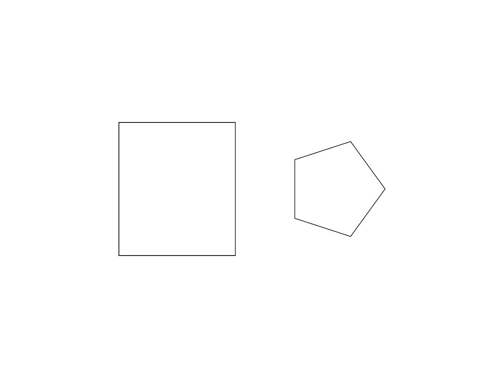

# 14.3 · Planar boundaries and checked solid foundations

**Goal:** Connect tetrahedron and octahedron constructors to the shared radius questions, unit-face cache and placed builder. · **Steps:** 21 · **Source:** [app/walk/sheet.rs](../../../src/app/walk/sheet.rs) · [app/sheet_query.rs](../../../src/app/sheet_query.rs) · [app/stream.rs](../../../src/app/stream.rs) · [app/cplane.rs](../../../src/app/cplane.rs) · [app/coords.rs](../../../src/app/coords.rs) · [app/command/tool/shape.rs](../../../src/app/command/tool/shape.rs) · [app/command/tool/gather.rs](../../../src/app/command/tool/gather.rs) · [app/deform.rs](../../../src/app/deform.rs) (`src/app/cplane.rs,src/app/primitives.rs,src/app/curves.rs`)

<div class="webgpu-schematic" style="width:100%;margin:6px auto;">
<svg xmlns="http://www.w3.org/2000/svg" width="1120" height="188" viewBox="0 0 1120 188" style="width:100%;max-width:100%;height:auto;display:block;margin:0 auto;" role="img">
  <defs>
    <marker id="arr" viewBox="0 0 10 10" refX="8" refY="5" markerWidth="6" markerHeight="6" orient="auto">
      <path d="M 0 1 L 9 5 L 0 9 z" fill="#111111"/>
    </marker>
    <marker id="arrR" viewBox="0 0 10 10" refX="8" refY="5" markerWidth="6" markerHeight="6" orient="auto">
      <path d="M 0 1 L 9 5 L 0 9 z" fill="#dc2626"/>
    </marker>
    <marker id="arrG" viewBox="0 0 10 10" refX="8" refY="5" markerWidth="6" markerHeight="6" orient="auto">
      <path d="M 0 1 L 9 5 L 0 9 z" fill="#16a34a"/>
    </marker>
    <marker id="arrB" viewBox="0 0 10 10" refX="8" refY="5" markerWidth="6" markerHeight="6" orient="auto">
      <path d="M 0 1 L 9 5 L 0 9 z" fill="#2563eb"/>
    </marker>
  </defs>
  <rect x="2" y="2" width="1116" height="184" rx="10" fill="#ffffff" stroke="#111111" stroke-width="2"/>
  <rect x="14" y="12" width="344" height="164" rx="8" fill="#ffffff" stroke="#111111" stroke-width="1.5"/>
  <text paint-order="stroke fill" stroke="#ffffff" stroke-width="5" stroke-linejoin="round" x="186" y="30" text-anchor="middle" font-family="monospace" font-size="10.5" font-weight="700" fill="#111111">Plane (O, u, v, w) + Polar (r, ∠θ) Input</text>
  <circle cx="112" cy="128" r="4" fill="#111111"/>
  <line x1="112" y1="128" x2="246" y2="128" stroke="#dc2626" stroke-width="2" marker-end="url(#arrR)"/>
  <line x1="112" y1="128" x2="112" y2="50" stroke="#16a34a" stroke-width="2" marker-end="url(#arrG)"/>
  <line x1="112" y1="128" x2="212" y2="68" stroke="#2563eb" stroke-width="2.2" marker-end="url(#arrB)"/>
  <path d="M 164 128 A 52 52 0 0 0 156 101" fill="none" stroke="#111111" stroke-width="1.5"/>
  <text paint-order="stroke fill" stroke="#ffffff" stroke-width="5" stroke-linejoin="round" x="176" y="114" font-family="monospace" font-size="10" font-weight="700" fill="#111111">r∠θ</text>
  <line x1="358" y1="94" x2="384" y2="94" stroke="#111111" stroke-width="2" marker-end="url(#arr)"/>
  <rect x="388" y="12" width="344" height="164" rx="8" fill="#ffffff" stroke="#111111" stroke-width="1.5"/>
  <text paint-order="stroke fill" stroke="#ffffff" stroke-width="5" stroke-linejoin="round" x="560" y="30" text-anchor="middle" font-family="monospace" font-size="10.5" font-weight="700" fill="#111111">Rational NURBS Conic Arc + B-Rep Solid Primitives</text>
  <polyline points="424,140 494,52 564,140" fill="none" stroke="#94a3b8" stroke-width="1.5" stroke-dasharray="4 3"/>
  <path d="M 424 140 Q 494 66 564 140" fill="none" stroke="#dc2626" stroke-width="2.5"/>
  <circle cx="494" cy="52" r="4.5" fill="#fef08a" stroke="#111111" stroke-width="1.5"/>
  <text paint-order="stroke fill" stroke="#ffffff" stroke-width="5" stroke-linejoin="round" x="494" y="44" text-anchor="middle" font-family="monospace" font-size="9" font-weight="700" fill="#111111">w = cos(θ/2)</text>
  <ellipse cx="648" cy="72" rx="38" ry="12" fill="#dbeafe" stroke="#111111" stroke-width="1.75"/>
  <path d="M 610 72 L 610 132 A 38 12 0 0 0 686 132 L 686 72" fill="#93c5fd" stroke="#111111" stroke-width="1.75"/>
  <line x1="732" y1="94" x2="758" y2="94" stroke="#111111" stroke-width="2" marker-end="url(#arr)"/>
  <rect x="762" y="12" width="344" height="164" rx="8" fill="#ffffff" stroke="#111111" stroke-width="1.75"/>
  <text paint-order="stroke fill" stroke="#ffffff" stroke-width="5" stroke-linejoin="round" x="934" y="30" text-anchor="middle" font-family="monospace" font-size="10.5" font-weight="700" fill="#111111">Exact Curves + Closed B-Rep Box / Cylinder / Torus</text>
  <rect x="806" y="44" width="256" height="118" rx="4" fill="#ffffff" stroke="#111111" stroke-width="2"/>
  <path d="M 828 138 Q 868 62 908 138" fill="none" stroke="#dc2626" stroke-width="2.5"/>
  <polygon points="928,136 928,82 978,66 978,120" fill="#dbeafe" stroke="#111111" stroke-width="1.75"/>
  <polygon points="978,66 1028,82 1028,136 978,120" fill="#93c5fd" stroke="#111111" stroke-width="1.75"/>
</svg>
</div>

Construct rectangles/polygons in plane axes and prepare reusable right-handed frames and kernel solid builders.

## Ownership and data flow

Two accepted original points determine plane-axis dimensions and a closed polyline. Bound generated point counts and finite values; polygon sides belong to the current draft and preview is a temporary full boundary. World-prefixed replay preserves multiword command meaning. Solid foundation helpers then describe questions, dimensions and right-handed frames, sample temporary wires and validate sizes before building placed kernel boxes, pyramids, holed blocks and regular polyhedra. These helpers do not yet wire every solid question into browser input.

## The maintained implementation

app/command/tool/shape.rs defines Frame, Ask, Kind and checked shape recipes; app/command/verbs registers original constructors. Source geometry remains session_rust Geometry, with preview wires derived from the pending recipe. The next lesson connects reusable builders to one answer/commit owner.

All production paths above are relative to `session_viewer/src`. The implementation below preserves the runnable teaching sequence. Early `src/renderer.rs`, `src/browser.rs` and local WGSL are staged prerequisites; production drawing remains in `engine/gpu`, `engine/pipelines` and `src/shaders`. Later rendering lessons must converge to those maintained paths.

Production source reference: [app/walk/sheet.rs](../../../src/app/walk/sheet.rs), [app/sheet_query.rs](../../../src/app/sheet_query.rs), [app/stream.rs](../../../src/app/stream.rs), [app/cplane.rs](../../../src/app/cplane.rs), [app/coords.rs](../../../src/app/coords.rs), [app/command/tool/shape.rs](../../../src/app/command/tool/shape.rs), [app/command/tool/gather.rs](../../../src/app/command/tool/gather.rs), [app/deform.rs](../../../src/app/deform.rs).

## <a id="checkpoint-73-construct-rectangles-and-polygons-in-plane-axes"></a>1. Construct rectangles and polygons in plane axes

**What this code does:** Construct rectangles and polygons in plane axes.

### 1. `src/planar.rs`

Construct current planar polylines from signed dimensions and a checked orientation frame.

Create the file and type:

```rust
use crate::cplane::CPlane;
use session_rust::{Point, Polyline};

pub fn construction_points(
    kind: &str,
    plane: CPlane,
    sides: usize,
    points: &[Point],
) -> Result<Vec<Point>, String> {
    if kind == "points" {
        return Ok(points.to_vec());
    }
    let [a, b] = points else {
        return Err("Pick two points to complete this polyline".into());
    };
    let (x, y) = plane.axes();
    // a to b, measured along the plane axes
    let u: f64 = (0..3).map(|i| (b[i] - a[i]) * x[i]).sum();
    let v: f64 = (0..3).map(|i| (b[i] - a[i]) * y[i]).sum();
    if kind == "rectangle" {
        if u.abs() <= 1e-12 || v.abs() <= 1e-12 {
            return Err(
                "Rectangle corners must define a nonzero width and height".into(),
            );
        }
        return Ok(Polyline::rectangle(a, &x, &y, u, v, true).get_points());
    }
    let radius = u.hypot(v);
    if radius <= 1e-12 {
        return Err("Polygon radius must be above zero".into());
    }
    let (cos, sin) = (u / radius, v / radius); // turn so a corner lands on b
    Ok(Polyline::from_sides(sides, radius, true)
        .get_points()
        .iter()
        .map(|p| {
            // rotate, then place on the plane
            let px = cos * p[0] - sin * p[1];
            let py = sin * p[0] + cos * p[1];
            Point::new(
                a[0] + px * x[0] + py * y[0],
                a[1] + px * x[1] + py * y[1],
                a[2] + px * x[2] + py * y[2],
            )
        })
        .collect())
}
```

### 2. `src/lib.rs`

Register the planar component.

**Locate this existing block:**

```rust
mod drawing_tests;

#[cfg(target_arch = "wasm32")]
```

Edit the existing block to match this code; keep unchanged lines:

```rust
mod drawing_tests;

pub mod planar;

#[cfg(target_arch = "wasm32")]
```

## <a id="checkpoint-73a-bound-generated-original-construction-points"></a>2. Bound generated construction points

**What this code does:** Bound generated original construction points.

### 1. `src/planar.rs`

Bound original side counts and generated coordinates before preparing the resulting chain.

**Locate this existing block:**

```rust
        .collect())
}
```

Edit the existing block to match this code; keep unchanged lines:

```rust
        .collect())
}

pub fn points(
    kind: &str,
    plane: CPlane,
    sides: usize,
    points: &[[f64; 3]],
) -> Result<Vec<[f64; 3]>, &'static str> {
    if kind == "polygon" && !(3..crate::tool::MAX_POINTS).contains(&sides) {
        return Err("Polygon sides must be between 3 and 4095");
    }
    let points: Vec<_> = points
        .iter()
        .map(|p| Point::new(p[0], p[1], p[2]))
        .collect();
    let result = construction_points(kind, plane, sides, &points).map_err(|_| {
        if kind == "rectangle" {
            "Rectangle corners must define a nonzero width and height"
        } else {
            "Polygon radius must be above zero"
        }
    })?;
    result
        .iter()
        .map(|p| crate::tool_coords::checked([p[0], p[1], p[2]]))
        .collect()
}
```

## <a id="checkpoint-73b-give-point-tools-a-plane-aware-construction-hook"></a>3. Give point tools a plane aware construction hook

**What this code does:** Give point tools a plane aware construction hook.

### 1. `src/tool.rs`

Extend the point-tool interface with original construction frames and temporary boundary hooks.

**Locate this existing block:**

```rust
    fn build(&self, points: &[[f64; 3]]) -> Result<Built, &'static str>;
    fn buttons(&self) -> Vec<(String, String)> {
```

Edit the existing block to match this code; keep unchanged lines:

```rust
    fn build(&self, points: &[[f64; 3]]) -> Result<Built, &'static str>;
    fn build_on_plane(
        &self,
        points: &[[f64; 3]],
        _plane: crate::cplane::CPlane,
    ) -> Result<Built, &'static str> {
        self.build(points)
    }
    fn outline(
        &self,
        points: &[[f64; 3]],
        _plane: crate::cplane::CPlane,
    ) -> Vec<[f64; 3]> {
        points.to_vec()
    }
    fn sides(&self) -> Option<usize> {
        None
    }
    fn set_sides(&mut self, _sides: usize) -> Result<(), &'static str> {
        Err("Sides works while drawing a polygon")
    }
    fn buttons(&self) -> Vec<(String, String)> {
```

## <a id="checkpoint-73c-build-original-rectangle-and-polygon-tool-results"></a>4. Build rectangle and polygon tool results

**What this code does:** Build original rectangle and polygon tool results.

### 1. `src/tool.rs`

Build precise original rectangle and polygon results through the current construction frame.

**Locate this existing block:**

```rust
    Polyline,
}

impl Tool for Shape {
    fn name(&self) -> &'static str {
        match self {
            Self::Point => "Point",
            Self::Line => "Line",
            Self::Move => "Move",
            Self::Polyline => "Polyline",
        }
    }
    fn count(&self) -> usize {
        match self {
            Self::Point => 1,
            Self::Line | Self::Move => 2,
            Self::Polyline => 0,
        }
    }
    fn buttons(&self) -> Vec<(String, String)> {
        let mut buttons = vec![("Cancel".into(), "Escape".into())];
        if matches!(self, Self::Polyline) {
            buttons.insert(0, ("Close".into(), "Close".into()));
        }
        buttons
    }
    fn build(&self, points: &[[f64; 3]]) -> Result<Built, &'static str> {
        match (self, points) {
            (Self::Point, [p]) => Ok(Built::Point(PreparedPoint::new(Rc::new(
                session_rust::Point::new(p[0], p[1], p[2]),
            ))?)),
            (Self::Line, [a, b]) => {
                if a.iter()
                    .zip(b)
                    .all(|(a, b)| (a - b).abs() < 1e-12)
                {
                    return Err("Line endpoints must differ");
                }
                Ok(Built::Line(PreparedLine::new(Rc::new(
                    session_rust::Line::new(a[0], a[1], a[2], b[0], b[1], b[2]),
                ))?))
            }
            (Self::Move, [a, b]) => Ok(Built::Move(std::array::from_fn(|i| {
                b[i] - a[i]
            }))),
            (Self::Polyline, points) if (2..=MAX_POINTS).contains(&points.len()) => {
                if !points.windows(2).any(|p| p[0] != p[1]) {
                    return Err("Polyline points must differ");
                }
                let points = points
                    .iter()
                    .map(|p| session_rust::Point::new(p[0], p[1], p[2]))
                    .collect();
                Ok(Built::Polyline(
                    crate::chain::PreparedChain::polyline(Rc::new(
                        session_rust::Polyline::new(points),
                    ))?,
                ))
            }
```

Edit the existing block to match this code; keep unchanged lines:

```rust
    Polyline,
    Rectangle,
    Polygon { sides: usize },
}

impl Tool for Shape {
    fn name(&self) -> &'static str {
        match self {
            Self::Point => "Point",
            Self::Line => "Line",
            Self::Move => "Move",
            Self::Polyline => "Polyline",
            Self::Rectangle => "Polyline Rectangle",
            Self::Polygon { .. } => "Polyline Polygon",
        }
    }
    fn count(&self) -> usize {
        match self {
            Self::Point => 1,
            Self::Line | Self::Move => 2,
            Self::Polyline => 0,
            Self::Rectangle | Self::Polygon { .. } => 2,
        }
    }
    fn build_on_plane(
        &self,
        points: &[[f64; 3]],
        plane: crate::cplane::CPlane,
    ) -> Result<Built, &'static str> {
        let (kind, sides) = match self {
            Self::Rectangle => ("rectangle", 4),
            Self::Polygon { sides } => ("polygon", *sides),
            _ => return self.build(points),
        };
        let points = crate::planar::points(kind, plane, sides, points)?;
        Self::Polyline.build(&points)
    }
    fn outline(
        &self,
        points: &[[f64; 3]],
        plane: crate::cplane::CPlane,
    ) -> Vec<[f64; 3]> {
        match self {
            Self::Rectangle if points.len() == 2 => {
                crate::planar::points("rectangle", plane, 4, points).unwrap_or_default()
            }
            Self::Polygon { sides } if points.len() == 2 => {
                crate::planar::points("polygon", plane, *sides, points)
                    .unwrap_or_default()
            }
            _ => points.to_vec(),
        }
    }
    fn buttons(&self) -> Vec<(String, String)> {
        let mut buttons = vec![("Cancel".into(), "Escape".into())];
        if matches!(self, Self::Polyline) {
            buttons.insert(0, ("Close".into(), "Close".into()));
        }
        buttons
    }
    fn build(&self, points: &[[f64; 3]]) -> Result<Built, &'static str> {
        match (self, points) {
            (Self::Point, [p]) => Ok(Built::Point(PreparedPoint::new(Rc::new(
                session_rust::Point::new(p[0], p[1], p[2]),
            ))?)),
            (Self::Line, [a, b]) => {
                if a.iter()
                    .zip(b)
                    .all(|(a, b)| (a - b).abs() < 1e-12)
                {
                    return Err("Line endpoints must differ");
                }
                Ok(Built::Line(PreparedLine::new(Rc::new(
                    session_rust::Line::new(a[0], a[1], a[2], b[0], b[1], b[2]),
                ))?))
            }
            (Self::Move, [a, b]) => Ok(Built::Move(std::array::from_fn(|i| {
                b[i] - a[i]
            }))),
            (Self::Polyline, points) if (2..=MAX_POINTS).contains(&points.len()) => {
                if !points.windows(2).any(|p| p[0] != p[1]) {
                    return Err("Polyline points must differ");
                }
                let points = points
                    .iter()
                    .map(|p| session_rust::Point::new(p[0], p[1], p[2]))
                    .collect();
                Ok(Built::Polyline(
                    crate::chain::PreparedChain::polyline(Rc::new(
                        session_rust::Polyline::new(points),
                    ))?,
                ))
            }
            (Self::Rectangle | Self::Polygon { .. }, _) => {
                self.build_on_plane(points, crate::cplane::CPlane::Xy)
            }
```

## <a id="checkpoint-73d-preserve-world-replay-for-multiword-construction-names"></a>5. Preserve world replay for multiword construction names

**What this code does:** Preserve world replay for multiword construction names.

### 1. `src/tool.rs`

Replay original world points independently of multiword names and derive temporary construction boundaries.

**Locate this existing block:**

```rust
        let command = self.command(points);
        let text = command
            .split_once(' ')
            .map_or("", |(_, text)| text);
        let world = crate::drawing_input::points(
            text,
            crate::drawing_coords::plane(),
            self.frame,
            &[],
            None,
        )?;
        self.tool.build(&world)
    }
```

Edit the existing block to match this code; keep unchanged lines:

```rust
        let command = self.command(points);
        let text = &command[self.tool.name().len()..];
        let world = crate::drawing_input::points(
            text,
            crate::drawing_coords::plane(),
            self.frame,
            &[],
            None,
        )?;
        self.tool.build_on_plane(&world, self.frame)
    }
    pub fn outline(&self) -> Vec<[f64; 3]> {
        let mut points = self.points.clone();
        if let Some(cursor) = self.cursor {
            points.push(cursor);
        }
        self.tool.outline(&points, self.frame)
    }
```

## <a id="checkpoint-73e-keep-polygon-sides-in-the-current-draft"></a>6. Keep polygon sides in the current draft

**What this code does:** Keep polygon sides in the current draft.

### 1. `src/tool.rs`

Keep validated polygon side counts beside unfinished original input.

Edit these blocks from bottom to top. Keep the surrounding lines unchanged.

**Locate this block:**

```rust
                self.tool.count()
            )
        };
        if let Some(kind) = self.snapped {
```

Replace it with:

```rust
                self.tool.count()
            )
        };
        if let Some(sides) = self.tool.sides() {
            prompt.push_str(&format!(" · Sides {sides}"));
        }
        if let Some(kind) = self.snapped {
```

**Locate this block:**

```rust
    }
    fn build_on_plane(
        &self,
        points: &[[f64; 3]],
```

Replace it with:

```rust
    }
    fn sides(&self) -> Option<usize> {
        if let Self::Polygon { sides } = self {
            Some(*sides)
        } else {
            None
        }
    }
    fn set_sides(&mut self, value: usize) -> Result<(), &'static str> {
        if !(3..MAX_POINTS).contains(&value) {
            return Err("Polygon sides must be between 3 and 4095");
        }
        let Self::Polygon { sides } = self else {
            return Err("Sides works while drawing a polygon");
        };
        *sides = value;
        Ok(())
    }
    fn build_on_plane(
        &self,
        points: &[[f64; 3]],
```

### 2. `src/editor.rs`

Route bounded Sides input to the current unfinished Polygon and preserve original draft points.

Edit these blocks from bottom to top. Keep the surrounding lines unchanged.

**Locate this block:**

```rust
            self.plane_only = false;
        }
        match action {
            Action::ConstructionPlane(plane) => {
```

Replace it with:

```rust
            self.plane_only = false;
        }
        match action {
            Action::ToolSides(sides) => {
                let draft = self
                    .draft
                    .as_mut()
                    .ok_or("Sides works while drawing a polygon")?;
                draft.tool.set_sides(sides)?;
                self.tool_status = draft.prompt();
                return Ok(Change::View);
            }
            Action::ConstructionPlane(plane) => {
```

**Locate this block:**

```rust
                | Action::ConstructionPlane(_)
                | Action::PlaneMenu
                | Action::Plane3
                | Action::ToolPoint(_)
                | Action::ToolScreen { .. }
                | Action::ToolHover(_)
```

Replace it with:

```rust
                | Action::ConstructionPlane(_)
                | Action::PlaneMenu
                | Action::Plane3
                | Action::ToolSides(_)
                | Action::ToolPoint(_)
                | Action::ToolScreen { .. }
                | Action::ToolHover(_)
```

**Locate this block:**

```rust
            ));
        }
        let word = text.trim();
        let coordinate = crate::drawing_coords::parse_world(word).is_some()
            || word.contains(',')
            || word.contains('<')
```

Replace it with:

```rust
            ));
        }
        let word = text.trim();
        if word
            .split_whitespace()
            .next()
            .is_some_and(|s| s.eq_ignore_ascii_case("Sides"))
            && draft.tool.sides().is_some()
        {
            let parts: Vec<_> = word.split_whitespace().collect();
            return Some(match parts.as_slice() {
                [_name, value] => value
                    .parse::<usize>()
                    .ok()
                    .filter(|n| (3..crate::tool::MAX_POINTS).contains(n))
                    .map(Action::ToolSides)
                    .ok_or("Polygon sides must be between 3 and 4095"),
                _ => Err("Use Sides 6"),
            });
        }
        let coordinate = crate::drawing_coords::parse_world(word).is_some()
            || word.contains(',')
            || word.contains('<')
```

**Locate this block:**

```rust
    StreamRefresh,
    ConstructionPlane(Option<crate::cplane::CPlane>),
    PlaneMenu,
    Plane3,
```

Replace it with:

```rust
    StreamRefresh,
    ToolSides(usize),
    ConstructionPlane(Option<crate::cplane::CPlane>),
    PlaneMenu,
    Plane3,
```

## <a id="checkpoint-73f-register-current-planar-options-and-temporary-outlines"></a>7. Register current planar options and temporary outlines

**What this code does:** Register current planar options and temporary outlines.

### 1. `src/tool.rs`

Offer current planar construction choices on the Polyline tools.

**Locate this existing block:**

```rust
        let mut buttons = vec![("Cancel".into(), "Escape".into())];
        if matches!(self, Self::Polyline) {
```

Edit the existing block to match this code; keep unchanged lines:

```rust
        let mut buttons = vec![("Cancel".into(), "Escape".into())];
        if matches!(
            self,
            Self::Polyline | Self::Rectangle | Self::Polygon { .. }
        ) {
            for name in ["Points", "Rectangle", "Polygon"] {
                buttons.push((name.into(), format!("Polyline {name}")));
            }
        }
        if matches!(self, Self::Polyline) {
```

### 2. `src/commands.rs`

Register current Polyline Points, Rectangle and Polygon options and direct coordinates.

Edit these blocks from bottom to top. Keep the surrounding lines unchanged.

**Locate this block:**

```rust
            .map(Command::Editor)
            .ok_or_else(|| "CPlane (XY XZ YZ 3 Point View Cancel)".into());
    }
    if matches!(name, "Point" | "Line" | "Polyline") && words.len() > count {
        let shape = match name {
            "Point" => crate::tool::Shape::Point,
            "Line" => crate::tool::Shape::Line,
            _ => crate::tool::Shape::Polyline,
```

Replace it with:

```rust
            .map(Command::Editor)
            .ok_or_else(|| "CPlane (XY XZ YZ 3 Point View Cancel)".into());
    }
    if matches!(
        name,
        "Point"
            | "Line"
            | "Polyline"
            | "Polyline Points"
            | "Polyline Rectangle"
            | "Polyline Polygon"
    ) && words.len() > count
    {
        let shape = match name {
            "Point" => crate::tool::Shape::Point,
            "Line" => crate::tool::Shape::Line,
            "Polyline Rectangle" => crate::tool::Shape::Rectangle,
            "Polyline Polygon" => crate::tool::Shape::Polygon { sides: 6 },
            _ => crate::tool::Shape::Polyline,
```

**Locate this block:**

```rust
    }),
    ("CPlane", || Action::PlaneMenu),
    ("Hide", || Action::Hide),
    ("Show", || Action::Show),
```

Replace it with:

```rust
    }),
    ("Polyline Points", || {
        Action::BeginTool(crate::tool::Shape::Polyline)
    }),
    ("Polyline Rectangle", || {
        Action::BeginTool(crate::tool::Shape::Rectangle)
    }),
    ("Polyline Polygon", || {
        Action::BeginTool(crate::tool::Shape::Polygon { sides: 6 })
    }),
    ("CPlane", || Action::PlaneMenu),
    ("Hide", || Action::Hide),
    ("Show", || Action::Show),
```

### 3. `src/tool_preview.rs`

Draw complete temporary construction boundaries while retaining the current cursor marker.

**Locate this existing block:**

```rust
        if let Some(draft) = draft {
            for pair in draft.points.windows(2) {
                if pair[0] != pair[1] {
                    strokes.push(crate::stroke::Stroke {
                        start: pair[0].map(|v| v as f32),
                        end: pair[1].map(|v| v as f32),
                        width: 2.,
                        colour: yellow,
                    });
                }
            }
            if let Some(cursor) = draft.cursor {
                markers.push(crate::marker::Marker {
                    center: cursor.map(|v| v as f32),
                    diameter: 8.,
                    colour: yellow,
                });
                if let Some(&start) = draft.points.last().filter(|&&p| p != cursor) {
                    strokes.push(crate::stroke::Stroke {
                        start: start.map(|v| v as f32),
                        end: cursor.map(|v| v as f32),
                        width: 2.,
                        colour: yellow,
                    });
                }
            }
```

Edit the existing block to match this code; keep unchanged lines:

```rust
        if let Some(draft) = draft {
            for pair in draft.outline().windows(2) {
                if pair[0] != pair[1] {
                    strokes.push(crate::stroke::Stroke {
                        start: pair[0].map(|v| v as f32),
                        end: pair[1].map(|v| v as f32),
                        width: 2.,
                        colour: yellow,
                    });
                }
            }
            if let Some(cursor) = draft.cursor {
                markers.push(crate::marker::Marker {
                    center: cursor.map(|v| v as f32),
                    diameter: 8.,
                    colour: yellow,
                });
            }
```

## <a id="checkpoint-73g-exercise-oriented-original-planar-constructions"></a>8. Exercise oriented planar constructions

**What this code does:** Exercise oriented original planar constructions.

### 1. `src/planar_tests.rs`

Copy current oriented construction, original archive, side-cap, failed-input and temporary-preview fixtures.

Create the file and type:

```rust
use crate::{
    cplane::CPlane,
    editor::{Action, Editor},
    tool::{Draft, Shape},
};
use session_rust::Point;
fn editor() -> Editor {
    let mut e = Editor::default();
    e.apply(Action::Close).unwrap();
    e
}
fn command(e: &mut Editor, text: &str) -> Result<(), String> {
    let action = if let Some(action) = e.tool_line(text) {
        action.map_err(str::to_owned)?
    } else {
        let crate::commands::Command::Editor(action) = crate::commands::parse(text)?
        else {
            return Err("Editor command".into());
        };
        action
    };
    e.apply(action).map_err(str::to_owned)?;
    Ok(())
}
fn tilted() -> CPlane {
    CPlane::from_3_points(
        &Point::new(4., 5., 6.),
        &Point::new(5., 5., 7.),
        &Point::new(4., 6., 6.),
    )
    .unwrap()
}
#[test]
fn a_rectangle_uses_plane_axes_and_retains_closed_original_points() {
    let mut e = editor();
    command(&mut e, "CPlane XZ").unwrap();
    command(&mut e, "Polyline Rectangle 1,2 @3,4").unwrap();
    assert_eq!(
        e.scene.paths()[0]
            .prepared
            .source
            .coordinates(),
        vec![
            [1., 0., 2.],
            [4., 0., 2.],
            [4., 0., 6.],
            [1., 0., 6.],
            [1., 0., 2.]
        ]
    );
    command(&mut e, "Undo").unwrap();
    assert!(e.scene.paths().is_empty());
    command(&mut e, "Redo").unwrap();
    assert_eq!(e.scene.paths().len(), 1);
}
#[test]
fn polygon_sides_are_bounded_and_one_corner_lands_on_the_second_point() {
    let mut e = editor();
    command(&mut e, "CPlane XY").unwrap();
    command(&mut e, "Polyline Polygon").unwrap();
    command(&mut e, "Sides 5").unwrap();
    command(&mut e, "w0,0,0").unwrap();
    for value in [
        "Sides 2",
        "Sides 4096",
        "Sides -1",
        "Sides NaN",
        "Sides 4 extra",
    ] {
        assert!(command(&mut e, value).is_err());
        assert_eq!(
            e.draft.as_ref().unwrap().tool.sides(),
            Some(5)
        );
    }
    command(&mut e, "w0,2,0").unwrap();
    let points = e.scene.paths()[0]
        .prepared
        .source
        .coordinates();
    assert_eq!(points.len(), 6);
    assert_eq!(points[0], points[5]);
    assert!((points[0][0]).abs() < 1e-12 && (points[0][1] - 2.).abs() < 1e-12);
    for p in points {
        assert!((p[0].hypot(p[1]) - 2.).abs() < 1e-12);
    }
}
#[test]
fn tilted_constructions_preserve_world_prefixes_and_original_archive_columns() {
    let mut e = editor();
    let plane = tilted();
    e.apply(Action::ConstructionPlane(Some(plane)))
        .unwrap();
    command(&mut e, "Polyline Rectangle").unwrap();
    command(&mut e, "0,0").unwrap();
    command(&mut e, "1,2").unwrap();
    let points = e.scene.paths()[0]
        .prepared
        .source
        .coordinates();
    for p in &points {
        assert!(plane.local(&Point::new(p[0], p[1], p[2]))[2].abs() < 1e-12);
    }
    assert_eq!(points[0], [4., 5., 6.]);
    let bytes = crate::scene_archive::save(&e.scene).unwrap();
    e.apply(Action::Close).unwrap();
    crate::scene_document::open(&mut e.scene, &bytes).unwrap();
    assert_eq!(
        e.scene.paths()[0]
            .prepared
            .source
            .coordinates(),
        points
    );
}
#[test]
fn invalid_construction_keeps_accepted_points_and_existing_redo() {
    let mut e = editor();
    command(&mut e, "Polyline Rectangle w0,0 w1,2").unwrap();
    command(&mut e, "Undo").unwrap();
    command(&mut e, "Polyline Rectangle").unwrap();
    command(&mut e, "w0,0").unwrap();
    assert!(command(&mut e, "w1,0").is_err());
    assert_eq!(
        e.draft.as_ref().unwrap().points,
        vec![[0.; 3]]
    );
    command(&mut e, "Escape").unwrap();
    command(&mut e, "Redo").unwrap();
    assert_eq!(e.scene.paths().len(), 1);
    command(&mut e, "Polyline Polygon w0,0 w0,0").unwrap_err();
    assert!(e.draft.is_none());
    assert_eq!(e.scene.paths().len(), 1);
}
#[test]
fn planar_preview_is_temporary_and_constructs_the_complete_boundary() {
    let mut draft = Draft::new(Shape::Rectangle);
    draft.submit([0.; 3]).unwrap();
    draft.hover(Some([1., 2., 0.])).unwrap();
    assert_eq!(draft.outline().len(), 5);
    assert_eq!(draft.points.len(), 1);
    draft.hover(Some([1., 0., 0.])).unwrap();
    assert!(draft.outline().is_empty());
    assert_eq!(draft.points.len(), 1);
    let mut polygon = Draft::new(Shape::Polygon { sides: 5 });
    polygon.submit([0.; 3]).unwrap();
    polygon.hover(Some([1., 0., 0.])).unwrap();
    assert_eq!(polygon.outline().len(), 6);
    assert_eq!(polygon.points.len(), 1);
}
#[test]
fn polygon_maximum_leaves_space_for_the_closing_original_point() {
    let points = crate::planar::points(
        "polygon",
        CPlane::Xy,
        4095,
        &[[0.; 3], [1., 0., 0.]],
    )
    .unwrap();
    assert_eq!(points.len(), 4096);
    assert_eq!(points[0], points[4095]);
    assert!(
        crate::planar::points(
            "polygon",
            CPlane::Xy,
            4096,
            &[[0.; 3], [1., 0., 0.]]
        )
        .is_err()
    );
}
```

### 2. `src/lib.rs`

Register the planar component.

**Locate this existing block:**

```rust
pub mod planar;

#[cfg(target_arch = "wasm32")]
```

Edit the existing block to match this code; keep unchanged lines:

```rust
pub mod planar;

#[cfg(test)]
mod planar_tests;

#[cfg(target_arch = "wasm32")]
```

## <a id="checkpoint-73h-match-solid-command-options"></a>9. Match solid command options

**What this code does:** Compare normalized option words while keeping Enter and Escape outside shape choices..

### 1. `src/primitive_options.rs`

Normalize option labels once and consume matching input words.

Create the file and type:

```rust
/// Option labels, excluding the Enter and Escape actions.
pub(crate) fn choices(
    chips: &'static [(&str, &str)],
) -> impl Iterator<Item = &'static str> {
    chips.iter().filter_map(|&(label, line)| {
        if line.is_empty() || line == "Escape" {
            None
        } else {
            Some(label)
        }
    })
}

/// Match an option and return its index and consumed word count.
pub(crate) fn find(
    chips: &'static [(&str, &str)],
    words: &[&str],
) -> Option<(usize, usize)> {
    for (index, label) in choices(chips).enumerate() {
        let target = compact(label);
        let mut typed = String::new();

        for (count, word) in words.iter().enumerate() {
            typed.push_str(&word.to_ascii_lowercase());

            if typed == target {
                return Some((index, count + 1));
            }

            if !target.starts_with(&typed) {
                break;
            }
        }
    }

    None
}

/// Lowercase without spaces.
pub(crate) fn compact(text: &str) -> String {
    text.split_whitespace()
        .collect::<String>()
        .to_ascii_lowercase()
}
```

### 2. `src/lib.rs`

Register the shared option matcher.

**Locate this existing block:**

```rust
mod planar_tests;

#[cfg(target_arch = "wasm32")]
```

Edit the existing block to match this code; keep unchanged lines:

```rust
mod planar_tests;

pub mod primitive_options;

#[cfg(target_arch = "wasm32")]
```

## <a id="checkpoint-73i-describe-solid-command-questions"></a>10. Describe solid command questions

**What this code does:** Represent typed coordinates and numbers explicitly.

### 1. `src/primitive_shape.rs`

Describe the solid answers and questions using kernel points.

Create the file and type:

```rust
use crate::primitive_options as options;
use session_rust::{BRep, Geometry, Mesh, Plane, Point, Polyline, Vector, Xform};
use std::{collections::HashMap, rc::Rc, sync::OnceLock};

pub const MESH_QUALITY: (f64, f64) = (10.0, 0.002); // tessellation of a Mesh option: degrees, chord factor
pub const RING: usize = 64; // preview samples of a full circle

pub const BREP_MESH: &[(&str, &str)] = &[
    ("Brep", "Brep"),
    ("Mesh", "Mesh"),
    ("Cancel", "Escape"),
];
pub const MESH_ONLY: &[(&str, &str)] = &[("Mesh", "Mesh"), ("Cancel", "Escape")];
pub const CURVE: &[(&str, &str)] = &[("Cancel", "Escape")];

/// One answer to a shape's question.
#[derive(Clone, Debug)]
pub enum Answer {
    Point(Point), // clicked or typed coordinates
    Number(f64),  // a typed value
}

/// How a question reads a bare number.
#[derive(Clone, Copy, Debug, PartialEq)]
pub enum Kind {
    Point,  // a distance along the rubber band
    Size,   // the value itself
    Height, // the value itself; clicks follow the normal through the first point
}

/// One question a shape asks.
#[derive(Clone, Copy, Debug)]
pub struct Ask {
    pub prompt: &'static str, // what the answer is for
    pub kind: Kind,           // how a number and a click count
    pub default: Option<f64>, // what Enter takes
}

impl Ask {
    /// A point question.
    pub fn point(prompt: &'static str) -> Self {
        Self {
            prompt,
            kind: Kind::Point,
            default: None,
        }
    }

    /// A click or a number.
    pub fn size(prompt: &'static str) -> Self {
        Self {
            prompt,
            kind: Kind::Size,
            default: None,
        }
    }

    /// A click along the normal or a number.
    pub fn height(prompt: &'static str) -> Self {
        Self {
            prompt,
            kind: Kind::Height,
            default: None,
        }
    }

    /// Enter takes `value`.
    pub fn or(self, value: f64) -> Self {
        Self {
            default: Some(value),
            ..self
        }
    }
}
```

### 2. `src/lib.rs`

Register the foundation as it is written.

**Locate this existing block:**

```rust
pub mod primitive_options;

#[cfg(target_arch = "wasm32")]
```

Edit the existing block to match this code; keep unchanged lines:

```rust
pub mod primitive_options;

pub mod primitive_shape;

#[cfg(target_arch = "wasm32")]
```

## <a id="checkpoint-73j-build-a-right-handed-solid-frame"></a>11. Build a right-handed solid frame

**What this code does:** Place kernel coordinates in a construction-plane frame.

### 1. `src/primitive_shape.rs`

Continue the shared solid foundation with this lesson’s functions.

**Locate this existing block:**

```rust
    }
}
```

Edit the existing block to match this code; keep unchanged lines:

```rust
    }
}

/// A right-handed frame: in-plane x and y, normal z.
#[derive(Clone, Debug)]
pub struct Frame {
    pub origin: Point, // the first point answered
    pub x: Vector,     // in the plane
    pub y: Vector,     // in the plane
    pub z: Vector,     // the plane normal
}

impl Frame {
    /// The plane's axes at `origin`; z = x × y.
    pub fn new(plane: &Plane, origin: Point) -> Self {
        let (x, y) = (plane.x_axis(), plane.y_axis());
        let z = x.cross(&y);
        Self { origin, x, y, z }
    }

    /// The point at local coordinates.
    pub fn at(&self, u: f64, v: f64, w: f64) -> Point {
        &self.origin + (&self.x * u + &self.y * v + &self.z * w)
    }

    /// Local coordinates of `p`.
    pub fn local(&self, p: &Point) -> [f64; 3] {
        let d = p - &self.origin;
        [
            d.dot(&self.x),
            d.dot(&self.y),
            d.dot(&self.z),
        ]
    }

    /// Turned about z so x points along in-plane (u, v); unchanged for a zero direction.
    pub fn turned(&self, u: f64, v: f64) -> Self {
        let length = u.hypot(v);

        if length <= 1e-300 {
            return self.clone();
        }

        let x = &self.x * (u / length) + &self.y * (v / length);
        let y = self.z.cross(&x);
        Self {
            origin: self.origin.clone(),
            x,
            y,
            z: self.z.clone(),
        }
    }

    /// Upside down: y and z reversed, still a rotation.
    pub fn flipped(&self) -> Self {
        Self {
            origin: self.origin.clone(),
            x: self.x.clone(),
            y: -&self.y,
            z: -&self.z,
        }
    }

    /// The frame and height with the height made positive.
    pub fn upright(&self, height: f64) -> (Self, f64) {
        if height < 0.0 {
            (self.flipped(), -height)
        } else {
            (self.clone(), height)
        }
    }

    /// The axes turned one step: x, y, z become y, z, x.
    pub fn rolled(&self) -> Self {
        Self {
            origin: self.origin.clone(),
            x: self.y.clone(),
            y: self.z.clone(),
            z: self.x.clone(),
        }
    }

    /// Local to world.
    pub fn to_xform(&self) -> Xform {
        Xform::frame_to_world(&self.origin, &self.x, &self.y, &self.z)
    }
}
```

## <a id="checkpoint-73k-sample-solid-preview-wires"></a>12. Sample solid preview wires

**What this code does:** Sample circles and boxes in the existing frame.

### 1. `src/primitive_shape.rs`

Continue the shared solid foundation with this lesson’s functions.

**Locate this existing block:**

```rust
        Xform::frame_to_world(&self.origin, &self.x, &self.y, &self.z)
    }
}
```

Edit the existing block to match this code; keep unchanged lines:

```rust
        Xform::frame_to_world(&self.origin, &self.x, &self.y, &self.z)
    }

    /// A closed ellipse of radii `rx`, `ry` at height `w`.
    pub fn oval(&self, rx: f64, ry: f64, w: f64) -> Vec<Point> {
        (0..=RING)
            .map(|i| {
                let angle = std::f64::consts::TAU * i as f64 / RING as f64;
                self.at(rx * angle.cos(), ry * angle.sin(), w)
            })
            .collect()
    }

    /// A closed circle at height `w`.
    pub fn ring(&self, radius: f64, w: f64) -> Vec<Point> {
        self.oval(radius, radius, w)
    }

    /// A closed rectangle centered on the axis at height `w`.
    pub fn rectangle(&self, sx: f64, sy: f64, w: f64) -> Vec<Point> {
        let corner = self.at(-sx * 0.5, -sy * 0.5, w);
        Polyline::rectangle(&corner, &self.x, &self.y, sx, sy, true).get_points()
    }

    /// A box standing on the plane, `h` along the normal: two rectangles and four edges.
    pub fn cuboid(&self, sx: f64, sy: f64, h: f64) -> Vec<Vec<Point>> {
        let mut wires = vec![
            self.rectangle(sx, sy, 0.0),
            self.rectangle(sx, sy, h),
        ];

        for (u, v) in [
            (-1.0, -1.0),
            (1.0, -1.0),
            (1.0, 1.0),
            (-1.0, 1.0),
        ] {
            wires.push(vec![
                self.at(u * sx * 0.5, v * sy * 0.5, 0.0),
                self.at(u * sx * 0.5, v * sy * 0.5, h),
            ]);
        }

        wires
    }
}
```

## <a id="checkpoint-73l-describe-solid-builders-and-dimensions"></a>13. Describe solid builders and dimensions

**What this code does:** Read sizes and signed heights from answers, then describe one creation command through question, preview and kernel-build functions..

### 1. `src/primitive_shape.rs`

Continue the shared solid foundation with this lesson’s functions.

**Locate this existing block:**

```rust
        wires
    }
}
```

Edit the existing block to match this code; keep unchanged lines:

```rust
        wires
    }

    /// A number, or a click's distance from the origin in the plane.
    pub fn size(&self, answer: &Answer) -> f64 {
        match answer {
            Answer::Number(value) => *value,
            Answer::Point(p) => {
                let [u, v, _] = self.local(p);
                u.hypot(v)
            }
        }
    }

    /// A number, or a click's distance from the origin.
    pub fn distance(&self, answer: &Answer) -> f64 {
        match answer {
            Answer::Number(value) => *value,
            Answer::Point(p) => p.distance(&self.origin, None),
        }
    }

    /// A number, or a click's height along the normal.
    pub fn height(&self, answer: &Answer) -> f64 {
        match answer {
            Answer::Number(value) => *value,
            Answer::Point(p) => self.local(p)[2],
        }
    }
}

/// What the answers say so far: the placed frame and the sizes known.
#[derive(Clone, Debug)]
pub struct Part {
    pub frame: Frame,    // where the shape sits
    pub sizes: Vec<f64>, // its dimensions in answer order
}

impl Part {
    /// No sizes yet.
    pub fn new(frame: Frame) -> Self {
        Self {
            frame,
            sizes: Vec::new(),
        }
    }
}

/// A creation command: its questions, preview and kernel object.
pub struct Shape {
    pub name: &'static str, // shown name, e.g. `Box`
    pub options: &'static [(&'static str, &'static str)], // buttons: (label, line)
    pub upfront: bool, // the option changes the questions: chosen before any answer
    pub ask: fn(&[Answer], &Part, &str) -> Option<Ask>, // the next question, None when all are answered
    pub read: fn(&Frame, &[Answer], &str) -> Result<Part, String>, // what the answers say; an error refuses the last one
    pub outline: fn(&Part) -> Vec<Vec<Point>>, // preview wires, cheap
    pub build: fn(&Part, &str) -> Result<Geometry, String>, // the object for the chosen option
}

impl std::fmt::Debug for Shape {
    fn fmt(&self, f: &mut std::fmt::Formatter) -> std::fmt::Result {
        f.write_str(self.name)
    }
}

impl Shape {
    /// The option labels a word can pick, without Cancel.
    pub(crate) fn choices(&self) -> impl Iterator<Item = &'static str> {
        options::choices(self.options)
    }

    /// The option `words` start with and how many words spell it, ignoring case and spaces.
    pub(crate) fn option_in(&self, words: &[&str]) -> Option<(usize, usize)> {
        options::find(self.options, words)
    }
}
```

## <a id="checkpoint-73m-validate-solid-sizes-and-radius"></a>14. Validate solid sizes and radius

**What this code does:** Reject nonfinite and degenerate dimensions.

### 1. `src/primitive_shape.rs`

Continue the shared solid foundation with this lesson’s functions.

**Locate this existing block:**

```rust
        options::find(self.options, words)
    }
}
```

Edit the existing block to match this code; keep unchanged lines:

```rust
        options::find(self.options, words)
    }
}

/// A positive, finite size, or a message naming it.
pub fn positive(value: f64, what: &str) -> Result<f64, String> {
    if !(value.is_finite() && value > 1e-9 && value <= 1e9) {
        return Err(format!("{what} must be above zero"));
    }

    Ok(value)
}

/// A nonzero, finite height, or a message.
pub fn nonzero(value: f64, what: &str) -> Result<f64, String> {
    if !(value.is_finite() && value.abs() > 1e-9 && value.abs() <= 1e9) {
        return Err(format!("{what} must not be zero"));
    }

    Ok(value)
}

/// The frame at the first answered point, else at the plane's origin.
pub fn frame_of(plane: &Plane, answers: &[Answer]) -> Frame {
    let origin = match answers.first() {
        Some(Answer::Point(p)) => p.clone(),
        _ => plane.origin(),
    };
    Frame::new(plane, origin)
}

/// Center, then radius: the questions of a sphere-like shape.
pub fn center_radius(answers: &[Answer], _part: &Part, _option: &str) -> Option<Ask> {
    match answers.len() {
        0 => Some(Ask::point("Center")),
        1 => Some(Ask::size("Radius")),
        _ => None,
    }
}

/// The radius as the distance from the center.
pub fn read_radius(
    frame: &Frame,
    answers: &[Answer],
    _option: &str,
) -> Result<Part, String> {
    let mut part = Part::new(frame.clone());

    if let Some(radius) = answers.get(1) {
        part.sizes.push(positive(
            frame.distance(radius),
            "The radius",
        )?);
    }

    Ok(part)
}

/// Three great circles.
pub fn sphere_outline(part: &Part) -> Vec<Vec<Point>> {
    let [radius] = part.sizes[..] else {
        return Vec::new();
    };
    let side = part.frame.rolled();
    vec![
        part.frame.ring(radius, 0.0),
        side.ring(radius, 0.0),
        side.rolled().ring(radius, 0.0),
    ]
}
```

## <a id="checkpoint-73n-weld-solid-tessellation-once"></a>15. Weld solid tessellation once

<div class="webgpu-schematic" style="width:100%;margin:6px auto;">
<svg xmlns="http://www.w3.org/2000/svg" width="1120" height="188" viewBox="0 0 1120 188" style="width:100%;max-width:100%;height:auto;display:block;margin:0 auto;" role="img">
  <defs>
    <marker id="arr" viewBox="0 0 10 10" refX="8" refY="5" markerWidth="6" markerHeight="6" orient="auto">
      <path d="M 0 1 L 9 5 L 0 9 z" fill="#111111"/>
    </marker>
    <marker id="arrR" viewBox="0 0 10 10" refX="8" refY="5" markerWidth="6" markerHeight="6" orient="auto">
      <path d="M 0 1 L 9 5 L 0 9 z" fill="#dc2626"/>
    </marker>
    <marker id="arrG" viewBox="0 0 10 10" refX="8" refY="5" markerWidth="6" markerHeight="6" orient="auto">
      <path d="M 0 1 L 9 5 L 0 9 z" fill="#16a34a"/>
    </marker>
    <marker id="arrB" viewBox="0 0 10 10" refX="8" refY="5" markerWidth="6" markerHeight="6" orient="auto">
      <path d="M 0 1 L 9 5 L 0 9 z" fill="#2563eb"/>
    </marker>
  </defs>
  <rect x="2" y="2" width="1116" height="184" rx="10" fill="#ffffff" stroke="#111111" stroke-width="2"/>
  <rect x="14" y="12" width="344" height="164" rx="8" fill="#ffffff" stroke="#111111" stroke-width="1.5"/>
  <text paint-order="stroke fill" stroke="#ffffff" stroke-width="5" stroke-linejoin="round" x="186" y="30" text-anchor="middle" font-family="monospace" font-size="10.5" font-weight="700" fill="#111111">Corner Tangents t0, t1 &amp; Miter Vector m = (n0+n1)/dot</text>
  <polyline points="58,136 164,66 270,136" fill="none" stroke="#111111" stroke-width="2" stroke-dasharray="4 3"/>
  <polygon points="48,122 164,44 280,122 260,150 164,88 68,150" fill="#dbeafe" fill-opacity="0.7" stroke="#2563eb" stroke-width="1.75"/>
  <line x1="164" y1="66" x2="164" y2="44" stroke="#dc2626" stroke-width="2.5" marker-end="url(#arrR)"/>
  <text paint-order="stroke fill" stroke="#ffffff" stroke-width="5" stroke-linejoin="round" x="192" y="54" font-family="monospace" font-size="9.5" font-weight="700" fill="#dc2626">m</text>
  <line x1="358" y1="94" x2="384" y2="94" stroke="#111111" stroke-width="2" marker-end="url(#arr)"/>
  <rect x="388" y="12" width="344" height="164" rx="8" fill="#ffffff" stroke="#111111" stroke-width="1.5"/>
  <text paint-order="stroke fill" stroke="#ffffff" stroke-width="5" stroke-linejoin="round" x="560" y="30" text-anchor="middle" font-family="monospace" font-size="10.5" font-weight="700" fill="#111111">Round Cap SDF (||uv|| &lt;= 1) + Arc-Length Dash Modulo</text>
  <circle cx="468" cy="102" r="28" fill="#dcfce7" stroke="#16a34a" stroke-width="2"/>
  <line x1="468" y1="102" x2="496" y2="102" stroke="#dc2626" stroke-width="2"/>
  <rect x="526" y="88" width="46" height="28" fill="#dbeafe" stroke="#111111" stroke-width="1.75"/>
  <rect x="592" y="88" width="24" height="28" fill="none" stroke="#94a3b8" stroke-width="1.5" stroke-dasharray="3 3"/>
  <rect x="636" y="88" width="46" height="28" fill="#dbeafe" stroke="#111111" stroke-width="1.75"/>
  <line x1="732" y1="94" x2="758" y2="94" stroke="#111111" stroke-width="2" marker-end="url(#arr)"/>
  <rect x="762" y="12" width="344" height="164" rx="8" fill="#ffffff" stroke="#111111" stroke-width="1.75"/>
  <text paint-order="stroke fill" stroke="#ffffff" stroke-width="5" stroke-linejoin="round" x="934" y="30" text-anchor="middle" font-family="monospace" font-size="10.5" font-weight="700" fill="#111111">Clean Mitered Corners &amp; Dashed CAD Strokes</text>
  <rect x="806" y="44" width="256" height="118" rx="4" fill="#ffffff" stroke="#111111" stroke-width="2"/>
  <polyline points="834,136 904,68 974,136" fill="none" stroke="#111111" stroke-width="6" stroke-linejoin="miter" stroke-linecap="round"/>
  <line x1="964" y1="74" x2="1044" y2="136" stroke="#2563eb" stroke-width="4" stroke-dasharray="10 6" stroke-linecap="round"/>
</svg>
</div>

**What this code does:** Join kernel face meshes by reusing nearby corners, then retain either a placed BRep or its mesh representation.

### 1. `src/primitive_shape.rs`

Continue the shared solid foundation with this lesson’s functions.

**Locate this existing block:**

```rust
    ]
}
```

Edit the existing block to match this code; keep unchanged lines:

```rust
    ]
}

/// One mesh of every part's faces; corners within a billionth of the size share a vertex.
pub fn to_mesh(parts: &[Mesh]) -> Mesh {
    let polygons: Vec<Vec<Point>> = parts
        .iter()
        .flat_map(|part| part.face_outlines())
        .map(|outline| {
            let mut points = outline.get_points();
            points.pop(); // the closing point
            points
        })
        .collect();
    let size = polygons
        .iter()
        .flatten()
        .fold(0.0_f64, |size, p| {
            size.max(p[0].abs())
                .max(p[1].abs())
                .max(p[2].abs())
        });
    let step = (size * 1e-9).max(1e-12);
    let mut cells: HashMap<[i64; 3], Point> = HashMap::new();
    let welded = polygons
        .into_iter()
        .map(|polygon| {
            polygon
                .into_iter()
                .map(|p| weld(&mut cells, p, step))
                .collect()
        })
        .collect();
    Mesh::from_polylines(welded, None)
}

/// The point already stored within `step` of `p` in this or a neighbouring cell, else `p`.
fn weld(cells: &mut HashMap<[i64; 3], Point>, p: Point, step: f64) -> Point {
    let key = [0, 1, 2].map(|i| (p[i] / step).round() as i64);

    for dx in -1..=1 {
        for dy in -1..=1 {
            for dz in -1..=1 {
                if let Some(q) = cells.get(&[key[0] + dx, key[1] + dy, key[2] + dz])
                    && q.distance(&p, None) <= step
                {
                    return q.clone();
                }
            }
        }
    }

    cells.insert(key, p.clone());
    p
}

/// The BRep placed by `place`, or its tessellation for the Mesh option.
pub fn solid(mut brep: BRep, option: &str, place: &Xform, name: &str) -> Geometry {
    brep.transform(place);

    if option == "Mesh" {
        let mut mesh = to_mesh(&brep.face_meshes_q(Some(MESH_QUALITY)));
        mesh.name = name.into();
        return Geometry::Mesh(Rc::new(mesh));
    }

    brep.name = name.into();
    Geometry::BRep(Rc::new(brep))
}

/// The mesh placed by `place`, or a BRep of its planar faces for the Brep option.
pub fn polyhedron(mut mesh: Mesh, option: &str, place: &Xform, name: &str) -> Geometry {
    mesh.transform(place);

    if option == "Brep" {
        let mut brep = BRep::from_polylines(&mesh.face_outlines(), &[]);
        brep.name = name.into();
        return Geometry::BRep(Rc::new(brep));
    }

    mesh.name = name.into();
    Geometry::Mesh(Rc::new(mesh))
}
```

## <a id="checkpoint-73o-scale-and-cache-polyhedron-faces"></a>16. Scale and cache polyhedron faces

**What this code does:** Cache unit polyhedron face outlines, then apply the requested circumradius and the existing placement frame.

### 1. `src/primitive_shape.rs`

Continue the shared solid foundation with this lesson’s functions. Supply the existing original frame fixture and reusable builder validation helpers.

**Locate this existing block:**

```rust
    Geometry::Mesh(Rc::new(mesh))
}
```

Edit the existing block to match this code; keep unchanged lines:

```rust
    Geometry::Mesh(Rc::new(mesh))
}

/// The largest distance of a vertex from the origin.
pub fn circumradius(mesh: &Mesh) -> f64 {
    mesh.vertex
        .values()
        .map(|vertex| {
            vertex
                .position()
                .distance(&Point::new(0.0, 0.0, 0.0), None)
        })
        .fold(0.0, f64::max)
}

/// A polyhedron of circumradius 1 as face outlines, built on first use.
pub fn unit_faces(
    cache: &'static OnceLock<Vec<Vec<[f64; 3]>>>,
    make: fn(f64) -> Mesh,
) -> &'static [Vec<[f64; 3]>] {
    cache.get_or_init(|| {
        let mesh = make(1.0);
        let scale = 1.0 / circumradius(&mesh);
        mesh.face_outlines()
            .iter()
            .map(|outline| {
                outline
                    .get_points()
                    .iter()
                    .map(|p| [p[0] * scale, p[1] * scale, p[2] * scale])
                    .collect()
            })
            .collect()
    })
}

/// The unit faces at the part's radius.
pub fn polyhedron_outline(part: &Part, faces: &[Vec<[f64; 3]>]) -> Vec<Vec<Point>> {
    let [radius] = part.sizes[..] else {
        return Vec::new();
    };
    faces
        .iter()
        .map(|face| {
            face.iter()
                .map(|q| {
                    part.frame
                        .at(q[0] * radius, q[1] * radius, q[2] * radius)
                })
                .collect()
        })
        .collect()
}

/// The polyhedron `make` with its corners at the part's radius.
pub fn polyhedron_of(
    part: &Part,
    option: &str,
    make: fn(f64) -> Mesh,
    name: &str,
) -> Result<Geometry, String> {
    let [radius] = part.sizes[..] else {
        return Err(format!("The {name} needs a radius"));
    };

    // the Brep's faces join within 1e-6
    if option == "Brep" && radius < 1e-3 {
        return Err("The radius must be at least 0.001 for a Brep".into());
    }

    let mesh = make(radius / circumradius(&make(1.0)));
    Ok(polyhedron(
        mesh,
        option,
        &part.frame.to_xform(),
        name,
    ))
}

#[cfg(test)]
pub mod tests {
    use super::*;

    /// A point from coordinates.
    pub fn p(x: f64, y: f64, z: f64) -> Point {
        Point::new(x, y, z)
    }

    /// A drawing plane through the origin with axes `x` and `y`.
    pub fn plane(x: [f64; 3], y: [f64; 3]) -> Plane {
        Plane::new(
            p(0.0, 0.0, 0.0),
            Vector::new(x[0], x[1], x[2]),
            Vector::new(y[0], y[1], y[2]),
        )
    }

    pub const XY: ([f64; 3], [f64; 3]) = ([1.0, 0.0, 0.0], [0.0, 1.0, 0.0]); // Top
    pub const XZ: ([f64; 3], [f64; 3]) = ([1.0, 0.0, 0.0], [0.0, 0.0, 1.0]); // Front
    pub const YZ: ([f64; 3], [f64; 3]) = ([0.0, 1.0, 0.0], [0.0, 0.0, 1.0]); // Right

    /// Answer every question of `shape` in turn, then build it.
    pub fn build(
        shape: &Shape,
        plane: &Plane,
        answers: &[Answer],
        option: &str,
    ) -> Result<Geometry, String> {
        let frame = frame_of(plane, answers);

        for count in 1..=answers.len() {
            let part = (shape.read)(&frame, &answers[..count], option)?;
            let asked = (shape.ask)(&answers[..count], &part, option).is_some();
            assert_eq!(
                asked,
                count < answers.len(),
                "{shape:?} after {count} answers"
            );
        }

        let part = (shape.read)(&frame, answers, option)?;
        (shape.build)(&part, option)
    }

    /// Every point of a geometry: BRep vertices, mesh vertices or curve samples.
    pub fn corners(geometry: &Geometry) -> Vec<Point> {
        match geometry {
            Geometry::BRep(brep) => brep.vertex_points(),
            Geometry::Mesh(mesh) => mesh
                .vertex
                .values()
                .map(|vertex| vertex.position())
                .collect(),
            Geometry::NurbsCurve(curve) => curve.divide_by_count(RING, true).0,
            _ => Vec::new(),
        }
    }

    /// Low and high corners of the points.
    pub fn bounds(points: &[Point]) -> [[f64; 3]; 2] {
        let mut low = [f64::MAX; 3];
        let mut high = [f64::MIN; 3];

        for q in points {
            for i in 0..3 {
                low[i] = low[i].min(q[i]);
                high[i] = high[i].max(q[i]);
            }
        }

        [low, high]
    }

    /// Close within 1e-9 of the size.
    pub fn near(a: [[f64; 3]; 2], b: [[f64; 3]; 2]) -> bool {
        let scale = b
            .iter()
            .flatten()
            .fold(1.0_f64, |m, v| m.max(v.abs()));
        a.iter()
            .flatten()
            .zip(b.iter().flatten())
            .all(|(x, y)| (x - y).abs() <= 1e-9 * scale)
    }

    /// Xy gives +Z, Xz gives −Y, Yz gives +X; the flipped frame is still a rotation.
    #[test]
    fn frames_are_right_handed_on_every_plane() {
        for ((x, y), z) in [
            (XY, [0.0, 0.0, 1.0]),
            (XZ, [0.0, -1.0, 0.0]),
            (YZ, [1.0, 0.0, 0.0]),
        ] {
            let frame = Frame::new(&plane(x, y), p(1.0, 2.0, 3.0));
            assert_eq!([frame.z[0], frame.z[1], frame.z[2]], z);
            let flipped = frame.flipped();
            let turn = flipped.x.cross(&flipped.y);
            assert!((turn.dot(&flipped.z) - 1.0).abs() < 1e-12);
            let rolled = frame.rolled();
            assert!((rolled.x.cross(&rolled.y).dot(&rolled.z) - 1.0).abs() < 1e-12);
            let moved = frame
                .to_xform()
                .transform_point(&p(1.0, 0.0, 0.0));
            assert!(moved.distance(&frame.at(1.0, 0.0, 0.0), None) < 1e-12);
        }

        let turned = Frame::new(&plane(XY.0, XY.1), p(0.0, 0.0, 0.0)).turned(0.0, 2.0);
        assert!(
            turned
                .at(1.0, 0.0, 0.0)
                .distance(&p(0.0, 1.0, 0.0), None)
                < 1e-12
        );
        assert!(
            turned
                .at(0.0, 1.0, 0.0)
                .distance(&p(-1.0, 0.0, 0.0), None)
                < 1e-12
        );
    }
}
```

## <a id="checkpoint-73p-build-a-placed-kernel-box"></a>17. Build a placed kernel box

**What this code does:** Build a box through the Session kernel and place its center half a signed height above the construction plane.

### 1. `src/primitive_box.rs`

Build and place the kernel box, with its width and preview helpers.

Create the file and type:

```rust
use crate::primitive_shape as shape;
use crate::primitive_shape::{
    Answer, Ask, BREP_MESH, Frame, Part, Shape, nonzero, positive,
};
use session_rust::{BRep, Geometry, Mesh, Point, Xform};
use std::rc::Rc;

/// A number, or twice a click's distance across the length.
pub fn width_of(frame: &Frame, answer: &Answer) -> f64 {
    match answer {
        Answer::Number(width) => *width,
        Answer::Point(p) => 2.0 * frame.local(p)[1].abs(),
    }
}

/// The length as a line, the base, then the whole box.
pub fn outline(part: &Part) -> Vec<Vec<Point>> {
    let frame = &part.frame;

    match part.sizes[..] {
        [length] => vec![vec![
            frame.at(-length * 0.5, 0.0, 0.0),
            frame.at(length * 0.5, 0.0, 0.0),
        ]],
        [length, width] => vec![frame.rectangle(length, width, 0.0)],
        [length, width, height, ..] => frame.cuboid(length, width, height),
        _ => Vec::new(),
    }
}

/// A kernel box centered on the axis, standing on the plane.
fn build(part: &Part, option: &str) -> Result<Geometry, String> {
    let [length, width, height] = part.sizes[..] else {
        return Err("Box needs a length, a width and a height".into());
    };
    let place = &part.frame.to_xform() * &Xform::translation(0.0, 0.0, height * 0.5);

    if option == "Mesh" {
        let mut mesh = Mesh::create_box(length, width, height.abs());
        mesh.transform(&place);
        mesh.name = "box".into();
        return Ok(Geometry::Mesh(Rc::new(mesh)));
    }

    Ok(shape::solid(
        BRep::create_box(length, width, height.abs()),
        option,
        &place,
        "box",
    ))
}
```

### 2. `src/lib.rs`

Register the box helpers before connecting their question sequence.

**Locate this existing block:**

```rust
pub mod primitive_shape;

#[cfg(target_arch = "wasm32")]
```

Edit the existing block to match this code; keep unchanged lines:

```rust
pub mod primitive_shape;

pub mod primitive_box;

#[cfg(target_arch = "wasm32")]
```

## <a id="checkpoint-73q-read-box-questions-and-corner-clicks"></a>18. Read box questions and corner clicks

**What this code does:** Connect the box builder to its question sequence.

### 1. `src/primitive_box.rs`

Insert the shape descriptor and question reader before the helpers already written. Supply the original corner, signed-height, orientation and invalid-size fixtures.

**Locate this existing block:**

```rust
use std::rc::Rc;

/// A number, or twice a click's distance across the length.
pub fn width_of(frame: &Frame, answer: &Answer) -> f64 {
    match answer {
        Answer::Number(width) => *width,
        Answer::Point(p) => 2.0 * frame.local(p)[1].abs(),
    }
}

/// The length as a line, the base, then the whole box.
pub fn outline(part: &Part) -> Vec<Vec<Point>> {
    let frame = &part.frame;

    match part.sizes[..] {
        [length] => vec![vec![
            frame.at(-length * 0.5, 0.0, 0.0),
            frame.at(length * 0.5, 0.0, 0.0),
        ]],
        [length, width] => vec![frame.rectangle(length, width, 0.0)],
        [length, width, height, ..] => frame.cuboid(length, width, height),
        _ => Vec::new(),
    }
}

/// A kernel box centered on the axis, standing on the plane.
fn build(part: &Part, option: &str) -> Result<Geometry, String> {
    let [length, width, height] = part.sizes[..] else {
        return Err("Box needs a length, a width and a height".into());
    };
    let place = &part.frame.to_xform() * &Xform::translation(0.0, 0.0, height * 0.5);

    if option == "Mesh" {
        let mut mesh = Mesh::create_box(length, width, height.abs());
        mesh.transform(&place);
        mesh.name = "box".into();
        return Ok(Geometry::Mesh(Rc::new(mesh)));
    }

    Ok(shape::solid(
        BRep::create_box(length, width, height.abs()),
        option,
        &place,
        "box",
    ))
}
```

Edit the existing block to match this code; keep unchanged lines:

```rust
use std::rc::Rc;

pub static SHAPE: Shape = Shape {
    name: "Box",
    options: BREP_MESH,
    upfront: false,
    ask,
    read,
    outline,
    build,
};

/// Base center, a corner or the length, the width after a typed length, then the height.
pub fn ask(answers: &[Answer], part: &Part, _option: &str) -> Option<Ask> {
    match (answers.len(), part.sizes.as_slice()) {
        (0, _) => Some(Ask::point("Base center")),
        (1, _) => Some(Ask::size("Corner or length")),
        (_, &[length]) => Some(Ask::size("Width").or(length)),
        (_, &[_, width]) => Some(Ask::height("Height").or(width)),
        _ => None,
    }
}

/// Length, width and signed height; a corner click gives length and width at once.
pub fn read(frame: &Frame, answers: &[Answer], _option: &str) -> Result<Part, String> {
    let mut part = Part::new(frame.clone());
    let mut rest = answers.iter().skip(1);

    match rest.next() {
        Some(Answer::Point(corner)) => {
            let [u, v, _] = frame.local(corner);
            let message = "The corner must lie off both axes of the base center";
            part.sizes
                .push(positive(2.0 * u.abs(), message)?);
            part.sizes
                .push(positive(2.0 * v.abs(), message)?);
        }
        Some(Answer::Number(length)) => {
            part.sizes
                .push(positive(*length, "The length")?);

            if let Some(width) = rest.next() {
                part.sizes.push(positive(
                    width_of(frame, width),
                    "The width",
                )?);
            }
        }
        None => return Ok(part),
    }

    if let Some(height) = rest.next() {
        part.sizes
            .push(nonzero(frame.height(height), "The height")?);
    }

    Ok(part)
}

/// A number, or twice a click's distance across the length.
pub fn width_of(frame: &Frame, answer: &Answer) -> f64 {
    match answer {
        Answer::Number(width) => *width,
        Answer::Point(p) => 2.0 * frame.local(p)[1].abs(),
    }
}

/// The length as a line, the base, then the whole box.
pub fn outline(part: &Part) -> Vec<Vec<Point>> {
    let frame = &part.frame;

    match part.sizes[..] {
        [length] => vec![vec![
            frame.at(-length * 0.5, 0.0, 0.0),
            frame.at(length * 0.5, 0.0, 0.0),
        ]],
        [length, width] => vec![frame.rectangle(length, width, 0.0)],
        [length, width, height, ..] => frame.cuboid(length, width, height),
        _ => Vec::new(),
    }
}

/// A kernel box centered on the axis, standing on the plane.
fn build(part: &Part, option: &str) -> Result<Geometry, String> {
    let [length, width, height] = part.sizes[..] else {
        return Err("Box needs a length, a width and a height".into());
    };
    let place = &part.frame.to_xform() * &Xform::translation(0.0, 0.0, height * 0.5);

    if option == "Mesh" {
        let mut mesh = Mesh::create_box(length, width, height.abs());
        mesh.transform(&place);
        mesh.name = "box".into();
        return Ok(Geometry::Mesh(Rc::new(mesh)));
    }

    Ok(shape::solid(
        BRep::create_box(length, width, height.abs()),
        option,
        &place,
        "box",
    ))
}

#[cfg(test)]
mod tests {
    use super::*;
    use crate::primitive_shape::tests::{
        XY, XZ, bounds, build, corners, near, p, plane,
    };

    /// Typed sizes and a corner click give the same box; a negative height goes below the plane.
    #[test]
    fn typed_sizes_and_a_corner_give_the_box() {
        let top = plane(XY.0, XY.1);
        let typed = [
            Answer::Point(p(0.0, 0.0, 0.0)),
            Answer::Number(100.0),
            Answer::Number(50.0),
            Answer::Number(30.0),
        ];
        let Geometry::BRep(brep) = build(&SHAPE, &top, &typed, "Brep").unwrap() else {
            panic!()
        };
        assert_eq!(brep.face_count(), 6);
        assert!(brep.is_solid());
        assert!(near(
            bounds(&brep.vertex_points()),
            [[-50.0, -25.0, 0.0], [50.0, 25.0, 30.0]]
        ));
        let corner = [
            Answer::Point(p(0.0, 0.0, 0.0)),
            Answer::Point(p(50.0, 25.0, 0.0)),
            Answer::Number(30.0),
        ];
        let clicked = build(&SHAPE, &top, &corner, "Brep").unwrap();
        assert!(near(
            bounds(&corners(&clicked)),
            [[-50.0, -25.0, 0.0], [50.0, 25.0, 30.0]]
        ));
        let below = [
            Answer::Point(p(0.0, 0.0, 0.0)),
            Answer::Number(100.0),
            Answer::Number(50.0),
            Answer::Number(-30.0),
        ];
        let low = build(&SHAPE, &top, &below, "Brep").unwrap();
        assert!(near(
            bounds(&corners(&low)),
            [[-50.0, -25.0, -30.0], [50.0, 25.0, 0.0]]
        ));
        let Geometry::Mesh(mesh) = build(&SHAPE, &top, &typed, "Mesh").unwrap() else {
            panic!()
        };
        assert_eq!(mesh.number_of_faces(), 6);
        assert!(mesh.is_closed());
    }

    /// On the Front plane the height runs along −Y.
    #[test]
    fn the_front_plane_stands_the_box_along_minus_y() {
        let front = plane(XZ.0, XZ.1);
        let typed = [
            Answer::Point(p(0.0, 0.0, 0.0)),
            Answer::Number(100.0),
            Answer::Number(50.0),
            Answer::Number(30.0),
        ];
        let made = build(&SHAPE, &front, &typed, "Brep").unwrap();
        assert!(near(
            bounds(&corners(&made)),
            [[-50.0, -30.0, -25.0], [50.0, 0.0, 25.0]]
        ));
    }

    /// Zero sizes and a corner on an axis are refused.
    #[test]
    fn zero_sizes_are_refused() {
        let frame = Frame::new(&plane(XY.0, XY.1), p(0.0, 0.0, 0.0));
        let center = Answer::Point(p(0.0, 0.0, 0.0));
        assert!(
            read(
                &frame,
                &[center.clone(), Answer::Number(0.0)],
                "Brep"
            )
            .is_err()
        );
        assert!(
            read(
                &frame,
                &[
                    center.clone(),
                    Answer::Point(p(10.0, 0.0, 0.0))
                ],
                "Brep"
            )
            .is_err()
        );
        assert!(
            read(
                &frame,
                &[
                    center,
                    Answer::Number(10.0),
                    Answer::Number(5.0),
                    Answer::Number(0.0)
                ],
                "Brep"
            )
            .is_err()
        );
    }
}
```

## <a id="checkpoint-73r-build-an-oriented-kernel-pyramid"></a>19. Build an oriented kernel pyramid

**What this code does:** Read a base diagonal and signed height.

### 1. `src/primitive_pyramid.rs`

Type the kernel builder and reuse the shared original-coordinate helpers.

Create the file and type:

```rust
use crate::primitive_shape as shape;
use crate::primitive_shape::{
    Answer, Ask, BREP_MESH, Frame, Part, Shape, nonzero, positive,
};
use session_rust::{BRep, Geometry, Point};
use std::f64::consts::FRAC_1_SQRT_2;

pub static SHAPE: Shape = Shape {
    name: "Pyramid",
    options: BREP_MESH,
    upfront: false,
    ask,
    read,
    outline,
    build,
};

/// Base center, a corner or the edge length, then the height.
fn ask(answers: &[Answer], _part: &Part, _option: &str) -> Option<Ask> {
    match answers.len() {
        0 => Some(Ask::point("Base center")),
        1 => Some(Ask::size("Corner or edge length")),
        2 => Some(Ask::height("Height")),
        _ => None,
    }
}

/// Edge and signed height; a corner click turns the base so a corner lands on it.
fn read(frame: &Frame, answers: &[Answer], _option: &str) -> Result<Part, String> {
    let mut part = Part::new(frame.clone());

    match answers.get(1) {
        Some(Answer::Point(corner)) => {
            let [u, v, _] = frame.local(corner);
            let (cos, sin) = (FRAC_1_SQRT_2, FRAC_1_SQRT_2); // the kernel's corner sits at 45°
            part.frame = frame.turned(u * cos + v * sin, v * cos - u * sin);
            part.sizes.push(positive(
                u.hypot(v) * 2.0_f64.sqrt(),
                "The edge",
            )?);
        }
        Some(Answer::Number(edge)) => part.sizes.push(positive(*edge, "The edge")?),
        None => return Ok(part),
    }

    if let Some(height) = answers.get(2) {
        part.sizes
            .push(nonzero(frame.height(height), "The height")?);
    }

    Ok(part)
}

/// The base square, then four lines to the apex.
fn outline(part: &Part) -> Vec<Vec<Point>> {
    let frame = &part.frame;

    match part.sizes[..] {
        [edge] => vec![frame.rectangle(edge, edge, 0.0)],
        [edge, height] => {
            let apex = frame.at(0.0, 0.0, height);
            let mut wires = vec![frame.rectangle(edge, edge, 0.0)];

            for (u, v) in [
                (-1.0, -1.0),
                (1.0, -1.0),
                (1.0, 1.0),
                (-1.0, 1.0),
            ] {
                wires.push(vec![
                    frame.at(u * edge * 0.5, v * edge * 0.5, 0.0),
                    apex.clone(),
                ]);
            }

            wires
        }
        _ => Vec::new(),
    }
}

/// A kernel pyramid on the base, apex along the normal.
fn build(part: &Part, option: &str) -> Result<Geometry, String> {
    let [edge, height] = part.sizes[..] else {
        return Err("Pyramid needs an edge and a height".into());
    };
    let (frame, height) = part.frame.upright(height);
    Ok(shape::solid(
        BRep::create_pyramid(edge, height),
        option,
        &frame.to_xform(),
        "pyramid",
    ))
}
```

### 2. `src/lib.rs`

Register the completed original solid module.

**Locate this existing block:**

```rust
pub mod primitive_box;

#[cfg(target_arch = "wasm32")]
```

Edit the existing block to match this code; keep unchanged lines:

```rust
pub mod primitive_box;

pub mod primitive_pyramid;

#[cfg(target_arch = "wasm32")]
```

### 3. `src/primitive_pyramid.rs`

Supply the existing accepted-solid validation fixture separately.

**Locate this existing block:**

```rust
    ))
}
```

Edit the existing block to match this code; keep unchanged lines:

```rust
    ))
}

#[cfg(test)]
mod tests {
    use super::*;
    use crate::primitive_shape::tests::{XY, build, p, plane};

    /// Five faces; a clicked corner lands a base corner on the click; the apex tops it.
    #[test]
    fn a_clicked_corner_lands_on_the_click() {
        let top = plane(XY.0, XY.1);
        let answers = [
            Answer::Point(p(10.0, 0.0, 0.0)),
            Answer::Point(p(13.0, 4.0, 0.0)),
            Answer::Number(15.0),
        ];
        let Geometry::BRep(brep) = build(&SHAPE, &top, &answers, "Brep").unwrap()
        else {
            panic!()
        };
        assert_eq!(brep.face_count(), 5);
        assert!(brep.is_solid());
        let points = brep.vertex_points();
        assert!(
            points
                .iter()
                .any(|q| q.distance(&p(13.0, 4.0, 0.0), None) < 1e-9)
        );
        assert!(
            points
                .iter()
                .any(|q| q.distance(&p(10.0, 0.0, 15.0), None) < 1e-9)
        );
        let typed = [
            Answer::Point(p(0.0, 0.0, 0.0)),
            Answer::Number(10.0),
            Answer::Number(15.0),
        ];
        let Geometry::BRep(square) = build(&SHAPE, &top, &typed, "Brep").unwrap()
        else {
            panic!()
        };
        assert!(
            square
                .vertex_points()
                .iter()
                .any(|q| q.distance(&p(5.0, 5.0, 0.0), None) < 1e-9)
        );
    }
}
```

## <a id="checkpoint-73s-build-a-block-with-a-kernel-hole"></a>20. Build a block with a kernel hole

**What this code does:** Reuse the existing box questions and dimension reader.

### 1. `src/primitive_block_with_hole.rs`

Type the kernel builder and reuse the shared original-coordinate helpers.

Create the file and type:

```rust
use crate::primitive_shape as shape;
use crate::primitive_shape::{Answer, Ask, BREP_MESH, Frame, Part, Shape, positive};
use session_rust::{BRep, Geometry, Point, Xform};

pub static SHAPE: Shape = Shape {
    name: "Block With Hole",
    options: BREP_MESH,
    upfront: false,
    ask,
    read,
    outline,
    build,
};

/// The box questions, then the hole radius.
fn ask(answers: &[Answer], part: &Part, option: &str) -> Option<Ask> {
    match part.sizes.len() {
        3 => Some(Ask::size("Hole radius")),
        4 => None,
        _ => crate::primitive_box::ask(answers, part, option),
    }
}

/// The box sizes, then a hole radius below half the shorter side.
fn read(frame: &Frame, answers: &[Answer], option: &str) -> Result<Part, String> {
    let sides = match answers.get(1) {
        Some(Answer::Point(_)) => 3, // a corner gives length and width at once
        _ => 4,
    };
    let mut part = crate::primitive_box::read(
        frame,
        &answers[..answers.len().min(sides)],
        option,
    )?;

    if let Some(hole) = answers.get(sides) {
        let hole = positive(frame.size(hole), "The hole radius")?;

        if hole >= 0.5 * part.sizes[0].min(part.sizes[1]) {
            return Err("The hole radius must be below half the shorter side".into());
        }

        part.sizes.push(hole);
    }

    Ok(part)
}

/// The box, then the hole's rings.
fn outline(part: &Part) -> Vec<Vec<Point>> {
    let mut wires = crate::primitive_box::outline(part);

    if let [_, _, height, hole] = part.sizes[..] {
        wires.push(part.frame.ring(hole, 0.0));
        wires.push(part.frame.ring(hole, height));
    }

    wires
}

/// A kernel block centered on the axis, standing on the plane, the hole along the normal.
fn build(part: &Part, option: &str) -> Result<Geometry, String> {
    let [length, width, height, hole] = part.sizes[..] else {
        return Err("Block With Hole needs its sides and a hole radius".into());
    };
    let place = &part.frame.to_xform() * &Xform::translation(0.0, 0.0, height * 0.5);
    let brep = BRep::create_block_with_hole(length, width, height.abs(), hole);
    Ok(shape::solid(
        brep,
        option,
        &place,
        "block with hole",
    ))
}
```

### 2. `src/lib.rs`

Register the completed original solid module.

**Locate this existing block:**

```rust
pub mod primitive_pyramid;

#[cfg(target_arch = "wasm32")]
```

Edit the existing block to match this code; keep unchanged lines:

```rust
pub mod primitive_pyramid;

pub mod primitive_block_with_hole;

#[cfg(target_arch = "wasm32")]
```

### 3. `src/primitive_block_with_hole.rs`

Supply the existing accepted-solid validation fixture separately.

**Locate this existing block:**

```rust
    ))
}
```

Edit the existing block to match this code; keep unchanged lines:

```rust
    ))
}

#[cfg(test)]
mod tests {
    use super::*;
    use crate::primitive_shape::tests::{XY, bounds, build, corners, near, p, plane};

    /// Seven faces standing on the plane; a hole as wide as the block is refused.
    #[test]
    fn the_block_stands_on_the_plane() {
        let top = plane(XY.0, XY.1);
        let answers = [
            Answer::Point(p(0.0, 0.0, 0.0)),
            Answer::Number(600.0),
            Answer::Number(400.0),
            Answer::Number(200.0),
            Answer::Number(100.0),
        ];
        let made = build(&SHAPE, &top, &answers, "Brep").unwrap();
        let Geometry::BRep(brep) = &made else {
            panic!()
        };
        assert_eq!(brep.face_count(), 7);
        assert!(brep.is_solid());
        assert!(near(
            bounds(&corners(&made)),
            [[-300.0, -200.0, 0.0], [300.0, 200.0, 200.0]]
        ));
        let corner = [
            Answer::Point(p(0.0, 0.0, 0.0)),
            Answer::Point(p(300.0, 200.0, 0.0)),
            Answer::Number(200.0),
            Answer::Number(100.0),
        ];
        assert!(build(&SHAPE, &top, &corner, "Mesh").is_ok());
        let mut wide = answers.clone();
        wide[4] = Answer::Number(200.0);
        assert!(build(&SHAPE, &top, &wide, "Brep").is_err());
    }
}
```

## <a id="checkpoint-73t-build-regular-kernel-polyhedra"></a>21. Build regular kernel polyhedra

**What this code does:** Connect tetrahedron and octahedron constructors to the shared radius questions, unit-face cache and placed builder.

### 1. `src/primitive_tetrahedron.rs`

Type the kernel builder and reuse the shared original-coordinate helpers.

Create the file and type:

```rust
use crate::primitive_shape as shape;
use crate::primitive_shape::{BREP_MESH, Part, Shape};
use session_rust::{Geometry, Mesh, Point};
use std::sync::OnceLock;

pub static SHAPE: Shape = Shape {
    name: "Tetrahedron",
    options: BREP_MESH,
    upfront: false,
    ask: shape::center_radius,
    read: shape::read_radius,
    outline,
    build,
};

static UNIT: OnceLock<Vec<Vec<[f64; 3]>>> = OnceLock::new(); // faces at radius 1

/// The kernel mesh of edge length `edge`.
fn make(edge: f64) -> Mesh {
    session_rust::Primitives::tetrahedron(edge)
}

/// The faces at the radius.
fn outline(part: &Part) -> Vec<Vec<Point>> {
    shape::polyhedron_outline(part, shape::unit_faces(&UNIT, make))
}

/// The kernel mesh scaled so its corners lie at the radius.
fn build(part: &Part, option: &str) -> Result<Geometry, String> {
    shape::polyhedron_of(part, option, make, "tetrahedron")
}
```

### 2. `src/lib.rs`

Register the completed original solid module.

**Locate this existing block:**

```rust
pub mod primitive_block_with_hole;

#[cfg(target_arch = "wasm32")]
```

Edit the existing block to match this code; keep unchanged lines:

```rust
pub mod primitive_block_with_hole;

pub mod primitive_tetrahedron;

#[cfg(target_arch = "wasm32")]
```

### 3. `src/primitive_tetrahedron.rs`

Supply the existing accepted-solid validation fixture separately.

**Locate this existing block:**

```rust
    shape::polyhedron_of(part, option, make, "tetrahedron")
}
```

Edit the existing block to match this code; keep unchanged lines:

```rust
    shape::polyhedron_of(part, option, make, "tetrahedron")
}

#[cfg(test)]
mod tests {
    use super::*;
    use crate::primitive_shape::Answer;
    use crate::primitive_shape::tests::{XZ, build, corners, p, plane};

    /// Every corner at the radius; the Brep option is a closed solid of 4 faces.
    #[test]
    fn the_corners_lie_at_the_radius() {
        let center = p(1.0, 2.0, 3.0);
        let answers = [
            Answer::Point(center.clone()),
            Answer::Number(300.0),
        ];
        let mesh = build(&SHAPE, &plane(XZ.0, XZ.1), &answers, "Mesh").unwrap();
        assert!(matches!(mesh, Geometry::Mesh(_)));

        for q in corners(&mesh) {
            assert!((q.distance(&center, None) - 300.0).abs() < 1e-9 * 300.0);
        }

        let Geometry::BRep(brep) =
            build(&SHAPE, &plane(XZ.0, XZ.1), &answers, "Brep").unwrap()
        else {
            panic!()
        };
        assert_eq!(brep.face_count(), 4);
        assert!(brep.is_solid());
    }
}
```

### 4. `src/primitive_octahedron.rs`

Type the kernel builder and reuse the shared original-coordinate helpers.

Create the file and type:

```rust
use crate::primitive_shape as shape;
use crate::primitive_shape::{BREP_MESH, Part, Shape};
use session_rust::{Geometry, Mesh, Point};
use std::sync::OnceLock;

pub static SHAPE: Shape = Shape {
    name: "Octahedron",
    options: BREP_MESH,
    upfront: false,
    ask: shape::center_radius,
    read: shape::read_radius,
    outline,
    build,
};

static UNIT: OnceLock<Vec<Vec<[f64; 3]>>> = OnceLock::new(); // faces at radius 1

/// The kernel mesh of edge length `edge`.
fn make(edge: f64) -> Mesh {
    session_rust::Primitives::octahedron(edge)
}

/// The faces at the radius.
fn outline(part: &Part) -> Vec<Vec<Point>> {
    shape::polyhedron_outline(part, shape::unit_faces(&UNIT, make))
}

/// The kernel mesh scaled so its corners lie at the radius.
fn build(part: &Part, option: &str) -> Result<Geometry, String> {
    shape::polyhedron_of(part, option, make, "octahedron")
}
```

### 5. `src/lib.rs`

Register the completed original solid module.

**Locate this existing block:**

```rust
pub mod primitive_tetrahedron;

#[cfg(target_arch = "wasm32")]
```

Edit the existing block to match this code; keep unchanged lines:

```rust
pub mod primitive_tetrahedron;

pub mod primitive_octahedron;

#[cfg(target_arch = "wasm32")]
```

### 6. `src/primitive_octahedron.rs`

Supply the existing accepted-solid validation fixture separately.

**Locate this existing block:**

```rust
    shape::polyhedron_of(part, option, make, "octahedron")
}
```

Edit the existing block to match this code; keep unchanged lines:

```rust
    shape::polyhedron_of(part, option, make, "octahedron")
}

#[cfg(test)]
mod tests {
    use super::*;
    use crate::primitive_shape::Answer;
    use crate::primitive_shape::tests::{XZ, build, corners, p, plane};

    /// Every corner at the radius; the Brep option is a closed solid of 8 faces.
    #[test]
    fn the_corners_lie_at_the_radius() {
        let center = p(1.0, 2.0, 3.0);
        let answers = [
            Answer::Point(center.clone()),
            Answer::Number(300.0),
        ];
        let mesh = build(&SHAPE, &plane(XZ.0, XZ.1), &answers, "Mesh").unwrap();
        assert!(matches!(mesh, Geometry::Mesh(_)));

        for q in corners(&mesh) {
            assert!((q.distance(&center, None) - 300.0).abs() < 1e-9 * 300.0);
        }

        let Geometry::BRep(brep) =
            build(&SHAPE, &plane(XZ.0, XZ.1), &answers, "Brep").unwrap()
        else {
            panic!()
        };
        assert_eq!(brep.face_count(), 8);
        assert!(brep.is_solid());
    }
}
```

## Build & Run



```sh
npm --prefix ../session_tests run course -- dependencies 14.3
cd workspace/journey
REGEN_PROTO=0 cargo build --lib --locked --target wasm32-unknown-unknown -j1
REGEN_PROTO=0 CARGO_BUILD_JOBS=1 trunk serve --port 8780
cd ../..
npm --prefix ../session_tests run course -- check 14.3
npm --prefix ../session_tests run course -- save 14.3
```

Continue with [14.4 · Solid questions, previews and one original commit](74-copy-current-solid-geometry-and-question-definitions.md).
