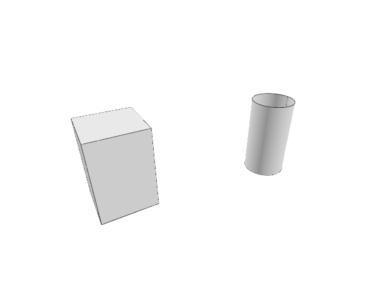

# 15.2 · Profile collection and one surfacing transaction

**Steps:** 14 · **Source:** [app/deform.rs](../../../src/app/deform.rs) · [state/edit.rs](../../../src/state/edit.rs) · [app/command/tool/gather.rs](../../../src/app/command/tool/gather.rs) · [app/command/tool/surfacing.rs](../../../src/app/command/tool/surfacing.rs)

<div class="webgpu-schematic" style="width:100%;margin:6px auto;">
<svg xmlns="http://www.w3.org/2000/svg" width="1120" height="188" viewBox="0 0 1120 188" style="width:100%;max-width:100%;height:auto;display:block;margin:0 auto;" role="img">
  <defs>
    <marker id="arr" viewBox="0 0 10 10" refX="8" refY="5" markerWidth="6" markerHeight="6" orient="auto">
      <path d="M 0 1 L 9 5 L 0 9 z" fill="#111111"/>
    </marker>
    <marker id="arrR" viewBox="0 0 10 10" refX="8" refY="5" markerWidth="6" markerHeight="6" orient="auto">
      <path d="M 0 1 L 9 5 L 0 9 z" fill="#dc2626"/>
    </marker>
    <marker id="arrG" viewBox="0 0 10 10" refX="8" refY="5" markerWidth="6" markerHeight="6" orient="auto">
      <path d="M 0 1 L 9 5 L 0 9 z" fill="#16a34a"/>
    </marker>
    <marker id="arrB" viewBox="0 0 10 10" refX="8" refY="5" markerWidth="6" markerHeight="6" orient="auto">
      <path d="M 0 1 L 9 5 L 0 9 z" fill="#2563eb"/>
    </marker>
  </defs>
  <rect x="2" y="2" width="1116" height="184" rx="10" fill="#ffffff" stroke="#111111" stroke-width="2"/>
  <rect x="14" y="12" width="344" height="164" rx="8" fill="#ffffff" stroke="#111111" stroke-width="1.5"/>
  <text paint-order="stroke fill" stroke="#ffffff" stroke-width="5" stroke-linejoin="round" x="186" y="30" text-anchor="middle" font-family="monospace" font-size="10.5" font-weight="700" fill="#111111">Section Profiles C_0(u)..C_k(u) + Rail Curve R(v)</text>
  <path d="M 58 142 Q 112 96 168 142" fill="none" stroke="#2563eb" stroke-width="2.5"/>
  <path d="M 88 106 Q 142 60 198 106" fill="none" stroke="#16a34a" stroke-width="2.5"/>
  <path d="M 118 70 Q 172 24 228 70" fill="none" stroke="#dc2626" stroke-width="2.5"/>
  <line x1="58" y1="142" x2="118" y2="70" stroke="#111111" stroke-width="1.5" stroke-dasharray="4 3"/>
  <line x1="168" y1="142" x2="228" y2="70" stroke="#111111" stroke-width="1.5" stroke-dasharray="4 3"/>
  <line x1="358" y1="94" x2="384" y2="94" stroke="#111111" stroke-width="2" marker-end="url(#arr)"/>
  <rect x="388" y="12" width="344" height="164" rx="8" fill="#ffffff" stroke="#111111" stroke-width="1.5"/>
  <text paint-order="stroke fill" stroke="#ffffff" stroke-width="5" stroke-linejoin="round" x="560" y="30" text-anchor="middle" font-family="monospace" font-size="10.5" font-weight="700" fill="#111111">Tensor-Product Loft / Sweep / Coons Patch S(u,v)</text>
  <polygon points="434,142 494,66 664,66 604,142" fill="#dbeafe" stroke="#111111" stroke-width="2"/>
  <line x1="464" y1="104" x2="634" y2="104" stroke="#2563eb" stroke-width="1.5"/>
  <line x1="491" y1="142" x2="551" y2="66" stroke="#16a34a" stroke-width="1.5"/>
  <line x1="548" y1="142" x2="608" y2="66" stroke="#16a34a" stroke-width="1.5"/>
  <circle cx="550" cy="104" r="4.5" fill="#fef08a" stroke="#dc2626" stroke-width="1.75"/>
  <line x1="732" y1="94" x2="758" y2="94" stroke="#111111" stroke-width="2" marker-end="url(#arr)"/>
  <rect x="762" y="12" width="344" height="164" rx="8" fill="#ffffff" stroke="#111111" stroke-width="1.75"/>
  <text paint-order="stroke fill" stroke="#ffffff" stroke-width="5" stroke-linejoin="round" x="934" y="30" text-anchor="middle" font-family="monospace" font-size="10.5" font-weight="700" fill="#111111">Shaded Freeform Surface + Tessellated Mesh</text>
  <rect x="806" y="44" width="256" height="118" rx="4" fill="#ffffff" stroke="#111111" stroke-width="2"/>
  <polygon points="838,138 888,68 1028,68 978,138" fill="#93c5fd" stroke="#111111" stroke-width="2"/>
  <line x1="888" y1="68" x2="978" y2="138" stroke="#1e3a8a" stroke-width="1.2"/>
  <line x1="863" y1="103" x2="1003" y2="103" stroke="#1e3a8a" stroke-width="1.2"/>
</svg>
</div>

## <a id="checkpoint-78-copy-current-curve-collection-and-surfacing-recipes"></a>1. Copy current curve collection and surfacing recipes

### 1. `src/lib.rs`

**Locate this existing block:**

```rust
pub mod gather_input;
pub mod source_mesh_topology;

#[cfg(target_arch = "wasm32")]
#[wasm_bindgen]
pub fn validate_source_json(text: &str) -> Result<(), JsValue> {
    source_validate::json(text).map_err(|error| JsValue::from_str(&error))
}

#[cfg(test)]
mod cloud_shader_contract;
mod shader_check;

pub mod surfacing;

pub mod extrude_geometry;

pub mod revolve_geometry;
```

Edit the existing block to match this code; keep unchanged lines:

```rust
pub mod gather_input;

pub mod surfacing;

pub mod extrude_geometry;

pub mod revolve_geometry;
pub mod source_mesh_topology;

#[cfg(target_arch = "wasm32")]
#[wasm_bindgen]
pub fn validate_source_json(text: &str) -> Result<(), JsValue> {
    source_validate::json(text).map_err(|error| JsValue::from_str(&error))
}

#[cfg(test)]
mod cloud_shader_contract;
mod shader_check;
```

## <a id="checkpoint-78a-own-picked-originals-and-world-profile-copies"></a>2. Own picked originals and world profile copies

### 1. `src/gather_draft.rs`

Create the file and type:

```rust
use crate::{
    cplane::CPlane,
    gather_input::{Answer, Input, Made, Picked, Progress, Recipe, Step},
    scene::{ObjectId, Scene},
};
use session_rust::{Geometry, Point, Vector};
#[derive(Clone)]
pub struct Draft {
    pub recipe: &'static Recipe,
    pub choice: usize,
    pub progress: Progress,
    pub answers: Vec<Answer>,
    pub curves: Vec<(ObjectId, Picked)>,
    pub before: Vec<ObjectId>,
    pub frame: CPlane,
    pub typed: String,
    pub originals: Vec<(ObjectId, Geometry, session_rust::Xform)>,
}
impl Draft {
    pub fn new(
        recipe: &'static Recipe,
        text: &str,
        scene: &Scene,
        before: Vec<ObjectId>,
        frame: CPlane,
    ) -> Result<Self, String> {
        let words = text.split_whitespace().collect::<Vec<_>>();
        let (choice, answers) = crate::gather_input::read(recipe, &words)?;
        for answer in &answers {
            match answer {
                Answer::Point(p) => {
                    crate::tool_coords::checked([p[0], p[1], p[2]])
                        .map_err(str::to_owned)?;
                }
                Answer::Vector(v)
                    if (0..3).any(|i| !v[i].is_finite() || v[i].abs() > 1e12) =>
                {
                    return Err("Distance vector exceeds the accepted range".into());
                }
                _ => {}
            }
        }
        let mut result = Self {
            recipe,
            choice,
            progress: Progress::new(recipe.steps, answers.len()),
            answers,
            curves: Vec::new(),
            before: before.clone(),
            frame,
            typed: String::new(),
            originals: Vec::new(),
        };
        for id in before {
            if scene.pick_id(id.value()) == Some(id) {
                if let Some(curve) = Self::world(scene, id) {
                    result.originals.push((
                        id,
                        Self::source(scene, id).unwrap(),
                        scene.placement(id).unwrap(),
                    ));
                    result.curves.push((id, curve));
                }
            }
        }
        let rows = result
            .curves
            .iter()
            .map(|(id, _)| id.value())
            .collect::<Vec<_>>();
        result
            .progress
            .preselect(recipe.steps, &rows);
        Ok(result)
    }
    pub fn current(&self) -> Option<&'static Step> {
        self.recipe.steps.get(self.progress.step)
    }
    pub fn world(scene: &Scene, id: ObjectId) -> Option<Picked> {
        let geometry = Self::source(scene, id)?;
        crate::gather_input::picked(&geometry, &scene.placement(id)?)
    }
    pub fn source(scene: &Scene, id: ObjectId) -> Option<Geometry> {
        if let Some(row) = scene.lines().iter().find(|row| row.id == id) {
            return Some(Geometry::Line(row.prepared.source.clone()));
        }
        let row = scene
            .paths()
            .iter()
            .find(|row| row.id == id)?;
        Some(match &row.prepared.source {
            crate::chain::Source::Line(source) => Geometry::Line(source.clone()),
            crate::chain::Source::Polyline(source) => {
                Geometry::Polyline(source.clone())
            }
            crate::chain::Source::Curve(source, _) => {
                Geometry::NurbsCurve(source.clone())
            }
        })
    }
}
```

### 2. `src/lib.rs`

**Locate this existing block:**

```rust
pub mod revolve_geometry;
pub mod source_mesh_topology;
```

Edit the existing block to match this code; keep unchanged lines:

```rust
pub mod revolve_geometry;

pub mod gather_draft;
pub mod source_mesh_topology;
```

## <a id="checkpoint-78b-resolve-a-recipe-input-and-guard-picked-source-freshness"></a>3. Resolve a recipe input and guard picked source freshness

### 1. `src/gather_draft.rs`

**Locate this existing block:**

```rust
    }
}
```

Edit the existing block to match this code; keep unchanged lines:

```rust
    }
    pub fn valid(&self, scene: &Scene) -> Result<(), String> {
        for (id, source, place) in &self.originals {
            if !self.progress.picked().contains(&id.value()) {
                continue;
            }
            let current = Self::source(scene, *id).ok_or("Picked curve was removed")?;
            let same = match (source, current) {
                (Geometry::Line(a), Geometry::Line(b)) => std::rc::Rc::ptr_eq(a, &b),
                (Geometry::Polyline(a), Geometry::Polyline(b)) => {
                    std::rc::Rc::ptr_eq(a, &b)
                }
                (Geometry::NurbsCurve(a), Geometry::NurbsCurve(b)) => {
                    std::rc::Rc::ptr_eq(a, &b)
                }
                _ => false,
            };
            if !same
                || scene
                    .placement(*id)
                    .is_none_or(|p| p.m != place.m)
                || scene.pick_id(id.value()) != Some(*id)
            {
                return Err("Picked curve changed; start again".into());
            }
        }
        Ok(())
    }
    pub fn input(&self) -> Result<Input, String> {
        let curves = self
            .progress
            .rows
            .iter()
            .map(|rows| {
                rows.iter()
                    .map(|row| {
                        self.curves
                            .iter()
                            .find(|(id, _)| id.value() == *row)
                            .map(|(_, curve)| curve.clone())
                            .ok_or_else(|| "Picked source is missing".into())
                    })
                    .collect::<Result<Vec<_>, String>>()
            })
            .collect::<Result<Vec<_>, _>>()?;
        let (x, y) = self.frame.axes();
        Ok(Input {
            curves,
            answers: self.answers[..self
                .progress
                .answered
                .min(self.answers.len())]
                .to_vec(),
            choice: self
                .recipe
                .choices()
                .nth(self.choice)
                .unwrap_or(""),
            normal: x.cross(&y),
        })
    }
    pub fn build(&self) -> Result<Option<Made>, String> {
        if self.progress.done(self.recipe.steps) {
            (self.recipe.build)(&self.input()?).map(Some)
        } else {
            Ok(None)
        }
    }
    pub fn prompt(&self) -> String {
        let step = self
            .current()
            .map_or("complete", Step::prompt);
        format!("{} · {step} · Esc cancels", self.recipe.name)
    }
    pub fn axis(&self) -> Result<(Point, Vector), String> {
        Ok((self.recipe.axis)(&self.input()?))
    }
}
```

## <a id="checkpoint-78c-accept-curve-picks-and-geometric-answers-atomically"></a>4. Accept curve picks and geometric answers atomically

### 1. `src/gather_draft.rs`

**Locate this existing block:**

```rust
    }
}
```

Edit the existing block to match this code; keep unchanged lines:

```rust
    }
    pub fn pick(
        &mut self,
        scene: &Scene,
        id: Option<ObjectId>,
    ) -> Result<Option<Made>, String> {
        let id = id.ok_or("Nothing there · pick a line, polyline or curve")?;
        if scene.pick_id(id.value()) != Some(id) {
            return Err("Pick a visible unlocked curve".into());
        }
        let mut next = self.clone();
        if !next.curves.iter().any(|(old, _)| *old == id) {
            let curve =
                Self::world(scene, id).ok_or("Pick a line, polyline or curve")?;
            next.originals.push((
                id,
                Self::source(scene, id).unwrap(),
                scene.placement(id).unwrap(),
            ));
            next.curves.push((id, curve));
        }
        next.progress
            .pick(next.recipe.steps, id.value())?;
        let made = next.build()?;
        *self = next;
        Ok(made)
    }
    pub fn point(&mut self, point: [f64; 3]) -> Result<Option<Made>, String> {
        let point = crate::tool_coords::checked(point).map_err(str::to_owned)?;
        let mut next = self.clone();
        let answer = match next.current() {
            Some(Step::Point(_)) => {
                Answer::Point(Point::new(point[0], point[1], point[2]))
            }
            Some(Step::Distance(_)) => {
                let (base, _) = next.axis()?;
                Answer::Vector(Vector::new(
                    point[0] - base[0],
                    point[1] - base[1],
                    point[2] - base[2],
                ))
            }
            _ => {
                return Err(
                    "The current step needs a curve pick or a typed number".into(),
                );
            }
        };
        next.progress
            .answer(next.recipe.steps, &mut next.answers, answer);
        let made = next.build()?;
        *self = next;
        Ok(made)
    }
}
```

## <a id="checkpoint-78d-read-options-and-typed-batches-without-partial-results"></a>5. Read options and typed batches without partial results

### 1. `src/gather_draft.rs`

**Locate this existing block:**

```rust
    }
}
```

Edit the existing block to match this code; keep unchanged lines:

```rust
    }
    pub fn text(
        &mut self,
        text: &str,
        fixed: Option<CPlane>,
    ) -> Result<Option<Made>, String> {
        crate::drawing_coords::set_plane(fixed);
        let mut next = self.clone();
        let words = text.split_whitespace().collect::<Vec<_>>();
        if words.is_empty() {
            next.progress
                .next(next.recipe.steps, &mut next.answers)?;
        } else {
            let mut index = 0;
            while index < words.len() {
                let typed = format!(
                    "{}{}",
                    next.typed,
                    crate::primitive_options::compact(words[index])
                );
                if let Some(choice) = next.recipe.choices().position(|choice| {
                    crate::primitive_options::compact(choice) == typed
                }) {
                    next.choice = choice;
                    next.typed.clear();
                    index += 1;
                    continue;
                }
                if next.recipe.choices().any(|choice| {
                    crate::primitive_options::compact(choice).starts_with(&typed)
                }) {
                    next.typed = typed;
                    index += 1;
                    continue;
                }
                if let Some((choice, count)) = next.recipe.option_in(&words[index..]) {
                    next.choice = choice;
                    next.typed.clear();
                    index += count;
                    continue;
                }
                let step = next
                    .current()
                    .ok_or("Extra input after the completed command")?;
                let answer = step.read(words[index])?;
                match &answer {
                    Answer::Point(point) => {
                        crate::tool_coords::checked([point[0], point[1], point[2]])
                            .map_err(str::to_owned)?;
                    }
                    Answer::Vector(vector)
                        if (0..3).any(|i| {
                            !vector[i].is_finite() || vector[i].abs() > 1e12
                        }) =>
                    {
                        return Err("Distance vector exceeds the accepted range".into());
                    }
                    _ => {}
                }
                next.typed.clear();
                next.progress
                    .answer(next.recipe.steps, &mut next.answers, answer);
                index += 1;
            }
        }
        let made = next.build()?;
        *self = next;
        Ok(made)
    }
}
```

## <a id="checkpoint-78e-constrain-distance-input-and-draw-lifted-profile-wires"></a>6. Constrain distance input and draw lifted profile wires

### 1. `src/gather_draft.rs`

Edit these blocks from bottom to top. Keep the surrounding lines unchanged.

**Locate this block:**

```rust
        }
        let made = next.build()?;
        *self = next;
        Ok(made)
    }
```

Replace it with:

```rust
        }
        let made = next.build()?;
        *self = next;
        Ok(made)
    }
    pub fn axis(&self) -> Result<(Point, Vector), String> {
        Ok((self.recipe.axis)(&self.input()?))
    }
    pub fn on_axis(
        &self,
        camera: &crate::camera::Camera,
        screen: [f32; 2],
    ) -> Option<[f64; 3]> {
        let ray = camera.ray(screen)?;
        let (base, axis) = self.axis().ok()?;
        let direction = ray.direction;
        let (a, b) = (
            direction.dot(&direction),
            direction.dot(&axis),
        );
        let denominator = a - b * b;
        if denominator <= 0.01 * a {
            return None;
        }
        let offset = &ray.origin - &base;
        let distance =
            (a * offset.dot(&axis) - b * offset.dot(&direction)) / denominator;
        let p = &base + &(axis * distance);
        crate::tool_coords::checked([p[0], p[1], p[2]]).ok()
    }
    pub fn outlines(&self, cursor: Option<[f64; 3]>) -> Vec<Vec<[f64; 3]>> {
        if !matches!(self.current(), Some(Step::Distance(_))) {
            return Vec::new();
        }
        let Some(cursor) = cursor else {
            return Vec::new();
        };
        let Ok((base, _)) = self.axis() else {
            return Vec::new();
        };
        let offset = Vector::new(
            cursor[0] - base[0],
            cursor[1] - base[1],
            cursor[2] - base[2],
        );
        let Ok(input) = self.input() else {
            return Vec::new();
        };
        input
            .curves
            .iter()
            .flatten()
            .map(|curve| {
                curve
                    .outline()
                    .into_iter()
                    .map(|point| {
                        let p = &point + &offset;
                        [p[0], p[1], p[2]]
                    })
                    .collect()
            })
            .collect()
    }
```

**Locate this block:**

```rust
            .map_or("complete", Step::prompt);
        format!("{} · {step} · Esc cancels", self.recipe.name)
    }
    pub fn axis(&self) -> Result<(Point, Vector), String> {
        Ok((self.recipe.axis)(&self.input()?))
    }
    pub fn pick(
        &mut self,
        scene: &Scene,
```

Replace it with:

```rust
            .map_or("complete", Step::prompt);
        format!("{} · {step} · Esc cancels", self.recipe.name)
    }
    pub fn pick(
        &mut self,
        scene: &Scene,
```

**Locate this block:**

```rust
    }
    pub fn world(scene: &Scene, id: ObjectId) -> Option<Picked> {
        let geometry = Self::source(scene, id)?;
        crate::gather_input::picked(&geometry, &scene.placement(id)?)
```

Replace it with:

```rust
    }
    pub fn picks(&self) -> bool {
        self.current().is_some_and(Step::curves)
    }
    pub fn world(scene: &Scene, id: ObjectId) -> Option<Picked> {
        let geometry = Self::source(scene, id)?;
        crate::gather_input::picked(&geometry, &scene.placement(id)?)
```

## <a id="checkpoint-78f-carry-gather-state-through-the-current-tool-owner"></a>7. Carry gather state through the current tool owner

### 1. `src/tool.rs`

Edit these blocks from bottom to top. Keep the surrounding lines unchanged.

**Locate this block:**

```rust
        self.tool.build_on_plane(&world, self.frame)
    }
    pub fn outlines(&self) -> Vec<Vec<[f64; 3]>> {
        if let Some(primitive) = &self.primitive {
            primitive.outline(self.cursor)
```

Replace it with:

```rust
        self.tool.build_on_plane(&world, self.frame)
    }
    pub fn outlines(&self) -> Vec<Vec<[f64; 3]>> {
        if let Some(gather) = &self.gather {
            gather.outlines(self.cursor)
        } else if let Some(primitive) = &self.primitive {
            primitive.outline(self.cursor)
```

**Locate this block:**

```rust
    }
    pub fn prompt(&self) -> String {
        if self.plane_points.is_none() {
            if let Some(transform) = &self.transform {
                return transform.prompt();
            }
```

Replace it with:

```rust
    }
    pub fn prompt(&self) -> String {
        if self.plane_points.is_none() {
            if let Some(gather) = &self.gather {
                return gather.prompt();
            }
        }
        if self.plane_points.is_none() {
            if let Some(transform) = &self.transform {
                return transform.prompt();
            }
```

**Locate this block:**

```rust
    pub plane_points: Option<Vec<[f64; 3]>>,
    pub primitive: Option<crate::primitive_draft::Draft>,
    pub transform: Option<crate::transform_draft::Draft>,
}

impl Draft {
    pub fn new(shape: Shape) -> Self {
        Self {
            tool: Box::new(shape),
            points: Vec::new(),
            cursor: None,
```

Replace it with:

```rust
    pub plane_points: Option<Vec<[f64; 3]>>,
    pub primitive: Option<crate::primitive_draft::Draft>,
    pub transform: Option<crate::transform_draft::Draft>,
    pub gather: Option<crate::gather_draft::Draft>,
}

impl Draft {
    pub fn new(shape: Shape) -> Self {
        Self {
            gather: None,
            tool: Box::new(shape),
            points: Vec::new(),
            cursor: None,
```

**Locate this block:**

```rust
        }
    }
    fn buttons(&self) -> Vec<(String, String)> {
        if let Self::Transform(kind) = self {
            return crate::transform_draft::Draft::new(
                *kind,
```

Replace it with:

```rust
        }
    }
    fn buttons(&self) -> Vec<(String, String)> {
        if let Self::Gather(recipe) = self {
            return recipe
                .chips
                .iter()
                .map(|(label, line)| ((*label).into(), (*line).into()))
                .collect();
        }
        if let Self::Transform(kind) = self {
            return crate::transform_draft::Draft::new(
                *kind,
```

**Locate this block:**

```rust
    }
    fn count(&self) -> usize {
        match self {
            Self::Point => 1,
            Self::Line | Self::Move => 2,
            Self::Polyline | Self::Curve => 0,
```

Replace it with:

```rust
    }
    fn count(&self) -> usize {
        match self {
            Self::Gather(_) => 0,
            Self::Point => 1,
            Self::Line | Self::Move => 2,
            Self::Polyline | Self::Curve => 0,
```

**Locate this block:**

```rust
impl Tool for Shape {
    fn name(&self) -> &'static str {
        match self {
            Self::Point => "Point",
            Self::Line => "Line",
            Self::Move => "Move",
```

Replace it with:

```rust
impl Tool for Shape {
    fn name(&self) -> &'static str {
        match self {
            Self::Gather(recipe) => recipe.name,
            Self::Point => "Point",
            Self::Line => "Line",
            Self::Move => "Move",
```

**Locate this block:**

```rust
pub enum Shape {
    Point,
    Line,
    Move,
```

Replace it with:

```rust
pub enum Shape {
    Gather(&'static crate::gather_input::Recipe),
    Point,
    Line,
    Move,
```

### 2. `src/primitive_geometry.rs`

**Locate this existing block:**

```rust
    match geometry {
        Geometry::BRep(source) => scene.insert_cad(source),
```

Edit the existing block to match this code; keep unchanged lines:

```rust
    match geometry {
        Geometry::NurbsSurface(source) => scene.insert_surface(source),
        Geometry::BRep(source) => scene.insert_cad(source),
```

### 3. `src/editor.rs`

**Locate this existing block:**

```rust
    StreamRefresh,
    BeginTransformation(crate::transform_draft::Kind),
```

Edit the existing block to match this code; keep unchanged lines:

```rust
    StreamRefresh,
    GatherBegin {
        recipe: &'static crate::gather_input::Recipe,
        text: String,
    },
    GatherPick(Option<ObjectId>),
    BeginTransformation(crate::transform_draft::Kind),
```

## <a id="checkpoint-78g-adopt-every-generated-original-in-one-history-transaction"></a>8. Adopt every generated in one history transaction

### 1. `src/editor.rs`

**Locate this existing block:**

```rust
    }
    fn tool_text(&mut self, text: &str) -> Result<Change, &'static str> {
```

Edit the existing block to match this code; keep unchanged lines:

```rust
    }
    pub fn highlighted_objects(&self) -> Vec<ObjectId> {
        self.draft
            .as_ref()
            .and_then(|d| d.gather.as_ref())
            .map_or_else(
                || self.selected_objects(),
                |g| {
                    g.progress
                        .picked()
                        .iter()
                        .filter_map(|row| {
                            g.curves
                                .iter()
                                .find(|(id, _)| id.value() == *row)
                                .map(|(id, _)| *id)
                        })
                        .collect()
                },
            )
    }
    pub fn gathering_curves(&self) -> bool {
        self.draft.as_ref().is_some_and(|d| {
            d.plane_points.is_none() && d.gather.as_ref().is_some_and(|g| g.picks())
        })
    }
    fn gather_adopt(
        &mut self,
        next: crate::gather_draft::Draft,
        made: Option<crate::gather_input::Made>,
    ) -> Result<Change, &'static str> {
        next.valid(&self.scene)
            .map_err(|message| self.primitive_failure(message))?;
        if let Some(made) = made {
            let mut ids = Vec::new();
            self.history
                .try_edit(&mut self.scene, |scene| {
                    ids = made
                        .geometries
                        .into_iter()
                        .map(|geometry| {
                            crate::primitive_geometry::insert(scene, geometry)
                        })
                        .collect::<Result<Vec<_>, _>>()?;
                    Ok(())
                })?;
            self.select_objects(ids, false);
            self.draft = None;
            self.tool_status = made.message;
            return Ok(Change::Scene);
        }
        let draft = self
            .draft
            .as_mut()
            .ok_or("No gathering tool is running")?;
        draft.points = next
            .answers
            .iter()
            .filter_map(|answer| {
                if let crate::gather_input::Answer::Point(p) = answer {
                    Some([p[0], p[1], p[2]])
                } else {
                    None
                }
            })
            .collect();
        draft.gather = Some(next);
        draft.cursor = None;
        draft.snapped = None;
        self.tool_status = draft.prompt();
        Ok(Change::View)
    }
    fn tool_text(&mut self, text: &str) -> Result<Change, &'static str> {
```

## <a id="checkpoint-78h-start-and-advance-the-recipe-through-the-existing-editor"></a>9. Start and advance the recipe through the existing Editor

### 1. `src/editor.rs`

**Locate this existing block:**

```rust
    }
    fn tool_text(&mut self, text: &str) -> Result<Change, &'static str> {
```

Edit the existing block to match this code; keep unchanged lines:

```rust
    }
    fn begin_gather(
        &mut self,
        recipe: &'static crate::gather_input::Recipe,
        text: &str,
    ) -> Result<Change, &'static str> {
        crate::drawing_coords::set_plane(self.construction_plane);
        let frame = self.construction_plane.unwrap_or_else(|| {
            crate::cplane::CPlane::view(
                &self
                    .camera
                    .orientation
                    .rotate_vector(session_rust::Vector::y_axis()),
            )
        });
        let next = crate::gather_draft::Draft::new(
            recipe,
            text,
            &self.scene,
            self.selected_objects(),
            frame,
        )
        .map_err(|message| self.primitive_failure(message))?;
        let made = next
            .build()
            .map_err(|message| self.primitive_failure(message))?;
        if made.is_some() {
            return self.gather_adopt(next, made);
        }
        self.apply(Action::BeginTool(
            crate::tool::Shape::Gather(recipe),
        ))?;
        self.select_objects([], false);
        self.gather_adopt(next, made)
    }
    fn gather_point(&mut self, point: [f64; 3]) -> Result<Change, &'static str> {
        let mut next = self
            .draft
            .as_ref()
            .and_then(|d| d.gather.clone())
            .ok_or("No gathering tool is running")?;
        next.valid(&self.scene)
            .map_err(|message| self.primitive_failure(message))?;
        let made = next
            .point(point)
            .map_err(|message| self.primitive_failure(message))?;
        self.gather_adopt(next, made)
    }
    fn gather_text(&mut self, text: &str) -> Result<Change, &'static str> {
        let mut next = self
            .draft
            .as_ref()
            .and_then(|d| d.gather.clone())
            .ok_or("No gathering tool is running")?;
        next.valid(&self.scene)
            .map_err(|message| self.primitive_failure(message))?;
        let made = next
            .text(text, self.construction_plane)
            .map_err(|message| self.primitive_failure(message))?;
        self.gather_adopt(next, made)
    }
    fn gather_pick(&mut self, id: Option<ObjectId>) -> Result<Change, &'static str> {
        let mut next = self
            .draft
            .as_ref()
            .and_then(|d| d.gather.clone())
            .ok_or("No gathering tool is running")?;
        next.valid(&self.scene)
            .map_err(|message| self.primitive_failure(message))?;
        let made = next
            .pick(&self.scene, id)
            .map_err(|message| self.primitive_failure(message))?;
        self.gather_adopt(next, made)
    }
    fn tool_text(&mut self, text: &str) -> Result<Change, &'static str> {
```

## <a id="checkpoint-78i-route-typed-answers-and-axis-cursor-input"></a>10. Route typed answers and axis cursor input

### 1. `src/editor.rs`

Edit these blocks from bottom to top. Keep the surrounding lines unchanged.

**Locate this block:**

```rust
            .filter(|d| {
                d.primitive.is_none()
                    && d.transform.is_none()
                    && d.tool.count() == 0
```

Replace it with:

```rust
            .filter(|d| {
                d.primitive.is_none()
                    && d.transform.is_none()
                    && d.gather.is_none()
                    && d.tool.count() == 0
```

**Locate this block:**

```rust
                    });
            }
        }
        let ray = self.camera.ray(screen)?;
        let from = self.draft.as_ref()?.points.last().copied();
        let hit = if self.snapping.objects {
```

Replace it with:

```rust
                    });
            }
        }
        if let Some(gather) = self.draft.as_ref()?.gather.as_ref() {
            if self.draft.as_ref()?.plane_points.is_none() {
                match gather.current() {
                    Some(
                        crate::gather_input::Step::Curves { .. }
                        | crate::gather_input::Step::Number { .. },
                    ) => return None,
                    Some(crate::gather_input::Step::Distance(_)) => {
                        return gather
                            .on_axis(&self.camera, screen)
                            .map(|point| crate::snap::Hit {
                                point,
                                kind: crate::snap::Kind::Near,
                                owner: None,
                            });
                    }
                    _ => {}
                }
            }
        }
        let ray = self.camera.ray(screen)?;
        let from = self.draft.as_ref()?.points.last().copied();
        let hit = if self.snapping.objects {
```

**Locate this block:**

```rust
        if self
            .draft
            .as_ref()
            .is_some_and(|d| d.transform.is_some() && d.plane_points.is_none())
        {
            return self.transform_text(text);
```

Replace it with:

```rust
        if self
            .draft
            .as_ref()
            .is_some_and(|d| d.gather.is_some() && d.plane_points.is_none())
        {
            return self.gather_text(text);
        }
        if self
            .draft
            .as_ref()
            .is_some_and(|d| d.transform.is_some() && d.plane_points.is_none())
        {
            return self.transform_text(text);
```

**Locate this block:**

```rust
        if self
            .draft
            .as_ref()
            .is_some_and(|d| d.transform.is_some() && d.plane_points.is_none())
        {
            return self.transform_point(point);
```

Replace it with:

```rust
        if self
            .draft
            .as_ref()
            .is_some_and(|d| d.gather.is_some() && d.plane_points.is_none())
        {
            return self.gather_point(point);
        }
        if self
            .draft
            .as_ref()
            .is_some_and(|d| d.transform.is_some() && d.plane_points.is_none())
        {
            return self.transform_point(point);
```

**Locate this block:**

```rust
        }
        if draft.plane_points.is_none() && draft.primitive.is_some() {
            let words: Vec<_> = text.split_whitespace().collect();
            let primitive = draft.primitive.as_ref().unwrap();
```

Replace it with:

```rust
        }
        if draft.plane_points.is_none() {
            if let Some(gather) = &draft.gather {
                let first = text.split_whitespace().next();
                if text.trim().is_empty()
                    || first.is_some_and(|word| {
                        word.parse::<f64>().is_ok()
                            || word.contains(',')
                            || word.starts_with('w')
                            || word.starts_with('W')
                            || gather.recipe.option_in(&[word]).is_some()
                            || gather.recipe.choices().any(|choice| {
                                crate::primitive_options::compact(choice).starts_with(
                                    &crate::primitive_options::compact(word),
                                )
                            })
                            || !gather.typed.is_empty()
                    })
                {
                    return Some(Ok(Action::ToolText(text.into())));
                }
                return None;
            }
        }
        if draft.plane_points.is_none() && draft.primitive.is_some() {
            let words: Vec<_> = text.split_whitespace().collect();
            let primitive = draft.primitive.as_ref().unwrap();
```

## <a id="checkpoint-78j-restore-selection-and-preserve-the-gather-lifecycle"></a>11. Restore selection and preserve the gather lifecycle

### 1. `src/editor.rs`

Edit these blocks from bottom to top. Keep the surrounding lines unchanged.

**Locate this block:**

```rust
                return self.update_edit_preview();
            }
            Action::CancelTool => {
                let changed = self.edit_preview.take().is_some()
```

Replace it with:

```rust
                return self.update_edit_preview();
            }
            Action::CancelTool => {
                if let Some(before) = self
                    .draft
                    .as_ref()
                    .and_then(|d| d.gather.as_ref())
                    .map(|g| g.before.clone())
                {
                    self.select_objects(before, false);
                }
                let changed = self.edit_preview.take().is_some()
```

**Locate this block:**

```rust
                        self.draft.as_ref().is_some_and(|d| {
                            d.primitive.is_none()
                                && d.transform.is_none()
                                && d.tool.count() == 0
                                && d.points.len() >= 2
                                && d.points.first().is_some_and(|p| {
```

Replace it with:

```rust
                        self.draft.as_ref().is_some_and(|d| {
                            d.primitive.is_none()
                                && d.transform.is_none()
                                && d.gather.is_none()
                                && d.tool.count() == 0
                                && d.points.len() >= 2
                                && d.points.first().is_some_and(|p| {
```

**Locate this block:**

```rust
                return self.commit_tool(built);
            }
            Action::FinishTool => {
                crate::drawing_coords::set_plane(self.construction_plane);
                let built = self
                    .draft
```

Replace it with:

```rust
                return self.commit_tool(built);
            }
            Action::FinishTool => {
                if self
                    .draft
                    .as_ref()
                    .is_some_and(|d| d.gather.is_some())
                {
                    return self.gather_text("");
                }
                crate::drawing_coords::set_plane(self.construction_plane);
                let built = self
                    .draft
```

**Locate this block:**

```rust
                    .draft
                    .as_ref()
                    .ok_or("No point tool is running")?;
                if draft.tool.count() != 0 || draft.points.len() < 3 {
                    return Err("Close needs at least three polyline points");
                }
```

Replace it with:

```rust
                    .draft
                    .as_ref()
                    .ok_or("No point tool is running")?;
                if draft.gather.is_some() {
                    return Err("Close works on a polyline or curve");
                }
                if draft.tool.count() != 0 || draft.points.len() < 3 {
                    return Err("Close needs at least three polyline points");
                }
```

**Locate this block:**

```rust
                {
                    transform.frame = frame;
                }
                self.construction_plane = plane;
                crate::drawing_coords::set_plane(plane);
                self.plane_menu = false;
```

Replace it with:

```rust
                {
                    transform.frame = frame;
                }
                if let Some(gather) = self
                    .draft
                    .as_mut()
                    .and_then(|d| d.gather.as_mut())
                {
                    gather.frame = frame;
                }
                self.construction_plane = plane;
                crate::drawing_coords::set_plane(plane);
                self.plane_menu = false;
```

**Locate this block:**

```rust
            self.plane_only = false;
        }
        match action {
            Action::ScaleFactor(factor) => {
                if !factor.is_finite() || factor <= 0. {
                    return Err("Scale wants a finite factor above zero");
```

Replace it with:

```rust
            self.plane_only = false;
        }
        match action {
            Action::GatherBegin { recipe, text } => {
                return self.begin_gather(recipe, &text);
            }
            Action::GatherPick(id) => return self.gather_pick(id),
            Action::ScaleFactor(factor) => {
                if !factor.is_finite() || factor <= 0. {
                    return Err("Scale wants a finite factor above zero");
```

**Locate this block:**

```rust
            && self
                .draft
                .as_ref()
                .is_some_and(|d| d.transform.is_some())
        {
            self.transform_preview = None;
```

Replace it with:

```rust
            && self
                .draft
                .as_ref()
                .is_some_and(|d| d.gather.is_some())
        {
            self.apply_action(Action::CancelTool)?;
        }
        if !keep_edit
            && self
                .draft
                .as_ref()
                .is_some_and(|d| d.transform.is_some())
        {
            self.transform_preview = None;
```

**Locate this block:**

```rust
                | Action::PrimitiveBegin { .. }
                | Action::ToolPoint(_)
                | Action::ToolScreen { .. }
                | Action::ToolHover(_)
```

Replace it with:

```rust
                | Action::PrimitiveBegin { .. }
                | Action::GatherBegin { .. }
                | Action::GatherPick(_)
                | Action::ToolPoint(_)
                | Action::ToolScreen { .. }
                | Action::ToolHover(_)
```

## <a id="checkpoint-78k-register-extrusion-revolution-and-browser-curve-picking"></a>12. Register extrusion revolution and browser curve picking

### 1. `src/gather_registry.rs`

Create the file and type:

```rust
use crate::{editor::Action, gather_input::Recipe};
pub const ENTRIES: &[(&str, &Recipe)] = &[
    ("Extrude", &crate::extrude_geometry::RECIPE),
    (
        "Nurbs Surface Revolve",
        &crate::revolve_geometry::RECIPE,
    ),
];
pub fn command(name: &str, text: &str) -> Option<Action> {
    let (_, recipe) = ENTRIES
        .iter()
        .find(|(label, _)| *label == name)?;
    Some(Action::GatherBegin {
        recipe,
        text: text.into(),
    })
}
```

### 2. `src/lib.rs`

**Locate this existing block:**

```rust
pub mod gather_draft;
pub mod source_mesh_topology;
```

Edit the existing block to match this code; keep unchanged lines:

```rust
pub mod gather_draft;

pub mod gather_registry;
pub mod source_mesh_topology;
```

### 3. `src/commands.rs`

**Locate this existing block:**

```rust
        )
        .collect()
}

// Choose the longest known name so Open Replace cannot become Open with an unwanted argument.
fn matched(words: &[&str]) -> Option<(&'static str, usize)> {
    names()
        .into_iter()
        .filter_map(|name| {
            let compact = name
                .split_whitespace()
                .collect::<String>()
                .to_ascii_lowercase();
            let mut rest = compact.as_str();
            for (index, word) in words.iter().enumerate() {
                let word = word.to_ascii_lowercase();
                rest = rest.strip_prefix(&word)?;
                if rest.is_empty() {
                    return Some((name, index + 1, compact.len()));
                }
            }
            None
        })
        .max_by_key(|(_, _, letters)| *letters)
        .map(|(name, count, _)| (name, count))
}

pub fn canonical(line: &str) -> String {
    let alias = crate::transform_commands::alias(line);
    let line = alias.as_str();
    let words: Vec<_> = line.split_whitespace().collect();
    matched(&words).map_or_else(
        || line.trim().to_owned(),
        |(name, count)| {
            std::iter::once(name)
                .chain(words[count..].iter().copied())
                .collect::<Vec<_>>()
                .join(" ")
        },
    )
}

pub fn parse(line: &str) -> Result<Command, String> {
    let alias = crate::transform_commands::alias(line);
    let line = alias.as_str();
    let words: Vec<_> = line.split_whitespace().collect();
    let (name, count) = matched(&words).ok_or("Unknown command. Type Help.")?;
    if let Some(action) = crate::transform_commands::action(name, &words[count..]) {
        return action.map(Command::Editor);
    }
```

Edit the existing block to match this code; keep unchanged lines:

```rust
        )
        .chain(
            crate::gather_registry::ENTRIES
                .iter()
                .map(|(name, _)| *name),
        )
        .collect()
}

// Choose the longest known name so Open Replace cannot become Open with an unwanted argument.
fn matched(words: &[&str]) -> Option<(&'static str, usize)> {
    names()
        .into_iter()
        .filter_map(|name| {
            let compact = name
                .split_whitespace()
                .collect::<String>()
                .to_ascii_lowercase();
            let mut rest = compact.as_str();
            for (index, word) in words.iter().enumerate() {
                let word = word.to_ascii_lowercase();
                rest = rest.strip_prefix(&word)?;
                if rest.is_empty() {
                    return Some((name, index + 1, compact.len()));
                }
            }
            None
        })
        .max_by_key(|(_, _, letters)| *letters)
        .map(|(name, count, _)| (name, count))
}

pub fn canonical(line: &str) -> String {
    let line = if let Some(rest) = line
        .trim()
        .strip_prefix("nurbssurface_revolve")
    {
        format!("Nurbs Surface Revolve{rest}")
    } else {
        line.to_owned()
    };
    let alias = crate::transform_commands::alias(&line);
    let line = alias.as_str();
    let words: Vec<_> = line.split_whitespace().collect();
    matched(&words).map_or_else(
        || line.trim().to_owned(),
        |(name, count)| {
            std::iter::once(name)
                .chain(words[count..].iter().copied())
                .collect::<Vec<_>>()
                .join(" ")
        },
    )
}

pub fn parse(line: &str) -> Result<Command, String> {
    let line = if let Some(rest) = line
        .trim()
        .strip_prefix("nurbssurface_revolve")
    {
        format!("Nurbs Surface Revolve{rest}")
    } else {
        line.to_owned()
    };
    let alias = crate::transform_commands::alias(&line);
    let line = alias.as_str();
    let words: Vec<_> = line.split_whitespace().collect();
    let (name, count) = matched(&words).ok_or("Unknown command. Type Help.")?;
    if let Some(action) = crate::transform_commands::action(name, &words[count..]) {
        return action.map(Command::Editor);
    }
    if let Some(action) =
        crate::gather_registry::command(name, &words[count..].join(" "))
    {
        return Ok(Command::Editor(action));
    }
```

## <a id="checkpoint-78l-pick-original-profiles-through-the-browser-integer-pass"></a>13. Pick profiles through the browser integer pass

### 1. `src/browser.rs`

Edit these blocks from bottom to top. Keep the surrounding lines unchanged.

**Locate this block:**

```rust
        &originals.to_string(),
    )?;
    canvas.set_attribute("data-cplane",&serde_json::json!({"fixed":editor.construction_plane.is_some(),"mode":format!("{:?}",editor.construction_plane),"chooser":editor.plane_menu}).to_string())?;
    canvas.set_attribute("data-tool", &editor.draft.as_ref().map_or_else(|| "null".into(), |d| serde_json::json!({"name":d.tool.name(),"points":d.points,"cursor":d.cursor,"snap":d.snapped.map(|kind| format!("{kind:?}"))}).to_string()))?;
```

Replace it with:

```rust
        &originals.to_string(),
    )?;
    canvas.set_attribute("data-cplane",&serde_json::json!({"fixed":editor.construction_plane.is_some(),"mode":format!("{:?}",editor.construction_plane),"chooser":editor.plane_menu}).to_string())?;
    canvas.set_attribute("data-gather",&editor.draft.as_ref().and_then(|d|d.gather.as_ref()).map_or_else(||"null".into(),|g|serde_json::json!({"name":g.recipe.name,"step":g.progress.step,"rows":g.progress.rows,"answered":g.progress.answered,"choice":g.choice}).to_string()))?;
    canvas.set_attribute("data-tool", &editor.draft.as_ref().map_or_else(|| "null".into(), |d| serde_json::json!({"name":d.tool.name(),"points":d.points,"cursor":d.cursor,"snap":d.snapped.map(|kind| format!("{kind:?}"))}).to_string()))?;
```

**Locate this block:**

```rust
            if let Err(error) = renderer.set_preview(editor.draft.as_ref()) {
                panel.result(error);
            }
            renderer.set_pick_mode(editor.pick_mode);
            if highlight_changed {
                if let Err(error) = renderer
                    .set_highlight(editor.display_scene(), editor.selection())
                    .and_then(|()| {
                        renderer.select_objects(
                            editor.display_scene(),
                            &editor.selected_objects(),
                        )
                    })
                {
```

Replace it with:

```rust
            if let Err(error) = renderer.set_preview(editor.draft.as_ref()) {
                panel.result(error);
            }
            renderer.set_pick_mode(if editor.gathering_curves() {
                crate::pick_sources::Mode::Object
            } else {
                editor.pick_mode
            });
            if highlight_changed {
                if let Err(error) = renderer
                    .set_highlight(editor.display_scene(), editor.selection())
                    .and_then(|()| {
                        renderer.select_objects(
                            editor.display_scene(),
                            &editor.highlighted_objects(),
                        )
                    })
                {
```

**Locate this block:**

```rust
                        .rename_result(change.as_ref().err().map(String::as_str));
                }
                if tool_action && change.is_ok() {
                    panel.result(&editor.tool_status);
                }
                match change {
```

Replace it with:

```rust
                        .rename_result(change.as_ref().err().map(String::as_str));
                }
                if tool_action && change.is_ok() {
                    highlight_changed = true;
                    panel.result(&editor.tool_status);
                }
                match change {
```

**Locate this block:**

```rust
                let tool_action = matches!(
                    &action,
                    Action::BeginTool(_)
                        | Action::ToolPoint(_)
                        | Action::CancelTool
                        | Action::Snap(_)
```

Replace it with:

```rust
                let tool_action = matches!(
                    &action,
                    Action::BeginTool(_)
                        | Action::GatherBegin { .. }
                        | Action::GatherPick(_)
                        | Action::ToolPoint(_)
                        | Action::CancelTool
                        | Action::Snap(_)
```

**Locate this block:**

```rust
                        for action in actions {
                            match action {
                                Action::Pick(screen) => {
                                    if editor.draft.is_some() {
                                        let r =
                                            pointer_canvas.get_bounding_client_rect();
                                        applied.push(Action::ToolScreen {
```

Replace it with:

```rust
                        for action in actions {
                            match action {
                                Action::Pick(screen) => {
                                    if editor.gathering_curves() {
                                        pick_additive.set(false);
                                        pick_remove.set(false);
                                        if let Err(error) = renderer.request_pick(
                                            screen,
                                            editor.camera.uniform(),
                                        ) {
                                            report(error)
                                        }
                                    } else if editor.draft.is_some() {
                                        let r =
                                            pointer_canvas.get_bounding_client_rect();
                                        applied.push(Action::ToolScreen {
```

**Locate this block:**

```rust
                }
            } else {
                match action {
                    Some(Action::Pick(screen)) if editor.draft.is_some() => {
                        Some(Action::ToolScreen {
                            screen,
```

Replace it with:

```rust
                }
            } else {
                match action {
                    Some(Action::Pick(screen)) if editor.gathering_curves() => {
                        pick_additive.set(false);
                        pick_remove.set(false);
                        if let Err(error) =
                            renderer.request_pick(screen, editor.camera.uniform())
                        {
                            report(error)
                        }
                        None
                    }
                    Some(Action::Pick(screen)) if editor.draft.is_some() => {
                        Some(Action::ToolScreen {
                            screen,
```

**Locate this block:**

```rust
                            .and_then(|hit| renderer.resolve_pick(&editor.scene, hit));
                        if editor.canvas_drag.is_some() {
                            Some(Action::CanvasHit(target.map(|t| t.owner)))
                        } else if pick_remove.get() {
                            Some(Action::SelectRows {
```

Replace it with:

```rust
                            .and_then(|hit| renderer.resolve_pick(&editor.scene, hit));
                        if editor.gathering_curves() {
                            Some(Action::GatherPick(target.map(|t| t.owner)))
                        } else if editor.canvas_drag.is_some() {
                            Some(Action::CanvasHit(target.map(|t| t.owner)))
                        } else if pick_remove.get() {
                            Some(Action::SelectRows {
```

## <a id="checkpoint-78m-exercise-profiles-exact-surfaces-and-one-undo-transaction"></a>14. Exercise profiles exact surfaces and one undo transaction

### 1. `src/gather_tests.rs`

Create the file and type:

```rust
use crate::{
    editor::{Action, Editor},
    scene::Scene,
};
use session_rust::Xform;
use std::rc::Rc;
fn editor() -> Editor {
    let mut e = Editor::default();
    e.apply(Action::Close).unwrap();
    e
}
fn command(e: &mut Editor, line: &str) -> Result<(), String> {
    let action = if let Some(a) = e.tool_line(line) {
        a.map_err(str::to_owned)?
    } else {
        let crate::commands::Command::Editor(a) = crate::commands::parse(line)? else {
            return Err("Editor command".into());
        };
        a
    };
    e.apply(action).map_err(|message| {
        if message == "Shape input invalid" {
            e.tool_status.clone()
        } else {
            message.into()
        }
    })?;
    Ok(())
}
#[test]
fn extrude_preselected_placed_originals_builds_all_profiles_once_and_selects_new_geometry()
 {
    let mut e = editor();
    command(&mut e, "CPlane XY").unwrap();
    command(&mut e, "Polyline Rectangle w0,0,0 w1,2,0").unwrap();
    command(&mut e, "Line w3,0,0 w3,2,0").unwrap();
    let a = e.scene.paths()[0].id;
    let b = e.scene.lines()[0].id;
    e.scene
        .place_following(a, Xform::translation(10., 0., 0.))
        .unwrap();
    let original = match &e.scene.paths()[0].prepared.source {
        crate::chain::Source::Polyline(p) => p.clone(),
        _ => panic!(),
    };
    e.select_objects([a, b], false);
    command(&mut e, "Extrude 2").unwrap();
    assert_eq!(e.scene.objects().len(), 2);
    assert!(
        e.scene.objects()[0]
            .cad
            .as_ref()
            .unwrap()
            .source
            .is_closed(0)
    );
    assert!(e.scene.objects()[1].surface.is_some());
    let bounds = e
        .scene
        .selected_bounds(e.scene.objects()[0].id)
        .unwrap();
    assert!((bounds.min[0] - 10.).abs() < 1e-6 && (bounds.max[0] - 11.).abs() < 1e-6);
    assert_eq!(
        e.selected_objects(),
        e.scene
            .objects()
            .iter()
            .map(|r| r.id)
            .collect::<Vec<_>>()
    );
    assert!(
        matches!(&e.scene.paths()[0].prepared.source,crate::chain::Source::Polyline(p)if Rc::ptr_eq(p,&original))
    );
    command(&mut e, "Undo").unwrap();
    assert!(e.scene.objects().is_empty());
    assert_eq!(e.scene.paths().len(), 1);
    assert_eq!(e.scene.lines().len(), 1);
    command(&mut e, "Redo").unwrap();
    assert_eq!(e.scene.objects().len(), 2);
}
#[test]
fn curve_picks_toggle_in_order_skip_locked_and_cancel_restores_initial_selection() {
    let mut e = editor();
    command(&mut e, "Line w0,0,0 w1,0,0").unwrap();
    command(&mut e, "Line w2,0,0 w3,0,0").unwrap();
    let (a, b) = (e.scene.lines()[0].id, e.scene.lines()[1].id);
    e.select_objects([a], false);
    command(&mut e, "Extrude").unwrap();
    assert!(e.selected_objects().is_empty());
    assert!(!e.gathering_curves());
    command(&mut e, "Escape").unwrap();
    assert_eq!(e.selected_objects(), vec![a]);
    e.select_objects([], false);
    command(&mut e, "Extrude 1").unwrap();
    assert!(e.gathering_curves());
    assert!(e.apply(Action::GatherPick(None)).is_err());
    e.apply(Action::GatherPick(Some(b))).unwrap();
    e.apply(Action::GatherPick(Some(a))).unwrap();
    assert_eq!(
        e.draft
            .as_ref()
            .unwrap()
            .gather
            .as_ref()
            .unwrap()
            .progress
            .rows[0],
        vec![b.value(), a.value()]
    );
    assert_eq!(e.highlighted_objects(), vec![b, a]);
    e.apply(Action::GatherPick(Some(b))).unwrap();
    assert_eq!(
        e.draft
            .as_ref()
            .unwrap()
            .gather
            .as_ref()
            .unwrap()
            .progress
            .rows[0],
        vec![a.value()]
    );
    Rc::make_mut(&mut e.scene.view)
        .locked
        .insert(b);
    assert!(e.apply(Action::GatherPick(Some(b))).is_err());
    command(&mut e, "").unwrap();
    assert_eq!(e.scene.objects().len(), 1);
    assert!(e.scene.objects()[0].surface.is_some());
}
#[test]
fn cap_options_split_across_submissions_and_signed_distance_do_not_mutate_source() {
    let mut e = editor();
    command(&mut e, "CPlane XY").unwrap();
    command(&mut e, "Polyline Rectangle w0,0,0 w1,1,0").unwrap();
    let id = e.scene.paths()[0].id;
    let original = match &e.scene.paths()[0].prepared.source {
        crate::chain::Source::Polyline(p) => p.clone(),
        _ => panic!(),
    };
    e.select_objects([id], false);
    command(&mut e, "Extrude").unwrap();
    command(&mut e, "Cap").unwrap();
    assert_eq!(
        e.draft
            .as_ref()
            .unwrap()
            .gather
            .as_ref()
            .unwrap()
            .typed,
        "cap"
    );
    command(&mut e, "Off").unwrap();
    command(&mut e, "-2").unwrap();
    let cad = &e.scene.objects()[0]
        .cad
        .as_ref()
        .unwrap()
        .source;
    assert!(!cad.is_closed(0));
    assert!(
        matches!(&e.scene.paths()[0].prepared.source,crate::chain::Source::Polyline(p)if Rc::ptr_eq(p,&original))
    );
    let bounds = e
        .scene
        .selected_bounds(e.scene.objects()[0].id)
        .unwrap();
    assert!((bounds.min[2] + 2.).abs() < 1e-6 && bounds.max[2].abs() < 1e-6);
}
#[test]
fn bad_distance_and_revolve_axis_batches_preserve_owner_source_and_redo() {
    let mut e = editor();
    command(&mut e, "Line w1,0,0 w1,0,2").unwrap();
    command(&mut e, "Point w4,0,0").unwrap();
    command(&mut e, "Undo").unwrap();
    let id = e.scene.lines()[0].id;
    e.select_objects([id], false);
    command(&mut e, "Extrude").unwrap();
    let step = e
        .draft
        .as_ref()
        .unwrap()
        .gather
        .as_ref()
        .unwrap()
        .progress
        .step;
    assert!(command(&mut e, "0").is_err());
    assert!(command(&mut e, "NaN").is_err());
    assert_eq!(
        e.draft
            .as_ref()
            .unwrap()
            .gather
            .as_ref()
            .unwrap()
            .progress
            .step,
        step
    );
    assert!(e.scene.objects().is_empty());
    command(&mut e, "Escape").unwrap();
    assert_eq!(e.selected_objects(), vec![id]);
    command(&mut e, "Redo").unwrap();
    assert_eq!(e.scene.points().len(), 1);
    e.select_objects([id], false);
    command(&mut e, "Nurbs Surface Revolve w0,0,0").unwrap();
    assert!(command(&mut e, "w0,0,0 90").is_err());
    let gather = e
        .draft
        .as_ref()
        .unwrap()
        .gather
        .as_ref()
        .unwrap();
    assert_eq!(gather.answers.len(), 1);
    assert_eq!(gather.progress.answered, 1);
    command(&mut e, "w0,0,1 90").unwrap();
    assert!(e.draft.is_none());
    assert!(e.scene.objects()[0].surface.is_some());
}
#[test]
fn revolution_defaults_to_full_turn_and_preserves_exact_original_surfaces_on_save_open()
{
    let mut e = editor();
    command(&mut e, "Line w2,0,0 w2,0,3").unwrap();
    let id = e.scene.lines()[0].id;
    e.scene
        .place_following(id, Xform::translation(10., 0., 0.))
        .unwrap();
    let source = e.scene.lines()[0].prepared.source.clone();
    e.select_objects([id], false);
    command(
        &mut e,
        "nurbssurface_revolve w10,0,0 w10,0,1",
    )
    .unwrap();
    let surface = e.scene.objects()[0]
        .surface
        .as_ref()
        .unwrap()
        .source
        .clone();
    assert!(surface.is_closed(0));
    assert!(surface.is_rational());
    assert!(Rc::ptr_eq(
        &source,
        &e.scene.lines()[0].prepared.source
    ));
    let _ = surface.guid();
    let original = surface.to_proto();
    let guid = e.scene.objects()[0].guid.clone();
    let bytes = crate::scene_archive::save(&e.scene).unwrap();
    let mut reopened = Scene::empty();
    crate::scene_document::open(&mut reopened, &bytes).unwrap();
    assert_eq!(reopened.objects()[0].guid, guid);
    assert_eq!(
        reopened.objects()[0]
            .surface
            .as_ref()
            .unwrap()
            .source
            .to_proto(),
        original
    );
    command(&mut e, "Undo").unwrap();
    assert!(e.scene.objects().is_empty());
    command(&mut e, "Redo").unwrap();
    assert_eq!(
        e.scene.objects()[0]
            .surface
            .as_ref()
            .unwrap()
            .source
            .to_proto(),
        original
    );
}
#[test]
fn fixed_plane_offsets_world_prefix_and_distance_preview_are_separate_from_history() {
    let mut e = editor();
    command(&mut e, "CPlane XZ").unwrap();
    command(&mut e, "Polyline Rectangle 0,0 1,2").unwrap();
    let id = e.scene.paths()[0].id;
    e.select_objects([id], false);
    command(&mut e, "Extrude").unwrap();
    e.apply(Action::ToolHover(Some([0., -2., 0.])))
        .unwrap();
    assert!(e.scene.objects().is_empty());
    assert!(
        !e.draft
            .as_ref()
            .unwrap()
            .outlines()
            .is_empty()
    );
    assert!(e.apply(Action::ToolPoint([0.; 3])).is_err());
    assert_eq!(
        e.draft.as_ref().unwrap().cursor,
        Some([0., -2., 0.])
    );
    command(&mut e, "w0,-2,0").unwrap();
    let bounds = e
        .scene
        .selected_bounds(e.scene.objects()[0].id)
        .unwrap();
    assert!((bounds.min[1] + 2.).abs() < 1e-6 && bounds.max[1].abs() < 1e-6);
    command(&mut e, "Undo").unwrap();
    assert!(e.scene.objects().is_empty());
    assert_eq!(e.scene.paths().len(), 1);
}
#[test]
fn stale_original_sources_are_refused_and_invalid_begin_keeps_existing_drawing() {
    let mut e = editor();
    command(&mut e, "Line w0,0,0 w1,0,0").unwrap();
    let id = e.scene.lines()[0].id;
    e.select_objects([id], false);
    command(&mut e, "Extrude").unwrap();
    e.scene
        .place_following(id, Xform::translation(1., 0., 0.))
        .unwrap();
    assert!(command(&mut e, "2").is_err());
    assert!(e.scene.objects().is_empty());
    assert!(e.draft.as_ref().unwrap().gather.is_some());
    command(&mut e, "Escape").unwrap();
    command(&mut e, "Curve").unwrap();
    command(&mut e, "w0,0,0").unwrap();
    assert!(command(&mut e, "Extrude 0").is_err());
    assert_eq!(
        e.draft.as_ref().unwrap().tool.name(),
        "Curve"
    );
    assert_eq!(
        e.draft.as_ref().unwrap().points,
        vec![[0.; 3]]
    );
}
```

### 2. `src/lib.rs`

**Locate this existing block:**

```rust
pub mod gather_registry;
pub mod source_mesh_topology;
```

Edit the existing block to match this code; keep unchanged lines:

```rust
pub mod gather_registry;

#[cfg(test)]
mod gather_tests;
pub mod source_mesh_topology;
```

## Build & Run



```sh
npm --prefix ../session_tests run course -- dependencies 15.2
cd workspace/journey
REGEN_PROTO=0 cargo build --lib --locked --target wasm32-unknown-unknown -j1
REGEN_PROTO=0 CARGO_BUILD_JOBS=1 trunk serve --port 8780
cd ../..
npm --prefix ../session_tests run course -- check 15.2
npm --prefix ../session_tests run course -- save 15.2
```

Continue with [15.3 · Lofts, rail sweeps and network foundations](79-retain-current-loft-section-order-and-degree-options.md).
