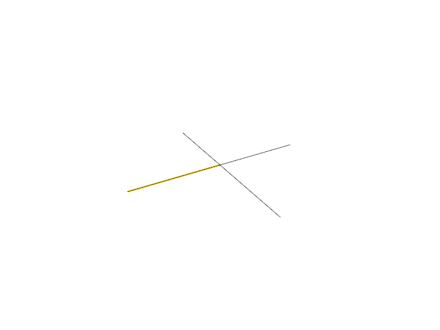

# 16.2 · Split original curves and joined faces

**Goal:** Exercise curve pieces source inheritance and one-step Undo. · **Steps:** 8 · **Source:** [app/command/verbs/project_to_plane.rs](../../../src/app/command/verbs/project_to_plane.rs) · [app/command/verbs/extend.rs](../../../src/app/command/verbs/extend.rs) · [app/splitting.rs](../../../src/app/splitting.rs) · [app/command/verbs/measure.rs](../../../src/app/command/verbs/measure.rs) · [app/command/verbs/trim/parts.rs](../../../src/app/command/verbs/trim/parts.rs) · [app/command/verbs/explode.rs](../../../src/app/command/verbs/explode.rs) · [app/walk/frames.rs](../../../src/app/walk/frames.rs) (`src/app/booleans.rs,src/app/measurements.rs,src/app/recipes.rs`)

<div class="webgpu-schematic" style="width:100%;margin:6px auto;">
<svg xmlns="http://www.w3.org/2000/svg" width="1120" height="200" viewBox="0 0 1120 200" style="width:100%;max-width:100%;height:auto;display:block;margin:0 auto;" role="img">
  <defs>
    <marker id="arr" viewBox="0 0 10 10" refX="8" refY="5" markerWidth="6" markerHeight="6" orient="auto">
      <path d="M 0 1 L 9 5 L 0 9 z" fill="#111111"/>
    </marker>
    <marker id="arrR" viewBox="0 0 10 10" refX="8" refY="5" markerWidth="6" markerHeight="6" orient="auto">
      <path d="M 0 1 L 9 5 L 0 9 z" fill="#dc2626"/>
    </marker>
    <marker id="arrG" viewBox="0 0 10 10" refX="8" refY="5" markerWidth="6" markerHeight="6" orient="auto">
      <path d="M 0 1 L 9 5 L 0 9 z" fill="#16a34a"/>
    </marker>
    <marker id="arrB" viewBox="0 0 10 10" refX="8" refY="5" markerWidth="6" markerHeight="6" orient="auto">
      <path d="M 0 1 L 9 5 L 0 9 z" fill="#2563eb"/>
    </marker>
  </defs>
  <rect x="2" y="2" width="1116" height="196" rx="10" fill="#ffffff" stroke="#111111" stroke-width="2"/>
  <rect x="16" y="14" width="248" height="172" rx="8" fill="#ffffff" stroke="#111111" stroke-width="1.75"/>
  <text paint-order="stroke fill" stroke="#ffffff" stroke-width="5" stroke-linejoin="round" x="140" y="34" text-anchor="middle" font-family="monospace" font-size="11.5" font-weight="700" fill="#111111">1. Lesson 16.2 Code</text>
  <rect x="34" y="48" width="212" height="24" rx="4" fill="#ffffff" stroke="#111111" stroke-width="1.25"/>
  <text paint-order="stroke fill" stroke="#ffffff" stroke-width="5" stroke-linejoin="round" x="140" y="64" text-anchor="middle" font-family="monospace" font-size="10" font-weight="700" fill="#111111">src/split_geometry.rs</text>
  <rect x="34" y="78" width="212" height="24" rx="4" fill="#ffffff" stroke="#111111" stroke-width="1.5"/>
  <text paint-order="stroke fill" stroke="#ffffff" stroke-width="5" stroke-linejoin="round" x="140" y="94" text-anchor="middle" font-family="monospace" font-size="10" font-weight="700" fill="#111111">src/split_draft.rs</text>
  <rect x="34" y="108" width="212" height="24" rx="4" fill="#ffffff" stroke="#111111" stroke-width="1.25"/>
  <text paint-order="stroke fill" stroke="#ffffff" stroke-width="5" stroke-linejoin="round" x="140" y="124" text-anchor="middle" font-family="monospace" font-size="10" font-weight="700" fill="#111111">src/lib.rs</text>
  <text paint-order="stroke fill" stroke="#ffffff" stroke-width="5" stroke-linejoin="round" x="140" y="172" text-anchor="middle" font-family="monospace" font-size="9.5" fill="#111111">8 Coding Steps</text>
  <line x1="264" y1="100" x2="292" y2="100" stroke="#111111" stroke-width="2" marker-end="url(#arr)"/>
  <rect x="296" y="14" width="248" height="172" rx="8" fill="#ffffff" stroke="#111111" stroke-width="1.75"/>
  <text paint-order="stroke fill" stroke="#ffffff" stroke-width="5" stroke-linejoin="round" x="420" y="34" text-anchor="middle" font-family="monospace" font-size="11.5" font-weight="700" fill="#111111">2. session_viewer/src</text>
  <rect x="314" y="48" width="212" height="26" rx="4" fill="#ffffff" stroke="#111111" stroke-width="1.5"/>
  <text paint-order="stroke fill" stroke="#ffffff" stroke-width="5" stroke-linejoin="round" x="420" y="65" text-anchor="middle" font-family="monospace" font-size="10" font-weight="700" fill="#111111">src/app/booleans.rs</text>
  <rect x="314" y="80" width="212" height="26" rx="4" fill="#ffffff" stroke="#111111" stroke-width="1.5"/>
  <text paint-order="stroke fill" stroke="#ffffff" stroke-width="5" stroke-linejoin="round" x="420" y="97" text-anchor="middle" font-family="monospace" font-size="10" font-weight="700" fill="#111111">src/app/measurements.rs</text>
  <rect x="314" y="112" width="212" height="24" rx="4" fill="#ffffff" stroke="#111111" stroke-width="1.5"/>
  <text paint-order="stroke fill" stroke="#ffffff" stroke-width="5" stroke-linejoin="round" x="420" y="128" text-anchor="middle" font-family="monospace" font-size="9.5" font-weight="700" fill="#111111">✓ cargo check (wasm32)</text>
  <text paint-order="stroke fill" stroke="#ffffff" stroke-width="5" stroke-linejoin="round" x="420" y="172" text-anchor="middle" font-family="sans-serif" font-size="10" fill="#111111">Divide curves and joined…</text>
  <line x1="544" y1="100" x2="572" y2="100" stroke="#111111" stroke-width="2" marker-end="url(#arr)"/>
  <rect x="576" y="14" width="248" height="172" rx="8" fill="#ffffff" stroke="#111111" stroke-width="1.75"/>
  <text paint-order="stroke fill" stroke="#ffffff" stroke-width="5" stroke-linejoin="round" x="700" y="34" text-anchor="middle" font-family="monospace" font-size="11.5" font-weight="700" fill="#111111">3. B-Rep Boolean (A ∪ / ∖ / ∩ B)</text>
  <rect x="618" y="56" width="84" height="68" rx="4" fill="#dbeafe" stroke="#111111" stroke-width="1.75"/>
  <rect x="676" y="72" width="84" height="68" rx="4" fill="#fee2e2" stroke="#111111" stroke-width="1.75"/>
  <rect x="676" y="72" width="26" height="52" fill="#fef08a" stroke="#dc2626" stroke-width="2"/>
  <text paint-order="stroke fill" stroke="#ffffff" stroke-width="5" stroke-linejoin="round" x="689" y="102" text-anchor="middle" font-family="monospace" font-size="9" font-weight="700" fill="#111111">SSI</text>
  <text paint-order="stroke fill" stroke="#ffffff" stroke-width="5" stroke-linejoin="round" x="700" y="172" text-anchor="middle" font-family="monospace" font-size="9.5" fill="#111111">Split original curves and j…</text>
  <line x1="824" y1="100" x2="852" y2="100" stroke="#111111" stroke-width="2" marker-end="url(#arr)"/>
  <rect x="856" y="14" width="248" height="172" rx="8" fill="#ffffff" stroke="#111111" stroke-width="1.75"/>
  <text paint-order="stroke fill" stroke="#ffffff" stroke-width="5" stroke-linejoin="round" x="980" y="34" text-anchor="middle" font-family="monospace" font-size="11.5" font-weight="700" fill="#111111">4. Split, Trim &amp; Dimensions</text>
  <line x1="896" y1="92" x2="1056" y2="92" stroke="#111111" stroke-width="2" marker-end="url(#arr)"/>
  <line x1="896" y1="76" x2="896" y2="108" stroke="#111111" stroke-width="1.75"/>
  <line x1="1056" y1="76" x2="1056" y2="108" stroke="#111111" stroke-width="1.75"/>
  <rect x="932" y="54" width="88" height="24" rx="4" fill="#fef9c3" stroke="#111111" stroke-width="1.5"/>
  <text paint-order="stroke fill" stroke="#ffffff" stroke-width="5" stroke-linejoin="round" x="976" y="70" text-anchor="middle" font-family="monospace" font-size="9.5" font-weight="700" fill="#111111">124.50 mm</text>
  <text paint-order="stroke fill" stroke="#ffffff" stroke-width="5" stroke-linejoin="round" x="976" y="132" text-anchor="middle" font-family="monospace" font-size="9.5" font-weight="700" fill="#111111">Area / Volume / Mass</text>
  <text paint-order="stroke fill" stroke="#ffffff" stroke-width="5" stroke-linejoin="round" x="980" y="172" text-anchor="middle" font-family="sans-serif" font-size="10" font-weight="700" fill="#111111">Exercise curve pieces sou…</text>
</svg>
</div>

## <a id="checkpoint-82-divide-current-original-curve-families"></a>1. Divide curves and joined faces

<div class="webgpu-schematic" style="width:100%;margin:6px auto;">
<svg xmlns="http://www.w3.org/2000/svg" width="1120" height="72" viewBox="0 0 1120 72" style="width:100%;max-width:100%;height:auto;display:block;margin:0 auto;" role="img">
  <defs>
    <marker id="arr" viewBox="0 0 10 10" refX="8" refY="5" markerWidth="6" markerHeight="6" orient="auto">
      <path d="M 0 1 L 9 5 L 0 9 z" fill="#111111"/>
    </marker>
    <marker id="arrR" viewBox="0 0 10 10" refX="8" refY="5" markerWidth="6" markerHeight="6" orient="auto">
      <path d="M 0 1 L 9 5 L 0 9 z" fill="#dc2626"/>
    </marker>
    <marker id="arrG" viewBox="0 0 10 10" refX="8" refY="5" markerWidth="6" markerHeight="6" orient="auto">
      <path d="M 0 1 L 9 5 L 0 9 z" fill="#16a34a"/>
    </marker>
    <marker id="arrB" viewBox="0 0 10 10" refX="8" refY="5" markerWidth="6" markerHeight="6" orient="auto">
      <path d="M 0 1 L 9 5 L 0 9 z" fill="#2563eb"/>
    </marker>
  </defs>
  <rect x="2" y="2" width="1116" height="68" rx="10" fill="#ffffff" stroke="#111111" stroke-width="2"/>
  <rect x="14" y="10" width="252" height="52" rx="6" fill="#ffffff" stroke="#111111" stroke-width="1.5"/>
  <text paint-order="stroke fill" stroke="#ffffff" stroke-width="5" stroke-linejoin="round" x="140" y="30" text-anchor="middle" font-family="monospace" font-size="10.5" font-weight="700" fill="#111111">Step 1 of 8</text>
  <text paint-order="stroke fill" stroke="#ffffff" stroke-width="5" stroke-linejoin="round" x="140" y="48" text-anchor="middle" font-family="monospace" font-size="9.5" fill="#111111">src/split_geometry.rs</text>
  <line x1="266" y1="36" x2="292" y2="36" stroke="#111111" stroke-width="1.75" marker-end="url(#arr)"/>
  <rect x="296" y="10" width="252" height="52" rx="6" fill="#ffffff" stroke="#111111" stroke-width="1.5"/>
  <text paint-order="stroke fill" stroke="#ffffff" stroke-width="5" stroke-linejoin="round" x="422" y="30" text-anchor="middle" font-family="monospace" font-size="10" font-weight="700" fill="#111111">1. CPU / Rust Input</text>
  <text paint-order="stroke fill" stroke="#ffffff" stroke-width="5" stroke-linejoin="round" x="422" y="48" text-anchor="middle" font-family="sans-serif" font-size="9.5" fill="#111111">original family</text>
  <line x1="548" y1="36" x2="574" y2="36" stroke="#111111" stroke-width="1.75" marker-end="url(#arr)"/>
  <rect x="578" y="10" width="252" height="52" rx="6" fill="#ffffff" stroke="#111111" stroke-width="1.5"/>
  <text paint-order="stroke fill" stroke="#ffffff" stroke-width="5" stroke-linejoin="round" x="704" y="30" text-anchor="middle" font-family="monospace" font-size="10" font-weight="700" fill="#111111">2. WebGPU / WGSL</text>
  <text paint-order="stroke fill" stroke="#ffffff" stroke-width="5" stroke-linejoin="round" x="704" y="48" text-anchor="middle" font-family="sans-serif" font-size="9.5" fill="#111111">pure calculation</text>
  <line x1="830" y1="36" x2="856" y2="36" stroke="#111111" stroke-width="1.75" marker-end="url(#arr)"/>
  <rect x="860" y="10" width="246" height="52" rx="6" fill="#fef9c3" stroke="#111111" stroke-width="1.75"/>
  <text paint-order="stroke fill" stroke="#ffffff" stroke-width="5" stroke-linejoin="round" x="983" y="30" text-anchor="middle" font-family="monospace" font-size="10" font-weight="700" fill="#111111">3. -&gt; src/app/booleans.rs</text>
  <text paint-order="stroke fill" stroke="#ffffff" stroke-width="5" stroke-linejoin="round" x="983" y="48" text-anchor="middle" font-family="sans-serif" font-size="9.5" fill="#111111">result or refusal</text>
</svg>
</div>

**What this code does:** Bound the cutter count and dispatch original lines, polylines, curves, surfaces and selected BRep faces to the Session split algorithms.

### 1. `src/split_geometry.rs`

Extend this original owner with today’s complete helper.

**Locate this existing block:**

```rust
}

pub fn named(source: &Geometry, mut pieces: Vec<Geometry>) -> Vec<Geometry> {
```

Edit the existing block to match this code; keep unchanged lines:

```rust
}

pub fn divided(
    source: &Geometry,
    face: Option<usize>,
    tools: &[NurbsCurve],
) -> Result<(Vec<Geometry>, usize), String> {
    if tools.is_empty() || tools.len() > 64 {
        return Err("Choose 1–64 cutter curves".into());
    }
    let face = face_index(source, face)?;
    let tolerance = 1e-6;
    let (pieces, regions) = match source {
        Geometry::Line(line) => {
            let pieces: Vec<_> = split::split_line_by_curves(line, &tools, tolerance)?
                .into_iter()
                .map(|p| Geometry::Line(Rc::new(p)))
                .collect();
            let count = pieces.len();
            (pieces, count)
        }
        Geometry::Polyline(line) => {
            let pieces: Vec<_> =
                split::split_polyline_by_curves(line, &tools, tolerance)?
                    .into_iter()
                    .map(|p| Geometry::Polyline(Rc::new(p)))
                    .collect();
            let count = pieces.len();
            (pieces, count)
        }
        Geometry::NurbsCurve(curve) => {
            let pieces: Vec<_> =
                split::split_curve_by_curves(curve, &tools, tolerance)?
                    .into_iter()
                    .map(|p| Geometry::NurbsCurve(Rc::new(p)))
                    .collect();
            let count = pieces.len();
            (pieces, count)
        }
        Geometry::NurbsSurface(surface) => {
            let mut brep = split::split_surface_by_curves(surface, &tools, tolerance)?;
            brep.name = surface.name.clone();
            let count = brep.face_count();
            (vec![Geometry::BRep(Rc::new(brep))], count)
        }
        Geometry::BRep(brep) => {
            let next = split::split_brep_face_by_curves(
                brep,
                face.ok_or("Select a face")?,
                &tools,
                tolerance,
            )?;
            let count = next.face_count() - brep.face_count() + 1;
            (vec![Geometry::BRep(Rc::new(next))], count)
        }
        Geometry::Element(element) => {
            let session_rust::element::ElementGeometry::BRep(brep) = element.geometry()
            else {
                return Err("Element has no BRep".into());
            };
            let next = split::split_brep_face_by_curves(
                brep,
                face.ok_or("Select a face")?,
                &tools,
                tolerance,
            )?;
            let count = next.face_count() - brep.face_count() + 1;
            let mut result = (**element).clone();
            result.set_brep_geometry(next);
            (
                vec![Geometry::Element(Rc::new(result))],
                count,
            )
        }
        _ => return Err("Unsupported split target".into()),
    };

    Ok((pieces, regions))
}
pub fn named(source: &Geometry, mut pieces: Vec<Geometry>) -> Vec<Geometry> {
```

## <a id="checkpoint-82a-own-the-split-target-and-toggle-original-cutters"></a>2. Own the split target and toggle cutters

<div class="webgpu-schematic" style="width:100%;margin:6px auto;">
<svg xmlns="http://www.w3.org/2000/svg" width="1120" height="72" viewBox="0 0 1120 72" style="width:100%;max-width:100%;height:auto;display:block;margin:0 auto;" role="img">
  <defs>
    <marker id="arr" viewBox="0 0 10 10" refX="8" refY="5" markerWidth="6" markerHeight="6" orient="auto">
      <path d="M 0 1 L 9 5 L 0 9 z" fill="#111111"/>
    </marker>
    <marker id="arrR" viewBox="0 0 10 10" refX="8" refY="5" markerWidth="6" markerHeight="6" orient="auto">
      <path d="M 0 1 L 9 5 L 0 9 z" fill="#dc2626"/>
    </marker>
    <marker id="arrG" viewBox="0 0 10 10" refX="8" refY="5" markerWidth="6" markerHeight="6" orient="auto">
      <path d="M 0 1 L 9 5 L 0 9 z" fill="#16a34a"/>
    </marker>
    <marker id="arrB" viewBox="0 0 10 10" refX="8" refY="5" markerWidth="6" markerHeight="6" orient="auto">
      <path d="M 0 1 L 9 5 L 0 9 z" fill="#2563eb"/>
    </marker>
  </defs>
  <rect x="2" y="2" width="1116" height="68" rx="10" fill="#ffffff" stroke="#111111" stroke-width="2"/>
  <rect x="14" y="10" width="252" height="52" rx="6" fill="#ffffff" stroke="#111111" stroke-width="1.5"/>
  <text paint-order="stroke fill" stroke="#ffffff" stroke-width="5" stroke-linejoin="round" x="140" y="30" text-anchor="middle" font-family="monospace" font-size="10.5" font-weight="700" fill="#111111">Step 2 of 8</text>
  <text paint-order="stroke fill" stroke="#ffffff" stroke-width="5" stroke-linejoin="round" x="140" y="48" text-anchor="middle" font-family="monospace" font-size="9.5" fill="#111111">src/split_draft.rs, src/lib…</text>
  <line x1="266" y1="36" x2="292" y2="36" stroke="#111111" stroke-width="1.75" marker-end="url(#arr)"/>
  <rect x="296" y="10" width="252" height="52" rx="6" fill="#ffffff" stroke="#111111" stroke-width="1.5"/>
  <text paint-order="stroke fill" stroke="#ffffff" stroke-width="5" stroke-linejoin="round" x="422" y="30" text-anchor="middle" font-family="monospace" font-size="10" font-weight="700" fill="#111111">1. CPU / Rust Input</text>
  <text paint-order="stroke fill" stroke="#ffffff" stroke-width="5" stroke-linejoin="round" x="422" y="48" text-anchor="middle" font-family="sans-serif" font-size="9.5" fill="#111111">target original</text>
  <line x1="548" y1="36" x2="574" y2="36" stroke="#111111" stroke-width="1.75" marker-end="url(#arr)"/>
  <rect x="578" y="10" width="252" height="52" rx="6" fill="#ffffff" stroke="#111111" stroke-width="1.5"/>
  <text paint-order="stroke fill" stroke="#ffffff" stroke-width="5" stroke-linejoin="round" x="704" y="30" text-anchor="middle" font-family="monospace" font-size="10" font-weight="700" fill="#111111">2. WebGPU / WGSL</text>
  <text paint-order="stroke fill" stroke="#ffffff" stroke-width="5" stroke-linejoin="round" x="704" y="48" text-anchor="middle" font-family="sans-serif" font-size="9.5" fill="#111111">pending cutter owners</text>
  <line x1="830" y1="36" x2="856" y2="36" stroke="#111111" stroke-width="1.75" marker-end="url(#arr)"/>
  <rect x="860" y="10" width="246" height="52" rx="6" fill="#ffffff" stroke="#111111" stroke-width="1.75"/>
  <text paint-order="stroke fill" stroke="#ffffff" stroke-width="5" stroke-linejoin="round" x="983" y="30" text-anchor="middle" font-family="monospace" font-size="10" font-weight="700" fill="#111111">3. -&gt; src/app/booleans.rs</text>
  <text paint-order="stroke fill" stroke="#ffffff" stroke-width="5" stroke-linejoin="round" x="983" y="48" text-anchor="middle" font-family="sans-serif" font-size="9.5" fill="#111111">whole-owner toggles</text>
</svg>
</div>

**What this code does:** Own the split target and toggle original cutters.

### 1. `src/split_draft.rs`

Own the curve target and bounded original cutter toggles.

Create the file and type:

```rust
use crate::{
    scene::{ObjectId, Scene},
    source_edit::Owner,
};
use session_rust::{Geometry, Xform};
#[derive(Clone)]
pub struct Draft {
    pub target: Owner,
    pub face: Option<usize>,
    pub cutters: Vec<Owner>,
}
impl Draft {
    pub fn new(
        scene: &Scene,
        id: ObjectId,
        face: Option<usize>,
    ) -> Result<Self, String> {
        let target = Owner::capture(scene, id).map_err(str::to_owned)?;
        if !crate::split_geometry::is_cutter(&target.source) {
            return Err("Select a curve; surface-face splitting connects next".into());
        }
        let face = crate::split_geometry::face_index(&target.source, face)?;
        Ok(Self {
            target,
            face,
            cutters: Vec::new(),
        })
    }
    pub fn pick(&mut self, scene: &Scene, id: Option<ObjectId>) -> Result<(), String> {
        let id = id.ok_or("Choose a cutter curve")?;
        if id == self.target.id {
            return Err("Choose a cutter distinct from the target".into());
        }
        let owner = Owner::capture(scene, id).map_err(str::to_owned)?;
        if !crate::split_geometry::is_cutter(&owner.source) {
            return Err("Choose a line, polyline or NURBS curve as cutter".into());
        }
        if let Some(at) = self.cutters.iter().position(|c| c.id == id) {
            self.cutters.remove(at);
        } else if self.cutters.len() < 64 {
            self.cutters.push(owner);
        }
        Ok(())
    }
}
```

### 2. `src/lib.rs`

Register the source-splitting component.

**Locate this existing block:**

```rust
mod editing_tests;

pub mod source_mesh_topology;
pub mod split_geometry;

#[cfg(target_arch = "wasm32")]
```

Edit the existing block to match this code; keep unchanged lines:

```rust
mod editing_tests;

pub mod split_geometry;

pub mod source_mesh_topology;
pub mod split_draft;

#[cfg(target_arch = "wasm32")]
```

## <a id="checkpoint-82b-transform-cutters-into-the-target-frame-before-dividing"></a>3. Transform cutters into the target frame before dividing

<div class="webgpu-schematic" style="width:100%;margin:6px auto;">
<svg xmlns="http://www.w3.org/2000/svg" width="1120" height="72" viewBox="0 0 1120 72" style="width:100%;max-width:100%;height:auto;display:block;margin:0 auto;" role="img">
  <defs>
    <marker id="arr" viewBox="0 0 10 10" refX="8" refY="5" markerWidth="6" markerHeight="6" orient="auto">
      <path d="M 0 1 L 9 5 L 0 9 z" fill="#111111"/>
    </marker>
    <marker id="arrR" viewBox="0 0 10 10" refX="8" refY="5" markerWidth="6" markerHeight="6" orient="auto">
      <path d="M 0 1 L 9 5 L 0 9 z" fill="#dc2626"/>
    </marker>
    <marker id="arrG" viewBox="0 0 10 10" refX="8" refY="5" markerWidth="6" markerHeight="6" orient="auto">
      <path d="M 0 1 L 9 5 L 0 9 z" fill="#16a34a"/>
    </marker>
    <marker id="arrB" viewBox="0 0 10 10" refX="8" refY="5" markerWidth="6" markerHeight="6" orient="auto">
      <path d="M 0 1 L 9 5 L 0 9 z" fill="#2563eb"/>
    </marker>
  </defs>
  <rect x="2" y="2" width="1116" height="68" rx="10" fill="#ffffff" stroke="#111111" stroke-width="2"/>
  <rect x="14" y="10" width="252" height="52" rx="6" fill="#ffffff" stroke="#111111" stroke-width="1.5"/>
  <text paint-order="stroke fill" stroke="#ffffff" stroke-width="5" stroke-linejoin="round" x="140" y="30" text-anchor="middle" font-family="monospace" font-size="10.5" font-weight="700" fill="#111111">Step 3 of 8</text>
  <text paint-order="stroke fill" stroke="#ffffff" stroke-width="5" stroke-linejoin="round" x="140" y="48" text-anchor="middle" font-family="monospace" font-size="9.5" fill="#111111">src/split_draft.rs</text>
  <line x1="266" y1="36" x2="292" y2="36" stroke="#111111" stroke-width="1.75" marker-end="url(#arr)"/>
  <rect x="296" y="10" width="252" height="52" rx="6" fill="#ffffff" stroke="#111111" stroke-width="1.5"/>
  <text paint-order="stroke fill" stroke="#ffffff" stroke-width="5" stroke-linejoin="round" x="422" y="30" text-anchor="middle" font-family="monospace" font-size="10" font-weight="700" fill="#111111">1. CPU / Rust Input</text>
  <text paint-order="stroke fill" stroke="#ffffff" stroke-width="5" stroke-linejoin="round" x="422" y="48" text-anchor="middle" font-family="sans-serif" font-size="9.5" fill="#111111">world placements</text>
  <line x1="548" y1="36" x2="574" y2="36" stroke="#111111" stroke-width="1.75" marker-end="url(#arr)"/>
  <rect x="578" y="10" width="252" height="52" rx="6" fill="#ffffff" stroke="#111111" stroke-width="1.5"/>
  <text paint-order="stroke fill" stroke="#ffffff" stroke-width="5" stroke-linejoin="round" x="704" y="30" text-anchor="middle" font-family="monospace" font-size="10" font-weight="700" fill="#111111">2. WebGPU / WGSL</text>
  <text paint-order="stroke fill" stroke="#ffffff" stroke-width="5" stroke-linejoin="round" x="704" y="48" text-anchor="middle" font-family="sans-serif" font-size="9.5" fill="#111111">local original cutters</text>
  <line x1="830" y1="36" x2="856" y2="36" stroke="#111111" stroke-width="1.75" marker-end="url(#arr)"/>
  <rect x="860" y="10" width="246" height="52" rx="6" fill="#ffffff" stroke="#111111" stroke-width="1.75"/>
  <text paint-order="stroke fill" stroke="#ffffff" stroke-width="5" stroke-linejoin="round" x="983" y="30" text-anchor="middle" font-family="monospace" font-size="10" font-weight="700" fill="#111111">3. -&gt; src/app/booleans.rs</text>
  <text paint-order="stroke fill" stroke="#ffffff" stroke-width="5" stroke-linejoin="round" x="983" y="48" text-anchor="middle" font-family="sans-serif" font-size="9.5" fill="#111111">division</text>
</svg>
</div>

**What this code does:** Transform cutters into the target frame before dividing.

### 1. `src/split_draft.rs`

Prepare original split pieces from fresh local-frame cutter copies.

**Locate this existing block:**

```rust
    }
}
```

Edit the existing block to match this code; keep unchanged lines:

```rust
    }
    pub fn prepare(&self, scene: &Scene) -> Result<(Vec<Geometry>, usize), String> {
        self.target
            .valid(scene)
            .map_err(str::to_owned)?;
        let back = self
            .target
            .model
            .inverse()
            .ok_or("Target placement is singular")?;
        let mut tools = Vec::new();
        for owner in &self.cutters {
            owner.valid(scene).map_err(str::to_owned)?;
            if owner.model.inverse().is_none() {
                return Err("Cutter placement is singular".into());
            }
            let mut cutter = crate::split_geometry::curve(&owner.source)?;
            cutter.transform(&(&back * &owner.model));
            tools.push(cutter);
        }
        let (pieces, regions) =
            crate::split_geometry::divided(&self.target.source, self.face, &tools)?;
        Ok((
            crate::split_geometry::named(&self.target.source, pieces),
            regions,
        ))
    }
    pub fn prompt(&self) -> String {
        format!(
            "Split · {} cutter curves · Enter or Split confirms · Esc cancels",
            self.cutters.len()
        )
    }
}
```

## <a id="checkpoint-82c-adopt-sibling-pieces-beside-the-original-target"></a>4. Adopt sibling pieces beside the target

<div class="webgpu-schematic" style="width:100%;margin:6px auto;">
<svg xmlns="http://www.w3.org/2000/svg" width="1120" height="72" viewBox="0 0 1120 72" style="width:100%;max-width:100%;height:auto;display:block;margin:0 auto;" role="img">
  <defs>
    <marker id="arr" viewBox="0 0 10 10" refX="8" refY="5" markerWidth="6" markerHeight="6" orient="auto">
      <path d="M 0 1 L 9 5 L 0 9 z" fill="#111111"/>
    </marker>
    <marker id="arrR" viewBox="0 0 10 10" refX="8" refY="5" markerWidth="6" markerHeight="6" orient="auto">
      <path d="M 0 1 L 9 5 L 0 9 z" fill="#dc2626"/>
    </marker>
    <marker id="arrG" viewBox="0 0 10 10" refX="8" refY="5" markerWidth="6" markerHeight="6" orient="auto">
      <path d="M 0 1 L 9 5 L 0 9 z" fill="#16a34a"/>
    </marker>
    <marker id="arrB" viewBox="0 0 10 10" refX="8" refY="5" markerWidth="6" markerHeight="6" orient="auto">
      <path d="M 0 1 L 9 5 L 0 9 z" fill="#2563eb"/>
    </marker>
  </defs>
  <rect x="2" y="2" width="1116" height="68" rx="10" fill="#ffffff" stroke="#111111" stroke-width="2"/>
  <rect x="14" y="10" width="252" height="52" rx="6" fill="#ffffff" stroke="#111111" stroke-width="1.5"/>
  <text paint-order="stroke fill" stroke="#ffffff" stroke-width="5" stroke-linejoin="round" x="140" y="30" text-anchor="middle" font-family="monospace" font-size="10.5" font-weight="700" fill="#111111">Step 4 of 8</text>
  <text paint-order="stroke fill" stroke="#ffffff" stroke-width="5" stroke-linejoin="round" x="140" y="48" text-anchor="middle" font-family="monospace" font-size="9.5" fill="#111111">src/split_draft.rs</text>
  <line x1="266" y1="36" x2="292" y2="36" stroke="#111111" stroke-width="1.75" marker-end="url(#arr)"/>
  <rect x="296" y="10" width="252" height="52" rx="6" fill="#ffffff" stroke="#111111" stroke-width="1.5"/>
  <text paint-order="stroke fill" stroke="#ffffff" stroke-width="5" stroke-linejoin="round" x="422" y="30" text-anchor="middle" font-family="monospace" font-size="10" font-weight="700" fill="#111111">1. CPU / Rust Input</text>
  <text paint-order="stroke fill" stroke="#ffffff" stroke-width="5" stroke-linejoin="round" x="422" y="48" text-anchor="middle" font-family="sans-serif" font-size="9.5" fill="#111111">prepared pieces</text>
  <line x1="548" y1="36" x2="574" y2="36" stroke="#111111" stroke-width="1.75" marker-end="url(#arr)"/>
  <rect x="578" y="10" width="252" height="52" rx="6" fill="#ffffff" stroke="#111111" stroke-width="1.5"/>
  <text paint-order="stroke fill" stroke="#ffffff" stroke-width="5" stroke-linejoin="round" x="704" y="30" text-anchor="middle" font-family="monospace" font-size="10" font-weight="700" fill="#111111">2. WebGPU / WGSL</text>
  <text paint-order="stroke fill" stroke="#ffffff" stroke-width="5" stroke-linejoin="round" x="704" y="48" text-anchor="middle" font-family="sans-serif" font-size="9.5" fill="#111111">target sibling identities</text>
  <line x1="830" y1="36" x2="856" y2="36" stroke="#111111" stroke-width="1.75" marker-end="url(#arr)"/>
  <rect x="860" y="10" width="246" height="52" rx="6" fill="#ffffff" stroke="#111111" stroke-width="1.75"/>
  <text paint-order="stroke fill" stroke="#ffffff" stroke-width="5" stroke-linejoin="round" x="983" y="30" text-anchor="middle" font-family="monospace" font-size="10" font-weight="700" fill="#111111">3. -&gt; src/app/booleans.rs</text>
  <text paint-order="stroke fill" stroke="#ffffff" stroke-width="5" stroke-linejoin="round" x="983" y="48" text-anchor="middle" font-family="sans-serif" font-size="9.5" fill="#111111">inherited parent and plac…</text>
</svg>
</div>

**What this code does:** Adopt sibling pieces beside the original target.

### 1. `src/split_draft.rs`

Adopt named original sibling pieces with inherited source parent, placement and colours.

**Locate this existing block:**

```rust
    }
}
```

Edit the existing block to match this code; keep unchanged lines:

```rust
    }
}
pub fn adopt(
    scene: &mut Scene,
    target: ObjectId,
    pieces: Vec<Geometry>,
) -> Result<(), &'static str> {
    let mut ids = vec![target];
    for _ in 1..pieces.len() {
        ids.extend(crate::layer_edit::copy_objects(
            scene,
            &[target],
            &Xform::identity(),
        )?);
    }
    for (id, piece) in ids.into_iter().zip(pieces) {
        let label = piece.name().to_owned();
        scene.replace_original(id, piece)?;
        for index in 0..scene.forest.documents.len() {
            if scene.forest.documents[index]
                .nodes
                .iter()
                .any(|n| n.object == Some(id))
            {
                let mut doc = (*scene.forest.documents[index]).clone();
                for node in &mut doc.nodes {
                    if node.object == Some(id) {
                        node.label = label.clone();
                    }
                }
                scene.forest.replace(index, doc);
                break;
            }
        }
    }
    Ok(())
}
```

## <a id="checkpoint-82d-connect-pending-split-completion-to-one-history-change"></a>5. Connect pending split completion to one history change

<div class="webgpu-schematic" style="width:100%;margin:6px auto;">
<svg xmlns="http://www.w3.org/2000/svg" width="1120" height="72" viewBox="0 0 1120 72" style="width:100%;max-width:100%;height:auto;display:block;margin:0 auto;" role="img">
  <defs>
    <marker id="arr" viewBox="0 0 10 10" refX="8" refY="5" markerWidth="6" markerHeight="6" orient="auto">
      <path d="M 0 1 L 9 5 L 0 9 z" fill="#111111"/>
    </marker>
    <marker id="arrR" viewBox="0 0 10 10" refX="8" refY="5" markerWidth="6" markerHeight="6" orient="auto">
      <path d="M 0 1 L 9 5 L 0 9 z" fill="#dc2626"/>
    </marker>
    <marker id="arrG" viewBox="0 0 10 10" refX="8" refY="5" markerWidth="6" markerHeight="6" orient="auto">
      <path d="M 0 1 L 9 5 L 0 9 z" fill="#16a34a"/>
    </marker>
    <marker id="arrB" viewBox="0 0 10 10" refX="8" refY="5" markerWidth="6" markerHeight="6" orient="auto">
      <path d="M 0 1 L 9 5 L 0 9 z" fill="#2563eb"/>
    </marker>
  </defs>
  <rect x="2" y="2" width="1116" height="68" rx="10" fill="#ffffff" stroke="#111111" stroke-width="2"/>
  <rect x="14" y="10" width="252" height="52" rx="6" fill="#ffffff" stroke="#111111" stroke-width="1.5"/>
  <text paint-order="stroke fill" stroke="#ffffff" stroke-width="5" stroke-linejoin="round" x="140" y="30" text-anchor="middle" font-family="monospace" font-size="10.5" font-weight="700" fill="#111111">Step 5 of 8</text>
  <text paint-order="stroke fill" stroke="#ffffff" stroke-width="5" stroke-linejoin="round" x="140" y="48" text-anchor="middle" font-family="monospace" font-size="9.5" fill="#111111">src/editor.rs</text>
  <line x1="266" y1="36" x2="292" y2="36" stroke="#111111" stroke-width="1.75" marker-end="url(#arr)"/>
  <rect x="296" y="10" width="252" height="52" rx="6" fill="#ffffff" stroke="#111111" stroke-width="1.5"/>
  <text paint-order="stroke fill" stroke="#ffffff" stroke-width="5" stroke-linejoin="round" x="422" y="30" text-anchor="middle" font-family="monospace" font-size="10" font-weight="700" fill="#111111">1. CPU / Rust Input</text>
  <text paint-order="stroke fill" stroke="#ffffff" stroke-width="5" stroke-linejoin="round" x="422" y="48" text-anchor="middle" font-family="sans-serif" font-size="9.5" fill="#111111">pending cutter owners</text>
  <line x1="548" y1="36" x2="574" y2="36" stroke="#111111" stroke-width="1.75" marker-end="url(#arr)"/>
  <rect x="578" y="10" width="252" height="52" rx="6" fill="#ffffff" stroke="#111111" stroke-width="1.5"/>
  <text paint-order="stroke fill" stroke="#ffffff" stroke-width="5" stroke-linejoin="round" x="704" y="30" text-anchor="middle" font-family="monospace" font-size="10" font-weight="700" fill="#111111">2. WebGPU / WGSL</text>
  <text paint-order="stroke fill" stroke="#ffffff" stroke-width="5" stroke-linejoin="round" x="704" y="48" text-anchor="middle" font-family="sans-serif" font-size="9.5" fill="#111111">prepared originals</text>
  <line x1="830" y1="36" x2="856" y2="36" stroke="#111111" stroke-width="1.75" marker-end="url(#arr)"/>
  <rect x="860" y="10" width="246" height="52" rx="6" fill="#ffffff" stroke="#111111" stroke-width="1.75"/>
  <text paint-order="stroke fill" stroke="#ffffff" stroke-width="5" stroke-linejoin="round" x="983" y="30" text-anchor="middle" font-family="monospace" font-size="10" font-weight="700" fill="#111111">3. -&gt; src/app/booleans.rs</text>
  <text paint-order="stroke fill" stroke="#ffffff" stroke-width="5" stroke-linejoin="round" x="983" y="48" text-anchor="middle" font-family="sans-serif" font-size="9.5" fill="#111111">one history transaction</text>
</svg>
</div>

**What this code does:** Connect pending split completion to one history change.

### 1. `src/editor.rs`

Connect pending split actions, checked completion and one original adoption transaction.

Edit these blocks from bottom to top. Keep the surrounding lines unchanged.

**Locate this block:**

```rust
            self.plane_only = false;
        }
        match action {
            Action::Project(words) => return self.begin_project(&words),
```

Replace it with:

```rust
            self.plane_only = false;
        }
        match action {
            Action::Split => return self.split_command(),
            Action::SplitPick(id) => return self.split_pick(id),
            Action::CancelSplit => {
                self.split = None;
                self.tool_status = "Split cancelled".into();
                return Ok(Change::View);
            }
            Action::Project(words) => return self.begin_project(&words),
```

**Locate this block:**

```rust
        self.tool_status = "Geometry updated".into();
        Ok(Change::Scene)
    }
    fn tool_text(&mut self, text: &str) -> Result<Change, &'static str> {
        if self
            .draft
```

Replace it with:

```rust
        self.tool_status = "Geometry updated".into();
        Ok(Change::Scene)
    }
    fn split_command(&mut self) -> Result<Change, &'static str> {
        if self
            .split
            .as_ref()
            .is_some_and(|s| s.cutters.is_empty())
        {
            return Err("Select at least one cutter curve, then press Enter");
        }
        if let Some(next) = self.split.take() {
            let (pieces, regions) = next
                .prepare(&self.scene)
                .map_err(|message| self.primitive_failure(message))?;
            if regions < 2 {
                self.tool_status="No division: cutters must cross the curve or lie on the selected face".into();
                return Ok(Change::View);
            }
            self.history
                .try_edit(&mut self.scene, |scene| {
                    crate::split_draft::adopt(scene, next.target.id, pieces)
                })?;
            self.select_objects([next.target.id], false);
            self.tool_status = format!(
                "Split into {regions} regions · cutters retained · Undo restores the original"
            );
            return Ok(Change::Scene);
        }
        let id = self
            .selection()
            .map(|t| t.owner)
            .or(self.selected)
            .ok_or("Select a curve or one surface face, then run Split")?;
        let face = match self.selected_part {
            Some(crate::pick_sources::Part::Face(face)) => Some(face as usize),
            _ => None,
        };
        let next = crate::split_draft::Draft::new(&self.scene, id, face)
            .map_err(|message| self.primitive_failure(message))?;
        self.draft = None;
        self.gizmo_edit = None;
        self.edit_preview = None;
        self.transform_preview = None;
        self.tool_status = next.prompt();
        self.split = Some(next);
        Ok(Change::View)
    }
    fn split_pick(&mut self, id: Option<ObjectId>) -> Result<Change, &'static str> {
        let mut next = self
            .split
            .clone()
            .ok_or("Start Split first")?;
        next.pick(&self.scene, id)
            .map_err(|message| self.primitive_failure(message))?;
        self.tool_status = next.prompt();
        self.split = Some(next);
        Ok(Change::View)
    }
    fn tool_text(&mut self, text: &str) -> Result<Change, &'static str> {
        if self
            .draft
```

**Locate this block:**

```rust
impl Default for Editor {
    fn default() -> Self {
        Self {
            canvas_drag: None,
            gizmo_edit: None,
            gizmo_hover: None,
```

Replace it with:

```rust
impl Default for Editor {
    fn default() -> Self {
        Self {
            split: None,
            canvas_drag: None,
            gizmo_edit: None,
            gizmo_hover: None,
```

**Locate this block:**

```rust
}

pub struct Editor {
    pub canvas_drag: Option<crate::canvas_drag::Drag>,
    pub gizmo_edit: Option<crate::gizmo_edit::Edit>,
    gizmo_hover: Option<crate::gizmo::Handle>,
```

Replace it with:

```rust
}

pub struct Editor {
    pub split: Option<crate::split_draft::Draft>,
    pub canvas_drag: Option<crate::canvas_drag::Drag>,
    pub gizmo_edit: Option<crate::gizmo_edit::Edit>,
    gizmo_hover: Option<crate::gizmo::Handle>,
```

**Locate this block:**

```rust
    StreamRefresh,
    Project(Vec<String>),
    ExtendBegin {
        distance: Option<f64>,
```

Replace it with:

```rust
    StreamRefresh,
    Split,
    SplitPick(Option<ObjectId>),
    CancelSplit,
    Project(Vec<String>),
    ExtendBegin {
        distance: Option<f64>,
```

## <a id="checkpoint-82e-route-cutter-picks-cancellation-and-temporary-highlights"></a>6. Route cutter picks cancellation and temporary highlights

<div class="webgpu-schematic" style="width:100%;margin:6px auto;">
<svg xmlns="http://www.w3.org/2000/svg" width="1120" height="72" viewBox="0 0 1120 72" style="width:100%;max-width:100%;height:auto;display:block;margin:0 auto;" role="img">
  <defs>
    <marker id="arr" viewBox="0 0 10 10" refX="8" refY="5" markerWidth="6" markerHeight="6" orient="auto">
      <path d="M 0 1 L 9 5 L 0 9 z" fill="#111111"/>
    </marker>
    <marker id="arrR" viewBox="0 0 10 10" refX="8" refY="5" markerWidth="6" markerHeight="6" orient="auto">
      <path d="M 0 1 L 9 5 L 0 9 z" fill="#dc2626"/>
    </marker>
    <marker id="arrG" viewBox="0 0 10 10" refX="8" refY="5" markerWidth="6" markerHeight="6" orient="auto">
      <path d="M 0 1 L 9 5 L 0 9 z" fill="#16a34a"/>
    </marker>
    <marker id="arrB" viewBox="0 0 10 10" refX="8" refY="5" markerWidth="6" markerHeight="6" orient="auto">
      <path d="M 0 1 L 9 5 L 0 9 z" fill="#2563eb"/>
    </marker>
  </defs>
  <rect x="2" y="2" width="1116" height="68" rx="10" fill="#ffffff" stroke="#111111" stroke-width="2"/>
  <rect x="14" y="10" width="252" height="52" rx="6" fill="#ffffff" stroke="#111111" stroke-width="1.5"/>
  <text paint-order="stroke fill" stroke="#ffffff" stroke-width="5" stroke-linejoin="round" x="140" y="30" text-anchor="middle" font-family="monospace" font-size="10.5" font-weight="700" fill="#111111">Step 6 of 8</text>
  <text paint-order="stroke fill" stroke="#ffffff" stroke-width="5" stroke-linejoin="round" x="140" y="48" text-anchor="middle" font-family="monospace" font-size="9.5" fill="#111111">src/editor.rs</text>
  <line x1="266" y1="36" x2="292" y2="36" stroke="#111111" stroke-width="1.75" marker-end="url(#arr)"/>
  <rect x="296" y="10" width="252" height="52" rx="6" fill="#ffffff" stroke="#111111" stroke-width="1.5"/>
  <text paint-order="stroke fill" stroke="#ffffff" stroke-width="5" stroke-linejoin="round" x="422" y="30" text-anchor="middle" font-family="monospace" font-size="10" font-weight="700" fill="#111111">1. CPU / Rust Input</text>
  <text paint-order="stroke fill" stroke="#ffffff" stroke-width="5" stroke-linejoin="round" x="422" y="48" text-anchor="middle" font-family="sans-serif" font-size="9.5" fill="#111111">whole-owner picks</text>
  <line x1="548" y1="36" x2="574" y2="36" stroke="#111111" stroke-width="1.75" marker-end="url(#arr)"/>
  <rect x="578" y="10" width="252" height="52" rx="6" fill="#ffffff" stroke="#111111" stroke-width="1.5"/>
  <text paint-order="stroke fill" stroke="#ffffff" stroke-width="5" stroke-linejoin="round" x="704" y="30" text-anchor="middle" font-family="monospace" font-size="10" font-weight="700" fill="#111111">2. WebGPU / WGSL</text>
  <text paint-order="stroke fill" stroke="#ffffff" stroke-width="5" stroke-linejoin="round" x="704" y="48" text-anchor="middle" font-family="sans-serif" font-size="9.5" fill="#111111">temporary highlights</text>
  <line x1="830" y1="36" x2="856" y2="36" stroke="#111111" stroke-width="1.75" marker-end="url(#arr)"/>
  <rect x="860" y="10" width="246" height="52" rx="6" fill="#fef9c3" stroke="#111111" stroke-width="1.75"/>
  <text paint-order="stroke fill" stroke="#ffffff" stroke-width="5" stroke-linejoin="round" x="983" y="30" text-anchor="middle" font-family="monospace" font-size="10" font-weight="700" fill="#111111">3. -&gt; src/app/booleans.rs</text>
  <text paint-order="stroke fill" stroke="#ffffff" stroke-width="5" stroke-linejoin="round" x="983" y="48" text-anchor="middle" font-family="sans-serif" font-size="9.5" fill="#111111">completion or cancellation</text>
</svg>
</div>

**What this code does:** Route cutter picks cancellation and temporary highlights.

### 1. `src/editor.rs`

Route split input, cutter highlights, gizmo visibility and pending-owner lifecycle.

Edit these blocks from bottom to top. Keep the surrounding lines unchanged.

**Locate this block:**

```rust
                return Ok(Change::Preview);
            }
            Action::TreePick { ids, additive } => {
                let eligible = ids
```

Replace it with:

```rust
                return Ok(Change::Preview);
            }
            Action::TreePick { ids, additive } => {
                if self.split.is_some() {
                    for id in ids {
                        self.split_pick(Some(id))?;
                    }
                    return Ok(Change::View);
                }
                let eligible = ids
```

**Locate this block:**

```rust
            self.plane_menu = false;
            self.plane_only = false;
        }
        match action {
            Action::Split => return self.split_command(),
            Action::SplitPick(id) => return self.split_pick(id),
```

Replace it with:

```rust
            self.plane_menu = false;
            self.plane_only = false;
        }
        if self.split.is_some()
            && !matches!(
                &action,
                Action::Split
                    | Action::SplitPick(_)
                    | Action::CancelSplit
                    | Action::TreePick { .. }
                    | Action::Zoom(_)
                    | Action::ZoomAt { .. }
                    | Action::PanScreen { .. }
                    | Action::Pan(_, _)
                    | Action::Orbit(_, _)
                    | Action::Fit
                    | Action::FitSelected
                    | Action::Projection(_)
                    | Action::ResetView
                    | Action::Background
                    | Action::NormalView(_)
                    | Action::Grid(_)
                    | Action::ConstructionPlane(_)
                    | Action::PlaneMenu
                    | Action::Plane3
            )
        {
            self.split = None;
        }
        match action {
            Action::Split => return self.split_command(),
            Action::SplitPick(id) => return self.split_pick(id),
```

**Locate this block:**

```rust
                });
            }
            Action::SelectRows { ids, add, remove } => {
                self.select_rows(ids, add, remove);
                return Ok(Change::View);
            }
```

Replace it with:

```rust
                });
            }
            Action::SelectRows { ids, add, remove } => {
                if self.split.is_some() {
                    for id in ids {
                        self.split_pick(Some(id))?;
                    }
                    return Ok(Change::View);
                }
                self.select_rows(ids, add, remove);
                return Ok(Change::View);
            }
```

**Locate this block:**

```rust
        self.transform_outcome(next, outcome)
    }
    pub fn highlighted_objects(&self) -> Vec<ObjectId> {
        if let Some(extend) = self
            .draft
            .as_ref()
```

Replace it with:

```rust
        self.transform_outcome(next, outcome)
    }
    pub fn highlighted_objects(&self) -> Vec<ObjectId> {
        if let Some(split) = &self.split {
            return std::iter::once(split.target.id)
                .chain(split.cutters.iter().map(|o| o.id))
                .collect();
        }
        if let Some(extend) = self
            .draft
            .as_ref()
```

**Locate this block:**

```rust
    }

    pub fn tool_line(&self, text: &str) -> Option<Result<Action, &'static str>> {
        if self.gizmo_edit.as_ref().is_some_and(|e| {
            e.gizmo.typing.is_some() || text.trim().eq_ignore_ascii_case("Escape")
        }) {
```

Replace it with:

```rust
    }

    pub fn tool_line(&self, text: &str) -> Option<Result<Action, &'static str>> {
        if self.split.is_some() {
            return match text.trim() {
                "" => Some(Ok(Action::Split)),
                v if v.eq_ignore_ascii_case("Split") => Some(Ok(Action::Split)),
                v if v.eq_ignore_ascii_case("Escape")
                    || v.eq_ignore_ascii_case("Esc") =>
                {
                    Some(Ok(Action::CancelSplit))
                }
                _ => None,
            };
        }
        if self.gizmo_edit.as_ref().is_some_and(|e| {
            e.gizmo.typing.is_some() || text.trim().eq_ignore_ascii_case("Escape")
        }) {
```

**Locate this block:**

```rust
    pub fn gizmo_origin(&self) -> Option<[f64; 3]> {
        if self.draft.is_some() || self.canvas_drag.is_some() {
            return None;
        }
        if self
```

Replace it with:

```rust
    pub fn gizmo_origin(&self) -> Option<[f64; 3]> {
        if self.split.is_some() || self.draft.is_some() || self.canvas_drag.is_some() {
            return None;
        }
        if self
```

## <a id="checkpoint-82f-register-split-and-route-mouse-touch-and-confirmation"></a>7. Register Split and route mouse touch and confirmation

<div class="webgpu-schematic" style="width:100%;margin:6px auto;">
<svg xmlns="http://www.w3.org/2000/svg" width="1120" height="72" viewBox="0 0 1120 72" style="width:100%;max-width:100%;height:auto;display:block;margin:0 auto;" role="img">
  <defs>
    <marker id="arr" viewBox="0 0 10 10" refX="8" refY="5" markerWidth="6" markerHeight="6" orient="auto">
      <path d="M 0 1 L 9 5 L 0 9 z" fill="#111111"/>
    </marker>
    <marker id="arrR" viewBox="0 0 10 10" refX="8" refY="5" markerWidth="6" markerHeight="6" orient="auto">
      <path d="M 0 1 L 9 5 L 0 9 z" fill="#dc2626"/>
    </marker>
    <marker id="arrG" viewBox="0 0 10 10" refX="8" refY="5" markerWidth="6" markerHeight="6" orient="auto">
      <path d="M 0 1 L 9 5 L 0 9 z" fill="#16a34a"/>
    </marker>
    <marker id="arrB" viewBox="0 0 10 10" refX="8" refY="5" markerWidth="6" markerHeight="6" orient="auto">
      <path d="M 0 1 L 9 5 L 0 9 z" fill="#2563eb"/>
    </marker>
  </defs>
  <rect x="2" y="2" width="1116" height="68" rx="10" fill="#ffffff" stroke="#111111" stroke-width="2"/>
  <rect x="14" y="10" width="252" height="52" rx="6" fill="#ffffff" stroke="#111111" stroke-width="1.5"/>
  <text paint-order="stroke fill" stroke="#ffffff" stroke-width="5" stroke-linejoin="round" x="140" y="30" text-anchor="middle" font-family="monospace" font-size="10.5" font-weight="700" fill="#111111">Step 7 of 8</text>
  <text paint-order="stroke fill" stroke="#ffffff" stroke-width="5" stroke-linejoin="round" x="140" y="48" text-anchor="middle" font-family="monospace" font-size="9.5" fill="#111111">src/commands.rs, src/browse…</text>
  <line x1="266" y1="36" x2="292" y2="36" stroke="#111111" stroke-width="1.75" marker-end="url(#arr)"/>
  <rect x="296" y="10" width="252" height="52" rx="6" fill="#ffffff" stroke="#111111" stroke-width="1.5"/>
  <text paint-order="stroke fill" stroke="#ffffff" stroke-width="5" stroke-linejoin="round" x="422" y="30" text-anchor="middle" font-family="monospace" font-size="10" font-weight="700" fill="#111111">1. CPU / Rust Input</text>
  <text paint-order="stroke fill" stroke="#ffffff" stroke-width="5" stroke-linejoin="round" x="422" y="48" text-anchor="middle" font-family="sans-serif" font-size="9.5" fill="#111111">current Split command</text>
  <line x1="548" y1="36" x2="574" y2="36" stroke="#111111" stroke-width="1.75" marker-end="url(#arr)"/>
  <rect x="578" y="10" width="252" height="52" rx="6" fill="#ffffff" stroke="#111111" stroke-width="1.5"/>
  <text paint-order="stroke fill" stroke="#ffffff" stroke-width="5" stroke-linejoin="round" x="704" y="30" text-anchor="middle" font-family="monospace" font-size="10" font-weight="700" fill="#111111">2. WebGPU / WGSL</text>
  <text paint-order="stroke fill" stroke="#ffffff" stroke-width="5" stroke-linejoin="round" x="704" y="48" text-anchor="middle" font-family="sans-serif" font-size="9.5" fill="#111111">pending cutter facts</text>
  <line x1="830" y1="36" x2="856" y2="36" stroke="#111111" stroke-width="1.75" marker-end="url(#arr)"/>
  <rect x="860" y="10" width="246" height="52" rx="6" fill="#ffffff" stroke="#111111" stroke-width="1.75"/>
  <text paint-order="stroke fill" stroke="#ffffff" stroke-width="5" stroke-linejoin="round" x="983" y="30" text-anchor="middle" font-family="monospace" font-size="10" font-weight="700" fill="#111111">3. -&gt; src/app/booleans.rs</text>
  <text paint-order="stroke fill" stroke="#ffffff" stroke-width="5" stroke-linejoin="round" x="983" y="48" text-anchor="middle" font-family="sans-serif" font-size="9.5" fill="#111111">confirm</text>
</svg>
</div>

**What this code does:** Register Split and route mouse touch and confirmation.

### 1. `src/commands.rs`

Register current Split vocabulary and argument-free dispatch.

**Locate this existing block:**

```rust
        )
        .chain(
            crate::gather_registry::ENTRIES
                .iter()
                .map(|(name, _)| *name),
        )
        .collect()
}

// Choose the longest known name so Open Replace cannot become Open with an unwanted argument.
fn matched(words: &[&str]) -> Option<(&'static str, usize)> {
    names()
        .into_iter()
        .filter_map(|name| {
            let compact = name
                .split_whitespace()
                .collect::<String>()
                .to_ascii_lowercase();
            let mut rest = compact.as_str();
            for (index, word) in words.iter().enumerate() {
                let word = word.to_ascii_lowercase();
                rest = rest.strip_prefix(&word)?;
                if rest.is_empty() {
                    return Some((name, index + 1, compact.len()));
                }
            }
            None
        })
        .max_by_key(|(_, _, letters)| *letters)
        .map(|(name, count, _)| (name, count))
}

pub fn canonical(line: &str) -> String {
    let line = crate::gather_registry::alias(line);
    let alias = crate::transform_commands::alias(&line);
    let line = alias.as_str();
    let words: Vec<_> = line.split_whitespace().collect();
    matched(&words).map_or_else(
        || line.trim().to_owned(),
        |(name, count)| {
            std::iter::once(name)
                .chain(words[count..].iter().copied())
                .collect::<Vec<_>>()
                .join(" ")
        },
    )
}

pub fn parse(line: &str) -> Result<Command, String> {
    let line = crate::gather_registry::alias(line);
    let alias = crate::transform_commands::alias(&line);
    let line = alias.as_str();
    let words: Vec<_> = line.split_whitespace().collect();
    let (name, count) = matched(&words).ok_or("Unknown command. Type Help.")?;
    if let Some(action) = crate::editing_commands::action(name, &words[count..]) {
```

Edit the existing block to match this code; keep unchanged lines:

```rust
        )
        .chain(["Split"])
        .chain(
            crate::gather_registry::ENTRIES
                .iter()
                .map(|(name, _)| *name),
        )
        .collect()
}

// Choose the longest known name so Open Replace cannot become Open with an unwanted argument.
fn matched(words: &[&str]) -> Option<(&'static str, usize)> {
    names()
        .into_iter()
        .filter_map(|name| {
            let compact = name
                .split_whitespace()
                .collect::<String>()
                .to_ascii_lowercase();
            let mut rest = compact.as_str();
            for (index, word) in words.iter().enumerate() {
                let word = word.to_ascii_lowercase();
                rest = rest.strip_prefix(&word)?;
                if rest.is_empty() {
                    return Some((name, index + 1, compact.len()));
                }
            }
            None
        })
        .max_by_key(|(_, _, letters)| *letters)
        .map(|(name, count, _)| (name, count))
}

pub fn canonical(line: &str) -> String {
    let line = crate::gather_registry::alias(line);
    let alias = crate::transform_commands::alias(&line);
    let line = alias.as_str();
    let words: Vec<_> = line.split_whitespace().collect();
    matched(&words).map_or_else(
        || line.trim().to_owned(),
        |(name, count)| {
            std::iter::once(name)
                .chain(words[count..].iter().copied())
                .collect::<Vec<_>>()
                .join(" ")
        },
    )
}

pub fn parse(line: &str) -> Result<Command, String> {
    let line = crate::gather_registry::alias(line);
    let alias = crate::transform_commands::alias(&line);
    let line = alias.as_str();
    let words: Vec<_> = line.split_whitespace().collect();
    let (name, count) = matched(&words).ok_or("Unknown command. Type Help.")?;
    if name == "Split" {
        return if words.len() == count {
            Ok(Command::Editor(Action::Split))
        } else {
            Err("Split takes no arguments".into())
        };
    }
    if let Some(action) = crate::editing_commands::action(name, &words[count..]) {
```

### 2. `src/browser.rs`

Route whole original cutters and expose pending split facts and options.

Edit these blocks from bottom to top. Keep the surrounding lines unchanged.

**Locate this block:**

```rust
        &originals.to_string(),
    )?;
    canvas.set_attribute("data-cplane",&serde_json::json!({"fixed":editor.construction_plane.is_some(),"mode":format!("{:?}",editor.construction_plane),"chooser":editor.plane_menu}).to_string())?;
    canvas.set_attribute("data-project", &editor.draft.as_ref().and_then(|d|d.project.as_ref()).map_or_else(||"null".into(), |p|serde_json::json!({"targets":p.targets.iter().map(|o|o.id.value()).collect::<Vec<_>>(),"points":p.points,"unsupported":p.unsupported}).to_string()))?;
```

Replace it with:

```rust
        &originals.to_string(),
    )?;
    canvas.set_attribute("data-cplane",&serde_json::json!({"fixed":editor.construction_plane.is_some(),"mode":format!("{:?}",editor.construction_plane),"chooser":editor.plane_menu}).to_string())?;
    canvas.set_attribute("data-split", &editor.split.as_ref().map_or_else(||"null".into(),|s|serde_json::json!({"target":s.target.id.value(),"face":s.face,"cutters":s.cutters.iter().map(|o|o.id.value()).collect::<Vec<_>>()}).to_string()))?;
    canvas.set_attribute("data-project", &editor.draft.as_ref().and_then(|d|d.project.as_ref()).map_or_else(||"null".into(), |p|serde_json::json!({"targets":p.targets.iter().map(|o|o.id.value()).collect::<Vec<_>>(),"points":p.points,"unsupported":p.unsupported}).to_string()))?;
```

**Locate this block:**

```rust
                panel.result(error);
            }
            renderer.set_pick_mode(
                if editor.editing_boundaries() || editor.gathering_curves() {
                    crate::pick_sources::Mode::Object
                } else {
                    editor.pick_mode
```

Replace it with:

```rust
                panel.result(error);
            }
            renderer.set_pick_mode(
                if editor.split.is_some()
                    || editor.editing_boundaries()
                    || editor.gathering_curves()
                {
                    crate::pick_sources::Mode::Object
                } else {
                    editor.pick_mode
```

**Locate this block:**

```rust
                    editor.tool_status.clone(),
                    crate::drawing_input::buttons(),
                );
            } else if let Some(draft) = editor.draft.as_ref() {
                let mut buttons = draft.tool.buttons();
                buttons.extend(crate::drawing_input::buttons());
```

Replace it with:

```rust
                    editor.tool_status.clone(),
                    crate::drawing_input::buttons(),
                );
            } else if let Some(split) = &editor.split {
                panel.tool(
                    split.prompt(),
                    vec![
                        ("Split".into(), "Split".into()),
                        ("Cancel".into(), "Escape".into()),
                    ],
                );
            } else if let Some(draft) = editor.draft.as_ref() {
                let mut buttons = draft.tool.buttons();
                buttons.extend(crate::drawing_input::buttons());
```

**Locate this block:**

```rust
                        | Action::GizmoNumber(_)
                        | Action::ToolScreen { commit: true, .. }
                );
                if matches!(&action, Action::CancelTool) {
                    panel.cancel_input();
                }
                if matches!(
```

Replace it with:

```rust
                        | Action::GizmoNumber(_)
                        | Action::ToolScreen { commit: true, .. }
                );
                if matches!(
                    &action,
                    Action::CancelTool | Action::CancelSplit
                ) {
                    panel.cancel_input();
                }
                if matches!(
```

**Locate this block:**

```rust
                );
                let tool_action = matches!(
                    &action,
                    Action::BeginTool(_)
                        | Action::GatherBegin { .. }
                        | Action::GatherPick(_)
                        | Action::Project(_)
```

Replace it with:

```rust
                );
                let tool_action = matches!(
                    &action,
                    Action::Split
                        | Action::SplitPick(_)
                        | Action::CancelSplit
                        | Action::BeginTool(_)
                        | Action::GatherBegin { .. }
                        | Action::GatherPick(_)
                        | Action::Project(_)
```

**Locate this block:**

```rust
                        for action in actions {
                            match action {
                                Action::Pick(screen) => {
                                    if editor.editing_boundaries()
                                        || editor.gathering_curves()
                                    {
                                        pick_additive.set(false);
```

Replace it with:

```rust
                        for action in actions {
                            match action {
                                Action::Pick(screen) => {
                                    if editor.split.is_some()
                                        || editor.editing_boundaries()
                                        || editor.gathering_curves()
                                    {
                                        pick_additive.set(false);
```

**Locate this block:**

```rust
            } else {
                match action {
                    Some(Action::Pick(screen))
                        if editor.editing_boundaries() || editor.gathering_curves() =>
                    {
                        pick_additive.set(false);
                        pick_remove.set(false);
```

Replace it with:

```rust
            } else {
                match action {
                    Some(Action::Pick(screen))
                        if editor.split.is_some()
                            || editor.editing_boundaries()
                            || editor.gathering_curves() =>
                    {
                        pick_additive.set(false);
                        pick_remove.set(false);
```

**Locate this block:**

```rust
                            .and_then(|hit| renderer.resolve_pick(&editor.scene, hit));
                        if editor.editing_boundaries() {
                            Some(Action::ExtendPick(target.map(|t| t.owner)))
                        } else if editor.gathering_curves() {
                            Some(Action::GatherPick(target.map(|t| t.owner)))
```

Replace it with:

```rust
                            .and_then(|hit| renderer.resolve_pick(&editor.scene, hit));
                        if editor.split.is_some() {
                            Some(Action::SplitPick(target.map(|t| t.owner)))
                        } else if editor.editing_boundaries() {
                            Some(Action::ExtendPick(target.map(|t| t.owner)))
                        } else if editor.gathering_curves() {
                            Some(Action::GatherPick(target.map(|t| t.owner)))
```

## <a id="checkpoint-82g-exercise-curve-pieces-source-inheritance-and-one-step-undo"></a>8. Exercise curve pieces source inheritance and one-step Undo

<div class="webgpu-schematic" style="width:100%;margin:6px auto;">
<svg xmlns="http://www.w3.org/2000/svg" width="1120" height="72" viewBox="0 0 1120 72" style="width:100%;max-width:100%;height:auto;display:block;margin:0 auto;" role="img">
  <defs>
    <marker id="arr" viewBox="0 0 10 10" refX="8" refY="5" markerWidth="6" markerHeight="6" orient="auto">
      <path d="M 0 1 L 9 5 L 0 9 z" fill="#111111"/>
    </marker>
    <marker id="arrR" viewBox="0 0 10 10" refX="8" refY="5" markerWidth="6" markerHeight="6" orient="auto">
      <path d="M 0 1 L 9 5 L 0 9 z" fill="#dc2626"/>
    </marker>
    <marker id="arrG" viewBox="0 0 10 10" refX="8" refY="5" markerWidth="6" markerHeight="6" orient="auto">
      <path d="M 0 1 L 9 5 L 0 9 z" fill="#16a34a"/>
    </marker>
    <marker id="arrB" viewBox="0 0 10 10" refX="8" refY="5" markerWidth="6" markerHeight="6" orient="auto">
      <path d="M 0 1 L 9 5 L 0 9 z" fill="#2563eb"/>
    </marker>
  </defs>
  <rect x="2" y="2" width="1116" height="68" rx="10" fill="#ffffff" stroke="#111111" stroke-width="2"/>
  <rect x="14" y="10" width="252" height="52" rx="6" fill="#ffffff" stroke="#111111" stroke-width="1.5"/>
  <text paint-order="stroke fill" stroke="#ffffff" stroke-width="5" stroke-linejoin="round" x="140" y="30" text-anchor="middle" font-family="monospace" font-size="10.5" font-weight="700" fill="#111111">Step 8 of 8</text>
  <text paint-order="stroke fill" stroke="#ffffff" stroke-width="5" stroke-linejoin="round" x="140" y="48" text-anchor="middle" font-family="monospace" font-size="9.5" fill="#111111">src/split_tests.rs, src/lib…</text>
  <line x1="266" y1="36" x2="292" y2="36" stroke="#111111" stroke-width="1.75" marker-end="url(#arr)"/>
  <rect x="296" y="10" width="252" height="52" rx="6" fill="#ffffff" stroke="#111111" stroke-width="1.5"/>
  <text paint-order="stroke fill" stroke="#ffffff" stroke-width="5" stroke-linejoin="round" x="422" y="30" text-anchor="middle" font-family="monospace" font-size="10" font-weight="700" fill="#111111">1. CPU / Rust Input</text>
  <text paint-order="stroke fill" stroke="#ffffff" stroke-width="5" stroke-linejoin="round" x="422" y="48" text-anchor="middle" font-family="sans-serif" font-size="9.5" fill="#111111">original curve and cutter</text>
  <line x1="548" y1="36" x2="574" y2="36" stroke="#111111" stroke-width="1.75" marker-end="url(#arr)"/>
  <rect x="578" y="10" width="252" height="52" rx="6" fill="#ffffff" stroke="#111111" stroke-width="1.5"/>
  <text paint-order="stroke fill" stroke="#ffffff" stroke-width="5" stroke-linejoin="round" x="704" y="30" text-anchor="middle" font-family="monospace" font-size="10" font-weight="700" fill="#111111">2. WebGPU / WGSL</text>
  <text paint-order="stroke fill" stroke="#ffffff" stroke-width="5" stroke-linejoin="round" x="704" y="48" text-anchor="middle" font-family="sans-serif" font-size="9.5" fill="#111111">one Undo</text>
  <line x1="830" y1="36" x2="856" y2="36" stroke="#111111" stroke-width="1.75" marker-end="url(#arr)"/>
  <rect x="860" y="10" width="246" height="52" rx="6" fill="#ffffff" stroke="#111111" stroke-width="1.75"/>
  <text paint-order="stroke fill" stroke="#ffffff" stroke-width="5" stroke-linejoin="round" x="983" y="30" text-anchor="middle" font-family="monospace" font-size="10" font-weight="700" fill="#111111">3. -&gt; src/app/booleans.rs</text>
  <text paint-order="stroke fill" stroke="#ffffff" stroke-width="5" stroke-linejoin="round" x="983" y="48" text-anchor="middle" font-family="sans-serif" font-size="9.5" fill="#111111">exact Save/Open</text>
</svg>
</div>

**What this code does:** Exercise curve pieces source inheritance and one-step Undo.

### 1. `src/split_tests.rs`

Copy integrated source split, tree, placement, colour, stale, history and archive fixtures.

Create the file and type:

```rust
use crate::{
    editor::{Action, Editor},
    scene::Scene,
};
use prost::Message;
use session_rust::{Line, Point, Session, Xform};
use std::rc::Rc;
fn editor() -> Editor {
    let mut e = Editor::default();
    e.apply(Action::Close).unwrap();
    e
}
fn command(e: &mut Editor, line: &str) -> Result<(), String> {
    let action = if let Some(a) = e.tool_line(line) {
        a.map_err(str::to_owned)?
    } else {
        let crate::commands::Command::Editor(a) = crate::commands::parse(line)? else {
            return Err("Editor action".into());
        };
        a
    };
    e.apply(action).map_err(|m| {
        if m == "Shape input invalid" {
            e.tool_status.clone()
        } else {
            m.into()
        }
    })?;
    Ok(())
}
#[test]
fn split_preserves_tree_placement_shared_original_colours_and_exact_archive_with_one_undo()
 {
    let mut source = Session::new("shared");
    let parent = source.add_group("parts");
    source.set_xform(
        &parent.borrow().name,
        Xform::translation(10., 0., 0.),
    );
    source.add_line(
        Line::from_points(
            &Point::new(-2., 0., 0.),
            &Point::new(2., 0., 0.),
        ),
        Some(&parent),
    );
    let bytes = source.to_proto().encode_to_vec();
    let mut e = editor();
    crate::scene_document::import(
        &mut e.scene,
        &bytes,
        "first",
        &Xform::translation(100., 0., 0.),
        3.,
    )
    .unwrap();
    crate::scene_document::import(
        &mut e.scene,
        &bytes,
        "second",
        &Xform::translation(200., 0., 0.),
        3.,
    )
    .unwrap();
    command(&mut e, "Line w110,-2,0 w110,2,0").unwrap();
    let ids = e
        .scene
        .lines()
        .iter()
        .map(|r| r.id)
        .collect::<Vec<_>>();
    let (target, other, cutter) = (ids[0], ids[1], ids[2]);
    let old = e.scene.lines()[0].prepared.source.clone();
    let other_source = e.scene.lines()[1].prepared.source.clone();
    let guid = e.scene.row_guid(target).unwrap().to_owned();
    let model = e.scene.placement(target).unwrap();
    let v = Rc::make_mut(&mut e.scene.view);
    v.faces.insert(target, [60, 170, 100]);
    v.edges.insert(target, [0, 0, 0]);
    e.select_objects([target], false);
    command(&mut e, "Split").unwrap();
    assert!(e.gizmo_origin().is_none());
    e.apply(Action::SplitPick(Some(cutter)))
        .unwrap();
    assert_eq!(e.selected_objects(), [target]);
    assert!(e.highlighted_objects().contains(&cutter));
    command(&mut e, "").unwrap();
    assert!(e.split.is_none());
    assert_eq!(e.scene.lines().len(), 4);
    assert_eq!(e.scene.row_guid(target), Some(guid.as_str()));
    assert_eq!(e.scene.placement(target).unwrap().m, model.m);
    assert_eq!(old.end()[0], 2.);
    assert!(Rc::ptr_eq(
        &other_source,
        &e.scene
            .lines()
            .iter()
            .find(|r| r.id == other)
            .unwrap()
            .prepared
            .source
    ));
    let pieces = e
        .scene
        .lines()
        .iter()
        .filter(|r| r.model.m == model.m)
        .collect::<Vec<_>>();
    assert_eq!(pieces.len(), 2);
    assert_eq!(pieces[0].prepared.source.end()[0], 0.);
    assert_eq!(pieces[1].prepared.source.start()[0], 0.);
    assert!(
        pieces
            .iter()
            .all(|r| e.scene.view.edges.get(&r.id) == Some(&[0, 0, 0]))
    );
    let doc = &e.scene.forest.documents[0];
    let parent = doc
        .nodes
        .iter()
        .position(|n| n.label == "parts")
        .unwrap();
    assert_eq!(
        doc.nodes
            .iter()
            .filter(|n| n.parent == Some(parent) && n.object.is_some())
            .count(),
        2
    );
    assert_eq!(
        e.scene.forest.documents[1]
            .nodes
            .iter()
            .filter(|n| n.object.is_some())
            .count(),
        1
    );
    let mut reopened = Scene::empty();
    crate::scene_document::open(
        &mut reopened,
        &crate::scene_archive::save(&e.scene).unwrap(),
    )
    .unwrap();
    assert_eq!(reopened.lines().len(), 4);
    assert_eq!(
        reopened
            .lines()
            .iter()
            .filter(|r| r.model.m == model.m)
            .count(),
        2
    );
    command(&mut e, "Undo").unwrap();
    assert_eq!(e.scene.lines().len(), 3);
    assert!(Rc::ptr_eq(
        &old,
        &e.scene.lines()[0].prepared.source
    ));
    command(&mut e, "Redo").unwrap();
    assert_eq!(e.scene.lines().len(), 4);
}
#[test]
fn polyline_and_rational_curve_pieces_keep_original_family_corners_and_old_allocations()
{
    for text in [
        "Polyline w-2,0,0 w-1,0,0 w1,0,0 w2,0,0",
        "Nurbs Curve Arc Center w0,0,0 2 180",
    ] {
        let mut e = editor();
        command(&mut e, "CPlane XY").unwrap();
        command(&mut e, text).unwrap();
        let target = e.scene.paths()[0].id;
        let old = crate::source_edit::original(&e.scene, target).unwrap();
        command(&mut e, "Line w0,-3,0 w0,3,0").unwrap();
        let cutter = e.scene.lines()[0].id;
        e.select_objects([target], false);
        command(&mut e, "Split").unwrap();
        e.apply(Action::SplitPick(Some(cutter)))
            .unwrap();
        command(&mut e, "Split").unwrap();
        assert_eq!(e.scene.paths().len(), 2);
        assert!(
            e.scene
                .paths()
                .iter()
                .all(|r| std::mem::discriminant(
                    &crate::source_edit::original(&e.scene, r.id).unwrap()
                ) == std::mem::discriminant(&old))
        );
        if let session_rust::Geometry::Polyline(source) = &old {
            assert_eq!(source.get_points().len(), 4);
            assert_eq!(
                e.scene
                    .paths()
                    .iter()
                    .map(|r| r.prepared.source.coordinates().len())
                    .sum::<usize>(),
                6
            );
        } else if let session_rust::Geometry::NurbsCurve(source) = &old {
            assert!(source.m_is_rat);
            assert!(e.scene.paths().iter().all(
                |r| matches!(&r.prepared.source,crate::chain::Source::Curve(c,_)if c.m_is_rat)
            ));
        }
        command(&mut e, "Undo").unwrap();
        assert_eq!(e.scene.paths().len(), 1);
        assert!(crate::source_edit::same(
            &old,
            &crate::source_edit::original(&e.scene, target).unwrap()
        ));
    }
}
#[test]
fn split_cutter_toggles_whole_tree_rows_and_empty_confirmation_keep_the_pending_owner()
{
    let mut e = editor();
    for text in [
        "Line w-2,0,0 w2,0,0",
        "Line w0,-2,0 w0,2,0",
        "Point w0,0,0",
    ] {
        command(&mut e, text).unwrap()
    }
    let (target, cutter) = (e.scene.lines()[0].id, e.scene.lines()[1].id);
    e.select_objects([target], false);
    command(&mut e, "Split").unwrap();
    assert!(command(&mut e, "Split").is_err());
    assert!(e.split.is_some());
    assert!(
        e.apply(Action::SplitPick(Some(target)))
            .is_err()
    );
    assert!(
        e.apply(Action::SplitPick(Some(
            e.scene.points()[0].id
        )))
        .is_err()
    );
    e.apply(Action::TreePick {
        ids: vec![cutter],
        additive: false,
    })
    .unwrap();
    assert_eq!(e.split.as_ref().unwrap().cutters.len(), 1);
    assert_eq!(e.selected_objects(), [target]);
    e.apply(Action::SelectRows {
        ids: vec![cutter],
        add: false,
        remove: false,
    })
    .unwrap();
    assert!(e.split.as_ref().unwrap().cutters.is_empty());
    command(&mut e, "Escape").unwrap();
    assert!(e.split.is_none());
    assert_eq!(e.selected_objects(), [target]);
    assert!(e.gizmo_origin().is_some());
}
#[test]
fn split_no_division_stale_and_locked_owners_preserve_redo_without_partial_edits() {
    let mut e = editor();
    for text in [
        "Line w-2,0,0 w2,0,0",
        "Line w5,-2,0 w5,2,0",
        "Point w0,0,0",
        "Undo",
    ] {
        command(&mut e, text).unwrap()
    }
    let (target, cutter) = (e.scene.lines()[0].id, e.scene.lines()[1].id);
    let old = e.scene.lines()[0].prepared.source.clone();
    e.select_objects([target], false);
    command(&mut e, "Split").unwrap();
    e.apply(Action::SplitPick(Some(cutter)))
        .unwrap();
    command(&mut e, "").unwrap();
    assert!(e.split.is_none());
    assert_eq!(e.scene.lines().len(), 2);
    assert!(Rc::ptr_eq(
        &old,
        &e.scene.lines()[0].prepared.source
    ));
    command(&mut e, "Redo").unwrap();
    assert_eq!(e.scene.points().len(), 1);
    e.select_objects([target], false);
    command(&mut e, "Split").unwrap();
    e.apply(Action::SplitPick(Some(cutter)))
        .unwrap();
    e.scene
        .place_owner(cutter, Xform::translation(-5., 0., 0.))
        .unwrap();
    assert!(command(&mut e, "").is_err());
    assert!(e.split.is_none());
    assert!(Rc::ptr_eq(
        &old,
        &e.scene.lines()[0].prepared.source
    ));
    Rc::make_mut(&mut e.scene.view).lock(&[target], true);
    assert!(command(&mut e, "Split").is_err());
    assert!(e.split.is_none());
}
#[test]
fn split_arity_undo_and_new_commands_end_pending_state_while_fit_preserves_it() {
    let mut e = editor();
    command(&mut e, "Line w-2,0,0 w2,0,0").unwrap();
    let target = e.scene.lines()[0].id;
    e.select_objects([target], false);
    command(&mut e, "Split").unwrap();
    assert!(crate::commands::parse("Split extra").is_err());
    command(&mut e, "Fit").unwrap();
    assert!(e.split.is_some());
    command(&mut e, "Undo").unwrap();
    assert!(e.split.is_none());
    command(&mut e, "Redo").unwrap();
    e.select_objects([target], false);
    command(&mut e, "Split").unwrap();
    command(&mut e, "Point w0,0,0").unwrap();
    assert!(e.split.is_none());
    assert_eq!(e.scene.points().len(), 1);
}
```

### 2. `src/lib.rs`

Register the source-splitting component.

**Locate this existing block:**

```rust
pub mod split_geometry;

pub mod source_mesh_topology;
pub mod split_draft;

#[cfg(target_arch = "wasm32")]
```

Edit the existing block to match this code; keep unchanged lines:

```rust
pub mod split_geometry;

pub mod split_draft;

pub mod source_mesh_topology;
#[cfg(test)]
mod split_tests;

#[cfg(target_arch = "wasm32")]
```

## Build & Run



```sh
npm --prefix ../session_tests run course -- dependencies 16.2
cd workspace/journey
REGEN_PROTO=0 cargo build --lib --locked --target wasm32-unknown-unknown -j1
REGEN_PROTO=0 CARGO_BUILD_JOBS=1 trunk serve --port 8780
cd ../..
npm --prefix ../session_tests run course -- check 16.2
npm --prefix ../session_tests run course -- save 16.2
```

Continue with [16.3 · Joined-face topology and exact surface measures](83-split-original-faces-without-separating-the-solid.md).
