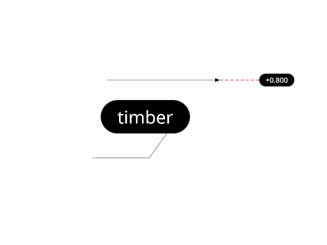

# 17.1 · Bounded projected triangles and tile lists

**Goal:** Cache projection and finish current reports. · **Steps:** 27 · **Source:** [engine/gpu/triangle_tiles.rs](../../../src/engine/gpu/triangle_tiles.rs) · [shaders/project_triangles.wgsl](../../../src/shaders/project_triangles.wgsl) · [shaders/ink_visibility.wgsl](../../../src/shaders/ink_visibility.wgsl) · [shaders/ribbon.wgsl](../../../src/shaders/ribbon.wgsl) · [shaders/vector.wgsl](../../../src/shaders/vector.wgsl) · [engine/gpu/clip.rs](../../../src/engine/gpu/clip.rs) · [shaders/cap.wgsl](../../../src/shaders/cap.wgsl) · [engine/gpu/render.rs](../../../src/engine/gpu/render.rs) · [engine/gpu/pass.rs](../../../src/engine/gpu/pass.rs) (`src/engine/gpu/cull.rs,src/shaders/section.wgsl,src/app/section_plane.rs`)

<div class="webgpu-schematic" style="width:100%;margin:6px auto;">
<svg xmlns="http://www.w3.org/2000/svg" width="1120" height="188" viewBox="0 0 1120 188" style="width:100%;max-width:100%;height:auto;display:block;margin:0 auto;" role="img">
  <defs>
    <marker id="arr" viewBox="0 0 10 10" refX="8" refY="5" markerWidth="6" markerHeight="6" orient="auto">
      <path d="M 0 1 L 9 5 L 0 9 z" fill="#111111"/>
    </marker>
    <marker id="arrR" viewBox="0 0 10 10" refX="8" refY="5" markerWidth="6" markerHeight="6" orient="auto">
      <path d="M 0 1 L 9 5 L 0 9 z" fill="#dc2626"/>
    </marker>
    <marker id="arrG" viewBox="0 0 10 10" refX="8" refY="5" markerWidth="6" markerHeight="6" orient="auto">
      <path d="M 0 1 L 9 5 L 0 9 z" fill="#16a34a"/>
    </marker>
    <marker id="arrB" viewBox="0 0 10 10" refX="8" refY="5" markerWidth="6" markerHeight="6" orient="auto">
      <path d="M 0 1 L 9 5 L 0 9 z" fill="#2563eb"/>
    </marker>
  </defs>
  <rect x="2" y="2" width="1116" height="184" rx="10" fill="#ffffff" stroke="#111111" stroke-width="2"/>
  <rect x="14" y="12" width="344" height="164" rx="8" fill="#ffffff" stroke="#111111" stroke-width="1.5"/>
  <text paint-order="stroke fill" stroke="#ffffff" stroke-width="5" stroke-linejoin="round" x="186" y="30" text-anchor="middle" font-family="monospace" font-size="10.5" font-weight="700" fill="#111111">16×16 Screen Tile Grid + Compute Frustum Culling</text>
  <rect x="64" y="48" width="212" height="106" fill="#f8fafc" stroke="#111111" stroke-width="1.75"/>
  <line x1="117" y1="48" x2="117" y2="154" stroke="#cbd5e1" stroke-width="1"/>
  <line x1="170" y1="48" x2="170" y2="154" stroke="#cbd5e1" stroke-width="1"/>
  <line x1="223" y1="48" x2="223" y2="154" stroke="#cbd5e1" stroke-width="1"/>
  <line x1="64" y1="83" x2="276" y2="83" stroke="#cbd5e1" stroke-width="1"/>
  <line x1="64" y1="118" x2="276" y2="118" stroke="#cbd5e1" stroke-width="1"/>
  <rect x="117" y="83" width="106" height="35" fill="#fef08a" fill-opacity="0.65" stroke="#d97706" stroke-width="1.75"/>
  <polygon points="128,112 170,62 212,112" fill="none" stroke="#111111" stroke-width="2"/>
  <line x1="358" y1="94" x2="384" y2="94" stroke="#111111" stroke-width="2" marker-end="url(#arr)"/>
  <rect x="388" y="12" width="344" height="164" rx="8" fill="#ffffff" stroke="#111111" stroke-width="1.5"/>
  <text paint-order="stroke fill" stroke="#ffffff" stroke-width="5" stroke-linejoin="round" x="560" y="30" text-anchor="middle" font-family="monospace" font-size="10.5" font-weight="700" fill="#111111">Section Clip: dot(P, n) + d &lt; 0 -&gt; Discard + Closed Cap Loop</text>
  <polygon points="434,140 484,64 584,64 534,140" fill="#dbeafe" stroke="#111111" stroke-width="1.75"/>
  <line x1="510" y1="46" x2="510" y2="158" stroke="#dc2626" stroke-width="2.5" stroke-dasharray="5 3"/>
  <polygon points="510,64 584,64 534,140 510,140" fill="#fee2e2" fill-opacity="0.5" stroke="#dc2626" stroke-width="1.5" stroke-dasharray="3 3"/>
  <line x1="510" y1="64" x2="510" y2="140" stroke="#dc2626" stroke-width="4"/>
  <polygon points="614,72 688,72 688,132 614,132" fill="#fef08a" stroke="#dc2626" stroke-width="2"/>
  <line x1="732" y1="94" x2="758" y2="94" stroke="#111111" stroke-width="2" marker-end="url(#arr)"/>
  <rect x="762" y="12" width="344" height="164" rx="8" fill="#ffffff" stroke="#111111" stroke-width="1.75"/>
  <text paint-order="stroke fill" stroke="#ffffff" stroke-width="5" stroke-linejoin="round" x="934" y="30" text-anchor="middle" font-family="monospace" font-size="10.5" font-weight="700" fill="#111111">Clipped Solid + Hatched Cross-Section Cap</text>
  <rect x="806" y="44" width="256" height="118" rx="4" fill="#ffffff" stroke="#111111" stroke-width="2"/>
  <polygon points="842,138 886,68 948,68 948,138" fill="#93c5fd" stroke="#111111" stroke-width="2"/>
  <polygon points="948,68 986,82 986,146 948,138" fill="#fef08a" stroke="#dc2626" stroke-width="2.2"/>
  <line x1="952" y1="84" x2="982" y2="114" stroke="#dc2626" stroke-width="1.5"/>
  <line x1="952" y1="108" x2="982" y2="138" stroke="#dc2626" stroke-width="1.5"/>
</svg>
</div>

## <a id="checkpoint-86-copy-finite-tile-allocation-rules"></a>1. Bound the physical tile grid and reference storage

**What this code does:** Bound the physical tile grid and reference storage.

### 1. `src/tile_math.rs`

Bound the physical tile grid and reference storage.

Create the file and type:

```rust
/// Bytes per projected triangle record.
pub const PROJECTED_BYTES: u64 = 96;

/// Projection workgroups a dispatch row, under the 65535 limit; 64 triangles each.
const PROJECT_ROW_GROUPS: u32 = 32768;

/// Most screen tiles the grid may have.
const MAX_TILES: u32 = 262_144;

/// Most triangle references per tile on average.
const REFERENCES_PER_TILE: u64 = 32;

/// Words per reference: triangle index and depth.
const REFERENCE_WORDS: u64 = 2;

/// Smallest reference pool, in words.
const MIN_POOL_WORDS: u64 = 32 * 1024;

/// The screen tile grid: tile count and pixels per tile.
#[derive(Clone, Copy, Debug, PartialEq, Eq)]
pub struct TileLayout {
    width: u32,  // tiles across
    height: u32, // tiles down
    span: u32,   // pixels per tile side
}

impl TileLayout {
    pub fn dimensions(self) -> [u32; 2] {
        [self.width, self.height]
    }
    /// Grid for a canvas size; tiles grow until the count fits.
    pub fn new(size: (u32, u32)) -> Self {
        let mut span = 4;

        while size.0.div_ceil(span) as u64 * size.1.div_ceil(span) as u64
            > MAX_TILES as u64
        {
            span *= 2;
        }

        Self {
            width: size.0.div_ceil(span).max(1),
            height: size.1.div_ceil(span).max(1),
            span,
        }
    }

    /// Tiles in the grid.
    pub fn count(self) -> u32 {
        self.width * self.height
    }

    /// 16-byte records before the pool: one per tile plus scan totals.
    pub fn header_records(self) -> u64 {
        let blocks = self.count().div_ceil(256);
        1 + self.count() as u64 + blocks as u64 + blocks.div_ceil(256) as u64
    }

    /// Bytes of the tile buffer with a pool of `pool_words`.
    pub fn buffer_bytes(self, pool_words: u64) -> u64 {
        self.header_records() * 16 + pool_words * 4
    }

    /// Largest pool, in words.
    pub fn max_pool_words(self) -> u64 {
        self.count() as u64 * REFERENCES_PER_TILE * REFERENCE_WORDS
    }

    /// First pool size for `triangles`, in words.
    pub fn initial_pool_words(self, triangles: u32) -> u64 {
        let references = self.count() as u64 * 2 + u64::from(triangles) * 8;
        (references * REFERENCE_WORDS)
            .max(MIN_POOL_WORDS)
            .min(self.max_pool_words())
    }
}
```

### 2. `src/lib.rs`

Register the completed source owner.

**Locate this existing block:**

```rust
mod lasso_geometry_tests;
pub mod source_mesh_topology;

#[cfg(target_arch = "wasm32")]
```

Edit the existing block to match this code; keep unchanged lines:

```rust
mod lasso_geometry_tests;

pub mod source_mesh_topology;
pub mod tile_math;

#[cfg(target_arch = "wasm32")]
```

## <a id="checkpoint-86ma-grow-projection-and-reference-pools-from-demand"></a>2. Grow projection and reference pools from demand

**What this code does:** Grow projection and reference pools from demand.

### 1. `src/tile_math.rs`

Grow projection and reference pools from demand.

**Locate this existing block:**

```rust
    }
}
```

Edit the existing block to match this code; keep unchanged lines:

```rust
    }
}

/// Projection workgroups across and down for `triangles`, 64 each, rows of PROJECT_ROW_GROUPS.
pub fn project_groups(triangles: u32) -> (u32, u32) {
    let groups = triangles.div_ceil(64);
    (
        groups.min(PROJECT_ROW_GROUPS),
        groups.div_ceil(PROJECT_ROW_GROUPS),
    )
}

/// Next pool size: at least `floor`; doubled when the report overflowed.
/// Records for a table of `need` triangles, None while `capacity` fits: exact after a load jump, an eighth spare after an edit.
pub fn projected_records(need: u64, capacity: u64, most: u64) -> Option<u64> {
    if need <= capacity && need * 4 >= capacity {
        return None;
    }

    let spare = if need > capacity * 3 / 2 {
        0
    } else {
        need / 8
    };
    Some((need + spare).min(most).max(need))
}

pub fn next_pool_words(
    current: u64,
    floor: u64,
    capacity: u64,
    report: Option<u64>,
    ceiling: u64,
) -> u64 {
    let mut want = current.max(floor);

    // a report at or past capacity means the lists did not fit
    if let Some(needed) = report
        && needed >= capacity
    {
        want = want.max(current.saturating_mul(2));
    }

    want.min(ceiling)
}

#[cfg(test)]
mod tests {
    use super::*;
    /// Past 65535 workgroups the projection wraps into rows, covering every triangle once.
    #[test]
    fn projection_dispatch_stays_in_limits() {
        assert_eq!(project_groups(0), (0, 0));
        assert_eq!(project_groups(65), (2, 1));
        assert_eq!(project_groups(4_194_304), (32_768, 2));
        let (x, y) = project_groups(u32::MAX);
        assert!(x <= 65_535 && y <= 65_535);
        assert!(u64::from(x) * u64::from(y) * 64 >= u64::from(u32::MAX));
    }

    /// One more triangle reuses the table; a load jump is exact; an emptied table shrinks.
    #[test]
    fn projected_grows_by_capacity() {
        let most = u64::MAX;
        assert_eq!(
            projected_records(1_000, 1, most),
            Some(1_000),
            "a load is exact"
        );
        assert_eq!(
            projected_records(1_001, 1_000, most),
            Some(1_126),
            "an edit spares an eighth"
        );
        assert_eq!(
            projected_records(1_002, 1_126, most),
            None,
            "the next one fits"
        );
        assert_eq!(
            projected_records(900, 1_126, most),
            None,
            "fewer still fit"
        );
        assert_eq!(
            projected_records(200, 1_126, most),
            Some(225),
            "a quarter full shrinks"
        );
        assert_eq!(
            projected_records(2_000, 1_000, 2_050),
            Some(2_000),
            "within the device limit"
        );
        assert_eq!(
            projected_records(1_010, 1_000, 1_050),
            Some(1_050)
        );
    }

    /// Past or at capacity doubles; below it keeps the pool.
    #[test]
    fn a_saturated_report_grows_the_pool() {
        let capacity = 1_000;
        let pool = 800;
        assert_eq!(
            next_pool_words(
                pool,
                0,
                capacity,
                Some(capacity + 64),
                u64::MAX
            ),
            1_600,
            "a report past capacity doubles"
        );
        assert_eq!(
            next_pool_words(pool, 0, capacity, Some(capacity), u64::MAX),
            1_600,
            "a pool exactly filled has also run out"
        );
        assert_eq!(
            next_pool_words(
                pool,
                0,
                capacity,
                Some(capacity - 1),
                u64::MAX
            ),
            pool,
            "a report below capacity measured lists that fitted"
        );
        assert_eq!(
            next_pool_words(pool, 0, capacity, None, u64::MAX),
            pool,
            "no report, no change"
        );
    }

    /// Growth stops at the ceiling.
    #[test]
    fn growth_stops_at_the_ceiling() {
        let ceiling = 2_048;
        let mut pool = 512;

        for _ in 0..8 {
            pool = next_pool_words(pool, 0, pool, Some(pool), ceiling);
        }

        assert_eq!(pool, ceiling);
        assert_eq!(
            next_pool_words(pool, 0, pool, Some(pool), ceiling),
            ceiling
        );
    }

    /// Doubling reaches ten times the size in four frames.
    #[test]
    fn doubling_converges_in_a_few_frames() {
        let ceiling = u64::MAX;
        let mut pool = 1_000;
        let mut frames = 0;

        while pool < 10_000 {
            pool = next_pool_words(pool, 0, pool, Some(pool), ceiling);
            frames += 1;
        }

        assert_eq!(frames, 4);
    }

    /// The floor wins when the scene grew.
    #[test]
    fn the_initial_pool_is_a_floor() {
        assert_eq!(
            next_pool_words(100, 4_096, 100, None, u64::MAX),
            4_096
        );
        assert_eq!(
            next_pool_words(8_192, 4_096, 8_192, None, u64::MAX),
            8_192
        );
    }

    #[test]
    /// Every canvas size gets a grid under the tile and memory limits.
    fn viewport_grid_fits_core_storage_limits_without_fixed_per_tile_caps() {
        for size in [
            (1, 1),
            (1400, 900),
            (1800, 1400),
            (2800, 1800),
            (7680, 4320),
            (16384, 16384),
        ] {
            let layout = TileLayout::new(size);
            assert!(layout.count() <= MAX_TILES);
            assert!(layout.buffer_bytes(layout.max_pool_words()) < 128 * 1024 * 1024);
            assert!(
                layout.width * layout.span >= size.0
                    && layout.height * layout.span >= size.1
            );
        }

        assert_eq!(TileLayout::new((1800, 1400)).span, 4);
        assert_eq!(TileLayout::new((2800, 1800)).span, 8);
    }

    /// A small scene starts with a small pool.
    #[test]
    fn pool_starts_small_and_is_capped() {
        let layout = TileLayout::new((3200, 2000));
        let small = layout.initial_pool_words(6_000);
        assert!(small < layout.max_pool_words() / 8);
        assert_eq!(
            layout.initial_pool_words(u32::MAX),
            layout.max_pool_words()
        );
        assert!(layout.buffer_bytes(small) < 4 * 1024 * 1024);
        assert_eq!(
            layout.buffer_bytes(layout.max_pool_words()),
            layout.header_records() * 16
                + layout.count() as u64 * REFERENCES_PER_TILE * 8
        );
    }
}
```

## <a id="checkpoint-86a-copy-maintained-projection-and-scan-recipes"></a>3. Define one shared projected-triangle coverage contract

**What this code does:** Store stable screen-space triangle records and reuse one coverage and tile-span owner.

### 1. `src/projected_triangle.wgsl`

Copy the maintained shader recipe.

Create the file and type:

```wgsl
// One triangle in screen space, 96 bytes.
struct ProjectedTriangle {
    edge0: vec4<f32>, // xyz: edge line equation; w: reference x
    edge1: vec4<f32>, // xyz: edge line equation; w: reference y
    edge2: vec4<f32>, // xyz: edge line equation; w: reference depth
    edge3: vec4<f32>, // xyz: fourth edge after clipping; w: corner count
    gradient: vec4<f32>, // xy: depth slope; z: nearest depth; w: contact radius
    bounds: vec4<f32>, // screen box: left, top, right, bottom
};

// (depth, 1) where the triangle covers `at`, else (0, 0).
fn projected_triangle_at(triangle: ProjectedTriangle, at: vec2<f32>) -> vec2<f32> {
    // empty triangle
    if (triangle.edge3.w<3.0) {
        return vec2<f32>(0.0);
    }

    // 1/256 px slack: the rasterizer's vertex snap
    if (any(at<triangle.bounds.xy-0.00390625) || any(at>triangle.bounds.zw+0.00390625)) {
        return vec2<f32>(0.0);
    }

    // signed distance to each edge; negative = outside
    let distances = vec4<f32>(dot(triangle.edge0.xy, at)+triangle.edge0.z,
    dot(triangle.edge1.xy, at)+triangle.edge1.z,
    dot(triangle.edge2.xy, at)+triangle.edge2.z,
    dot(triangle.edge3.xy, at)+triangle.edge3.z);

    if (any(distances<vec4<f32>(-0.00390625))) {
        return vec2<f32>(0.0);
    }

    // depth at `at` from the reference point and slope
    let depth = triangle.edge2.w+dot(triangle.gradient.xy, at-vec2<f32>(triangle.edge0.w, triangle.edge1.w));
    return vec2<f32>(depth, 1.0);
}
// Pixels per tile side for a canvas; must match TileLayout in Rust.

fn visibility_tile_span_of(width: u32, height: u32) -> u32 {
    var span = 4u;

    while (((width+span-1u)/span)*((height+span-1u)/span)>262144u) {
        span*=2u;
    }

    return span;
}

// Pixels per tile side for this canvas.
fn visibility_tile_span() -> u32 {
    return visibility_tile_span_of(u32(line.vp_w), u32(line.vp_h));
}
```

## <a id="checkpoint-86b-copy-the-project-recipe"></a>4. Declare finite projection buffers and vertex access

**What this code does:** Bind existing original mesh buffers and transform each indexed corner into the projection convention.

### 1. `src/finite_project.wgsl`

Bind existing original mesh buffers and transform each indexed corner into the projection convention.

Create the file and type:

```wgsl
struct View { transform:mat4x4<f32>, size:vec2<f32>, density:f32 }
struct TileLine {thickness:f32,proj_y:f32,ortho_h:f32,vp_h:f32,vp_w:f32}
struct ObjectSettings {model:mat4x4<f32>,selected:u32,id:u32,pad:vec2<u32>,normals:mat4x4<f32>,colour:vec4<f32>}
@group(0) @binding(0) var<uniform> view:View;
@group(1) @binding(0) var<uniform> line:TileLine;
@group(2) @binding(0) var<storage,read> physical_vertices:array<f32>;
@group(2) @binding(1) var<storage,read> physical_indices:array<u32>;
@group(2) @binding(2) var<uniform> object:ObjectSettings;
@group(2) @binding(3) var<storage,read_write> projected:array<ProjectedTriangle>;
@group(2) @binding(4) var<uniform> live_count:vec4<u32>;
#include "projected_triangle.wgsl"
struct ProjectedPolygon {
    points: array<vec3<f32>,
    4>,
    count: u32, // corners; 0 = not drawn
    depth: vec3<f32>, // screen gradient xy and depth at the viewport centre
};
fn physical_clip_corner(index:u32)->vec4<f32>{
 let base=physical_indices[index]*6u;
 let point=vec3<f32>(physical_vertices[base],physical_vertices[base+1u],physical_vertices[base+2u]);
 let clip=view.transform*object.model*vec4<f32>(point,1.0);
 return vec4<f32>(clip.xy,clip.w-clip.z,clip.w);
}
```

## <a id="checkpoint-86ba-clip-original-triangles-before-dividing-by-depth"></a>5. Clip triangles before dividing by depth

<div class="webgpu-schematic" style="width:100%;margin:6px auto;">
<svg xmlns="http://www.w3.org/2000/svg" width="1120" height="188" viewBox="0 0 1120 188" style="width:100%;max-width:100%;height:auto;display:block;margin:0 auto;" role="img">
  <defs>
    <marker id="arr" viewBox="0 0 10 10" refX="8" refY="5" markerWidth="6" markerHeight="6" orient="auto">
      <path d="M 0 1 L 9 5 L 0 9 z" fill="#111111"/>
    </marker>
    <marker id="arrR" viewBox="0 0 10 10" refX="8" refY="5" markerWidth="6" markerHeight="6" orient="auto">
      <path d="M 0 1 L 9 5 L 0 9 z" fill="#dc2626"/>
    </marker>
    <marker id="arrG" viewBox="0 0 10 10" refX="8" refY="5" markerWidth="6" markerHeight="6" orient="auto">
      <path d="M 0 1 L 9 5 L 0 9 z" fill="#16a34a"/>
    </marker>
    <marker id="arrB" viewBox="0 0 10 10" refX="8" refY="5" markerWidth="6" markerHeight="6" orient="auto">
      <path d="M 0 1 L 9 5 L 0 9 z" fill="#2563eb"/>
    </marker>
  </defs>
  <rect x="2" y="2" width="1116" height="184" rx="10" fill="#ffffff" stroke="#111111" stroke-width="2"/>
  <rect x="14" y="12" width="344" height="164" rx="8" fill="#ffffff" stroke="#111111" stroke-width="1.5"/>
  <text paint-order="stroke fill" stroke="#ffffff" stroke-width="5" stroke-linejoin="round" x="186" y="30" text-anchor="middle" font-family="monospace" font-size="10.5" font-weight="700" fill="#111111">Curve Quadrature ∑ w_i ||C'(t_i)|| &amp; Surface Patch dA = ||Su×Sv||</text>
  <path d="M 56 138 Q 112 52 176 126" fill="none" stroke="#dc2626" stroke-width="2.5"/>
  <circle cx="84" cy="98" r="4" fill="#fef08a" stroke="#111111" stroke-width="1.5"/>
  <circle cx="116" cy="84" r="4" fill="#fef08a" stroke="#111111" stroke-width="1.5"/>
  <circle cx="148" cy="98" r="4" fill="#fef08a" stroke="#111111" stroke-width="1.5"/>
  <polygon points="196,136 226,74 288,74 258,136" fill="#dbeafe" stroke="#111111" stroke-width="1.75"/>
  <line x1="226" y1="105" x2="268" y2="105" stroke="#2563eb" stroke-width="2" marker-end="url(#arrB)"/>
  <line x1="226" y1="105" x2="242" y2="74" stroke="#16a34a" stroke-width="2" marker-end="url(#arrG)"/>
  <line x1="358" y1="94" x2="384" y2="94" stroke="#111111" stroke-width="2" marker-end="url(#arr)"/>
  <rect x="388" y="12" width="344" height="164" rx="8" fill="#ffffff" stroke="#111111" stroke-width="1.5"/>
  <text paint-order="stroke fill" stroke="#ffffff" stroke-width="5" stroke-linejoin="round" x="560" y="30" text-anchor="middle" font-family="monospace" font-size="10.5" font-weight="700" fill="#111111">Divergence Volume: V = (1/6) ∑ det(v0, v1, v2) &amp; Centroid C_g</text>
  <circle cx="448" cy="138" r="4.5" fill="#111111"/>
  <text paint-order="stroke fill" stroke="#ffffff" stroke-width="5" stroke-linejoin="round" x="448" y="154" text-anchor="middle" font-family="monospace" font-size="9" font-weight="700" fill="#111111">Origin O</text>
  <polygon points="448,138 556,58 656,92" fill="#dbeafe" fill-opacity="0.55" stroke="#2563eb" stroke-width="1.5" stroke-dasharray="4 3"/>
  <polygon points="556,58 656,92 596,142" fill="#93c5fd" stroke="#111111" stroke-width="2"/>
  <circle cx="576" cy="104" r="5" fill="#fef08a" stroke="#dc2626" stroke-width="2"/>
  <line x1="732" y1="94" x2="758" y2="94" stroke="#111111" stroke-width="2" marker-end="url(#arr)"/>
  <rect x="762" y="12" width="344" height="164" rx="8" fill="#ffffff" stroke="#111111" stroke-width="1.75"/>
  <text paint-order="stroke fill" stroke="#ffffff" stroke-width="5" stroke-linejoin="round" x="934" y="30" text-anchor="middle" font-family="monospace" font-size="10.5" font-weight="700" fill="#111111">Exact Length, Area, Volume &amp; Centroid Marker</text>
  <rect x="806" y="44" width="256" height="118" rx="4" fill="#ffffff" stroke="#111111" stroke-width="2"/>
  <polygon points="846,136 894,64 988,64 940,136" fill="#dbeafe" stroke="#111111" stroke-width="2"/>
  <circle cx="917" cy="100" r="6" fill="#fef08a" stroke="#dc2626" stroke-width="2.2"/>
  <text paint-order="stroke fill" stroke="#ffffff" stroke-width="5" stroke-linejoin="round" x="1016" y="96" text-anchor="middle" font-family="monospace" font-size="9.5" font-weight="700" fill="#111111">C_g</text>
</svg>
</div>

**What this code does:** Clip against the homogeneous near plane, retain up to four corners and measure signed screen area.

### 1. `src/finite_project.wgsl`

Clip against the homogeneous near plane, retain up to four corners and measure signed screen area.

**Locate this existing block:**

```wgsl
 return vec4<f32>(clip.xy,clip.w-clip.z,clip.w);
}
```

Edit the existing block to match this code; keep unchanged lines:

```wgsl
 return vec4<f32>(clip.xy,clip.w-clip.z,clip.w);
}

fn project_physical_triangle(primitive: u32, row: u32) -> ProjectedPolygon {
    var polygon: ProjectedPolygon;

    if (primitive == 0u || primitive > arrayLength(&physical_indices)/3u) {
        return polygon;
    }

    let base = (primitive-1u)*3u;

    let input = array<vec4<f32>, 3>(physical_clip_corner(base), physical_clip_corner(base+1u), physical_clip_corner(base+2u));
    // Homogeneous barycentric coordinates give z_ndc as an affine plane without
    // dividing corners by w. Its constant is the depth at ndc (0, 0).
    let edge0 = cross(input[1].xyw, input[2].xyw);
    let determinant = dot(edge0, input[0].xyw);

    if (determinant == 0.0) {
        return polygon;
    }

    let plane = (input[0].z * edge0 + input[1].z * cross(input[2].xyw, input[0].xyw)
        + input[2].z * cross(input[0].xyw, input[1].xyw)) / determinant;
    polygon.depth = vec3<f32>(2.0 * plane.x / line.vp_w, -2.0 * plane.y / line.vp_h, plane.z);
    var clipped: array<vec4<f32>, 4>;
    var previous = input[2];
    var previous_distance = previous.w - previous.z;

    // clip each edge against the near plane
    for (var i = 0u; i<3u; i++) {
        let current = input[i];
        let distance = current.w - current.z;

        if ((distance > 0.0 && previous_distance < 0.0) || (distance < 0.0 && previous_distance > 0.0)) {
            let t = previous_distance / (previous_distance-distance);
            clipped[polygon.count] = mix(previous, current, t);
            polygon.count++;
        }

        if (distance >= 0.0) {
            clipped[polygon.count] = current;
            polygon.count++;
        }

        previous = current;
        previous_distance = distance;
    }

    // clip space to screen pixels
    for (var i = 0u; i<polygon.count; i++) {
        let clip = clipped[i];

        if (clip.w <= 0.0) {
            polygon.count = 0u;
            return polygon;
        }

        let ndc = clip.xyz/clip.w;
        polygon.points[i] = vec3<f32>((ndc.x*0.5+0.5)*line.vp_w, (0.5-ndc.y*0.5)*line.vp_h, ndc.z);
    }

    return polygon;
}
fn physical_cross(a: vec2<f32>, b: vec2<f32>) -> f32 {
    return a.x*b.y-a.y*b.x;
}
fn physical_polygon_area(polygon: ProjectedPolygon) -> f32 {
    // zero only for a degenerate polygon
    return physical_cross(polygon.points[1].xy-polygon.points[0].xy, polygon.points[2].xy-polygon.points[0].xy);
}
```

## <a id="checkpoint-86bb-write-bounded-projected-triangle-records-on-the-gpu"></a>6. Write bounded projected triangle records on the GPU

**What this code does:** Dispatch one invocation per original triangle and write screen bounds, inward edge equations and a conditioned depth plane.

### 1. `src/finite_project.wgsl`

Dispatch one invocation per original triangle and write screen bounds, inward edge equations and a conditioned depth plane.

**Locate this existing block:**

```wgsl
    return physical_cross(polygon.points[1].xy-polygon.points[0].xy, polygon.points[2].xy-polygon.points[0].xy);
}
```

Edit the existing block to match this code; keep unchanged lines:

```wgsl
    return physical_cross(polygon.points[1].xy-polygon.points[0].xy, polygon.points[2].xy-polygon.points[0].xy);
}

@compute @workgroup_size(64)
fn cs_main(@builtin(global_invocation_id) id: vec3<u32>) {
    // rows of 32768 workgroups (PROJECT_ROW_GROUPS): a dispatch dimension holds at most 65535
    let local = id.x + id.y * 2097152u;
    let index = local + live_count.y;

    if (local>=live_count.x) {
        return;
    }

    let polygon = project_physical_triangle(local+1u, 0u);
    var out: ProjectedTriangle;

    // otherwise the record stays all zero
    if (polygon.count>=3u) {
        // screen box
        var lo = polygon.points[0].xy;
        var hi = lo;

        for (var i = 1u;i<polygon.count;i++) {
            lo = min(lo, polygon.points[i].xy);
            hi = max(hi, polygon.points[i].xy);
        }

        let area = physical_polygon_area(polygon);

        // degenerate: empty record
        if (abs(area)<1e-12) {
            projected[index] = out;
            return;
        }

        // one inward line equation per edge
        var equations: array<vec4<f32>, 4>;

        for (var i = 0u;i<polygon.count;i++) {
            let a = polygon.points[i].xy;
            let edge = polygon.points[(i+1u)%polygon.count].xy-a;
            let normal = sign(area)*vec2<f32>(-edge.y, edge.x)/length(edge);
            equations[i] = vec4<f32>(normal, -dot(normal, a), 0.0);
        }

        // Small far triangles need a nearby reference; extrapolating their homogeneous
        // plane to the viewport centre magnifies cancellation. Huge near-clipped faces
        // still use that centre, keeping their million-pixel corners out of the depth fit.
        var reference = vec3<f32>(line.vp_w * 0.5, line.vp_h * 0.5, polygon.depth.z);
        var gradient = polygon.depth.xy;
        let viewport = vec2<f32>(line.vp_w, line.vp_h);
        if (polygon.count == 3u && all(lo >= -viewport) && all(hi <= 2.0 * viewport)) {
            let ab = polygon.points[1] - polygon.points[0];
            let ac = polygon.points[2] - polygon.points[0];
            gradient = vec2<f32>(ab.z * ac.y - ac.z * ab.y, ab.x * ac.z - ac.x * ab.z) / area;
            reference = polygon.points[0];
        }
        out.edge0 = vec4<f32>(equations[0].xyz, reference.x);
        out.edge1 = vec4<f32>(equations[1].xyz, reference.y);
        out.edge2 = vec4<f32>(equations[2].xyz, reference.z);
        out.edge3 = vec4<f32>(equations[3].xyz, f32(polygon.count));
        // nearest corner depth
        var nearest = polygon.points[0].z;

        for (var i = 1u;i<polygon.count;i++) {
            nearest = max(nearest, polygon.points[i].z);
        }

        out.gradient = vec4<f32>(gradient, nearest, 0.0);
        out.bounds = vec4<f32>(lo, hi);
    }

    projected[index] = out;
}
```

## <a id="checkpoint-86c-project-existing-original-mesh-buffers"></a>7. Assemble and validate the shared finite projection shader

**What this code does:** Reuse shared WGSL declarations and validate the completed compute entry point.

### 1. `src/finite_project_source.rs`

Assemble one shared shader interface and validate its compute entry point.

Create the file and type:

```rust
pub fn source() -> String {
    let shared = include_str!("projected_triangle.wgsl")
        .split("// Pixels per tile side for this canvas.")
        .next()
        .unwrap();
    include_str!("finite_project.wgsl").replace(
        "#include \"projected_triangle.wgsl\"",
        shared,
    )
}

#[cfg(test)]
mod tests {
    #[test]
    fn assembled_projection_shader_has_a_valid_compute_interface() {
        use wgpu::naga;
        let source = super::source();
        let module = naga::front::wgsl::parse_str(&source)
            .unwrap_or_else(|error| panic!("{}", error.emit_to_string(&source)));
        naga::valid::Validator::new(
            naga::valid::ValidationFlags::all(),
            naga::valid::Capabilities::all(),
        )
        .validate(&module)
        .unwrap();
        assert!(
            module
                .entry_points
                .iter()
                .any(|entry| entry.name == "cs_main"
                    && entry.stage == naga::ShaderStage::Compute)
        );
    }
}
```

### 2. `src/lib.rs`

Expose the existing-source assembly boundary for the later pipeline.

**Locate this existing block:**

```rust
mod lasso_geometry_tests;

pub mod source_mesh_topology;
```

Edit the existing block to match this code; keep unchanged lines:

```rust
mod lasso_geometry_tests;

pub mod finite_project_source;
pub mod source_mesh_topology;
```

### 3. `src/renderer.rs`

Compile the completed recipe on the actual browser device and report asynchronous compilation info.

**Locate this existing block:**

```rust
        );
        let shader = device.create_shader_module(wgpu::ShaderModuleDescriptor {
```

Edit the existing block to match this code; keep unchanged lines:

```rust
        );
        crate::shader_check::check(
            &device,
            crate::finite_project_source::source(),
            "Finite projection",
        );
        let shader = device.create_shader_module(wgpu::ShaderModuleDescriptor {
```

## <a id="checkpoint-86d-copy-the-triangle-tiles-recipe"></a>8. Declare atomic tile records and flat triangle inputs

**What this code does:** Bind projected triangle records and a shared bounded reference pool with atomic count and cursor words.

### 1. `src/finite_triangle_tiles.wgsl`

Bind projected triangle records and a shared bounded reference pool with atomic count and cursor words.

Create the file and type:

```wgsl
// The first five fields of LineUniform; this shader needs no more.
struct TileLine {
    thickness: f32, // pen width, px
    proj_y: f32, // perspective scale factor
    ortho_h: f32, // ortho half-height; 0 = perspective
    vp_h: f32, // target height, px
    vp_w: f32, // target width, px
};

@group(0) @binding(0) var<uniform> line: TileLine; // view settings
@group(1) @binding(0) var<storage, read> projected: array<ProjectedTriangle>; // every triangle in screen space

// One tile record: 0 count, 1 list start, 2 write cursor, 3 overflow.
struct TileRecord {
    values: array<atomic<u32>, 4>
};

@group(1) @binding(1) var<storage, read_write> tile_records: array<TileRecord>; // tile records, then the reference pool

// what the vertex shader passes to the fragment shader
struct TileVertex {
    @builtin(position) clip: vec4<f32>, // position in the tile grid
    @location(0) @interpolate(flat) edge0: vec3<f32>, // edge line equation
    @location(1) @interpolate(flat) edge1: vec3<f32>, // edge line equation
    @location(2) @interpolate(flat) edge2: vec3<f32>, // edge line equation
    @location(3) @interpolate(flat) edge3: vec3<f32>, // fourth edge, if clipped
    @location(4) @interpolate(flat) bounds: vec4<f32>, // screen box
    @location(5) @interpolate(flat) primitive: u32, // triangle index + 1
    @location(6) @interpolate(flat) gradient: vec3<f32>, // depth slope and nearest depth
    @location(7) @interpolate(flat) reference: vec3<f32>, // reference point and its depth
};
#include "projected_triangle.wgsl"
#include "projected_triangle.wgsl:viewport-span"
```

### 2. `src/finite_project_source.rs`

Expand shared source sections once for projection, tile passes and finite ink.

**Locate this existing block:**

```rust
pub fn source() -> String {
    let shared = include_str!("projected_triangle.wgsl")
        .split("// Pixels per tile side for this canvas.")
        .next()
        .unwrap();
    include_str!("finite_project.wgsl").replace(
        "#include \"projected_triangle.wgsl\"",
        shared,
    )
}
```

Edit the existing block to match this code; keep unchanged lines:

```rust
pub fn expand(shader: &str) -> String {
    let (geometry, viewport) = include_str!("projected_triangle.wgsl")
        .split_once("// Pixels per tile side for this canvas.")
        .unwrap();
    shader
        .replace(
            "#include \"projected_triangle.wgsl\"",
            geometry,
        )
        .replace(
            "#include \"projected_triangle.wgsl:viewport-span\"",
            viewport,
        )
}

pub fn source() -> String {
    expand(include_str!("finite_project.wgsl"))
}
```

## <a id="checkpoint-86da-count-conservative-triangle-coverage-per-tile"></a>9. Count conservative triangle coverage per tile

**What this code does:** Rasterize one tile-grid quad per triangle and reject tiles outside any inward edge before counting.

### 1. `src/finite_triangle_tiles.wgsl`

Rasterize one tile-grid quad per triangle and reject tiles outside any inward edge before counting.

**Locate this existing block:**

```wgsl
#include "projected_triangle.wgsl"
#include "projected_triangle.wgsl:viewport-span"
```

Edit the existing block to match this code; keep unchanged lines:

```wgsl
#include "projected_triangle.wgsl"
#include "projected_triangle.wgsl:viewport-span"

@vertex
fn vs_main(@builtin(vertex_index) vertex: u32, @builtin(instance_index) instance: u32) -> TileVertex {
    let triangle = projected[instance];
    var out: TileVertex;
    out.clip = vec4<f32>(2.0, 2.0, 0.0, 1.0);

    // empty triangle: off screen
    if (triangle.edge3.w<3.0) {
        return out;
    }

    // tile grid size
    let size = ceil(vec2<f32>(line.vp_w, line.vp_h)/f32(visibility_tile_span()));
    let lo = clamp(floor((triangle.bounds.xy-0.00390625)/f32(visibility_tile_span())), vec2<f32>(0.0), size);
    let hi = clamp(floor((triangle.bounds.zw+0.00390625)/f32(visibility_tile_span()))+1.0, vec2<f32>(0.0), size);
    // triangle strip: two triangles from four corners
    let corners = array<vec2<f32>, 4>(vec2<f32>(0.0, 0.0), vec2<f32>(1.0, 0.0), vec2<f32>(0.0, 1.0), vec2<f32>(1.0, 1.0));
    let position = mix(lo, hi, corners[vertex])/size;
    out.clip = vec4<f32>(position.x*2.0-1.0, 1.0-position.y*2.0, 0.0, 1.0);
    out.edge0 = triangle.edge0.xyz;
    out.edge1 = triangle.edge1.xyz;
    out.edge2 = triangle.edge2.xyz;
    out.edge3 = triangle.edge3.xyz;
    out.bounds = triangle.bounds;
    out.primitive = instance+1u;
    out.gradient = triangle.gradient.xyz;
    out.reference = vec3<f32>(triangle.edge0.w, triangle.edge1.w, triangle.edge2.w);
    return out;
}
fn tile_outside(edge: vec3<f32>, centre: vec2<f32>) -> bool {
    return dot(edge.xy, centre)+edge.z+0.5*f32(visibility_tile_span())*(abs(edge.x)+abs(edge.y)) < -0.00390625;
}
fn covered_tile(v: TileVertex) -> u32 {
    let centre = (floor(v.clip.xy)+0.5)*f32(visibility_tile_span());

    if (tile_outside(v.edge0, centre) || tile_outside(v.edge1, centre) || tile_outside(v.edge2, centre) || tile_outside(v.edge3, centre)) {
        discard;
    }

    let size = vec2<u32>(ceil(vec2<f32>(line.vp_w, line.vp_h)/f32(visibility_tile_span())));
    let tile = 1u+u32(v.clip.y)*size.x+u32(v.clip.x);
    return tile;
}
@fragment
fn fs_count(v: TileVertex) -> @location(0) f32 {
    let tile = covered_tile(v);
    atomicAdd(&tile_records[tile].values[0], 1u);
    return 0.0;
}
```

## <a id="checkpoint-86db-fill-bounded-original-triangle-reference-lists"></a>10. Fill bounded triangle reference lists

**What this code does:** Atomically reserve a tile slot, store the original projected triangle address and depth, and flag overflow instead of writing past the pool.

### 1. `src/finite_triangle_tiles.wgsl`

Atomically reserve a tile slot, store the original projected triangle address and depth, and flag overflow instead of writing past the pool.

**Locate this existing block:**

```wgsl
    return 0.0;
}
```

Edit the existing block to match this code; keep unchanged lines:

```wgsl
    return 0.0;
}

@fragment
fn fs_fill(v: TileVertex) -> @location(0) f32 {
    let tile = covered_tile(v);

    // list overflowed: stop
    if (atomicLoad(&tile_records[tile].values[3])!=0u) {
        return 0.0;
    }

    let cursor = atomicAdd(&tile_records[tile].values[2], 1u);

    // more writes than counted: mark overflow
    if (cursor>=atomicLoad(&tile_records[tile].values[0])) {
        atomicStore(&tile_records[tile].values[3], 1u);
        return 0.0;
    }

    let offset = atomicLoad(&tile_records[tile].values[1])+cursor*2u;
    atomicStore(&tile_records[offset/4u].values[offset%4u], v.primitive);
    let centre = (floor(v.clip.xy)+0.5)*f32(visibility_tile_span());
    let slope = abs(v.gradient.x)+abs(v.gradient.y);
    // nearest depth the triangle reaches in this tile
    let nearest = min(v.gradient.z, v.reference.z+dot(v.gradient.xy, centre-v.reference.xy)+0.5*f32(visibility_tile_span())*slope);
    // plus float and vertex-snap tolerance
    let bound = nearest+abs(nearest)*1.9073486e-6+slope*0.00390625;
    atomicStore(&tile_records[(offset+1u)/4u].values[(offset+1u)%4u], bitcast<u32>(bound));
    return 0.0;
}
```

## <a id="checkpoint-86e-count-and-fill-original-triangle-references"></a>11. Assemble and validate the bounded tiles shader

**What this code does:** Reuse shared WGSL source and validate the complete tiles pass interfaces.

### 1. `src/renderer.rs`

Check the complete recipe on the actual browser GPU before the later pass connection.

**Locate this existing block:**

```rust
        );
        let shader = device.create_shader_module(wgpu::ShaderModuleDescriptor {
```

Edit the existing block to match this code; keep unchanged lines:

```rust
        );
        crate::shader_check::check(
            &device,
            crate::finite_project_source::tiles(),
            "Finite tiles",
        );
        let shader = device.create_shader_module(wgpu::ShaderModuleDescriptor {
```

### 2. `src/finite_project_source.rs`

Reuse one source expansion owner for the completed recipe.

**Locate this existing block:**

```rust
}

pub fn source() -> String {
```

Edit the existing block to match this code; keep unchanged lines:

```rust
}

pub fn tiles() -> String {
    expand(include_str!("finite_triangle_tiles.wgsl"))
}

pub fn source() -> String {
```

### 3. `src/finite_tiles_contract.rs`

Supply independent assembled WGSL entry-point witnesses.

Create the file and type:

```rust
#[cfg(test)]
mod tiles_contract {
    #[test]
    fn assembled_tiles_shader_interfaces_validate() {
        use wgpu::naga;
        let source = crate::finite_project_source::tiles();
        let module = naga::front::wgsl::parse_str(&source)
            .unwrap_or_else(|error| panic!("{}", error.emit_to_string(&source)));
        naga::valid::Validator::new(
            naga::valid::ValidationFlags::all(),
            naga::valid::Capabilities::all(),
        )
        .validate(&module)
        .unwrap();
        for name in ["vs_main", "fs_count", "fs_fill"] {
            assert!(
                module
                    .entry_points
                    .iter()
                    .any(|entry| entry.name == name)
            );
        }
    }
}
```

### 4. `src/lib.rs`

Register the supplied shader interface fixture.

**Locate this existing block:**

```rust
pub mod finite_project_source;
pub mod source_mesh_topology;
```

Edit the existing block to match this code; keep unchanged lines:

```rust
pub mod finite_project_source;
#[cfg(test)]
mod finite_tiles_contract;
pub mod source_mesh_topology;
```

## <a id="checkpoint-86f-copy-the-scan-triangle-tiles-recipe"></a>12. Scan bounded tile counts in workgroup memory

**What this code does:** Build a saturating exclusive prefix sum with uniform barriers and shared scratch storage.

### 1. `src/finite_scan_triangle_tiles.wgsl`

Build a saturating exclusive prefix sum with uniform barriers and shared scratch storage.

Create the file and type:

```wgsl
// The first five fields of LineUniform; this shader needs no more.
struct ScanLine {
    thickness: f32, // pen width, px
    proj_y: f32, // perspective scale factor
    ortho_h: f32, // ortho half-height; 0 = perspective
    vp_h: f32, // target height, px
    vp_w: f32, // target width, px
};

@group(0) @binding(0) var<uniform> line: ScanLine; // view settings

// One 16-byte tile record: count, list start, cursor, overflow.
struct ScanRecord {
    values: array<u32, 4>
};

@group(1) @binding(0) var<storage, read_write> records: array<ScanRecord>; // tile records, then the reference pool
var<workgroup> scan: array<u32, 256>; // scratch for one workgroup's prefix sum
#include "projected_triangle.wgsl"
#include "projected_triangle.wgsl:viewport-span"
fn tile_count() -> u32 {
    return u32(ceil(line.vp_w/f32(visibility_tile_span())))*u32(ceil(line.vp_h/f32(visibility_tile_span())));
}
fn blocks(count: u32) -> u32 {
    return (count+255u)/256u;
}
fn prefix(lane: u32, value: u32) -> u32 {
    // an overflowing sum sticks at capacity instead of wrapping
    let capacity = arrayLength(&records)*4u;
    let bounded = min(value, capacity);
    scan[lane] = bounded;
    workgroupBarrier();

    for (var stride = 1u;stride<256u;stride*=2u) {
        var previous = 0u;

        if (lane>=stride) {
            previous = scan[lane-stride];
        }

        workgroupBarrier();
        scan[lane] = min(scan[lane]+previous, capacity);
        workgroupBarrier();
    }

    return select(scan[lane]-bounded, capacity, scan[lane]==capacity);
}
```

## <a id="checkpoint-86fa-scan-tile-blocks-and-their-block-totals"></a>13. Scan tile blocks and their block totals

**What this code does:** Run the same prefix owner first over tile counts and then over their block totals.

### 1. `src/finite_scan_triangle_tiles.wgsl`

Run the same prefix owner first over tile counts and then over their block totals.

**Locate this existing block:**

```wgsl
    return select(scan[lane]-bounded, capacity, scan[lane]==capacity);
}
```

Edit the existing block to match this code; keep unchanged lines:

```wgsl
    return select(scan[lane]-bounded, capacity, scan[lane]==capacity);
}

@compute @workgroup_size(256)
fn scan_tiles(@builtin(global_invocation_id) id: vec3<u32>, @builtin(local_invocation_index) lane: u32, @builtin(workgroup_id) group: vec3<u32>) {
    let count = tile_count();
    var value = 0u;

    if (id.x<count) {
        // two words per reference
        value = records[1u+id.x].values[0]*2u;
    }

    let offset = prefix(lane, value);

    if (id.x<count) {
        records[1u+id.x].values[1] = offset;
    }

    // block total, for pass 2
    if (lane==255u) {
        records[1u+count+group.x].values[0] = scan[255];
    }
}
@compute @workgroup_size(256)
fn scan_blocks(@builtin(global_invocation_id) id: vec3<u32>, @builtin(local_invocation_index) lane: u32, @builtin(workgroup_id) group: vec3<u32>) {
    let count = tile_count();
    let block_count = blocks(count);
    var value = 0u;

    if (id.x<block_count) {
        value = records[1u+count+id.x].values[0];
    }

    let offset = prefix(lane, value);

    if (id.x<block_count) {
        records[1u+count+id.x].values[1] = offset;
    }

    if (lane==255u) {
        records[1u+count+block_count+group.x].values[0] = scan[255];
    }
}
```

## <a id="checkpoint-86fb-finalize-bounded-tile-list-offsets-and-demand"></a>14. Finalize bounded tile list offsets and demand

**What this code does:** Combine block and local offsets, reset fill cursors, and record actual pool demand in the shared header.

### 1. `src/finite_scan_triangle_tiles.wgsl`

Combine block and local offsets, reset fill cursors, and record actual pool demand in the shared header.

**Locate this existing block:**

```wgsl
        records[1u+count+block_count+group.x].values[0] = scan[255];
    }
}
```

Edit the existing block to match this code; keep unchanged lines:

```wgsl
        records[1u+count+block_count+group.x].values[0] = scan[255];
    }
}

@compute @workgroup_size(256)
fn finish_offsets(@builtin(global_invocation_id) id: vec3<u32>) {
    let count = tile_count();

    if (id.x==0u) {
        // record 0: valid flag
        records[0].values[0] = 1u;
    }

    if (id.x>=count) {
        return;
    }

    let block_count = blocks(count);
    let pool = 4u*(1u+count+block_count+blocks(block_count));
    let tile = 1u+id.x;
    let block = id.x/256u;
    var offset = records[tile].values[1]+records[1u+count+block].values[1];

    for (var i = 0u;i<block/256u;i++) {
        offset+=records[1u+count+block_count+i].values[0];
    }

    let start = pool+offset;
    records[tile].values[1] = start;
    // overflow flag when the list runs past the buffer
    records[tile].values[3] = select(0u, 1u, start+records[tile].values[0]*2u>arrayLength(&records)*4u);

    // record 0 word 1: words needed; the CPU reads it back
    if (id.x==count-1u) {
        records[0].values[1] = start+records[tile].values[0]*2u;
    }
}
```

## <a id="checkpoint-86fc-assemble-and-validate-the-bounded-scan-shader"></a>15. Assemble and validate the bounded scan shader

**What this code does:** Reuse shared WGSL source and validate the complete scan pass interfaces.

### 1. `src/renderer.rs`

Check the complete recipe on the actual browser GPU before the later pass connection.

**Locate this existing block:**

```rust
        );
        let shader = device.create_shader_module(wgpu::ShaderModuleDescriptor {
```

Edit the existing block to match this code; keep unchanged lines:

```rust
        );
        crate::shader_check::check(
            &device,
            crate::finite_project_source::scan(),
            "Finite scan",
        );
        let shader = device.create_shader_module(wgpu::ShaderModuleDescriptor {
```

### 2. `src/finite_project_source.rs`

Reuse one source expansion owner for the completed recipe.

**Locate this existing block:**

```rust
}

pub fn source() -> String {
```

Edit the existing block to match this code; keep unchanged lines:

```rust
}

pub fn scan() -> String {
    expand(include_str!(
        "finite_scan_triangle_tiles.wgsl"
    ))
}

pub fn source() -> String {
```

### 3. `src/finite_scan_contract.rs`

Supply independent assembled WGSL entry-point witnesses.

Create the file and type:

```rust
#[cfg(test)]
mod scan_contract {
    #[test]
    fn assembled_scan_shader_interfaces_validate() {
        use wgpu::naga;
        let source = crate::finite_project_source::scan();
        let module = naga::front::wgsl::parse_str(&source)
            .unwrap_or_else(|error| panic!("{}", error.emit_to_string(&source)));
        naga::valid::Validator::new(
            naga::valid::ValidationFlags::all(),
            naga::valid::Capabilities::all(),
        )
        .validate(&module)
        .unwrap();
        for name in ["scan_tiles", "scan_blocks", "finish_offsets"] {
            assert!(
                module
                    .entry_points
                    .iter()
                    .any(|entry| entry.name == name)
            );
        }
    }
}
```

### 4. `src/lib.rs`

Register the supplied shader interface fixture.

**Locate this existing block:**

```rust
#[cfg(test)]
mod finite_tiles_contract;
```

Edit the existing block to match this code; keep unchanged lines:

```rust
#[cfg(test)]
mod finite_scan_contract;
#[cfg(test)]
mod finite_tiles_contract;
```

## <a id="checkpoint-86g-wake-only-after-a-tile-report-arrives"></a>16. Wake only after a tile report arrives

**What this code does:** Wake only after a tile report arrives.

### 1. `src/browser_tiles.rs`

Wake only after a tile report arrives.

Create the file and type:

```rust
pub fn wake() {
    if let (Some(window), Ok(event)) = (
        web_sys::window(),
        web_sys::Event::new("viewer-tiles"),
    ) {
        let _ = window.dispatch_event(&event);
    }
}
```

### 2. `src/lib.rs`

Register the completed source owner.

**Locate this existing block:**

```rust
mod lasso_geometry_tests;

pub mod finite_project_source;
#[cfg(test)]
mod finite_scan_contract;
#[cfg(test)]
mod finite_tiles_contract;
pub mod source_mesh_topology;
pub mod tile_math;

#[cfg(target_arch = "wasm32")]
```

Edit the existing block to match this code; keep unchanged lines:

```rust
mod lasso_geometry_tests;

pub mod tile_math;

pub mod browser_tiles;
pub mod finite_project_source;
#[cfg(test)]
mod finite_scan_contract;
#[cfg(test)]
mod finite_tiles_contract;
pub mod source_mesh_topology;

#[cfg(target_arch = "wasm32")]
```

## <a id="checkpoint-86h-read-actual-pool-demand-asynchronously"></a>17. Read actual pool demand asynchronously

**What this code does:** Read GPU tile-pool demand asynchronously, with one map in flight and one reusable readback buffer.

### 1. `src/tile_report.rs`

Type the complete existing WebGPU helper and reuse its current consumer. Return actual copy admission so a newer bin generation can retry after an old report.

Create the file and type:

```rust
use std::sync::{
    Arc,
    atomic::{AtomicU8, Ordering},
};
/// Reads back how many words the last scan needed.
pub struct PoolReport {
    buffer: wgpu::Buffer, // 16-byte CPU-readable copy
    ready: Arc<AtomicU8>, // 0 waiting, 1 mapped, 2 failed
    copied: bool,         // a copy was encoded this frame
    inflight: bool,       // the copy is being mapped
}

impl PoolReport {
    /// Create the readback buffer.
    pub fn new(device: &wgpu::Device) -> Self {
        Self {
            buffer: device.create_buffer(&wgpu::BufferDescriptor {
                label: Some("triangle.tiles.report"),
                size: 16,
                usage: wgpu::BufferUsages::COPY_DST | wgpu::BufferUsages::MAP_READ,
                mapped_at_creation: false,
            }),
            ready: Arc::new(AtomicU8::new(0)),
            copied: false,
            inflight: false,
        }
    }

    /// Copy the first tile record into the readback buffer.
    pub fn copy(
        &mut self,
        encoder: &mut wgpu::CommandEncoder,
        tiles: &wgpu::Buffer,
    ) -> bool {
        if self.inflight {
            return false;
        }

        encoder.copy_buffer_to_buffer(tiles, 0, &self.buffer, 0, 16);
        self.copied = true;
        true
    }

    /// Start mapping the copy; call once after submit.
    pub fn map(&mut self) {
        if !self.copied || self.inflight {
            return;
        }

        self.copied = false;
        self.inflight = true;
        let flag = self.ready.clone();
        self.buffer
            .slice(..)
            .map_async(wgpu::MapMode::Read, move |result| {
                flag.store(
                    if result.is_ok() {
                        1
                    } else {
                        2
                    },
                    Ordering::Release,
                );
                #[cfg(target_arch = "wasm32")]
                crate::browser_tiles::wake();
            });
    }

    /// Words the last scan needed, once the copy is readable.
    pub fn poll(&mut self) -> Option<u64> {
        if !self.inflight {
            return None;
        }

        let status = self.ready.load(Ordering::Acquire);

        if status == 0 {
            return None;
        }

        self.ready.store(0, Ordering::Release);
        self.inflight = false;

        if status != 1 {
            return None;
        }

        let words = {
            let bytes = self.buffer.slice(..).get_mapped_range();
            u32::from_le_bytes(bytes[4..8].try_into().expect("report words"))
        };
        self.buffer.unmap();
        Some(u64::from(words))
    }
}
```

### 2. `src/lib.rs`

Register the completed source owner.

**Locate this existing block:**

```rust
pub mod browser_tiles;
pub mod finite_project_source;
#[cfg(test)]
mod finite_scan_contract;
#[cfg(test)]
mod finite_tiles_contract;
pub mod source_mesh_topology;

#[cfg(target_arch = "wasm32")]
```

Edit the existing block to match this code; keep unchanged lines:

```rust
pub mod browser_tiles;

pub mod finite_project_source;
#[cfg(test)]
mod finite_scan_contract;
#[cfg(test)]
mod finite_tiles_contract;
pub mod source_mesh_topology;
pub mod tile_report;

#[cfg(target_arch = "wasm32")]
```

## <a id="checkpoint-86i-describe-explicit-finite-gpu-layouts"></a>18. Describe explicit finite GPU layouts

**What this code does:** Compile the finite pipeline resource types before their helper functions.

### 1. `src/tile_pipelines.rs`

Describe explicit finite GPU layouts.

Create the file and type:

```rust
use wgpu::{BufferBindingType as Type, ShaderStages as Stage};

pub struct Pipelines {
    pub line: wgpu::BindGroupLayout,
    pub project_layout: wgpu::BindGroupLayout,
    pub raster_layout: wgpu::BindGroupLayout,
    pub scan_layout: wgpu::BindGroupLayout,
    pub project: wgpu::ComputePipeline,
    pub count: wgpu::RenderPipeline,
    pub fill: wgpu::RenderPipeline,
    pub scans: [wgpu::ComputePipeline; 3],
}
impl Pipelines {}
```

### 2. `src/lib.rs`

Register the resource types immediately so every following method is checked by the browser compiler.

**Locate this existing block:**

```rust
pub mod browser_tiles;

pub mod finite_project_source;
#[cfg(test)]
mod finite_scan_contract;
#[cfg(test)]
mod finite_tiles_contract;
pub mod source_mesh_topology;
pub mod tile_report;

#[cfg(target_arch = "wasm32")]
```

Edit the existing block to match this code; keep unchanged lines:

```rust
pub mod browser_tiles;

pub mod tile_report;

pub mod finite_project_source;
#[cfg(test)]
mod finite_scan_contract;
#[cfg(test)]
mod finite_tiles_contract;
pub mod source_mesh_topology;
pub mod tile_pipelines;

#[cfg(target_arch = "wasm32")]
```

## <a id="checkpoint-86j-build-compute-and-count-pipeline-helpers"></a>19. Build compute and count pipeline helpers

**What this code does:** Build compute and count pipeline helpers.

### 1. `src/tile_pipelines.rs`

Build compute and count pipeline helpers.

**Locate this existing block:**

```rust
use wgpu::{BufferBindingType as Type, ShaderStages as Stage};

pub struct Pipelines {
```

Edit the existing block to match this code; keep unchanged lines:

```rust
fn compute(
    device: &wgpu::Device,
    source: &str,
    entry_point: &str,
    groups: &[Option<&wgpu::BindGroupLayout>],
) -> wgpu::ComputePipeline {
    let shader = device.create_shader_module(wgpu::ShaderModuleDescriptor {
        label: Some(entry_point),
        source: wgpu::ShaderSource::Wgsl(source.into()),
    });
    let layout = device.create_pipeline_layout(&wgpu::PipelineLayoutDescriptor {
        label: Some(entry_point),
        bind_group_layouts: groups,
        immediate_size: 0,
    });
    device.create_compute_pipeline(&wgpu::ComputePipelineDescriptor {
        label: Some(entry_point),
        layout: Some(&layout),
        module: &shader,
        entry_point: Some(entry_point),
        compilation_options: Default::default(),
        cache: None,
    })
}
fn raster(
    device: &wgpu::Device,
    shader: &wgpu::ShaderModule,
    layout: &wgpu::PipelineLayout,
    entry: &str,
) -> wgpu::RenderPipeline {
    device.create_render_pipeline(&wgpu::RenderPipelineDescriptor {
        label: Some(entry),
        layout: Some(&layout),
        vertex: wgpu::VertexState {
            module: &shader,
            entry_point: Some("vs_main"),
            compilation_options: Default::default(),
            buffers: &[],
        },
        fragment: Some(wgpu::FragmentState {
            module: &shader,
            entry_point: Some(entry),
            compilation_options: Default::default(),
            targets: &[Some(wgpu::ColorTargetState {
                format: wgpu::TextureFormat::R8Unorm,
                blend: None,
                write_mask: wgpu::ColorWrites::empty(),
            })],
        }),
        primitive: wgpu::PrimitiveState {
            topology: wgpu::PrimitiveTopology::TriangleStrip,
            ..Default::default()
        },
        depth_stencil: None,
        multisample: Default::default(),
        multiview_mask: None,
        cache: None,
    })
}
use wgpu::{BufferBindingType as Type, ShaderStages as Stage};
pub fn entry(binding: u32, visibility: Stage, ty: Type) -> wgpu::BindGroupLayoutEntry {
    wgpu::BindGroupLayoutEntry {
        binding,
        visibility,
        ty: wgpu::BindingType::Buffer {
            ty,
            has_dynamic_offset: false,
            min_binding_size: None,
        },
        count: None,
    }
}
pub fn group(
    device: &wgpu::Device,
    layout: &wgpu::BindGroupLayout,
    buffers: &[&wgpu::Buffer],
) -> wgpu::BindGroup {
    device.create_bind_group(&wgpu::BindGroupDescriptor {
        label: Some("finite triangle buffers"),
        layout,
        entries: &buffers
            .iter()
            .enumerate()
            .map(|(binding, buffer)| wgpu::BindGroupEntry {
                binding: binding as u32,
                resource: buffer.as_entire_binding(),
            })
            .collect::<Vec<_>>(),
    })
}
pub struct Pipelines {
```

## <a id="checkpoint-86k-connect-projection-count-scan-and-fill-pipelines"></a>20. Connect projection count scan and fill pipelines

**What this code does:** Connect projection count scan and fill pipelines.

### 1. `src/tile_pipelines.rs`

Connect projection count scan and fill pipelines.

**Locate this existing block:**

```rust
}
impl Pipelines {}
```

Edit the existing block to match this code; keep unchanged lines:

```rust
}
impl Pipelines {
    pub fn new(device: &wgpu::Device, view: &wgpu::BindGroupLayout) -> Self {
        let layout = |label, entries: &[wgpu::BindGroupLayoutEntry]| {
            device.create_bind_group_layout(&wgpu::BindGroupLayoutDescriptor {
                label: Some(label),
                entries,
            })
        };
        let line = layout(
            "finite view dimensions",
            &[entry(
                0,
                Stage::VERTEX_FRAGMENT | Stage::COMPUTE,
                Type::Uniform,
            )],
        );
        let project_layout = layout(
            "finite original projection",
            &[
                entry(
                    0,
                    Stage::COMPUTE,
                    Type::Storage { read_only: true },
                ),
                entry(
                    1,
                    Stage::COMPUTE,
                    Type::Storage { read_only: true },
                ),
                entry(2, Stage::COMPUTE, Type::Uniform),
                entry(
                    3,
                    Stage::COMPUTE,
                    Type::Storage { read_only: false },
                ),
                entry(4, Stage::COMPUTE, Type::Uniform),
            ],
        );
        let raster_layout = layout(
            "finite triangle tiles",
            &[
                entry(
                    0,
                    Stage::VERTEX,
                    Type::Storage { read_only: true },
                ),
                entry(
                    1,
                    Stage::FRAGMENT,
                    Type::Storage { read_only: false },
                ),
            ],
        );
        let scan_layout = layout(
            "finite prefix scan",
            &[entry(
                0,
                Stage::COMPUTE,
                Type::Storage { read_only: false },
            )],
        );

        let project = compute(
            device,
            &crate::finite_project_source::source(),
            "cs_main",
            &[
                Some(view),
                Some(&line),
                Some(&project_layout),
            ],
        );
        let scans = ["scan_tiles", "scan_blocks", "finish_offsets"].map(|entry| {
            compute(
                device,
                &crate::finite_project_source::scan(),
                entry,
                &[Some(&line), Some(&scan_layout)],
            )
        });
        let shader = device.create_shader_module(wgpu::ShaderModuleDescriptor {
            label: Some("finite bins"),
            source: wgpu::ShaderSource::Wgsl(
                crate::finite_project_source::tiles().into(),
            ),
        });
        let layout = device.create_pipeline_layout(&wgpu::PipelineLayoutDescriptor {
            label: Some("finite bins"),
            bind_group_layouts: &[Some(&line), Some(&raster_layout)],
            immediate_size: 0,
        });

        let count = raster(device, &shader, &layout, "fs_count");
        let fill = raster(device, &shader, &layout, "fs_fill");
        Self {
            line,
            project_layout,
            raster_layout,
            scan_layout,
            project,
            count,
            fill,
            scans,
        }
    }
}
```

## <a id="checkpoint-86l-own-bounded-finite-tile-resources"></a>21. Own bounded finite tile resources

**What this code does:** Compile bounded tile resource types before allocation and population.

### 1. `src/tile_gpu.rs`

Own bounded finite tile resources.

Create the file and type:

```rust
use crate::{
    gpu_mesh::GpuMesh,
    tile_math::{
        PROJECTED_BYTES, TileLayout, next_pool_words, project_groups, projected_records,
    },
    tile_pipelines::{Pipelines, group},
    tile_report::PoolReport,
};
use wgpu::util::DeviceExt;
type Witness = (
    wgpu::Buffer,
    wgpu::Buffer,
    wgpu::Buffer,
    [u8; 64],
);
struct Row {
    vertices: wgpu::Buffer,
    indices: wgpu::Buffer,
    model: wgpu::Buffer,
    count: wgpu::Buffer,
    triangles: u32,
    group: Option<wgpu::BindGroup>,
}
pub struct Tiles {
    pub projected: wgpu::Buffer,
    pub buffer: wgpu::Buffer,
    pipes: Pipelines,
    line: wgpu::Buffer,
    line_group: wgpu::BindGroup,
    raster: wgpu::BindGroup,
    scan: wgpu::BindGroup,
    rows: Vec<Row>,
    witness: Vec<Witness>,
    triangles: u32,
    viewport: [u32; 2],
    layout: Option<TileLayout>,
    target: Option<wgpu::TextureView>,
    pool: u64,
    report: PoolReport,
    key: Option<[f32; 16]>,
    pub projections: u64,
    pub bins: u64,
    reported: Option<u64>,
    pub fallback: bool,
}
fn buffer(device: &wgpu::Device, label: &str, size: u64) -> wgpu::Buffer {
    device.create_buffer(&wgpu::BufferDescriptor {
        label: Some(label),
        size,
        usage: wgpu::BufferUsages::STORAGE
            | wgpu::BufferUsages::COPY_DST
            | wgpu::BufferUsages::COPY_SRC,
        mapped_at_creation: false,
    })
}
impl Tiles {}
```

### 2. `src/gpu_mesh.rs`

Expose existing buffers without changing original data.

**Locate this existing block:**

```rust
    }

    pub(crate) fn packed(&self) -> [u8; 160] {
```

Edit the existing block to match this code; keep unchanged lines:

```rust
    }

    pub(crate) fn model_buffer(&self) -> &wgpu::Buffer {
        &self.model
    }
    pub(crate) fn packed(&self) -> [u8; 160] {
```

### 3. `src/lib.rs`

Register the resource types immediately so every following method is checked by the browser compiler.

**Locate this existing block:**

```rust
pub mod tile_report;

pub mod finite_project_source;
#[cfg(test)]
mod finite_scan_contract;
#[cfg(test)]
mod finite_tiles_contract;
pub mod source_mesh_topology;
pub mod tile_pipelines;

#[cfg(target_arch = "wasm32")]
```

Edit the existing block to match this code; keep unchanged lines:

```rust
pub mod tile_report;

pub mod tile_pipelines;

pub mod finite_project_source;
#[cfg(test)]
mod finite_scan_contract;
#[cfg(test)]
mod finite_tiles_contract;
pub mod source_mesh_topology;
pub mod tile_gpu;

#[cfg(target_arch = "wasm32")]
```

## <a id="checkpoint-86m-allocate-empty-tile-placeholders"></a>22. Allocate empty tile placeholders

**What this code does:** Allocate empty tile placeholders.

### 1. `src/tile_gpu.rs`

Allocate empty tile placeholders.

**Locate this existing block:**

```rust
}
impl Tiles {}
```

Edit the existing block to match this code; keep unchanged lines:

```rust
}
impl Tiles {
    pub fn new(device: &wgpu::Device, view: &wgpu::BindGroupLayout) -> Self {
        let pipes = Pipelines::new(device, view);
        let projected = buffer(
            device,
            "finite projected placeholder",
            PROJECTED_BYTES,
        );
        let buffer = buffer(device, "finite tile placeholder", 16);
        let line = device.create_buffer(&wgpu::BufferDescriptor {
            label: Some("finite view dimensions"),
            size: 32,
            usage: wgpu::BufferUsages::UNIFORM | wgpu::BufferUsages::COPY_DST,
            mapped_at_creation: false,
        });
        let line_group = group(device, &pipes.line, &[&line]);
        let raster = group(
            device,
            &pipes.raster_layout,
            &[&projected, &buffer],
        );
        let scan = group(device, &pipes.scan_layout, &[&buffer]);
        Self {
            projected,
            buffer,
            pipes,
            line,
            line_group,
            raster,
            scan,
            rows: Vec::new(),
            witness: Vec::new(),
            triangles: 0,
            viewport: [0; 2],
            layout: None,
            target: None,
            pool: 0,
            report: PoolReport::new(device),
            key: None,
            projections: 0,
            bins: 0,
            reported: None,
            fallback: false,
        }
    }
}
```

## <a id="checkpoint-86n-witness-original-buffers-and-world-placement"></a>23. Witness buffers and world placement

**What this code does:** Witness original buffers and world placement.

### 1. `src/tile_gpu.rs`

Witness original buffers and world placement.

**Locate this existing block:**

```rust
    }
}
```

Edit the existing block to match this code; keep unchanged lines:

```rust
    }
    pub fn set(&mut self, device: &wgpu::Device, meshes: &[GpuMesh]) {
        let limit = u64::from(
            device
                .limits()
                .max_storage_buffer_binding_size,
        )
        .min(device.limits().max_buffer_size);
        let count = meshes.iter().try_fold(0u32, |count, row| {
            count.checked_add(row.geometry.index_count / 3)
        });
        self.fallback =
            count.is_none_or(|count| u64::from(count) * PROJECTED_BYTES > limit);
        if self.fallback {
            self.rows.clear();
            self.witness.clear();
            self.triangles = 0;
            self.key = None;
            return;
        }
        let witness = meshes
            .iter()
            .filter(|row| row.geometry.index_count > 0)
            .map(|row| {
                (
                    row.geometry.vertices.clone(),
                    row.geometry.indices.clone(),
                    row.model_buffer().clone(),
                    row.packed()[..64].try_into().unwrap(),
                )
            })
            .collect::<Vec<_>>();
        if witness == self.witness {
            return;
        }
        self.rows.clear();
        let mut offset = 0;
        for row in meshes
            .iter()
            .filter(|row| row.geometry.index_count > 0)
        {
            let triangles = row.geometry.index_count / 3;
            let bytes = [triangles, offset, 0, 0]
                .into_iter()
                .flat_map(u32::to_ne_bytes)
                .collect::<Vec<_>>();
            let count = device.create_buffer_init(&wgpu::util::BufferInitDescriptor {
                label: Some("finite original triangle interval"),
                contents: &bytes,
                usage: wgpu::BufferUsages::UNIFORM,
            });
            self.rows.push(Row {
                vertices: row.geometry.vertices.clone(),
                indices: row.geometry.indices.clone(),
                model: row.model_buffer().clone(),
                count,
                triangles,
                group: None,
            });
            offset += triangles;
        }
        self.witness = witness;
        self.triangles = count.unwrap();
        self.key = None;
    }
}
```

## <a id="checkpoint-86o-release-obsolete-tile-lists-and-bindings"></a>24. Release obsolete tile lists and bindings

**What this code does:** Release obsolete tile lists and bindings.

### 1. `src/tile_gpu.rs`

Release obsolete tile lists and bindings.

**Locate this existing block:**

```rust
    }
}
```

Edit the existing block to match this code; keep unchanged lines:

```rust
    }
    fn rebind(&mut self, device: &wgpu::Device) {
        self.raster = group(
            device,
            &self.pipes.raster_layout,
            &[&self.projected, &self.buffer],
        );
        self.scan = group(
            device,
            &self.pipes.scan_layout,
            &[&self.buffer],
        );
        for row in &mut self.rows {
            row.group = None;
        }
    }
    fn release(&mut self, device: &wgpu::Device) {
        if self.layout.take().is_none()
            && self.projected.size() == PROJECTED_BYTES
            && self.buffer.size() == 16
        {
            return;
        }
        self.projected = buffer(
            device,
            "finite projected placeholder",
            PROJECTED_BYTES,
        );
        self.buffer = buffer(device, "finite tile placeholder", 16);
        self.pool = 0;
        self.target = None;
        self.key = None;
        self.rebind(device);
    }
}
```

## <a id="checkpoint-86p-grow-lists-only-from-actual-demand"></a>25. Grow lists only from actual demand

**What this code does:** Grow lists only from actual demand.

### 1. `src/tile_gpu.rs`

Grow lists only from actual demand.

**Locate this existing block:**

```rust
    }
}
```

Edit the existing block to match this code; keep unchanged lines:

```rust
    }
    pub fn prepare(
        &mut self,
        device: &wgpu::Device,
        queue: &wgpu::Queue,
        size: [u32; 2],
    ) {
        if self.triangles == 0 || size.contains(&0) {
            self.release(device);
            return;
        }
        let layout = TileLayout::new((size[0], size[1]));
        let limit = u64::from(
            device
                .limits()
                .max_storage_buffer_binding_size,
        )
        .min(device.limits().max_buffer_size);
        let report = self
            .report
            .poll()
            .filter(|_| self.layout == Some(layout));
        let capacity = self.buffer.size() / 4;
        let ceiling = layout
            .max_pool_words()
            .min(limit.saturating_sub(layout.header_records() * 16) / 4);
        let pool = next_pool_words(
            self.pool,
            layout.initial_pool_words(self.triangles),
            capacity,
            report,
            ceiling,
        );
        if pool < layout.initial_pool_words(self.triangles)
            || layout.header_records() * 16 > limit
        {
            self.fallback = true;
            self.release(device);
            return;
        }
        let mut moved = false;
        if let Some(records) = projected_records(
            u64::from(self.triangles),
            self.projected.size() / PROJECTED_BYTES,
            limit / PROJECTED_BYTES,
        ) {
            self.projected = buffer(
                device,
                "finite projected triangles",
                records * PROJECTED_BYTES,
            );
            moved = true;
        }
        if self.layout != Some(layout) || pool > self.pool {
            self.buffer = buffer(
                device,
                "finite triangle tile lists",
                layout.buffer_bytes(pool),
            );
            self.pool = pool;
            moved = true;
        }
        if self.layout != Some(layout) {
            self.target = Some(
                device
                    .create_texture(&wgpu::TextureDescriptor {
                        label: Some("finite tile raster"),
                        size: wgpu::Extent3d {
                            width: layout.dimensions()[0],
                            height: layout.dimensions()[1],
                            depth_or_array_layers: 1,
                        },
                        mip_level_count: 1,
                        sample_count: 1,
                        dimension: wgpu::TextureDimension::D2,
                        format: wgpu::TextureFormat::R8Unorm,
                        usage: wgpu::TextureUsages::RENDER_ATTACHMENT,
                        view_formats: &[],
                    })
                    .create_view(&Default::default()),
            );
        }
        if self.viewport != size {
            let bytes = [
                0.,
                0.,
                0.,
                size[1] as f32,
                size[0] as f32,
                0.,
                0.,
                0.,
            ]
            .into_iter()
            .flat_map(f32::to_ne_bytes)
            .collect::<Vec<_>>();
            queue.write_buffer(&self.line, 0, &bytes);
            self.viewport = size;
            self.key = None;
        }
        self.layout = Some(layout);
        if moved {
            self.key = None;
            self.rebind(device);
        }
    }
}
```

## <a id="checkpoint-86q-rasterize-bounded-tile-counts-and-references"></a>26. Rasterize bounded tile counts and references

**What this code does:** Rasterize bounded tile counts and references.

### 1. `src/tile_gpu.rs`

Rasterize bounded tile counts and references.

**Locate this existing block:**

```rust
    }
}
```

Edit the existing block to match this code; keep unchanged lines:

```rust
    }

    fn bin(&self, encoder: &mut wgpu::CommandEncoder, pipeline: &wgpu::RenderPipeline) {
        let Some(target) = &self.target else { return };
        let mut pass = encoder.begin_render_pass(&wgpu::RenderPassDescriptor {
            label: Some("finite tile lists"),
            color_attachments: &[Some(wgpu::RenderPassColorAttachment {
                view: target,
                depth_slice: None,
                resolve_target: None,
                ops: wgpu::Operations {
                    load: wgpu::LoadOp::Clear(wgpu::Color::TRANSPARENT),
                    store: wgpu::StoreOp::Discard,
                },
            })],
            depth_stencil_attachment: None,
            timestamp_writes: None,
            occlusion_query_set: None,
            multiview_mask: None,
        });
        pass.set_pipeline(pipeline);
        pass.set_bind_group(0, &self.line_group, &[]);
        pass.set_bind_group(1, &self.raster, &[]);
        pass.draw(0..4, 0..self.triangles);
    }
}
```

## <a id="checkpoint-86r-cache-projection-and-finish-current-reports"></a>27. Cache projection and finish current reports

**What this code does:** Cache projection and finish current reports.

### 1. `src/tile_gpu.rs`

Cache projection and finish current reports.

**Locate this existing block:**

```rust
    }

    fn bin(&self, encoder: &mut wgpu::CommandEncoder, pipeline: &wgpu::RenderPipeline) {
        let Some(target) = &self.target else { return };
        let mut pass = encoder.begin_render_pass(&wgpu::RenderPassDescriptor {
            label: Some("finite tile lists"),
            color_attachments: &[Some(wgpu::RenderPassColorAttachment {
                view: target,
                depth_slice: None,
                resolve_target: None,
                ops: wgpu::Operations {
                    load: wgpu::LoadOp::Clear(wgpu::Color::TRANSPARENT),
                    store: wgpu::StoreOp::Discard,
                },
            })],
            depth_stencil_attachment: None,
            timestamp_writes: None,
            occlusion_query_set: None,
            multiview_mask: None,
        });
        pass.set_pipeline(pipeline);
        pass.set_bind_group(0, &self.line_group, &[]);
        pass.set_bind_group(1, &self.raster, &[]);
        pass.draw(0..4, 0..self.triangles);
    }
```

Edit the existing block to match this code; keep unchanged lines:

```rust
    }
    pub fn encode(
        &mut self,
        device: &wgpu::Device,
        encoder: &mut wgpu::CommandEncoder,
        view: &wgpu::BindGroup,
        matrix: [f32; 16],
    ) {
        let Some(layout) = self.layout else { return };
        if self.key == Some(matrix) {
            if self.reported != Some(self.bins)
                && self.report.copy(encoder, &self.buffer)
            {
                self.reported = Some(self.bins)
            }
            return;
        }
        for row in &mut self.rows {
            let bindings = row.group.get_or_insert_with(|| {
                group(
                    device,
                    &self.pipes.project_layout,
                    &[
                        &row.vertices,
                        &row.indices,
                        &row.model,
                        &self.projected,
                        &row.count,
                    ],
                )
            });
            let mut pass = encoder.begin_compute_pass(&wgpu::ComputePassDescriptor {
                label: Some("finite original projection"),
                timestamp_writes: None,
            });
            pass.set_pipeline(&self.pipes.project);
            pass.set_bind_group(0, view, &[]);
            pass.set_bind_group(1, &self.line_group, &[]);
            pass.set_bind_group(2, &*bindings, &[]);
            let (x, y) = project_groups(row.triangles);
            pass.dispatch_workgroups(x, y, 1);
        }
        self.projections += 1;
        encoder.clear_buffer(
            &self.buffer,
            0,
            Some(layout.header_records() * 16),
        );
        self.bin(encoder, &self.pipes.count);
        let blocks = layout.count().div_ceil(256);
        for (pipeline, count) in
            self.pipes
                .scans
                .iter()
                .zip([blocks, blocks.div_ceil(256), blocks])
        {
            let mut pass = encoder.begin_compute_pass(&wgpu::ComputePassDescriptor {
                label: Some("finite prefix scan"),
                timestamp_writes: None,
            });
            pass.set_pipeline(pipeline);
            pass.set_bind_group(0, &self.line_group, &[]);
            pass.set_bind_group(1, &self.scan, &[]);
            pass.dispatch_workgroups(count, 1, 1);
        }
        self.bin(encoder, &self.pipes.fill);
        self.bins += 1;
        if self.report.copy(encoder, &self.buffer) {
            self.reported = Some(self.bins)
        }
        self.key = Some(matrix);
    }
    fn bin(&self, encoder: &mut wgpu::CommandEncoder, pipeline: &wgpu::RenderPipeline) {
        let Some(target) = &self.target else { return };
        let mut pass = encoder.begin_render_pass(&wgpu::RenderPassDescriptor {
            label: Some("finite tile lists"),
            color_attachments: &[Some(wgpu::RenderPassColorAttachment {
                view: target,
                depth_slice: None,
                resolve_target: None,
                ops: wgpu::Operations {
                    load: wgpu::LoadOp::Clear(wgpu::Color::TRANSPARENT),
                    store: wgpu::StoreOp::Discard,
                },
            })],
            depth_stencil_attachment: None,
            timestamp_writes: None,
            occlusion_query_set: None,
            multiview_mask: None,
        });
        pass.set_pipeline(pipeline);
        pass.set_bind_group(0, &self.line_group, &[]);
        pass.set_bind_group(1, &self.raster, &[]);
        pass.draw(0..4, 0..self.triangles);
    }
    pub fn map_report(&mut self) {
        self.report.map();
    }
    pub fn usage(&self) -> [u64; 7] {
        [
            self.projected.size(),
            self.buffer.size(),
            32 + 16 + 16 * self.rows.len() as u64,
            self.triangles as u64,
            self.pool,
            self.projections,
            self.bins,
        ]
    }
```

## Build & Run



```sh
npm --prefix ../session_tests run course -- dependencies 17.1
cd workspace/journey
REGEN_PROTO=0 cargo build --lib --locked --target wasm32-unknown-unknown -j1
REGEN_PROTO=0 CARGO_BUILD_JOBS=1 trunk serve --port 8780
cd ../..
npm --prefix ../session_tests run course -- check 17.1
npm --prefix ../session_tests run course -- save 17.1
```

Continue with [17.2 · Finite ink visibility and original colour/pick ownership](86s-test-visibility-at-the-original-center-line.md).
