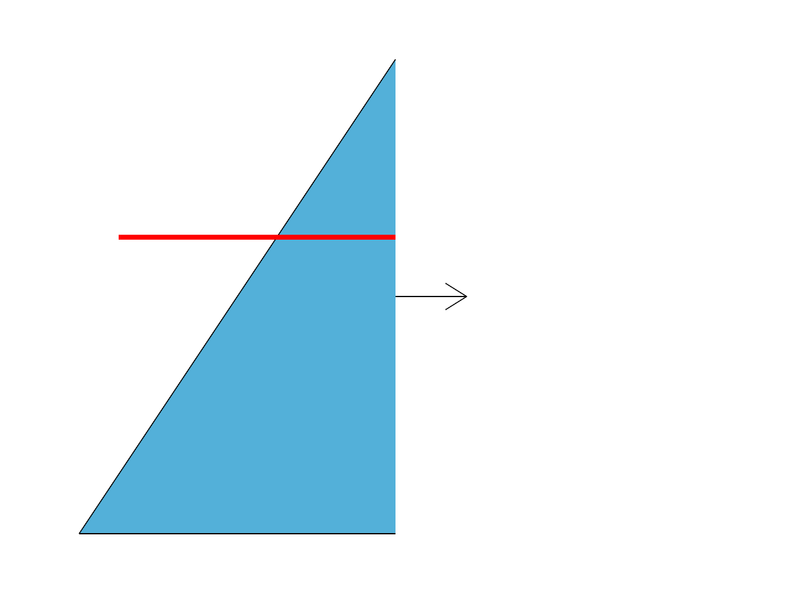

# 17.3 · Original clipping half-spaces across drawing families

**Goal:** Exercise original clipping color and picking. · **Steps:** 38 · **Source:** [engine/gpu/triangle_tiles.rs](../../../src/engine/gpu/triangle_tiles.rs) · [shaders/project_triangles.wgsl](../../../src/shaders/project_triangles.wgsl) · [shaders/ink_visibility.wgsl](../../../src/shaders/ink_visibility.wgsl) · [shaders/ribbon.wgsl](../../../src/shaders/ribbon.wgsl) · [shaders/vector.wgsl](../../../src/shaders/vector.wgsl) · [engine/gpu/clip.rs](../../../src/engine/gpu/clip.rs) · [shaders/cap.wgsl](../../../src/shaders/cap.wgsl) · [engine/gpu/render.rs](../../../src/engine/gpu/render.rs) · [engine/gpu/pass.rs](../../../src/engine/gpu/pass.rs) (`src/engine/gpu/cull.rs,src/shaders/section.wgsl,src/app/section_plane.rs`)

<div class="webgpu-schematic" style="width:100%;margin:6px auto;">
<svg xmlns="http://www.w3.org/2000/svg" width="1120" height="200" viewBox="0 0 1120 200" style="width:100%;max-width:100%;height:auto;display:block;margin:0 auto;" role="img">
  <defs>
    <marker id="arr" viewBox="0 0 10 10" refX="8" refY="5" markerWidth="6" markerHeight="6" orient="auto">
      <path d="M 0 1 L 9 5 L 0 9 z" fill="#111111"/>
    </marker>
    <marker id="arrR" viewBox="0 0 10 10" refX="8" refY="5" markerWidth="6" markerHeight="6" orient="auto">
      <path d="M 0 1 L 9 5 L 0 9 z" fill="#dc2626"/>
    </marker>
    <marker id="arrG" viewBox="0 0 10 10" refX="8" refY="5" markerWidth="6" markerHeight="6" orient="auto">
      <path d="M 0 1 L 9 5 L 0 9 z" fill="#16a34a"/>
    </marker>
    <marker id="arrB" viewBox="0 0 10 10" refX="8" refY="5" markerWidth="6" markerHeight="6" orient="auto">
      <path d="M 0 1 L 9 5 L 0 9 z" fill="#2563eb"/>
    </marker>
  </defs>
  <rect x="2" y="2" width="1116" height="196" rx="10" fill="#ffffff" stroke="#111111" stroke-width="2"/>
  <rect x="16" y="14" width="248" height="172" rx="8" fill="#ffffff" stroke="#111111" stroke-width="1.75"/>
  <text paint-order="stroke fill" stroke="#ffffff" stroke-width="5" stroke-linejoin="round" x="140" y="34" text-anchor="middle" font-family="monospace" font-size="11.5" font-weight="700" fill="#111111">1. Lesson 17.3 Code</text>
  <rect x="34" y="48" width="212" height="24" rx="4" fill="#ffffff" stroke="#111111" stroke-width="1.25"/>
  <text paint-order="stroke fill" stroke="#ffffff" stroke-width="5" stroke-linejoin="round" x="140" y="64" text-anchor="middle" font-family="monospace" font-size="10" font-weight="700" fill="#111111">src/clipping_geometry.rs</text>
  <rect x="34" y="78" width="212" height="24" rx="4" fill="#ffffff" stroke="#111111" stroke-width="1.5"/>
  <text paint-order="stroke fill" stroke="#ffffff" stroke-width="5" stroke-linejoin="round" x="140" y="94" text-anchor="middle" font-family="monospace" font-size="10" font-weight="700" fill="#111111">src/lib.rs</text>
  <rect x="34" y="108" width="212" height="24" rx="4" fill="#ffffff" stroke="#111111" stroke-width="1.25"/>
  <text paint-order="stroke fill" stroke="#ffffff" stroke-width="5" stroke-linejoin="round" x="140" y="124" text-anchor="middle" font-family="monospace" font-size="10" font-weight="700" fill="#111111">src/clipping_rows.rs</text>
  <text paint-order="stroke fill" stroke="#ffffff" stroke-width="5" stroke-linejoin="round" x="140" y="172" text-anchor="middle" font-family="monospace" font-size="9.5" fill="#111111">38 Coding Steps</text>
  <line x1="264" y1="100" x2="292" y2="100" stroke="#111111" stroke-width="2" marker-end="url(#arr)"/>
  <rect x="296" y="14" width="248" height="172" rx="8" fill="#ffffff" stroke="#111111" stroke-width="1.75"/>
  <text paint-order="stroke fill" stroke="#ffffff" stroke-width="5" stroke-linejoin="round" x="420" y="34" text-anchor="middle" font-family="monospace" font-size="11.5" font-weight="700" fill="#111111">2. session_viewer/src</text>
  <rect x="314" y="48" width="212" height="26" rx="4" fill="#ffffff" stroke="#111111" stroke-width="1.5"/>
  <text paint-order="stroke fill" stroke="#ffffff" stroke-width="5" stroke-linejoin="round" x="420" y="65" text-anchor="middle" font-family="monospace" font-size="10" font-weight="700" fill="#111111">src/engine/gpu/cull.rs</text>
  <rect x="314" y="80" width="212" height="26" rx="4" fill="#ffffff" stroke="#111111" stroke-width="1.5"/>
  <text paint-order="stroke fill" stroke="#ffffff" stroke-width="5" stroke-linejoin="round" x="420" y="97" text-anchor="middle" font-family="monospace" font-size="10" font-weight="700" fill="#111111">src/shaders/section.wgsl</text>
  <rect x="314" y="112" width="212" height="24" rx="4" fill="#ffffff" stroke="#111111" stroke-width="1.5"/>
  <text paint-order="stroke fill" stroke="#ffffff" stroke-width="5" stroke-linejoin="round" x="420" y="128" text-anchor="middle" font-family="monospace" font-size="9.5" font-weight="700" fill="#111111">✓ cargo check (wasm32)</text>
  <text paint-order="stroke fill" stroke="#ffffff" stroke-width="5" stroke-linejoin="round" x="420" y="172" text-anchor="middle" font-family="sans-serif" font-size="10" fill="#111111">Describe clipping half-sp…</text>
  <line x1="544" y1="100" x2="572" y2="100" stroke="#111111" stroke-width="2" marker-end="url(#arr)"/>
  <rect x="576" y="14" width="248" height="172" rx="8" fill="#ffffff" stroke="#111111" stroke-width="1.75"/>
  <text paint-order="stroke fill" stroke="#ffffff" stroke-width="5" stroke-linejoin="round" x="700" y="34" text-anchor="middle" font-family="monospace" font-size="11.5" font-weight="700" fill="#111111">3. Screen Tile Visibility Grid</text>
  <rect x="616" y="52" width="168" height="88" fill="#ffffff" stroke="#111111" stroke-width="1.5"/>
  <rect x="658" y="74" width="84" height="44" fill="#dcfce7" stroke="#16a34a" stroke-width="2"/>
  <line x1="658" y1="52" x2="658" y2="140" stroke="#111111" stroke-width="1"/>
  <line x1="700" y1="52" x2="700" y2="140" stroke="#111111" stroke-width="1"/>
  <line x1="742" y1="52" x2="742" y2="140" stroke="#111111" stroke-width="1"/>
  <line x1="616" y1="74" x2="784" y2="74" stroke="#111111" stroke-width="1"/>
  <line x1="616" y1="96" x2="784" y2="96" stroke="#111111" stroke-width="1"/>
  <line x1="616" y1="118" x2="784" y2="118" stroke="#111111" stroke-width="1"/>
  <text paint-order="stroke fill" stroke="#ffffff" stroke-width="5" stroke-linejoin="round" x="700" y="172" text-anchor="middle" font-family="monospace" font-size="9.5" fill="#111111">Original clipping half-spac…</text>
  <line x1="824" y1="100" x2="852" y2="100" stroke="#111111" stroke-width="2" marker-end="url(#arr)"/>
  <rect x="856" y="14" width="248" height="172" rx="8" fill="#ffffff" stroke="#111111" stroke-width="1.75"/>
  <text paint-order="stroke fill" stroke="#ffffff" stroke-width="5" stroke-linejoin="round" x="980" y="34" text-anchor="middle" font-family="monospace" font-size="11.5" font-weight="700" fill="#111111">4. Section Plane Clip &amp; Cap</text>
  <polygon points="894,132 934,64 1038,64 1058,132" fill="#dbeafe" stroke="#111111" stroke-width="1.75"/>
  <line x1="968" y1="48" x2="968" y2="144" stroke="#dc2626" stroke-width="2.5" stroke-dasharray="4 3"/>
  <rect x="968" y="64" width="70" height="68" fill="#fee2e2" stroke="#dc2626" stroke-width="2"/>
  <text paint-order="stroke fill" stroke="#ffffff" stroke-width="5" stroke-linejoin="round" x="1003" y="102" text-anchor="middle" font-family="monospace" font-size="9" font-weight="700" fill="#dc2626">Cap Fill</text>
  <text paint-order="stroke fill" stroke="#ffffff" stroke-width="5" stroke-linejoin="round" x="980" y="172" text-anchor="middle" font-family="sans-serif" font-size="10" font-weight="700" fill="#111111">Exercise clipping color a…</text>
</svg>
</div>

## <a id="checkpoint-87-copy-current-original-plane-modes"></a>1. Describe clipping half-spaces

<div class="webgpu-schematic" style="width:100%;margin:6px auto;">
<svg xmlns="http://www.w3.org/2000/svg" width="1120" height="72" viewBox="0 0 1120 72" style="width:100%;max-width:100%;height:auto;display:block;margin:0 auto;" role="img">
  <defs>
    <marker id="arr" viewBox="0 0 10 10" refX="8" refY="5" markerWidth="6" markerHeight="6" orient="auto">
      <path d="M 0 1 L 9 5 L 0 9 z" fill="#111111"/>
    </marker>
    <marker id="arrR" viewBox="0 0 10 10" refX="8" refY="5" markerWidth="6" markerHeight="6" orient="auto">
      <path d="M 0 1 L 9 5 L 0 9 z" fill="#dc2626"/>
    </marker>
    <marker id="arrG" viewBox="0 0 10 10" refX="8" refY="5" markerWidth="6" markerHeight="6" orient="auto">
      <path d="M 0 1 L 9 5 L 0 9 z" fill="#16a34a"/>
    </marker>
    <marker id="arrB" viewBox="0 0 10 10" refX="8" refY="5" markerWidth="6" markerHeight="6" orient="auto">
      <path d="M 0 1 L 9 5 L 0 9 z" fill="#2563eb"/>
    </marker>
  </defs>
  <rect x="2" y="2" width="1116" height="68" rx="10" fill="#ffffff" stroke="#111111" stroke-width="2"/>
  <rect x="14" y="10" width="252" height="52" rx="6" fill="#ffffff" stroke="#111111" stroke-width="1.5"/>
  <text paint-order="stroke fill" stroke="#ffffff" stroke-width="5" stroke-linejoin="round" x="140" y="30" text-anchor="middle" font-family="monospace" font-size="10.5" font-weight="700" fill="#111111">Step 1 of 38</text>
  <text paint-order="stroke fill" stroke="#ffffff" stroke-width="5" stroke-linejoin="round" x="140" y="48" text-anchor="middle" font-family="monospace" font-size="9.5" fill="#111111">src/clipping_geometry.rs, s…</text>
  <line x1="266" y1="36" x2="292" y2="36" stroke="#111111" stroke-width="1.75" marker-end="url(#arr)"/>
  <rect x="296" y="10" width="252" height="52" rx="6" fill="#ffffff" stroke="#111111" stroke-width="1.5"/>
  <text paint-order="stroke fill" stroke="#ffffff" stroke-width="5" stroke-linejoin="round" x="422" y="30" text-anchor="middle" font-family="monospace" font-size="10" font-weight="700" fill="#111111">1. CPU / Rust Input</text>
  <text paint-order="stroke fill" stroke="#ffffff" stroke-width="5" stroke-linejoin="round" x="422" y="48" text-anchor="middle" font-family="sans-serif" font-size="9.5" fill="#111111">original Plane</text>
  <line x1="548" y1="36" x2="574" y2="36" stroke="#111111" stroke-width="1.75" marker-end="url(#arr)"/>
  <rect x="578" y="10" width="252" height="52" rx="6" fill="#ffffff" stroke="#111111" stroke-width="1.5"/>
  <text paint-order="stroke fill" stroke="#ffffff" stroke-width="5" stroke-linejoin="round" x="704" y="30" text-anchor="middle" font-family="monospace" font-size="10" font-weight="700" fill="#111111">2. WebGPU / WGSL</text>
  <text paint-order="stroke fill" stroke="#ffffff" stroke-width="5" stroke-linejoin="round" x="704" y="48" text-anchor="middle" font-family="sans-serif" font-size="9.5" fill="#111111">world half-space</text>
  <line x1="830" y1="36" x2="856" y2="36" stroke="#111111" stroke-width="1.75" marker-end="url(#arr)"/>
  <rect x="860" y="10" width="246" height="52" rx="6" fill="#ffffff" stroke="#111111" stroke-width="1.75"/>
  <text paint-order="stroke fill" stroke="#ffffff" stroke-width="5" stroke-linejoin="round" x="983" y="30" text-anchor="middle" font-family="monospace" font-size="10" font-weight="700" fill="#111111">3. -&gt; src/engine/gpu/cull…</text>
  <text paint-order="stroke fill" stroke="#ffffff" stroke-width="5" stroke-linejoin="round" x="983" y="48" text-anchor="middle" font-family="sans-serif" font-size="9.5" fill="#111111">later GPU uniform</text>
</svg>
</div>

**What this code does:** Describe original clipping half-spaces.

### 1. `src/clipping_geometry.rs`

Describe original clipping half-spaces.

Create the file and type:

```rust
use session_rust::{Plane, Point, Vector, Xform};
pub const NAME: &str = "Clipping Plane";
pub fn is_clipping(plane: &Plane) -> bool {
    plane.name == NAME || plane.name == "clipping_plane" // the name before 2026-09-24
}
pub fn array<T: std::ops::Index<usize, Output = f64>>(v: &T) -> [f64; 3] {
    [v[0], v[1], v[2]]
}
pub fn add(a: [f64; 3], b: [f64; 3]) -> [f64; 3] {
    [a[0] + b[0], a[1] + b[1], a[2] + b[2]]
}
pub fn sub(a: [f64; 3], b: [f64; 3]) -> [f64; 3] {
    [a[0] - b[0], a[1] - b[1], a[2] - b[2]]
}
pub fn scale(a: [f64; 3], s: f64) -> [f64; 3] {
    [a[0] * s, a[1] * s, a[2] * s]
}
pub fn dot(a: [f64; 3], b: [f64; 3]) -> f64 {
    a[0] * b[0] + a[1] * b[1] + a[2] * b[2]
}
pub fn cross(a: [f64; 3], b: [f64; 3]) -> [f64; 3] {
    [
        a[1] * b[2] - a[2] * b[1],
        a[2] * b[0] - a[0] * b[2],
        a[0] * b[1] - a[1] * b[0],
    ]
}
pub fn length(a: [f64; 3]) -> f64 {
    dot(a, a).sqrt()
}
pub fn unit(a: [f64; 3]) -> [f64; 3] {
    let l = length(a);

    if l > 0.0 {
        scale(a, 1.0 / l)
    } else {
        a
    }
}
#[derive(Clone, Copy, Debug, Default, PartialEq)]
pub struct ClipPlane {
    pub normal: [f64; 3], // unit normal toward the kept side
    pub offset: f64,      // kept where normal · p + offset >= 0
    pub origin: [f64; 3], // a point on the plane, where the hatch starts
    pub hatch: [f64; 3],  // unit direction across the hatch lines, in the plane
}

impl ClipPlane {
    /// Signed distance of world point `p`; below zero is cut away.
    pub fn distance(&self, p: [f64; 3]) -> f64 {
        dot(self.normal, p) + self.offset
    }
}
```

### 2. `src/lib.rs`

Register the completed source owner.

**Locate this existing block:**

```rust
mod tile_gpu_tests;

pub mod finite_project_source;
#[cfg(test)]
mod finite_scan_contract;
#[cfg(test)]
mod finite_tiles_contract;
#[cfg(test)]
mod finite_visibility_tests;
pub mod source_mesh_topology;
```

Edit the existing block to match this code; keep unchanged lines:

```rust
mod tile_gpu_tests;

#[cfg(test)]
mod finite_visibility_tests;

pub mod clipping_geometry;
pub mod finite_project_source;
#[cfg(test)]
mod finite_scan_contract;
#[cfg(test)]
mod finite_tiles_contract;
pub mod source_mesh_topology;
```

## <a id="checkpoint-87sa-describe-clipping-construction-choices-once"></a>2. Describe clipping construction choices once

<div class="webgpu-schematic" style="width:100%;margin:6px auto;">
<svg xmlns="http://www.w3.org/2000/svg" width="1120" height="72" viewBox="0 0 1120 72" style="width:100%;max-width:100%;height:auto;display:block;margin:0 auto;" role="img">
  <defs>
    <marker id="arr" viewBox="0 0 10 10" refX="8" refY="5" markerWidth="6" markerHeight="6" orient="auto">
      <path d="M 0 1 L 9 5 L 0 9 z" fill="#111111"/>
    </marker>
    <marker id="arrR" viewBox="0 0 10 10" refX="8" refY="5" markerWidth="6" markerHeight="6" orient="auto">
      <path d="M 0 1 L 9 5 L 0 9 z" fill="#dc2626"/>
    </marker>
    <marker id="arrG" viewBox="0 0 10 10" refX="8" refY="5" markerWidth="6" markerHeight="6" orient="auto">
      <path d="M 0 1 L 9 5 L 0 9 z" fill="#16a34a"/>
    </marker>
    <marker id="arrB" viewBox="0 0 10 10" refX="8" refY="5" markerWidth="6" markerHeight="6" orient="auto">
      <path d="M 0 1 L 9 5 L 0 9 z" fill="#2563eb"/>
    </marker>
  </defs>
  <rect x="2" y="2" width="1116" height="68" rx="10" fill="#ffffff" stroke="#111111" stroke-width="2"/>
  <rect x="14" y="10" width="252" height="52" rx="6" fill="#ffffff" stroke="#111111" stroke-width="1.5"/>
  <text paint-order="stroke fill" stroke="#ffffff" stroke-width="5" stroke-linejoin="round" x="140" y="30" text-anchor="middle" font-family="monospace" font-size="10.5" font-weight="700" fill="#111111">Step 2 of 38</text>
  <text paint-order="stroke fill" stroke="#ffffff" stroke-width="5" stroke-linejoin="round" x="140" y="48" text-anchor="middle" font-family="monospace" font-size="9.5" fill="#111111">src/clipping_geometry.rs</text>
  <line x1="266" y1="36" x2="292" y2="36" stroke="#111111" stroke-width="1.75" marker-end="url(#arr)"/>
  <rect x="296" y="10" width="252" height="52" rx="6" fill="#ffffff" stroke="#111111" stroke-width="1.5"/>
  <text paint-order="stroke fill" stroke="#ffffff" stroke-width="5" stroke-linejoin="round" x="422" y="30" text-anchor="middle" font-family="monospace" font-size="10" font-weight="700" fill="#111111">1. CPU / Rust Input</text>
  <text paint-order="stroke fill" stroke="#ffffff" stroke-width="5" stroke-linejoin="round" x="422" y="48" text-anchor="middle" font-family="sans-serif" font-size="9.5" fill="#111111">original Plane</text>
  <line x1="548" y1="36" x2="574" y2="36" stroke="#111111" stroke-width="1.75" marker-end="url(#arr)"/>
  <rect x="578" y="10" width="252" height="52" rx="6" fill="#ffffff" stroke="#111111" stroke-width="1.5"/>
  <text paint-order="stroke fill" stroke="#ffffff" stroke-width="5" stroke-linejoin="round" x="704" y="30" text-anchor="middle" font-family="monospace" font-size="10" font-weight="700" fill="#111111">2. WebGPU / WGSL</text>
  <text paint-order="stroke fill" stroke="#ffffff" stroke-width="5" stroke-linejoin="round" x="704" y="48" text-anchor="middle" font-family="sans-serif" font-size="9.5" fill="#111111">world half-space</text>
  <line x1="830" y1="36" x2="856" y2="36" stroke="#111111" stroke-width="1.75" marker-end="url(#arr)"/>
  <rect x="860" y="10" width="246" height="52" rx="6" fill="#ffffff" stroke="#111111" stroke-width="1.75"/>
  <text paint-order="stroke fill" stroke="#ffffff" stroke-width="5" stroke-linejoin="round" x="983" y="30" text-anchor="middle" font-family="monospace" font-size="10" font-weight="700" fill="#111111">3. -&gt; src/engine/gpu/cull…</text>
  <text paint-order="stroke fill" stroke="#ffffff" stroke-width="5" stroke-linejoin="round" x="983" y="48" text-anchor="middle" font-family="sans-serif" font-size="9.5" fill="#111111">later GPU uniform</text>
</svg>
</div>

**What this code does:** Describe clipping construction choices once.

### 1. `src/clipping_geometry.rs`

Describe clipping construction choices once.

**Locate this existing block:**

```rust
        dot(self.normal, p) + self.offset
    }
}
```

Edit the existing block to match this code; keep unchanged lines:

```rust
        dot(self.normal, p) + self.offset
    }
}

/// How a clipping plane is placed.
#[derive(Clone, Copy, Debug, PartialEq, Eq)]
pub enum Mode {
    Normal, // an origin, then a point on the side to cut away
    Points, // three points; the cut side by the right-hand rule
    Xy,     // the world XY plane through a point, +Z cut away
    Yz,     // the world YZ plane through a point, +X cut away
    Zx,     // the world ZX plane through a point, +Y cut away
}

impl Mode {
    /// Every mode, in the order the options list them.
    pub const ALL: [Mode; 5] = [
        Mode::Normal,
        Mode::Points,
        Mode::Xy,
        Mode::Yz,
        Mode::Zx,
    ];

    /// The word typed for it.
    pub fn word(self) -> &'static str {
        match self {
            Mode::Normal => "Normal",
            Mode::Points => "3Point",
            Mode::Xy => "XY",
            Mode::Yz => "YZ",
            Mode::Zx => "ZX",
        }
    }

    /// Points the mode takes.
    pub fn points(self) -> usize {
        match self {
            Mode::Normal => 2,
            Mode::Points => 3,
            _ => 1,
        }
    }

    /// The mode a typed word names, any case.
    pub fn parse(word: &str) -> Option<Mode> {
        Mode::ALL
            .into_iter()
            .find(|mode| mode.word().eq_ignore_ascii_case(word))
    }

    /// What each picked point is for.
    pub fn prompts(self) -> &'static [&'static str] {
        match self {
            Mode::Normal => &[
                "First point: a point on the cutting plane (or choose XY, YZ, ZX, 3Point)",
                "Second point: toward the side to remove; origin-to-point sets the perpendicular direction (e.g. @0,0,1 removes above)",
            ],
            Mode::Points => &[
                "First point",
                "Second point, along the plane",
                "Third point: the cut side follows the right-hand rule",
            ],
            Mode::Xy => &["Origin point: the +Z side is cut away"],
            Mode::Yz => &["Origin point: the +X side is cut away"],
            Mode::Zx => &["Origin point: the +Y side is cut away"],
        }
    }
}
```

## <a id="checkpoint-87sb-construct-and-reverse-original-clipping-planes"></a>3. Construct and reverse clipping planes

<div class="webgpu-schematic" style="width:100%;margin:6px auto;">
<svg xmlns="http://www.w3.org/2000/svg" width="1120" height="72" viewBox="0 0 1120 72" style="width:100%;max-width:100%;height:auto;display:block;margin:0 auto;" role="img">
  <defs>
    <marker id="arr" viewBox="0 0 10 10" refX="8" refY="5" markerWidth="6" markerHeight="6" orient="auto">
      <path d="M 0 1 L 9 5 L 0 9 z" fill="#111111"/>
    </marker>
    <marker id="arrR" viewBox="0 0 10 10" refX="8" refY="5" markerWidth="6" markerHeight="6" orient="auto">
      <path d="M 0 1 L 9 5 L 0 9 z" fill="#dc2626"/>
    </marker>
    <marker id="arrG" viewBox="0 0 10 10" refX="8" refY="5" markerWidth="6" markerHeight="6" orient="auto">
      <path d="M 0 1 L 9 5 L 0 9 z" fill="#16a34a"/>
    </marker>
    <marker id="arrB" viewBox="0 0 10 10" refX="8" refY="5" markerWidth="6" markerHeight="6" orient="auto">
      <path d="M 0 1 L 9 5 L 0 9 z" fill="#2563eb"/>
    </marker>
  </defs>
  <rect x="2" y="2" width="1116" height="68" rx="10" fill="#ffffff" stroke="#111111" stroke-width="2"/>
  <rect x="14" y="10" width="252" height="52" rx="6" fill="#ffffff" stroke="#111111" stroke-width="1.5"/>
  <text paint-order="stroke fill" stroke="#ffffff" stroke-width="5" stroke-linejoin="round" x="140" y="30" text-anchor="middle" font-family="monospace" font-size="10.5" font-weight="700" fill="#111111">Step 3 of 38</text>
  <text paint-order="stroke fill" stroke="#ffffff" stroke-width="5" stroke-linejoin="round" x="140" y="48" text-anchor="middle" font-family="monospace" font-size="9.5" fill="#111111">src/clipping_geometry.rs</text>
  <line x1="266" y1="36" x2="292" y2="36" stroke="#111111" stroke-width="1.75" marker-end="url(#arr)"/>
  <rect x="296" y="10" width="252" height="52" rx="6" fill="#ffffff" stroke="#111111" stroke-width="1.5"/>
  <text paint-order="stroke fill" stroke="#ffffff" stroke-width="5" stroke-linejoin="round" x="422" y="30" text-anchor="middle" font-family="monospace" font-size="10" font-weight="700" fill="#111111">1. CPU / Rust Input</text>
  <text paint-order="stroke fill" stroke="#ffffff" stroke-width="5" stroke-linejoin="round" x="422" y="48" text-anchor="middle" font-family="sans-serif" font-size="9.5" fill="#111111">original Plane</text>
  <line x1="548" y1="36" x2="574" y2="36" stroke="#111111" stroke-width="1.75" marker-end="url(#arr)"/>
  <rect x="578" y="10" width="252" height="52" rx="6" fill="#ffffff" stroke="#111111" stroke-width="1.5"/>
  <text paint-order="stroke fill" stroke="#ffffff" stroke-width="5" stroke-linejoin="round" x="704" y="30" text-anchor="middle" font-family="monospace" font-size="10" font-weight="700" fill="#111111">2. WebGPU / WGSL</text>
  <text paint-order="stroke fill" stroke="#ffffff" stroke-width="5" stroke-linejoin="round" x="704" y="48" text-anchor="middle" font-family="sans-serif" font-size="9.5" fill="#111111">world half-space</text>
  <line x1="830" y1="36" x2="856" y2="36" stroke="#111111" stroke-width="1.75" marker-end="url(#arr)"/>
  <rect x="860" y="10" width="246" height="52" rx="6" fill="#ffffff" stroke="#111111" stroke-width="1.75"/>
  <text paint-order="stroke fill" stroke="#ffffff" stroke-width="5" stroke-linejoin="round" x="983" y="30" text-anchor="middle" font-family="monospace" font-size="10" font-weight="700" fill="#111111">3. -&gt; src/engine/gpu/cull…</text>
  <text paint-order="stroke fill" stroke="#ffffff" stroke-width="5" stroke-linejoin="round" x="983" y="48" text-anchor="middle" font-family="sans-serif" font-size="9.5" fill="#111111">later GPU uniform</text>
</svg>
</div>

**What this code does:** Construct and reverse original clipping planes.

### 1. `src/clipping_geometry.rs`

Construct and reverse original clipping planes.

**Locate this existing block:**

```rust
        }
    }
}
```

Edit the existing block to match this code; keep unchanged lines:

```rust
        }
    }
}

/// A clipping plane through picked points, its rectangle `half` wide each way from the origin.
pub fn plane_from(mode: Mode, points: &[[f64; 3]], half: f64) -> Result<Plane, String> {
    if points.len() != mode.points() {
        return Err(format!(
            "Clipping Plane {} needs {} point{}",
            mode.word(),
            mode.points(),
            if mode.points() == 1 {
                ""
            } else {
                "s"
            }
        ));
    }

    let origin = points[0];
    let (x, y, z) = match mode {
        Mode::Normal => {
            let n = sub(points[1], origin);

            if length(n) <= 1e-9 {
                return Err("the normal point must differ from the origin".into());
            }

            let frame = Plane::from_point_normal(
                Point::new(origin[0], origin[1], origin[2]),
                Vector::new(n[0], n[1], n[2]),
                Some(true),
            );
            (
                array(&frame.x_axis()),
                array(&frame.y_axis()),
                array(&frame.z_axis()),
            )
        }
        Mode::Points => {
            let along = sub(points[1], origin);
            let z = cross(along, sub(points[2], origin));

            if length(along) <= 1e-9 || length(z) <= 1e-9 * length(along).max(1.0) {
                return Err("the three points must not lie on one line".into());
            }

            let x = unit(along);
            let z = unit(z);
            (x, cross(z, x), z)
        }
        Mode::Xy => (
            [1.0, 0.0, 0.0],
            [0.0, 1.0, 0.0],
            [0.0, 0.0, 1.0],
        ),
        Mode::Yz => (
            [0.0, 1.0, 0.0],
            [0.0, 0.0, 1.0],
            [1.0, 0.0, 0.0],
        ),
        Mode::Zx => (
            [0.0, 0.0, 1.0],
            [1.0, 0.0, 0.0],
            [0.0, 1.0, 0.0],
        ),
    };
    let mut plane = Plane::from_frame(
        Point::new(origin[0], origin[1], origin[2]),
        Vector::new(x[0] * half, x[1] * half, x[2] * half),
        Vector::new(y[0] * half, y[1] * half, y[2] * half),
        Vector::new(z[0], z[1], z[2]),
    );
    plane.name = NAME.into();
    Ok(plane)
}

/// The plane turned around: the other side is cut away.
pub fn flipped(plane: &Plane) -> Plane {
    let mut plane = plane.clone();
    plane.reverse();
    plane
}
```

## <a id="checkpoint-87sc-derive-placed-world-half-spaces-from-original-planes"></a>4. Derive placed world half-spaces from planes

<div class="webgpu-schematic" style="width:100%;margin:6px auto;">
<svg xmlns="http://www.w3.org/2000/svg" width="1120" height="72" viewBox="0 0 1120 72" style="width:100%;max-width:100%;height:auto;display:block;margin:0 auto;" role="img">
  <defs>
    <marker id="arr" viewBox="0 0 10 10" refX="8" refY="5" markerWidth="6" markerHeight="6" orient="auto">
      <path d="M 0 1 L 9 5 L 0 9 z" fill="#111111"/>
    </marker>
    <marker id="arrR" viewBox="0 0 10 10" refX="8" refY="5" markerWidth="6" markerHeight="6" orient="auto">
      <path d="M 0 1 L 9 5 L 0 9 z" fill="#dc2626"/>
    </marker>
    <marker id="arrG" viewBox="0 0 10 10" refX="8" refY="5" markerWidth="6" markerHeight="6" orient="auto">
      <path d="M 0 1 L 9 5 L 0 9 z" fill="#16a34a"/>
    </marker>
    <marker id="arrB" viewBox="0 0 10 10" refX="8" refY="5" markerWidth="6" markerHeight="6" orient="auto">
      <path d="M 0 1 L 9 5 L 0 9 z" fill="#2563eb"/>
    </marker>
  </defs>
  <rect x="2" y="2" width="1116" height="68" rx="10" fill="#ffffff" stroke="#111111" stroke-width="2"/>
  <rect x="14" y="10" width="252" height="52" rx="6" fill="#ffffff" stroke="#111111" stroke-width="1.5"/>
  <text paint-order="stroke fill" stroke="#ffffff" stroke-width="5" stroke-linejoin="round" x="140" y="30" text-anchor="middle" font-family="monospace" font-size="10.5" font-weight="700" fill="#111111">Step 4 of 38</text>
  <text paint-order="stroke fill" stroke="#ffffff" stroke-width="5" stroke-linejoin="round" x="140" y="48" text-anchor="middle" font-family="monospace" font-size="9.5" fill="#111111">src/clipping_geometry.rs</text>
  <line x1="266" y1="36" x2="292" y2="36" stroke="#111111" stroke-width="1.75" marker-end="url(#arr)"/>
  <rect x="296" y="10" width="252" height="52" rx="6" fill="#ffffff" stroke="#111111" stroke-width="1.5"/>
  <text paint-order="stroke fill" stroke="#ffffff" stroke-width="5" stroke-linejoin="round" x="422" y="30" text-anchor="middle" font-family="monospace" font-size="10" font-weight="700" fill="#111111">1. CPU / Rust Input</text>
  <text paint-order="stroke fill" stroke="#ffffff" stroke-width="5" stroke-linejoin="round" x="422" y="48" text-anchor="middle" font-family="sans-serif" font-size="9.5" fill="#111111">original Plane</text>
  <line x1="548" y1="36" x2="574" y2="36" stroke="#111111" stroke-width="1.75" marker-end="url(#arr)"/>
  <rect x="578" y="10" width="252" height="52" rx="6" fill="#ffffff" stroke="#111111" stroke-width="1.5"/>
  <text paint-order="stroke fill" stroke="#ffffff" stroke-width="5" stroke-linejoin="round" x="704" y="30" text-anchor="middle" font-family="monospace" font-size="10" font-weight="700" fill="#111111">2. WebGPU / WGSL</text>
  <text paint-order="stroke fill" stroke="#ffffff" stroke-width="5" stroke-linejoin="round" x="704" y="48" text-anchor="middle" font-family="sans-serif" font-size="9.5" fill="#111111">world half-space</text>
  <line x1="830" y1="36" x2="856" y2="36" stroke="#111111" stroke-width="1.75" marker-end="url(#arr)"/>
  <rect x="860" y="10" width="246" height="52" rx="6" fill="#ffffff" stroke="#111111" stroke-width="1.75"/>
  <text paint-order="stroke fill" stroke="#ffffff" stroke-width="5" stroke-linejoin="round" x="983" y="30" text-anchor="middle" font-family="monospace" font-size="10" font-weight="700" fill="#111111">3. -&gt; src/engine/gpu/cull…</text>
  <text paint-order="stroke fill" stroke="#ffffff" stroke-width="5" stroke-linejoin="round" x="983" y="48" text-anchor="middle" font-family="sans-serif" font-size="9.5" fill="#111111">later GPU uniform</text>
</svg>
</div>

**What this code does:** Derive placed world half-spaces from original planes.

### 1. `src/clipping_geometry.rs`

Derive placed world half-spaces from original planes. Supply independent construction, placement and degenerate-frame fixtures.

**Locate this existing block:**

```rust
    plane
}
```

Edit the existing block to match this code; keep unchanged lines:

```rust
    plane
}

/// The world clipping plane of `plane` placed at `place`; None when its rectangle is flat.
pub fn clip_plane(plane: &Plane, place: &Xform) -> Option<ClipPlane> {
    let origin = array(&place.transform_point(&plane.origin()));
    let x = array(&place.transform_vector(&plane.x_axis()));
    let y = array(&place.transform_vector(&plane.y_axis()));
    let cut = cross(x, y);

    if !(length(cut) > 1e-300) || !origin.iter().all(|v| v.is_finite()) {
        return None;
    }

    let normal = unit(cut).map(|v| -v);
    // across the 45 degree lines, in the plane
    let across = sub(unit(x), unit(y));
    let hatch = if length(across) > 1e-9 {
        unit(across)
    } else {
        unit(x)
    };
    Some(ClipPlane {
        normal,
        offset: -dot(normal, origin),
        origin,
        hatch,
    })
}

#[cfg(test)]
mod tests {
    use super::*;
    fn kept(plane: &ClipPlane, p: [f64; 3]) -> bool {
        plane.distance(p) >= 0.0
    }
    #[test]
    fn modes_place_the_plane_and_the_cut_side() {
        let normal = plane_from(
            Mode::Normal,
            &[[1.0, 2.0, 3.0], [1.0, 2.0, 13.0]],
            50.0,
        )
        .unwrap();
        assert_eq!(array(&normal.z_axis()), [0.0, 0.0, 1.0]);
        assert_eq!(array(&normal.origin()), [1.0, 2.0, 3.0]);
        assert!((length(array(&normal.x_axis())) - 50.0).abs() < 1e-9);
        assert!((length(array(&normal.y_axis())) - 50.0).abs() < 1e-9);
        assert!(is_clipping(&normal));

        for (mode, cut) in [
            (Mode::Xy, [0.0, 0.0, 1.0]),
            (Mode::Yz, [1.0, 0.0, 0.0]),
            (Mode::Zx, [0.0, 1.0, 0.0]),
        ] {
            let plane = plane_from(mode, &[[0.0, 0.0, 5.0]], 10.0).unwrap();
            let clip = clip_plane(&plane, &Xform::identity()).unwrap();
            assert!(
                !kept(&clip, add([0.0, 0.0, 5.0], cut)),
                "{mode:?} cuts its +axis side"
            );
            assert!(
                kept(&clip, sub([0.0, 0.0, 5.0], cut)),
                "{mode:?} keeps the other"
            );
        }

        let three = plane_from(
            Mode::Points,
            &[
                [0.0, 0.0, 0.0],
                [1.0, 0.0, 0.0],
                [0.0, 1.0, 0.0],
            ],
            10.0,
        )
        .unwrap();
        let clip = clip_plane(&three, &Xform::identity()).unwrap();
        assert!(
            !kept(&clip, [0.0, 0.0, 1.0]),
            "right-hand rule: +Z is cut"
        );
        assert!(kept(&clip, [0.0, 0.0, -1.0]));
    }
    #[test]
    fn degenerate_picks_are_refused() {
        assert!(
            plane_from(
                Mode::Normal,
                &[[1.0, 1.0, 1.0], [1.0, 1.0, 1.0]],
                5.0
            )
            .is_err()
        );
        assert!(
            plane_from(
                Mode::Points,
                &[
                    [0.0, 0.0, 0.0],
                    [1.0, 1.0, 1.0],
                    [2.0, 2.0, 2.0]
                ],
                5.0
            )
            .is_err()
        );
        assert!(plane_from(Mode::Xy, &[], 5.0).is_err());
        assert!(plane_from(Mode::Normal, &[[0.0; 3]], 5.0).is_err());
    }
    #[test]
    fn the_cut_follows_the_placement() {
        let plane = plane_from(Mode::Xy, &[[0.0, 0.0, 0.0]], 10.0).unwrap();
        let moved = clip_plane(&plane, &Xform::translation(0.0, 0.0, 10.0)).unwrap();
        assert!(kept(&moved, [0.0, 0.0, 9.999]) && !kept(&moved, [0.0, 0.0, 10.001]));

        // turned about x: +Z becomes -Y
        let turned = clip_plane(&plane, &Xform::rotation_x(90.0, true)).unwrap();
        assert!(!kept(&turned, [0.0, -0.001, 0.0]) && kept(&turned, [0.0, 0.001, 0.0]));

        // stretched unevenly: the normal still comes out exact
        let stretched = clip_plane(&plane, &Xform::scale_xyz(2.0, 1.0, 1.0)).unwrap();
        assert!((stretched.normal[2] + 1.0).abs() < 1e-12);

        for clip in [moved, turned, stretched] {
            assert!(
                (length(clip.hatch) - 1.0).abs() < 1e-12,
                "unit hatch direction"
            );
            assert!(
                dot(clip.hatch, clip.normal).abs() < 1e-12,
                "hatch lies in the plane"
            );
        }
    }
    #[test]
    fn a_flip_swaps_the_sides() {
        let plane = plane_from(Mode::Xy, &[[0.0, 0.0, 0.0]], 10.0).unwrap();
        let before = clip_plane(&plane, &Xform::identity()).unwrap();
        let after = clip_plane(&flipped(&plane), &Xform::identity()).unwrap();
        assert!(kept(&before, [0.0, 0.0, -1.0]) && !kept(&after, [0.0, 0.0, -1.0]));
        assert!(is_clipping(&flipped(&plane)));
    }
}
```

## <a id="checkpoint-87a-gather-six-visible-original-world-planes"></a>5. Gather six visible world planes

<div class="webgpu-schematic" style="width:100%;margin:6px auto;">
<svg xmlns="http://www.w3.org/2000/svg" width="1120" height="72" viewBox="0 0 1120 72" style="width:100%;max-width:100%;height:auto;display:block;margin:0 auto;" role="img">
  <defs>
    <marker id="arr" viewBox="0 0 10 10" refX="8" refY="5" markerWidth="6" markerHeight="6" orient="auto">
      <path d="M 0 1 L 9 5 L 0 9 z" fill="#111111"/>
    </marker>
    <marker id="arrR" viewBox="0 0 10 10" refX="8" refY="5" markerWidth="6" markerHeight="6" orient="auto">
      <path d="M 0 1 L 9 5 L 0 9 z" fill="#dc2626"/>
    </marker>
    <marker id="arrG" viewBox="0 0 10 10" refX="8" refY="5" markerWidth="6" markerHeight="6" orient="auto">
      <path d="M 0 1 L 9 5 L 0 9 z" fill="#16a34a"/>
    </marker>
    <marker id="arrB" viewBox="0 0 10 10" refX="8" refY="5" markerWidth="6" markerHeight="6" orient="auto">
      <path d="M 0 1 L 9 5 L 0 9 z" fill="#2563eb"/>
    </marker>
  </defs>
  <rect x="2" y="2" width="1116" height="68" rx="10" fill="#ffffff" stroke="#111111" stroke-width="2"/>
  <rect x="14" y="10" width="252" height="52" rx="6" fill="#ffffff" stroke="#111111" stroke-width="1.5"/>
  <text paint-order="stroke fill" stroke="#ffffff" stroke-width="5" stroke-linejoin="round" x="140" y="30" text-anchor="middle" font-family="monospace" font-size="10.5" font-weight="700" fill="#111111">Step 5 of 38</text>
  <text paint-order="stroke fill" stroke="#ffffff" stroke-width="5" stroke-linejoin="round" x="140" y="48" text-anchor="middle" font-family="monospace" font-size="9.5" fill="#111111">src/clipping_rows.rs, src/l…</text>
  <line x1="266" y1="36" x2="292" y2="36" stroke="#111111" stroke-width="1.75" marker-end="url(#arr)"/>
  <rect x="296" y="10" width="252" height="52" rx="6" fill="#ffffff" stroke="#111111" stroke-width="1.5"/>
  <text paint-order="stroke fill" stroke="#ffffff" stroke-width="5" stroke-linejoin="round" x="422" y="30" text-anchor="middle" font-family="monospace" font-size="10" font-weight="700" fill="#111111">1. CPU / Rust Input</text>
  <text paint-order="stroke fill" stroke="#ffffff" stroke-width="5" stroke-linejoin="round" x="422" y="48" text-anchor="middle" font-family="sans-serif" font-size="9.5" fill="#111111">original source</text>
  <line x1="548" y1="36" x2="574" y2="36" stroke="#111111" stroke-width="1.75" marker-end="url(#arr)"/>
  <rect x="578" y="10" width="252" height="52" rx="6" fill="#ffffff" stroke="#111111" stroke-width="1.5"/>
  <text paint-order="stroke fill" stroke="#ffffff" stroke-width="5" stroke-linejoin="round" x="704" y="30" text-anchor="middle" font-family="monospace" font-size="10" font-weight="700" fill="#111111">2. WebGPU / WGSL</text>
  <text paint-order="stroke fill" stroke="#ffffff" stroke-width="5" stroke-linejoin="round" x="704" y="48" text-anchor="middle" font-family="sans-serif" font-size="9.5" fill="#111111">checked derived clipping</text>
  <line x1="830" y1="36" x2="856" y2="36" stroke="#111111" stroke-width="1.75" marker-end="url(#arr)"/>
  <rect x="860" y="10" width="246" height="52" rx="6" fill="#ffffff" stroke="#111111" stroke-width="1.75"/>
  <text paint-order="stroke fill" stroke="#ffffff" stroke-width="5" stroke-linejoin="round" x="983" y="30" text-anchor="middle" font-family="monospace" font-size="10" font-weight="700" fill="#111111">3. -&gt; src/engine/gpu/cull…</text>
  <text paint-order="stroke fill" stroke="#ffffff" stroke-width="5" stroke-linejoin="round" x="983" y="48" text-anchor="middle" font-family="sans-serif" font-size="9.5" fill="#111111">current view</text>
</svg>
</div>

**What this code does:** Gather six visible original world planes.

### 1. `src/clipping_rows.rs`

Retain the original source and explicit derived owner.

Create the file and type:

```rust
use crate::{
    clipping_geometry::{ClipPlane, clip_plane, is_clipping},
    scene::{ObjectId, Scene},
};
#[derive(Clone, Copy, Debug, PartialEq)]
pub struct Row {
    pub id: ObjectId,
    pub plane: ClipPlane,
}
pub fn owners(scene: &Scene) -> Vec<ObjectId> {
    scene.objects().iter().filter(|r|matches!(&r.original,Some(session_rust::Geometry::Plane(p)) if is_clipping(p))).map(|r|r.id).collect()
}
pub fn current(scene: &Scene) -> Result<Vec<Row>, &'static str> {
    let mut rows = Vec::new();
    for row in scene
        .objects()
        .iter()
        .filter(|r| scene.visible(r.id))
    {
        let Some(session_rust::Geometry::Plane(plane)) = &row.original else {
            continue;
        };
        if !is_clipping(plane) {
            continue;
        }
        if let Some(plane) = clip_plane(plane, &row.model) {
            if rows.len() == 6 {
                return Err("At most six visible clipping planes");
            }
            rows.push(Row {
                id: row.id,
                plane,
            });
        }
    }
    Ok(rows)
}
pub fn half_size(scene: &Scene) -> f64 {
    scene
        .bounds()
        .map(|b| {
            let half = (0..3)
                .map(|i| (b.max[i] - b.min[i]) * 0.5)
                .fold(0., f64::max);
            if half.is_finite() && half > 0. {
                half * 1.1
            } else {
                500.
            }
        })
        .unwrap_or(500.)
}
#[cfg(test)]
mod tests {
    use super::*;
    use crate::clipping_geometry::{Mode, plane_from};
    use std::rc::Rc;
    #[test]
    fn plane_identity_and_world_cut_survive_locking_and_hidden_rows_stop_cutting() {
        let mut scene = Scene::empty();
        let original = Rc::new(plane_from(Mode::Xy, &[[0., 0., 3.]], 10.).unwrap());
        let id = crate::plane_original::insert(&mut scene, original.clone()).unwrap();
        let before = original.to_proto();
        Rc::make_mut(&mut scene.view).lock(&[id], true);
        assert_eq!(
            current(&scene).unwrap()[0]
                .plane
                .distance([0., 0., 2.]),
            1.
        );
        Rc::make_mut(&mut scene.view).hide(&[id], true);
        assert!(current(&scene).unwrap().is_empty());
        assert_eq!(owners(&scene), vec![id]);
        assert_eq!(original.to_proto(), before);
    }
}
```

### 2. `src/lib.rs`

Register the completed source owner.

**Locate this existing block:**

```rust
pub mod clipping_geometry;
pub mod finite_project_source;
```

Edit the existing block to match this code; keep unchanged lines:

```rust
pub mod clipping_geometry;

pub mod clipping_rows;
pub mod finite_project_source;
```

## <a id="checkpoint-87b-copy-the-maintained-clipping-uniform-layout"></a>6. Pack the clipping uniform with explicit byte offsets

<div class="webgpu-schematic" style="width:100%;margin:6px auto;">
<svg xmlns="http://www.w3.org/2000/svg" width="1120" height="72" viewBox="0 0 1120 72" style="width:100%;max-width:100%;height:auto;display:block;margin:0 auto;" role="img">
  <defs>
    <marker id="arr" viewBox="0 0 10 10" refX="8" refY="5" markerWidth="6" markerHeight="6" orient="auto">
      <path d="M 0 1 L 9 5 L 0 9 z" fill="#111111"/>
    </marker>
    <marker id="arrR" viewBox="0 0 10 10" refX="8" refY="5" markerWidth="6" markerHeight="6" orient="auto">
      <path d="M 0 1 L 9 5 L 0 9 z" fill="#dc2626"/>
    </marker>
    <marker id="arrG" viewBox="0 0 10 10" refX="8" refY="5" markerWidth="6" markerHeight="6" orient="auto">
      <path d="M 0 1 L 9 5 L 0 9 z" fill="#16a34a"/>
    </marker>
    <marker id="arrB" viewBox="0 0 10 10" refX="8" refY="5" markerWidth="6" markerHeight="6" orient="auto">
      <path d="M 0 1 L 9 5 L 0 9 z" fill="#2563eb"/>
    </marker>
  </defs>
  <rect x="2" y="2" width="1116" height="68" rx="10" fill="#ffffff" stroke="#111111" stroke-width="2"/>
  <rect x="14" y="10" width="252" height="52" rx="6" fill="#ffffff" stroke="#111111" stroke-width="1.5"/>
  <text paint-order="stroke fill" stroke="#ffffff" stroke-width="5" stroke-linejoin="round" x="140" y="30" text-anchor="middle" font-family="monospace" font-size="10.5" font-weight="700" fill="#111111">Step 6 of 38</text>
  <text paint-order="stroke fill" stroke="#ffffff" stroke-width="5" stroke-linejoin="round" x="140" y="48" text-anchor="middle" font-family="monospace" font-size="9.5" fill="#111111">src/clipping_uniform.rs, sr…</text>
  <line x1="266" y1="36" x2="292" y2="36" stroke="#111111" stroke-width="1.75" marker-end="url(#arr)"/>
  <rect x="296" y="10" width="252" height="52" rx="6" fill="#ffffff" stroke="#111111" stroke-width="1.5"/>
  <text paint-order="stroke fill" stroke="#ffffff" stroke-width="5" stroke-linejoin="round" x="422" y="30" text-anchor="middle" font-family="monospace" font-size="10" font-weight="700" fill="#111111">1. CPU / Rust Input</text>
  <text paint-order="stroke fill" stroke="#ffffff" stroke-width="5" stroke-linejoin="round" x="422" y="48" text-anchor="middle" font-family="sans-serif" font-size="9.5" fill="#111111">original source</text>
  <line x1="548" y1="36" x2="574" y2="36" stroke="#111111" stroke-width="1.75" marker-end="url(#arr)"/>
  <rect x="578" y="10" width="252" height="52" rx="6" fill="#ffffff" stroke="#111111" stroke-width="1.5"/>
  <text paint-order="stroke fill" stroke="#ffffff" stroke-width="5" stroke-linejoin="round" x="704" y="30" text-anchor="middle" font-family="monospace" font-size="10" font-weight="700" fill="#111111">2. WebGPU / WGSL</text>
  <text paint-order="stroke fill" stroke="#ffffff" stroke-width="5" stroke-linejoin="round" x="704" y="48" text-anchor="middle" font-family="sans-serif" font-size="9.5" fill="#111111">checked derived clipping</text>
  <line x1="830" y1="36" x2="856" y2="36" stroke="#111111" stroke-width="1.75" marker-end="url(#arr)"/>
  <rect x="860" y="10" width="246" height="52" rx="6" fill="#ffffff" stroke="#111111" stroke-width="1.75"/>
  <text paint-order="stroke fill" stroke="#ffffff" stroke-width="5" stroke-linejoin="round" x="983" y="30" text-anchor="middle" font-family="monospace" font-size="10" font-weight="700" fill="#111111">3. -&gt; src/engine/gpu/cull…</text>
  <text paint-order="stroke fill" stroke="#ffffff" stroke-width="5" stroke-linejoin="round" x="983" y="48" text-anchor="middle" font-family="sans-serif" font-size="9.5" fill="#111111">current view</text>
</svg>
</div>

**What this code does:** Match six-plane CPU storage to the later WGSL layout without losing original f64 data.

### 1. `src/clipping_uniform.rs`

Write the fixed arrays, scalar fields and explicit padding for the shared GPU layout. Describe only the current camera inputs this adapter borrows.

Create the file and type:

```rust
use crate::clipping_geometry::{ClipPlane, dot};
use session_rust::Xform;
pub const MAX_PLANES: usize = 6;
const HATCH_CSS_PX: f64 = 8.;
#[repr(C)]
#[derive(Clone, Copy, Debug, Default, PartialEq)]
pub struct ClipUniform {
    // offset size
    pub planes: [[f32; 4]; MAX_PLANES], //   0   96  kept side relative to the anchor
    pub screen: [[f32; 4]; MAX_PLANES], //  96   96  the same over canvas clip space
    pub hatch: [[f32; 4]; MAX_PLANES], // 192   96  hatch coordinate numerator over (x, y, 1)
    pub hatch_w: [[f32; 4]; MAX_PLANES], // 288   96  its denominator
    pub sides: [[f32; 4]; 2],          // 384   32  side of each plane the eye is on
    pub count: u32,                    // 416    4  planes in use
    pub samples: u32,                  // 420    4  scene samples per pixel
    pub fill: u32,                     // 424    4  0 hatch, 1 solid light grey
    pub spacing: f32,                  // 428    4  hatch spacing, px
    pub width: f32,                    // 432    4  hatch line width, px
    pub outline: f32,                  // 436    4  cut boundary width, px
    pub pad: [f32; 2],                 // 440    8  -> 448
}
pub struct ClipView<'a> {
    pub view_proj: &'a Xform,
    pub anchor: [f64; 3],
    pub height: u32,
    pub pixel_scale: f64,
    pub samples: u32,
    pub forward_depth: bool,
}
```

### 2. `src/lib.rs`

Register the completed source owner.

**Locate this existing block:**

```rust
pub mod clipping_rows;
pub mod finite_project_source;
```

Edit the existing block to match this code; keep unchanged lines:

```rust
pub mod clipping_rows;

pub mod clipping_uniform;
pub mod finite_project_source;
```

## <a id="checkpoint-87c-copy-conditioned-screen-and-hatch-projections"></a>7. Condition the camera inverse for clipping

<div class="webgpu-schematic" style="width:100%;margin:6px auto;">
<svg xmlns="http://www.w3.org/2000/svg" width="1120" height="72" viewBox="0 0 1120 72" style="width:100%;max-width:100%;height:auto;display:block;margin:0 auto;" role="img">
  <defs>
    <marker id="arr" viewBox="0 0 10 10" refX="8" refY="5" markerWidth="6" markerHeight="6" orient="auto">
      <path d="M 0 1 L 9 5 L 0 9 z" fill="#111111"/>
    </marker>
    <marker id="arrR" viewBox="0 0 10 10" refX="8" refY="5" markerWidth="6" markerHeight="6" orient="auto">
      <path d="M 0 1 L 9 5 L 0 9 z" fill="#dc2626"/>
    </marker>
    <marker id="arrG" viewBox="0 0 10 10" refX="8" refY="5" markerWidth="6" markerHeight="6" orient="auto">
      <path d="M 0 1 L 9 5 L 0 9 z" fill="#16a34a"/>
    </marker>
    <marker id="arrB" viewBox="0 0 10 10" refX="8" refY="5" markerWidth="6" markerHeight="6" orient="auto">
      <path d="M 0 1 L 9 5 L 0 9 z" fill="#2563eb"/>
    </marker>
  </defs>
  <rect x="2" y="2" width="1116" height="68" rx="10" fill="#ffffff" stroke="#111111" stroke-width="2"/>
  <rect x="14" y="10" width="252" height="52" rx="6" fill="#ffffff" stroke="#111111" stroke-width="1.5"/>
  <text paint-order="stroke fill" stroke="#ffffff" stroke-width="5" stroke-linejoin="round" x="140" y="30" text-anchor="middle" font-family="monospace" font-size="10.5" font-weight="700" fill="#111111">Step 7 of 38</text>
  <text paint-order="stroke fill" stroke="#ffffff" stroke-width="5" stroke-linejoin="round" x="140" y="48" text-anchor="middle" font-family="monospace" font-size="9.5" fill="#111111">src/clipping_uniform.rs</text>
  <line x1="266" y1="36" x2="292" y2="36" stroke="#111111" stroke-width="1.75" marker-end="url(#arr)"/>
  <rect x="296" y="10" width="252" height="52" rx="6" fill="#ffffff" stroke="#111111" stroke-width="1.5"/>
  <text paint-order="stroke fill" stroke="#ffffff" stroke-width="5" stroke-linejoin="round" x="422" y="30" text-anchor="middle" font-family="monospace" font-size="10" font-weight="700" fill="#111111">1. CPU / Rust Input</text>
  <text paint-order="stroke fill" stroke="#ffffff" stroke-width="5" stroke-linejoin="round" x="422" y="48" text-anchor="middle" font-family="sans-serif" font-size="9.5" fill="#111111">original clipping plane</text>
  <line x1="548" y1="36" x2="574" y2="36" stroke="#111111" stroke-width="1.75" marker-end="url(#arr)"/>
  <rect x="578" y="10" width="252" height="52" rx="6" fill="#ffffff" stroke="#111111" stroke-width="1.5"/>
  <text paint-order="stroke fill" stroke="#ffffff" stroke-width="5" stroke-linejoin="round" x="704" y="30" text-anchor="middle" font-family="monospace" font-size="10" font-weight="700" fill="#111111">2. WebGPU / WGSL</text>
  <text paint-order="stroke fill" stroke="#ffffff" stroke-width="5" stroke-linejoin="round" x="704" y="48" text-anchor="middle" font-family="sans-serif" font-size="9.5" fill="#111111">anchor-relative projection</text>
  <line x1="830" y1="36" x2="856" y2="36" stroke="#111111" stroke-width="1.75" marker-end="url(#arr)"/>
  <rect x="860" y="10" width="246" height="52" rx="6" fill="#ffffff" stroke="#111111" stroke-width="1.75"/>
  <text paint-order="stroke fill" stroke="#ffffff" stroke-width="5" stroke-linejoin="round" x="983" y="30" text-anchor="middle" font-family="monospace" font-size="10" font-weight="700" fill="#111111">3. -&gt; src/engine/gpu/cull…</text>
  <text paint-order="stroke fill" stroke="#ffffff" stroke-width="5" stroke-linejoin="round" x="983" y="48" text-anchor="middle" font-family="sans-serif" font-size="9.5" fill="#111111">shared pixel and sample c…</text>
</svg>
</div>

**What this code does:** Scale matrix rows before inversion and undo that scaling on the inverse.

### 1. `src/clipping_uniform.rs`

Scale matrix rows before inversion and undo that scaling on the inverse.

**Locate this existing block:**

```rust
    pub forward_depth: bool,
}
```

Edit the existing block to match this code; keep unchanged lines:

```rust
    pub forward_depth: bool,
}
fn inverse(m: &Xform) -> Option<Xform> {
    let scales: [f64; 4] = std::array::from_fn(|row| {
        (0..4)
            .map(|col| m.m[col * 4 + row].abs())
            .fold(0.0, f64::max)
    });

    if scales.iter().any(|scale| !scale.is_normal()) {
        return None;
    }

    let mut inverse = Xform::from_matrix(std::array::from_fn(|i| {
        m.m[i] / scales[i % 4]
    }))
    .inverse()?;

    for (i, value) in inverse.m.iter_mut().enumerate() {
        *value /= scales[i / 4];
    }

    Some(inverse)
}
```

## <a id="checkpoint-87ca-project-a-stable-hatch-coordinate-onto-a-plane"></a>8. Project a stable hatch coordinate onto a plane

<div class="webgpu-schematic" style="width:100%;margin:6px auto;">
<svg xmlns="http://www.w3.org/2000/svg" width="1120" height="72" viewBox="0 0 1120 72" style="width:100%;max-width:100%;height:auto;display:block;margin:0 auto;" role="img">
  <defs>
    <marker id="arr" viewBox="0 0 10 10" refX="8" refY="5" markerWidth="6" markerHeight="6" orient="auto">
      <path d="M 0 1 L 9 5 L 0 9 z" fill="#111111"/>
    </marker>
    <marker id="arrR" viewBox="0 0 10 10" refX="8" refY="5" markerWidth="6" markerHeight="6" orient="auto">
      <path d="M 0 1 L 9 5 L 0 9 z" fill="#dc2626"/>
    </marker>
    <marker id="arrG" viewBox="0 0 10 10" refX="8" refY="5" markerWidth="6" markerHeight="6" orient="auto">
      <path d="M 0 1 L 9 5 L 0 9 z" fill="#16a34a"/>
    </marker>
    <marker id="arrB" viewBox="0 0 10 10" refX="8" refY="5" markerWidth="6" markerHeight="6" orient="auto">
      <path d="M 0 1 L 9 5 L 0 9 z" fill="#2563eb"/>
    </marker>
  </defs>
  <rect x="2" y="2" width="1116" height="68" rx="10" fill="#ffffff" stroke="#111111" stroke-width="2"/>
  <rect x="14" y="10" width="252" height="52" rx="6" fill="#ffffff" stroke="#111111" stroke-width="1.5"/>
  <text paint-order="stroke fill" stroke="#ffffff" stroke-width="5" stroke-linejoin="round" x="140" y="30" text-anchor="middle" font-family="monospace" font-size="10.5" font-weight="700" fill="#111111">Step 8 of 38</text>
  <text paint-order="stroke fill" stroke="#ffffff" stroke-width="5" stroke-linejoin="round" x="140" y="48" text-anchor="middle" font-family="monospace" font-size="9.5" fill="#111111">src/clipping_uniform.rs</text>
  <line x1="266" y1="36" x2="292" y2="36" stroke="#111111" stroke-width="1.75" marker-end="url(#arr)"/>
  <rect x="296" y="10" width="252" height="52" rx="6" fill="#ffffff" stroke="#111111" stroke-width="1.5"/>
  <text paint-order="stroke fill" stroke="#ffffff" stroke-width="5" stroke-linejoin="round" x="422" y="30" text-anchor="middle" font-family="monospace" font-size="10" font-weight="700" fill="#111111">1. CPU / Rust Input</text>
  <text paint-order="stroke fill" stroke="#ffffff" stroke-width="5" stroke-linejoin="round" x="422" y="48" text-anchor="middle" font-family="sans-serif" font-size="9.5" fill="#111111">original clipping plane</text>
  <line x1="548" y1="36" x2="574" y2="36" stroke="#111111" stroke-width="1.75" marker-end="url(#arr)"/>
  <rect x="578" y="10" width="252" height="52" rx="6" fill="#ffffff" stroke="#111111" stroke-width="1.5"/>
  <text paint-order="stroke fill" stroke="#ffffff" stroke-width="5" stroke-linejoin="round" x="704" y="30" text-anchor="middle" font-family="monospace" font-size="10" font-weight="700" fill="#111111">2. WebGPU / WGSL</text>
  <text paint-order="stroke fill" stroke="#ffffff" stroke-width="5" stroke-linejoin="round" x="704" y="48" text-anchor="middle" font-family="sans-serif" font-size="9.5" fill="#111111">anchor-relative projection</text>
  <line x1="830" y1="36" x2="856" y2="36" stroke="#111111" stroke-width="1.75" marker-end="url(#arr)"/>
  <rect x="860" y="10" width="246" height="52" rx="6" fill="#ffffff" stroke="#111111" stroke-width="1.75"/>
  <text paint-order="stroke fill" stroke="#ffffff" stroke-width="5" stroke-linejoin="round" x="983" y="30" text-anchor="middle" font-family="monospace" font-size="10" font-weight="700" fill="#111111">3. -&gt; src/engine/gpu/cull…</text>
  <text paint-order="stroke fill" stroke="#ffffff" stroke-width="5" stroke-linejoin="round" x="983" y="48" text-anchor="middle" font-family="sans-serif" font-size="9.5" fill="#111111">shared pixel and sample c…</text>
</svg>
</div>

**What this code does:** Build homogeneous hatch numerator and denominator from the projected plane.

### 1. `src/clipping_uniform.rs`

Build homogeneous hatch numerator and denominator from the projected plane.

**Locate this existing block:**

```rust
    Some(inverse)
}
```

Edit the existing block to match this code; keep unchanged lines:

```rust
    Some(inverse)
}

fn hatch_projection(
    u: &mut ClipUniform,
    i: usize,
    plane: &ClipPlane,
    s: [f64; 4],
    inverse: &Xform,
    v: &ClipView,
    period: f64,
) {
    // a plane point over canvas (x, y) is inverse · (x, y, depth(x, y), 1), homogeneous
    let columns = [
        [1.0, 0.0, -s[0] / s[2], 0.0],
        [0.0, 1.0, -s[1] / s[2], 0.0],
        [0.0, 0.0, -s[3] / s[2], 1.0],
    ];
    let from = [
        v.anchor[0] - plane.origin[0],
        v.anchor[1] - plane.origin[1],
        v.anchor[2] - plane.origin[2],
    ];
    let phase = dot(plane.hatch, from);
    let phase = if period.is_normal() {
        phase.rem_euclid(period)
    } else {
        phase
    };

    for (c, column) in columns.iter().enumerate() {
        let h: [f64; 4] = std::array::from_fn(|r| {
            (0..4)
                .map(|q| inverse.m[q * 4 + r] * column[q])
                .sum()
        });
        u.hatch[i][c] = (dot(plane.hatch, [h[0], h[1], h[2]]) + phase * h[3]) as f32;
        u.hatch_w[i][c] = h[3] as f32;
    }
}
```

## <a id="checkpoint-87cb-fill-one-bounded-clipping-uniform-from-original-planes"></a>9. Fill one bounded clipping uniform from planes

<div class="webgpu-schematic" style="width:100%;margin:6px auto;">
<svg xmlns="http://www.w3.org/2000/svg" width="1120" height="72" viewBox="0 0 1120 72" style="width:100%;max-width:100%;height:auto;display:block;margin:0 auto;" role="img">
  <defs>
    <marker id="arr" viewBox="0 0 10 10" refX="8" refY="5" markerWidth="6" markerHeight="6" orient="auto">
      <path d="M 0 1 L 9 5 L 0 9 z" fill="#111111"/>
    </marker>
    <marker id="arrR" viewBox="0 0 10 10" refX="8" refY="5" markerWidth="6" markerHeight="6" orient="auto">
      <path d="M 0 1 L 9 5 L 0 9 z" fill="#dc2626"/>
    </marker>
    <marker id="arrG" viewBox="0 0 10 10" refX="8" refY="5" markerWidth="6" markerHeight="6" orient="auto">
      <path d="M 0 1 L 9 5 L 0 9 z" fill="#16a34a"/>
    </marker>
    <marker id="arrB" viewBox="0 0 10 10" refX="8" refY="5" markerWidth="6" markerHeight="6" orient="auto">
      <path d="M 0 1 L 9 5 L 0 9 z" fill="#2563eb"/>
    </marker>
  </defs>
  <rect x="2" y="2" width="1116" height="68" rx="10" fill="#ffffff" stroke="#111111" stroke-width="2"/>
  <rect x="14" y="10" width="252" height="52" rx="6" fill="#ffffff" stroke="#111111" stroke-width="1.5"/>
  <text paint-order="stroke fill" stroke="#ffffff" stroke-width="5" stroke-linejoin="round" x="140" y="30" text-anchor="middle" font-family="monospace" font-size="10.5" font-weight="700" fill="#111111">Step 9 of 38</text>
  <text paint-order="stroke fill" stroke="#ffffff" stroke-width="5" stroke-linejoin="round" x="140" y="48" text-anchor="middle" font-family="monospace" font-size="9.5" fill="#111111">src/clipping_uniform.rs</text>
  <line x1="266" y1="36" x2="292" y2="36" stroke="#111111" stroke-width="1.75" marker-end="url(#arr)"/>
  <rect x="296" y="10" width="252" height="52" rx="6" fill="#ffffff" stroke="#111111" stroke-width="1.5"/>
  <text paint-order="stroke fill" stroke="#ffffff" stroke-width="5" stroke-linejoin="round" x="422" y="30" text-anchor="middle" font-family="monospace" font-size="10" font-weight="700" fill="#111111">1. CPU / Rust Input</text>
  <text paint-order="stroke fill" stroke="#ffffff" stroke-width="5" stroke-linejoin="round" x="422" y="48" text-anchor="middle" font-family="sans-serif" font-size="9.5" fill="#111111">original clipping plane</text>
  <line x1="548" y1="36" x2="574" y2="36" stroke="#111111" stroke-width="1.75" marker-end="url(#arr)"/>
  <rect x="578" y="10" width="252" height="52" rx="6" fill="#ffffff" stroke="#111111" stroke-width="1.5"/>
  <text paint-order="stroke fill" stroke="#ffffff" stroke-width="5" stroke-linejoin="round" x="704" y="30" text-anchor="middle" font-family="monospace" font-size="10" font-weight="700" fill="#111111">2. WebGPU / WGSL</text>
  <text paint-order="stroke fill" stroke="#ffffff" stroke-width="5" stroke-linejoin="round" x="704" y="48" text-anchor="middle" font-family="sans-serif" font-size="9.5" fill="#111111">anchor-relative projection</text>
  <line x1="830" y1="36" x2="856" y2="36" stroke="#111111" stroke-width="1.75" marker-end="url(#arr)"/>
  <rect x="860" y="10" width="246" height="52" rx="6" fill="#ffffff" stroke="#111111" stroke-width="1.75"/>
  <text paint-order="stroke fill" stroke="#ffffff" stroke-width="5" stroke-linejoin="round" x="983" y="30" text-anchor="middle" font-family="monospace" font-size="10" font-weight="700" fill="#111111">3. -&gt; src/engine/gpu/cull…</text>
  <text paint-order="stroke fill" stroke="#ffffff" stroke-width="5" stroke-linejoin="round" x="983" y="48" text-anchor="middle" font-family="sans-serif" font-size="9.5" fill="#111111">shared pixel and sample c…</text>
</svg>
</div>

**What this code does:** Populate world and screen half-spaces and reuse the hatch projection helper.

### 1. `src/clipping_uniform.rs`

Populate world and screen half-spaces and reuse the hatch projection helper.

**Locate this existing block:**

```rust
    }
}
```

Edit the existing block to match this code; keep unchanged lines:

```rust
    }
}

pub fn clip_uniform(planes: &[ClipPlane], fill: u32, v: &ClipView) -> ClipUniform {
    let mut u = ClipUniform::default();
    if planes.is_empty() {
        return u;
    }

    let Some(inverse) = inverse(v.view_proj) else {
        return u;
    };
    let m = &v.view_proj.m;
    let ortho = v.view_proj.ortho_half_height() > 0.0;
    let eye = v.view_proj.eye();
    let sign = if v.forward_depth {
        -1.0
    } else {
        1.0
    };
    let toward = [sign * m[2], sign * m[6], sign * m[10]];
    // scene units per pixel at the anchor; the hatch phase wraps far above that
    let rows = (m[1] * m[1] + m[5] * m[5] + m[9] * m[9]).sqrt();
    let per_px = 2.0 * m[15].abs() / (rows * f64::from(v.height.max(1)));
    let spacing = HATCH_CSS_PX * v.pixel_scale;
    let period = (spacing * per_px * 65536.0)
        .log2()
        .ceil()
        .exp2();
    u.count = planes.len().min(MAX_PLANES) as u32;
    u.samples = v.samples;
    u.fill = fill;
    u.spacing = spacing as f32;
    u.width = v.pixel_scale.max(1.5) as f32;
    u.outline = (2.0 * v.pixel_scale) as f32;

    for (i, plane) in planes.iter().take(MAX_PLANES).enumerate() {
        let k = plane.normal;
        let p = [
            k[0],
            k[1],
            k[2],
            plane.offset + dot(k, v.anchor),
        ];
        let s: [f64; 4] = std::array::from_fn(|j| {
            (0..4)
                .map(|r| inverse.m[j * 4 + r] * p[r])
                .sum()
        });
        let side = if ortho {
            dot(k, toward)
        } else {
            dot(k, [eye[0], eye[1], eye[2]]) + p[3]
        };
        u.planes[i] = p.map(|value| value as f32);
        u.screen[i] = s.map(|value| value as f32);
        u.sides[i / 4][i % 4] = if side > 0.0 {
            1.0
        } else if side < 0.0 {
            -1.0
        } else {
            0.0
        };

        // edge on: no cap to hatch
        if s[2] == 0.0 {
            continue;
        }

        hatch_projection(&mut u, i, plane, s, &inverse, v, period);
    }

    u
}
```

## <a id="checkpoint-87cc-match-the-clipping-uniform-and-sample-conventions"></a>10. Match the clipping uniform and sample conventions

<div class="webgpu-schematic" style="width:100%;margin:6px auto;">
<svg xmlns="http://www.w3.org/2000/svg" width="1120" height="72" viewBox="0 0 1120 72" style="width:100%;max-width:100%;height:auto;display:block;margin:0 auto;" role="img">
  <defs>
    <marker id="arr" viewBox="0 0 10 10" refX="8" refY="5" markerWidth="6" markerHeight="6" orient="auto">
      <path d="M 0 1 L 9 5 L 0 9 z" fill="#111111"/>
    </marker>
    <marker id="arrR" viewBox="0 0 10 10" refX="8" refY="5" markerWidth="6" markerHeight="6" orient="auto">
      <path d="M 0 1 L 9 5 L 0 9 z" fill="#dc2626"/>
    </marker>
    <marker id="arrG" viewBox="0 0 10 10" refX="8" refY="5" markerWidth="6" markerHeight="6" orient="auto">
      <path d="M 0 1 L 9 5 L 0 9 z" fill="#16a34a"/>
    </marker>
    <marker id="arrB" viewBox="0 0 10 10" refX="8" refY="5" markerWidth="6" markerHeight="6" orient="auto">
      <path d="M 0 1 L 9 5 L 0 9 z" fill="#2563eb"/>
    </marker>
  </defs>
  <rect x="2" y="2" width="1116" height="68" rx="10" fill="#ffffff" stroke="#111111" stroke-width="2"/>
  <rect x="14" y="10" width="252" height="52" rx="6" fill="#ffffff" stroke="#111111" stroke-width="1.5"/>
  <text paint-order="stroke fill" stroke="#ffffff" stroke-width="5" stroke-linejoin="round" x="140" y="30" text-anchor="middle" font-family="monospace" font-size="10.5" font-weight="700" fill="#111111">Step 10 of 38</text>
  <text paint-order="stroke fill" stroke="#ffffff" stroke-width="5" stroke-linejoin="round" x="140" y="48" text-anchor="middle" font-family="monospace" font-size="9.5" fill="#111111">src/clip.wgsl</text>
  <line x1="266" y1="36" x2="292" y2="36" stroke="#111111" stroke-width="1.75" marker-end="url(#arr)"/>
  <rect x="296" y="10" width="252" height="52" rx="6" fill="#ffffff" stroke="#111111" stroke-width="1.5"/>
  <text paint-order="stroke fill" stroke="#ffffff" stroke-width="5" stroke-linejoin="round" x="422" y="30" text-anchor="middle" font-family="monospace" font-size="10" font-weight="700" fill="#111111">1. CPU / Rust Input</text>
  <text paint-order="stroke fill" stroke="#ffffff" stroke-width="5" stroke-linejoin="round" x="422" y="48" text-anchor="middle" font-family="sans-serif" font-size="9.5" fill="#111111">original clipping plane</text>
  <line x1="548" y1="36" x2="574" y2="36" stroke="#111111" stroke-width="1.75" marker-end="url(#arr)"/>
  <rect x="578" y="10" width="252" height="52" rx="6" fill="#ffffff" stroke="#111111" stroke-width="1.5"/>
  <text paint-order="stroke fill" stroke="#ffffff" stroke-width="5" stroke-linejoin="round" x="704" y="30" text-anchor="middle" font-family="monospace" font-size="10" font-weight="700" fill="#111111">2. WebGPU / WGSL</text>
  <text paint-order="stroke fill" stroke="#ffffff" stroke-width="5" stroke-linejoin="round" x="704" y="48" text-anchor="middle" font-family="sans-serif" font-size="9.5" fill="#111111">anchor-relative projection</text>
  <line x1="830" y1="36" x2="856" y2="36" stroke="#111111" stroke-width="1.75" marker-end="url(#arr)"/>
  <rect x="860" y="10" width="246" height="52" rx="6" fill="#ffffff" stroke="#111111" stroke-width="1.75"/>
  <text paint-order="stroke fill" stroke="#ffffff" stroke-width="5" stroke-linejoin="round" x="983" y="30" text-anchor="middle" font-family="monospace" font-size="10" font-weight="700" fill="#111111">3. -&gt; src/engine/gpu/cull…</text>
  <text paint-order="stroke fill" stroke="#ffffff" stroke-width="5" stroke-linejoin="round" x="983" y="48" text-anchor="middle" font-family="sans-serif" font-size="9.5" fill="#111111">shared pixel and sample c…</text>
</svg>
</div>

**What this code does:** Match the Rust layout and define shared specialization and sample constants.

### 1. `src/clip.wgsl`

Match the Rust layout and define shared specialization and sample constants.

Create the file and type:

```wgsl
// Clipping planes and section caps, 448 bytes; matches ClipUniform in Rust.
struct ClipUniform {
    planes: array<vec4<f32>, 6>, // kept side in scene space: unit normal toward it, offset
    screen: array<vec4<f32>, 6>, // the same planes over canvas clip space (x, y, depth, 1)
    hatch: array<vec4<f32>, 6>, // hatch coordinate numerator over canvas (x, y, 1)
    hatch_w: array<vec4<f32>, 6>, // its denominator
    sides: array<vec4<f32>, 2>, // side of each plane the eye is on: 1 kept, -1 cut, 0 on it
    count: u32, // planes in use; 0 = nothing is cut
    samples: u32, // scene samples per pixel
    fill: u32, // 0 black hatch, 1 solid light grey
    spacing: f32, // hatch spacing, framebuffer px
    width: f32, // hatch line width, framebuffer px
    outline: f32, // cut boundary width, framebuffer px
    pad1: f32, // padding
    pad2: f32, // padding
};

// False in ink pipelines built while no plane cuts, so their clip tests compile away.
override CLIPPING: bool = true;

// A clipping plane row: it cuts and is never cut; matches Instance::FLAG_CLIPPING_PLANE.
const FLAG_CLIPPING_PLANE: u32 = 4096u;
// A verified closed solid; matches Instance::FLAG_CLOSED.
const FLAG_CLOSED: u32 = 8192u;
// A closed solid wound inward; matches Instance::FLAG_INWARD.
const FLAG_INWARD: u32 = 16384u;
// Triangle id of a section cap: this, plus twice the plane, plus 1 when selected.
const CAP_PRIMITIVE: u32 = 0xfffffff0u;
// What a selected solid's crossing counts, so one count says inside and selected; fewer unselected solids nest.
const SELECTED_CROSSING: f32 = 64.0;

// Sample offsets from the pixel center at 4x, where WebGPU puts the samples.
const CLIP_OFFSETS = array<vec2<f32>, 4>(
    vec2<f32>(-0.125, -0.375),
    vec2<f32>(0.375, -0.125),
    vec2<f32>(-0.375, 0.125),
    vec2<f32>(0.125, 0.375),
);

// True while a clipping plane cuts; a constant false where CLIPPING is.
fn clip_active() -> bool {
    return CLIPPING && clipping.count != 0u;
}
```

## <a id="checkpoint-87cd-apply-shared-original-half-space-tests"></a>11. Apply shared half-space tests

<div class="webgpu-schematic" style="width:100%;margin:6px auto;">
<svg xmlns="http://www.w3.org/2000/svg" width="1120" height="72" viewBox="0 0 1120 72" style="width:100%;max-width:100%;height:auto;display:block;margin:0 auto;" role="img">
  <defs>
    <marker id="arr" viewBox="0 0 10 10" refX="8" refY="5" markerWidth="6" markerHeight="6" orient="auto">
      <path d="M 0 1 L 9 5 L 0 9 z" fill="#111111"/>
    </marker>
    <marker id="arrR" viewBox="0 0 10 10" refX="8" refY="5" markerWidth="6" markerHeight="6" orient="auto">
      <path d="M 0 1 L 9 5 L 0 9 z" fill="#dc2626"/>
    </marker>
    <marker id="arrG" viewBox="0 0 10 10" refX="8" refY="5" markerWidth="6" markerHeight="6" orient="auto">
      <path d="M 0 1 L 9 5 L 0 9 z" fill="#16a34a"/>
    </marker>
    <marker id="arrB" viewBox="0 0 10 10" refX="8" refY="5" markerWidth="6" markerHeight="6" orient="auto">
      <path d="M 0 1 L 9 5 L 0 9 z" fill="#2563eb"/>
    </marker>
  </defs>
  <rect x="2" y="2" width="1116" height="68" rx="10" fill="#ffffff" stroke="#111111" stroke-width="2"/>
  <rect x="14" y="10" width="252" height="52" rx="6" fill="#ffffff" stroke="#111111" stroke-width="1.5"/>
  <text paint-order="stroke fill" stroke="#ffffff" stroke-width="5" stroke-linejoin="round" x="140" y="30" text-anchor="middle" font-family="monospace" font-size="10.5" font-weight="700" fill="#111111">Step 11 of 38</text>
  <text paint-order="stroke fill" stroke="#ffffff" stroke-width="5" stroke-linejoin="round" x="140" y="48" text-anchor="middle" font-family="monospace" font-size="9.5" fill="#111111">src/clip.wgsl</text>
  <line x1="266" y1="36" x2="292" y2="36" stroke="#111111" stroke-width="1.75" marker-end="url(#arr)"/>
  <rect x="296" y="10" width="252" height="52" rx="6" fill="#ffffff" stroke="#111111" stroke-width="1.5"/>
  <text paint-order="stroke fill" stroke="#ffffff" stroke-width="5" stroke-linejoin="round" x="422" y="30" text-anchor="middle" font-family="monospace" font-size="10" font-weight="700" fill="#111111">1. CPU / Rust Input</text>
  <text paint-order="stroke fill" stroke="#ffffff" stroke-width="5" stroke-linejoin="round" x="422" y="48" text-anchor="middle" font-family="sans-serif" font-size="9.5" fill="#111111">original clipping plane</text>
  <line x1="548" y1="36" x2="574" y2="36" stroke="#111111" stroke-width="1.75" marker-end="url(#arr)"/>
  <rect x="578" y="10" width="252" height="52" rx="6" fill="#ffffff" stroke="#111111" stroke-width="1.5"/>
  <text paint-order="stroke fill" stroke="#ffffff" stroke-width="5" stroke-linejoin="round" x="704" y="30" text-anchor="middle" font-family="monospace" font-size="10" font-weight="700" fill="#111111">2. WebGPU / WGSL</text>
  <text paint-order="stroke fill" stroke="#ffffff" stroke-width="5" stroke-linejoin="round" x="704" y="48" text-anchor="middle" font-family="sans-serif" font-size="9.5" fill="#111111">anchor-relative projection</text>
  <line x1="830" y1="36" x2="856" y2="36" stroke="#111111" stroke-width="1.75" marker-end="url(#arr)"/>
  <rect x="860" y="10" width="246" height="52" rx="6" fill="#ffffff" stroke="#111111" stroke-width="1.75"/>
  <text paint-order="stroke fill" stroke="#ffffff" stroke-width="5" stroke-linejoin="round" x="983" y="30" text-anchor="middle" font-family="monospace" font-size="10" font-weight="700" fill="#111111">3. -&gt; src/engine/gpu/cull…</text>
  <text paint-order="stroke fill" stroke="#ffffff" stroke-width="5" stroke-linejoin="round" x="983" y="48" text-anchor="middle" font-family="sans-serif" font-size="9.5" fill="#111111">shared pixel and sample c…</text>
</svg>
</div>

**What this code does:** Reject points or segments on the cut side while preserving plane display rows.

### 1. `src/clip.wgsl`

Reject points or segments on the cut side while preserving plane display rows.

**Locate this existing block:**

```wgsl
    return CLIPPING && clipping.count != 0u;
}
```

Edit the existing block to match this code; keep unchanged lines:

```wgsl
    return CLIPPING && clipping.count != 0u;
}


// Share of a point's coordinates within which it lies on a plane: 2^-17, far above f32 rounding.
const CLIP_SLACK: f32 = 7.62939453125e-6;

// Signed distance of scene point `p` to plane `i`, below zero cut away; a face lying on the plane
// is cut in every pass alike, so the section covers it instead of speckling with it.
fn clip_distance(i: u32, p: vec3<f32>) -> f32 {
    let plane = clipping.planes[i];
    let slack = CLIP_SLACK * (abs(p.x) + abs(p.y) + abs(p.z) + abs(plane.w));
    return dot(plane.xyz, p) + plane.w - slack;
}

// True when a plane cuts scene point `p` away from an object with `flags`.
fn clip_cut(flags: u32, p: vec3<f32>) -> bool {
    if ((flags & FLAG_CLIPPING_PLANE) != 0u) {
        return false;
    }

    for (var i = 0u; i < clipping.count; i++) {
        if (clip_distance(i, p) < 0.0) {
            return true;
        }
    }

    return false;
}

// True when one plane cuts both `a` and `b` away.
fn clip_cut_both(flags: u32, a: vec3<f32>, b: vec3<f32>) -> bool {
    if ((flags & FLAG_CLIPPING_PLANE) != 0u) {
        return false;
    }

    for (var i = 0u; i < clipping.count; i++) {
        if (clip_distance(i, a) < 0.0 && clip_distance(i, b) < 0.0) {
            return true;
        }
    }

    return false;
}
```

## <a id="checkpoint-87ce-compute-clipping-coverage-in-framebuffer-sample-space"></a>12. Compute clipping coverage in framebuffer sample space

<div class="webgpu-schematic" style="width:100%;margin:6px auto;">
<svg xmlns="http://www.w3.org/2000/svg" width="1120" height="72" viewBox="0 0 1120 72" style="width:100%;max-width:100%;height:auto;display:block;margin:0 auto;" role="img">
  <defs>
    <marker id="arr" viewBox="0 0 10 10" refX="8" refY="5" markerWidth="6" markerHeight="6" orient="auto">
      <path d="M 0 1 L 9 5 L 0 9 z" fill="#111111"/>
    </marker>
    <marker id="arrR" viewBox="0 0 10 10" refX="8" refY="5" markerWidth="6" markerHeight="6" orient="auto">
      <path d="M 0 1 L 9 5 L 0 9 z" fill="#dc2626"/>
    </marker>
    <marker id="arrG" viewBox="0 0 10 10" refX="8" refY="5" markerWidth="6" markerHeight="6" orient="auto">
      <path d="M 0 1 L 9 5 L 0 9 z" fill="#16a34a"/>
    </marker>
    <marker id="arrB" viewBox="0 0 10 10" refX="8" refY="5" markerWidth="6" markerHeight="6" orient="auto">
      <path d="M 0 1 L 9 5 L 0 9 z" fill="#2563eb"/>
    </marker>
  </defs>
  <rect x="2" y="2" width="1116" height="68" rx="10" fill="#ffffff" stroke="#111111" stroke-width="2"/>
  <rect x="14" y="10" width="252" height="52" rx="6" fill="#ffffff" stroke="#111111" stroke-width="1.5"/>
  <text paint-order="stroke fill" stroke="#ffffff" stroke-width="5" stroke-linejoin="round" x="140" y="30" text-anchor="middle" font-family="monospace" font-size="10.5" font-weight="700" fill="#111111">Step 12 of 38</text>
  <text paint-order="stroke fill" stroke="#ffffff" stroke-width="5" stroke-linejoin="round" x="140" y="48" text-anchor="middle" font-family="monospace" font-size="9.5" fill="#111111">src/clip.wgsl</text>
  <line x1="266" y1="36" x2="292" y2="36" stroke="#111111" stroke-width="1.75" marker-end="url(#arr)"/>
  <rect x="296" y="10" width="252" height="52" rx="6" fill="#ffffff" stroke="#111111" stroke-width="1.5"/>
  <text paint-order="stroke fill" stroke="#ffffff" stroke-width="5" stroke-linejoin="round" x="422" y="30" text-anchor="middle" font-family="monospace" font-size="10" font-weight="700" fill="#111111">1. CPU / Rust Input</text>
  <text paint-order="stroke fill" stroke="#ffffff" stroke-width="5" stroke-linejoin="round" x="422" y="48" text-anchor="middle" font-family="sans-serif" font-size="9.5" fill="#111111">original clipping plane</text>
  <line x1="548" y1="36" x2="574" y2="36" stroke="#111111" stroke-width="1.75" marker-end="url(#arr)"/>
  <rect x="578" y="10" width="252" height="52" rx="6" fill="#ffffff" stroke="#111111" stroke-width="1.5"/>
  <text paint-order="stroke fill" stroke="#ffffff" stroke-width="5" stroke-linejoin="round" x="704" y="30" text-anchor="middle" font-family="monospace" font-size="10" font-weight="700" fill="#111111">2. WebGPU / WGSL</text>
  <text paint-order="stroke fill" stroke="#ffffff" stroke-width="5" stroke-linejoin="round" x="704" y="48" text-anchor="middle" font-family="sans-serif" font-size="9.5" fill="#111111">anchor-relative projection</text>
  <line x1="830" y1="36" x2="856" y2="36" stroke="#111111" stroke-width="1.75" marker-end="url(#arr)"/>
  <rect x="860" y="10" width="246" height="52" rx="6" fill="#ffffff" stroke="#111111" stroke-width="1.75"/>
  <text paint-order="stroke fill" stroke="#ffffff" stroke-width="5" stroke-linejoin="round" x="983" y="30" text-anchor="middle" font-family="monospace" font-size="10" font-weight="700" fill="#111111">3. -&gt; src/engine/gpu/cull…</text>
  <text paint-order="stroke fill" stroke="#ffffff" stroke-width="5" stroke-linejoin="round" x="983" y="48" text-anchor="middle" font-family="sans-serif" font-size="9.5" fill="#111111">shared pixel and sample c…</text>
</svg>
</div>

**What this code does:** Convert framebuffer pixels to NDC and form per-sample half-space masks.

### 1. `src/clip.wgsl`

Convert framebuffer pixels to NDC and form per-sample half-space masks.

**Locate this existing block:**

```wgsl
        if (clip_distance(i, a) < 0.0 && clip_distance(i, b) < 0.0) {
            return true;
        }
    }

    return false;
}
```

Edit the existing block to match this code; keep unchanged lines:

```wgsl
        if (clip_distance(i, a) < 0.0 && clip_distance(i, b) < 0.0) {
            return true;
        }
    }

    return false;
}


// Canvas clip-space point of canvas pixel `px` at depth `z`.
fn clip_ndc(px: vec2<f32>, frame: vec2<f32>, z: f32) -> vec3<f32> {
    return vec3<f32>(px.x / frame.x * 2.0 - 1.0, 1.0 - px.y / frame.y * 2.0, z);
}

// True when a plane cuts the canvas point `ndc` (x, y, depth) away.
fn clip_cut_ndc(flags: u32, ndc: vec3<f32>) -> bool {
    if ((flags & FLAG_CLIPPING_PLANE) != 0u) {
        return false;
    }

    for (var i = 0u; i < clipping.count; i++) {
        if (dot(clipping.screen[i], vec4<f32>(ndc, 1.0)) < 0.0) {
            return true;
        }
    }

    return false;
}

// Samples of this pixel where `value`, changing by `slope` per pixel, is not below zero.
fn clip_samples(value: f32, slope: vec2<f32>) -> u32 {
    if (clipping.samples <= 1u) {
        return select(0u, 1u, value >= 0.0);
    }

    var mask = 0u;

    for (var k = 0u; k < 4u; k++) {
        if (value + dot(slope, CLIP_OFFSETS[k]) >= 0.0) {
            mask |= 1u << k;
        }
    }

    return mask;
}

// Samples no plane cuts from a surface through `p`; it takes derivatives, so call it before any branch.
fn clip_mask(flags: u32, p: vec3<f32>) -> u32 {
    var mask = 0xffffffffu;

    for (var i = 0u; i < clipping.count; i++) {
        let s = clip_distance(i, p);
        mask &= clip_samples(s, vec2<f32>(dpdx(s), dpdy(s)));
    }

    return select(mask, 0xffffffffu, (flags & FLAG_CLIPPING_PLANE) != 0u);
}
```

## <a id="checkpoint-87cf-address-section-depth-and-original-cap-records"></a>13. Address section depth and cap records

<div class="webgpu-schematic" style="width:100%;margin:6px auto;">
<svg xmlns="http://www.w3.org/2000/svg" width="1120" height="72" viewBox="0 0 1120 72" style="width:100%;max-width:100%;height:auto;display:block;margin:0 auto;" role="img">
  <defs>
    <marker id="arr" viewBox="0 0 10 10" refX="8" refY="5" markerWidth="6" markerHeight="6" orient="auto">
      <path d="M 0 1 L 9 5 L 0 9 z" fill="#111111"/>
    </marker>
    <marker id="arrR" viewBox="0 0 10 10" refX="8" refY="5" markerWidth="6" markerHeight="6" orient="auto">
      <path d="M 0 1 L 9 5 L 0 9 z" fill="#dc2626"/>
    </marker>
    <marker id="arrG" viewBox="0 0 10 10" refX="8" refY="5" markerWidth="6" markerHeight="6" orient="auto">
      <path d="M 0 1 L 9 5 L 0 9 z" fill="#16a34a"/>
    </marker>
    <marker id="arrB" viewBox="0 0 10 10" refX="8" refY="5" markerWidth="6" markerHeight="6" orient="auto">
      <path d="M 0 1 L 9 5 L 0 9 z" fill="#2563eb"/>
    </marker>
  </defs>
  <rect x="2" y="2" width="1116" height="68" rx="10" fill="#ffffff" stroke="#111111" stroke-width="2"/>
  <rect x="14" y="10" width="252" height="52" rx="6" fill="#ffffff" stroke="#111111" stroke-width="1.5"/>
  <text paint-order="stroke fill" stroke="#ffffff" stroke-width="5" stroke-linejoin="round" x="140" y="30" text-anchor="middle" font-family="monospace" font-size="10.5" font-weight="700" fill="#111111">Step 13 of 38</text>
  <text paint-order="stroke fill" stroke="#ffffff" stroke-width="5" stroke-linejoin="round" x="140" y="48" text-anchor="middle" font-family="monospace" font-size="9.5" fill="#111111">src/clip.wgsl</text>
  <line x1="266" y1="36" x2="292" y2="36" stroke="#111111" stroke-width="1.75" marker-end="url(#arr)"/>
  <rect x="296" y="10" width="252" height="52" rx="6" fill="#ffffff" stroke="#111111" stroke-width="1.5"/>
  <text paint-order="stroke fill" stroke="#ffffff" stroke-width="5" stroke-linejoin="round" x="422" y="30" text-anchor="middle" font-family="monospace" font-size="10" font-weight="700" fill="#111111">1. CPU / Rust Input</text>
  <text paint-order="stroke fill" stroke="#ffffff" stroke-width="5" stroke-linejoin="round" x="422" y="48" text-anchor="middle" font-family="sans-serif" font-size="9.5" fill="#111111">original clipping plane</text>
  <line x1="548" y1="36" x2="574" y2="36" stroke="#111111" stroke-width="1.75" marker-end="url(#arr)"/>
  <rect x="578" y="10" width="252" height="52" rx="6" fill="#ffffff" stroke="#111111" stroke-width="1.5"/>
  <text paint-order="stroke fill" stroke="#ffffff" stroke-width="5" stroke-linejoin="round" x="704" y="30" text-anchor="middle" font-family="monospace" font-size="10" font-weight="700" fill="#111111">2. WebGPU / WGSL</text>
  <text paint-order="stroke fill" stroke="#ffffff" stroke-width="5" stroke-linejoin="round" x="704" y="48" text-anchor="middle" font-family="sans-serif" font-size="9.5" fill="#111111">anchor-relative projection</text>
  <line x1="830" y1="36" x2="856" y2="36" stroke="#111111" stroke-width="1.75" marker-end="url(#arr)"/>
  <rect x="860" y="10" width="246" height="52" rx="6" fill="#fef9c3" stroke="#111111" stroke-width="1.75"/>
  <text paint-order="stroke fill" stroke="#ffffff" stroke-width="5" stroke-linejoin="round" x="983" y="30" text-anchor="middle" font-family="monospace" font-size="10" font-weight="700" fill="#111111">3. -&gt; src/engine/gpu/cull…</text>
  <text paint-order="stroke fill" stroke="#ffffff" stroke-width="5" stroke-linejoin="round" x="983" y="48" text-anchor="middle" font-family="sans-serif" font-size="9.5" fill="#111111">shared pixel and sample c…</text>
</svg>
</div>

**What this code does:** Solve section depth and preserve the reserved cap and pick address conventions.

### 1. `src/clip.wgsl`

Solve section depth and preserve the reserved cap and pick address conventions.

**Locate this existing block:**

```wgsl
    return select(mask, 0xffffffffu, (flags & FLAG_CLIPPING_PLANE) != 0u);
}
```

Edit the existing block to match this code; keep unchanged lines:

```wgsl
    return select(mask, 0xffffffffu, (flags & FLAG_CLIPPING_PLANE) != 0u);
}


// Side of plane `i` the eye is on: 1 kept, -1 cut, 0 on the plane.
fn clip_eye_side(i: u32) -> f32 {
    return clipping.sides[i / 4u][i % 4u];
}

// Depth of plane `i` at canvas point `ndc`; NaN or outside 0..1 when it is not in view.
fn clip_plane_depth(i: u32, ndc: vec2<f32>) -> f32 {
    let s = clipping.screen[i];
    return -(s.x * ndc.x + s.y * ndc.y + s.w) / s.z;
}

// Depth change per pixel of plane `i`, over a canvas `frame` px wide and high.
fn clip_plane_slope(i: u32, frame: vec2<f32>) -> vec2<f32> {
    let s = clipping.screen[i];
    return vec2<f32>(-s.x / s.z * 2.0 / frame.x, s.y / s.z * 2.0 / frame.y);
}

// True for a section cap's triangle id.
fn clip_is_cap(primitive: u32) -> bool {
    return primitive >= CAP_PRIMITIVE;
}

// The plane of a section cap's triangle id.
fn clip_cap_plane(primitive: u32) -> u32 {
    return (primitive - CAP_PRIMITIVE) / 2u;
}

// First word of plane `plane`'s pick record at pixel `px` of a `size` target: count, id sum, nearest exit, owner.
fn clip_pick_word(plane: u32, px: vec2<f32>, size: vec2<u32>) -> u32 {
    let at = min(vec2<u32>(px), size - 1u);
    return ((plane * size.y + at.y) * size.x + at.x) * 4u;
}
```

## <a id="checkpoint-87d-parse-strict-clipping-modes-and-presentation-switches"></a>14. Parse strict clipping modes and presentation switches

<div class="webgpu-schematic" style="width:100%;margin:6px auto;">
<svg xmlns="http://www.w3.org/2000/svg" width="1120" height="72" viewBox="0 0 1120 72" style="width:100%;max-width:100%;height:auto;display:block;margin:0 auto;" role="img">
  <defs>
    <marker id="arr" viewBox="0 0 10 10" refX="8" refY="5" markerWidth="6" markerHeight="6" orient="auto">
      <path d="M 0 1 L 9 5 L 0 9 z" fill="#111111"/>
    </marker>
    <marker id="arrR" viewBox="0 0 10 10" refX="8" refY="5" markerWidth="6" markerHeight="6" orient="auto">
      <path d="M 0 1 L 9 5 L 0 9 z" fill="#dc2626"/>
    </marker>
    <marker id="arrG" viewBox="0 0 10 10" refX="8" refY="5" markerWidth="6" markerHeight="6" orient="auto">
      <path d="M 0 1 L 9 5 L 0 9 z" fill="#16a34a"/>
    </marker>
    <marker id="arrB" viewBox="0 0 10 10" refX="8" refY="5" markerWidth="6" markerHeight="6" orient="auto">
      <path d="M 0 1 L 9 5 L 0 9 z" fill="#2563eb"/>
    </marker>
  </defs>
  <rect x="2" y="2" width="1116" height="68" rx="10" fill="#ffffff" stroke="#111111" stroke-width="2"/>
  <rect x="14" y="10" width="252" height="52" rx="6" fill="#ffffff" stroke="#111111" stroke-width="1.5"/>
  <text paint-order="stroke fill" stroke="#ffffff" stroke-width="5" stroke-linejoin="round" x="140" y="30" text-anchor="middle" font-family="monospace" font-size="10.5" font-weight="700" fill="#111111">Step 14 of 38</text>
  <text paint-order="stroke fill" stroke="#ffffff" stroke-width="5" stroke-linejoin="round" x="140" y="48" text-anchor="middle" font-family="monospace" font-size="9.5" fill="#111111">src/clipping_input.rs, src/…</text>
  <line x1="266" y1="36" x2="292" y2="36" stroke="#111111" stroke-width="1.75" marker-end="url(#arr)"/>
  <rect x="296" y="10" width="252" height="52" rx="6" fill="#ffffff" stroke="#111111" stroke-width="1.5"/>
  <text paint-order="stroke fill" stroke="#ffffff" stroke-width="5" stroke-linejoin="round" x="422" y="30" text-anchor="middle" font-family="monospace" font-size="10" font-weight="700" fill="#111111">1. CPU / Rust Input</text>
  <text paint-order="stroke fill" stroke="#ffffff" stroke-width="5" stroke-linejoin="round" x="422" y="48" text-anchor="middle" font-family="sans-serif" font-size="9.5" fill="#111111">original source</text>
  <line x1="548" y1="36" x2="574" y2="36" stroke="#111111" stroke-width="1.75" marker-end="url(#arr)"/>
  <rect x="578" y="10" width="252" height="52" rx="6" fill="#ffffff" stroke="#111111" stroke-width="1.5"/>
  <text paint-order="stroke fill" stroke="#ffffff" stroke-width="5" stroke-linejoin="round" x="704" y="30" text-anchor="middle" font-family="monospace" font-size="10" font-weight="700" fill="#111111">2. WebGPU / WGSL</text>
  <text paint-order="stroke fill" stroke="#ffffff" stroke-width="5" stroke-linejoin="round" x="704" y="48" text-anchor="middle" font-family="sans-serif" font-size="9.5" fill="#111111">checked derived clipping</text>
  <line x1="830" y1="36" x2="856" y2="36" stroke="#111111" stroke-width="1.75" marker-end="url(#arr)"/>
  <rect x="860" y="10" width="246" height="52" rx="6" fill="#ffffff" stroke="#111111" stroke-width="1.75"/>
  <text paint-order="stroke fill" stroke="#ffffff" stroke-width="5" stroke-linejoin="round" x="983" y="30" text-anchor="middle" font-family="monospace" font-size="10" font-weight="700" fill="#111111">3. -&gt; src/engine/gpu/cull…</text>
  <text paint-order="stroke fill" stroke="#ffffff" stroke-width="5" stroke-linejoin="round" x="983" y="48" text-anchor="middle" font-family="sans-serif" font-size="9.5" fill="#111111">current view</text>
</svg>
</div>

**What this code does:** Parse strict clipping modes and presentation switches.

### 1. `src/clipping_input.rs`

Retain the original source and explicit derived owner.

Create the file and type:

```rust
use crate::clipping_geometry::Mode;
#[derive(Clone, Debug)]
pub enum Request {
    Begin(Mode),
    Create(Mode, Vec<[f64; 3]>),
    Switch(bool),
    Flip,
    Fill(Option<bool>),
}
pub fn parse(words: &[&str]) -> Result<Request, String> {
    let word = words.first().map(|w| w.to_ascii_lowercase());
    match (word.as_deref(), words.len()) {
        (None, _) => Ok(Request::Begin(Mode::Normal)),
        (Some("on"), 1) => Ok(Request::Switch(true)),
        (Some("off"), 1) => Ok(Request::Switch(false)),
        (Some("flip"), 1) => Ok(Request::Flip),
        (Some("hatch"), 1) => Ok(Request::Fill(Some(false))),
        (Some("solid"), 1) => Ok(Request::Fill(Some(true))),
        (Some("fill"), 1) => Ok(Request::Fill(None)),
        (Some("fill"), 2) => match words[1].to_ascii_lowercase().as_str() {
            "hatch" => Ok(Request::Fill(Some(false))),
            "solid" => Ok(Request::Fill(Some(true))),
            _ => Err("Clipping Plane Fill takes Hatch or Solid".into()),
        },
        _ => {
            let mode = Mode::parse(words[0])
                .ok_or("Clipping Plane (Normal 3Point XY YZ ZX On Off Flip Fill)")?;
            if words.len() == 1 {
                return Ok(Request::Begin(mode));
            }
            let points = words[1..]
                .iter()
                .map(|word| {
                    crate::drawing_coords::absolute(word)
                        .filter(|p| {
                            p.iter()
                                .all(|v| v.is_finite() && v.abs() <= 1e12)
                        })
                        .ok_or_else(|| {
                            format!("`{word}` is not a finite world point within ±1e12")
                        })
                })
                .collect::<Result<Vec<_>, _>>()?;
            if points.len() != mode.points() {
                return Err(format!(
                    "Clipping Plane {} takes {} points",
                    mode.word(),
                    mode.points()
                ));
            }
            Ok(Request::Create(mode, points))
        }
    }
}
```

### 2. `src/lib.rs`

Register the completed source owner.

**Locate this existing block:**

```rust
pub mod clipping_uniform;
pub mod finite_project_source;
```

Edit the existing block to match this code; keep unchanged lines:

```rust
pub mod clipping_uniform;

pub mod clipping_input;
pub mod finite_project_source;
```

## <a id="checkpoint-87e-preserve-mode-prefixes-in-generic-point-drafts"></a>15. Preserve mode prefixes in generic point drafts

<div class="webgpu-schematic" style="width:100%;margin:6px auto;">
<svg xmlns="http://www.w3.org/2000/svg" width="1120" height="72" viewBox="0 0 1120 72" style="width:100%;max-width:100%;height:auto;display:block;margin:0 auto;" role="img">
  <defs>
    <marker id="arr" viewBox="0 0 10 10" refX="8" refY="5" markerWidth="6" markerHeight="6" orient="auto">
      <path d="M 0 1 L 9 5 L 0 9 z" fill="#111111"/>
    </marker>
    <marker id="arrR" viewBox="0 0 10 10" refX="8" refY="5" markerWidth="6" markerHeight="6" orient="auto">
      <path d="M 0 1 L 9 5 L 0 9 z" fill="#dc2626"/>
    </marker>
    <marker id="arrG" viewBox="0 0 10 10" refX="8" refY="5" markerWidth="6" markerHeight="6" orient="auto">
      <path d="M 0 1 L 9 5 L 0 9 z" fill="#16a34a"/>
    </marker>
    <marker id="arrB" viewBox="0 0 10 10" refX="8" refY="5" markerWidth="6" markerHeight="6" orient="auto">
      <path d="M 0 1 L 9 5 L 0 9 z" fill="#2563eb"/>
    </marker>
  </defs>
  <rect x="2" y="2" width="1116" height="68" rx="10" fill="#ffffff" stroke="#111111" stroke-width="2"/>
  <rect x="14" y="10" width="252" height="52" rx="6" fill="#ffffff" stroke="#111111" stroke-width="1.5"/>
  <text paint-order="stroke fill" stroke="#ffffff" stroke-width="5" stroke-linejoin="round" x="140" y="30" text-anchor="middle" font-family="monospace" font-size="10.5" font-weight="700" fill="#111111">Step 15 of 38</text>
  <text paint-order="stroke fill" stroke="#ffffff" stroke-width="5" stroke-linejoin="round" x="140" y="48" text-anchor="middle" font-family="monospace" font-size="9.5" fill="#111111">src/tool.rs</text>
  <line x1="266" y1="36" x2="292" y2="36" stroke="#111111" stroke-width="1.75" marker-end="url(#arr)"/>
  <rect x="296" y="10" width="252" height="52" rx="6" fill="#ffffff" stroke="#111111" stroke-width="1.5"/>
  <text paint-order="stroke fill" stroke="#ffffff" stroke-width="5" stroke-linejoin="round" x="422" y="30" text-anchor="middle" font-family="monospace" font-size="10" font-weight="700" fill="#111111">1. CPU / Rust Input</text>
  <text paint-order="stroke fill" stroke="#ffffff" stroke-width="5" stroke-linejoin="round" x="422" y="48" text-anchor="middle" font-family="sans-serif" font-size="9.5" fill="#111111">original source</text>
  <line x1="548" y1="36" x2="574" y2="36" stroke="#111111" stroke-width="1.75" marker-end="url(#arr)"/>
  <rect x="578" y="10" width="252" height="52" rx="6" fill="#ffffff" stroke="#111111" stroke-width="1.5"/>
  <text paint-order="stroke fill" stroke="#ffffff" stroke-width="5" stroke-linejoin="round" x="704" y="30" text-anchor="middle" font-family="monospace" font-size="10" font-weight="700" fill="#111111">2. WebGPU / WGSL</text>
  <text paint-order="stroke fill" stroke="#ffffff" stroke-width="5" stroke-linejoin="round" x="704" y="48" text-anchor="middle" font-family="sans-serif" font-size="9.5" fill="#111111">checked derived clipping</text>
  <line x1="830" y1="36" x2="856" y2="36" stroke="#111111" stroke-width="1.75" marker-end="url(#arr)"/>
  <rect x="860" y="10" width="246" height="52" rx="6" fill="#ffffff" stroke="#111111" stroke-width="1.75"/>
  <text paint-order="stroke fill" stroke="#ffffff" stroke-width="5" stroke-linejoin="round" x="983" y="30" text-anchor="middle" font-family="monospace" font-size="10" font-weight="700" fill="#111111">3. -&gt; src/engine/gpu/cull…</text>
  <text paint-order="stroke fill" stroke="#ffffff" stroke-width="5" stroke-linejoin="round" x="983" y="48" text-anchor="middle" font-family="sans-serif" font-size="9.5" fill="#111111">current view</text>
</svg>
</div>

**What this code does:** Preserve mode prefixes in generic point drafts.

### 1. `src/tool.rs`

Connect matching source ownership and derived clipping.

Edit these blocks from bottom to top. Keep the surrounding lines unchanged.

**Locate this block:**

```rust
    }
    pub fn build_world(&self, points: &[[f64; 3]]) -> Result<Built, &'static str> {
        let command = self.command(points);
        let text = &command[self.tool.name().len()..];
        let world = crate::drawing_input::points(
```

Replace it with:

```rust
    }
    pub fn build_world(&self, points: &[[f64; 3]]) -> Result<Built, &'static str> {
        let command = self.command(points);
        let text = &command[self.tool.command_prefix().len()..];
        let world = crate::drawing_input::points(
```

**Locate this block:**

```rust
    }
    // Finished coordinates already belong to the world; their prefix prevents applying a fixed plane a second time during replay.
    pub fn command(&self, points: &[[f64; 3]]) -> String {
        let mut line = self.tool.name().to_owned();
        for p in points {
            line.push_str(&format!(" w{},{},{}", p[0], p[1], p[2]));
        }
```

Replace it with:

```rust
    }
    // Finished coordinates already belong to the world; their prefix prevents applying a fixed plane a second time during replay.
    pub fn command(&self, points: &[[f64; 3]]) -> String {
        let mut line = self.tool.command_prefix();
        for p in points {
            line.push_str(&format!(" w{},{},{}", p[0], p[1], p[2]));
        }
```

**Locate this block:**

```rust
    }
    pub fn prompt(&self) -> String {
        if self.plane_points.is_none() {
            if let Some(text) = &self.text {
                return text.prompt();
            }
```

Replace it with:

```rust
    }
    pub fn prompt(&self) -> String {
        if self.plane_points.is_none() {
            if let Some(prompt) = self.tool.point_prompt(self.points.len()) {
                return prompt;
            }
        }
        if self.plane_points.is_none() {
            if let Some(text) = &self.text {
                return text.prompt();
            }
```

**Locate this block:**

```rust
    fn name(&self) -> &'static str;
    fn count(&self) -> usize;
    fn build(&self, points: &[[f64; 3]]) -> Result<Built, &'static str>;
    fn build_on_plane(
```

Replace it with:

```rust
    fn name(&self) -> &'static str;
    fn command_prefix(&self) -> String {
        self.name().into()
    }
    fn point_prompt(&self, _index: usize) -> Option<String> {
        None
    }
    fn count(&self) -> usize;
    fn build(&self, points: &[[f64; 3]]) -> Result<Built, &'static str>;
    fn build_on_plane(
```

## <a id="checkpoint-87f-build-original-clipping-planes-through-the-shared-tool"></a>16. Build clipping planes through the shared tool

<div class="webgpu-schematic" style="width:100%;margin:6px auto;">
<svg xmlns="http://www.w3.org/2000/svg" width="1120" height="72" viewBox="0 0 1120 72" style="width:100%;max-width:100%;height:auto;display:block;margin:0 auto;" role="img">
  <defs>
    <marker id="arr" viewBox="0 0 10 10" refX="8" refY="5" markerWidth="6" markerHeight="6" orient="auto">
      <path d="M 0 1 L 9 5 L 0 9 z" fill="#111111"/>
    </marker>
    <marker id="arrR" viewBox="0 0 10 10" refX="8" refY="5" markerWidth="6" markerHeight="6" orient="auto">
      <path d="M 0 1 L 9 5 L 0 9 z" fill="#dc2626"/>
    </marker>
    <marker id="arrG" viewBox="0 0 10 10" refX="8" refY="5" markerWidth="6" markerHeight="6" orient="auto">
      <path d="M 0 1 L 9 5 L 0 9 z" fill="#16a34a"/>
    </marker>
    <marker id="arrB" viewBox="0 0 10 10" refX="8" refY="5" markerWidth="6" markerHeight="6" orient="auto">
      <path d="M 0 1 L 9 5 L 0 9 z" fill="#2563eb"/>
    </marker>
  </defs>
  <rect x="2" y="2" width="1116" height="68" rx="10" fill="#ffffff" stroke="#111111" stroke-width="2"/>
  <rect x="14" y="10" width="252" height="52" rx="6" fill="#ffffff" stroke="#111111" stroke-width="1.5"/>
  <text paint-order="stroke fill" stroke="#ffffff" stroke-width="5" stroke-linejoin="round" x="140" y="30" text-anchor="middle" font-family="monospace" font-size="10.5" font-weight="700" fill="#111111">Step 16 of 38</text>
  <text paint-order="stroke fill" stroke="#ffffff" stroke-width="5" stroke-linejoin="round" x="140" y="48" text-anchor="middle" font-family="monospace" font-size="9.5" fill="#111111">src/clipping_tool.rs, src/l…</text>
  <line x1="266" y1="36" x2="292" y2="36" stroke="#111111" stroke-width="1.75" marker-end="url(#arr)"/>
  <rect x="296" y="10" width="252" height="52" rx="6" fill="#ffffff" stroke="#111111" stroke-width="1.5"/>
  <text paint-order="stroke fill" stroke="#ffffff" stroke-width="5" stroke-linejoin="round" x="422" y="30" text-anchor="middle" font-family="monospace" font-size="10" font-weight="700" fill="#111111">1. CPU / Rust Input</text>
  <text paint-order="stroke fill" stroke="#ffffff" stroke-width="5" stroke-linejoin="round" x="422" y="48" text-anchor="middle" font-family="sans-serif" font-size="9.5" fill="#111111">original source</text>
  <line x1="548" y1="36" x2="574" y2="36" stroke="#111111" stroke-width="1.75" marker-end="url(#arr)"/>
  <rect x="578" y="10" width="252" height="52" rx="6" fill="#ffffff" stroke="#111111" stroke-width="1.5"/>
  <text paint-order="stroke fill" stroke="#ffffff" stroke-width="5" stroke-linejoin="round" x="704" y="30" text-anchor="middle" font-family="monospace" font-size="10" font-weight="700" fill="#111111">2. WebGPU / WGSL</text>
  <text paint-order="stroke fill" stroke="#ffffff" stroke-width="5" stroke-linejoin="round" x="704" y="48" text-anchor="middle" font-family="sans-serif" font-size="9.5" fill="#111111">checked derived clipping</text>
  <line x1="830" y1="36" x2="856" y2="36" stroke="#111111" stroke-width="1.75" marker-end="url(#arr)"/>
  <rect x="860" y="10" width="246" height="52" rx="6" fill="#ffffff" stroke="#111111" stroke-width="1.75"/>
  <text paint-order="stroke fill" stroke="#ffffff" stroke-width="5" stroke-linejoin="round" x="983" y="30" text-anchor="middle" font-family="monospace" font-size="10" font-weight="700" fill="#111111">3. -&gt; src/engine/gpu/cull…</text>
  <text paint-order="stroke fill" stroke="#ffffff" stroke-width="5" stroke-linejoin="round" x="983" y="48" text-anchor="middle" font-family="sans-serif" font-size="9.5" fill="#111111">current view</text>
</svg>
</div>

**What this code does:** Build original clipping planes through the shared tool.

### 1. `src/clipping_tool.rs`

Retain the original source and explicit derived owner.

Create the file and type:

```rust
use crate::{
    clipping_geometry::{Mode, plane_from},
    tool::{Built, Tool},
};
#[derive(Debug)]
pub struct Clipping {
    pub mode: Mode,
    pub half: f64,
}
impl Tool for Clipping {
    fn name(&self) -> &'static str {
        "Clipping Plane"
    }
    fn command_prefix(&self) -> String {
        format!("Clipping Plane {}", self.mode.word())
    }
    fn point_prompt(&self, index: usize) -> Option<String> {
        Some(format!(
            "Clipping Plane {} · {} · Esc cancels",
            self.mode.word(),
            self.mode.prompts()[index.min(self.count() - 1)]
        ))
    }
    fn count(&self) -> usize {
        self.mode.points()
    }
    fn build(&self, points: &[[f64; 3]]) -> Result<Built, &'static str> {
        if !self.half.is_finite()
            || self.half <= 0.
            || points
                .iter()
                .flatten()
                .any(|v| !v.is_finite() || v.abs() > 1e12)
        {
            return Err("Invalid clipping plane coordinates or size");
        }
        let plane = plane_from(self.mode, points, self.half)
            .map_err(|_| "Clipping plane points are equal, collinear or incomplete")?;
        Ok(Built::Geometry(
            session_rust::Geometry::Plane(std::rc::Rc::new(plane)),
        ))
    }
    fn outline(&self, points: &[[f64; 3]], _: crate::cplane::CPlane) -> Vec<[f64; 3]> {
        if let Ok(plane) = plane_from(self.mode, points, self.half) {
            if let Ok(p) = crate::plane_original::points(&plane) {
                return [0, 1, 2, 3, 0]
                    .into_iter()
                    .map(|i| [p[i][0], p[i][1], p[i][2]])
                    .collect();
            }
        }
        points.to_vec()
    }
    fn buttons(&self) -> Vec<(String, String)> {
        Mode::ALL
            .into_iter()
            .map(|m| {
                (
                    m.word().into(),
                    format!("Clipping Plane {}", m.word()),
                )
            })
            .chain([
                ("On".into(), "Clipping Plane On".into()),
                ("Off".into(), "Clipping Plane Off".into()),
                ("Cancel".into(), "Escape".into()),
            ])
            .collect()
    }
}
```

### 2. `src/lib.rs`

Register the completed source owner.

**Locate this existing block:**

```rust
pub mod clipping_input;
pub mod finite_project_source;
```

Edit the existing block to match this code; keep unchanged lines:

```rust
pub mod clipping_input;

pub mod clipping_tool;
pub mod finite_project_source;
```

## <a id="checkpoint-87g-own-clipping-presentation-and-one-history-transaction"></a>17. Own clipping presentation and one history transaction

<div class="webgpu-schematic" style="width:100%;margin:6px auto;">
<svg xmlns="http://www.w3.org/2000/svg" width="1120" height="72" viewBox="0 0 1120 72" style="width:100%;max-width:100%;height:auto;display:block;margin:0 auto;" role="img">
  <defs>
    <marker id="arr" viewBox="0 0 10 10" refX="8" refY="5" markerWidth="6" markerHeight="6" orient="auto">
      <path d="M 0 1 L 9 5 L 0 9 z" fill="#111111"/>
    </marker>
    <marker id="arrR" viewBox="0 0 10 10" refX="8" refY="5" markerWidth="6" markerHeight="6" orient="auto">
      <path d="M 0 1 L 9 5 L 0 9 z" fill="#dc2626"/>
    </marker>
    <marker id="arrG" viewBox="0 0 10 10" refX="8" refY="5" markerWidth="6" markerHeight="6" orient="auto">
      <path d="M 0 1 L 9 5 L 0 9 z" fill="#16a34a"/>
    </marker>
    <marker id="arrB" viewBox="0 0 10 10" refX="8" refY="5" markerWidth="6" markerHeight="6" orient="auto">
      <path d="M 0 1 L 9 5 L 0 9 z" fill="#2563eb"/>
    </marker>
  </defs>
  <rect x="2" y="2" width="1116" height="68" rx="10" fill="#ffffff" stroke="#111111" stroke-width="2"/>
  <rect x="14" y="10" width="252" height="52" rx="6" fill="#ffffff" stroke="#111111" stroke-width="1.5"/>
  <text paint-order="stroke fill" stroke="#ffffff" stroke-width="5" stroke-linejoin="round" x="140" y="30" text-anchor="middle" font-family="monospace" font-size="10.5" font-weight="700" fill="#111111">Step 17 of 38</text>
  <text paint-order="stroke fill" stroke="#ffffff" stroke-width="5" stroke-linejoin="round" x="140" y="48" text-anchor="middle" font-family="monospace" font-size="9.5" fill="#111111">src/editor.rs</text>
  <line x1="266" y1="36" x2="292" y2="36" stroke="#111111" stroke-width="1.75" marker-end="url(#arr)"/>
  <rect x="296" y="10" width="252" height="52" rx="6" fill="#ffffff" stroke="#111111" stroke-width="1.5"/>
  <text paint-order="stroke fill" stroke="#ffffff" stroke-width="5" stroke-linejoin="round" x="422" y="30" text-anchor="middle" font-family="monospace" font-size="10" font-weight="700" fill="#111111">1. CPU / Rust Input</text>
  <text paint-order="stroke fill" stroke="#ffffff" stroke-width="5" stroke-linejoin="round" x="422" y="48" text-anchor="middle" font-family="sans-serif" font-size="9.5" fill="#111111">original source</text>
  <line x1="548" y1="36" x2="574" y2="36" stroke="#111111" stroke-width="1.75" marker-end="url(#arr)"/>
  <rect x="578" y="10" width="252" height="52" rx="6" fill="#ffffff" stroke="#111111" stroke-width="1.5"/>
  <text paint-order="stroke fill" stroke="#ffffff" stroke-width="5" stroke-linejoin="round" x="704" y="30" text-anchor="middle" font-family="monospace" font-size="10" font-weight="700" fill="#111111">2. WebGPU / WGSL</text>
  <text paint-order="stroke fill" stroke="#ffffff" stroke-width="5" stroke-linejoin="round" x="704" y="48" text-anchor="middle" font-family="sans-serif" font-size="9.5" fill="#111111">checked derived clipping</text>
  <line x1="830" y1="36" x2="856" y2="36" stroke="#111111" stroke-width="1.75" marker-end="url(#arr)"/>
  <rect x="860" y="10" width="246" height="52" rx="6" fill="#ffffff" stroke="#111111" stroke-width="1.75"/>
  <text paint-order="stroke fill" stroke="#ffffff" stroke-width="5" stroke-linejoin="round" x="983" y="30" text-anchor="middle" font-family="monospace" font-size="10" font-weight="700" fill="#111111">3. -&gt; src/engine/gpu/cull…</text>
  <text paint-order="stroke fill" stroke="#ffffff" stroke-width="5" stroke-linejoin="round" x="983" y="48" text-anchor="middle" font-family="sans-serif" font-size="9.5" fill="#111111">current view</text>
</svg>
</div>

**What this code does:** Own clipping presentation and one history transaction.

### 1. `src/editor.rs`

Own presentation state and checked original-plane edits before command routing.

Edit these blocks from bottom to top. Keep the surrounding lines unchanged.

**Locate this block:**

```rust
        self.tool_status = "Created original scene text. Undo removes it.".into();
        Ok(Change::Scene)
    }
```

Replace it with:

```rust
        self.tool_status = "Created original scene text. Undo removes it.".into();
        Ok(Change::Scene)
    }
    fn clipping_begin(
        &mut self,
        mode: crate::clipping_geometry::Mode,
    ) -> Result<Change, &'static str> {
        if crate::clipping_rows::owners(&self.scene).len() >= 6 {
            return Err("At most six clipping planes");
        }
        self.apply(Action::CancelTool)?;
        let mut draft = crate::tool::Draft::new(crate::tool::Shape::Line);
        draft.frame = self.drawing_plane();
        draft.tool = Box::new(crate::clipping_tool::Clipping {
            mode,
            half: crate::clipping_rows::half_size(&self.scene),
        });
        self.tool_status = draft.prompt();
        self.draft = Some(draft);
        self.snap_index = None;
        Ok(Change::View)
    }
    fn clipping_request(
        &mut self,
        request: crate::clipping_input::Request,
    ) -> Result<Change, &'static str> {
        use crate::clipping_input::Request;
        match request {
            Request::Begin(mode) => self.clipping_begin(mode),
            Request::Create(mode, points) => {
                let tool = crate::clipping_tool::Clipping {
                    mode,
                    half: crate::clipping_rows::half_size(&self.scene),
                };
                let built = crate::tool::Tool::build(&tool, &points)?;
                self.clipping_begin(mode)?;
                self.commit_tool(built)
            }
            Request::Switch(on) => {
                self.clipping_enabled = on;
                self.tool_status = format!(
                    "Clipping Plane {}",
                    if on {
                        "On"
                    } else {
                        "Off"
                    }
                );
                Ok(Change::View)
            }
            Request::Fill(solid) => {
                self.clipping_solid = solid.unwrap_or(!self.clipping_solid);
                self.tool_status = format!(
                    "Clipping Plane Fill {}",
                    if self.clipping_solid {
                        "Solid"
                    } else {
                        "Hatch"
                    }
                );
                Ok(Change::View)
            }
            Request::Flip => {
                let ids = self.selected_objects();
                let owners = crate::clipping_rows::owners(&self.scene);
                let ids = ids
                    .into_iter()
                    .filter(|id| owners.contains(id))
                    .collect::<Vec<_>>();
                if ids.is_empty() {
                    return Err("Select a clipping plane to flip");
                }
                self.history
                    .try_edit(&mut self.scene, |scene| {
                        for id in &ids {
                            let plane = scene
                                .objects()
                                .iter()
                                .find(|r| r.id == *id)
                                .and_then(|r| r.original.as_ref());
                            let Some(session_rust::Geometry::Plane(plane)) = plane
                            else {
                                return Err("Missing original clipping plane");
                            };
                            let flipped = crate::clipping_geometry::flipped(plane);
                            scene.replace_original(
                                *id,
                                session_rust::Geometry::Plane(std::rc::Rc::new(
                                    flipped,
                                )),
                            )?;
                        }
                        Ok(())
                    })?;
                self.tool_status =
                    "Flipped clipping planes. Undo restores their original sides."
                        .into();
                Ok(Change::Scene)
            }
        }
    }
```

**Locate this block:**

```rust
impl Default for Editor {
    fn default() -> Self {
        Self {
            interaction_epoch: 0,
            lasso: None,
            trim: None,
```

Replace it with:

```rust
impl Default for Editor {
    fn default() -> Self {
        Self {
            clipping_enabled: true,
            clipping_solid: true,
            interaction_epoch: 0,
            lasso: None,
            trim: None,
```

**Locate this block:**

```rust
pub struct Editor {
    pub interaction_epoch: u64,
    pub lasso: Option<crate::lasso::Lasso>,
    pub trim: Option<crate::trim_draft::Draft>,
```

Replace it with:

```rust
pub struct Editor {
    pub clipping_enabled: bool,
    pub clipping_solid: bool,
    pub interaction_epoch: u64,
    pub lasso: Option<crate::lasso::Lasso>,
    pub trim: Option<crate::trim_draft::Draft>,
```

## <a id="checkpoint-87h-route-clipping-plane-and-preserve-pending-points"></a>18. Route Clipping Plane and preserve pending points

<div class="webgpu-schematic" style="width:100%;margin:6px auto;">
<svg xmlns="http://www.w3.org/2000/svg" width="1120" height="72" viewBox="0 0 1120 72" style="width:100%;max-width:100%;height:auto;display:block;margin:0 auto;" role="img">
  <defs>
    <marker id="arr" viewBox="0 0 10 10" refX="8" refY="5" markerWidth="6" markerHeight="6" orient="auto">
      <path d="M 0 1 L 9 5 L 0 9 z" fill="#111111"/>
    </marker>
    <marker id="arrR" viewBox="0 0 10 10" refX="8" refY="5" markerWidth="6" markerHeight="6" orient="auto">
      <path d="M 0 1 L 9 5 L 0 9 z" fill="#dc2626"/>
    </marker>
    <marker id="arrG" viewBox="0 0 10 10" refX="8" refY="5" markerWidth="6" markerHeight="6" orient="auto">
      <path d="M 0 1 L 9 5 L 0 9 z" fill="#16a34a"/>
    </marker>
    <marker id="arrB" viewBox="0 0 10 10" refX="8" refY="5" markerWidth="6" markerHeight="6" orient="auto">
      <path d="M 0 1 L 9 5 L 0 9 z" fill="#2563eb"/>
    </marker>
  </defs>
  <rect x="2" y="2" width="1116" height="68" rx="10" fill="#ffffff" stroke="#111111" stroke-width="2"/>
  <rect x="14" y="10" width="252" height="52" rx="6" fill="#ffffff" stroke="#111111" stroke-width="1.5"/>
  <text paint-order="stroke fill" stroke="#ffffff" stroke-width="5" stroke-linejoin="round" x="140" y="30" text-anchor="middle" font-family="monospace" font-size="10.5" font-weight="700" fill="#111111">Step 18 of 38</text>
  <text paint-order="stroke fill" stroke="#ffffff" stroke-width="5" stroke-linejoin="round" x="140" y="48" text-anchor="middle" font-family="monospace" font-size="9.5" fill="#111111">src/editor.rs, src/commands…</text>
  <line x1="266" y1="36" x2="292" y2="36" stroke="#111111" stroke-width="1.75" marker-end="url(#arr)"/>
  <rect x="296" y="10" width="252" height="52" rx="6" fill="#ffffff" stroke="#111111" stroke-width="1.5"/>
  <text paint-order="stroke fill" stroke="#ffffff" stroke-width="5" stroke-linejoin="round" x="422" y="30" text-anchor="middle" font-family="monospace" font-size="10" font-weight="700" fill="#111111">1. CPU / Rust Input</text>
  <text paint-order="stroke fill" stroke="#ffffff" stroke-width="5" stroke-linejoin="round" x="422" y="48" text-anchor="middle" font-family="sans-serif" font-size="9.5" fill="#111111">original source</text>
  <line x1="548" y1="36" x2="574" y2="36" stroke="#111111" stroke-width="1.75" marker-end="url(#arr)"/>
  <rect x="578" y="10" width="252" height="52" rx="6" fill="#ffffff" stroke="#111111" stroke-width="1.5"/>
  <text paint-order="stroke fill" stroke="#ffffff" stroke-width="5" stroke-linejoin="round" x="704" y="30" text-anchor="middle" font-family="monospace" font-size="10" font-weight="700" fill="#111111">2. WebGPU / WGSL</text>
  <text paint-order="stroke fill" stroke="#ffffff" stroke-width="5" stroke-linejoin="round" x="704" y="48" text-anchor="middle" font-family="sans-serif" font-size="9.5" fill="#111111">checked derived clipping</text>
  <line x1="830" y1="36" x2="856" y2="36" stroke="#111111" stroke-width="1.75" marker-end="url(#arr)"/>
  <rect x="860" y="10" width="246" height="52" rx="6" fill="#ffffff" stroke="#111111" stroke-width="1.75"/>
  <text paint-order="stroke fill" stroke="#ffffff" stroke-width="5" stroke-linejoin="round" x="983" y="30" text-anchor="middle" font-family="monospace" font-size="10" font-weight="700" fill="#111111">3. -&gt; src/engine/gpu/cull…</text>
  <text paint-order="stroke fill" stroke="#ffffff" stroke-width="5" stroke-linejoin="round" x="983" y="48" text-anchor="middle" font-family="sans-serif" font-size="9.5" fill="#111111">current view</text>
</svg>
</div>

**What this code does:** Route Clipping Plane and preserve pending points.

### 1. `src/editor.rs`

Connect matching source ownership and derived clipping.

Edit these blocks from bottom to top. Keep the surrounding lines unchanged.

**Locate this block:**

```rust
            self.split = None;
        }
        match action {
            Action::SelectLasso => {
```

Replace it with:

```rust
            self.split = None;
        }
        match action {
            Action::Clipping(request) => return self.clipping_request(request),
            Action::SelectLasso => {
```

**Locate this block:**

```rust
                    unreachable!("Move uses its placement preview")
                }
            })?;
        self.draft = None;
        self.tool_status = format!("{name} created.");
        Ok(Change::Scene)
```

Replace it with:

```rust
                    unreachable!("Move uses its placement preview")
                }
            })?;
        if name == "Clipping Plane" {
            if let Some(row) = self.scene.objects().last() {
                self.select_rows(vec![row.id], false, false);
            }
        }
        self.draft = None;
        self.tool_status = format!("{name} created.");
        Ok(Change::Scene)
```

**Locate this block:**

```rust
        })
    }
    pub fn tool_line(&self, text: &str) -> Option<Result<Action, &'static str>> {
        if self.trim.is_some() {
            return match text.trim() {
                "" => Some(Ok(Action::Trim)),
```

Replace it with:

```rust
        })
    }
    pub fn tool_line(&self, text: &str) -> Option<Result<Action, &'static str>> {
        if self
            .draft
            .as_ref()
            .is_some_and(|d| d.tool.name() == "Clipping Plane")
        {
            if let Some(mode) = crate::clipping_geometry::Mode::parse(text.trim()) {
                return Some(Ok(Action::Clipping(
                    crate::clipping_input::Request::Begin(mode),
                )));
            }
        }
        if self.trim.is_some() {
            return match text.trim() {
                "" => Some(Ok(Action::Trim)),
```

**Locate this block:**

```rust
pub enum Action {
    SelectLasso,
    LassoPress {
        at: [f64; 2],
```

Replace it with:

```rust
pub enum Action {
    Clipping(crate::clipping_input::Request),
    SelectLasso,
    LassoPress {
        at: [f64; 2],
```

### 2. `src/commands.rs`

Connect matching source ownership and derived clipping.

Edit these blocks from bottom to top. Keep the surrounding lines unchanged.

**Locate this block:**

```rust
    {
        return Ok(Command::Editor(action));
    }
```

Replace it with:

```rust
    {
        return Ok(Command::Editor(action));
    }
    if name == "Clipping Plane" {
        return crate::clipping_input::parse(&words[count..])
            .map(|r| Command::Editor(Action::Clipping(r)));
    }
```

**Locate this block:**

```rust
    }),
    ("Construction Plane", || Action::PlaneMenu),
    ("Hide", || Action::Hide),
    ("Show", || Action::Show),
```

Replace it with:

```rust
    }),
    ("Clipping Plane", || {
        Action::Clipping(crate::clipping_input::Request::Begin(
            crate::clipping_geometry::Mode::Normal,
        ))
    }),
    ("Construction Plane", || Action::PlaneMenu),
    ("Hide", || Action::Hide),
    ("Show", || Action::Show),
```

### 3. `src/primitive_geometry.rs`

Connect matching source ownership and derived clipping.

**Locate this existing block:**

```rust
    match geometry {
        Geometry::NurbsSurface(source) => scene.insert_surface(source),
```

Edit the existing block to match this code; keep unchanged lines:

```rust
    match geometry {
        Geometry::Plane(source) => crate::plane_original::insert(scene, source),
        Geometry::NurbsSurface(source) => scene.insert_surface(source),
```

## <a id="checkpoint-87i-own-one-shared-clipping-gpu-uniform"></a>19. Own one shared clipping GPU uniform

<div class="webgpu-schematic" style="width:100%;margin:6px auto;">
<svg xmlns="http://www.w3.org/2000/svg" width="1120" height="72" viewBox="0 0 1120 72" style="width:100%;max-width:100%;height:auto;display:block;margin:0 auto;" role="img">
  <defs>
    <marker id="arr" viewBox="0 0 10 10" refX="8" refY="5" markerWidth="6" markerHeight="6" orient="auto">
      <path d="M 0 1 L 9 5 L 0 9 z" fill="#111111"/>
    </marker>
    <marker id="arrR" viewBox="0 0 10 10" refX="8" refY="5" markerWidth="6" markerHeight="6" orient="auto">
      <path d="M 0 1 L 9 5 L 0 9 z" fill="#dc2626"/>
    </marker>
    <marker id="arrG" viewBox="0 0 10 10" refX="8" refY="5" markerWidth="6" markerHeight="6" orient="auto">
      <path d="M 0 1 L 9 5 L 0 9 z" fill="#16a34a"/>
    </marker>
    <marker id="arrB" viewBox="0 0 10 10" refX="8" refY="5" markerWidth="6" markerHeight="6" orient="auto">
      <path d="M 0 1 L 9 5 L 0 9 z" fill="#2563eb"/>
    </marker>
  </defs>
  <rect x="2" y="2" width="1116" height="68" rx="10" fill="#ffffff" stroke="#111111" stroke-width="2"/>
  <rect x="14" y="10" width="252" height="52" rx="6" fill="#ffffff" stroke="#111111" stroke-width="1.5"/>
  <text paint-order="stroke fill" stroke="#ffffff" stroke-width="5" stroke-linejoin="round" x="140" y="30" text-anchor="middle" font-family="monospace" font-size="10.5" font-weight="700" fill="#111111">Step 19 of 38</text>
  <text paint-order="stroke fill" stroke="#ffffff" stroke-width="5" stroke-linejoin="round" x="140" y="48" text-anchor="middle" font-family="monospace" font-size="9.5" fill="#111111">src/clipping_gpu.rs, src/li…</text>
  <line x1="266" y1="36" x2="292" y2="36" stroke="#111111" stroke-width="1.75" marker-end="url(#arr)"/>
  <rect x="296" y="10" width="252" height="52" rx="6" fill="#ffffff" stroke="#111111" stroke-width="1.5"/>
  <text paint-order="stroke fill" stroke="#ffffff" stroke-width="5" stroke-linejoin="round" x="422" y="30" text-anchor="middle" font-family="monospace" font-size="10" font-weight="700" fill="#111111">1. CPU / Rust Input</text>
  <text paint-order="stroke fill" stroke="#ffffff" stroke-width="5" stroke-linejoin="round" x="422" y="48" text-anchor="middle" font-family="sans-serif" font-size="9.5" fill="#111111">original source</text>
  <line x1="548" y1="36" x2="574" y2="36" stroke="#111111" stroke-width="1.75" marker-end="url(#arr)"/>
  <rect x="578" y="10" width="252" height="52" rx="6" fill="#ffffff" stroke="#111111" stroke-width="1.5"/>
  <text paint-order="stroke fill" stroke="#ffffff" stroke-width="5" stroke-linejoin="round" x="704" y="30" text-anchor="middle" font-family="monospace" font-size="10" font-weight="700" fill="#111111">2. WebGPU / WGSL</text>
  <text paint-order="stroke fill" stroke="#ffffff" stroke-width="5" stroke-linejoin="round" x="704" y="48" text-anchor="middle" font-family="sans-serif" font-size="9.5" fill="#111111">checked derived clipping</text>
  <line x1="830" y1="36" x2="856" y2="36" stroke="#111111" stroke-width="1.75" marker-end="url(#arr)"/>
  <rect x="860" y="10" width="246" height="52" rx="6" fill="#ffffff" stroke="#111111" stroke-width="1.75"/>
  <text paint-order="stroke fill" stroke="#ffffff" stroke-width="5" stroke-linejoin="round" x="983" y="30" text-anchor="middle" font-family="monospace" font-size="10" font-weight="700" fill="#111111">3. -&gt; src/engine/gpu/cull…</text>
  <text paint-order="stroke fill" stroke="#ffffff" stroke-width="5" stroke-linejoin="round" x="983" y="48" text-anchor="middle" font-family="sans-serif" font-size="9.5" fill="#111111">current view</text>
</svg>
</div>

**What this code does:** Own one shared clipping GPU uniform.

### 1. `src/clipping_gpu.rs`

Retain the original source and explicit derived owner.

Create the file and type:

```rust
use crate::{
    clipping_rows::Row,
    clipping_uniform::{ClipUniform, ClipView, clip_uniform},
};
use wgpu::util::DeviceExt;
pub fn layout(device: &wgpu::Device) -> wgpu::BindGroupLayout {
    crate::gpu_layout::uniform(device, 448)
}
pub fn source(base: &str, group: u32, binding: u32) -> String {
    format!(
        "@group({group}) @binding({binding}) var<uniform> clipping:ClipUniform;\n{}\n{base}",
        include_str!("clip.wgsl")
    )
}
pub fn bytes(uniform: &ClipUniform) -> Vec<u8> {
    let mut bytes = uniform
        .planes
        .iter()
        .chain(&uniform.screen)
        .chain(&uniform.hatch)
        .chain(&uniform.hatch_w)
        .chain(&uniform.sides)
        .flatten()
        .copied()
        .flat_map(f32::to_ne_bytes)
        .collect::<Vec<_>>();
    bytes.extend(
        [uniform.count, uniform.samples, uniform.fill]
            .into_iter()
            .flat_map(u32::to_ne_bytes),
    );
    bytes.extend(
        [
            uniform.spacing,
            uniform.width,
            uniform.outline,
            uniform.pad[0],
            uniform.pad[1],
        ]
        .into_iter()
        .flat_map(f32::to_ne_bytes),
    );
    assert_eq!(bytes.len(), 448);
    bytes
}
pub struct Clipping {
    pub buffer: wgpu::Buffer,
    pub group: wgpu::BindGroup,
    pub rows: Vec<Row>,
    pub error: Option<&'static str>,
    pub enabled: bool,
    pub solid: bool,
    key: Vec<u8>,
    pub writes: u64,
}
impl Clipping {
    pub fn new(device: &wgpu::Device) -> Self {
        let key = bytes(&ClipUniform::default());
        let buffer = device.create_buffer_init(&wgpu::util::BufferInitDescriptor {
            label: Some("current original clipping planes"),
            contents: &key,
            usage: wgpu::BufferUsages::UNIFORM | wgpu::BufferUsages::COPY_DST,
        });
        let group = crate::gpu_layout::group(device, &layout(device), &buffer);
        Self {
            buffer,
            group,
            rows: Vec::new(),
            error: None,
            enabled: true,
            solid: true,
            key,
            writes: 0,
        }
    }
    pub fn set(&mut self, scene: &crate::scene::Scene) {
        match crate::clipping_rows::current(scene) {
            Ok(rows) => {
                self.rows = rows;
                self.error = None
            }
            Err(error) => {
                self.rows.clear();
                self.error = Some(error)
            }
        }
    }
    pub fn frame(
        &mut self,
        queue: &wgpu::Queue,
        matrix: [f32; 16],
        height: u32,
        density: f32,
    ) {
        let matrix = session_rust::Xform::from_matrix(matrix.map(f64::from));
        let planes = if self.enabled {
            self.rows
                .iter()
                .map(|r| r.plane)
                .collect::<Vec<_>>()
        } else {
            Vec::new()
        };
        let uniform = clip_uniform(
            &planes,
            u32::from(self.solid),
            &ClipView {
                view_proj: &matrix,
                anchor: [0.; 3],
                height,
                pixel_scale: f64::from(density),
                samples: 1,
                forward_depth: true,
            },
        );
        let bytes = bytes(&uniform);
        if bytes != self.key {
            queue.write_buffer(&self.buffer, 0, &bytes);
            self.key = bytes;
            self.writes += 1;
        }
    }
}
```

### 2. `src/lib.rs`

Register the completed source owner.

**Locate this existing block:**

```rust
pub mod clipping_tool;
pub mod finite_project_source;
```

Edit the existing block to match this code; keep unchanged lines:

```rust
pub mod clipping_tool;

pub mod clipping_gpu;
pub mod finite_project_source;
```

## <a id="checkpoint-87j-retain-clipping-state-beside-the-renderer"></a>20. Retain clipping state beside the renderer

<div class="webgpu-schematic" style="width:100%;margin:6px auto;">
<svg xmlns="http://www.w3.org/2000/svg" width="1120" height="72" viewBox="0 0 1120 72" style="width:100%;max-width:100%;height:auto;display:block;margin:0 auto;" role="img">
  <defs>
    <marker id="arr" viewBox="0 0 10 10" refX="8" refY="5" markerWidth="6" markerHeight="6" orient="auto">
      <path d="M 0 1 L 9 5 L 0 9 z" fill="#111111"/>
    </marker>
    <marker id="arrR" viewBox="0 0 10 10" refX="8" refY="5" markerWidth="6" markerHeight="6" orient="auto">
      <path d="M 0 1 L 9 5 L 0 9 z" fill="#dc2626"/>
    </marker>
    <marker id="arrG" viewBox="0 0 10 10" refX="8" refY="5" markerWidth="6" markerHeight="6" orient="auto">
      <path d="M 0 1 L 9 5 L 0 9 z" fill="#16a34a"/>
    </marker>
    <marker id="arrB" viewBox="0 0 10 10" refX="8" refY="5" markerWidth="6" markerHeight="6" orient="auto">
      <path d="M 0 1 L 9 5 L 0 9 z" fill="#2563eb"/>
    </marker>
  </defs>
  <rect x="2" y="2" width="1116" height="68" rx="10" fill="#ffffff" stroke="#111111" stroke-width="2"/>
  <rect x="14" y="10" width="252" height="52" rx="6" fill="#ffffff" stroke="#111111" stroke-width="1.5"/>
  <text paint-order="stroke fill" stroke="#ffffff" stroke-width="5" stroke-linejoin="round" x="140" y="30" text-anchor="middle" font-family="monospace" font-size="10.5" font-weight="700" fill="#111111">Step 20 of 38</text>
  <text paint-order="stroke fill" stroke="#ffffff" stroke-width="5" stroke-linejoin="round" x="140" y="48" text-anchor="middle" font-family="monospace" font-size="9.5" fill="#111111">src/renderer.rs</text>
  <line x1="266" y1="36" x2="292" y2="36" stroke="#111111" stroke-width="1.75" marker-end="url(#arr)"/>
  <rect x="296" y="10" width="252" height="52" rx="6" fill="#ffffff" stroke="#111111" stroke-width="1.5"/>
  <text paint-order="stroke fill" stroke="#ffffff" stroke-width="5" stroke-linejoin="round" x="422" y="30" text-anchor="middle" font-family="monospace" font-size="10" font-weight="700" fill="#111111">1. CPU / Rust Input</text>
  <text paint-order="stroke fill" stroke="#ffffff" stroke-width="5" stroke-linejoin="round" x="422" y="48" text-anchor="middle" font-family="sans-serif" font-size="9.5" fill="#111111">original source</text>
  <line x1="548" y1="36" x2="574" y2="36" stroke="#111111" stroke-width="1.75" marker-end="url(#arr)"/>
  <rect x="578" y="10" width="252" height="52" rx="6" fill="#ffffff" stroke="#111111" stroke-width="1.5"/>
  <text paint-order="stroke fill" stroke="#ffffff" stroke-width="5" stroke-linejoin="round" x="704" y="30" text-anchor="middle" font-family="monospace" font-size="10" font-weight="700" fill="#111111">2. WebGPU / WGSL</text>
  <text paint-order="stroke fill" stroke="#ffffff" stroke-width="5" stroke-linejoin="round" x="704" y="48" text-anchor="middle" font-family="sans-serif" font-size="9.5" fill="#111111">checked derived clipping</text>
  <line x1="830" y1="36" x2="856" y2="36" stroke="#111111" stroke-width="1.75" marker-end="url(#arr)"/>
  <rect x="860" y="10" width="246" height="52" rx="6" fill="#ffffff" stroke="#111111" stroke-width="1.75"/>
  <text paint-order="stroke fill" stroke="#ffffff" stroke-width="5" stroke-linejoin="round" x="983" y="30" text-anchor="middle" font-family="monospace" font-size="10" font-weight="700" fill="#111111">3. -&gt; src/engine/gpu/cull…</text>
  <text paint-order="stroke fill" stroke="#ffffff" stroke-width="5" stroke-linejoin="round" x="983" y="48" text-anchor="middle" font-family="sans-serif" font-size="9.5" fill="#111111">current view</text>
</svg>
</div>

**What this code does:** Retain clipping state beside the renderer.

### 1. `src/renderer.rs`

Own current clipping independently of original uploads.

Edit these blocks from bottom to top. Keep the surrounding lines unchanged.

**Locate this block:**

```rust
        let tiles = self.tiles.borrow();
        [tiles.projected.clone(), tiles.buffer.clone()]
    }
```

Replace it with:

```rust
        let tiles = self.tiles.borrow();
        [tiles.projected.clone(), tiles.buffer.clone()]
    }
    pub fn set_clipping(&self, enabled: bool, solid: bool) {
        let mut clip = self.clipping.borrow_mut();
        clip.enabled = enabled;
        clip.solid = solid;
    }
    pub fn clipping_usage(&self) -> [u64; 5] {
        let clip = self.clipping.borrow();
        [
            clip.rows.len() as u64,
            u64::from(clip.enabled),
            u64::from(clip.solid),
            clip.writes,
            clip.buffer.size(),
        ]
    }
    pub fn clipping_error(&self) -> Option<&'static str> {
        self.clipping.borrow().error
    }
```

**Locate this block:**

```rust
    }

    pub fn set_scene(&mut self, scene: &Scene, selected: Option<ObjectId>) {
        if let Some(outline) = self.outline.borrow_mut().as_mut() {
            outline.invalidate();
        }
```

Replace it with:

```rust
    }

    pub fn set_scene(&mut self, scene: &Scene, selected: Option<ObjectId>) {
        self.clipping.borrow_mut().set(scene);
        if let Some(outline) = self.outline.borrow_mut().as_mut() {
            outline.invalidate();
        }
```

**Locate this block:**

```rust
        let measurement = crate::measure_gpu::Measurement::new(&device, format);
        let guides = crate::guide_gpu::Guide::new(&device, format);
        let mut renderer = Self {
            tiles,
            guides,
            measurement,
```

Replace it with:

```rust
        let measurement = crate::measure_gpu::Measurement::new(&device, format);
        let guides = crate::guide_gpu::Guide::new(&device, format);
        let mut renderer = Self {
            clipping: std::cell::RefCell::new(crate::clipping_gpu::Clipping::new(
                &device,
            )),
            tiles,
            guides,
            measurement,
```

**Locate this block:**

```rust
pub struct Renderer {
    tiles: std::cell::RefCell<crate::tile_gpu::Tiles>,
    guides: crate::guide_gpu::Guide,
    measurement: crate::measure_gpu::Measurement,
```

Replace it with:

```rust
pub struct Renderer {
    clipping: std::cell::RefCell<crate::clipping_gpu::Clipping>,
    tiles: std::cell::RefCell<crate::tile_gpu::Tiles>,
    guides: crate::guide_gpu::Guide,
    measurement: crate::measure_gpu::Measurement,
```

## <a id="checkpoint-87k-prepare-shared-clipping-shader-declarations"></a>21. Prepare shared clipping shader declarations

<div class="webgpu-schematic" style="width:100%;margin:6px auto;">
<svg xmlns="http://www.w3.org/2000/svg" width="1120" height="72" viewBox="0 0 1120 72" style="width:100%;max-width:100%;height:auto;display:block;margin:0 auto;" role="img">
  <defs>
    <marker id="arr" viewBox="0 0 10 10" refX="8" refY="5" markerWidth="6" markerHeight="6" orient="auto">
      <path d="M 0 1 L 9 5 L 0 9 z" fill="#111111"/>
    </marker>
    <marker id="arrR" viewBox="0 0 10 10" refX="8" refY="5" markerWidth="6" markerHeight="6" orient="auto">
      <path d="M 0 1 L 9 5 L 0 9 z" fill="#dc2626"/>
    </marker>
    <marker id="arrG" viewBox="0 0 10 10" refX="8" refY="5" markerWidth="6" markerHeight="6" orient="auto">
      <path d="M 0 1 L 9 5 L 0 9 z" fill="#16a34a"/>
    </marker>
    <marker id="arrB" viewBox="0 0 10 10" refX="8" refY="5" markerWidth="6" markerHeight="6" orient="auto">
      <path d="M 0 1 L 9 5 L 0 9 z" fill="#2563eb"/>
    </marker>
  </defs>
  <rect x="2" y="2" width="1116" height="68" rx="10" fill="#ffffff" stroke="#111111" stroke-width="2"/>
  <rect x="14" y="10" width="252" height="52" rx="6" fill="#ffffff" stroke="#111111" stroke-width="1.5"/>
  <text paint-order="stroke fill" stroke="#ffffff" stroke-width="5" stroke-linejoin="round" x="140" y="30" text-anchor="middle" font-family="monospace" font-size="10.5" font-weight="700" fill="#111111">Step 21 of 38</text>
  <text paint-order="stroke fill" stroke="#ffffff" stroke-width="5" stroke-linejoin="round" x="140" y="48" text-anchor="middle" font-family="monospace" font-size="9.5" fill="#111111">src/pick_pipeline.rs, src/f…</text>
  <line x1="266" y1="36" x2="292" y2="36" stroke="#111111" stroke-width="1.75" marker-end="url(#arr)"/>
  <rect x="296" y="10" width="252" height="52" rx="6" fill="#ffffff" stroke="#111111" stroke-width="1.5"/>
  <text paint-order="stroke fill" stroke="#ffffff" stroke-width="5" stroke-linejoin="round" x="422" y="30" text-anchor="middle" font-family="monospace" font-size="10" font-weight="700" fill="#111111">1. CPU / Rust Input</text>
  <text paint-order="stroke fill" stroke="#ffffff" stroke-width="5" stroke-linejoin="round" x="422" y="48" text-anchor="middle" font-family="sans-serif" font-size="9.5" fill="#111111">original source</text>
  <line x1="548" y1="36" x2="574" y2="36" stroke="#111111" stroke-width="1.75" marker-end="url(#arr)"/>
  <rect x="578" y="10" width="252" height="52" rx="6" fill="#ffffff" stroke="#111111" stroke-width="1.5"/>
  <text paint-order="stroke fill" stroke="#ffffff" stroke-width="5" stroke-linejoin="round" x="704" y="30" text-anchor="middle" font-family="monospace" font-size="10" font-weight="700" fill="#111111">2. WebGPU / WGSL</text>
  <text paint-order="stroke fill" stroke="#ffffff" stroke-width="5" stroke-linejoin="round" x="704" y="48" text-anchor="middle" font-family="sans-serif" font-size="9.5" fill="#111111">checked derived clipping</text>
  <line x1="830" y1="36" x2="856" y2="36" stroke="#111111" stroke-width="1.75" marker-end="url(#arr)"/>
  <rect x="860" y="10" width="246" height="52" rx="6" fill="#ffffff" stroke="#111111" stroke-width="1.75"/>
  <text paint-order="stroke fill" stroke="#ffffff" stroke-width="5" stroke-linejoin="round" x="983" y="30" text-anchor="middle" font-family="monospace" font-size="10" font-weight="700" fill="#111111">3. -&gt; src/engine/gpu/cull…</text>
  <text paint-order="stroke fill" stroke="#ffffff" stroke-width="5" stroke-linejoin="round" x="983" y="48" text-anchor="middle" font-family="sans-serif" font-size="9.5" fill="#111111">current view</text>
</svg>
</div>

**What this code does:** Prepare shared clipping shader declarations.

### 1. `src/pick_pipeline.rs`

Connect matching source ownership and derived clipping.

**Locate this existing block:**

```rust
        source: wgpu::ShaderSource::Wgsl(
            concat!(
                include_str!("triangle.wgsl"),
                "\n",
                include_str!("pick_crop.wgsl"),
                "\n",
                include_str!("triangle_pick.wgsl")
            )
```

Edit the existing block to match this code; keep unchanged lines:

```rust
        source: wgpu::ShaderSource::Wgsl(
            crate::clipping_gpu::source(
                concat!(
                    include_str!("triangle.wgsl"),
                    "\n",
                    include_str!("pick_crop.wgsl"),
                    "\n",
                    include_str!("triangle_pick.wgsl")
                ),
                3,
                0,
            )
```

### 2. `src/face_pick.rs`

Declare the shared predicate before connecting face clipping.

**Locate this existing block:**

```rust
            label: Some("source faces"),
            source: wgpu::ShaderSource::Wgsl(source.into()),
        });
```

Edit the existing block to match this code; keep unchanged lines:

```rust
            label: Some("source faces"),
            source: wgpu::ShaderSource::Wgsl(
                crate::clipping_gpu::source(source, 2, 4).into(),
            ),
        });
```

## <a id="checkpoint-87l-connect-mesh-and-instance-color-half-spaces"></a>22. Connect mesh and instance color half-spaces

<div class="webgpu-schematic" style="width:100%;margin:6px auto;">
<svg xmlns="http://www.w3.org/2000/svg" width="1120" height="72" viewBox="0 0 1120 72" style="width:100%;max-width:100%;height:auto;display:block;margin:0 auto;" role="img">
  <defs>
    <marker id="arr" viewBox="0 0 10 10" refX="8" refY="5" markerWidth="6" markerHeight="6" orient="auto">
      <path d="M 0 1 L 9 5 L 0 9 z" fill="#111111"/>
    </marker>
    <marker id="arrR" viewBox="0 0 10 10" refX="8" refY="5" markerWidth="6" markerHeight="6" orient="auto">
      <path d="M 0 1 L 9 5 L 0 9 z" fill="#dc2626"/>
    </marker>
    <marker id="arrG" viewBox="0 0 10 10" refX="8" refY="5" markerWidth="6" markerHeight="6" orient="auto">
      <path d="M 0 1 L 9 5 L 0 9 z" fill="#16a34a"/>
    </marker>
    <marker id="arrB" viewBox="0 0 10 10" refX="8" refY="5" markerWidth="6" markerHeight="6" orient="auto">
      <path d="M 0 1 L 9 5 L 0 9 z" fill="#2563eb"/>
    </marker>
  </defs>
  <rect x="2" y="2" width="1116" height="68" rx="10" fill="#ffffff" stroke="#111111" stroke-width="2"/>
  <rect x="14" y="10" width="252" height="52" rx="6" fill="#ffffff" stroke="#111111" stroke-width="1.5"/>
  <text paint-order="stroke fill" stroke="#ffffff" stroke-width="5" stroke-linejoin="round" x="140" y="30" text-anchor="middle" font-family="monospace" font-size="10.5" font-weight="700" fill="#111111">Step 22 of 38</text>
  <text paint-order="stroke fill" stroke="#ffffff" stroke-width="5" stroke-linejoin="round" x="140" y="48" text-anchor="middle" font-family="monospace" font-size="9.5" fill="#111111">src/gpu_mesh.rs, src/triang…</text>
  <line x1="266" y1="36" x2="292" y2="36" stroke="#111111" stroke-width="1.75" marker-end="url(#arr)"/>
  <rect x="296" y="10" width="252" height="52" rx="6" fill="#ffffff" stroke="#111111" stroke-width="1.5"/>
  <text paint-order="stroke fill" stroke="#ffffff" stroke-width="5" stroke-linejoin="round" x="422" y="30" text-anchor="middle" font-family="monospace" font-size="10" font-weight="700" fill="#111111">1. CPU / Rust Input</text>
  <text paint-order="stroke fill" stroke="#ffffff" stroke-width="5" stroke-linejoin="round" x="422" y="48" text-anchor="middle" font-family="sans-serif" font-size="9.5" fill="#111111">original source</text>
  <line x1="548" y1="36" x2="574" y2="36" stroke="#111111" stroke-width="1.75" marker-end="url(#arr)"/>
  <rect x="578" y="10" width="252" height="52" rx="6" fill="#ffffff" stroke="#111111" stroke-width="1.5"/>
  <text paint-order="stroke fill" stroke="#ffffff" stroke-width="5" stroke-linejoin="round" x="704" y="30" text-anchor="middle" font-family="monospace" font-size="10" font-weight="700" fill="#111111">2. WebGPU / WGSL</text>
  <text paint-order="stroke fill" stroke="#ffffff" stroke-width="5" stroke-linejoin="round" x="704" y="48" text-anchor="middle" font-family="sans-serif" font-size="9.5" fill="#111111">checked derived clipping</text>
  <line x1="830" y1="36" x2="856" y2="36" stroke="#111111" stroke-width="1.75" marker-end="url(#arr)"/>
  <rect x="860" y="10" width="246" height="52" rx="6" fill="#dbeafe" stroke="#111111" stroke-width="1.75"/>
  <text paint-order="stroke fill" stroke="#ffffff" stroke-width="5" stroke-linejoin="round" x="983" y="30" text-anchor="middle" font-family="monospace" font-size="10" font-weight="700" fill="#111111">3. -&gt; src/engine/gpu/cull…</text>
  <text paint-order="stroke fill" stroke="#ffffff" stroke-width="5" stroke-linejoin="round" x="983" y="48" text-anchor="middle" font-family="sans-serif" font-size="9.5" fill="#111111">current view</text>
</svg>
</div>

**What this code does:** Connect mesh and instance color half-spaces.

### 1. `src/gpu_mesh.rs`

Connect matching source ownership and derived clipping.

**Locate this existing block:**

```rust
    bytes[68..72].copy_from_slice(&id.to_ne_bytes());
    let normals = crate::normals::matrix(&object.model)
```

Edit the existing block to match this code; keep unchanged lines:

```rust
    bytes[68..72].copy_from_slice(&id.to_ne_bytes());
    let flags = if matches!(&object.original,Some(session_rust::Geometry::Plane(p)) if crate::clipping_geometry::is_clipping(p))
    {
        4096u32
    } else {
        0
    };
    bytes[72..76].copy_from_slice(&flags.to_ne_bytes());
    let normals = crate::normals::matrix(&object.model)
```

### 2. `src/triangle.wgsl`

Connect matching source ownership and derived clipping.

**Locate this existing block:**

```wgsl
    @location(2) normal: vec3<f32>,
}

fn geometry(position: vec3<f32>, colour: vec3<f32>, normal: vec3<f32>) -> VertexOutput {
    var output: VertexOutput;
    let world = object.model * vec4<f32>(position, 1.0);
    output.position = view.transform * world;
    let displayed=select(colour,object.face_colour.xyz,object.face_colour.w>0.5);
    output.colour = select(displayed, vec3<f32>(1.0, 0.75, 0.05), object.selection.x != 0u);
    output.world = world.xyz;
    output.normal = (object.normal_matrix * vec4<f32>(normal, 0.0)).xyz;
    return output;
}

@fragment
fn fragment(input: VertexOutput, @builtin(front_facing) front: bool) -> @location(0) vec4<f32> {
    // Derivatives require neighbouring fragments; calculate the sharp face direction before choosing a potentially smooth interpolated source direction.
    let derivative = cross(dpdx(input.world), dpdy(input.world));
    // Screen derivatives ignore vertex order; front-facing restores the original face orientation for reversed winding and world-normal inspection.
    let face = select(derivative, -derivative, front);
    let direction = select(face, input.normal, dot(input.normal, input.normal) > 0.0);
```

Edit the existing block to match this code; keep unchanged lines:

```wgsl
    @location(2) normal: vec3<f32>,
    @location(3) @interpolate(flat) clip_flags:u32,
}

fn geometry(position: vec3<f32>, colour: vec3<f32>, normal: vec3<f32>) -> VertexOutput {
    var output: VertexOutput;
    let world = object.model * vec4<f32>(position, 1.0);
    output.position = view.transform * world;
    let displayed=select(colour,object.face_colour.xyz,object.face_colour.w>0.5);
    output.colour = select(displayed, vec3<f32>(1.0, 0.75, 0.05), object.selection.x != 0u);
    output.world = world.xyz;output.clip_flags=object.selection.z;
    output.normal = (object.normal_matrix * vec4<f32>(normal, 0.0)).xyz;
    return output;
}

@fragment
fn fragment(input: VertexOutput, @builtin(front_facing) front: bool) -> @location(0) vec4<f32> {
    // Derivatives require neighbouring fragments; calculate the sharp face direction before choosing a potentially smooth interpolated source direction.
    let derivative = cross(dpdx(input.world), dpdy(input.world));
    // Screen derivatives ignore vertex order; front-facing restores the original face orientation for reversed winding and world-normal inspection.
    let face = select(derivative, -derivative, front);
    if(clip_active()&&clip_cut(input.clip_flags,input.world)){discard;}
    let direction = select(face, input.normal, dot(input.normal, input.normal) > 0.0);
```

### 3. `src/instance_gpu.rs`

Connect matching source ownership and derived clipping.

**Locate this existing block:**

```rust
            label: Some("shared definition placements"),
            source: wgpu::ShaderSource::Wgsl(source.into()),
        });
        let pipeline_layout =
            device.create_pipeline_layout(&wgpu::PipelineLayoutDescriptor {
                label: Some("shared instance settings"),
                bind_group_layouts: &[Some(view), Some(&layout)],
                immediate_size: 0,
```

Edit the existing block to match this code; keep unchanged lines:

```rust
            label: Some("shared definition placements"),
            source: wgpu::ShaderSource::Wgsl(
                crate::clipping_gpu::source(&source, 2, 0).into(),
            ),
        });
        let pipeline_layout =
            device.create_pipeline_layout(&wgpu::PipelineLayoutDescriptor {
                label: Some("shared instance settings"),
                bind_group_layouts: &[
                    Some(view),
                    Some(&layout),
                    Some(&crate::clipping_gpu::layout(device)),
                ],
                immediate_size: 0,
```

### 4. `src/renderer.rs`

Connect the completed owner through this method.

Edit these blocks from bottom to top. Keep the surrounding lines unchanged.

**Locate this block:**

```rust
                occlusion_query_set: None,
                multiview_mask: None,
            });
            self.highlight.ink(&mut pass);
```

Replace it with:

```rust
                occlusion_query_set: None,
                multiview_mask: None,
            });
            pass.set_bind_group(2, &clip_group, &[]);
            self.highlight.ink(&mut pass);
```

**Locate this block:**

```rust
                })],
                ..Default::default()
            });
            pass.set_pipeline(&self.pipeline);
            pass.set_bind_group(0, &self.view_group, &[]);
            for mesh in self
```

Replace it with:

```rust
                })],
                ..Default::default()
            });
            pass.set_bind_group(2, &clip_group, &[]);
            pass.set_pipeline(&self.pipeline);
            pass.set_bind_group(0, &self.view_group, &[]);
            for mesh in self
```

**Locate this block:**

```rust
        transform: &[f32; 16],
        normals: bool,
    ) {
        self.prepare_clouds(*transform);
        let mut bytes: Vec<u8> = transform
            .iter()
```

Replace it with:

```rust
        transform: &[f32; 16],
        normals: bool,
    ) {
        let (clip_group, clip_revision) = {
            let mut clip = self.clipping.borrow_mut();
            clip.frame(
                &self.queue,
                *transform,
                self.size[1],
                self.density,
            );
            (clip.group.clone(), clip.writes)
        };
        self.prepare_clouds(*transform);
        let mut bytes: Vec<u8> = transform
            .iter()
```

**Locate this block:**

```rust
            label: Some("triangle"),
            source: wgpu::ShaderSource::Wgsl(include_str!("triangle.wgsl").into()),
        });
        let view_layout = crate::gpu_layout::uniform(&device, 80);
        let model_layout = crate::gpu_layout::uniform(&device, 160);
        let layout = device.create_pipeline_layout(&wgpu::PipelineLayoutDescriptor {
            label: Some("mesh settings"),
            bind_group_layouts: &[Some(&view_layout), Some(&model_layout)],
            immediate_size: 0,
        });
        let mesh_pipeline = |depth| {
```

Replace it with:

```rust
            label: Some("triangle"),
            source: wgpu::ShaderSource::Wgsl(
                crate::clipping_gpu::source(include_str!("triangle.wgsl"), 2, 0).into(),
            ),
        });
        let view_layout = crate::gpu_layout::uniform(&device, 80);
        let model_layout = crate::gpu_layout::uniform(&device, 160);
        let layout = device.create_pipeline_layout(&wgpu::PipelineLayoutDescriptor {
            label: Some("mesh settings"),
            bind_group_layouts: &[
                Some(&view_layout),
                Some(&model_layout),
                Some(&crate::clipping_gpu::layout(&device)),
            ],
            immediate_size: 0,
        });
        let mesh_pipeline = |depth| {
```

## <a id="checkpoint-87m-prepare-explicit-original-mesh-pick-clipping"></a>23. Prepare explicit mesh pick clipping

<div class="webgpu-schematic" style="width:100%;margin:6px auto;">
<svg xmlns="http://www.w3.org/2000/svg" width="1120" height="72" viewBox="0 0 1120 72" style="width:100%;max-width:100%;height:auto;display:block;margin:0 auto;" role="img">
  <defs>
    <marker id="arr" viewBox="0 0 10 10" refX="8" refY="5" markerWidth="6" markerHeight="6" orient="auto">
      <path d="M 0 1 L 9 5 L 0 9 z" fill="#111111"/>
    </marker>
    <marker id="arrR" viewBox="0 0 10 10" refX="8" refY="5" markerWidth="6" markerHeight="6" orient="auto">
      <path d="M 0 1 L 9 5 L 0 9 z" fill="#dc2626"/>
    </marker>
    <marker id="arrG" viewBox="0 0 10 10" refX="8" refY="5" markerWidth="6" markerHeight="6" orient="auto">
      <path d="M 0 1 L 9 5 L 0 9 z" fill="#16a34a"/>
    </marker>
    <marker id="arrB" viewBox="0 0 10 10" refX="8" refY="5" markerWidth="6" markerHeight="6" orient="auto">
      <path d="M 0 1 L 9 5 L 0 9 z" fill="#2563eb"/>
    </marker>
  </defs>
  <rect x="2" y="2" width="1116" height="68" rx="10" fill="#ffffff" stroke="#111111" stroke-width="2"/>
  <rect x="14" y="10" width="252" height="52" rx="6" fill="#ffffff" stroke="#111111" stroke-width="1.5"/>
  <text paint-order="stroke fill" stroke="#ffffff" stroke-width="5" stroke-linejoin="round" x="140" y="30" text-anchor="middle" font-family="monospace" font-size="10.5" font-weight="700" fill="#111111">Step 23 of 38</text>
  <text paint-order="stroke fill" stroke="#ffffff" stroke-width="5" stroke-linejoin="round" x="140" y="48" text-anchor="middle" font-family="monospace" font-size="9.5" fill="#111111">src/triangle_pick.wgsl</text>
  <line x1="266" y1="36" x2="292" y2="36" stroke="#111111" stroke-width="1.75" marker-end="url(#arr)"/>
  <rect x="296" y="10" width="252" height="52" rx="6" fill="#ffffff" stroke="#111111" stroke-width="1.5"/>
  <text paint-order="stroke fill" stroke="#ffffff" stroke-width="5" stroke-linejoin="round" x="422" y="30" text-anchor="middle" font-family="monospace" font-size="10" font-weight="700" fill="#111111">1. CPU / Rust Input</text>
  <text paint-order="stroke fill" stroke="#ffffff" stroke-width="5" stroke-linejoin="round" x="422" y="48" text-anchor="middle" font-family="sans-serif" font-size="9.5" fill="#111111">original source</text>
  <line x1="548" y1="36" x2="574" y2="36" stroke="#111111" stroke-width="1.75" marker-end="url(#arr)"/>
  <rect x="578" y="10" width="252" height="52" rx="6" fill="#ffffff" stroke="#111111" stroke-width="1.5"/>
  <text paint-order="stroke fill" stroke="#ffffff" stroke-width="5" stroke-linejoin="round" x="704" y="30" text-anchor="middle" font-family="monospace" font-size="10" font-weight="700" fill="#111111">2. WebGPU / WGSL</text>
  <text paint-order="stroke fill" stroke="#ffffff" stroke-width="5" stroke-linejoin="round" x="704" y="48" text-anchor="middle" font-family="sans-serif" font-size="9.5" fill="#111111">checked derived clipping</text>
  <line x1="830" y1="36" x2="856" y2="36" stroke="#111111" stroke-width="1.75" marker-end="url(#arr)"/>
  <rect x="860" y="10" width="246" height="52" rx="6" fill="#fef9c3" stroke="#111111" stroke-width="1.75"/>
  <text paint-order="stroke fill" stroke="#ffffff" stroke-width="5" stroke-linejoin="round" x="983" y="30" text-anchor="middle" font-family="monospace" font-size="10" font-weight="700" fill="#111111">3. -&gt; src/engine/gpu/cull…</text>
  <text paint-order="stroke fill" stroke="#ffffff" stroke-width="5" stroke-linejoin="round" x="983" y="48" text-anchor="middle" font-family="sans-serif" font-size="9.5" fill="#111111">current view</text>
</svg>
</div>

**What this code does:** Prepare explicit original mesh pick clipping.

### 1. `src/triangle_pick.wgsl`

Connect matching source ownership and derived clipping.

Replace the entire file with:

```wgsl
@group(2) @binding(0) var<uniform> crop:Crop;
struct MeshPickOutput{@builtin(position) position:vec4<f32>,@location(0) world:vec3<f32>,@location(1) @interpolate(flat) flags:u32}
@vertex fn pick_vertex(@location(0) position:vec3<f32>,@location(1) colour:vec3<f32>,@location(2) normal:vec3<f32>)->MeshPickOutput{let placed=geometry(position,colour,normal);return MeshPickOutput(crop.transform*placed.position,placed.world,placed.clip_flags);}
@fragment fn pick_fragment(input:MeshPickOutput)->@location(0) vec2<u32>{return vec2<u32>(select(0u,object.selection.y,crop.mode==0u),0u);}
```

## <a id="checkpoint-87n-bind-shared-clipping-before-the-first-integer-request"></a>24. Bind shared clipping before the first integer request

<div class="webgpu-schematic" style="width:100%;margin:6px auto;">
<svg xmlns="http://www.w3.org/2000/svg" width="1120" height="72" viewBox="0 0 1120 72" style="width:100%;max-width:100%;height:auto;display:block;margin:0 auto;" role="img">
  <defs>
    <marker id="arr" viewBox="0 0 10 10" refX="8" refY="5" markerWidth="6" markerHeight="6" orient="auto">
      <path d="M 0 1 L 9 5 L 0 9 z" fill="#111111"/>
    </marker>
    <marker id="arrR" viewBox="0 0 10 10" refX="8" refY="5" markerWidth="6" markerHeight="6" orient="auto">
      <path d="M 0 1 L 9 5 L 0 9 z" fill="#dc2626"/>
    </marker>
    <marker id="arrG" viewBox="0 0 10 10" refX="8" refY="5" markerWidth="6" markerHeight="6" orient="auto">
      <path d="M 0 1 L 9 5 L 0 9 z" fill="#16a34a"/>
    </marker>
    <marker id="arrB" viewBox="0 0 10 10" refX="8" refY="5" markerWidth="6" markerHeight="6" orient="auto">
      <path d="M 0 1 L 9 5 L 0 9 z" fill="#2563eb"/>
    </marker>
  </defs>
  <rect x="2" y="2" width="1116" height="68" rx="10" fill="#ffffff" stroke="#111111" stroke-width="2"/>
  <rect x="14" y="10" width="252" height="52" rx="6" fill="#ffffff" stroke="#111111" stroke-width="1.5"/>
  <text paint-order="stroke fill" stroke="#ffffff" stroke-width="5" stroke-linejoin="round" x="140" y="30" text-anchor="middle" font-family="monospace" font-size="10.5" font-weight="700" fill="#111111">Step 24 of 38</text>
  <text paint-order="stroke fill" stroke="#ffffff" stroke-width="5" stroke-linejoin="round" x="140" y="48" text-anchor="middle" font-family="monospace" font-size="9.5" fill="#111111">src/pick_gpu.rs, src/pick_e…</text>
  <line x1="266" y1="36" x2="292" y2="36" stroke="#111111" stroke-width="1.75" marker-end="url(#arr)"/>
  <rect x="296" y="10" width="252" height="52" rx="6" fill="#ffffff" stroke="#111111" stroke-width="1.5"/>
  <text paint-order="stroke fill" stroke="#ffffff" stroke-width="5" stroke-linejoin="round" x="422" y="30" text-anchor="middle" font-family="monospace" font-size="10" font-weight="700" fill="#111111">1. CPU / Rust Input</text>
  <text paint-order="stroke fill" stroke="#ffffff" stroke-width="5" stroke-linejoin="round" x="422" y="48" text-anchor="middle" font-family="sans-serif" font-size="9.5" fill="#111111">original source</text>
  <line x1="548" y1="36" x2="574" y2="36" stroke="#111111" stroke-width="1.75" marker-end="url(#arr)"/>
  <rect x="578" y="10" width="252" height="52" rx="6" fill="#ffffff" stroke="#111111" stroke-width="1.5"/>
  <text paint-order="stroke fill" stroke="#ffffff" stroke-width="5" stroke-linejoin="round" x="704" y="30" text-anchor="middle" font-family="monospace" font-size="10" font-weight="700" fill="#111111">2. WebGPU / WGSL</text>
  <text paint-order="stroke fill" stroke="#ffffff" stroke-width="5" stroke-linejoin="round" x="704" y="48" text-anchor="middle" font-family="sans-serif" font-size="9.5" fill="#111111">checked derived clipping</text>
  <line x1="830" y1="36" x2="856" y2="36" stroke="#111111" stroke-width="1.75" marker-end="url(#arr)"/>
  <rect x="860" y="10" width="246" height="52" rx="6" fill="#ffffff" stroke="#111111" stroke-width="1.75"/>
  <text paint-order="stroke fill" stroke="#ffffff" stroke-width="5" stroke-linejoin="round" x="983" y="30" text-anchor="middle" font-family="monospace" font-size="10" font-weight="700" fill="#111111">3. -&gt; src/engine/gpu/cull…</text>
  <text paint-order="stroke fill" stroke="#ffffff" stroke-width="5" stroke-linejoin="round" x="983" y="48" text-anchor="middle" font-family="sans-serif" font-size="9.5" fill="#111111">current view</text>
</svg>
</div>

**What this code does:** Bind shared clipping before the first integer request.

### 1. `src/pick_gpu.rs`

Connect matching source ownership and derived clipping.

Edit these blocks from bottom to top. Keep the surrounding lines unchanged.

**Locate this block:**

```rust
                    + u64::from(image.window.draw[2])
                        * u64::from(image.window.draw[3])
                        * 12
            }) + 160,
        ]
```

Replace it with:

```rust
                    + u64::from(image.window.draw[2])
                        * u64::from(image.window.draw[3])
                        * 12
            }) + 160
                + u64::from(self.legacy_clipping.is_some()) * 448,
        ]
```

**Locate this block:**

```rust
                queue: queue.clone(),
            },
            tables,
        )]);
        let ready = Arc::new(AtomicU8::new(0));
        self.active = Some(Flight {
```

Replace it with:

```rust
                queue: queue.clone(),
            },
            tables,
            clipping,
        )]);
        let ready = Arc::new(AtomicU8::new(0));
        self.active = Some(Flight {
```

**Locate this block:**

```rust
        clouds: Option<&crate::cloud_gpu::Lane>,
        sheets: Option<&crate::sheet_gpu::Lane>,
        tables: Option<&crate::finite_ink::Tables>,
    ) {
        assert!(
            self.active.is_none(),
```

Replace it with:

```rust
        clouds: Option<&crate::cloud_gpu::Lane>,
        sheets: Option<&crate::sheet_gpu::Lane>,
        tables: Option<&crate::finite_ink::Tables>,
        clipping: &wgpu::BindGroup,
    ) {
        assert!(
            self.active.is_none(),
```

**Locate this block:**

```rust
        clouds: Option<&crate::cloud_gpu::Lane>,
        sheets: Option<&crate::sheet_gpu::Lane>,
    ) {
        self.submit_finite(
            device, queue, queued, meshes, ink, faces, text, clouds, sheets, None,
        )
    }
    pub(crate) fn submit_finite(
```

Replace it with:

```rust
        clouds: Option<&crate::cloud_gpu::Lane>,
        sheets: Option<&crate::sheet_gpu::Lane>,
    ) {
        let group = self
            .legacy_clipping
            .get_or_insert_with(|| crate::clipping_gpu::Clipping::new(device))
            .group
            .clone();
        self.submit_finite(
            device, queue, queued, meshes, ink, faces, text, clouds, sheets, None,
            &group,
        )
    }
    pub(crate) fn submit_finite(
```

**Locate this block:**

```rust
        let view_group = crate::gpu_layout::group(device, view_layout, &view);
        let crop_group = crate::gpu_layout::group(device, &crop_layout, &crop);
        Self {
            pipeline,
            view,
            view_group,
```

Replace it with:

```rust
        let view_group = crate::gpu_layout::group(device, view_layout, &view);
        let crop_group = crate::gpu_layout::group(device, &crop_layout, &crop);
        Self {
            legacy_clipping: None,
            pipeline,
            view,
            view_group,
```

**Locate this block:**

```rust
pub struct Picker {
    pipeline: wgpu::RenderPipeline,
    view: wgpu::Buffer,
    view_group: wgpu::BindGroup,
```

Replace it with:

```rust
pub struct Picker {
    legacy_clipping: Option<crate::clipping_gpu::Clipping>,
    pipeline: wgpu::RenderPipeline,
    view: wgpu::Buffer,
    view_group: wgpu::BindGroup,
```

### 2. `src/pick_encode.rs`

Bind shared clipping to compatible integer passes.

**Locate this existing block:**

```rust
    tables: Option<&crate::finite_ink::Tables>,
) -> wgpu::CommandBuffer {
    let mut encoder = device.create_command_encoder(&Default::default());
    {
        let mut pass = encoder.begin_render_pass(&wgpu::RenderPassDescriptor {
            label: Some("IDs"),
            color_attachments: &[Some(wgpu::RenderPassColorAttachment {
                view: &image.colour,
                depth_slice: None,
                resolve_target: None,
                ops: wgpu::Operations {
                    load: wgpu::LoadOp::Clear(wgpu::Color::TRANSPARENT),
                    store: wgpu::StoreOp::Store,
                },
            })],
            depth_stencil_attachment: Some(wgpu::RenderPassDepthStencilAttachment {
                view: &image.depth,
                depth_ops: Some(wgpu::Operations {
                    load: wgpu::LoadOp::Clear(1.0),
                    store: wgpu::StoreOp::Store,
                }),
                stencil_ops: None,
            }),
            ..Default::default()
        });
        pass.set_pipeline(pipeline);
        pass.set_bind_group(0, view_group, &[]);
        pass.set_bind_group(2, crop_group, &[]);
        for mesh in meshes {
            mesh.draw(&mut pass);
        }
        if mode == crate::pick_sources::Mode::Face {
            faces.draw(&mut pass, meshes, view_group, crop_group);
        }
    }
    {
        let mut pass = encoder.begin_render_pass(&wgpu::RenderPassDescriptor {
            label: Some("finite integer ink"),
            color_attachments: &[Some(wgpu::RenderPassColorAttachment {
                view: &image.colour,
                depth_slice: None,
                resolve_target: None,
                ops: wgpu::Operations {
                    load: wgpu::LoadOp::Load,
                    store: wgpu::StoreOp::Store,
                },
            })],
            depth_stencil_attachment: Some(wgpu::RenderPassDepthStencilAttachment {
                view: &image.depth,
                depth_ops: None,
                stencil_ops: None,
            }),
            ..Default::default()
        });
        for lane in ink {
```

Edit the existing block to match this code; keep unchanged lines:

```rust
    tables: Option<&crate::finite_ink::Tables>,
    clipping: &wgpu::BindGroup,
) -> wgpu::CommandBuffer {
    let mut encoder = device.create_command_encoder(&Default::default());
    {
        let mut pass = encoder.begin_render_pass(&wgpu::RenderPassDescriptor {
            label: Some("IDs"),
            color_attachments: &[Some(wgpu::RenderPassColorAttachment {
                view: &image.colour,
                depth_slice: None,
                resolve_target: None,
                ops: wgpu::Operations {
                    load: wgpu::LoadOp::Clear(wgpu::Color::TRANSPARENT),
                    store: wgpu::StoreOp::Store,
                },
            })],
            depth_stencil_attachment: Some(wgpu::RenderPassDepthStencilAttachment {
                view: &image.depth,
                depth_ops: Some(wgpu::Operations {
                    load: wgpu::LoadOp::Clear(1.0),
                    store: wgpu::StoreOp::Store,
                }),
                stencil_ops: None,
            }),
            ..Default::default()
        });
        pass.set_bind_group(3, clipping, &[]);
        pass.set_pipeline(pipeline);
        pass.set_bind_group(0, view_group, &[]);
        pass.set_bind_group(2, crop_group, &[]);
        for mesh in meshes {
            mesh.draw(&mut pass);
        }
        if mode == crate::pick_sources::Mode::Face {
            faces.draw(&mut pass, meshes, view_group, crop_group);
        }
    }
    {
        let mut pass = encoder.begin_render_pass(&wgpu::RenderPassDescriptor {
            label: Some("finite integer ink"),
            color_attachments: &[Some(wgpu::RenderPassColorAttachment {
                view: &image.colour,
                depth_slice: None,
                resolve_target: None,
                ops: wgpu::Operations {
                    load: wgpu::LoadOp::Load,
                    store: wgpu::StoreOp::Store,
                },
            })],
            depth_stencil_attachment: Some(wgpu::RenderPassDepthStencilAttachment {
                view: &image.depth,
                depth_ops: None,
                stencil_ops: None,
            }),
            ..Default::default()
        });
        pass.set_bind_group(3, clipping, &[]);
        for lane in ink {
```

### 3. `src/renderer.rs`

Connect the completed owner through this method.

**Locate this existing block:**

```rust
        }
        self.prepare_clouds(transform);
        if let Some(request) = self.picker.next(view) {
            let mut bytes = transform
                .iter()
                .flat_map(|v| v.to_ne_bytes())
                .collect::<Vec<_>>();
            bytes.resize(80, 0);
            self.queue
                .write_buffer(&self.uniform, 0, &bytes);
            let tables = {
                let mut tiles = self.tiles.borrow_mut();
                tiles.prepare(&self.device, &self.queue, self.size);
                let mut encoder = self
                    .device
                    .create_command_encoder(&Default::default());
                tiles.encode(
                    &self.device,
                    &mut encoder,
                    &self.view_group,
                    transform,
                );
                self.queue.submit([encoder.finish()]);
                tiles.map_report();
                crate::finite_ink::Tables {
                    projected: tiles.projected.clone(),
                    tiles: tiles.buffer.clone(),
                }
            };
            self.picker.submit_finite(
                &self.device,
                &self.queue,
                request,
                &self.meshes,
                &[
                    &self.mesh_ink,
                    &self.strokes,
                    &self.paths,
                    &self.markers,
                ],
                &self.faces,
                self.text.borrow().as_ref(),
                self.clouds.borrow().as_ref(),
                Some(&self.sheets),
                Some(&tables),
            );
```

Edit the existing block to match this code; keep unchanged lines:

```rust
        }
        self.clipping.borrow_mut().frame(
            &self.queue,
            transform,
            self.size[1],
            self.density,
        );
        self.prepare_clouds(transform);
        if let Some(request) = self.picker.next(view) {
            let mut clipping = self.clipping.borrow_mut();
            clipping.frame(
                &self.queue,
                transform,
                self.size[1],
                self.density,
            );
            let mut bytes = transform
                .iter()
                .flat_map(|v| v.to_ne_bytes())
                .collect::<Vec<_>>();
            bytes.resize(80, 0);
            self.queue
                .write_buffer(&self.uniform, 0, &bytes);
            let tables = {
                let mut tiles = self.tiles.borrow_mut();
                tiles.prepare(&self.device, &self.queue, self.size);
                let mut encoder = self
                    .device
                    .create_command_encoder(&Default::default());
                tiles.encode(
                    &self.device,
                    &mut encoder,
                    &self.view_group,
                    transform,
                );
                self.queue.submit([encoder.finish()]);
                tiles.map_report();
                crate::finite_ink::Tables {
                    projected: tiles.projected.clone(),
                    tiles: tiles.buffer.clone(),
                }
            };
            self.picker.submit_finite(
                &self.device,
                &self.queue,
                request,
                &self.meshes,
                &[
                    &self.mesh_ink,
                    &self.strokes,
                    &self.paths,
                    &self.markers,
                ],
                &self.faces,
                self.text.borrow().as_ref(),
                self.clouds.borrow().as_ref(),
                Some(&self.sheets),
                Some(&tables),
                &clipping.group,
            );
```

### 4. `src/pick_pipeline.rs`

Enable the clipping predicate and required pipeline layout only when every integer draw binds the shared uniform.

**Locate this existing block:**

```rust
            Some(crop_layout),
        ],
```

Edit the existing block to match this code; keep unchanged lines:

```rust
            Some(crop_layout),
            Some(&crate::clipping_gpu::layout(device)),
        ],
```

### 5. `src/triangle_pick.wgsl`

Enable the clipping predicate and required pipeline layout only when every integer draw binds the shared uniform.

**Locate this existing block:**

```wgsl
@vertex fn pick_vertex(@location(0) position:vec3<f32>,@location(1) colour:vec3<f32>,@location(2) normal:vec3<f32>)->MeshPickOutput{let placed=geometry(position,colour,normal);return MeshPickOutput(crop.transform*placed.position,placed.world,placed.clip_flags);}
@fragment fn pick_fragment(input:MeshPickOutput)->@location(0) vec2<u32>{return vec2<u32>(select(0u,object.selection.y,crop.mode==0u),0u);}
```

Edit the existing block to match this code; keep unchanged lines:

```wgsl
@vertex fn pick_vertex(@location(0) position:vec3<f32>,@location(1) colour:vec3<f32>,@location(2) normal:vec3<f32>)->MeshPickOutput{let placed=geometry(position,colour,normal);return MeshPickOutput(crop.transform*placed.position,placed.world,placed.clip_flags);}
@fragment fn pick_fragment(input:MeshPickOutput)->@location(0) vec2<u32>{if(clip_active()&&clip_cut(input.flags,input.world)){discard;}return vec2<u32>(select(0u,object.selection.y,crop.mode==0u),0u);}
```

## <a id="checkpoint-87o-preserve-sparse-source-face-ids-across-the-cut"></a>25. Preserve sparse source face IDs across the cut

<div class="webgpu-schematic" style="width:100%;margin:6px auto;">
<svg xmlns="http://www.w3.org/2000/svg" width="1120" height="72" viewBox="0 0 1120 72" style="width:100%;max-width:100%;height:auto;display:block;margin:0 auto;" role="img">
  <defs>
    <marker id="arr" viewBox="0 0 10 10" refX="8" refY="5" markerWidth="6" markerHeight="6" orient="auto">
      <path d="M 0 1 L 9 5 L 0 9 z" fill="#111111"/>
    </marker>
    <marker id="arrR" viewBox="0 0 10 10" refX="8" refY="5" markerWidth="6" markerHeight="6" orient="auto">
      <path d="M 0 1 L 9 5 L 0 9 z" fill="#dc2626"/>
    </marker>
    <marker id="arrG" viewBox="0 0 10 10" refX="8" refY="5" markerWidth="6" markerHeight="6" orient="auto">
      <path d="M 0 1 L 9 5 L 0 9 z" fill="#16a34a"/>
    </marker>
    <marker id="arrB" viewBox="0 0 10 10" refX="8" refY="5" markerWidth="6" markerHeight="6" orient="auto">
      <path d="M 0 1 L 9 5 L 0 9 z" fill="#2563eb"/>
    </marker>
  </defs>
  <rect x="2" y="2" width="1116" height="68" rx="10" fill="#ffffff" stroke="#111111" stroke-width="2"/>
  <rect x="14" y="10" width="252" height="52" rx="6" fill="#ffffff" stroke="#111111" stroke-width="1.5"/>
  <text paint-order="stroke fill" stroke="#ffffff" stroke-width="5" stroke-linejoin="round" x="140" y="30" text-anchor="middle" font-family="monospace" font-size="10.5" font-weight="700" fill="#111111">Step 25 of 38</text>
  <text paint-order="stroke fill" stroke="#ffffff" stroke-width="5" stroke-linejoin="round" x="140" y="48" text-anchor="middle" font-family="monospace" font-size="9.5" fill="#111111">src/face_pick.rs, src/face_…</text>
  <line x1="266" y1="36" x2="292" y2="36" stroke="#111111" stroke-width="1.75" marker-end="url(#arr)"/>
  <rect x="296" y="10" width="252" height="52" rx="6" fill="#ffffff" stroke="#111111" stroke-width="1.5"/>
  <text paint-order="stroke fill" stroke="#ffffff" stroke-width="5" stroke-linejoin="round" x="422" y="30" text-anchor="middle" font-family="monospace" font-size="10" font-weight="700" fill="#111111">1. CPU / Rust Input</text>
  <text paint-order="stroke fill" stroke="#ffffff" stroke-width="5" stroke-linejoin="round" x="422" y="48" text-anchor="middle" font-family="sans-serif" font-size="9.5" fill="#111111">original source</text>
  <line x1="548" y1="36" x2="574" y2="36" stroke="#111111" stroke-width="1.75" marker-end="url(#arr)"/>
  <rect x="578" y="10" width="252" height="52" rx="6" fill="#ffffff" stroke="#111111" stroke-width="1.5"/>
  <text paint-order="stroke fill" stroke="#ffffff" stroke-width="5" stroke-linejoin="round" x="704" y="30" text-anchor="middle" font-family="monospace" font-size="10" font-weight="700" fill="#111111">2. WebGPU / WGSL</text>
  <text paint-order="stroke fill" stroke="#ffffff" stroke-width="5" stroke-linejoin="round" x="704" y="48" text-anchor="middle" font-family="sans-serif" font-size="9.5" fill="#111111">checked derived clipping</text>
  <line x1="830" y1="36" x2="856" y2="36" stroke="#111111" stroke-width="1.75" marker-end="url(#arr)"/>
  <rect x="860" y="10" width="246" height="52" rx="6" fill="#ffffff" stroke="#111111" stroke-width="1.75"/>
  <text paint-order="stroke fill" stroke="#ffffff" stroke-width="5" stroke-linejoin="round" x="983" y="30" text-anchor="middle" font-family="monospace" font-size="10" font-weight="700" fill="#111111">3. -&gt; src/engine/gpu/cull…</text>
  <text paint-order="stroke fill" stroke="#ffffff" stroke-width="5" stroke-linejoin="round" x="983" y="48" text-anchor="middle" font-family="sans-serif" font-size="9.5" fill="#111111">current view</text>
</svg>
</div>

**What this code does:** Preserve sparse source face IDs across the cut.

### 1. `src/face_pick.rs`

Connect matching source ownership and derived clipping.

Edit these blocks from bottom to top. Keep the surrounding lines unchanged.

**Locate this block:**

```rust
                &geometry.indices,
                &faces,
                &settings,
            ];
```

Replace it with:

```rust
                &geometry.indices,
                &faces,
                &settings,
                clipping,
            ];
```

**Locate this block:**

```rust
        device: &wgpu::Device,
        meshes: &[GpuMesh],
        bases: &[(crate::scene::ObjectId, u32)],
    ) {
        self.rows.clear();
        for (mesh, &(owner, base)) in meshes.iter().zip(bases) {
```

Replace it with:

```rust
        device: &wgpu::Device,
        meshes: &[GpuMesh],
        bases: &[(crate::scene::ObjectId, u32)],
        clipping: &wgpu::Buffer,
    ) {
        self.rows.clear();
        for (mesh, &(owner, base)) in meshes.iter().zip(bases) {
```

**Locate this block:**

```rust
    }
    device.create_bind_group_layout(&wgpu::BindGroupLayoutDescriptor {
        label: Some("source face metadata"),
        entries: &entries,
```

Replace it with:

```rust
    }
    entries.push(crate::tile_pipelines::entry(
        4,
        wgpu::ShaderStages::FRAGMENT,
        wgpu::BufferBindingType::Uniform,
    ));
    device.create_bind_group_layout(&wgpu::BindGroupLayoutDescriptor {
        label: Some("source face metadata"),
        entries: &entries,
```

### 2. `src/face_pick.wgsl`

Connect matching source ownership and derived clipping.

**Locate this existing block:**

```wgsl
    @location(0) @interpolate(flat) face: u32,
}
@vertex
fn face_vertex(@builtin(vertex_index) index: u32) -> FaceOutput {
    let vertex = positions[indices[index]];
    let placed = geometry(vec3<f32>(vertex.x, vertex.y, vertex.z), vec3<f32>(vertex.r, vertex.g, vertex.b), vec3<f32>(0.0));
    return FaceOutput(crop.transform * placed.position, faces[index / 3u] + source.base);
}
@fragment
fn face_fragment(input: FaceOutput) -> @location(0) vec2<u32> {
    return vec2<u32>(object.selection.y, (0x20000000u | input.face) + 1u);
```

Edit the existing block to match this code; keep unchanged lines:

```wgsl
    @location(0) @interpolate(flat) face: u32,
    @location(1) world:vec3<f32>,@location(2) @interpolate(flat) flags:u32,
}
@vertex
fn face_vertex(@builtin(vertex_index) index: u32) -> FaceOutput {
    let vertex = positions[indices[index]];
    let placed = geometry(vec3<f32>(vertex.x, vertex.y, vertex.z), vec3<f32>(vertex.r, vertex.g, vertex.b), vec3<f32>(0.0));
    return FaceOutput(crop.transform * placed.position, faces[index / 3u] + source.base,placed.world,placed.clip_flags);
}
@fragment
fn face_fragment(input: FaceOutput) -> @location(0) vec2<u32> {
    if(clip_active()&&clip_cut(input.flags,input.world)){discard;}
    return vec2<u32>(object.selection.y, (0x20000000u | input.face) + 1u);
```

### 3. `src/renderer.rs`

Connect the completed owner through this method.

**Locate this existing block:**

```rust
                &self.sources.mesh_bases,
            );
```

Edit the existing block to match this code; keep unchanged lines:

```rust
                &self.sources.mesh_bases,
                &self.clipping.borrow().buffer,
            );
```

## <a id="checkpoint-87p-invalidate-selected-masks-on-clipping-changes"></a>26. Invalidate selected masks on clipping changes

<div class="webgpu-schematic" style="width:100%;margin:6px auto;">
<svg xmlns="http://www.w3.org/2000/svg" width="1120" height="72" viewBox="0 0 1120 72" style="width:100%;max-width:100%;height:auto;display:block;margin:0 auto;" role="img">
  <defs>
    <marker id="arr" viewBox="0 0 10 10" refX="8" refY="5" markerWidth="6" markerHeight="6" orient="auto">
      <path d="M 0 1 L 9 5 L 0 9 z" fill="#111111"/>
    </marker>
    <marker id="arrR" viewBox="0 0 10 10" refX="8" refY="5" markerWidth="6" markerHeight="6" orient="auto">
      <path d="M 0 1 L 9 5 L 0 9 z" fill="#dc2626"/>
    </marker>
    <marker id="arrG" viewBox="0 0 10 10" refX="8" refY="5" markerWidth="6" markerHeight="6" orient="auto">
      <path d="M 0 1 L 9 5 L 0 9 z" fill="#16a34a"/>
    </marker>
    <marker id="arrB" viewBox="0 0 10 10" refX="8" refY="5" markerWidth="6" markerHeight="6" orient="auto">
      <path d="M 0 1 L 9 5 L 0 9 z" fill="#2563eb"/>
    </marker>
  </defs>
  <rect x="2" y="2" width="1116" height="68" rx="10" fill="#ffffff" stroke="#111111" stroke-width="2"/>
  <rect x="14" y="10" width="252" height="52" rx="6" fill="#ffffff" stroke="#111111" stroke-width="1.5"/>
  <text paint-order="stroke fill" stroke="#ffffff" stroke-width="5" stroke-linejoin="round" x="140" y="30" text-anchor="middle" font-family="monospace" font-size="10.5" font-weight="700" fill="#111111">Step 26 of 38</text>
  <text paint-order="stroke fill" stroke="#ffffff" stroke-width="5" stroke-linejoin="round" x="140" y="48" text-anchor="middle" font-family="monospace" font-size="9.5" fill="#111111">src/outline_mask.wgsl, src/…</text>
  <line x1="266" y1="36" x2="292" y2="36" stroke="#111111" stroke-width="1.75" marker-end="url(#arr)"/>
  <rect x="296" y="10" width="252" height="52" rx="6" fill="#ffffff" stroke="#111111" stroke-width="1.5"/>
  <text paint-order="stroke fill" stroke="#ffffff" stroke-width="5" stroke-linejoin="round" x="422" y="30" text-anchor="middle" font-family="monospace" font-size="10" font-weight="700" fill="#111111">1. CPU / Rust Input</text>
  <text paint-order="stroke fill" stroke="#ffffff" stroke-width="5" stroke-linejoin="round" x="422" y="48" text-anchor="middle" font-family="sans-serif" font-size="9.5" fill="#111111">original source</text>
  <line x1="548" y1="36" x2="574" y2="36" stroke="#111111" stroke-width="1.75" marker-end="url(#arr)"/>
  <rect x="578" y="10" width="252" height="52" rx="6" fill="#ffffff" stroke="#111111" stroke-width="1.5"/>
  <text paint-order="stroke fill" stroke="#ffffff" stroke-width="5" stroke-linejoin="round" x="704" y="30" text-anchor="middle" font-family="monospace" font-size="10" font-weight="700" fill="#111111">2. WebGPU / WGSL</text>
  <text paint-order="stroke fill" stroke="#ffffff" stroke-width="5" stroke-linejoin="round" x="704" y="48" text-anchor="middle" font-family="sans-serif" font-size="9.5" fill="#111111">checked derived clipping</text>
  <line x1="830" y1="36" x2="856" y2="36" stroke="#111111" stroke-width="1.75" marker-end="url(#arr)"/>
  <rect x="860" y="10" width="246" height="52" rx="6" fill="#fef9c3" stroke="#111111" stroke-width="1.75"/>
  <text paint-order="stroke fill" stroke="#ffffff" stroke-width="5" stroke-linejoin="round" x="983" y="30" text-anchor="middle" font-family="monospace" font-size="10" font-weight="700" fill="#111111">3. -&gt; src/engine/gpu/cull…</text>
  <text paint-order="stroke fill" stroke="#ffffff" stroke-width="5" stroke-linejoin="round" x="983" y="48" text-anchor="middle" font-family="sans-serif" font-size="9.5" fill="#111111">current view</text>
</svg>
</div>

**What this code does:** Invalidate selected masks on clipping changes.

### 1. `src/outline_mask.wgsl`

Connect matching source ownership and derived clipping.

**Locate this existing block:**

```wgsl
@group(1) @binding(0) var<uniform> object:Object;
@vertex fn vertex(@location(0) position:vec3<f32>)->@builtin(position) vec4<f32> {return view.transform*object.model*vec4<f32>(position,1.0);}
@fragment fn fragment()->@location(0) vec4<f32> {return vec4<f32>(1.0);}
```

Edit the existing block to match this code; keep unchanged lines:

```wgsl
@group(1) @binding(0) var<uniform> object:Object;
struct Output{@builtin(position) position:vec4<f32>,@location(0) world:vec3<f32>,@location(1) @interpolate(flat) flags:u32}
@vertex fn vertex(@location(0) position:vec3<f32>)->Output{let world=object.model*vec4<f32>(position,1.0);return Output(view.transform*world,world.xyz,object.selection.z);}
@fragment fn fragment(input:Output)->@location(0) vec4<f32>{if(clip_active()&&clip_cut(input.flags,input.world)){discard;}return vec4<f32>(1.0);}
```

### 2. `src/outline_gpu.rs`

Connect matching source ownership and derived clipping.

Edit these blocks from bottom to top. Keep the surrounding lines unchanged.

**Locate this block:**

```rust
fn mask_pipeline(device: &wgpu::Device) -> wgpu::RenderPipeline {
    let shader = device.create_shader_module(wgpu::ShaderModuleDescriptor {
        label: Some("selected visible coverage"),
        source: wgpu::ShaderSource::Wgsl(include_str!("outline_mask.wgsl").into()),
    });
    let view = crate::gpu_layout::uniform(device, 80);
    let model = crate::gpu_layout::uniform(device, 160);
    let layout = device.create_pipeline_layout(&wgpu::PipelineLayoutDescriptor {
        label: Some("selected mask"),
        bind_group_layouts: &[Some(&view), Some(&model)],
        immediate_size: 0,
```

Replace it with:

```rust
fn mask_pipeline(device: &wgpu::Device) -> wgpu::RenderPipeline {
    let shader = device.create_shader_module(wgpu::ShaderModuleDescriptor {
        label: Some("selected visible coverage"),
        source: wgpu::ShaderSource::Wgsl(
            crate::clipping_gpu::source(include_str!("outline_mask.wgsl"), 2, 0).into(),
        ),
    });
    let view = crate::gpu_layout::uniform(device, 80);
    let model = crate::gpu_layout::uniform(device, 160);
    let layout = device.create_pipeline_layout(&wgpu::PipelineLayoutDescriptor {
        label: Some("selected mask"),
        bind_group_layouts: &[
            Some(&view),
            Some(&model),
            Some(&crate::clipping_gpu::layout(device)),
        ],
        immediate_size: 0,
```

**Locate this block:**

```rust
                });
                pass.set_pipeline(&self.mask_pipeline);
                pass.set_bind_group(0, view_group, &[]);
                for mesh in meshes.iter().filter(|m| m.selected()) {
                    mesh.draw(&mut pass);
                }
```

Replace it with:

```rust
                });
                pass.set_pipeline(&self.mask_pipeline);
                pass.set_bind_group(0, view_group, &[]);
                pass.set_bind_group(2, clipping, &[]);
                for mesh in meshes.iter().filter(|m| m.selected()) {
                    mesh.draw(&mut pass);
                }
```

**Locate this block:**

```rust
            size,
            density: density.to_bits(),
            revision: self.revision,
        };
        let m = self.masks.as_ref().unwrap();
        if self.key.as_ref() != Some(&key) {
```

Replace it with:

```rust
            size,
            density: density.to_bits(),
            revision: self.revision,
            clipping: clip_revision,
        };
        let m = self.masks.as_ref().unwrap();
        if self.key.as_ref() != Some(&key) {
```

**Locate this block:**

```rust
        transform: [f32; 16],
        size: [u32; 2],
        density: f32,
    ) {
        if !meshes.iter().any(GpuMesh::selected) {
            self.release();
```

Replace it with:

```rust
        transform: [f32; 16],
        size: [u32; 2],
        density: f32,
        clipping: &wgpu::BindGroup,
        clip_revision: u64,
    ) {
        if !meshes.iter().any(GpuMesh::selected) {
            self.release();
```

**Locate this block:**

```rust
    revision: u64,
}

pub struct Outline {
```

Replace it with:

```rust
    revision: u64,
    clipping: u64,
}

pub struct Outline {
```

### 3. `src/renderer.rs`

Connect the completed owner through this method.

**Locate this existing block:**

```rust
                self.size,
                self.density,
            );
        } else {
```

Edit the existing block to match this code; keep unchanged lines:

```rust
                self.size,
                self.density,
                &clip_group,
                clip_revision,
            );
        } else {
```

## <a id="checkpoint-87q-share-clipping-at-finite-original-center-lines"></a>27. Share clipping at finite center lines

<div class="webgpu-schematic" style="width:100%;margin:6px auto;">
<svg xmlns="http://www.w3.org/2000/svg" width="1120" height="72" viewBox="0 0 1120 72" style="width:100%;max-width:100%;height:auto;display:block;margin:0 auto;" role="img">
  <defs>
    <marker id="arr" viewBox="0 0 10 10" refX="8" refY="5" markerWidth="6" markerHeight="6" orient="auto">
      <path d="M 0 1 L 9 5 L 0 9 z" fill="#111111"/>
    </marker>
    <marker id="arrR" viewBox="0 0 10 10" refX="8" refY="5" markerWidth="6" markerHeight="6" orient="auto">
      <path d="M 0 1 L 9 5 L 0 9 z" fill="#dc2626"/>
    </marker>
    <marker id="arrG" viewBox="0 0 10 10" refX="8" refY="5" markerWidth="6" markerHeight="6" orient="auto">
      <path d="M 0 1 L 9 5 L 0 9 z" fill="#16a34a"/>
    </marker>
    <marker id="arrB" viewBox="0 0 10 10" refX="8" refY="5" markerWidth="6" markerHeight="6" orient="auto">
      <path d="M 0 1 L 9 5 L 0 9 z" fill="#2563eb"/>
    </marker>
  </defs>
  <rect x="2" y="2" width="1116" height="68" rx="10" fill="#ffffff" stroke="#111111" stroke-width="2"/>
  <rect x="14" y="10" width="252" height="52" rx="6" fill="#ffffff" stroke="#111111" stroke-width="1.5"/>
  <text paint-order="stroke fill" stroke="#ffffff" stroke-width="5" stroke-linejoin="round" x="140" y="30" text-anchor="middle" font-family="monospace" font-size="10.5" font-weight="700" fill="#111111">Step 27 of 38</text>
  <text paint-order="stroke fill" stroke="#ffffff" stroke-width="5" stroke-linejoin="round" x="140" y="48" text-anchor="middle" font-family="monospace" font-size="9.5" fill="#111111">src/finite_visibility.wgsl,…</text>
  <line x1="266" y1="36" x2="292" y2="36" stroke="#111111" stroke-width="1.75" marker-end="url(#arr)"/>
  <rect x="296" y="10" width="252" height="52" rx="6" fill="#ffffff" stroke="#111111" stroke-width="1.5"/>
  <text paint-order="stroke fill" stroke="#ffffff" stroke-width="5" stroke-linejoin="round" x="422" y="30" text-anchor="middle" font-family="monospace" font-size="10" font-weight="700" fill="#111111">1. CPU / Rust Input</text>
  <text paint-order="stroke fill" stroke="#ffffff" stroke-width="5" stroke-linejoin="round" x="422" y="48" text-anchor="middle" font-family="sans-serif" font-size="9.5" fill="#111111">original source</text>
  <line x1="548" y1="36" x2="574" y2="36" stroke="#111111" stroke-width="1.75" marker-end="url(#arr)"/>
  <rect x="578" y="10" width="252" height="52" rx="6" fill="#ffffff" stroke="#111111" stroke-width="1.5"/>
  <text paint-order="stroke fill" stroke="#ffffff" stroke-width="5" stroke-linejoin="round" x="704" y="30" text-anchor="middle" font-family="monospace" font-size="10" font-weight="700" fill="#111111">2. WebGPU / WGSL</text>
  <text paint-order="stroke fill" stroke="#ffffff" stroke-width="5" stroke-linejoin="round" x="704" y="48" text-anchor="middle" font-family="sans-serif" font-size="9.5" fill="#111111">checked derived clipping</text>
  <line x1="830" y1="36" x2="856" y2="36" stroke="#111111" stroke-width="1.75" marker-end="url(#arr)"/>
  <rect x="860" y="10" width="246" height="52" rx="6" fill="#ffffff" stroke="#111111" stroke-width="1.75"/>
  <text paint-order="stroke fill" stroke="#ffffff" stroke-width="5" stroke-linejoin="round" x="983" y="30" text-anchor="middle" font-family="monospace" font-size="10" font-weight="700" fill="#111111">3. -&gt; src/engine/gpu/cull…</text>
  <text paint-order="stroke fill" stroke="#ffffff" stroke-width="5" stroke-linejoin="round" x="983" y="48" text-anchor="middle" font-family="sans-serif" font-size="9.5" fill="#111111">current view</text>
</svg>
</div>

**What this code does:** Share clipping at finite original center lines.

### 1. `src/finite_visibility.wgsl`

Connect matching source ownership and derived clipping.

**Locate this existing block:**

```wgsl
fn finite_axis(a:vec4<f32>,b:vec4<f32>)->vec4<f32>{return vec4<f32>(finite_screen(a),finite_screen(b));}
fn finite_visible(pixel:vec2<f32>,axis:vec4<f32>,depths:vec2<f32>)->bool{
 let delta=axis.zw-axis.xy;let length2=dot(delta,delta);let t=clamp(dot(pixel-axis.xy,delta)/max(length2,1e-20),0.0,1.0);let at=axis.xy+t*delta;let depth=mix(depths.x,depths.y,t);let relative=abs(depth)*1.9073486e-6+abs(1.0-depth)*2.3841858e-7;
 if(any(at<vec2<f32>(0.0))||any(at>=view.size)){return finite_physical(pixel,depth,relative);}
 if(finite_tiles[0].x==0u){return finite_physical(pixel,depth,relative);}
 let span=f32(visibility_tile_span_of(u32(view.size.x),u32(view.size.y)));let size=vec2<u32>(ceil(view.size/span));let cell=vec2<u32>(at/span);let head=finite_tiles[1u+cell.y*size.x+cell.x];
 if(head.w!=0u||head.z!=head.x){return finite_physical(pixel,depth,relative);}
 for(var i=0u;i<head.x;i++){
  let offset=head.y+i*2u;let nearest=bitcast<f32>(finite_tiles[(offset+1u)/4u][(offset+1u)%4u]);if(nearest<depth-relative||(!FINITE_GRID&&nearest<=depth+relative)){continue;}
  let primitive=finite_tiles[offset/4u][offset%4u];if(primitive==0u||primitive>arrayLength(&finite_projected)){continue;}
  let triangle=finite_projected[primitive-1u];let hit=projected_triangle_at(triangle,at);let tolerance=relative+0.00390625*(abs(triangle.gradient.x)+abs(triangle.gradient.y));
  if(hit.y>0.5&&select(hit.x>depth+tolerance,hit.x>=depth-tolerance,FINITE_GRID)){return false;}
 }
```

Edit the existing block to match this code; keep unchanged lines:

```wgsl
fn finite_axis(a:vec4<f32>,b:vec4<f32>)->vec4<f32>{return vec4<f32>(finite_screen(a),finite_screen(b));}
fn finite_visible(pixel:vec2<f32>,axis:vec4<f32>,depths:vec2<f32>,flags:u32)->bool{
 let delta=axis.zw-axis.xy;let length2=dot(delta,delta);let t=clamp(dot(pixel-axis.xy,delta)/max(length2,1e-20),0.0,1.0);let at=axis.xy+t*delta;let depth=mix(depths.x,depths.y,t);let relative=abs(depth)*1.9073486e-6+abs(1.0-depth)*2.3841858e-7;
 if(clip_active()&&clip_cut_ndc(flags,clip_ndc(at,view.size,1.0-depth))){return false;}
 if(any(at<vec2<f32>(0.0))||any(at>=view.size)){return finite_physical(pixel,depth,relative);}
 if(finite_tiles[0].x==0u){return finite_physical(pixel,depth,relative);}
 let span=f32(visibility_tile_span_of(u32(view.size.x),u32(view.size.y)));let size=vec2<u32>(ceil(view.size/span));let cell=vec2<u32>(at/span);let head=finite_tiles[1u+cell.y*size.x+cell.x];
 if(head.w!=0u||head.z!=head.x){return finite_physical(pixel,depth,relative);}
 for(var i=0u;i<head.x;i++){
  let offset=head.y+i*2u;let nearest=bitcast<f32>(finite_tiles[(offset+1u)/4u][(offset+1u)%4u]);if(nearest<depth-relative||(!FINITE_GRID&&nearest<=depth+relative)){continue;}
  let primitive=finite_tiles[offset/4u][offset%4u];if(primitive==0u||primitive>arrayLength(&finite_projected)){continue;}
  let triangle=finite_projected[primitive-1u];let hit=projected_triangle_at(triangle,at);let tolerance=relative+0.00390625*(abs(triangle.gradient.x)+abs(triangle.gradient.y));
  if(hit.y>0.5&&!(clip_active()&&clip_cut_ndc(0u,clip_ndc(at,view.size,1.0-hit.x)))&&select(hit.x>depth+tolerance,hit.x>=depth-tolerance,FINITE_GRID)){return false;}
 }
```

### 2. `src/finite_sources.rs`

Connect matching source ownership and derived clipping.

**Locate this existing block:**

```rust
    };
    if pick {
        format!(
            "{}\n{}\n{ids}",
            base.replace("@group(1)", "@group(2)")
                .replace(
                    "return vec2<i32>(pixel);",
                    "return vec2<i32>(pixel)-vec2<i32>(i32(crop._a),i32(crop._b));"
                ),
            include_str!("pick_crop.wgsl")
        )
    } else {
        base
    }
}
```

Edit the existing block to match this code; keep unchanged lines:

```rust
    };
    let source = if pick {
        format!(
            "{}\n{}\n{ids}",
            base.replace("@group(1)", "@group(2)")
                .replace(
                    "return vec2<i32>(pixel);",
                    "return vec2<i32>(pixel)-vec2<i32>(i32(crop._a),i32(crop._b));"
                ),
            include_str!("pick_crop.wgsl")
        )
    } else {
        base
    };
    crate::clipping_gpu::source(
        &source,
        if pick {
            3
        } else {
            2
        },
        0,
    )
}
```

### 3. `src/finite_stroke.wgsl`

Use the same shared clipping predicate before original-plane flags connect.

**Locate this existing block:**

```wgsl
@fragment
fn fragment(input: Output) -> @location(0) vec4<f32> {if(!finite_visible(input.finite_pixel,input.finite_axis_value,input.finite_depths)){discard;}return colour(input);}


#include "projected_triangle.wgsl"
```

Edit the existing block to match this code; keep unchanged lines:

```wgsl
@fragment
fn fragment(input: Output) -> @location(0) vec4<f32> {if(!finite_visible(input.finite_pixel,input.finite_axis_value,input.finite_depths,0u)){discard;}return colour(input);}


#include "projected_triangle.wgsl"
```

### 4. `src/finite_stroke_pick.wgsl`

Use the same shared clipping predicate before original-plane flags connect.

**Locate this existing block:**

```wgsl
    if (colour(source).a <= 0.0) { discard; }
    if(!finite_visible(input.finite_pixel,input.finite_axis_value,input.finite_depths)){discard;}
    return input.id;
```

Edit the existing block to match this code; keep unchanged lines:

```wgsl
    if (colour(source).a <= 0.0) { discard; }
    if(!finite_visible(input.finite_pixel,input.finite_axis_value,input.finite_depths,0u)){discard;}
    return input.id;
```

### 5. `src/finite_chain.wgsl`

Use the same shared clipping predicate before original-plane flags connect.

**Locate this existing block:**

```wgsl
@fragment
fn fragment(input: Output) -> @location(0) vec4<f32> {if(!finite_visible(input.finite_pixel,input.finite_axis_value,input.finite_depths)){discard;}return colour(input);}


#include "projected_triangle.wgsl"
```

Edit the existing block to match this code; keep unchanged lines:

```wgsl
@fragment
fn fragment(input: Output) -> @location(0) vec4<f32> {if(!finite_visible(input.finite_pixel,input.finite_axis_value,input.finite_depths,0u)){discard;}return colour(input);}


#include "projected_triangle.wgsl"
```

### 6. `src/finite_chain_pick.wgsl`

Use the same shared clipping predicate before original-plane flags connect.

**Locate this existing block:**

```wgsl
    if (colour(source).a <= 0.0) { discard; }
    if(!finite_visible(input.finite_pixel,input.finite_axis_value,input.finite_depths)){discard;}
    return input.id;
```

Edit the existing block to match this code; keep unchanged lines:

```wgsl
    if (colour(source).a <= 0.0) { discard; }
    if(!finite_visible(input.finite_pixel,input.finite_axis_value,input.finite_depths,0u)){discard;}
    return input.id;
```

### 7. `src/finite_marker.wgsl`

Use the same shared clipping predicate before original-plane flags connect.

**Locate this existing block:**

```wgsl
@fragment
fn fragment(input: Output) -> @location(0) vec4<f32> {if(!finite_visible(input.finite_pixel,input.finite_axis_value,input.finite_depths)){discard;}return colour(input);}


#include "projected_triangle.wgsl"
```

Edit the existing block to match this code; keep unchanged lines:

```wgsl
@fragment
fn fragment(input: Output) -> @location(0) vec4<f32> {if(!finite_visible(input.finite_pixel,input.finite_axis_value,input.finite_depths,0u)){discard;}return colour(input);}


#include "projected_triangle.wgsl"
```

### 8. `src/finite_marker_pick.wgsl`

Use the same shared clipping predicate before original-plane flags connect.

**Locate this existing block:**

```wgsl
    if (colour(source).a <= 0.0) { discard; }
    if(!finite_visible(input.finite_pixel,input.finite_axis_value,input.finite_depths)){discard;}
    return input.id;
```

Edit the existing block to match this code; keep unchanged lines:

```wgsl
    if (colour(source).a <= 0.0) { discard; }
    if(!finite_visible(input.finite_pixel,input.finite_axis_value,input.finite_depths,0u)){discard;}
    return input.id;
```

### 9. `src/finite_ink.rs`

Add the compatible shared clipping layout without changing original attributes yet.

**Locate this existing block:**

```rust
    });
    let groups = if picking {
        vec![Some(view), Some(crop), Some(layout)]
    } else {
        vec![Some(view), Some(layout)]
    };
```

Edit the existing block to match this code; keep unchanged lines:

```rust
    });
    let clipping = crate::clipping_gpu::layout(device);
    let groups = if picking {
        vec![
            Some(view),
            Some(crop),
            Some(layout),
            Some(&clipping),
        ]
    } else {
        vec![Some(view), Some(layout), Some(&clipping)]
    };
```

## <a id="checkpoint-87r-cache-explicit-original-plane-ink-flags"></a>28. Cache explicit original-plane ink flags

<div class="webgpu-schematic" style="width:100%;margin:6px auto;">
<svg xmlns="http://www.w3.org/2000/svg" width="1120" height="72" viewBox="0 0 1120 72" style="width:100%;max-width:100%;height:auto;display:block;margin:0 auto;" role="img">
  <defs>
    <marker id="arr" viewBox="0 0 10 10" refX="8" refY="5" markerWidth="6" markerHeight="6" orient="auto">
      <path d="M 0 1 L 9 5 L 0 9 z" fill="#111111"/>
    </marker>
    <marker id="arrR" viewBox="0 0 10 10" refX="8" refY="5" markerWidth="6" markerHeight="6" orient="auto">
      <path d="M 0 1 L 9 5 L 0 9 z" fill="#dc2626"/>
    </marker>
    <marker id="arrG" viewBox="0 0 10 10" refX="8" refY="5" markerWidth="6" markerHeight="6" orient="auto">
      <path d="M 0 1 L 9 5 L 0 9 z" fill="#16a34a"/>
    </marker>
    <marker id="arrB" viewBox="0 0 10 10" refX="8" refY="5" markerWidth="6" markerHeight="6" orient="auto">
      <path d="M 0 1 L 9 5 L 0 9 z" fill="#2563eb"/>
    </marker>
  </defs>
  <rect x="2" y="2" width="1116" height="68" rx="10" fill="#ffffff" stroke="#111111" stroke-width="2"/>
  <rect x="14" y="10" width="252" height="52" rx="6" fill="#ffffff" stroke="#111111" stroke-width="1.5"/>
  <text paint-order="stroke fill" stroke="#ffffff" stroke-width="5" stroke-linejoin="round" x="140" y="30" text-anchor="middle" font-family="monospace" font-size="10.5" font-weight="700" fill="#111111">Step 28 of 38</text>
  <text paint-order="stroke fill" stroke="#ffffff" stroke-width="5" stroke-linejoin="round" x="140" y="48" text-anchor="middle" font-family="monospace" font-size="9.5" fill="#111111">src/stroke_gpu.rs</text>
  <line x1="266" y1="36" x2="292" y2="36" stroke="#111111" stroke-width="1.75" marker-end="url(#arr)"/>
  <rect x="296" y="10" width="252" height="52" rx="6" fill="#ffffff" stroke="#111111" stroke-width="1.5"/>
  <text paint-order="stroke fill" stroke="#ffffff" stroke-width="5" stroke-linejoin="round" x="422" y="30" text-anchor="middle" font-family="monospace" font-size="10" font-weight="700" fill="#111111">1. CPU / Rust Input</text>
  <text paint-order="stroke fill" stroke="#ffffff" stroke-width="5" stroke-linejoin="round" x="422" y="48" text-anchor="middle" font-family="sans-serif" font-size="9.5" fill="#111111">original source</text>
  <line x1="548" y1="36" x2="574" y2="36" stroke="#111111" stroke-width="1.75" marker-end="url(#arr)"/>
  <rect x="578" y="10" width="252" height="52" rx="6" fill="#ffffff" stroke="#111111" stroke-width="1.5"/>
  <text paint-order="stroke fill" stroke="#ffffff" stroke-width="5" stroke-linejoin="round" x="704" y="30" text-anchor="middle" font-family="monospace" font-size="10" font-weight="700" fill="#111111">2. WebGPU / WGSL</text>
  <text paint-order="stroke fill" stroke="#ffffff" stroke-width="5" stroke-linejoin="round" x="704" y="48" text-anchor="middle" font-family="sans-serif" font-size="9.5" fill="#111111">checked derived clipping</text>
  <line x1="830" y1="36" x2="856" y2="36" stroke="#111111" stroke-width="1.75" marker-end="url(#arr)"/>
  <rect x="860" y="10" width="246" height="52" rx="6" fill="#ffffff" stroke="#111111" stroke-width="1.75"/>
  <text paint-order="stroke fill" stroke="#ffffff" stroke-width="5" stroke-linejoin="round" x="983" y="30" text-anchor="middle" font-family="monospace" font-size="10" font-weight="700" fill="#111111">3. -&gt; src/engine/gpu/cull…</text>
  <text paint-order="stroke fill" stroke="#ffffff" stroke-width="5" stroke-linejoin="round" x="983" y="48" text-anchor="middle" font-family="sans-serif" font-size="9.5" fill="#111111">current view</text>
</svg>
</div>

**What this code does:** Cache explicit original-plane ink flags.

### 1. `src/stroke_gpu.rs`

Own flag buffers before connecting them to vertex layouts.

Edit these blocks from bottom to top. Keep the surrounding lines unchanged.

**Locate this block:**

```rust
            }],
        });
        Self {
            finite: None,
```

Replace it with:

```rust
            }],
        });
        Self {
            flags: None,
            flag_data: Vec::new(),
            finite: None,
```

**Locate this block:**

```rust
            self.stride,
            self.strict_depth,
        ));
    }
    pub fn finite_frame(
        &self,
```

Replace it with:

```rust
            self.stride,
            self.strict_depth,
        ));
        self.set_flags(
            device,
            vec![0; self.data.len() / self.stride as usize],
        )
        .expect("Original ink clipping flags");
    }
    pub fn finite_frame(
        &self,
```

**Locate this block:**

```rust
        queue.write_buffer(&self.uniform, 0, &bytes);
    }

    pub fn enable_finite(
        &mut self,
        device: &wgpu::Device,
```

Replace it with:

```rust
        queue.write_buffer(&self.uniform, 0, &bytes);
    }

    pub fn set_flags(
        &mut self,
        device: &wgpu::Device,
        flags: Vec<u32>,
    ) -> Result<(), &'static str> {
        if flags.len() != self.data.len() / self.stride as usize {
            return Err("Clipping flags must match original ink instances");
        }
        if flags == self.flag_data {
            return Ok(());
        }
        use wgpu::util::DeviceExt;
        self.flags = if flags.is_empty() {
            None
        } else {
            let bytes = flags
                .iter()
                .copied()
                .flat_map(u32::to_ne_bytes)
                .collect::<Vec<_>>();
            Some(
                device.create_buffer_init(&wgpu::util::BufferInitDescriptor {
                    label: Some("original ink clipping flags"),
                    contents: &bytes,
                    usage: wgpu::BufferUsages::VERTEX,
                }),
            )
        };
        self.flag_data = flags;
        Ok(())
    }
    pub fn clipping_bytes(&self) -> [u64; 2] {
        [
            self.flags
                .as_ref()
                .map_or(0, wgpu::Buffer::size),
            self.flag_data.capacity() as u64 * 4,
        ]
    }
    pub fn enable_finite(
        &mut self,
        device: &wgpu::Device,
```

**Locate this block:**

```rust
            )
        };
        self.data = data;
        Ok(())
    }
```

Replace it with:

```rust
            )
        };
        self.data = data;
        if self.finite.is_some() {
            self.set_flags(
                device,
                vec![0; self.data.len() / self.stride as usize],
            )?;
        }
        Ok(())
    }
```

**Locate this block:**

```rust
pub struct Lane {
    finite: Option<crate::finite_ink::Ink>,
    strict_depth: bool,
    pipeline: wgpu::RenderPipeline,
```

Replace it with:

```rust
pub struct Lane {
    flags: Option<wgpu::Buffer>,
    flag_data: Vec<u32>,
    finite: Option<crate::finite_ink::Ink>,
    strict_depth: bool,
    pipeline: wgpu::RenderPipeline,
```

## <a id="checkpoint-87s-bind-original-flags-without-changing-instance-strides"></a>29. Bind flags without changing instance strides

<div class="webgpu-schematic" style="width:100%;margin:6px auto;">
<svg xmlns="http://www.w3.org/2000/svg" width="1120" height="72" viewBox="0 0 1120 72" style="width:100%;max-width:100%;height:auto;display:block;margin:0 auto;" role="img">
  <defs>
    <marker id="arr" viewBox="0 0 10 10" refX="8" refY="5" markerWidth="6" markerHeight="6" orient="auto">
      <path d="M 0 1 L 9 5 L 0 9 z" fill="#111111"/>
    </marker>
    <marker id="arrR" viewBox="0 0 10 10" refX="8" refY="5" markerWidth="6" markerHeight="6" orient="auto">
      <path d="M 0 1 L 9 5 L 0 9 z" fill="#dc2626"/>
    </marker>
    <marker id="arrG" viewBox="0 0 10 10" refX="8" refY="5" markerWidth="6" markerHeight="6" orient="auto">
      <path d="M 0 1 L 9 5 L 0 9 z" fill="#16a34a"/>
    </marker>
    <marker id="arrB" viewBox="0 0 10 10" refX="8" refY="5" markerWidth="6" markerHeight="6" orient="auto">
      <path d="M 0 1 L 9 5 L 0 9 z" fill="#2563eb"/>
    </marker>
  </defs>
  <rect x="2" y="2" width="1116" height="68" rx="10" fill="#ffffff" stroke="#111111" stroke-width="2"/>
  <rect x="14" y="10" width="252" height="52" rx="6" fill="#ffffff" stroke="#111111" stroke-width="1.5"/>
  <text paint-order="stroke fill" stroke="#ffffff" stroke-width="5" stroke-linejoin="round" x="140" y="30" text-anchor="middle" font-family="monospace" font-size="10.5" font-weight="700" fill="#111111">Step 29 of 38</text>
  <text paint-order="stroke fill" stroke="#ffffff" stroke-width="5" stroke-linejoin="round" x="140" y="48" text-anchor="middle" font-family="monospace" font-size="9.5" fill="#111111">src/finite_ink.rs, src/stro…</text>
  <line x1="266" y1="36" x2="292" y2="36" stroke="#111111" stroke-width="1.75" marker-end="url(#arr)"/>
  <rect x="296" y="10" width="252" height="52" rx="6" fill="#ffffff" stroke="#111111" stroke-width="1.5"/>
  <text paint-order="stroke fill" stroke="#ffffff" stroke-width="5" stroke-linejoin="round" x="422" y="30" text-anchor="middle" font-family="monospace" font-size="10" font-weight="700" fill="#111111">1. CPU / Rust Input</text>
  <text paint-order="stroke fill" stroke="#ffffff" stroke-width="5" stroke-linejoin="round" x="422" y="48" text-anchor="middle" font-family="sans-serif" font-size="9.5" fill="#111111">original source</text>
  <line x1="548" y1="36" x2="574" y2="36" stroke="#111111" stroke-width="1.75" marker-end="url(#arr)"/>
  <rect x="578" y="10" width="252" height="52" rx="6" fill="#ffffff" stroke="#111111" stroke-width="1.5"/>
  <text paint-order="stroke fill" stroke="#ffffff" stroke-width="5" stroke-linejoin="round" x="704" y="30" text-anchor="middle" font-family="monospace" font-size="10" font-weight="700" fill="#111111">2. WebGPU / WGSL</text>
  <text paint-order="stroke fill" stroke="#ffffff" stroke-width="5" stroke-linejoin="round" x="704" y="48" text-anchor="middle" font-family="sans-serif" font-size="9.5" fill="#111111">checked derived clipping</text>
  <line x1="830" y1="36" x2="856" y2="36" stroke="#111111" stroke-width="1.75" marker-end="url(#arr)"/>
  <rect x="860" y="10" width="246" height="52" rx="6" fill="#ffffff" stroke="#111111" stroke-width="1.75"/>
  <text paint-order="stroke fill" stroke="#ffffff" stroke-width="5" stroke-linejoin="round" x="983" y="30" text-anchor="middle" font-family="monospace" font-size="10" font-weight="700" fill="#111111">3. -&gt; src/engine/gpu/cull…</text>
  <text paint-order="stroke fill" stroke="#ffffff" stroke-width="5" stroke-linejoin="round" x="983" y="48" text-anchor="middle" font-family="sans-serif" font-size="9.5" fill="#111111">current view</text>
</svg>
</div>

**What this code does:** Bind original flags without changing instance strides.

### 1. `src/finite_ink.rs`

Connect matching source ownership and derived clipping.

Edit these blocks from bottom to top. Keep the surrounding lines unchanged.

**Locate this block:**

```rust
        pass.set_bind_group(2, &group, &[]);
        pass.set_vertex_buffer(0, vertices.slice(..));
        pass.set_vertex_buffer(1, ids.slice(..));
        pass.draw(0..verts, 0..count);
```

Replace it with:

```rust
        pass.set_bind_group(2, &group, &[]);
        pass.set_vertex_buffer(0, vertices.slice(..));
        pass.set_vertex_buffer(1, ids.slice(..));
        pass.set_vertex_buffer(2, flags.slice(..));
        pass.draw(0..verts, 0..count);
```

**Locate this block:**

```rust
        crop: &wgpu::BindGroup,
        vertices: &wgpu::Buffer,
        ids: &wgpu::Buffer,
        count: u32,
        verts: u32,
        tables: &Tables,
```

Replace it with:

```rust
        crop: &wgpu::BindGroup,
        vertices: &wgpu::Buffer,
        ids: &wgpu::Buffer,
        flags: &wgpu::Buffer,
        count: u32,
        verts: u32,
        tables: &Tables,
```

**Locate this block:**

```rust
        pass.set_bind_group(0, view, &[]);
        pass.set_bind_group(1, group, &[]);
        pass.set_vertex_buffer(0, vertices.slice(..));
        pass.draw(0..verts, 0..count);
        true
    }
```

Replace it with:

```rust
        pass.set_bind_group(0, view, &[]);
        pass.set_bind_group(1, group, &[]);
        pass.set_vertex_buffer(0, vertices.slice(..));
        pass.set_vertex_buffer(1, flags.slice(..));
        pass.draw(0..verts, 0..count);
        true
    }
```

**Locate this block:**

```rust
        pass: &mut wgpu::RenderPass<'_>,
        view: &wgpu::BindGroup,
        vertices: &wgpu::Buffer,
        count: u32,
        verts: u32,
    ) -> bool {
```

Replace it with:

```rust
        pass: &mut wgpu::RenderPass<'_>,
        view: &wgpu::BindGroup,
        vertices: &wgpu::Buffer,
        flags: &wgpu::Buffer,
        count: u32,
        verts: u32,
    ) -> bool {
```

**Locate this block:**

```rust
    }
    let mut depth = crate::depth::ink();
    depth.depth_compare = Some(wgpu::CompareFunction::Always);
    device.create_render_pipeline(&wgpu::RenderPipelineDescriptor {
```

Replace it with:

```rust
    }
    let flags = wgpu::vertex_attr_array![8=>Uint32];
    buffers.push(wgpu::VertexBufferLayout {
        array_stride: 4,
        step_mode: wgpu::VertexStepMode::Instance,
        attributes: &flags,
    });
    let mut depth = crate::depth::ink();
    depth.depth_compare = Some(wgpu::CompareFunction::Always);
    device.create_render_pipeline(&wgpu::RenderPipelineDescriptor {
```

### 2. `src/stroke_gpu.rs`

Connect matching source ownership and derived clipping.

Edit these blocks from bottom to top. Keep the surrounding lines unchanged.

**Locate this block:**

```rust
                crop,
                vertices,
                ids,
                (self.data.len() as u64 / self.stride) as u32,
```

Replace it with:

```rust
                crop,
                vertices,
                ids,
                self.flags
                    .as_ref()
                    .expect("Finite original clipping flags"),
                (self.data.len() as u64 / self.stride) as u32,
```

**Locate this block:**

```rust
                vertices,
                (self.data.len() as u64 / self.stride) as u32,
                self.vertices_per_instance,
            )
```

Replace it with:

```rust
                vertices,
                self.flags
                    .as_ref()
                    .expect("Finite original clipping flags"),
                (self.data.len() as u64 / self.stride) as u32,
                self.vertices_per_instance,
            )
```

## <a id="checkpoint-87t-keep-stroke-color-and-pick-exemptions-aligned"></a>30. Keep stroke color and pick exemptions aligned

<div class="webgpu-schematic" style="width:100%;margin:6px auto;">
<svg xmlns="http://www.w3.org/2000/svg" width="1120" height="72" viewBox="0 0 1120 72" style="width:100%;max-width:100%;height:auto;display:block;margin:0 auto;" role="img">
  <defs>
    <marker id="arr" viewBox="0 0 10 10" refX="8" refY="5" markerWidth="6" markerHeight="6" orient="auto">
      <path d="M 0 1 L 9 5 L 0 9 z" fill="#111111"/>
    </marker>
    <marker id="arrR" viewBox="0 0 10 10" refX="8" refY="5" markerWidth="6" markerHeight="6" orient="auto">
      <path d="M 0 1 L 9 5 L 0 9 z" fill="#dc2626"/>
    </marker>
    <marker id="arrG" viewBox="0 0 10 10" refX="8" refY="5" markerWidth="6" markerHeight="6" orient="auto">
      <path d="M 0 1 L 9 5 L 0 9 z" fill="#16a34a"/>
    </marker>
    <marker id="arrB" viewBox="0 0 10 10" refX="8" refY="5" markerWidth="6" markerHeight="6" orient="auto">
      <path d="M 0 1 L 9 5 L 0 9 z" fill="#2563eb"/>
    </marker>
  </defs>
  <rect x="2" y="2" width="1116" height="68" rx="10" fill="#ffffff" stroke="#111111" stroke-width="2"/>
  <rect x="14" y="10" width="252" height="52" rx="6" fill="#ffffff" stroke="#111111" stroke-width="1.5"/>
  <text paint-order="stroke fill" stroke="#ffffff" stroke-width="5" stroke-linejoin="round" x="140" y="30" text-anchor="middle" font-family="monospace" font-size="10.5" font-weight="700" fill="#111111">Step 30 of 38</text>
  <text paint-order="stroke fill" stroke="#ffffff" stroke-width="5" stroke-linejoin="round" x="140" y="48" text-anchor="middle" font-family="monospace" font-size="9.5" fill="#111111">src/finite_stroke.wgsl, src…</text>
  <line x1="266" y1="36" x2="292" y2="36" stroke="#111111" stroke-width="1.75" marker-end="url(#arr)"/>
  <rect x="296" y="10" width="252" height="52" rx="6" fill="#ffffff" stroke="#111111" stroke-width="1.5"/>
  <text paint-order="stroke fill" stroke="#ffffff" stroke-width="5" stroke-linejoin="round" x="422" y="30" text-anchor="middle" font-family="monospace" font-size="10" font-weight="700" fill="#111111">1. CPU / Rust Input</text>
  <text paint-order="stroke fill" stroke="#ffffff" stroke-width="5" stroke-linejoin="round" x="422" y="48" text-anchor="middle" font-family="sans-serif" font-size="9.5" fill="#111111">original source</text>
  <line x1="548" y1="36" x2="574" y2="36" stroke="#111111" stroke-width="1.75" marker-end="url(#arr)"/>
  <rect x="578" y="10" width="252" height="52" rx="6" fill="#ffffff" stroke="#111111" stroke-width="1.5"/>
  <text paint-order="stroke fill" stroke="#ffffff" stroke-width="5" stroke-linejoin="round" x="704" y="30" text-anchor="middle" font-family="monospace" font-size="10" font-weight="700" fill="#111111">2. WebGPU / WGSL</text>
  <text paint-order="stroke fill" stroke="#ffffff" stroke-width="5" stroke-linejoin="round" x="704" y="48" text-anchor="middle" font-family="sans-serif" font-size="9.5" fill="#111111">checked derived clipping</text>
  <line x1="830" y1="36" x2="856" y2="36" stroke="#111111" stroke-width="1.75" marker-end="url(#arr)"/>
  <rect x="860" y="10" width="246" height="52" rx="6" fill="#dbeafe" stroke="#111111" stroke-width="1.75"/>
  <text paint-order="stroke fill" stroke="#ffffff" stroke-width="5" stroke-linejoin="round" x="983" y="30" text-anchor="middle" font-family="monospace" font-size="10" font-weight="700" fill="#111111">3. -&gt; src/engine/gpu/cull…</text>
  <text paint-order="stroke fill" stroke="#ffffff" stroke-width="5" stroke-linejoin="round" x="983" y="48" text-anchor="middle" font-family="sans-serif" font-size="9.5" fill="#111111">current view</text>
</svg>
</div>

**What this code does:** Keep stroke color and pick exemptions aligned.

### 1. `src/finite_stroke.wgsl`

Connect matching source ownership and derived clipping.

**Locate this existing block:**

```wgsl
    @location(2) @interpolate(flat) half_width: f32,
    @location(9) @interpolate(flat) finite_axis_value:vec4<f32>,
    @location(10) @interpolate(flat) finite_depths:vec2<f32>,
    @location(11) @interpolate(linear) finite_pixel:vec2<f32>,
}

fn hidden(colour: vec4<f32>) -> Output {
    return Output(vec4<f32>(2.0, 2.0, 2.0, 1.0), colour, 0.0, 0.0,vec4<f32>(0.0),vec2<f32>(0.0),vec2<f32>(0.0));
}

fn geometry(start: vec3<f32>, end: vec3<f32>, colour: vec4<f32>, width: f32, index: u32) -> Output {
    var a = view.transform * vec4<f32>(start, 1.0);
    var b = view.transform * vec4<f32>(end, 1.0);
    if (a.z < 0.0 && b.z < 0.0) { return hidden(colour); }
    if (a.z < 0.0) { a = mix(a, b, -a.z / (b.z - a.z)); }
    if (b.z < 0.0) { b = mix(b, a, -b.z / (a.z - b.z)); }
    if (a.w <= 0.0 || b.w <= 0.0) { return hidden(colour); }
    let delta = (b.xy / b.w - a.xy / a.w) * view.size;
    let length2 = dot(delta, delta);
    if (length2 < 0.000001) { return hidden(colour); }
    let normal = vec2<f32>(-delta.y, delta.x) * inverseSqrt(length2);
    let corners = array<vec2<f32>, 6>(vec2<f32>(0.0, -1.0), vec2<f32>(1.0, -1.0),
        vec2<f32>(0.0, 1.0), vec2<f32>(0.0, 1.0), vec2<f32>(1.0, -1.0), vec2<f32>(1.0, 1.0));
    let corner = corners[index];
    let half_width = width * view.density * 0.5;
    let extent = half_width + 0.70711;
    var position = select(a, b, corner.x > 0.5);
    position = vec4<f32>(position.xy + normal * extent * 2.0 / view.size * corner.y * position.w, position.zw);
    return Output(position, colour, corner.y * extent, half_width,finite_axis(a,b),vec2<f32>(1.0-a.z/a.w,1.0-b.z/b.w),finite_screen(position));
}

#include "stroke_coverage.wgsl"

@vertex
fn vertex(@location(0) start: vec3<f32>, @location(1) end: vec3<f32>,
    @location(2) colour: vec4<f32>, @location(3) width: f32,
    @builtin(vertex_index) index: u32) -> Output { return geometry(start, end, colour, width, index); }
@fragment
fn fragment(input: Output) -> @location(0) vec4<f32> {if(!finite_visible(input.finite_pixel,input.finite_axis_value,input.finite_depths,0u)){discard;}return colour(input);}


#include "projected_triangle.wgsl"
```

Edit the existing block to match this code; keep unchanged lines:

```wgsl
    @location(2) @interpolate(flat) half_width: f32,
    @location(8) @interpolate(flat) clip_flags:u32,
    @location(9) @interpolate(flat) finite_axis_value:vec4<f32>,
    @location(10) @interpolate(flat) finite_depths:vec2<f32>,
    @location(11) @interpolate(linear) finite_pixel:vec2<f32>,
}

fn hidden(colour: vec4<f32>,flags:u32) -> Output {
    return Output(vec4<f32>(2.0, 2.0, 2.0, 1.0), colour, 0.0, 0.0,flags,vec4<f32>(0.0),vec2<f32>(0.0),vec2<f32>(0.0));
}

fn geometry(start: vec3<f32>, end: vec3<f32>, colour: vec4<f32>, width: f32, index: u32,flags:u32) -> Output {
    var a = view.transform * vec4<f32>(start, 1.0);
    var b = view.transform * vec4<f32>(end, 1.0);
    if (a.z < 0.0 && b.z < 0.0) { return hidden(colour,flags); }
    if (a.z < 0.0) { a = mix(a, b, -a.z / (b.z - a.z)); }
    if (b.z < 0.0) { b = mix(b, a, -b.z / (a.z - b.z)); }
    if (a.w <= 0.0 || b.w <= 0.0) { return hidden(colour,flags); }
    let delta = (b.xy / b.w - a.xy / a.w) * view.size;
    let length2 = dot(delta, delta);
    if (length2 < 0.000001) { return hidden(colour,flags); }
    let normal = vec2<f32>(-delta.y, delta.x) * inverseSqrt(length2);
    let corners = array<vec2<f32>, 6>(vec2<f32>(0.0, -1.0), vec2<f32>(1.0, -1.0),
        vec2<f32>(0.0, 1.0), vec2<f32>(0.0, 1.0), vec2<f32>(1.0, -1.0), vec2<f32>(1.0, 1.0));
    let corner = corners[index];
    let half_width = width * view.density * 0.5;
    let extent = half_width + 0.70711;
    var position = select(a, b, corner.x > 0.5);
    position = vec4<f32>(position.xy + normal * extent * 2.0 / view.size * corner.y * position.w, position.zw);
    return Output(position, colour, corner.y * extent, half_width,flags,finite_axis(a,b),vec2<f32>(1.0-a.z/a.w,1.0-b.z/b.w),finite_screen(position));
}

#include "stroke_coverage.wgsl"

@vertex
fn vertex(@location(0) start: vec3<f32>, @location(1) end: vec3<f32>,
    @location(2) colour: vec4<f32>, @location(3) width: f32,
    @builtin(vertex_index) index: u32,@location(8) flags:u32) -> Output { return geometry(start, end, colour, width, index,flags); }
@fragment
fn fragment(input: Output) -> @location(0) vec4<f32> {if(!finite_visible(input.finite_pixel,input.finite_axis_value,input.finite_depths,input.clip_flags)){discard;}return colour(input);}


#include "projected_triangle.wgsl"
```

### 2. `src/finite_stroke_pick.wgsl`

Connect matching source ownership and derived clipping.

**Locate this existing block:**

```wgsl
    @location(7) @interpolate(flat) id: vec2<u32>,
    @location(9) @interpolate(flat) finite_axis_value:vec4<f32>,
    @location(10) @interpolate(flat) finite_depths:vec2<f32>,
    @location(11) @interpolate(linear) finite_pixel:vec2<f32>,
}
@vertex
fn pick_vertex(@location(0) start: vec3<f32>, @location(1) end: vec3<f32>,
    @location(2) colour: vec4<f32>, @location(3) width: f32,
    @builtin(vertex_index) index: u32, @location(7) id: vec2<u32>) -> PickOutput {
    let source = geometry(start, end, colour, width, index);
    var output: PickOutput;
    output.position = crop.transform * source.position;
    output.colour = source.colour;
    output.side = source.side;
    output.half_width = source.half_width;
    output.finite_axis_value=source.finite_axis_value;output.finite_depths=source.finite_depths;output.finite_pixel=source.finite_pixel;
    output.id = id; return output;
}
@fragment
fn pick_fragment(input: PickOutput) -> @location(0) vec2<u32> {
    let source = Output(input.position, input.colour, input.side, input.half_width,input.finite_axis_value,input.finite_depths,input.finite_pixel);
    if (!wanted(input.id.y, crop.mode)) { discard; }
    if (colour(source).a <= 0.0) { discard; }
    if(!finite_visible(input.finite_pixel,input.finite_axis_value,input.finite_depths,0u)){discard;}
    return input.id;
```

Edit the existing block to match this code; keep unchanged lines:

```wgsl
    @location(7) @interpolate(flat) id: vec2<u32>,
    @location(8) @interpolate(flat) clip_flags:u32,
    @location(9) @interpolate(flat) finite_axis_value:vec4<f32>,
    @location(10) @interpolate(flat) finite_depths:vec2<f32>,
    @location(11) @interpolate(linear) finite_pixel:vec2<f32>,
}
@vertex
fn pick_vertex(@location(0) start: vec3<f32>, @location(1) end: vec3<f32>,
    @location(2) colour: vec4<f32>, @location(3) width: f32,
    @builtin(vertex_index) index: u32, @location(7) id: vec2<u32>,@location(8) flags:u32) -> PickOutput {
    let source = geometry(start, end, colour, width, index,flags);
    var output: PickOutput;
    output.position = crop.transform * source.position;
    output.colour = source.colour;
    output.side = source.side;
    output.half_width = source.half_width;
    output.clip_flags=source.clip_flags;
    output.finite_axis_value=source.finite_axis_value;output.finite_depths=source.finite_depths;output.finite_pixel=source.finite_pixel;
    output.id = id; return output;
}
@fragment
fn pick_fragment(input: PickOutput) -> @location(0) vec2<u32> {
    let source = Output(input.position, input.colour, input.side, input.half_width,input.clip_flags,input.finite_axis_value,input.finite_depths,input.finite_pixel);
    if (!wanted(input.id.y, crop.mode)) { discard; }
    if (colour(source).a <= 0.0) { discard; }
    if(!finite_visible(input.finite_pixel,input.finite_axis_value,input.finite_depths,input.clip_flags)){discard;}
    return input.id;
```

## <a id="checkpoint-87u-keep-chain-color-and-pick-exemptions-aligned"></a>31. Keep chain color and pick exemptions aligned

<div class="webgpu-schematic" style="width:100%;margin:6px auto;">
<svg xmlns="http://www.w3.org/2000/svg" width="1120" height="72" viewBox="0 0 1120 72" style="width:100%;max-width:100%;height:auto;display:block;margin:0 auto;" role="img">
  <defs>
    <marker id="arr" viewBox="0 0 10 10" refX="8" refY="5" markerWidth="6" markerHeight="6" orient="auto">
      <path d="M 0 1 L 9 5 L 0 9 z" fill="#111111"/>
    </marker>
    <marker id="arrR" viewBox="0 0 10 10" refX="8" refY="5" markerWidth="6" markerHeight="6" orient="auto">
      <path d="M 0 1 L 9 5 L 0 9 z" fill="#dc2626"/>
    </marker>
    <marker id="arrG" viewBox="0 0 10 10" refX="8" refY="5" markerWidth="6" markerHeight="6" orient="auto">
      <path d="M 0 1 L 9 5 L 0 9 z" fill="#16a34a"/>
    </marker>
    <marker id="arrB" viewBox="0 0 10 10" refX="8" refY="5" markerWidth="6" markerHeight="6" orient="auto">
      <path d="M 0 1 L 9 5 L 0 9 z" fill="#2563eb"/>
    </marker>
  </defs>
  <rect x="2" y="2" width="1116" height="68" rx="10" fill="#ffffff" stroke="#111111" stroke-width="2"/>
  <rect x="14" y="10" width="252" height="52" rx="6" fill="#ffffff" stroke="#111111" stroke-width="1.5"/>
  <text paint-order="stroke fill" stroke="#ffffff" stroke-width="5" stroke-linejoin="round" x="140" y="30" text-anchor="middle" font-family="monospace" font-size="10.5" font-weight="700" fill="#111111">Step 31 of 38</text>
  <text paint-order="stroke fill" stroke="#ffffff" stroke-width="5" stroke-linejoin="round" x="140" y="48" text-anchor="middle" font-family="monospace" font-size="9.5" fill="#111111">src/finite_chain.wgsl, src/…</text>
  <line x1="266" y1="36" x2="292" y2="36" stroke="#111111" stroke-width="1.75" marker-end="url(#arr)"/>
  <rect x="296" y="10" width="252" height="52" rx="6" fill="#ffffff" stroke="#111111" stroke-width="1.5"/>
  <text paint-order="stroke fill" stroke="#ffffff" stroke-width="5" stroke-linejoin="round" x="422" y="30" text-anchor="middle" font-family="monospace" font-size="10" font-weight="700" fill="#111111">1. CPU / Rust Input</text>
  <text paint-order="stroke fill" stroke="#ffffff" stroke-width="5" stroke-linejoin="round" x="422" y="48" text-anchor="middle" font-family="sans-serif" font-size="9.5" fill="#111111">original source</text>
  <line x1="548" y1="36" x2="574" y2="36" stroke="#111111" stroke-width="1.75" marker-end="url(#arr)"/>
  <rect x="578" y="10" width="252" height="52" rx="6" fill="#ffffff" stroke="#111111" stroke-width="1.5"/>
  <text paint-order="stroke fill" stroke="#ffffff" stroke-width="5" stroke-linejoin="round" x="704" y="30" text-anchor="middle" font-family="monospace" font-size="10" font-weight="700" fill="#111111">2. WebGPU / WGSL</text>
  <text paint-order="stroke fill" stroke="#ffffff" stroke-width="5" stroke-linejoin="round" x="704" y="48" text-anchor="middle" font-family="sans-serif" font-size="9.5" fill="#111111">checked derived clipping</text>
  <line x1="830" y1="36" x2="856" y2="36" stroke="#111111" stroke-width="1.75" marker-end="url(#arr)"/>
  <rect x="860" y="10" width="246" height="52" rx="6" fill="#dbeafe" stroke="#111111" stroke-width="1.75"/>
  <text paint-order="stroke fill" stroke="#ffffff" stroke-width="5" stroke-linejoin="round" x="983" y="30" text-anchor="middle" font-family="monospace" font-size="10" font-weight="700" fill="#111111">3. -&gt; src/engine/gpu/cull…</text>
  <text paint-order="stroke fill" stroke="#ffffff" stroke-width="5" stroke-linejoin="round" x="983" y="48" text-anchor="middle" font-family="sans-serif" font-size="9.5" fill="#111111">current view</text>
</svg>
</div>

**What this code does:** Keep chain color and pick exemptions aligned.

### 1. `src/finite_chain.wgsl`

Connect matching source ownership and derived clipping.

**Locate this existing block:**

```wgsl
    @location(6) @interpolate(flat) head_length: f32,
    @location(9) @interpolate(flat) finite_axis_value:vec4<f32>,
    @location(10) @interpolate(flat) finite_depths:vec2<f32>,
    @location(11) @interpolate(linear) finite_pixel:vec2<f32>,
}
fn screen(p: vec4<f32>) -> vec2<f32> { return p.xy / p.w * view.size * 0.5; }
fn perpendicular(d: vec2<f32>) -> vec2<f32> { return vec2<f32>(-d.y, d.x); }
fn joint(neighbour: vec4<f32>, endpoint: vec4<f32>, d: vec2<f32>, before: bool) -> vec2<f32> {
    let normal = perpendicular(d);
    if (neighbour.z < 0.0 || neighbour.w <= 0.0) { return normal; }
    let span = select(screen(neighbour) - screen(endpoint), screen(endpoint) - screen(neighbour), before);
    if (dot(span, span) < 0.000001) { return normal; }
    let other = normalize(span); let sum = normal + perpendicular(other);
    if (dot(sum, sum) < 0.000001) { return normal; }
    let bisector = normalize(sum);
    return bisector / max(dot(bisector, normal), 0.25);
}
fn geometry(start: vec3<f32>, end: vec3<f32>, colour: vec4<f32>, width: f32, previous: vec3<f32>, next: vec3<f32>, heads: u32, index: u32) -> Output {
    var hidden: Output; hidden.position = vec4<f32>(2.0, 2.0, 2.0, 1.0);
    var a = view.transform * vec4<f32>(start, 1.0);
    var b = view.transform * vec4<f32>(end, 1.0);
    let clipped_a = a.z < 0.0; let clipped_b = b.z < 0.0;
    if (clipped_a && clipped_b) { return hidden; }
    if (clipped_a) { a = mix(a, b, -a.z / (b.z - a.z)); }
    if (clipped_b) { b = mix(b, a, -b.z / (a.z - b.z)); }
    if (a.w <= 0.0 || b.w <= 0.0) { return hidden; }
    let delta = screen(b) - screen(a);
    if (dot(delta, delta) < 0.000001) { return hidden; }
    let direction = normalize(delta); let normal = perpendicular(direction);
    let back = view.transform * vec4<f32>(previous, 1.0);
    let front = view.transform * vec4<f32>(next, 1.0);
    let left = select(joint(back, a, direction, true), normal, clipped_a);
    let right = select(joint(front, b, direction, false), normal, clipped_b);
    let corners = array<vec2<f32>, 6>(vec2<f32>(0.0, -1.0), vec2<f32>(1.0, -1.0), vec2<f32>(0.0, 1.0),
        vec2<f32>(0.0, 1.0), vec2<f32>(1.0, -1.0), vec2<f32>(1.0, 1.0));
    let corner = corners[index % 6u]; let half_width = width * view.density * 0.5;
    let at_start = (heads & 2u) != 0u && !clipped_a;
    let at_end = (heads & 1u) != 0u && !clipped_b;
    let share = select(1.0, 2.0, at_start && at_end);
    let head_length = min(max(10.0 * view.density, 6.0 * half_width), length(delta) * 0.6 / share);
    let part = index / 6u;
    if (part > 0u) {
        let is_start = part == 2u;
        if ((is_start && !at_start) || (!is_start && !at_end)) { return hidden; }
        let tip = select(b, a, is_start); let aim = select(direction, -direction, is_start);
        let offset = -aim * mix(-0.70711, head_length + 0.70711, corner.x)
            + perpendicular(aim) * (head_length * 0.4 + 0.70711) * corner.y;
        let position = vec4<f32>(tip.xy + offset * 2.0 / view.size * tip.w, tip.zw);
        return Output(position, colour, screen(position), screen(tip), aim, half_width, 1u, head_length,finite_axis(a,b),vec2<f32>(1.0-a.z/a.w,1.0-b.z/b.w),finite_screen(position));
    }
    let start_offset = direction * select(0.0, head_length, at_start);
    let end_offset = -direction * select(0.0, head_length, at_end);
    var position = select(a, b, corner.x > 0.5);
    position = vec4<f32>(position.xy + select(start_offset, end_offset, corner.x > 0.5)
        * 2.0 / view.size * position.w, position.zw);
    let offset = select(left, right, corner.x > 0.5) * (half_width + 0.70711) * corner.y;
    position = vec4<f32>(position.xy + offset * 2.0 / view.size * position.w, position.zw);
    return Output(position, colour, screen(position), screen(a), direction, half_width, 0u, 0.0,finite_axis(a,b),vec2<f32>(1.0-a.z/a.w,1.0-b.z/b.w),finite_screen(position));
}
#include "chain_coverage.wgsl"

@vertex
fn vertex(@location(0) start: vec3<f32>, @location(1) end: vec3<f32>,
    @location(2) colour: vec4<f32>, @location(3) width: f32,
    @location(4) previous: vec3<f32>, @location(5) next: vec3<f32>,
    @location(6) heads: u32, @builtin(vertex_index) index: u32) -> Output { return geometry(start, end, colour, width, previous, next, heads, index); }
@fragment
fn fragment(input: Output) -> @location(0) vec4<f32> {if(!finite_visible(input.finite_pixel,input.finite_axis_value,input.finite_depths,0u)){discard;}return colour(input);}


#include "projected_triangle.wgsl"
```

Edit the existing block to match this code; keep unchanged lines:

```wgsl
    @location(6) @interpolate(flat) head_length: f32,
    @location(8) @interpolate(flat) clip_flags:u32,
    @location(9) @interpolate(flat) finite_axis_value:vec4<f32>,
    @location(10) @interpolate(flat) finite_depths:vec2<f32>,
    @location(11) @interpolate(linear) finite_pixel:vec2<f32>,
}
fn screen(p: vec4<f32>) -> vec2<f32> { return p.xy / p.w * view.size * 0.5; }
fn perpendicular(d: vec2<f32>) -> vec2<f32> { return vec2<f32>(-d.y, d.x); }
fn joint(neighbour: vec4<f32>, endpoint: vec4<f32>, d: vec2<f32>, before: bool) -> vec2<f32> {
    let normal = perpendicular(d);
    if (neighbour.z < 0.0 || neighbour.w <= 0.0) { return normal; }
    let span = select(screen(neighbour) - screen(endpoint), screen(endpoint) - screen(neighbour), before);
    if (dot(span, span) < 0.000001) { return normal; }
    let other = normalize(span); let sum = normal + perpendicular(other);
    if (dot(sum, sum) < 0.000001) { return normal; }
    let bisector = normalize(sum);
    return bisector / max(dot(bisector, normal), 0.25);
}
fn geometry(start: vec3<f32>, end: vec3<f32>, colour: vec4<f32>, width: f32, previous: vec3<f32>, next: vec3<f32>, heads: u32, index: u32,flags:u32) -> Output {
    var hidden: Output; hidden.position = vec4<f32>(2.0, 2.0, 2.0, 1.0);
    var a = view.transform * vec4<f32>(start, 1.0);
    var b = view.transform * vec4<f32>(end, 1.0);
    let clipped_a = a.z < 0.0; let clipped_b = b.z < 0.0;
    if (clipped_a && clipped_b) { return hidden; }
    if (clipped_a) { a = mix(a, b, -a.z / (b.z - a.z)); }
    if (clipped_b) { b = mix(b, a, -b.z / (a.z - b.z)); }
    if (a.w <= 0.0 || b.w <= 0.0) { return hidden; }
    let delta = screen(b) - screen(a);
    if (dot(delta, delta) < 0.000001) { return hidden; }
    let direction = normalize(delta); let normal = perpendicular(direction);
    let back = view.transform * vec4<f32>(previous, 1.0);
    let front = view.transform * vec4<f32>(next, 1.0);
    let left = select(joint(back, a, direction, true), normal, clipped_a);
    let right = select(joint(front, b, direction, false), normal, clipped_b);
    let corners = array<vec2<f32>, 6>(vec2<f32>(0.0, -1.0), vec2<f32>(1.0, -1.0), vec2<f32>(0.0, 1.0),
        vec2<f32>(0.0, 1.0), vec2<f32>(1.0, -1.0), vec2<f32>(1.0, 1.0));
    let corner = corners[index % 6u]; let half_width = width * view.density * 0.5;
    let at_start = (heads & 2u) != 0u && !clipped_a;
    let at_end = (heads & 1u) != 0u && !clipped_b;
    let share = select(1.0, 2.0, at_start && at_end);
    let head_length = min(max(10.0 * view.density, 6.0 * half_width), length(delta) * 0.6 / share);
    let part = index / 6u;
    if (part > 0u) {
        let is_start = part == 2u;
        if ((is_start && !at_start) || (!is_start && !at_end)) { return hidden; }
        let tip = select(b, a, is_start); let aim = select(direction, -direction, is_start);
        let offset = -aim * mix(-0.70711, head_length + 0.70711, corner.x)
            + perpendicular(aim) * (head_length * 0.4 + 0.70711) * corner.y;
        let position = vec4<f32>(tip.xy + offset * 2.0 / view.size * tip.w, tip.zw);
        return Output(position, colour, screen(position), screen(tip), aim, half_width, 1u, head_length,flags,finite_axis(a,b),vec2<f32>(1.0-a.z/a.w,1.0-b.z/b.w),finite_screen(position));
    }
    let start_offset = direction * select(0.0, head_length, at_start);
    let end_offset = -direction * select(0.0, head_length, at_end);
    var position = select(a, b, corner.x > 0.5);
    position = vec4<f32>(position.xy + select(start_offset, end_offset, corner.x > 0.5)
        * 2.0 / view.size * position.w, position.zw);
    let offset = select(left, right, corner.x > 0.5) * (half_width + 0.70711) * corner.y;
    position = vec4<f32>(position.xy + offset * 2.0 / view.size * position.w, position.zw);
    return Output(position, colour, screen(position), screen(a), direction, half_width, 0u, 0.0,flags,finite_axis(a,b),vec2<f32>(1.0-a.z/a.w,1.0-b.z/b.w),finite_screen(position));
}
#include "chain_coverage.wgsl"

@vertex
fn vertex(@location(0) start: vec3<f32>, @location(1) end: vec3<f32>,
    @location(2) colour: vec4<f32>, @location(3) width: f32,
    @location(4) previous: vec3<f32>, @location(5) next: vec3<f32>,
    @location(6) heads: u32, @builtin(vertex_index) index: u32,@location(8) flags:u32) -> Output { return geometry(start, end, colour, width, previous, next, heads, index,flags); }
@fragment
fn fragment(input: Output) -> @location(0) vec4<f32> {if(!finite_visible(input.finite_pixel,input.finite_axis_value,input.finite_depths,input.clip_flags)){discard;}return colour(input);}


#include "projected_triangle.wgsl"
```

### 2. `src/finite_chain_pick.wgsl`

Connect matching source ownership and derived clipping.

**Locate this existing block:**

```wgsl
    @location(7) @interpolate(flat) id: vec2<u32>,
    @location(9) @interpolate(flat) finite_axis_value:vec4<f32>,
    @location(10) @interpolate(flat) finite_depths:vec2<f32>,
    @location(11) @interpolate(linear) finite_pixel:vec2<f32>,
}
@vertex
fn pick_vertex(@location(0) start: vec3<f32>, @location(1) end: vec3<f32>,
    @location(2) colour: vec4<f32>, @location(3) width: f32,
    @location(4) previous: vec3<f32>, @location(5) next: vec3<f32>,
    @location(6) heads: u32, @builtin(vertex_index) index: u32, @location(7) id: vec2<u32>) -> PickOutput {
    let source = geometry(start, end, colour, width, previous, next, heads, index);
    var output: PickOutput;
    output.position = crop.transform * source.position;
    output.colour = source.colour;
    output.pixel = source.pixel;
    output.origin = source.origin;
    output.direction = source.direction;
    output.half_width = source.half_width;
    output.part = source.part;
    output.head_length = source.head_length;
    output.finite_axis_value=source.finite_axis_value;output.finite_depths=source.finite_depths;output.finite_pixel=source.finite_pixel;
    output.id = id; return output;
}
@fragment
fn pick_fragment(input: PickOutput) -> @location(0) vec2<u32> {
    let source = Output(input.position, input.colour, input.pixel, input.origin, input.direction, input.half_width, input.part, input.head_length,input.finite_axis_value,input.finite_depths,input.finite_pixel);
    if (!wanted(input.id.y, crop.mode)) { discard; }
    if (colour(source).a <= 0.0) { discard; }
    if(!finite_visible(input.finite_pixel,input.finite_axis_value,input.finite_depths,0u)){discard;}
    return input.id;
```

Edit the existing block to match this code; keep unchanged lines:

```wgsl
    @location(7) @interpolate(flat) id: vec2<u32>,
    @location(8) @interpolate(flat) clip_flags:u32,
    @location(9) @interpolate(flat) finite_axis_value:vec4<f32>,
    @location(10) @interpolate(flat) finite_depths:vec2<f32>,
    @location(11) @interpolate(linear) finite_pixel:vec2<f32>,
}
@vertex
fn pick_vertex(@location(0) start: vec3<f32>, @location(1) end: vec3<f32>,
    @location(2) colour: vec4<f32>, @location(3) width: f32,
    @location(4) previous: vec3<f32>, @location(5) next: vec3<f32>,
    @location(6) heads: u32, @builtin(vertex_index) index: u32, @location(7) id: vec2<u32>,@location(8) flags:u32) -> PickOutput {
    let source = geometry(start, end, colour, width, previous, next, heads, index,flags);
    var output: PickOutput;
    output.position = crop.transform * source.position;
    output.colour = source.colour;
    output.pixel = source.pixel;
    output.origin = source.origin;
    output.direction = source.direction;
    output.half_width = source.half_width;
    output.part = source.part;
    output.head_length = source.head_length;
    output.clip_flags=source.clip_flags;
    output.finite_axis_value=source.finite_axis_value;output.finite_depths=source.finite_depths;output.finite_pixel=source.finite_pixel;
    output.id = id; return output;
}
@fragment
fn pick_fragment(input: PickOutput) -> @location(0) vec2<u32> {
    let source = Output(input.position, input.colour, input.pixel, input.origin, input.direction, input.half_width, input.part, input.head_length,input.clip_flags,input.finite_axis_value,input.finite_depths,input.finite_pixel);
    if (!wanted(input.id.y, crop.mode)) { discard; }
    if (colour(source).a <= 0.0) { discard; }
    if(!finite_visible(input.finite_pixel,input.finite_axis_value,input.finite_depths,input.clip_flags)){discard;}
    return input.id;
```

## <a id="checkpoint-87v-keep-marker-color-and-pick-exemptions-aligned"></a>32. Keep marker color and pick exemptions aligned

<div class="webgpu-schematic" style="width:100%;margin:6px auto;">
<svg xmlns="http://www.w3.org/2000/svg" width="1120" height="72" viewBox="0 0 1120 72" style="width:100%;max-width:100%;height:auto;display:block;margin:0 auto;" role="img">
  <defs>
    <marker id="arr" viewBox="0 0 10 10" refX="8" refY="5" markerWidth="6" markerHeight="6" orient="auto">
      <path d="M 0 1 L 9 5 L 0 9 z" fill="#111111"/>
    </marker>
    <marker id="arrR" viewBox="0 0 10 10" refX="8" refY="5" markerWidth="6" markerHeight="6" orient="auto">
      <path d="M 0 1 L 9 5 L 0 9 z" fill="#dc2626"/>
    </marker>
    <marker id="arrG" viewBox="0 0 10 10" refX="8" refY="5" markerWidth="6" markerHeight="6" orient="auto">
      <path d="M 0 1 L 9 5 L 0 9 z" fill="#16a34a"/>
    </marker>
    <marker id="arrB" viewBox="0 0 10 10" refX="8" refY="5" markerWidth="6" markerHeight="6" orient="auto">
      <path d="M 0 1 L 9 5 L 0 9 z" fill="#2563eb"/>
    </marker>
  </defs>
  <rect x="2" y="2" width="1116" height="68" rx="10" fill="#ffffff" stroke="#111111" stroke-width="2"/>
  <rect x="14" y="10" width="252" height="52" rx="6" fill="#ffffff" stroke="#111111" stroke-width="1.5"/>
  <text paint-order="stroke fill" stroke="#ffffff" stroke-width="5" stroke-linejoin="round" x="140" y="30" text-anchor="middle" font-family="monospace" font-size="10.5" font-weight="700" fill="#111111">Step 32 of 38</text>
  <text paint-order="stroke fill" stroke="#ffffff" stroke-width="5" stroke-linejoin="round" x="140" y="48" text-anchor="middle" font-family="monospace" font-size="9.5" fill="#111111">src/finite_marker.wgsl, src…</text>
  <line x1="266" y1="36" x2="292" y2="36" stroke="#111111" stroke-width="1.75" marker-end="url(#arr)"/>
  <rect x="296" y="10" width="252" height="52" rx="6" fill="#ffffff" stroke="#111111" stroke-width="1.5"/>
  <text paint-order="stroke fill" stroke="#ffffff" stroke-width="5" stroke-linejoin="round" x="422" y="30" text-anchor="middle" font-family="monospace" font-size="10" font-weight="700" fill="#111111">1. CPU / Rust Input</text>
  <text paint-order="stroke fill" stroke="#ffffff" stroke-width="5" stroke-linejoin="round" x="422" y="48" text-anchor="middle" font-family="sans-serif" font-size="9.5" fill="#111111">original source</text>
  <line x1="548" y1="36" x2="574" y2="36" stroke="#111111" stroke-width="1.75" marker-end="url(#arr)"/>
  <rect x="578" y="10" width="252" height="52" rx="6" fill="#ffffff" stroke="#111111" stroke-width="1.5"/>
  <text paint-order="stroke fill" stroke="#ffffff" stroke-width="5" stroke-linejoin="round" x="704" y="30" text-anchor="middle" font-family="monospace" font-size="10" font-weight="700" fill="#111111">2. WebGPU / WGSL</text>
  <text paint-order="stroke fill" stroke="#ffffff" stroke-width="5" stroke-linejoin="round" x="704" y="48" text-anchor="middle" font-family="sans-serif" font-size="9.5" fill="#111111">checked derived clipping</text>
  <line x1="830" y1="36" x2="856" y2="36" stroke="#111111" stroke-width="1.75" marker-end="url(#arr)"/>
  <rect x="860" y="10" width="246" height="52" rx="6" fill="#dbeafe" stroke="#111111" stroke-width="1.75"/>
  <text paint-order="stroke fill" stroke="#ffffff" stroke-width="5" stroke-linejoin="round" x="983" y="30" text-anchor="middle" font-family="monospace" font-size="10" font-weight="700" fill="#111111">3. -&gt; src/engine/gpu/cull…</text>
  <text paint-order="stroke fill" stroke="#ffffff" stroke-width="5" stroke-linejoin="round" x="983" y="48" text-anchor="middle" font-family="sans-serif" font-size="9.5" fill="#111111">current view</text>
</svg>
</div>

**What this code does:** Keep marker color and pick exemptions aligned.

### 1. `src/finite_marker.wgsl`

Connect matching source ownership and derived clipping.

**Locate this existing block:**

```wgsl
    @location(2) @interpolate(flat) radius: f32,
    @location(9) @interpolate(flat) finite_axis_value:vec4<f32>,
    @location(10) @interpolate(flat) finite_depths:vec2<f32>,
    @location(11) @interpolate(linear) finite_pixel:vec2<f32>,
}
fn geometry(center: vec3<f32>, diameter: f32, colour: vec4<f32>, index: u32) -> Output {
    var position = view.transform * vec4<f32>(center, 1.0);
    if (position.w <= 0.0 || position.z < 0.0 || position.z > position.w) {
        return Output(vec4<f32>(2.0, 2.0, 2.0, 1.0), colour, vec2<f32>(0.0), 0.0,vec4<f32>(0.0),vec2<f32>(0.0),vec2<f32>(0.0));
    }
    let corners = array<vec2<f32>, 6>(vec2<f32>(-1.0, -1.0), vec2<f32>(1.0, -1.0), vec2<f32>(-1.0, 1.0),
        vec2<f32>(-1.0, 1.0), vec2<f32>(1.0, -1.0), vec2<f32>(1.0, 1.0));
    let radius = diameter * view.density * 0.5;
    let offset = corners[index] * (radius + 0.70711);
    let axis=finite_axis(position,position);let depths=vec2<f32>(1.0-position.z/position.w);
    position = vec4<f32>(position.xy + offset * 2.0 / view.size * position.w, position.zw);
    return Output(position, colour, offset, radius,axis,depths,finite_screen(position));
}
#include "marker_coverage.wgsl"

@vertex
fn vertex(@location(0) center: vec3<f32>, @location(1) diameter: f32,
    @location(2) colour: vec4<f32>, @builtin(vertex_index) index: u32) -> Output { return geometry(center, diameter, colour, index); }
@fragment
fn fragment(input: Output) -> @location(0) vec4<f32> {if(!finite_visible(input.finite_pixel,input.finite_axis_value,input.finite_depths,0u)){discard;}return colour(input);}


#include "projected_triangle.wgsl"
```

Edit the existing block to match this code; keep unchanged lines:

```wgsl
    @location(2) @interpolate(flat) radius: f32,
    @location(8) @interpolate(flat) clip_flags:u32,
    @location(9) @interpolate(flat) finite_axis_value:vec4<f32>,
    @location(10) @interpolate(flat) finite_depths:vec2<f32>,
    @location(11) @interpolate(linear) finite_pixel:vec2<f32>,
}
fn geometry(center: vec3<f32>, diameter: f32, colour: vec4<f32>, index: u32,flags:u32) -> Output {
    var position = view.transform * vec4<f32>(center, 1.0);
    if (position.w <= 0.0 || position.z < 0.0 || position.z > position.w) {
        return Output(vec4<f32>(2.0, 2.0, 2.0, 1.0), colour, vec2<f32>(0.0), 0.0,flags,vec4<f32>(0.0),vec2<f32>(0.0),vec2<f32>(0.0));
    }
    let corners = array<vec2<f32>, 6>(vec2<f32>(-1.0, -1.0), vec2<f32>(1.0, -1.0), vec2<f32>(-1.0, 1.0),
        vec2<f32>(-1.0, 1.0), vec2<f32>(1.0, -1.0), vec2<f32>(1.0, 1.0));
    let radius = diameter * view.density * 0.5;
    let offset = corners[index] * (radius + 0.70711);
    let axis=finite_axis(position,position);let depths=vec2<f32>(1.0-position.z/position.w);
    position = vec4<f32>(position.xy + offset * 2.0 / view.size * position.w, position.zw);
    return Output(position, colour, offset, radius,flags,axis,depths,finite_screen(position));
}
#include "marker_coverage.wgsl"

@vertex
fn vertex(@location(0) center: vec3<f32>, @location(1) diameter: f32,
    @location(2) colour: vec4<f32>, @builtin(vertex_index) index: u32,@location(8) flags:u32) -> Output { return geometry(center, diameter, colour, index,flags); }
@fragment
fn fragment(input: Output) -> @location(0) vec4<f32> {if(!finite_visible(input.finite_pixel,input.finite_axis_value,input.finite_depths,input.clip_flags)){discard;}return colour(input);}


#include "projected_triangle.wgsl"
```

### 2. `src/finite_marker_pick.wgsl`

Connect matching source ownership and derived clipping.

**Locate this existing block:**

```wgsl
    @location(7) @interpolate(flat) id: vec2<u32>,
    @location(9) @interpolate(flat) finite_axis_value:vec4<f32>,
    @location(10) @interpolate(flat) finite_depths:vec2<f32>,
    @location(11) @interpolate(linear) finite_pixel:vec2<f32>,
}
@vertex
fn pick_vertex(@location(0) center: vec3<f32>, @location(1) diameter: f32,
    @location(2) colour: vec4<f32>, @builtin(vertex_index) index: u32, @location(7) id: vec2<u32>) -> PickOutput {
    let source = geometry(center, diameter, colour, index);
    var output: PickOutput;
    output.position = crop.transform * source.position;
    output.colour = source.colour;
    output.offset = source.offset;
    output.radius = source.radius;
    output.finite_axis_value=source.finite_axis_value;output.finite_depths=source.finite_depths;output.finite_pixel=source.finite_pixel;
    output.id = id; return output;
}
@fragment
fn pick_fragment(input: PickOutput) -> @location(0) vec2<u32> {
    let source = Output(input.position, input.colour, input.offset, input.radius,input.finite_axis_value,input.finite_depths,input.finite_pixel);
    if (!wanted(input.id.y, crop.mode)) { discard; }
    if (colour(source).a <= 0.0) { discard; }
    if(!finite_visible(input.finite_pixel,input.finite_axis_value,input.finite_depths,0u)){discard;}
    return input.id;
```

Edit the existing block to match this code; keep unchanged lines:

```wgsl
    @location(7) @interpolate(flat) id: vec2<u32>,
    @location(8) @interpolate(flat) clip_flags:u32,
    @location(9) @interpolate(flat) finite_axis_value:vec4<f32>,
    @location(10) @interpolate(flat) finite_depths:vec2<f32>,
    @location(11) @interpolate(linear) finite_pixel:vec2<f32>,
}
@vertex
fn pick_vertex(@location(0) center: vec3<f32>, @location(1) diameter: f32,
    @location(2) colour: vec4<f32>, @builtin(vertex_index) index: u32, @location(7) id: vec2<u32>,@location(8) flags:u32) -> PickOutput {
    let source = geometry(center, diameter, colour, index,flags);
    var output: PickOutput;
    output.position = crop.transform * source.position;
    output.colour = source.colour;
    output.offset = source.offset;
    output.radius = source.radius;
    output.clip_flags=source.clip_flags;
    output.finite_axis_value=source.finite_axis_value;output.finite_depths=source.finite_depths;output.finite_pixel=source.finite_pixel;
    output.id = id; return output;
}
@fragment
fn pick_fragment(input: PickOutput) -> @location(0) vec2<u32> {
    let source = Output(input.position, input.colour, input.offset, input.radius,input.clip_flags,input.finite_axis_value,input.finite_depths,input.finite_pixel);
    if (!wanted(input.id.y, crop.mode)) { discard; }
    if (colour(source).a <= 0.0) { discard; }
    if(!finite_visible(input.finite_pixel,input.finite_axis_value,input.finite_depths,input.clip_flags)){discard;}
    return input.id;
```

## <a id="checkpoint-87w-resolve-locked-and-selected-original-plane-boundaries"></a>33. Resolve locked and selected plane boundaries

<div class="webgpu-schematic" style="width:100%;margin:6px auto;">
<svg xmlns="http://www.w3.org/2000/svg" width="1120" height="72" viewBox="0 0 1120 72" style="width:100%;max-width:100%;height:auto;display:block;margin:0 auto;" role="img">
  <defs>
    <marker id="arr" viewBox="0 0 10 10" refX="8" refY="5" markerWidth="6" markerHeight="6" orient="auto">
      <path d="M 0 1 L 9 5 L 0 9 z" fill="#111111"/>
    </marker>
    <marker id="arrR" viewBox="0 0 10 10" refX="8" refY="5" markerWidth="6" markerHeight="6" orient="auto">
      <path d="M 0 1 L 9 5 L 0 9 z" fill="#dc2626"/>
    </marker>
    <marker id="arrG" viewBox="0 0 10 10" refX="8" refY="5" markerWidth="6" markerHeight="6" orient="auto">
      <path d="M 0 1 L 9 5 L 0 9 z" fill="#16a34a"/>
    </marker>
    <marker id="arrB" viewBox="0 0 10 10" refX="8" refY="5" markerWidth="6" markerHeight="6" orient="auto">
      <path d="M 0 1 L 9 5 L 0 9 z" fill="#2563eb"/>
    </marker>
  </defs>
  <rect x="2" y="2" width="1116" height="68" rx="10" fill="#ffffff" stroke="#111111" stroke-width="2"/>
  <rect x="14" y="10" width="252" height="52" rx="6" fill="#ffffff" stroke="#111111" stroke-width="1.5"/>
  <text paint-order="stroke fill" stroke="#ffffff" stroke-width="5" stroke-linejoin="round" x="140" y="30" text-anchor="middle" font-family="monospace" font-size="10.5" font-weight="700" fill="#111111">Step 33 of 38</text>
  <text paint-order="stroke fill" stroke="#ffffff" stroke-width="5" stroke-linejoin="round" x="140" y="48" text-anchor="middle" font-family="monospace" font-size="9.5" fill="#111111">src/highlight.rs, src/rende…</text>
  <line x1="266" y1="36" x2="292" y2="36" stroke="#111111" stroke-width="1.75" marker-end="url(#arr)"/>
  <rect x="296" y="10" width="252" height="52" rx="6" fill="#ffffff" stroke="#111111" stroke-width="1.5"/>
  <text paint-order="stroke fill" stroke="#ffffff" stroke-width="5" stroke-linejoin="round" x="422" y="30" text-anchor="middle" font-family="monospace" font-size="10" font-weight="700" fill="#111111">1. CPU / Rust Input</text>
  <text paint-order="stroke fill" stroke="#ffffff" stroke-width="5" stroke-linejoin="round" x="422" y="48" text-anchor="middle" font-family="sans-serif" font-size="9.5" fill="#111111">original source</text>
  <line x1="548" y1="36" x2="574" y2="36" stroke="#111111" stroke-width="1.75" marker-end="url(#arr)"/>
  <rect x="578" y="10" width="252" height="52" rx="6" fill="#ffffff" stroke="#111111" stroke-width="1.5"/>
  <text paint-order="stroke fill" stroke="#ffffff" stroke-width="5" stroke-linejoin="round" x="704" y="30" text-anchor="middle" font-family="monospace" font-size="10" font-weight="700" fill="#111111">2. WebGPU / WGSL</text>
  <text paint-order="stroke fill" stroke="#ffffff" stroke-width="5" stroke-linejoin="round" x="704" y="48" text-anchor="middle" font-family="sans-serif" font-size="9.5" fill="#111111">checked derived clipping</text>
  <line x1="830" y1="36" x2="856" y2="36" stroke="#111111" stroke-width="1.75" marker-end="url(#arr)"/>
  <rect x="860" y="10" width="246" height="52" rx="6" fill="#fef9c3" stroke="#111111" stroke-width="1.75"/>
  <text paint-order="stroke fill" stroke="#ffffff" stroke-width="5" stroke-linejoin="round" x="983" y="30" text-anchor="middle" font-family="monospace" font-size="10" font-weight="700" fill="#111111">3. -&gt; src/engine/gpu/cull…</text>
  <text paint-order="stroke fill" stroke="#ffffff" stroke-width="5" stroke-linejoin="round" x="983" y="48" text-anchor="middle" font-family="sans-serif" font-size="9.5" fill="#111111">current view</text>
</svg>
</div>

**What this code does:** Resolve locked and selected original plane boundaries.

### 1. `src/highlight.rs`

Connect matching source ownership and derived clipping.

Edit these blocks from bottom to top. Keep the surrounding lines unchanged.

**Locate this block:**

```rust
        self.paths.draw(pass);
        self.markers.draw(pass);
    }
```

Replace it with:

```rust
        self.paths.draw(pass);
        self.markers.draw(pass);
    }
    pub fn clipping_bytes(&self) -> [u64; 2] {
        [&self.strokes, &self.paths, &self.markers]
            .into_iter()
            .map(Lane::clipping_bytes)
            .fold([0; 2], |a, b| [a[0] + b[0], a[1] + b[1]])
    }
```

**Locate this block:**

```rust
                        }),
                ),
        )?;
        self.paths.set_chains(
            device,
            scene
```

Replace it with:

```rust
                        }),
                ),
        )?;
        let planes = crate::clipping_rows::owners(scene);
        let flags = scene
            .lines()
            .iter()
            .filter(|r| ids.contains(&r.id) && scene.visible(r.id))
            .map(|_| 0)
            .chain(
                scene
                    .objects()
                    .iter()
                    .filter(|r| {
                        ids.contains(&r.id)
                            && scene.visible(r.id)
                            && r.mesh.indices().is_empty()
                    })
                    .flat_map(|r| {
                        std::iter::repeat_n(
                            if planes.contains(&r.id) {
                                4096
                            } else {
                                0
                            },
                            r.mesh.parts.endpoints.len(),
                        )
                    }),
            )
            .collect();
        self.strokes.set_flags(device, flags)?;
        self.paths.set_chains(
            device,
            scene
```

**Locate this block:**

```rust
        }
        self.strokes.set(device, strokes)?;
        self.paths.set_chains(device, paths)?;
        self.markers.set_points(device, markers)?;
        Ok(())
```

Replace it with:

```rust
        }
        let flag = target
            .filter(|t| t.valid(scene))
            .map_or(0, |t| {
                if crate::clipping_rows::owners(scene).contains(&t.owner) {
                    4096
                } else {
                    0
                }
            });
        let count = strokes.len();
        self.strokes.set(device, strokes)?;
        self.strokes
            .set_flags(device, vec![flag; count])?;
        self.paths.set_chains(device, paths)?;
        self.markers.set_points(device, markers)?;
        Ok(())
```

### 2. `src/renderer.rs`

Connect the completed owner through this method. Resolve flags from current original owners and charge derived flag storage.

Edit these blocks from bottom to top. Keep the surrounding lines unchanged.

**Locate this block:**

```rust
            clip.buffer.size(),
        ]
    }
```

Replace it with:

```rust
            clip.buffer.size(),
        ]
    }
    pub fn clipping_ink_bytes(&self) -> [u64; 2] {
        [
            &self.mesh_ink,
            &self.strokes,
            &self.paths,
            &self.markers,
            &self.grid,
        ]
        .into_iter()
        .map(crate::stroke_gpu::Lane::clipping_bytes)
        .fold(self.highlight.clipping_bytes(), |a, b| {
            [a[0] + b[0], a[1] + b[1]]
        })
    }
```

**Locate this block:**

```rust
            .expect("Source edge IDs match");
        self.markers
            .set_points(
                &self.device,
```

Replace it with:

```rust
            .expect("Source edge IDs match");
        let planes = crate::clipping_rows::owners(scene);
        let flags = self
            .sources
            .mesh_ids
            .iter()
            .map(|id| {
                crate::sub_id::decode(id[1])
                    .and_then(|(_, address)| self.sources.edges.get(address))
                    .map_or(0, |target| {
                        if planes.contains(&target.owner) {
                            4096
                        } else {
                            0
                        }
                    })
            })
            .collect();
        self.mesh_ink
            .set_flags(&self.device, flags)
            .expect("Original plane ink flags match source addresses");
        self.markers
            .set_points(
                &self.device,
```

## <a id="checkpoint-87x-clip-cached-original-point-cloud-discs"></a>34. Clip cached point cloud discs

<div class="webgpu-schematic" style="width:100%;margin:6px auto;">
<svg xmlns="http://www.w3.org/2000/svg" width="1120" height="72" viewBox="0 0 1120 72" style="width:100%;max-width:100%;height:auto;display:block;margin:0 auto;" role="img">
  <defs>
    <marker id="arr" viewBox="0 0 10 10" refX="8" refY="5" markerWidth="6" markerHeight="6" orient="auto">
      <path d="M 0 1 L 9 5 L 0 9 z" fill="#111111"/>
    </marker>
    <marker id="arrR" viewBox="0 0 10 10" refX="8" refY="5" markerWidth="6" markerHeight="6" orient="auto">
      <path d="M 0 1 L 9 5 L 0 9 z" fill="#dc2626"/>
    </marker>
    <marker id="arrG" viewBox="0 0 10 10" refX="8" refY="5" markerWidth="6" markerHeight="6" orient="auto">
      <path d="M 0 1 L 9 5 L 0 9 z" fill="#16a34a"/>
    </marker>
    <marker id="arrB" viewBox="0 0 10 10" refX="8" refY="5" markerWidth="6" markerHeight="6" orient="auto">
      <path d="M 0 1 L 9 5 L 0 9 z" fill="#2563eb"/>
    </marker>
  </defs>
  <rect x="2" y="2" width="1116" height="68" rx="10" fill="#ffffff" stroke="#111111" stroke-width="2"/>
  <rect x="14" y="10" width="252" height="52" rx="6" fill="#ffffff" stroke="#111111" stroke-width="1.5"/>
  <text paint-order="stroke fill" stroke="#ffffff" stroke-width="5" stroke-linejoin="round" x="140" y="30" text-anchor="middle" font-family="monospace" font-size="10.5" font-weight="700" fill="#111111">Step 34 of 38</text>
  <text paint-order="stroke fill" stroke="#ffffff" stroke-width="5" stroke-linejoin="round" x="140" y="48" text-anchor="middle" font-family="monospace" font-size="9.5" fill="#111111">src/cloud_gpu.rs, src/cloud…</text>
  <line x1="266" y1="36" x2="292" y2="36" stroke="#111111" stroke-width="1.75" marker-end="url(#arr)"/>
  <rect x="296" y="10" width="252" height="52" rx="6" fill="#ffffff" stroke="#111111" stroke-width="1.5"/>
  <text paint-order="stroke fill" stroke="#ffffff" stroke-width="5" stroke-linejoin="round" x="422" y="30" text-anchor="middle" font-family="monospace" font-size="10" font-weight="700" fill="#111111">1. CPU / Rust Input</text>
  <text paint-order="stroke fill" stroke="#ffffff" stroke-width="5" stroke-linejoin="round" x="422" y="48" text-anchor="middle" font-family="sans-serif" font-size="9.5" fill="#111111">original source</text>
  <line x1="548" y1="36" x2="574" y2="36" stroke="#111111" stroke-width="1.75" marker-end="url(#arr)"/>
  <rect x="578" y="10" width="252" height="52" rx="6" fill="#ffffff" stroke="#111111" stroke-width="1.5"/>
  <text paint-order="stroke fill" stroke="#ffffff" stroke-width="5" stroke-linejoin="round" x="704" y="30" text-anchor="middle" font-family="monospace" font-size="10" font-weight="700" fill="#111111">2. WebGPU / WGSL</text>
  <text paint-order="stroke fill" stroke="#ffffff" stroke-width="5" stroke-linejoin="round" x="704" y="48" text-anchor="middle" font-family="sans-serif" font-size="9.5" fill="#111111">checked derived clipping</text>
  <line x1="830" y1="36" x2="856" y2="36" stroke="#111111" stroke-width="1.75" marker-end="url(#arr)"/>
  <rect x="860" y="10" width="246" height="52" rx="6" fill="#ffffff" stroke="#111111" stroke-width="1.75"/>
  <text paint-order="stroke fill" stroke="#ffffff" stroke-width="5" stroke-linejoin="round" x="983" y="30" text-anchor="middle" font-family="monospace" font-size="10" font-weight="700" fill="#111111">3. -&gt; src/engine/gpu/cull…</text>
  <text paint-order="stroke fill" stroke="#ffffff" stroke-width="5" stroke-linejoin="round" x="983" y="48" text-anchor="middle" font-family="sans-serif" font-size="9.5" fill="#111111">current view</text>
</svg>
</div>

**What this code does:** Clip cached original point cloud discs.

### 1. `src/cloud_gpu.rs`

Connect matching source ownership and derived clipping.

Edit these blocks from bottom to top. Keep the surrounding lines unchanged.

**Locate this block:**

```rust
    let point = pipeline(
        &ctx.device,
        &shader,
        &[&layouts.uniform, &layouts.columns],
        "vs_point",
```

Replace it with:

```rust
    let point = pipeline(
        &ctx.device,
        &shader,
        &[
            &layouts.uniform,
            &layouts.columns,
            &crate::clipping_gpu::layout(&ctx.device),
        ],
        "vs_point",
```

**Locate this block:**

```rust
        .device
        .create_shader_module(wgpu::ShaderModuleDescriptor {
            label: Some("current production cloud discs"),
            source: wgpu::ShaderSource::Wgsl(include_str!("cloud_points.wgsl").into()),
        });
    let resolver = ctx
        .device
```

Replace it with:

```rust
        .device
        .create_shader_module(wgpu::ShaderModuleDescriptor {
            label: Some("current production cloud discs"),
            source: wgpu::ShaderSource::Wgsl(
                crate::clipping_gpu::source(include_str!("cloud_points.wgsl"), 2, 0)
                    .into(),
            ),
        });
    let resolver = ctx
        .device
```

**Locate this block:**

```rust
            ortho: view.ortho_h.to_bits(),
            lod: view.lod_px.to_bits(),
            revision: self.revision,
        };
        if self.key.as_ref() == Some(&key) {
            self.skips += 1;
```

Replace it with:

```rust
            ortho: view.ortho_h.to_bits(),
            lod: view.lod_px.to_bits(),
            revision: self.revision,
            clipping: self.clip_revision,
        };
        if self.key.as_ref() == Some(&key) {
            self.skips += 1;
```

**Locate this block:**

```rust
                ..Default::default()
            });
            pass.set_pipeline(&self.point);
            pass.set_bind_group(0, &self.settings_group, &[]);
            for draw in &self.draws {
                if draw.total > 0 {
```

Replace it with:

```rust
                ..Default::default()
            });
            pass.set_pipeline(&self.point);
            pass.set_bind_group(2, &self.clipping, &[]);
            pass.set_bind_group(0, &self.settings_group, &[]);
            for draw in &self.draws {
                if draw.total > 0 {
```

**Locate this block:**

```rust
            total: 0,
        }
    }
    pub fn set_scene(
        &mut self,
        ctx: &GpuCtx,
```

Replace it with:

```rust
            total: 0,
        }
    }
    pub fn set_clipping(&mut self, revision: u64) {
        self.clip_revision = revision;
    }
    pub fn set_scene(
        &mut self,
        ctx: &GpuCtx,
```

**Locate this block:**

```rust
        );
        let [point, resolve, pick] = pipelines(ctx, format, &layouts);
        Self {
            point,
            resolve,
            pick,
```

Replace it with:

```rust
        );
        let [point, resolve, pick] = pipelines(ctx, format, &layouts);
        Self {
            clipping: clipping.clone(),
            clip_revision: 0,
            point,
            resolve,
            pick,
```

**Locate this block:**

```rust
    pub total: u64,
}
impl Lane {
    pub fn new(ctx: &GpuCtx, format: wgpu::TextureFormat) -> Self {
        let layouts = layouts(ctx);
        let make_buffer = |label, size| {
            ctx.device
```

Replace it with:

```rust
    pub total: u64,
}
impl Lane {
    pub fn new(
        ctx: &GpuCtx,
        format: wgpu::TextureFormat,
        clipping: &wgpu::BindGroup,
    ) -> Self {
        let layouts = layouts(ctx);
        let make_buffer = |label, size| {
            ctx.device
```

**Locate this block:**

```rust
    revision: u64,
}

pub struct Lane {
    point: wgpu::RenderPipeline,
    resolve: wgpu::RenderPipeline,
    pick: wgpu::RenderPipeline,
```

Replace it with:

```rust
    revision: u64,
    clipping: u64,
}

pub struct Lane {
    clipping: wgpu::BindGroup,
    clip_revision: u64,
    point: wgpu::RenderPipeline,
    resolve: wgpu::RenderPipeline,
    pick: wgpu::RenderPipeline,
```

### 2. `src/cloud_points.wgsl`

Connect matching source ownership and derived clipping.

**Locate this existing block:**

```wgsl
    let ndc = clip.xyz / clip.w;

    if (ndc.z < 0.0 || ndc.z > 1.0) {
        return s;
```

Edit the existing block to match this code; keep unchanged lines:

```wgsl
    let ndc = clip.xyz / clip.w;

    if (ndc.z < 0.0 || ndc.z > 1.0 || clip_cut_ndc(0u,ndc)) {
        return s;
```

### 3. `src/renderer.rs`

Connect the completed owner through this method. Check the same assembled clipping source used by the actual point pipeline.

Edit these blocks from bottom to top. Keep the surrounding lines unchanged.

**Locate this block:**

```rust
        }
        let mut owner = self.clouds.borrow_mut();
        let lane = owner.get_or_insert_with(|| {
            crate::cloud_gpu::Lane::new(&self.text_context(), self.format)
        });
        lane.set_scene(&self.text_context(), scene, selected)
    }
    fn prepare_clouds(&self, transform: [f32; 16]) {
        if let Some(lane) = self.clouds.borrow_mut().as_mut() {
            if let Err(error) = lane.prepare(
```

Replace it with:

```rust
        }
        let mut owner = self.clouds.borrow_mut();
        let lane = owner.get_or_insert_with(|| {
            crate::cloud_gpu::Lane::new(
                &self.text_context(),
                self.format,
                &self.clipping.borrow().group,
            )
        });
        lane.set_scene(&self.text_context(), scene, selected)
    }
    fn prepare_clouds(&self, transform: [f32; 16]) {
        if let Some(lane) = self.clouds.borrow_mut().as_mut() {
            lane.set_clipping(self.clipping.borrow().writes);
            if let Err(error) = lane.prepare(
```

**Locate this block:**

```rust
            &device,
            include_str!("cloud_points.wgsl").into(),
            "Cloud points",
        );
        crate::shader_check::check(
```

Replace it with:

```rust
            &device,
            crate::clipping_gpu::source(include_str!("cloud_points.wgsl"), 2, 0),
            "Cloud points",
        );
        crate::shader_check::check(
```

### 4. `src/cloud_shader_contract.rs`

Validate the completed clipped point source rather than its unexpanded file.

**Locate this existing block:**

```rust
    for source in [
        include_str!("cloud_points.wgsl"),
        include_str!("cloud_resolve.wgsl"),
    ] {
        let module = naga::front::wgsl::parse_str(source)
            .unwrap_or_else(|error| panic!("{}", error.emit_to_string(source)));
        naga::valid::Validator::new(
```

Edit the existing block to match this code; keep unchanged lines:

```rust
    for source in [
        crate::clipping_gpu::source(include_str!("cloud_points.wgsl"), 2, 0),
        include_str!("cloud_resolve.wgsl").to_owned(),
    ] {
        let module = naga::front::wgsl::parse_str(&source)
            .unwrap_or_else(|error| panic!("{}", error.emit_to_string(&source)));
        naga::valid::Validator::new(
```

## <a id="checkpoint-87y-clip-original-sheet-pens-and-integer-entities"></a>35. Clip sheet pens and integer entities

<div class="webgpu-schematic" style="width:100%;margin:6px auto;">
<svg xmlns="http://www.w3.org/2000/svg" width="1120" height="72" viewBox="0 0 1120 72" style="width:100%;max-width:100%;height:auto;display:block;margin:0 auto;" role="img">
  <defs>
    <marker id="arr" viewBox="0 0 10 10" refX="8" refY="5" markerWidth="6" markerHeight="6" orient="auto">
      <path d="M 0 1 L 9 5 L 0 9 z" fill="#111111"/>
    </marker>
    <marker id="arrR" viewBox="0 0 10 10" refX="8" refY="5" markerWidth="6" markerHeight="6" orient="auto">
      <path d="M 0 1 L 9 5 L 0 9 z" fill="#dc2626"/>
    </marker>
    <marker id="arrG" viewBox="0 0 10 10" refX="8" refY="5" markerWidth="6" markerHeight="6" orient="auto">
      <path d="M 0 1 L 9 5 L 0 9 z" fill="#16a34a"/>
    </marker>
    <marker id="arrB" viewBox="0 0 10 10" refX="8" refY="5" markerWidth="6" markerHeight="6" orient="auto">
      <path d="M 0 1 L 9 5 L 0 9 z" fill="#2563eb"/>
    </marker>
  </defs>
  <rect x="2" y="2" width="1116" height="68" rx="10" fill="#ffffff" stroke="#111111" stroke-width="2"/>
  <rect x="14" y="10" width="252" height="52" rx="6" fill="#ffffff" stroke="#111111" stroke-width="1.5"/>
  <text paint-order="stroke fill" stroke="#ffffff" stroke-width="5" stroke-linejoin="round" x="140" y="30" text-anchor="middle" font-family="monospace" font-size="10.5" font-weight="700" fill="#111111">Step 35 of 38</text>
  <text paint-order="stroke fill" stroke="#ffffff" stroke-width="5" stroke-linejoin="round" x="140" y="48" text-anchor="middle" font-family="monospace" font-size="9.5" fill="#111111">src/sheet_pipeline.rs, src/…</text>
  <line x1="266" y1="36" x2="292" y2="36" stroke="#111111" stroke-width="1.75" marker-end="url(#arr)"/>
  <rect x="296" y="10" width="252" height="52" rx="6" fill="#ffffff" stroke="#111111" stroke-width="1.5"/>
  <text paint-order="stroke fill" stroke="#ffffff" stroke-width="5" stroke-linejoin="round" x="422" y="30" text-anchor="middle" font-family="monospace" font-size="10" font-weight="700" fill="#111111">1. CPU / Rust Input</text>
  <text paint-order="stroke fill" stroke="#ffffff" stroke-width="5" stroke-linejoin="round" x="422" y="48" text-anchor="middle" font-family="sans-serif" font-size="9.5" fill="#111111">original source</text>
  <line x1="548" y1="36" x2="574" y2="36" stroke="#111111" stroke-width="1.75" marker-end="url(#arr)"/>
  <rect x="578" y="10" width="252" height="52" rx="6" fill="#ffffff" stroke="#111111" stroke-width="1.5"/>
  <text paint-order="stroke fill" stroke="#ffffff" stroke-width="5" stroke-linejoin="round" x="704" y="30" text-anchor="middle" font-family="monospace" font-size="10" font-weight="700" fill="#111111">2. WebGPU / WGSL</text>
  <text paint-order="stroke fill" stroke="#ffffff" stroke-width="5" stroke-linejoin="round" x="704" y="48" text-anchor="middle" font-family="sans-serif" font-size="9.5" fill="#111111">checked derived clipping</text>
  <line x1="830" y1="36" x2="856" y2="36" stroke="#111111" stroke-width="1.75" marker-end="url(#arr)"/>
  <rect x="860" y="10" width="246" height="52" rx="6" fill="#ffffff" stroke="#111111" stroke-width="1.75"/>
  <text paint-order="stroke fill" stroke="#ffffff" stroke-width="5" stroke-linejoin="round" x="983" y="30" text-anchor="middle" font-family="monospace" font-size="10" font-weight="700" fill="#111111">3. -&gt; src/engine/gpu/cull…</text>
  <text paint-order="stroke fill" stroke="#ffffff" stroke-width="5" stroke-linejoin="round" x="983" y="48" text-anchor="middle" font-family="sans-serif" font-size="9.5" fill="#111111">current view</text>
</svg>
</div>

**What this code does:** Clip original sheet pens and integer entities.

### 1. `src/sheet_pipeline.rs`

Connect matching source ownership and derived clipping.

**Locate this existing block:**

```rust
    let source = include_str!("sheet.wgsl");
    let shader = device.create_shader_module(wgpu::ShaderModuleDescriptor {
        label: Some("sheet pens"),
        source: wgpu::ShaderSource::Wgsl(source.into()),
    });
    let pick_shader = device.create_shader_module(wgpu::ShaderModuleDescriptor {
        label: Some("sheet original entities"),
        source: wgpu::ShaderSource::Wgsl(
            format!(
                "{source}\n{}\n{}",
                include_str!("pick_crop.wgsl"),
                include_str!("sheet_pick.wgsl")
            )
            .into(),
        ),
    });
    let layout = device.create_pipeline_layout(&wgpu::PipelineLayoutDescriptor {
        label: Some("sheet pens"),
        bind_group_layouts: &[Some(&view_layout), Some(&model_layout)],
        immediate_size: 0,
    });
    let pick_layout = device.create_pipeline_layout(&wgpu::PipelineLayoutDescriptor {
        label: Some("sheet entity picks"),
        bind_group_layouts: &[
            Some(&view_layout),
            Some(&model_layout),
            Some(&crop_layout),
        ],
```

Edit the existing block to match this code; keep unchanged lines:

```rust
    let source = include_str!("sheet.wgsl");
    let clip_layout = crate::clipping_gpu::layout(device);
    let shader = device.create_shader_module(wgpu::ShaderModuleDescriptor {
        label: Some("sheet pens"),
        source: wgpu::ShaderSource::Wgsl(
            crate::clipping_gpu::source(source, 2, 0).into(),
        ),
    });
    let pick_shader = device.create_shader_module(wgpu::ShaderModuleDescriptor {
        label: Some("sheet original entities"),
        source: wgpu::ShaderSource::Wgsl(
            crate::clipping_gpu::source(
                &format!(
                    "{source}\n{}\n{}",
                    include_str!("pick_crop.wgsl"),
                    include_str!("sheet_pick.wgsl")
                ),
                3,
                0,
            )
            .into(),
        ),
    });
    let layout = device.create_pipeline_layout(&wgpu::PipelineLayoutDescriptor {
        label: Some("sheet pens"),
        bind_group_layouts: &[
            Some(&view_layout),
            Some(&model_layout),
            Some(&clip_layout),
        ],
        immediate_size: 0,
    });
    let pick_layout = device.create_pipeline_layout(&wgpu::PipelineLayoutDescriptor {
        label: Some("sheet entity picks"),
        bind_group_layouts: &[
            Some(&view_layout),
            Some(&model_layout),
            Some(&crop_layout),
            Some(&clip_layout),
        ],
```

### 2. `src/sheet.wgsl`

Connect matching source ownership and derived clipping.

**Locate this existing block:**

```wgsl
    @location(7) @interpolate(flat) id: vec2<u32>,
}
fn geometry(start: vec3<f32>, end: vec3<f32>, radius: f32, packed: u32, vertex: u32, segment: u32) -> Output {
    var colour = vec4<f32>(f32(packed & 255u), f32((packed >> 8u) & 255u), f32((packed >> 16u) & 255u), f32(packed >> 24u)) / 255.0;
    if (model.ids.z == 1u) { colour = vec4<f32>(1.0, 0.68, 0.05, colour.a); }
    else if (model.tint.a > 0.0) { colour = vec4<f32>(model.tint.rgb, colour.a); }
    var output = Output(vec4<f32>(2.0,2.0,2.0,1.0), colour, 0.0, 0.0, vec2<u32>(model.ids.x, (0x80000000u | (model.ids.y + segment)) + 1u));
    var a = view.transform * model.transform * vec4<f32>(start, 1.0);
    var b = view.transform * model.transform * vec4<f32>(end, 1.0);
    if (a.z < 0.0 && b.z < 0.0) { return output; }
    if (a.z < 0.0) { a = mix(a,b,-a.z/(b.z-a.z)); }
    if (b.z < 0.0) { b = mix(b,a,-b.z/(a.z-b.z)); }
    if (a.w <= 0.0 || b.w <= 0.0) { return output; }
    let delta = (b.xy/b.w-a.xy/a.w)*view.size;
    let length2 = dot(delta,delta);
    if (length2 < 0.000001) { return output; }
    let normal = vec2<f32>(-delta.y,delta.x)*inverseSqrt(length2);
    let corners = array<vec2<f32>,6>(vec2<f32>(0.0,-1.0),vec2<f32>(1.0,-1.0),vec2<f32>(0.0,1.0),vec2<f32>(0.0,1.0),vec2<f32>(1.0,-1.0),vec2<f32>(1.0,1.0));
    let corner = corners[vertex];
    var position = select(a,b,corner.x>0.5);
    var half_width = view.density*0.5;
    // Sheet pens are authored in world millimetres; instance scale changes positions while the authored pen remains unchanged.
    if (radius>0.0) { half_width = radius*view.projection_y*view.size.y*0.5/position.w; }
    if (model.ids.z == 1u) {half_width=max(half_width,view.density);}
    let fade=select(1.0,max(half_width/0.5,0.5),half_width<0.5);colour.a=colour.a*fade;output.colour=colour;
    half_width=max(half_width,0.5);
    let extent = half_width+0.70711;
    output.position = vec4<f32>(position.xy+normal*extent*2.0/view.size*corner.y*position.w,position.zw);
    output.side = corner.y*extent; output.half_width = half_width;
    return output;
}
fn coverage(input:Output)->f32 {return input.colour.a*clamp(input.half_width+0.5-abs(input.side),0.0,1.0);}
@vertex
```

Edit the existing block to match this code; keep unchanged lines:

```wgsl
    @location(7) @interpolate(flat) id: vec2<u32>,
    @location(8) original_clip:vec4<f32>,
}
fn geometry(start: vec3<f32>, end: vec3<f32>, radius: f32, packed: u32, vertex: u32, segment: u32) -> Output {
    var colour = vec4<f32>(f32(packed & 255u), f32((packed >> 8u) & 255u), f32((packed >> 16u) & 255u), f32(packed >> 24u)) / 255.0;
    if (model.ids.z == 1u) { colour = vec4<f32>(1.0, 0.68, 0.05, colour.a); }
    else if (model.tint.a > 0.0) { colour = vec4<f32>(model.tint.rgb, colour.a); }
    var output = Output(vec4<f32>(2.0,2.0,2.0,1.0), colour, 0.0, 0.0, vec2<u32>(model.ids.x, (0x80000000u | (model.ids.y + segment)) + 1u),vec4<f32>(0.0,0.0,0.0,1.0));
    var a = view.transform * model.transform * vec4<f32>(start, 1.0);
    var b = view.transform * model.transform * vec4<f32>(end, 1.0);
    if (a.z < 0.0 && b.z < 0.0) { return output; }
    if (a.z < 0.0) { a = mix(a,b,-a.z/(b.z-a.z)); }
    if (b.z < 0.0) { b = mix(b,a,-b.z/(a.z-b.z)); }
    if (a.w <= 0.0 || b.w <= 0.0) { return output; }
    let delta = (b.xy/b.w-a.xy/a.w)*view.size;
    let length2 = dot(delta,delta);
    if (length2 < 0.000001) { return output; }
    let normal = vec2<f32>(-delta.y,delta.x)*inverseSqrt(length2);
    let corners = array<vec2<f32>,6>(vec2<f32>(0.0,-1.0),vec2<f32>(1.0,-1.0),vec2<f32>(0.0,1.0),vec2<f32>(0.0,1.0),vec2<f32>(1.0,-1.0),vec2<f32>(1.0,1.0));
    let corner = corners[vertex];
    var position = select(a,b,corner.x>0.5);
    var half_width = view.density*0.5;
    // Sheet pens are authored in world millimetres; instance scale changes positions while the authored pen remains unchanged.
    if (radius>0.0) { half_width = radius*view.projection_y*view.size.y*0.5/position.w; }
    if (model.ids.z == 1u) {half_width=max(half_width,view.density);}
    let fade=select(1.0,max(half_width/0.5,0.5),half_width<0.5);colour.a=colour.a*fade;output.colour=colour;
    half_width=max(half_width,0.5);
    let extent = half_width+0.70711;
    output.position = vec4<f32>(position.xy+normal*extent*2.0/view.size*corner.y*position.w,position.zw);
    output.original_clip=position;
    output.side = corner.y*extent; output.half_width = half_width;
    return output;
}
fn coverage(input:Output)->f32 {if(clip_cut_ndc(0u,input.original_clip.xyz/input.original_clip.w)){discard;}return input.colour.a*clamp(input.half_width+0.5-abs(input.side),0.0,1.0);}
@vertex
```

### 3. `src/sheet_gpu.rs`

Connect matching source ownership and derived clipping.

**Locate this existing block:**

```rust
    }
    pub fn pick(&self, pass: &mut wgpu::RenderPass<'_>, crop: &wgpu::BindGroup) {
        pass.set_pipeline(&self.pick);
        pass.set_bind_group(0, &self.group, &[]);
```

Edit the existing block to match this code; keep unchanged lines:

```rust
    }
    pub fn pick(
        &self,
        pass: &mut wgpu::RenderPass<'_>,
        crop: &wgpu::BindGroup,
        clipping: &wgpu::BindGroup,
    ) {
        pass.set_pipeline(&self.pick);
        pass.set_bind_group(3, clipping, &[]);
        pass.set_bind_group(0, &self.group, &[]);
```

### 4. `src/pick_encode.rs`

Connect matching source ownership and derived clipping.

**Locate this existing block:**

```rust
        if let Some(sheets) = sheets {
            sheets.pick(&mut pass, crop_group);
        }
```

Edit the existing block to match this code; keep unchanged lines:

```rust
        if let Some(sheets) = sheets {
            sheets.pick(&mut pass, crop_group, clipping);
        }
```

## <a id="checkpoint-87z-clip-text-anchors-with-all-six-original-planes"></a>36. Clip text anchors with all six planes

<div class="webgpu-schematic" style="width:100%;margin:6px auto;">
<svg xmlns="http://www.w3.org/2000/svg" width="1120" height="72" viewBox="0 0 1120 72" style="width:100%;max-width:100%;height:auto;display:block;margin:0 auto;" role="img">
  <defs>
    <marker id="arr" viewBox="0 0 10 10" refX="8" refY="5" markerWidth="6" markerHeight="6" orient="auto">
      <path d="M 0 1 L 9 5 L 0 9 z" fill="#111111"/>
    </marker>
    <marker id="arrR" viewBox="0 0 10 10" refX="8" refY="5" markerWidth="6" markerHeight="6" orient="auto">
      <path d="M 0 1 L 9 5 L 0 9 z" fill="#dc2626"/>
    </marker>
    <marker id="arrG" viewBox="0 0 10 10" refX="8" refY="5" markerWidth="6" markerHeight="6" orient="auto">
      <path d="M 0 1 L 9 5 L 0 9 z" fill="#16a34a"/>
    </marker>
    <marker id="arrB" viewBox="0 0 10 10" refX="8" refY="5" markerWidth="6" markerHeight="6" orient="auto">
      <path d="M 0 1 L 9 5 L 0 9 z" fill="#2563eb"/>
    </marker>
  </defs>
  <rect x="2" y="2" width="1116" height="68" rx="10" fill="#ffffff" stroke="#111111" stroke-width="2"/>
  <rect x="14" y="10" width="252" height="52" rx="6" fill="#ffffff" stroke="#111111" stroke-width="1.5"/>
  <text paint-order="stroke fill" stroke="#ffffff" stroke-width="5" stroke-linejoin="round" x="140" y="30" text-anchor="middle" font-family="monospace" font-size="10.5" font-weight="700" fill="#111111">Step 36 of 38</text>
  <text paint-order="stroke fill" stroke="#ffffff" stroke-width="5" stroke-linejoin="round" x="140" y="48" text-anchor="middle" font-family="monospace" font-size="9.5" fill="#111111">src/scene_text_gpu.rs, src/…</text>
  <line x1="266" y1="36" x2="292" y2="36" stroke="#111111" stroke-width="1.75" marker-end="url(#arr)"/>
  <rect x="296" y="10" width="252" height="52" rx="6" fill="#ffffff" stroke="#111111" stroke-width="1.5"/>
  <text paint-order="stroke fill" stroke="#ffffff" stroke-width="5" stroke-linejoin="round" x="422" y="30" text-anchor="middle" font-family="monospace" font-size="10" font-weight="700" fill="#111111">1. CPU / Rust Input</text>
  <text paint-order="stroke fill" stroke="#ffffff" stroke-width="5" stroke-linejoin="round" x="422" y="48" text-anchor="middle" font-family="sans-serif" font-size="9.5" fill="#111111">original source</text>
  <line x1="548" y1="36" x2="574" y2="36" stroke="#111111" stroke-width="1.75" marker-end="url(#arr)"/>
  <rect x="578" y="10" width="252" height="52" rx="6" fill="#ffffff" stroke="#111111" stroke-width="1.5"/>
  <text paint-order="stroke fill" stroke="#ffffff" stroke-width="5" stroke-linejoin="round" x="704" y="30" text-anchor="middle" font-family="monospace" font-size="10" font-weight="700" fill="#111111">2. WebGPU / WGSL</text>
  <text paint-order="stroke fill" stroke="#ffffff" stroke-width="5" stroke-linejoin="round" x="704" y="48" text-anchor="middle" font-family="sans-serif" font-size="9.5" fill="#111111">checked derived clipping</text>
  <line x1="830" y1="36" x2="856" y2="36" stroke="#111111" stroke-width="1.75" marker-end="url(#arr)"/>
  <rect x="860" y="10" width="246" height="52" rx="6" fill="#ffffff" stroke="#111111" stroke-width="1.75"/>
  <text paint-order="stroke fill" stroke="#ffffff" stroke-width="5" stroke-linejoin="round" x="983" y="30" text-anchor="middle" font-family="monospace" font-size="10" font-weight="700" fill="#111111">3. -&gt; src/engine/gpu/cull…</text>
  <text paint-order="stroke fill" stroke="#ffffff" stroke-width="5" stroke-linejoin="round" x="983" y="48" text-anchor="middle" font-family="sans-serif" font-size="9.5" fill="#111111">current view</text>
</svg>
</div>

**What this code does:** Clip text anchors with all six original planes.

### 1. `src/scene_text_gpu.rs`

Connect matching source ownership and derived clipping.

Edit these blocks from bottom to top. Keep the surrounding lines unchanged.

**Locate this block:**

```rust
            ],
            logical: [800.0, 600.0],
            ortho_half_height: 1.0,
            clip: [[0.0; 4]; 4],
        }
```

Replace it with:

```rust
            ],
            logical: [800.0, 600.0],
            ortho_half_height: 1.0,
            clip: [[0.0; 4]; 6],
        }
```

**Locate this block:**

```rust
            mvp: [0.0; 16],
            origin: [0.0; 3],
            ortho_half_height: 0.0,
            clip: [[0.0; 4]; 4],
            ..self.clone()
        }
    }
```

Replace it with:

```rust
            mvp: [0.0; 16],
            origin: [0.0; 3],
            ortho_half_height: 0.0,
            clip: [[0.0; 4]; 6],
            ..self.clone()
        }
    }
```

**Locate this block:**

```rust
    pub ortho_half_height: f32,
    pub clip: [[f64; 4]; 4],
}

impl TextFrame {
```

Replace it with:

```rust
    pub ortho_half_height: f32,
    pub clip: [[f64; 4]; 6],
}

impl TextFrame {
```

### 2. `src/renderer.rs`

Connect the completed owner through this method.

**Locate this existing block:**

```rust
            ortho_half_height: 0.,
            clip: [[0.; 4]; 4],
        }
```

Edit the existing block to match this code; keep unchanged lines:

```rust
            ortho_half_height: 0.,
            clip: {
                let clip = self.clipping.borrow();
                let mut planes = [[0.; 4]; 6];
                if clip.enabled {
                    for (p, row) in planes.iter_mut().zip(&clip.rows) {
                        *p = [
                            row.plane.normal[0],
                            row.plane.normal[1],
                            row.plane.normal[2],
                            row.plane.offset,
                        ];
                    }
                }
                planes
            },
        }
```

## <a id="checkpoint-87aa-observe-actual-clipping-resources-and-errors"></a>37. Observe actual clipping resources and errors

<div class="webgpu-schematic" style="width:100%;margin:6px auto;">
<svg xmlns="http://www.w3.org/2000/svg" width="1120" height="72" viewBox="0 0 1120 72" style="width:100%;max-width:100%;height:auto;display:block;margin:0 auto;" role="img">
  <defs>
    <marker id="arr" viewBox="0 0 10 10" refX="8" refY="5" markerWidth="6" markerHeight="6" orient="auto">
      <path d="M 0 1 L 9 5 L 0 9 z" fill="#111111"/>
    </marker>
    <marker id="arrR" viewBox="0 0 10 10" refX="8" refY="5" markerWidth="6" markerHeight="6" orient="auto">
      <path d="M 0 1 L 9 5 L 0 9 z" fill="#dc2626"/>
    </marker>
    <marker id="arrG" viewBox="0 0 10 10" refX="8" refY="5" markerWidth="6" markerHeight="6" orient="auto">
      <path d="M 0 1 L 9 5 L 0 9 z" fill="#16a34a"/>
    </marker>
    <marker id="arrB" viewBox="0 0 10 10" refX="8" refY="5" markerWidth="6" markerHeight="6" orient="auto">
      <path d="M 0 1 L 9 5 L 0 9 z" fill="#2563eb"/>
    </marker>
  </defs>
  <rect x="2" y="2" width="1116" height="68" rx="10" fill="#ffffff" stroke="#111111" stroke-width="2"/>
  <rect x="14" y="10" width="252" height="52" rx="6" fill="#ffffff" stroke="#111111" stroke-width="1.5"/>
  <text paint-order="stroke fill" stroke="#ffffff" stroke-width="5" stroke-linejoin="round" x="140" y="30" text-anchor="middle" font-family="monospace" font-size="10.5" font-weight="700" fill="#111111">Step 37 of 38</text>
  <text paint-order="stroke fill" stroke="#ffffff" stroke-width="5" stroke-linejoin="round" x="140" y="48" text-anchor="middle" font-family="monospace" font-size="9.5" fill="#111111">src/browser.rs</text>
  <line x1="266" y1="36" x2="292" y2="36" stroke="#111111" stroke-width="1.75" marker-end="url(#arr)"/>
  <rect x="296" y="10" width="252" height="52" rx="6" fill="#ffffff" stroke="#111111" stroke-width="1.5"/>
  <text paint-order="stroke fill" stroke="#ffffff" stroke-width="5" stroke-linejoin="round" x="422" y="30" text-anchor="middle" font-family="monospace" font-size="10" font-weight="700" fill="#111111">1. CPU / Rust Input</text>
  <text paint-order="stroke fill" stroke="#ffffff" stroke-width="5" stroke-linejoin="round" x="422" y="48" text-anchor="middle" font-family="sans-serif" font-size="9.5" fill="#111111">original source</text>
  <line x1="548" y1="36" x2="574" y2="36" stroke="#111111" stroke-width="1.75" marker-end="url(#arr)"/>
  <rect x="578" y="10" width="252" height="52" rx="6" fill="#ffffff" stroke="#111111" stroke-width="1.5"/>
  <text paint-order="stroke fill" stroke="#ffffff" stroke-width="5" stroke-linejoin="round" x="704" y="30" text-anchor="middle" font-family="monospace" font-size="10" font-weight="700" fill="#111111">2. WebGPU / WGSL</text>
  <text paint-order="stroke fill" stroke="#ffffff" stroke-width="5" stroke-linejoin="round" x="704" y="48" text-anchor="middle" font-family="sans-serif" font-size="9.5" fill="#111111">checked derived clipping</text>
  <line x1="830" y1="36" x2="856" y2="36" stroke="#111111" stroke-width="1.75" marker-end="url(#arr)"/>
  <rect x="860" y="10" width="246" height="52" rx="6" fill="#ffffff" stroke="#111111" stroke-width="1.75"/>
  <text paint-order="stroke fill" stroke="#ffffff" stroke-width="5" stroke-linejoin="round" x="983" y="30" text-anchor="middle" font-family="monospace" font-size="10" font-weight="700" fill="#111111">3. -&gt; src/engine/gpu/cull…</text>
  <text paint-order="stroke fill" stroke="#ffffff" stroke-width="5" stroke-linejoin="round" x="983" y="48" text-anchor="middle" font-family="sans-serif" font-size="9.5" fill="#111111">current view</text>
</svg>
</div>

**What this code does:** Observe actual clipping resources and errors.

### 1. `src/browser.rs`

Connect matching source ownership and derived clipping.

Edit these blocks from bottom to top. Keep the surrounding lines unchanged.

**Locate this block:**

```rust
        &serde_json::to_string(&placements)
            .map_err(|error| JsValue::from_str(&error.to_string()))?,
    )?;
    canvas.set_attribute(
```

Replace it with:

```rust
        &serde_json::to_string(&placements)
            .map_err(|error| JsValue::from_str(&error.to_string()))?,
    )?;
    canvas.set_attribute("data-clipping",&serde_json::json!({"usage":renderer.clipping_usage(),"ink_flags":renderer.clipping_ink_bytes(),"error":renderer.clipping_error(),"rows":crate::clipping_rows::current(&editor.scene).ok().map(|rows|rows.iter().map(|r|serde_json::json!({"id":r.id.value(),"normal":r.plane.normal,"offset":r.plane.offset})).collect::<Vec<_>>())}).to_string())?;
    canvas.set_attribute(
```

**Locate this block:**

```rust
            }
            if let Err(error) =
                renderer.set_grid_on(editor.camera.grid, editor.drawing_plane())
            {
```

Replace it with:

```rust
            }
            renderer.set_clipping(
                editor.clipping_enabled,
                editor.clipping_solid,
            );
            if let Err(error) =
                renderer.set_grid_on(editor.camera.grid, editor.drawing_plane())
            {
```

## <a id="checkpoint-87ab-exercise-original-clipping-color-and-picking"></a>38. Exercise clipping color and picking

<div class="webgpu-schematic" style="width:100%;margin:6px auto;">
<svg xmlns="http://www.w3.org/2000/svg" width="1120" height="72" viewBox="0 0 1120 72" style="width:100%;max-width:100%;height:auto;display:block;margin:0 auto;" role="img">
  <defs>
    <marker id="arr" viewBox="0 0 10 10" refX="8" refY="5" markerWidth="6" markerHeight="6" orient="auto">
      <path d="M 0 1 L 9 5 L 0 9 z" fill="#111111"/>
    </marker>
    <marker id="arrR" viewBox="0 0 10 10" refX="8" refY="5" markerWidth="6" markerHeight="6" orient="auto">
      <path d="M 0 1 L 9 5 L 0 9 z" fill="#dc2626"/>
    </marker>
    <marker id="arrG" viewBox="0 0 10 10" refX="8" refY="5" markerWidth="6" markerHeight="6" orient="auto">
      <path d="M 0 1 L 9 5 L 0 9 z" fill="#16a34a"/>
    </marker>
    <marker id="arrB" viewBox="0 0 10 10" refX="8" refY="5" markerWidth="6" markerHeight="6" orient="auto">
      <path d="M 0 1 L 9 5 L 0 9 z" fill="#2563eb"/>
    </marker>
  </defs>
  <rect x="2" y="2" width="1116" height="68" rx="10" fill="#ffffff" stroke="#111111" stroke-width="2"/>
  <rect x="14" y="10" width="252" height="52" rx="6" fill="#ffffff" stroke="#111111" stroke-width="1.5"/>
  <text paint-order="stroke fill" stroke="#ffffff" stroke-width="5" stroke-linejoin="round" x="140" y="30" text-anchor="middle" font-family="monospace" font-size="10.5" font-weight="700" fill="#111111">Step 38 of 38</text>
  <text paint-order="stroke fill" stroke="#ffffff" stroke-width="5" stroke-linejoin="round" x="140" y="48" text-anchor="middle" font-family="monospace" font-size="9.5" fill="#111111">src/clipping_source_tests.r…</text>
  <line x1="266" y1="36" x2="292" y2="36" stroke="#111111" stroke-width="1.75" marker-end="url(#arr)"/>
  <rect x="296" y="10" width="252" height="52" rx="6" fill="#ffffff" stroke="#111111" stroke-width="1.5"/>
  <text paint-order="stroke fill" stroke="#ffffff" stroke-width="5" stroke-linejoin="round" x="422" y="30" text-anchor="middle" font-family="monospace" font-size="10" font-weight="700" fill="#111111">1. CPU / Rust Input</text>
  <text paint-order="stroke fill" stroke="#ffffff" stroke-width="5" stroke-linejoin="round" x="422" y="48" text-anchor="middle" font-family="sans-serif" font-size="9.5" fill="#111111">original source</text>
  <line x1="548" y1="36" x2="574" y2="36" stroke="#111111" stroke-width="1.75" marker-end="url(#arr)"/>
  <rect x="578" y="10" width="252" height="52" rx="6" fill="#ffffff" stroke="#111111" stroke-width="1.5"/>
  <text paint-order="stroke fill" stroke="#ffffff" stroke-width="5" stroke-linejoin="round" x="704" y="30" text-anchor="middle" font-family="monospace" font-size="10" font-weight="700" fill="#111111">2. WebGPU / WGSL</text>
  <text paint-order="stroke fill" stroke="#ffffff" stroke-width="5" stroke-linejoin="round" x="704" y="48" text-anchor="middle" font-family="sans-serif" font-size="9.5" fill="#111111">checked derived clipping</text>
  <line x1="830" y1="36" x2="856" y2="36" stroke="#111111" stroke-width="1.75" marker-end="url(#arr)"/>
  <rect x="860" y="10" width="246" height="52" rx="6" fill="#dbeafe" stroke="#111111" stroke-width="1.75"/>
  <text paint-order="stroke fill" stroke="#ffffff" stroke-width="5" stroke-linejoin="round" x="983" y="30" text-anchor="middle" font-family="monospace" font-size="10" font-weight="700" fill="#111111">3. -&gt; src/engine/gpu/cull…</text>
  <text paint-order="stroke fill" stroke="#ffffff" stroke-width="5" stroke-linejoin="round" x="983" y="48" text-anchor="middle" font-family="sans-serif" font-size="9.5" fill="#111111">current view</text>
</svg>
</div>

**What this code does:** Exercise original clipping color and picking.

### 1. `src/clipping_source_tests.rs`

Retain the original source and explicit derived owner.

Create the file and type:

```rust
use crate::{
    clipping_geometry::{Mode, clip_plane},
    clipping_rows,
    commands::{Command, parse},
    editor::{Action, Editor},
};
fn command(e: &mut Editor, line: &str) -> Result<crate::editor::Change, &'static str> {
    let action = if let Some(result) = e.tool_line(line) {
        result?
    } else {
        let Command::Editor(action) = parse(line).map_err(|_| "Invalid command")?
        else {
            return Err("Editor command");
        };
        action
    };
    e.apply(action)
}
#[test]
fn original_plane_creation_flip_save_and_one_undo_keep_exact_identity() {
    let mut e = Editor::default();
    e.apply(Action::Close).unwrap();
    command(&mut e, "Clipping Plane XY 0,0,3").unwrap();
    let id = e.selected.unwrap();
    let source = e.scene.objects()[0]
        .original
        .clone()
        .unwrap();
    let session_rust::Geometry::Plane(source) = source else {
        panic!("original Plane")
    };
    let guid = source.guid().to_owned();
    let before = source.to_proto();
    assert_eq!(
        clipping_rows::current(&e.scene).unwrap()[0]
            .plane
            .distance([0., 0., 2.]),
        1.
    );
    command(&mut e, "Clipping Plane Flip").unwrap();
    assert_eq!(
        clipping_rows::current(&e.scene).unwrap()[0]
            .plane
            .distance([0., 0., 2.]),
        -1.
    );
    e.apply(Action::Undo).unwrap();
    assert_eq!(e.selected, Some(id));
    let Some(session_rust::Geometry::Plane(restored)) = &e.scene.objects()[0].original
    else {
        panic!("original Plane")
    };
    assert_eq!(restored.guid(), guid);
    assert_eq!(restored.to_proto(), before);
    let saved = crate::scene_archive::save(&e.scene).unwrap();
    assert!(!saved.is_empty());
    assert_eq!(source.to_proto(), before);
}
#[test]
fn switches_fills_views_and_invalid_answers_preserve_pending_original_points() {
    let mut e = Editor::default();
    e.apply(Action::Close).unwrap();
    command(&mut e, "Clipping Plane Normal").unwrap();
    command(&mut e, "w0,0,0").unwrap();
    let points = e.draft.as_ref().unwrap().points.clone();
    for line in [
        "Clipping Plane Off",
        "Clipping Plane Fill Hatch",
        "View Top",
    ] {
        command(&mut e, line).unwrap();
        assert_eq!(e.draft.as_ref().unwrap().points, points);
    }
    assert!(!e.clipping_enabled && !e.clipping_solid);
    assert!(command(&mut e, "w0,0,0").is_err());
    assert_eq!(e.draft.as_ref().unwrap().points, points);
    command(&mut e, "w0,0,1").unwrap();
    assert_eq!(clipping_rows::owners(&e.scene).len(), 1);
    assert!(e.draft.is_none());
    let plane = crate::clipping_geometry::plane_from(
        Mode::Normal,
        &[[0., 0., 0.], [0., 0., 1.]],
        500.,
    )
    .unwrap();
    assert_eq!(
        clipping_rows::current(&e.scene).unwrap()[0].plane,
        clip_plane(&plane, &session_rust::Xform::identity()).unwrap()
    );
}
```

### 2. `src/lib.rs`

Register the completed source owner.

**Locate this existing block:**

```rust
pub mod clipping_gpu;
pub mod finite_project_source;
```

Edit the existing block to match this code; keep unchanged lines:

```rust
pub mod clipping_gpu;

#[cfg(test)]
mod clipping_source_tests;
pub mod finite_project_source;
```

### 3. `src/clipping_gpu_tests.rs`

Retain the original source and explicit derived owner.

Create the file and type:

```rust
use crate::{
    renderer::Renderer,
    scene::{ObjectId, Scene},
    viewport::Viewport,
};
use std::rc::Rc;
fn scene(depth: f64, kind: u8, sloped: bool) -> (Scene, ObjectId, ObjectId) {
    let mut scene = Scene::empty();
    let points = if sloped {
        [
            [-0.8, -0.8, 0.1],
            [0.8, -0.8, 0.1],
            [0., 0.8, 0.9],
        ]
    } else {
        [
            [-0.8, -0.8, 0.5],
            [0.8, -0.8, 0.5],
            [0., 0.8, 0.5],
        ]
    };
    let solid = scene
        .insert(
            crate::prepared::PreparedMesh::triangle(points, [0.1, 0.5, 0.8]).unwrap(),
        )
        .unwrap();
    let color = session_rust::Color::new(1., 0., 0., 1.);
    let ink = if kind == 2 {
        let mut p = session_rust::Point::new(0., 0., depth);
        p.width = 10.;
        p.pointcolor = color;
        scene
            .insert_point(crate::marker::PreparedPoint::new(Rc::new(p)).unwrap())
            .unwrap()
    } else {
        let mut line = session_rust::Line::new(-0.25, 0., depth, 0.25, 0., depth);
        line.width = 4.;
        line.linecolor = color;
        if kind == 1 {
            line.arrowhead = session_rust::Arrowhead::END;
            scene
                .insert_path(crate::chain::PreparedChain::line(Rc::new(line)).unwrap())
                .unwrap()
        } else {
            scene
                .insert_line(crate::stroke::PreparedLine::new(Rc::new(line)).unwrap())
                .unwrap()
        }
    };
    (scene, solid, ink)
}
fn renderer(scene: &Scene, size: [u32; 2], density: f32) -> Renderer {
    renderer_limit(scene, size, density, None)
}
fn renderer_limit(
    scene: &Scene,
    size: [u32; 2],
    density: f32,
    storage: Option<u64>,
) -> Renderer {
    let instance = wgpu::Instance::new(wgpu::InstanceDescriptor {
        backends: wgpu::Backends::VULKAN,
        flags: Default::default(),
        memory_budget_thresholds: Default::default(),
        backend_options: Default::default(),
        display: None,
    });
    let adapter =
        pollster::block_on(instance.request_adapter(&Default::default())).unwrap();
    let mut descriptor = wgpu::DeviceDescriptor::default();
    if let Some(bytes) = storage {
        descriptor
            .required_limits
            .max_storage_buffer_binding_size = bytes;
    }
    let (device, queue) =
        pollster::block_on(adapter.request_device(&descriptor)).unwrap();
    device.on_uncaptured_error(std::sync::Arc::new(|error| {
        panic!("actual finite visibility: {error}")
    }));
    let mut renderer = Renderer::new(
        device,
        queue,
        wgpu::TextureFormat::Rgba8Unorm,
        scene,
    );
    renderer.resize(Viewport {
        width: size[0],
        height: size[1],
    });
    renderer.set_density(density);
    renderer
}
fn wait(renderer: &Renderer) {
    renderer
        .device
        .poll(wgpu::PollType::Wait {
            submission_index: None,
            timeout: Some(std::time::Duration::from_secs(5)),
        })
        .unwrap();
}
fn red_pixels(renderer: &Renderer, size: [u32; 2]) -> usize {
    red_frame(
        renderer,
        size,
        session_rust::Xform::identity()
            .m
            .map(|v| v as f32),
    )
}
fn red_frame(renderer: &Renderer, size: [u32; 2], matrix: [f32; 16]) -> usize {
    let texture = renderer
        .device
        .create_texture(&wgpu::TextureDescriptor {
            label: Some("finite visibility pixels"),
            size: wgpu::Extent3d {
                width: size[0],
                height: size[1],
                depth_or_array_layers: 1,
            },
            mip_level_count: 1,
            sample_count: 1,
            dimension: wgpu::TextureDimension::D2,
            format: wgpu::TextureFormat::Rgba8Unorm,
            usage: wgpu::TextureUsages::RENDER_ATTACHMENT
                | wgpu::TextureUsages::COPY_SRC,
            view_formats: &[],
        });
    renderer.draw(
        &texture.create_view(&Default::default()),
        &Default::default(),
        &matrix,
    );
    let pitch = (size[0] * 4).div_ceil(256) * 256;
    let read = renderer
        .device
        .create_buffer(&wgpu::BufferDescriptor {
            label: None,
            size: u64::from(pitch) * u64::from(size[1]),
            usage: wgpu::BufferUsages::MAP_READ | wgpu::BufferUsages::COPY_DST,
            mapped_at_creation: false,
        });
    let mut encoder = renderer
        .device
        .create_command_encoder(&Default::default());
    encoder.copy_texture_to_buffer(
        texture.as_image_copy(),
        wgpu::TexelCopyBufferInfo {
            buffer: &read,
            layout: wgpu::TexelCopyBufferLayout {
                offset: 0,
                bytes_per_row: Some(pitch),
                rows_per_image: Some(size[1]),
            },
        },
        texture.size(),
    );
    renderer.queue.submit([encoder.finish()]);
    let (tx, rx) = std::sync::mpsc::channel();
    read.slice(..)
        .map_async(wgpu::MapMode::Read, move |r| {
            tx.send(r).unwrap()
        });
    wait(renderer);
    rx.recv().unwrap().unwrap();
    let bytes = read.slice(..).get_mapped_range();
    let count = bytes
        .chunks_exact(pitch as usize)
        .flat_map(|row| row[..size[0] as usize * 4].chunks_exact(4))
        .filter(|p| p[0] > 200 && p[1] < 50 && p[2] < 50)
        .count();
    drop(bytes);
    read.unmap();
    count
}
fn picked(renderer: &mut Renderer, at: [f32; 2]) -> Option<[u32; 2]> {
    pick_frame(
        renderer,
        at,
        session_rust::Xform::identity()
            .m
            .map(|v| v as f32),
    )
}
fn pick_frame(
    renderer: &mut Renderer,
    at: [f32; 2],
    matrix: [f32; 16],
) -> Option<[u32; 2]> {
    renderer.request_pick(at, matrix).unwrap();
    wait(renderer);
    renderer.take_pick(matrix).unwrap().unwrap()
}

#[test]
fn actual_original_mesh_color_and_face_picks_share_the_world_cut_before_any_color_frame()
 {
    let mut scene = Scene::empty();
    let solid = scene
        .insert(
            crate::prepared::PreparedMesh::triangle(
                [
                    [-0.8, -0.8, 0.5],
                    [0.8, -0.8, 0.5],
                    [0., 0.8, 0.5],
                ],
                [1., 0., 0.],
            )
            .unwrap(),
        )
        .unwrap();
    let size = [320, 240];
    let mut renderer = renderer(&scene, size, 1.);
    let plane = crate::clipping_geometry::plane_from(
        crate::clipping_geometry::Mode::Yz,
        &[[0., 0., 0.5]],
        0.9,
    )
    .unwrap();
    crate::plane_original::insert(&mut scene, Rc::new(plane)).unwrap();
    renderer.set_scene(&scene, None);
    assert_eq!(
        picked(&mut renderer, [-0.3, 0.]),
        Some([solid.value(), 0])
    );
    assert_eq!(
        picked(&mut renderer, [0.3, 0.]),
        None,
        "the cut side has no original mesh pick before color rendering"
    );
    let cut = red_pixels(&renderer, size);
    renderer.set_pick_mode(crate::pick_sources::Mode::Face);
    let kept = picked(&mut renderer, [-0.3, 0.]).unwrap();
    assert_eq!(kept[0], solid.value());
    assert!(kept[1] > 0);
    assert_eq!(picked(&mut renderer, [0.3, 0.]), None);
    renderer.set_clipping(false, true);
    let full = red_pixels(&renderer, size);
    assert!(
        cut > full / 3 && cut < full * 2 / 3,
        "actual half-space color with the same visible plane: {cut}/{full}"
    );
    assert_eq!(
        picked(&mut renderer, [0.3, 0.]).unwrap()[0],
        solid.value()
    );
    let before = renderer.clipping_usage();
    red_pixels(&renderer, size);
    assert_eq!(
        renderer.clipping_usage(),
        before,
        "unchanged clipping uniforms stay cached"
    );
}
fn cut_x(scene: &mut Scene) -> ObjectId {
    let p = crate::clipping_geometry::plane_from(
        crate::clipping_geometry::Mode::Yz,
        &[[0., 0., 0.5]],
        0.9,
    )
    .unwrap();
    crate::plane_original::insert(scene, Rc::new(p)).unwrap()
}
#[test]
fn clipping_all_original_ink_families_preserve_kept_integer_owners_and_release_cut_occluders()
 {
    for kind in 0..3 {
        let mut scene = Scene::empty();
        let red = session_rust::Color::new(1., 0., 0., 1.);
        let owner = if kind == 2 {
            let mut p = session_rust::Point::new(-0.3, 0., 0.3);
            p.width = 16.;
            p.pointcolor = red.clone();
            let id = scene
                .insert_point(crate::marker::PreparedPoint::new(Rc::new(p)).unwrap())
                .unwrap();
            p = session_rust::Point::new(0.3, 0., 0.3);
            p.width = 16.;
            p.pointcolor = red;
            scene
                .insert_point(crate::marker::PreparedPoint::new(Rc::new(p)).unwrap())
                .unwrap();
            id
        } else {
            let mut line = session_rust::Line::new(-0.6, 0., 0.3, 0.6, 0., 0.3);
            line.width = 8.;
            line.linecolor = red;
            if kind == 1 {
                line.arrowhead = session_rust::Arrowhead::END;
                scene
                    .insert_path(
                        crate::chain::PreparedChain::line(Rc::new(line)).unwrap(),
                    )
                    .unwrap()
            } else {
                scene
                    .insert_line(
                        crate::stroke::PreparedLine::new(Rc::new(line)).unwrap(),
                    )
                    .unwrap()
            }
        };
        cut_x(&mut scene);
        for density in [1., 2.] {
            let mut r = renderer(&scene, [320, 240], density);
            assert_eq!(
                picked(&mut r, [-0.3, 0.]).unwrap()[0],
                owner.value(),
                "kept kind{kind}"
            );
            assert_eq!(
                picked(&mut r, [0.3, 0.]),
                None,
                "cut kind{kind}"
            );
            let cut = red_pixels(&r, [320, 240]);
            r.set_clipping(false, true);
            let full = red_pixels(&r, [320, 240]);
            assert!(
                cut > 0 && cut < full * 3 / 4,
                "kind{kind} density{density} color {cut}/{full}"
            );
        }
    }
    let (mut scene, _, ink) = scene(0.7, 0, false);
    let p = crate::clipping_geometry::plane_from(
        crate::clipping_geometry::Mode::Xy,
        &[[0., 0., 0.6]],
        0.9,
    )
    .unwrap();
    let p = crate::clipping_geometry::flipped(&p);
    crate::plane_original::insert(&mut scene, Rc::new(p)).unwrap();
    let mut r = renderer(&scene, [320, 240], 1.);
    assert_eq!(
        picked(&mut r, [-0.18, 0.]).unwrap()[0],
        ink.value()
    );
    assert!(
        red_pixels(&r, [320, 240]) > 100,
        "a cut solid must not keep occluding the retained original ink"
    );
}
#[test]
fn clipping_cloud_cache_color_and_original_u32_picks_follow_on_off_before_color() {
    let mut original = session_rust::PointCloud::from_coords(
        vec![-0.3, 0., 0.3, 0.3, 0., 0.3],
        vec![255, 0, 0, 255, 255, 0, 0, 255],
        vec![],
    )
    .to_proto();
    original.point_size = 16.;
    original.point_ids = vec![u32::MAX, 16_777_217];
    let source = Rc::new(session_rust::PointCloud::from_proto(
        original.clone(),
    ));
    let _ = source.guid();
    original = source.to_proto();
    let mut scene = Scene::empty();
    let owner = scene
        .insert_cloud(crate::cloud::Prepared::new(source.clone()).unwrap())
        .unwrap();
    cut_x(&mut scene);
    let mut r = renderer(&scene, [320, 240], 1.);
    assert_eq!(
        picked(&mut r, [-0.3, 0.]),
        Some([owner.value(), 0])
    );
    assert_eq!(picked(&mut r, [0.3, 0.]), None);
    let cut = red_pixels(&r, [320, 240]);
    let usage = r.cloud_usage();
    red_pixels(&r, [320, 240]);
    assert_eq!(
        r.cloud_usage()[3],
        usage[3],
        "unchanged clip uniform retains actual cached discs"
    );
    r.set_clipping(false, true);
    assert_eq!(
        picked(&mut r, [0.3, 0.]),
        Some([owner.value(), 0])
    );
    let full = red_pixels(&r, [320, 240]);
    assert!(
        cut > 0 && cut < full * 3 / 4,
        "cloud {cut}/{full}"
    );
    assert_eq!(
        r.cloud_usage()[2],
        usage[2],
        "changing clipping does not upload original columns"
    );
    assert_eq!(source.to_proto(), original);
}
#[test]
fn clipping_sheet_centerline_color_and_crop_ids_preserve_original_source_entities() {
    let original = session_rust::proto::Sheet {
        guid: crate::sheet_example::source().guid,
        coords: vec![-0.6, 0., 0.3, 0.6, 0., 0.3],
        colors: vec![0xff00_00ff],
        widths: vec![0.035],
        source_ids: vec![16_777_217],
        segment_count: 1,
        entity_count: 16_777_218,
        ..Default::default()
    };
    let mut scene = Scene::empty();
    let owner = scene
        .insert_sheet(Rc::new(
            crate::sheet_source::Prepared::new(Rc::new(original.clone())).unwrap(),
        ))
        .unwrap();
    cut_x(&mut scene);
    let mut r = renderer(&scene, [320, 240], 1.);
    assert_eq!(
        picked(&mut r, [-0.3, 0.]).unwrap()[0],
        owner.value()
    );
    assert_eq!(picked(&mut r, [0.3, 0.]), None);
    let cut = red_pixels(&r, [320, 240]);
    let uploads = r.sheet_usage()[3];
    r.set_clipping(false, true);
    assert_eq!(
        picked(&mut r, [0.3, 0.]).unwrap()[0],
        owner.value()
    );
    let full = red_pixels(&r, [320, 240]);
    assert!(
        cut > 0 && cut < full * 3 / 4,
        "sheet {cut}/{full}"
    );
    assert_eq!(r.sheet_usage()[3], uploads);
    assert_eq!(
        *scene.sheets()[0].prepared.original,
        original
    );
}
#[test]
fn clipping_text_uses_the_sixth_original_world_plane_for_color_and_nameplate_picks() {
    use crate::{
        scene_label::{Prepared, example},
        text::TextPlacement,
    };
    let mut scene = Scene::empty();
    let mut source = example(TextPlacement::Nameplate {
        world: [0.3, 0., 0.3],
        padding: [20., 12.],
        rounded: true,
    });
    source.label.text = "Hi".into();
    let owner = scene
        .insert_text(Prepared::new(Rc::new(source)).unwrap())
        .unwrap();
    for _ in 0..5 {
        let p = crate::clipping_geometry::plane_from(
            crate::clipping_geometry::Mode::Yz,
            &[[0.9, 0., 0.5]],
            0.2,
        )
        .unwrap();
        crate::plane_original::insert(&mut scene, Rc::new(p)).unwrap();
    }
    cut_x(&mut scene);
    let mut r = renderer(&scene, [320, 240], 1.);
    assert_eq!(picked(&mut r, [0.3, 0.]), None);
    red_pixels(&r, [320, 240]);
    assert_eq!(r.text_error(), None);
    assert_eq!(r.text_stats().unwrap().requested_glyphs, 0);
    r.set_clipping(false, true);
    assert_eq!(
        picked(&mut r, [0.3, 0.]),
        Some([owner.value(), 0])
    );
    red_pixels(&r, [320, 240]);
    assert_eq!(r.text_error(), None);
    assert!(r.text_stats().unwrap().requested_glyphs > 0);
}
```

### 4. `src/lib.rs`

Register the completed source owner.

**Locate this existing block:**

```rust
mod clipping_source_tests;
pub mod finite_project_source;
```

Edit the existing block to match this code; keep unchanged lines:

```rust
mod clipping_source_tests;

#[cfg(test)]
mod clipping_gpu_tests;
pub mod finite_project_source;
```

### 5. `src/clipping_uniform_tests.rs`

Retain the original source and explicit derived owner.

Create the file and type:

```rust
use crate::clipping_geometry::{ClipPlane, Mode, array, clip_plane, dot, plane_from};
use crate::clipping_uniform::*;
use session_rust::{Point, Vector, Xform};
fn view(eye: [f64; 3], target: [f64; 3], anchor: [f64; 3], perspective: bool) -> Xform {
    let at = |p: [f64; 3]| {
        Point::new(
            p[0] - anchor[0],
            p[1] - anchor[1],
            p[2] - anchor[2],
        )
    };
    let d = [
        target[0] - eye[0],
        target[1] - eye[1],
        target[2] - eye[2],
    ];
    let distance = dot(d, d).sqrt();
    // straight up or down: y is up on screen
    let up = if d[0].abs() + d[1].abs() < 1e-9 * distance {
        Vector::new(0.0, 1.0, 0.0)
    } else {
        Vector::new(0.0, 0.0, 1.0)
    };
    let look = Xform::look_at_right_handed(&at(eye), &at(target), &up);
    let projection = if perspective {
        Xform::perspective(
            60f64.to_radians(),
            1.0,
            distance * 10.0,
            distance * 1e-3,
        )
    } else {
        let h = distance * 30f64.to_radians().tan();
        Xform::orthographic(-h, h, -h, h, distance * 3.0, -distance * 3.0)
    };
    &projection * &look
}

fn uniform_for(plane: &ClipPlane, view_proj: &Xform, anchor: [f64; 3]) -> ClipUniform {
    clip_uniform(
        std::slice::from_ref(plane),
        0,
        &ClipView {
            view_proj,
            anchor,
            height: 512,
            pixel_scale: 1.0,
            samples: 4,
            forward_depth: false,
        },
    )
}
#[test]
fn no_plane_is_all_zero() {
    let eye = view(
        [0.0, -500.0, 300.0],
        [0.0; 3],
        [0.0; 3],
        true,
    );
    let u = clip_uniform(
        &[],
        1,
        &ClipView {
            view_proj: &eye,
            anchor: [0.0; 3],
            height: 512,
            pixel_scale: 2.0,
            samples: 4,
            forward_depth: false,
        },
    );
    assert_eq!(u, ClipUniform::default());
}
#[test]
fn anchored_planes_match_the_world() {
    let anchor = [1.0e6, -3.0e5, 2.0e3];
    let origin = [
        anchor[0] + 3.0,
        anchor[1] - 2.0,
        anchor[2] + 1.0,
    ];
    let normal = [
        origin[0] + 1.0,
        origin[1] + 2.0,
        origin[2] + 2.0,
    ];
    let plane = plane_from(Mode::Normal, &[origin, normal], 100.0).unwrap();
    let clip = clip_plane(&plane, &Xform::identity()).unwrap();
    let camera = view(
        [
            anchor[0] + 400.0,
            anchor[1] - 900.0,
            anchor[2] + 500.0,
        ],
        anchor,
        anchor,
        true,
    );
    let u = uniform_for(&clip, &camera, anchor);

    for i in 0..50 {
        let t = f64::from(i);
        let p = [
            anchor[0] + (t * 7.3).sin() * 50.0,
            anchor[1] + (t * 3.1).cos() * 50.0,
            anchor[2] + (t * 1.7).sin() * 50.0,
        ];
        let local = [
            (p[0] - anchor[0]) as f32,
            (p[1] - anchor[1]) as f32,
            (p[2] - anchor[2]) as f32,
        ];
        let k = u.planes[0];
        let gpu = k[0] * local[0] + k[1] * local[1] + k[2] * local[2] + k[3];
        assert!(
            (f64::from(gpu) - clip.distance(p)).abs() < 1e-3,
            "point {i}"
        );
    }
}
#[test]
fn screen_planes_vanish_on_the_plane() {
    let plane = plane_from(
        Mode::Normal,
        &[[10.0, 20.0, 30.0], [11.0, 21.0, 32.0]],
        100.0,
    )
    .unwrap();
    let clip = clip_plane(&plane, &Xform::identity()).unwrap();
    let anchor = [5.0, 5.0, 5.0];

    for perspective in [true, false] {
        let camera = view(
            [300.0, -400.0, 250.0],
            [10.0, 20.0, 30.0],
            anchor,
            perspective,
        );
        let u = uniform_for(&clip, &camera, anchor);
        let s = u.screen[0].map(f64::from);
        let ndc = |p: [f64; 3]| {
            camera.transform_point(&Point::new(
                p[0] - anchor[0],
                p[1] - anchor[1],
                p[2] - anchor[2],
            ))
        };
        let value = |p: [f64; 3]| {
            let q = ndc(p);
            s[0] * q[0] + s[1] * q[1] + s[2] * q[2] + s[3]
        };
        let x = array(&plane.x_axis());
        let y = array(&plane.y_axis());

        for (a, b) in [(0.0, 0.0), (0.3, -0.7), (-0.9, 0.2)] {
            let on = [
                10.0 + a * x[0] + b * y[0],
                20.0 + a * x[1] + b * y[1],
                30.0 + a * x[2] + b * y[2],
            ];
            assert!(
                value(on).abs() < 1e-4,
                "on the plane, perspective {perspective}"
            );
        }

        assert!(
            value([10.0, 20.0, 29.0]) > 0.0,
            "kept below the normal point"
        );
        assert!(
            value([10.0, 20.0, 31.0]) < 0.0,
            "cut toward the normal point"
        );
    }
}
#[test]
fn hatch_coordinate_follows_the_plane() {
    let plane = plane_from(Mode::Xy, &[[0.0, 0.0, 50.0]], 200.0).unwrap();
    let clip = clip_plane(&plane, &Xform::identity()).unwrap();
    let anchor = [30.0, -10.0, 0.0];
    let camera = view(
        [250.0, -300.0, 400.0],
        [0.0, 0.0, 50.0],
        anchor,
        true,
    );
    let inverse = camera.inverse().unwrap();
    let u = uniform_for(&clip, &camera, anchor);
    let s = u.screen[0].map(f64::from);
    // the scene point under canvas point (x, y), and the hatch coordinate there
    let point = |x: f64, y: f64| {
        let z = -(s[0] * x + s[1] * y + s[3]) / s[2];
        let p = inverse.transform_point(&Point::new(x, y, z));
        [
            p[0] + anchor[0],
            p[1] + anchor[1],
            p[2] + anchor[2],
        ]
    };
    let coordinate = |x: f64, y: f64| {
        let h = [x, y, 1.0];
        let n: f64 = (0..3)
            .map(|c| f64::from(u.hatch[0][c]) * h[c])
            .sum();
        let w: f64 = (0..3)
            .map(|c| f64::from(u.hatch_w[0][c]) * h[c])
            .sum();
        n / w
    };
    let a = point(-0.2, 0.1);
    let b = point(0.3, -0.25);
    assert!((a[2] - 50.0).abs() < 1e-3 && (b[2] - 50.0).abs() < 1e-3);
    let across = |p: [f64; 3]| dot(clip.hatch, p);
    let expected = across(b) - across(a);
    let found = coordinate(0.3, -0.25) - coordinate(-0.2, 0.1);
    assert!(
        (expected - found).abs() < 1e-2,
        "{expected} vs {found}"
    );
}
#[test]
fn eye_sides_follow_the_eye() {
    let plane = plane_from(Mode::Xy, &[[0.0, 0.0, 0.0]], 100.0).unwrap();
    let clip = clip_plane(&plane, &Xform::identity()).unwrap();

    for (eye, side) in [
        ([0.0, -300.0, 200.0], -1.0),
        ([0.0, -300.0, -200.0], 1.0),
    ] {
        for perspective in [true, false] {
            let camera = view(eye, [0.0; 3], [0.0; 3], perspective);
            let u = uniform_for(&clip, &camera, [0.0; 3]);
            assert_eq!(
                u.sides[0][0], side,
                "{eye:?}, perspective {perspective}"
            );
        }
    }
}
#[test]
fn hatch_spacing_follows_the_device_scale() {
    let plane = clip_plane(
        &plane_from(Mode::Xy, &[[0.0; 3]], 10.0).unwrap(),
        &Xform::identity(),
    )
    .unwrap();
    let camera = view(
        [0.0, -300.0, 200.0],
        [0.0; 3],
        [0.0; 3],
        true,
    );
    let u = clip_uniform(
        &[plane],
        0,
        &ClipView {
            view_proj: &camera,
            anchor: [0.0; 3],
            height: 512,
            pixel_scale: 2.0,
            samples: 1,
            forward_depth: false,
        },
    );
    assert_eq!(
        (
            u.count, u.samples, u.spacing, u.width, u.outline
        ),
        (1, 1, 16.0, 2.0, 4.0)
    );
}
```

### 6. `src/lib.rs`

Register the completed source owner.

**Locate this existing block:**

```rust
mod clipping_gpu_tests;
pub mod finite_project_source;
```

Edit the existing block to match this code; keep unchanged lines:

```rust
mod clipping_gpu_tests;

#[cfg(test)]
mod clipping_uniform_tests;
pub mod finite_project_source;
```

## Build & Run



```sh
npm --prefix ../session_tests run course -- dependencies 17.3
cd workspace/journey
REGEN_PROTO=0 cargo build --lib --locked --target wasm32-unknown-unknown -j1
REGEN_PROTO=0 CARGO_BUILD_JOBS=1 trunk serve --port 8780
cd ../..
npm --prefix ../session_tests run course -- check 17.3
npm --prefix ../session_tests run course -- save 17.3
```

Continue with [17.4 · Verified closed sections and exact cap picks](88-copy-original-closedness-and-winding.md).
