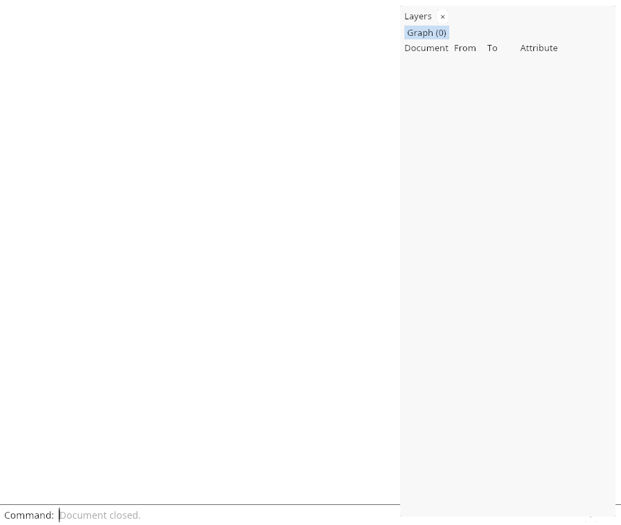

# 17.4 · Verified closed sections and exact cap picks

**Steps:** 32 · **Source:** [engine/gpu/triangle_tiles.rs](../../../src/engine/gpu/triangle_tiles.rs) · [shaders/project_triangles.wgsl](../../../src/shaders/project_triangles.wgsl) · [shaders/ink_visibility.wgsl](../../../src/shaders/ink_visibility.wgsl) · [shaders/ribbon.wgsl](../../../src/shaders/ribbon.wgsl)

<div class="webgpu-schematic" style="width:100%;margin:6px auto;">
<svg xmlns="http://www.w3.org/2000/svg" width="1120" height="188" viewBox="0 0 1120 188" style="width:100%;max-width:100%;height:auto;display:block;margin:0 auto;" role="img">
  <defs>
    <marker id="arr" viewBox="0 0 10 10" refX="8" refY="5" markerWidth="6" markerHeight="6" orient="auto">
      <path d="M 0 1 L 9 5 L 0 9 z" fill="#111111"/>
    </marker>
    <marker id="arrR" viewBox="0 0 10 10" refX="8" refY="5" markerWidth="6" markerHeight="6" orient="auto">
      <path d="M 0 1 L 9 5 L 0 9 z" fill="#dc2626"/>
    </marker>
    <marker id="arrG" viewBox="0 0 10 10" refX="8" refY="5" markerWidth="6" markerHeight="6" orient="auto">
      <path d="M 0 1 L 9 5 L 0 9 z" fill="#16a34a"/>
    </marker>
    <marker id="arrB" viewBox="0 0 10 10" refX="8" refY="5" markerWidth="6" markerHeight="6" orient="auto">
      <path d="M 0 1 L 9 5 L 0 9 z" fill="#2563eb"/>
    </marker>
  </defs>
  <rect x="2" y="2" width="1116" height="184" rx="10" fill="#ffffff" stroke="#111111" stroke-width="2"/>
  <rect x="14" y="12" width="344" height="164" rx="8" fill="#ffffff" stroke="#111111" stroke-width="1.5"/>
  <text paint-order="stroke fill" stroke="#ffffff" stroke-width="5" stroke-linejoin="round" x="186" y="30" text-anchor="middle" font-family="monospace" font-size="10.5" font-weight="700" fill="#111111">Half-Space Clip: d_i = dot(P_i, n_clip) + w_clip</text>
  <polygon points="58,138 118,58 258,58 198,138" fill="#dbeafe" stroke="#111111" stroke-width="1.75"/>
  <line x1="164" y1="44" x2="164" y2="156" stroke="#dc2626" stroke-width="2.5" stroke-dasharray="5 3"/>
  <line x1="164" y1="98" x2="218" y2="98" stroke="#dc2626" stroke-width="2.2" marker-end="url(#arrR)"/>
  <text paint-order="stroke fill" stroke="#ffffff" stroke-width="5" stroke-linejoin="round" x="236" y="102" font-family="monospace" font-size="9.5" font-weight="700" fill="#dc2626">d &lt; 0</text>
  <line x1="358" y1="94" x2="384" y2="94" stroke="#111111" stroke-width="2" marker-end="url(#arr)"/>
  <rect x="388" y="12" width="344" height="164" rx="8" fill="#ffffff" stroke="#111111" stroke-width="1.5"/>
  <text paint-order="stroke fill" stroke="#ffffff" stroke-width="5" stroke-linejoin="round" x="560" y="30" text-anchor="middle" font-family="monospace" font-size="10.5" font-weight="700" fill="#111111">Triangle-Plane Edge Segments -&gt; Welded Closed Cap Polygon</text>
  <polygon points="448,70 668,70 638,138 418,138" fill="#fef08a" stroke="#dc2626" stroke-width="2.2"/>
  <line x1="458" y1="70" x2="428" y2="138" stroke="#dc2626" stroke-width="1.5"/>
  <line x1="508" y1="70" x2="478" y2="138" stroke="#dc2626" stroke-width="1.5"/>
  <line x1="558" y1="70" x2="528" y2="138" stroke="#dc2626" stroke-width="1.5"/>
  <line x1="608" y1="70" x2="578" y2="138" stroke="#dc2626" stroke-width="1.5"/>
  <circle cx="448" cy="70" r="4" fill="#111111"/>
  <circle cx="668" cy="70" r="4" fill="#111111"/>
  <line x1="732" y1="94" x2="758" y2="94" stroke="#111111" stroke-width="2" marker-end="url(#arr)"/>
  <rect x="762" y="12" width="344" height="164" rx="8" fill="#ffffff" stroke="#111111" stroke-width="1.75"/>
  <text paint-order="stroke fill" stroke="#ffffff" stroke-width="5" stroke-linejoin="round" x="934" y="30" text-anchor="middle" font-family="monospace" font-size="10.5" font-weight="700" fill="#111111">Live Section Cut with Capped Solid Interior</text>
  <rect x="806" y="44" width="256" height="118" rx="4" fill="#ffffff" stroke="#111111" stroke-width="2"/>
  <polygon points="838,138 882,66 948,66 948,138" fill="#93c5fd" stroke="#111111" stroke-width="2"/>
  <polygon points="948,66 994,82 994,146 948,138" fill="#fef08a" stroke="#dc2626" stroke-width="2.2"/>
</svg>
</div>

## <a id="checkpoint-88-copy-original-closedness-and-winding"></a>1. Classify closedness and winding

### 1. `src/solid_orientation.rs`

Create the file and type:

```rust
use crate::clipping_geometry::{cross, dot};
use session_rust::Mesh;
pub const CLOSED: u32 = 8192;
pub const INWARD: u32 = 16384;
pub fn solid_orientation(mesh: &Mesh) -> Option<bool> {
    if mesh.vertex.is_empty() {
        return None;
    }

    // hole rings: the kernel decides
    if !mesh.face_holes.is_empty() {
        return mesh
            .is_closed()
            .then(|| six_volume(mesh) < 0.0);
    }

    let mut edges: Vec<u64> =
        Vec::with_capacity(mesh.face.values().map(Vec::len).sum());

    for corners in mesh.face.values() {
        for (i, &a) in corners.iter().enumerate() {
            let b = corners[(i + 1) % corners.len()];
            let (lo, hi) = (a.min(b), a.max(b));

            if lo == hi {
                continue;
            }

            // keys too big to pack: the kernel decides
            if hi >= 1 << 31 {
                return mesh
                    .is_closed()
                    .then(|| six_volume(mesh) < 0.0);
            }

            // the edge, then which way this face walks it
            edges.push((lo as u64) << 33 | (hi as u64) << 1 | u64::from(a > b));
        }
    }

    edges.sort_unstable();

    for run in edges.chunk_by(|a, b| a >> 1 == b >> 1) {
        let forward = run
            .iter()
            .filter(|edge| *edge & 1 == 0)
            .count();

        if forward * 2 != run.len() {
            return None;
        }
    }

    Some(six_volume(mesh) < 0.0)
}
pub fn solid_flags(solid: Option<bool>) -> u32 {
    match solid {
        Some(true) => CLOSED | INWARD,
        Some(false) => CLOSED,
        None => 0,
    }
}
fn six_volume(mesh: &Mesh) -> f64 {
    let mut volume = 0.0;

    for corners in mesh.face.values() {
        let Some(first) = corners
            .first()
            .and_then(|key| mesh.vertex.get(key))
        else {
            continue;
        };
        let a = [first.x, first.y, first.z];

        for pair in corners[1..].windows(2) {
            if let (Some(b), Some(c)) = (
                mesh.vertex.get(&pair[0]),
                mesh.vertex.get(&pair[1]),
            ) {
                volume += dot(a, cross([b.x, b.y, b.z], [c.x, c.y, c.z]));
            }
        }
    }

    volume
}
#[cfg(test)]
mod tests {
    use super::*;
    #[test]
    fn closedness_and_winding_of_meshes() {
        let cube = Mesh::create_box(2.0, 2.0, 2.0);
        assert_eq!(solid_orientation(&cube), Some(false));

        let mut inside_out = cube.clone();
        for corners in inside_out.face.values_mut() {
            corners.reverse();
        }
        assert_eq!(solid_orientation(&inside_out), Some(true));

        let mut open = cube.clone();
        let first = *open.face.keys().min().unwrap();
        open.face.remove(&first);
        assert_eq!(solid_orientation(&open), None);

        let mut mixed = cube.clone();
        mixed.face.get_mut(&first).unwrap().reverse();
        assert_eq!(
            solid_orientation(&mixed),
            None,
            "one face wound the wrong way"
        );
    }
}
```

### 2. `src/lib.rs`

**Locate this existing block:**

```rust
mod clipping_uniform_tests;
pub mod finite_project_source;
#[cfg(test)]
mod finite_scan_contract;
#[cfg(test)]
mod finite_tiles_contract;
pub mod source_mesh_topology;
```

Edit the existing block to match this code; keep unchanged lines:

```rust
mod clipping_uniform_tests;

pub mod finite_project_source;
#[cfg(test)]
mod finite_scan_contract;
#[cfg(test)]
mod finite_tiles_contract;
pub mod solid_orientation;
pub mod source_mesh_topology;
```

## <a id="checkpoint-88a-cache-verified-original-solids-weakly"></a>2. Cache verified solids weakly

### 1. `src/solid_cache.rs`

Create the file and type:

```rust
use crate::solid_orientation::{CLOSED, solid_flags, solid_orientation};
use std::{
    collections::HashMap,
    rc::{Rc, Weak},
};
enum Source {
    Mesh(Weak<session_rust::Mesh>),
    Cad(Weak<session_rust::BRep>),
}
impl Source {
    fn alive(&self) -> bool {
        match self {
            Self::Mesh(source) => source.strong_count() > 0,
            Self::Cad(source) => source.strong_count() > 0,
        }
    }
}
struct Entry {
    source: Source,
    flags: u32,
}
#[derive(Default)]
pub struct Solids {
    entries: HashMap<(u8, usize), Entry>,
    pub checks: u64,
}
impl Solids {
    pub fn flags(&mut self, object: &crate::scene::Object) -> u32 {
        if object.mesh.indices().is_empty() {
            return 0;
        }
        let cad = match &object.original {
            Some(session_rust::Geometry::BRep(source)) => Some(source),
            _ => object.cad.as_ref().map(|cad| &cad.source),
        };
        if let Some(source) = cad {
            let key = (1, Rc::as_ptr(source) as usize);
            if let Some(entry) = self
                .entries
                .get(&key)
                .filter(|e| e.source.alive())
            {
                return entry.flags;
            }
            let flags = if source.is_solid() {
                CLOSED
            } else {
                0
            };
            self.entries.insert(
                key,
                Entry {
                    source: Source::Cad(Rc::downgrade(source)),
                    flags,
                },
            );
            self.checks += 1;
            return flags;
        }
        let mesh = match &object.original {
            Some(session_rust::Geometry::Mesh(source)) => Some(source),
            _ => object.geometry(),
        };
        let Some(source) = mesh else { return 0 };
        let key = (0, Rc::as_ptr(source) as usize);
        if let Some(entry) = self
            .entries
            .get(&key)
            .filter(|e| e.source.alive())
        {
            return entry.flags;
        }
        let flags = solid_flags(solid_orientation(source));
        self.entries.insert(
            key,
            Entry {
                source: Source::Mesh(Rc::downgrade(source)),
                flags,
            },
        );
        self.checks += 1;
        flags
    }
    pub fn prune(&mut self) {
        self.entries
            .retain(|_, entry| entry.source.alive());
        if self.entries.is_empty() {
            self.entries.shrink_to_fit();
        }
    }
    pub fn count(&self) -> usize {
        self.entries.len()
    }
}
```

### 2. `src/lib.rs`

**Locate this existing block:**

```rust
mod clipping_uniform_tests;

pub mod finite_project_source;
#[cfg(test)]
mod finite_scan_contract;
#[cfg(test)]
mod finite_tiles_contract;
pub mod solid_orientation;
pub mod source_mesh_topology;
```

Edit the existing block to match this code; keep unchanged lines:

```rust
mod clipping_uniform_tests;

pub mod solid_orientation;

pub mod finite_project_source;
#[cfg(test)]
mod finite_scan_contract;
#[cfg(test)]
mod finite_tiles_contract;
pub mod solid_cache;
pub mod source_mesh_topology;
```

## <a id="checkpoint-88b-copy-conservative-plane-crossing-bounds"></a>3. Bound conservative plane crossings

<div class="webgpu-schematic" style="width:100%;margin:6px auto;">
<svg xmlns="http://www.w3.org/2000/svg" width="1120" height="188" viewBox="0 0 1120 188" style="width:100%;max-width:100%;height:auto;display:block;margin:0 auto;" role="img">
  <defs>
    <marker id="arr" viewBox="0 0 10 10" refX="8" refY="5" markerWidth="6" markerHeight="6" orient="auto">
      <path d="M 0 1 L 9 5 L 0 9 z" fill="#111111"/>
    </marker>
    <marker id="arrR" viewBox="0 0 10 10" refX="8" refY="5" markerWidth="6" markerHeight="6" orient="auto">
      <path d="M 0 1 L 9 5 L 0 9 z" fill="#dc2626"/>
    </marker>
    <marker id="arrG" viewBox="0 0 10 10" refX="8" refY="5" markerWidth="6" markerHeight="6" orient="auto">
      <path d="M 0 1 L 9 5 L 0 9 z" fill="#16a34a"/>
    </marker>
    <marker id="arrB" viewBox="0 0 10 10" refX="8" refY="5" markerWidth="6" markerHeight="6" orient="auto">
      <path d="M 0 1 L 9 5 L 0 9 z" fill="#2563eb"/>
    </marker>
  </defs>
  <rect x="2" y="2" width="1116" height="184" rx="10" fill="#ffffff" stroke="#111111" stroke-width="2"/>
  <rect x="14" y="12" width="344" height="164" rx="8" fill="#ffffff" stroke="#111111" stroke-width="1.5"/>
  <text paint-order="stroke fill" stroke="#ffffff" stroke-width="5" stroke-linejoin="round" x="186" y="30" text-anchor="middle" font-family="monospace" font-size="10.5" font-weight="700" fill="#111111">Drag Left-&gt;Right (Window) vs Right-&gt;Left (Crossing)</text>
  <rect x="54" y="54" width="108" height="88" fill="#dbeafe" fill-opacity="0.35" stroke="#2563eb" stroke-width="2"/>
  <text paint-order="stroke fill" stroke="#ffffff" stroke-width="5" stroke-linejoin="round" x="108" y="154" text-anchor="middle" font-family="monospace" font-size="9" font-weight="700" fill="#2563eb">dx &gt; 0: Inside Only</text>
  <rect x="180" y="54" width="108" height="88" fill="#dcfce7" fill-opacity="0.35" stroke="#16a34a" stroke-width="2" stroke-dasharray="5 3"/>
  <text paint-order="stroke fill" stroke="#ffffff" stroke-width="5" stroke-linejoin="round" x="234" y="154" text-anchor="middle" font-family="monospace" font-size="9" font-weight="700" fill="#16a34a">dx &lt; 0: Any Overlap</text>
  <line x1="358" y1="94" x2="384" y2="94" stroke="#111111" stroke-width="2" marker-end="url(#arr)"/>
  <rect x="388" y="12" width="344" height="164" rx="8" fill="#ffffff" stroke="#111111" stroke-width="1.5"/>
  <text paint-order="stroke fill" stroke="#ffffff" stroke-width="5" stroke-linejoin="round" x="560" y="30" text-anchor="middle" font-family="monospace" font-size="10.5" font-weight="700" fill="#111111">Screen AABB Containment vs Segment-Rect Intersection</text>
  <rect x="434" y="56" width="112" height="84" fill="none" stroke="#2563eb" stroke-width="2"/>
  <polygon points="458,122 490,74 522,122" fill="#bbf7d0" stroke="#16a34a" stroke-width="2"/>
  <rect x="574" y="56" width="112" height="84" fill="none" stroke="#16a34a" stroke-width="2" stroke-dasharray="5 3"/>
  <polygon points="638,126 676,68 712,126" fill="#fef08a" stroke="#dc2626" stroke-width="2"/>
  <line x1="732" y1="94" x2="758" y2="94" stroke="#111111" stroke-width="2" marker-end="url(#arr)"/>
  <rect x="762" y="12" width="344" height="164" rx="8" fill="#ffffff" stroke="#111111" stroke-width="1.75"/>
  <text paint-order="stroke fill" stroke="#ffffff" stroke-width="5" stroke-linejoin="round" x="934" y="30" text-anchor="middle" font-family="monospace" font-size="10.5" font-weight="700" fill="#111111">Multi-Object Selection Set Updated</text>
  <rect x="806" y="44" width="256" height="118" rx="4" fill="#ffffff" stroke="#111111" stroke-width="2"/>
  <polygon points="838,136 876,74 914,136" fill="#fef08a" stroke="#dc2626" stroke-width="2.2"/>
  <polygon points="944,136 982,74 1020,136" fill="#fef08a" stroke="#dc2626" stroke-width="2.2"/>
</svg>
</div>

### 1. `src/cap_bounds.rs`

Create the file and type:

```rust
use crate::clipping_geometry::ClipPlane;
use session_rust::AABB;
impl ClipPlane {
    pub fn crosses(&self, b: &AABB, anchor: [f64; 3]) -> bool {
        let reach = self.normal[0].abs() * b.hx
            + self.normal[1].abs() * b.hy
            + self.normal[2].abs() * b.hz;
        let center = [b.cx, b.cy, b.cz];
        let size = b.hx + b.hy + b.hz;
        let local: f64 = (0..3)
            .map(|i| (center[i] - anchor[i]).abs())
            .sum();
        let world: f64 = center.iter().map(|v| v.abs()).sum();
        // 32 times CLIP_SLACK in clip.wgsl, plus the f32 rounding of the vertices themselves
        let slack = (local + size + self.distance(anchor).abs()) / 4096.0
            + (world + size) / 1048576.0;
        self.distance(center).abs() <= reach + slack
    }
}
#[cfg(test)]
mod tests {
    use super::*;
    use crate::clipping_geometry::{Mode, clip_plane, plane_from};
    use session_rust::Xform;
    #[test]
    fn a_plane_crosses_the_boxes_it_passes_through() {
        let plane = clip_plane(
            &plane_from(Mode::Xy, &[[0.0, 0.0, 50.0]], 10.0).unwrap(),
            &Xform::identity(),
        )
        .unwrap();
        let tilted = clip_plane(
            &plane_from(
                Mode::Normal,
                &[[0.0, 0.0, 0.0], [1.0, 1.0, 1.0]],
                10.0,
            )
            .unwrap(),
            &Xform::identity(),
        )
        .unwrap();
        let block = |z: f64| AABB::new(0.0, 0.0, z, 10.0, 10.0, 10.0);
        let origin = [0.0; 3];
        assert!(plane.crosses(&block(45.0), origin));
        assert!(
            plane.crosses(&block(60.0), origin),
            "touching from above"
        );
        assert!(!plane.crosses(&block(61.0), origin));
        assert!(!plane.crosses(&block(-100.0), origin));
        assert!(tilted.crosses(&block(0.0), origin));
        assert!(!tilted.crosses(
            &AABB::new(40.0, 40.0, 40.0, 5.0, 5.0, 5.0),
            origin
        ));

        // a face on the plane whose box rounds a hair short of it still counts
        let bottom = clip_plane(
            &plane_from(
                Mode::Normal,
                &[[0.0, 0.0, 5.9], [0.0, 0.0, -4.1]],
                10.0,
            )
            .unwrap(),
            &Xform::identity(),
        )
        .unwrap();
        let mut b = AABB::empty();
        b.union_with_point(13.7, -21.3, 5.9 + 1e-9);
        b.union_with_point(113.7, 58.7, 65.9);
        assert!(bottom.crosses(&b, [63.7, 18.7, 35.9]));
    }
}
```

### 2. `src/lib.rs`

**Locate this existing block:**

```rust
pub mod solid_orientation;

pub mod finite_project_source;
#[cfg(test)]
mod finite_scan_contract;
#[cfg(test)]
mod finite_tiles_contract;
pub mod solid_cache;
pub mod source_mesh_topology;
```

Edit the existing block to match this code; keep unchanged lines:

```rust
pub mod solid_orientation;

pub mod solid_cache;

pub mod cap_bounds;
pub mod finite_project_source;
#[cfg(test)]
mod finite_scan_contract;
#[cfg(test)]
mod finite_tiles_contract;
pub mod source_mesh_topology;
```

## <a id="checkpoint-88c-cache-local-bounds-and-apply-placement-once"></a>4. Cache local bounds and apply placement once

### 1. `src/cap_source_bounds.rs`

Create the file and type:

```rust
use std::{
    collections::HashMap,
    rc::{Rc, Weak},
};
#[derive(Default)]
pub struct Bounds {
    entries: HashMap<usize, (Weak<crate::mesh::Mesh>, [[f64; 3]; 2])>,
}
impl Bounds {
    pub fn placed(
        &mut self,
        source: &Rc<crate::mesh::Mesh>,
        model: &session_rust::Xform,
    ) -> Option<session_rust::AABB> {
        let key = Rc::as_ptr(source) as usize;
        let local = if let Some((_, bounds)) = self
            .entries
            .get(&key)
            .filter(|(weak, _)| weak.strong_count() > 0)
        {
            *bounds
        } else {
            let first = source.vertices().first()?;
            let mut bounds = [[
                f64::from(first[0]),
                f64::from(first[1]),
                f64::from(first[2]),
            ]; 2];
            for vertex in source.vertices() {
                for i in 0..3 {
                    bounds[0][i] = bounds[0][i].min(f64::from(vertex[i]));
                    bounds[1][i] = bounds[1][i].max(f64::from(vertex[i]));
                }
            }
            self.entries
                .insert(key, (Rc::downgrade(source), bounds));
            bounds
        };
        let mut world = session_rust::AABB::empty();
        for corner in 0..8 {
            let p = [0, 1, 2].map(|i| local[(corner >> i) & 1][i]);
            let p = model.transform_point(&session_rust::Point::new(p[0], p[1], p[2]));
            world.union_with_point(p[0], p[1], p[2]);
        }
        Some(world)
    }
    pub fn prune(&mut self) {
        self.entries
            .retain(|_, (weak, _)| weak.strong_count() > 0);
        if self.entries.is_empty() {
            self.entries.shrink_to_fit();
        }
    }
}
```

### 2. `src/lib.rs`

**Locate this existing block:**

```rust
pub mod cap_bounds;
pub mod finite_project_source;
```

Edit the existing block to match this code; keep unchanged lines:

```rust
pub mod cap_bounds;

pub mod cap_source_bounds;
pub mod finite_project_source;
```

## <a id="checkpoint-88d-carry-closedness-and-dense-cap-addresses"></a>5. Carry closedness and dense cap addresses

<div class="webgpu-schematic" style="width:100%;margin:6px auto;">
<svg xmlns="http://www.w3.org/2000/svg" width="1120" height="188" viewBox="0 0 1120 188" style="width:100%;max-width:100%;height:auto;display:block;margin:0 auto;" role="img">
  <defs>
    <marker id="arr" viewBox="0 0 10 10" refX="8" refY="5" markerWidth="6" markerHeight="6" orient="auto">
      <path d="M 0 1 L 9 5 L 0 9 z" fill="#111111"/>
    </marker>
    <marker id="arrR" viewBox="0 0 10 10" refX="8" refY="5" markerWidth="6" markerHeight="6" orient="auto">
      <path d="M 0 1 L 9 5 L 0 9 z" fill="#dc2626"/>
    </marker>
    <marker id="arrG" viewBox="0 0 10 10" refX="8" refY="5" markerWidth="6" markerHeight="6" orient="auto">
      <path d="M 0 1 L 9 5 L 0 9 z" fill="#16a34a"/>
    </marker>
    <marker id="arrB" viewBox="0 0 10 10" refX="8" refY="5" markerWidth="6" markerHeight="6" orient="auto">
      <path d="M 0 1 L 9 5 L 0 9 z" fill="#2563eb"/>
    </marker>
  </defs>
  <rect x="2" y="2" width="1116" height="184" rx="10" fill="#ffffff" stroke="#111111" stroke-width="2"/>
  <rect x="14" y="12" width="344" height="164" rx="8" fill="#ffffff" stroke="#111111" stroke-width="1.5"/>
  <text paint-order="stroke fill" stroke="#ffffff" stroke-width="5" stroke-linejoin="round" x="186" y="30" text-anchor="middle" font-family="monospace" font-size="10.5" font-weight="700" fill="#111111">Corner Tangents t0, t1 &amp; Miter Vector m = (n0+n1)/dot</text>
  <polyline points="58,136 164,66 270,136" fill="none" stroke="#111111" stroke-width="2" stroke-dasharray="4 3"/>
  <polygon points="48,122 164,44 280,122 260,150 164,88 68,150" fill="#dbeafe" fill-opacity="0.7" stroke="#2563eb" stroke-width="1.75"/>
  <line x1="164" y1="66" x2="164" y2="44" stroke="#dc2626" stroke-width="2.5" marker-end="url(#arrR)"/>
  <text paint-order="stroke fill" stroke="#ffffff" stroke-width="5" stroke-linejoin="round" x="192" y="54" font-family="monospace" font-size="9.5" font-weight="700" fill="#dc2626">m</text>
  <line x1="358" y1="94" x2="384" y2="94" stroke="#111111" stroke-width="2" marker-end="url(#arr)"/>
  <rect x="388" y="12" width="344" height="164" rx="8" fill="#ffffff" stroke="#111111" stroke-width="1.5"/>
  <text paint-order="stroke fill" stroke="#ffffff" stroke-width="5" stroke-linejoin="round" x="560" y="30" text-anchor="middle" font-family="monospace" font-size="10.5" font-weight="700" fill="#111111">Round Cap SDF (||uv|| &lt;= 1) + Arc-Length Dash Modulo</text>
  <circle cx="468" cy="102" r="28" fill="#dcfce7" stroke="#16a34a" stroke-width="2"/>
  <line x1="468" y1="102" x2="496" y2="102" stroke="#dc2626" stroke-width="2"/>
  <rect x="526" y="88" width="46" height="28" fill="#dbeafe" stroke="#111111" stroke-width="1.75"/>
  <rect x="592" y="88" width="24" height="28" fill="none" stroke="#94a3b8" stroke-width="1.5" stroke-dasharray="3 3"/>
  <rect x="636" y="88" width="46" height="28" fill="#dbeafe" stroke="#111111" stroke-width="1.75"/>
  <line x1="732" y1="94" x2="758" y2="94" stroke="#111111" stroke-width="2" marker-end="url(#arr)"/>
  <rect x="762" y="12" width="344" height="164" rx="8" fill="#ffffff" stroke="#111111" stroke-width="1.75"/>
  <text paint-order="stroke fill" stroke="#ffffff" stroke-width="5" stroke-linejoin="round" x="934" y="30" text-anchor="middle" font-family="monospace" font-size="10.5" font-weight="700" fill="#111111">Clean Mitered Corners &amp; Dashed CAD Strokes</text>
  <rect x="806" y="44" width="256" height="118" rx="4" fill="#ffffff" stroke="#111111" stroke-width="2"/>
  <polyline points="834,136 904,68 974,136" fill="none" stroke="#111111" stroke-width="6" stroke-linejoin="miter" stroke-linecap="round"/>
  <line x1="964" y1="74" x2="1044" y2="136" stroke="#2563eb" stroke-width="4" stroke-dasharray="10 6" stroke-linecap="round"/>
</svg>
</div>

### 1. `src/gpu_mesh.rs`

Edit these blocks from bottom to top. Keep the surrounding lines unchanged.

**Locate this block:**

```rust
        object: &Object,
        style: Style,
    ) -> [usize; 2] {
        let next = settings(object, style);
        let mut writes = [0, 0];
```

Replace it with:

```rust
        object: &Object,
        style: Style,
    ) -> [usize; 2] {
        let next = settings(object, style, self.cap_flags, self.cap_token);
        let mut writes = [0, 0];
```

**Locate this block:**

```rust
        u32::from_ne_bytes(self.previous[64..68].try_into().unwrap()) != 0
    }

    pub fn settings_bytes(&self) -> u64 {
        self.model.size()
    }
```

Replace it with:

```rust
        u32::from_ne_bytes(self.previous[64..68].try_into().unwrap()) != 0
    }

    pub fn closed(&self) -> bool {
        self.cap_flags & crate::solid_orientation::CLOSED != 0
    }
    pub fn pickable(&self) -> bool {
        u32::from_ne_bytes(self.previous[68..72].try_into().unwrap()) != 0
    }
    pub fn set_caps(&mut self, queue: &wgpu::Queue, flags: u32, token: u32) {
        if self.cap_flags == flags && self.cap_token == token {
            return;
        }
        let plane =
            u32::from_ne_bytes(self.previous[72..76].try_into().unwrap()) & 4096;
        self.previous[72..76].copy_from_slice(&(plane | flags).to_ne_bytes());
        self.previous[76..80].copy_from_slice(&token.to_ne_bytes());
        queue.write_buffer(&self.model, 72, &self.previous[72..80]);
        self.cap_flags = flags;
        self.cap_token = token;
    }
    pub fn settings_bytes(&self) -> u64 {
        self.model.size()
    }
```

**Locate this block:**

```rust
            id: object.id,
            model,
            previous: bytes,
        }
    }
```

Replace it with:

```rust
            id: object.id,
            model,
            previous: bytes,
            cap_flags: 0,
            cap_token: 0,
        }
    }
```

**Locate this block:**

```rust
        style: Style,
        geometry: Rc<GpuGeometry>,
    ) -> Self {
        let bytes = settings(object, style);
        let model = device.create_buffer_init(&wgpu::util::BufferInitDescriptor {
            label: Some("object placement"),
            contents: &bytes,
```

Replace it with:

```rust
        style: Style,
        geometry: Rc<GpuGeometry>,
    ) -> Self {
        let bytes = settings(object, style, 0, 0);
        let model = device.create_buffer_init(&wgpu::util::BufferInitDescriptor {
            label: Some("object placement"),
            contents: &bytes,
```

**Locate this block:**

```rust
    } else {
        0
    };
    bytes[72..76].copy_from_slice(&flags.to_ne_bytes());
    let normals = crate::normals::matrix(&object.model)
        .expect("Scene placements are checked before insertion or editing");
    for (index, value) in normals.iter().enumerate() {
```

Replace it with:

```rust
    } else {
        0
    };
    bytes[72..76].copy_from_slice(&(flags | cap_flags).to_ne_bytes());
    bytes[76..80].copy_from_slice(&cap_token.to_ne_bytes());
    let normals = crate::normals::matrix(&object.model)
        .expect("Scene placements are checked before insertion or editing");
    for (index, value) in normals.iter().enumerate() {
```

**Locate this block:**

```rust
    pub colour: Option<[f32; 4]>,
}

fn settings(object: &Object, style: Style) -> [u8; 160] {
    let mut bytes = [0; 160];
    for (index, value) in object.model.m.iter().enumerate() {
        bytes[index * 4..index * 4 + 4].copy_from_slice(&(*value as f32).to_ne_bytes());
```

Replace it with:

```rust
    pub colour: Option<[f32; 4]>,
}

fn settings(
    object: &Object,
    style: Style,
    cap_flags: u32,
    cap_token: u32,
) -> [u8; 160] {
    let mut bytes = [0; 160];
    for (index, value) in object.model.m.iter().enumerate() {
        bytes[index * 4..index * 4 + 4].copy_from_slice(&(*value as f32).to_ne_bytes());
```

**Locate this block:**

```rust
    previous: [u8; 160],
}

#[derive(Clone, Copy)]
```

Replace it with:

```rust
    previous: [u8; 160],
    cap_flags: u32,
    cap_token: u32,
}

#[derive(Clone, Copy)]
```

## <a id="checkpoint-88e-count-original-closed-solid-crossings"></a>6. Count closed-solid crossings

### 1. `src/cap_count.wgsl`

Create the file and type:

```wgsl
struct ViewSettings { transform: mat4x4<f32>, display: vec4<f32>, }
@group(0) @binding(0) var<uniform> view: ViewSettings;
struct ObjectSettings {
    model: mat4x4<f32>,
    selection: vec4<u32>,
    normal_matrix: mat4x4<f32>,
    face_colour:vec4<f32>,
}
@group(1) @binding(0) var<uniform> object: ObjectSettings;

struct CountOut {
    @builtin(position) pos: vec4<f32>, // clip position
    @location(0) world_pos: vec3<f32>, // scene-space position
    @location(1) @interpolate(flat) inst_id: u32, // object row
    @location(2) @interpolate(flat) plane: u32, // clipping plane
    @location(3) @interpolate(flat) flip: u32, // 1 when the solid is mirrored or wound inward
    @location(4) @interpolate(flat) selected: u32, // nonzero when the solid is selected
}

fn count_corner(position:vec3<f32>,plane:u32)->CountOut{
 var out:CountOut;out.pos=vec4<f32>(3.0,3.0,0.5,1.0);
 if((object.selection.z&(FLAG_CLOSED|FLAG_CLIPPING_PLANE))!=FLAG_CLOSED){return out;}
 let world=object.model*vec4<f32>(position,1.0);let mirrored=dot(object.model[0].xyz,cross(object.model[1].xyz,object.model[2].xyz))<0.0;
 out.pos=view.transform*world;out.world_pos=world.xyz;out.inst_id=object.selection.w;out.plane=plane;out.flip=select(0u,1u,mirrored!=((object.selection.z&FLAG_INWARD)!=0u));out.selected=object.selection.x;return out;
}
@vertex fn vs_count(@location(0) position:vec3<f32>,@builtin(instance_index) plane:u32)->CountOut{return count_corner(position,plane);}
fn behind(plane: u32, p: vec3<f32>) -> f32 {
    return -clip_eye_side(plane) * clip_distance(plane, p);
}
fn leaving(in: CountOut, front: bool) -> bool {
    return front == (in.flip != 0u);
}
@fragment fn fs_count(in:CountOut,@builtin(front_facing) front:bool)->@location(0) vec4<f32>{if(clip_eye_side(in.plane)==0.0||behind(in.plane,in.world_pos)<0.0){discard;}let sign=select(-1.0,1.0,leaving(in,front));let weight=select(1.0,SELECTED_CROSSING,in.selected!=0u);return vec4<f32>(sign*weight,0.0,0.0,0.0);}
```

## <a id="checkpoint-88f-count-exact-original-cap-pick-candidates"></a>7. Count exact cap pick candidates

<div class="webgpu-schematic" style="width:100%;margin:6px auto;">
<svg xmlns="http://www.w3.org/2000/svg" width="1120" height="188" viewBox="0 0 1120 188" style="width:100%;max-width:100%;height:auto;display:block;margin:0 auto;" role="img">
  <defs>
    <marker id="arr" viewBox="0 0 10 10" refX="8" refY="5" markerWidth="6" markerHeight="6" orient="auto">
      <path d="M 0 1 L 9 5 L 0 9 z" fill="#111111"/>
    </marker>
    <marker id="arrR" viewBox="0 0 10 10" refX="8" refY="5" markerWidth="6" markerHeight="6" orient="auto">
      <path d="M 0 1 L 9 5 L 0 9 z" fill="#dc2626"/>
    </marker>
    <marker id="arrG" viewBox="0 0 10 10" refX="8" refY="5" markerWidth="6" markerHeight="6" orient="auto">
      <path d="M 0 1 L 9 5 L 0 9 z" fill="#16a34a"/>
    </marker>
    <marker id="arrB" viewBox="0 0 10 10" refX="8" refY="5" markerWidth="6" markerHeight="6" orient="auto">
      <path d="M 0 1 L 9 5 L 0 9 z" fill="#2563eb"/>
    </marker>
  </defs>
  <rect x="2" y="2" width="1116" height="184" rx="10" fill="#ffffff" stroke="#111111" stroke-width="2"/>
  <rect x="14" y="12" width="344" height="164" rx="8" fill="#ffffff" stroke="#111111" stroke-width="1.5"/>
  <text paint-order="stroke fill" stroke="#ffffff" stroke-width="5" stroke-linejoin="round" x="186" y="30" text-anchor="middle" font-family="monospace" font-size="10.5" font-weight="700" fill="#111111">CPU RAM: #[repr(C)] Structs -&gt; bytemuck::cast_slice</text>
  <rect x="46" y="54" width="280" height="44" fill="#f8fafc" stroke="#111111" stroke-width="1.75"/>
  <rect x="52" y="60" width="64" height="32" fill="#dbeafe" stroke="#2563eb" stroke-width="1.5"/>
  <text paint-order="stroke fill" stroke="#ffffff" stroke-width="5" stroke-linejoin="round" x="84" y="80" text-anchor="middle" font-family="monospace" font-size="9.5" font-weight="700" fill="#111111">v0: 24B</text>
  <rect x="122" y="60" width="64" height="32" fill="#dbeafe" stroke="#2563eb" stroke-width="1.5"/>
  <text paint-order="stroke fill" stroke="#ffffff" stroke-width="5" stroke-linejoin="round" x="154" y="80" text-anchor="middle" font-family="monospace" font-size="9.5" font-weight="700" fill="#111111">v1: 24B</text>
  <rect x="192" y="60" width="64" height="32" fill="#dbeafe" stroke="#2563eb" stroke-width="1.5"/>
  <text paint-order="stroke fill" stroke="#ffffff" stroke-width="5" stroke-linejoin="round" x="224" y="80" text-anchor="middle" font-family="monospace" font-size="9.5" font-weight="700" fill="#111111">v2: 24B</text>
  <text paint-order="stroke fill" stroke="#ffffff" stroke-width="5" stroke-linejoin="round" x="290" y="80" text-anchor="middle" font-family="monospace" font-size="10" font-weight="700" fill="#111111">...</text>
  <rect x="66" y="112" width="240" height="34" rx="4" fill="#fef08a" stroke="#111111" stroke-width="1.5"/>
  <text paint-order="stroke fill" stroke="#ffffff" stroke-width="5" stroke-linejoin="round" x="186" y="133" text-anchor="middle" font-family="monospace" font-size="9.5" font-weight="700" fill="#111111">&amp;[u8] Contiguous Byte Slice</text>
  <line x1="358" y1="94" x2="384" y2="94" stroke="#111111" stroke-width="2" marker-end="url(#arr)"/>
  <rect x="388" y="12" width="344" height="164" rx="8" fill="#ffffff" stroke="#111111" stroke-width="1.5"/>
  <text paint-order="stroke fill" stroke="#ffffff" stroke-width="5" stroke-linejoin="round" x="560" y="30" text-anchor="middle" font-family="monospace" font-size="10.5" font-weight="700" fill="#111111">CPU -&gt; GPU DMA: queue.write_buffer(buf, 0, bytes)</text>
  <rect x="424" y="54" width="272" height="92" rx="6" fill="#dcfce7" stroke="#16a34a" stroke-width="1.75"/>
  <line x1="448" y1="84" x2="672" y2="84" stroke="#16a34a" stroke-width="3" marker-end="url(#arrG)"/>
  <text paint-order="stroke fill" stroke="#ffffff" stroke-width="5" stroke-linejoin="round" x="560" y="74" text-anchor="middle" font-family="monospace" font-size="10" font-weight="700" fill="#111111">create_buffer_init / write_buffer</text>
  <text paint-order="stroke fill" stroke="#ffffff" stroke-width="5" stroke-linejoin="round" x="560" y="112" text-anchor="middle" font-family="monospace" font-size="9.5" font-weight="700" fill="#16a34a">VERTEX | INDEX | COPY_DST</text>
  <text paint-order="stroke fill" stroke="#ffffff" stroke-width="5" stroke-linejoin="round" x="560" y="132" text-anchor="middle" font-family="monospace" font-size="9" fill="#111111">array_stride = size_of::&lt;Vertex&gt;()</text>
  <line x1="732" y1="94" x2="758" y2="94" stroke="#111111" stroke-width="2" marker-end="url(#arr)"/>
  <rect x="762" y="12" width="344" height="164" rx="8" fill="#ffffff" stroke="#111111" stroke-width="1.75"/>
  <text paint-order="stroke fill" stroke="#ffffff" stroke-width="5" stroke-linejoin="round" x="934" y="30" text-anchor="middle" font-family="monospace" font-size="10.5" font-weight="700" fill="#111111">GPU VRAM Buffer -&gt; @vertex Input Locations</text>
  <rect x="806" y="44" width="256" height="118" rx="4" fill="#ffffff" stroke="#111111" stroke-width="2"/>
  <rect x="822" y="56" width="224" height="40" rx="4" fill="#dbeafe" stroke="#2563eb" stroke-width="1.5"/>
  <text paint-order="stroke fill" stroke="#ffffff" stroke-width="5" stroke-linejoin="round" x="934" y="80" text-anchor="middle" font-family="monospace" font-size="9.5" font-weight="700" fill="#111111">@location(0) pos: vec3&lt;f32&gt;</text>
  <rect x="822" y="106" width="224" height="40" rx="4" fill="#fce7f3" stroke="#db2777" stroke-width="1.5"/>
  <text paint-order="stroke fill" stroke="#ffffff" stroke-width="5" stroke-linejoin="round" x="934" y="130" text-anchor="middle" font-family="monospace" font-size="9.5" font-weight="700" fill="#111111">@location(1) color: vec3&lt;f32&gt;</text>
</svg>
</div>

### 1. `src/cap_count.wgsl`

**Locate this existing block:**

```wgsl
}
@fragment fn fs_count(in:CountOut,@builtin(front_facing) front:bool)->@location(0) vec4<f32>{if(clip_eye_side(in.plane)==0.0||behind(in.plane,in.world_pos)<0.0){discard;}let sign=select(-1.0,1.0,leaving(in,front));let weight=select(1.0,SELECTED_CROSSING,in.selected!=0u);return vec4<f32>(sign*weight,0.0,0.0,0.0);}
```

Edit the existing block to match this code; keep unchanged lines:

```wgsl
}
@fragment fn fs_count(in:CountOut,@builtin(front_facing) front:bool)->@location(0) vec4<f32>{if(clip_eye_side(in.plane)==0.0||behind(in.plane,in.world_pos)<0.0){discard;}let sign=select(-1.0,1.0,leaving(in,front));let weight=select(1.0,SELECTED_CROSSING,in.selected!=0u);return vec4<f32>(sign*weight,0.0,0.0,0.0);}
@group(3) @binding(0) var<storage,read_write> pick_caps:array<atomic<u32>>;
struct PickFrame{full:vec2<u32>,size:vec2<u32>,origin:vec2<u32>,mode:u32,pad:u32}
@group(3) @binding(2) var<uniform> pick_frame:PickFrame;
fn pick_cap_word(plane: u32, px: vec2<f32>) -> u32 {
    return clip_pick_word(plane, px, pick_frame.size);
}
@fragment fn fs_pick_count(in: CountOut, @builtin(front_facing) front: bool) -> @location(0) vec4<f32> {
    if (clip_eye_side(in.plane) == 0.0 || behind(in.plane, in.world_pos) < 0.0) {
        discard;
    }

    let leaves = leaving(in, front);
    let sign = select(-1, 1, leaves);
    let word = pick_cap_word(in.plane, in.pos.xy);
    atomicAdd(&pick_caps[word], bitcast<u32>(sign));
    atomicAdd(&pick_caps[word + 1u], bitcast<u32>(sign * i32(in.inst_id)));

    if (leaves) {
        atomicMax(&pick_caps[word + 2u], bitcast<u32>(1.0-in.pos.z));
    }

    return vec4<f32>(0.0);
}
@fragment
fn fs_pick_owner(in: CountOut, @builtin(front_facing) front: bool) -> @location(0) vec4<f32> {
    if (clip_eye_side(in.plane) == 0.0 || behind(in.plane, in.world_pos) < 0.0 || !leaving(in, front)) {
        discard;
    }

    let word = pick_cap_word(in.plane, in.pos.xy);

    if (bitcast<u32>(1.0-in.pos.z) == atomicLoad(&pick_caps[word + 2u])) {
        atomicStore(&pick_caps[word + 3u], in.inst_id);
    }

    return vec4<f32>(0.0);
}

struct Crop { transform: mat4x4<f32>, mode: u32, _a: u32, _b: u32, _c: u32 }
fn wanted(pixel: u32, mode: u32) -> bool {
    if (mode == 0u) { return true; }
    if (pixel == 0u) { return false; }
    let kind = (pixel - 1u) & 0xe0000000u;
    return (mode == 2u && kind == 0x80000000u) || (mode == 3u && kind == 0x40000000u);
}

@group(3) @binding(1) var<uniform> cap_crop:Crop;
@vertex fn vs_pick_count(@location(0) position:vec3<f32>,@builtin(instance_index) plane:u32)->CountOut{var output=count_corner(position,plane);output.pos=cap_crop.transform*output.pos;return output;}
```

## <a id="checkpoint-88g-copy-section-coverage-and-hatch-filtering"></a>8. Filter section bands over a pixel footprint

### 1. `src/cap_color.wgsl`

Create the file and type:

```wgsl
// Prefixed in Rust: `counts` and `primitives` at group 3, SAMPLES, `count_at` and `primitive_at`.

// One corner of a fullscreen triangle; the instance picks the plane or the caps.
struct CapVertex {
    @builtin(position) pos: vec4<f32>, // clip position
    @location(0) @interpolate(flat) plane: u32, // clipping plane; for the masks 1 = selected caps only
}

@vertex
// A triangle over the whole target.
fn vs_cap(@builtin(vertex_index) vertex: u32, @builtin(instance_index) plane: u32) -> CapVertex {
    let xy = vec2<f32>(f32((vertex << 1u) & 2u), f32(vertex & 2u));
    var out: CapVertex;
    out.pos = vec4<f32>(xy * 2.0 - 1.0, 0.0, 1.0);
    out.plane = plane;
    return out;
}

// A section cap fragment: color, triangle id, the plane's depth and the samples it covers.
struct CapOut {
    @location(0) color: vec4<f32>, // hatch or light grey, with a black boundary
    @location(1) primitive: vec2<u32>, // cap marker in 16-bit halves
    @builtin(frag_depth) depth: f32, // depth of the plane here
    @builtin(sample_mask) mask: u32, // samples inside a solid and kept by the other planes
}

// Fraction of a pixel square lying below signed distance `t` from a line; the ribbon filter.
fn box_cdf(t: f32, hi: f32, lo: f32, m: f32, q: f32) -> f32 {
    let s = clamp(t, -hi, hi);
    let e = hi - abs(s);
    let tail = select(e * e / q, 1.0 - e * e / q, s > 0.0);
    return select(tail, 0.5 + s / m, abs(s) <= lo);
}

// Exact area of this pixel within `hw` of a line `d` away, across direction `g`.
fn band_area(d: f32, hw: f32, g: vec2<f32>) -> f32 {
    let a = abs(g.x);
    let b = abs(g.y);
    let hi = 0.5 * (a + b);
    let lo = 0.5 * abs(a - b);
    let m = max(max(a, b), 1e-6);
    let q = max(2.0 * a * b, 1e-6);
    return box_cdf(hw - d, hi, lo, m, q) + box_cdf(hw + d, hi, lo, m, q) - 1.0;
}
```

## <a id="checkpoint-88ga-fade-hatch-detail-and-detect-section-boundaries"></a>9. Fade hatch detail and detect section boundaries

### 1. `src/cap_color.wgsl`

**Locate this existing block:**

```wgsl
    return box_cdf(hw - d, hi, lo, m, q) + box_cdf(hw + d, hi, lo, m, q) - 1.0;
}
```

Edit the existing block to match this code; keep unchanged lines:

```wgsl
    return box_cdf(hw - d, hi, lo, m, q) + box_cdf(hw + d, hi, lo, m, q) - 1.0;
}


// Coverage of the nearest hatch line; `slope` is the change of `u` per pixel.
fn hatch_ink(u: f32, slope: vec2<f32>) -> f32 {
    let rate = max(length(slope), 1e-30); // scene units per pixel across the lines
    let level = log2(clipping.spacing * rate);
    // lines every power of two in scene units; every other one fades out over the last half octave
    let step = exp2(floor(level));
    let fade = smoothstep(0.5, 1.0, fract(level));
    let n = u / step;
    let nearest = round(n);
    let distance = abs(n - nearest) * step / rate;
    let odd = abs(nearest - 2.0 * round(nearest * 0.5)) > 0.5;
    let ink = clamp(band_area(distance, clipping.width * 0.5, slope / rate), 0.0, 1.0);
    return ink * select(1.0, 1.0 - fade, odd);
}

// Coverage of the section's union, including holes, without a border at the viewport edge.
fn section_coverage(at: vec2<i32>) -> f32 {
    if (any(at < vec2<i32>(0)) || any(at >= vec2<i32>(textureDimensions(counts)))) {
        return 1.0;
    }
    var covered = 0.0;
    for (var k = 0u; k < SAMPLES; k++) {
        covered += select(0.0, 1.0, count_at(at, k) > 0.5);
    }
    return covered / f32(SAMPLES);
}

fn section_outline(at: vec2<f32>) -> f32 {
    let directions = array<vec2<f32>, 8>(
        vec2<f32>(1.0, 0.0), vec2<f32>(-1.0, 0.0),
        vec2<f32>(0.0, 1.0), vec2<f32>(0.0, -1.0),
        vec2<f32>(0.7071, 0.7071), vec2<f32>(-0.7071, 0.7071),
        vec2<f32>(0.7071, -0.7071), vec2<f32>(-0.7071, -0.7071)
    );
    var edge = 0.0;
    for (var k = 0u; k < 8u; k++) {
        edge = max(edge, 1.0 - section_coverage(vec2<i32>(floor(at + directions[k] * clipping.outline))));
    }
    return edge;
}
```

## <a id="checkpoint-88gb-shade-sections-with-shared-original-depth-and-sample-ownership"></a>10. Shade sections with shared depth and sample ownership

### 1. `src/cap_color.wgsl`

**Locate this existing block:**

```wgsl
    return edge;
}
```

Edit the existing block to match this code; keep unchanged lines:

```wgsl
    return edge;
}


@fragment
// Where the view ray meets a plane inside a closed solid: outlined hatch or solid grey.
fn fs_cap(in: CapVertex) -> CapOut {
    let i = in.plane;
    let ndc = clip_ndc(in.pos.xy + line.origin, line.frame, 0.0).xy;
    let z = clip_plane_depth(i, ndc);
    let h = vec3<f32>(ndc, 1.0);
    // scene units across the hatch lines, and their change per pixel
    let u = dot(clipping.hatch[i].xyz, h) / dot(clipping.hatch_w[i].xyz, h);
    let slope = vec2<f32>(dpdx(u), dpdy(u));
    var kept = 0xffffffffu;
    var edge = 0.0;

    // the other planes cut the cap sample by sample
    for (var j = 0u; j < clipping.count; j++) {
        let t = dot(clipping.screen[j], vec4<f32>(ndc, z, 1.0));
        let gradient = vec2<f32>(dpdx(t), dpdy(t));
        let samples = clip_samples(t, gradient);
        kept &= select(samples, 0xffffffffu, j == i);
        if (j != i && dot(gradient, gradient) > 1e-30) {
            let distance = t / max(length(gradient), 1e-20);
            edge = max(edge, 1.0 - smoothstep(clipping.outline - 0.5, clipping.outline + 0.5, distance));
        }
    }

    let at = vec2<i32>(in.pos.xy);
    var inside = 0u;
    var selected = false;

    // inside a solid where more crossings leave than enter behind the plane
    for (var k = 0u; k < SAMPLES; k++) {
        let count = count_at(at, k);
        inside |= select(0u, 1u << k, count > 0.5);
        selected = selected || count > SELECTED_CROSSING - 0.5;
    }

    let mask = inside & kept;

    if (mask == 0u || !(z >= 0.0 && z <= 1.0)) {
        discard;
    }

    let paper = select(vec3<f32>(1.0), SELECT_COLOR, selected);
    let hatched = mix(paper, vec3<f32>(0.0), hatch_ink(u, slope));
    let solid = select(vec3<f32>(0.6), SELECT_COLOR, selected);
    edge = max(edge, section_outline(in.pos.xy));
    let color = mix(select(hatched, solid, clipping.fill == 1u), vec3<f32>(0.0), edge);
    let marker = CAP_PRIMITIVE + i * 2u + select(0u, 1u, selected);
    return CapOut(vec4<f32>(color, 1.0), physical_primitive(marker), z, mask);
}
```

## <a id="checkpoint-88h-adapt-color-sections-to-forward-depth"></a>11. Adapt color sections to forward depth

### 1. `src/cap_color.wgsl`

Replace the entire file with:

```wgsl
struct CapFrame{size:vec2<f32>,origin:vec2<f32>}
@group(0) @binding(0) var<uniform> cap_frame:CapFrame;
@group(2) @binding(0) var counts:texture_2d<f32>;
const SAMPLES:u32=1u;const SELECT_COLOR:vec3<f32>=vec3<f32>(1.0,1.0,0.0);
fn count_at(at:vec2<i32>,sample:u32)->f32{return textureLoad(counts,at,0).x;}
// Prefixed in Rust: `counts` and `primitives` at group 3, SAMPLES, `count_at` and `primitive_at`.

// One corner of a fullscreen triangle; the instance picks the plane or the caps.
struct CapVertex {
    @builtin(position) pos: vec4<f32>, // clip position
    @location(0) @interpolate(flat) plane: u32, // clipping plane; for the masks 1 = selected caps only
}

@vertex
// A triangle over the whole target.
fn vs_cap(@builtin(vertex_index) vertex: u32, @builtin(instance_index) plane: u32) -> CapVertex {
    let xy = vec2<f32>(f32((vertex << 1u) & 2u), f32(vertex & 2u));
    var out: CapVertex;
    out.pos = vec4<f32>(xy * 2.0 - 1.0, 0.0, 1.0);
    out.plane = plane;
    return out;
}

// A section cap fragment: color, triangle id, the plane's depth and the samples it covers.
struct CapOut {
    @location(0) color: vec4<f32>, // hatch or light grey, with a black boundary
    @location(1) section_depth: vec2<f32>, // visible section depth and presence
    @builtin(frag_depth) depth: f32, // depth of the plane here
    @builtin(sample_mask) mask: u32, // samples inside a solid and kept by the other planes
}

// Fraction of a pixel square lying below signed distance `t` from a line; the ribbon filter.
fn box_cdf(t: f32, hi: f32, lo: f32, m: f32, q: f32) -> f32 {
    let s = clamp(t, -hi, hi);
    let e = hi - abs(s);
    let tail = select(e * e / q, 1.0 - e * e / q, s > 0.0);
    return select(tail, 0.5 + s / m, abs(s) <= lo);
}

// Exact area of this pixel within `hw` of a line `d` away, across direction `g`.
fn band_area(d: f32, hw: f32, g: vec2<f32>) -> f32 {
    let a = abs(g.x);
    let b = abs(g.y);
    let hi = 0.5 * (a + b);
    let lo = 0.5 * abs(a - b);
    let m = max(max(a, b), 1e-6);
    let q = max(2.0 * a * b, 1e-6);
    return box_cdf(hw - d, hi, lo, m, q) + box_cdf(hw + d, hi, lo, m, q) - 1.0;
}


// Coverage of the nearest hatch line; `slope` is the change of `u` per pixel.
fn hatch_ink(u: f32, slope: vec2<f32>) -> f32 {
    let rate = max(length(slope), 1e-30); // scene units per pixel across the lines
    let level = log2(clipping.spacing * rate);
    // lines every power of two in scene units; every other one fades out over the last half octave
    let step = exp2(floor(level));
    let fade = smoothstep(0.5, 1.0, fract(level));
    let n = u / step;
    let nearest = round(n);
    let distance = abs(n - nearest) * step / rate;
    let odd = abs(nearest - 2.0 * round(nearest * 0.5)) > 0.5;
    let ink = clamp(band_area(distance, clipping.width * 0.5, slope / rate), 0.0, 1.0);
    return ink * select(1.0, 1.0 - fade, odd);
}

// Coverage of the section's union, including holes, without a border at the viewport edge.
fn section_coverage(at: vec2<i32>) -> f32 {
    if (any(at < vec2<i32>(0)) || any(at >= vec2<i32>(textureDimensions(counts)))) {
        return 1.0;
    }
    var covered = 0.0;
    for (var k = 0u; k < SAMPLES; k++) {
        covered += select(0.0, 1.0, count_at(at, k) > 0.5);
    }
    return covered / f32(SAMPLES);
}

fn section_outline(at: vec2<f32>) -> f32 {
    let directions = array<vec2<f32>, 8>(
        vec2<f32>(1.0, 0.0), vec2<f32>(-1.0, 0.0),
        vec2<f32>(0.0, 1.0), vec2<f32>(0.0, -1.0),
        vec2<f32>(0.7071, 0.7071), vec2<f32>(-0.7071, 0.7071),
        vec2<f32>(0.7071, -0.7071), vec2<f32>(-0.7071, -0.7071)
    );
    var edge = 0.0;
    for (var k = 0u; k < 8u; k++) {
        edge = max(edge, 1.0 - section_coverage(vec2<i32>(floor(at + directions[k] * clipping.outline))));
    }
    return edge;
}


@fragment
// Where the view ray meets a plane inside a closed solid: outlined hatch or solid grey.
fn fs_cap(in: CapVertex) -> CapOut {
    let i = in.plane;
    let ndc = clip_ndc(in.pos.xy + cap_frame.origin, cap_frame.size, 0.0).xy;
    let z = clip_plane_depth(i, ndc);
    let h = vec3<f32>(ndc, 1.0);
    // scene units across the hatch lines, and their change per pixel
    let u = dot(clipping.hatch[i].xyz, h) / dot(clipping.hatch_w[i].xyz, h);
    let slope = vec2<f32>(dpdx(u), dpdy(u));
    var kept = 0xffffffffu;
    var edge = 0.0;

    // the other planes cut the cap sample by sample
    for (var j = 0u; j < clipping.count; j++) {
        let t = dot(clipping.screen[j], vec4<f32>(ndc, z, 1.0));
        let gradient = vec2<f32>(dpdx(t), dpdy(t));
        let samples = clip_samples(t, gradient);
        kept &= select(samples, 0xffffffffu, j == i);
        if (j != i && dot(gradient, gradient) > 1e-30) {
            let distance = t / max(length(gradient), 1e-20);
            edge = max(edge, 1.0 - smoothstep(clipping.outline - 0.5, clipping.outline + 0.5, distance));
        }
    }

    let at = vec2<i32>(in.pos.xy);
    var inside = 0u;
    var selected = false;

    // inside a solid where more crossings leave than enter behind the plane
    for (var k = 0u; k < SAMPLES; k++) {
        let count = count_at(at, k);
        inside |= select(0u, 1u << k, count > 0.5);
        selected = selected || count > SELECTED_CROSSING - 0.5;
    }

    let mask = inside & kept;

    if (mask == 0u || !(z >= 0.0 && z <= 1.0)) {
        discard;
    }

    let paper = select(vec3<f32>(1.0), SELECT_COLOR, selected);
    let hatched = mix(paper, vec3<f32>(0.0), hatch_ink(u, slope));
    let solid = select(vec3<f32>(0.6), SELECT_COLOR, selected);
    edge = max(edge, section_outline(in.pos.xy));
    let color = mix(select(hatched, solid, clipping.fill == 1u), vec3<f32>(0.0), edge);
    let marker = CAP_PRIMITIVE + i * 2u + select(0u, 1u, selected);
    return CapOut(vec4<f32>(color, 1.0), vec2<f32>(z,f32(i+1u)+select(0.0,8.0,selected)), z, mask);
}
```

## <a id="checkpoint-88i-return-original-integer-section-owners"></a>12. Return integer section owners

### 1. `src/cap_pick.wgsl`

Create the file and type:

```wgsl
struct PickFrame{full:vec2<u32>,size:vec2<u32>,origin:vec2<u32>,mode:u32,pad:u32}
@group(0) @binding(0) var<uniform> frame:PickFrame;
@group(2) @binding(0) var<storage,read_write> pick_caps:array<atomic<u32>>;
@group(2) @binding(1) var<storage,read> owners:array<vec2<u32>>;
struct CapVertex {
    @builtin(position) pos: vec4<f32>, // clip position
    @location(0) @interpolate(flat) plane: u32, // clipping plane; for the masks 1 = selected caps only
}

@vertex
// A triangle over the whole target.
fn vs_cap(@builtin(vertex_index) vertex: u32, @builtin(instance_index) plane: u32) -> CapVertex {
    let xy = vec2<f32>(f32((vertex << 1u) & 2u), f32(vertex & 2u));
    var out: CapVertex;
    out.pos = vec4<f32>(xy * 2.0 - 1.0, 0.0, 1.0);
    out.plane = plane;
    return out;
}

struct CapId{@location(0) id:vec2<u32>,@location(1) section_depth:vec2<f32>,@builtin(frag_depth) depth:f32}
@fragment
fn fs_cap_id(in: CapVertex) -> CapId {
    let i = in.plane;
    let ndc = clip_ndc(in.pos.xy + vec2<f32>(frame.origin), vec2<f32>(frame.full), 0.0).xy;
    let z = clip_plane_depth(i, ndc);
    let word = clip_pick_word(i, in.pos.xy, frame.size);
    let count = bitcast<i32>(atomicLoad(&pick_caps[word]));
    let owner = select(atomicLoad(&pick_caps[word + 3u]), atomicLoad(&pick_caps[word + 1u]), count == 1);
    var kept = true;

    for (var j = 0u; j < clipping.count; j++) {
        kept = kept && (j == i || dot(clipping.screen[j], vec4<f32>(ndc, z, 1.0)) >= 0.0);
    }

    if (count < 1 || owner == 0u || owner>arrayLength(&owners) || !kept || !(z >= 0.0 && z <= 1.0)) {
        discard;
    }

    let source=owners[owner-1u];return CapId(vec2<u32>(select(0u,source.x,source.y!=0u),0u),vec2<f32>(z,f32(i+1u)),z);
}
```

## <a id="checkpoint-88j-own-lazy-section-images"></a>13. Own lazy section images

### 1. `src/cap_image.rs`

Create the file and type:

```rust
pub struct Image {
    pub texture: wgpu::Texture,
    pub view: wgpu::TextureView,
    pub size: [u32; 2],
    pub bytes: u64,
}
impl Image {
    pub fn new(
        device: &wgpu::Device,
        size: [u32; 2],
        format: wgpu::TextureFormat,
        bytes: u64,
    ) -> Self {
        let texture = device.create_texture(&wgpu::TextureDescriptor {
            label: Some("original section data"),
            size: wgpu::Extent3d {
                width: size[0],
                height: size[1],
                depth_or_array_layers: 1,
            },
            mip_level_count: 1,
            sample_count: 1,
            dimension: wgpu::TextureDimension::D2,
            format,
            usage: wgpu::TextureUsages::TEXTURE_BINDING
                | wgpu::TextureUsages::RENDER_ATTACHMENT,
            view_formats: &[],
        });
        let view = texture.create_view(&Default::default());
        Self {
            texture,
            view,
            size,
            bytes: bytes * u64::from(size[0]) * u64::from(size[1]),
        }
    }
}
```

### 2. `src/lib.rs`

**Locate this existing block:**

```rust
pub mod cap_source_bounds;
pub mod finite_project_source;
```

Edit the existing block to match this code; keep unchanged lines:

```rust
pub mod cap_source_bounds;

pub mod cap_image;
pub mod finite_project_source;
```

## <a id="checkpoint-88k-build-compatible-section-render-pipelines"></a>14. Build compatible section render pipelines

### 1. `src/cap_pipeline.rs`

Create the file and type:

```rust
pub(crate) fn pipeline(
    device: &wgpu::Device,
    source: String,
    groups: &[&wgpu::BindGroupLayout],
    vertex: &str,
    fragment: &str,
    targets: &[wgpu::ColorTargetState],
    count: bool,
) -> wgpu::RenderPipeline {
    let shader = device.create_shader_module(wgpu::ShaderModuleDescriptor {
        label: Some("original closed-solid sections"),
        source: wgpu::ShaderSource::Wgsl(source.into()),
    });
    let layout = device.create_pipeline_layout(&wgpu::PipelineLayoutDescriptor {
        label: Some("original closed-solid sections"),
        bind_group_layouts: &groups
            .iter()
            .map(|g| Some(*g))
            .collect::<Vec<_>>(),
        immediate_size: 0,
    });
    let attributes = wgpu::vertex_attr_array![0=>Float32x3];
    let buffers = if count {
        vec![wgpu::VertexBufferLayout {
            array_stride: 24,
            step_mode: wgpu::VertexStepMode::Vertex,
            attributes: &attributes,
        }]
    } else {
        Vec::new()
    };
    device.create_render_pipeline(&wgpu::RenderPipelineDescriptor {
        label: Some("original closed-solid sections"),
        layout: Some(&layout),
        vertex: wgpu::VertexState {
            module: &shader,
            entry_point: Some(vertex),
            compilation_options: Default::default(),
            buffers: &buffers,
        },
        fragment: Some(wgpu::FragmentState {
            module: &shader,
            entry_point: Some(fragment),
            compilation_options: Default::default(),
            targets: &targets
                .iter()
                .cloned()
                .map(Some)
                .collect::<Vec<_>>(),
        }),
        primitive: Default::default(),
        depth_stencil: if count {
            None
        } else {
            Some(crate::depth::surface())
        },
        multisample: Default::default(),
        multiview_mask: None,
        cache: None,
    })
}
```

### 2. `src/lib.rs`

**Locate this existing block:**

```rust
pub mod cap_image;
pub mod finite_project_source;
```

Edit the existing block to match this code; keep unchanged lines:

```rust
pub mod cap_image;

pub mod cap_pipeline;
pub mod finite_project_source;
```

## <a id="checkpoint-88l-add-signed-counts-and-grey-hatch-color"></a>15. Add signed counts and grey hatch color

### 1. `src/cap_pipeline.rs`

**Locate this existing block:**

```rust
    })
}
```

Edit the existing block to match this code; keep unchanged lines:

```rust
    })
}
pub struct Pipelines {
    pub count: wgpu::RenderPipeline,
    pub color: wgpu::RenderPipeline,
    pub counts: wgpu::BindGroupLayout,
    pub frame: wgpu::BindGroupLayout,
}
impl Pipelines {
    pub fn new(device: &wgpu::Device, format: wgpu::TextureFormat) -> Self {
        let view = crate::gpu_layout::uniform(device, 80);
        let model = crate::gpu_layout::uniform(device, 160);
        let clip = crate::clipping_gpu::layout(device);
        let frame = crate::gpu_layout::uniform(device, 16);
        let counts =
            device.create_bind_group_layout(&wgpu::BindGroupLayoutDescriptor {
                label: Some("section crossing texture"),
                entries: &[crate::text_gpu_support::texture_entry(
                    0,
                    wgpu::ShaderStages::FRAGMENT,
                    wgpu::TextureSampleType::Float {
                        filterable: false,
                    },
                    false,
                )],
            });
        let add = wgpu::BlendComponent {
            src_factor: wgpu::BlendFactor::One,
            dst_factor: wgpu::BlendFactor::One,
            operation: wgpu::BlendOperation::Add,
        };
        let count = pipeline(
            device,
            crate::clipping_gpu::source(include_str!("cap_count.wgsl"), 2, 0),
            &[&view, &model, &clip],
            "vs_count",
            "fs_count",
            &[wgpu::ColorTargetState {
                format: wgpu::TextureFormat::R16Float,
                blend: Some(wgpu::BlendState {
                    color: add,
                    alpha: add,
                }),
                write_mask: wgpu::ColorWrites::RED,
            }],
            true,
        );
        let color = pipeline(
            device,
            crate::clipping_gpu::source(include_str!("cap_color.wgsl"), 1, 0),
            &[&frame, &clip, &counts],
            "vs_cap",
            "fs_cap",
            &[
                wgpu::ColorTargetState {
                    format,
                    blend: None,
                    write_mask: wgpu::ColorWrites::ALL,
                },
                wgpu::ColorTargetState {
                    format: wgpu::TextureFormat::Rg32Float,
                    blend: None,
                    write_mask: wgpu::ColorWrites::ALL,
                },
            ],
            false,
        );
        Self {
            count,
            color,
            counts,
            frame,
        }
    }
}
```

## <a id="checkpoint-88m-build-bounded-integer-section-pipelines"></a>16. Build bounded integer section pipelines

<div class="webgpu-schematic" style="width:100%;margin:6px auto;">
<svg xmlns="http://www.w3.org/2000/svg" width="1120" height="188" viewBox="0 0 1120 188" style="width:100%;max-width:100%;height:auto;display:block;margin:0 auto;" role="img">
  <defs>
    <marker id="arr" viewBox="0 0 10 10" refX="8" refY="5" markerWidth="6" markerHeight="6" orient="auto">
      <path d="M 0 1 L 9 5 L 0 9 z" fill="#111111"/>
    </marker>
    <marker id="arrR" viewBox="0 0 10 10" refX="8" refY="5" markerWidth="6" markerHeight="6" orient="auto">
      <path d="M 0 1 L 9 5 L 0 9 z" fill="#dc2626"/>
    </marker>
    <marker id="arrG" viewBox="0 0 10 10" refX="8" refY="5" markerWidth="6" markerHeight="6" orient="auto">
      <path d="M 0 1 L 9 5 L 0 9 z" fill="#16a34a"/>
    </marker>
    <marker id="arrB" viewBox="0 0 10 10" refX="8" refY="5" markerWidth="6" markerHeight="6" orient="auto">
      <path d="M 0 1 L 9 5 L 0 9 z" fill="#2563eb"/>
    </marker>
  </defs>
  <rect x="2" y="2" width="1116" height="184" rx="10" fill="#ffffff" stroke="#111111" stroke-width="2"/>
  <rect x="14" y="12" width="344" height="164" rx="8" fill="#ffffff" stroke="#111111" stroke-width="1.5"/>
  <text paint-order="stroke fill" stroke="#ffffff" stroke-width="5" stroke-linejoin="round" x="186" y="30" text-anchor="middle" font-family="monospace" font-size="10.5" font-weight="700" fill="#111111">CPU Rasterized Bytes (R8Unorm / Rgba8Unorm)</text>
  <rect x="64" y="50" width="244" height="102" fill="#f8fafc" stroke="#111111" stroke-width="1.75"/>
  <rect x="80" y="64" width="42" height="42" fill="#dbeafe" stroke="#2563eb" stroke-width="1.5"/>
  <text paint-order="stroke fill" stroke="#ffffff" stroke-width="5" stroke-linejoin="round" x="101" y="91" text-anchor="middle" font-family="monospace" font-size="16" font-weight="700" fill="#111111">A</text>
  <rect x="130" y="64" width="42" height="42" fill="#fef08a" stroke="#dc2626" stroke-width="1.5"/>
  <text paint-order="stroke fill" stroke="#ffffff" stroke-width="5" stroke-linejoin="round" x="151" y="91" text-anchor="middle" font-family="monospace" font-size="16" font-weight="700" fill="#111111">B</text>
  <text paint-order="stroke fill" stroke="#ffffff" stroke-width="5" stroke-linejoin="round" x="186" y="134" text-anchor="middle" font-family="monospace" font-size="9.5" font-weight="700" fill="#111111">CPU Shelf Bitmap &amp;[u8]</text>
  <line x1="358" y1="94" x2="384" y2="94" stroke="#111111" stroke-width="2" marker-end="url(#arr)"/>
  <rect x="388" y="12" width="344" height="164" rx="8" fill="#ffffff" stroke="#111111" stroke-width="1.5"/>
  <text paint-order="stroke fill" stroke="#ffffff" stroke-width="5" stroke-linejoin="round" x="560" y="30" text-anchor="middle" font-family="monospace" font-size="10.5" font-weight="700" fill="#111111">queue.write_texture(TexelCopyTextureInfo, Extent3d)</text>
  <rect x="424" y="52" width="272" height="96" rx="6" fill="#dcfce7" stroke="#16a34a" stroke-width="1.75"/>
  <line x1="448" y1="86" x2="672" y2="86" stroke="#16a34a" stroke-width="3" marker-end="url(#arrG)"/>
  <text paint-order="stroke fill" stroke="#ffffff" stroke-width="5" stroke-linejoin="round" x="560" y="74" text-anchor="middle" font-family="monospace" font-size="10" font-weight="700" fill="#111111">queue.write_texture(...)</text>
  <text paint-order="stroke fill" stroke="#ffffff" stroke-width="5" stroke-linejoin="round" x="560" y="114" text-anchor="middle" font-family="monospace" font-size="9.5" font-weight="700" fill="#16a34a">TEXTURE_BINDING | COPY_DST</text>
  <text paint-order="stroke fill" stroke="#ffffff" stroke-width="5" stroke-linejoin="round" x="560" y="134" text-anchor="middle" font-family="monospace" font-size="9" fill="#111111">origin: (x, y, 0), size: (w, h, 1)</text>
  <line x1="732" y1="94" x2="758" y2="94" stroke="#111111" stroke-width="2" marker-end="url(#arr)"/>
  <rect x="762" y="12" width="344" height="164" rx="8" fill="#ffffff" stroke="#111111" stroke-width="1.75"/>
  <text paint-order="stroke fill" stroke="#ffffff" stroke-width="5" stroke-linejoin="round" x="934" y="30" text-anchor="middle" font-family="monospace" font-size="10.5" font-weight="700" fill="#111111">GPU Texture2D + Sampler in @fragment</text>
  <rect x="806" y="44" width="256" height="118" rx="4" fill="#ffffff" stroke="#111111" stroke-width="2"/>
  <text paint-order="stroke fill" stroke="#ffffff" stroke-width="5" stroke-linejoin="round" x="934" y="76" text-anchor="middle" font-family="monospace" font-size="9.5" font-weight="700" fill="#2563eb">textureSample(t_atlas, s, uv).r</text>
  <rect x="852" y="96" width="164" height="44" rx="4" fill="#fef08a" stroke="#111111" stroke-width="1.75"/>
  <text paint-order="stroke fill" stroke="#ffffff" stroke-width="5" stroke-linejoin="round" x="934" y="123" text-anchor="middle" font-family="monospace" font-size="13" font-weight="700" fill="#111111"> Crisp GPU Text </text>
</svg>
</div>

### 1. `src/cap_pick_pipeline.rs`

Create the file and type:

```rust
pub struct Pipelines {
    pub count: wgpu::RenderPipeline,
    pub nearest: wgpu::RenderPipeline,
    pub ids: wgpu::RenderPipeline,
    pub records: wgpu::BindGroupLayout,
    pub owners: wgpu::BindGroupLayout,
    pub frame: wgpu::BindGroupLayout,
}
impl Pipelines {
    pub fn new(device: &wgpu::Device) -> Self {
        use wgpu::{BufferBindingType as B, ShaderStages as S};
        let frame = crate::gpu_layout::uniform(device, 32);
        let clip = crate::clipping_gpu::layout(device);
        let view = crate::gpu_layout::uniform(device, 80);
        let model = crate::gpu_layout::uniform(device, 160);
        let records =
            device.create_bind_group_layout(&wgpu::BindGroupLayoutDescriptor {
                label: Some("bounded cap crossings and original crop"),
                entries: &[
                    crate::tile_pipelines::entry(
                        0,
                        S::FRAGMENT,
                        B::Storage { read_only: false },
                    ),
                    crate::tile_pipelines::entry(1, S::VERTEX, B::Uniform),
                    crate::tile_pipelines::entry(2, S::FRAGMENT, B::Uniform),
                ],
            });
        let owners =
            device.create_bind_group_layout(&wgpu::BindGroupLayoutDescriptor {
                label: Some("cap crossings and original owner table"),
                entries: &[
                    crate::tile_pipelines::entry(
                        0,
                        S::FRAGMENT,
                        B::Storage { read_only: false },
                    ),
                    crate::tile_pipelines::entry(
                        1,
                        S::FRAGMENT,
                        B::Storage { read_only: true },
                    ),
                ],
            });
        let source = crate::clipping_gpu::source(include_str!("cap_count.wgsl"), 2, 0);
        let target = wgpu::ColorTargetState {
            format: wgpu::TextureFormat::R8Unorm,
            blend: None,
            write_mask: wgpu::ColorWrites::empty(),
        };
        let count = crate::cap_pipeline::pipeline(
            device,
            source.clone(),
            &[&view, &model, &clip, &records],
            "vs_pick_count",
            "fs_pick_count",
            &[target.clone()],
            true,
        );
        let nearest = crate::cap_pipeline::pipeline(
            device,
            source,
            &[&view, &model, &clip, &records],
            "vs_pick_count",
            "fs_pick_owner",
            &[target],
            true,
        );
        let ids = crate::cap_pipeline::pipeline(
            device,
            crate::clipping_gpu::source(include_str!("cap_pick.wgsl"), 1, 0),
            &[&frame, &clip, &owners],
            "vs_cap",
            "fs_cap_id",
            &[
                wgpu::ColorTargetState {
                    format: wgpu::TextureFormat::Rg32Uint,
                    blend: None,
                    write_mask: wgpu::ColorWrites::ALL,
                },
                wgpu::ColorTargetState {
                    format: wgpu::TextureFormat::Rg32Float,
                    blend: None,
                    write_mask: wgpu::ColorWrites::ALL,
                },
            ],
            false,
        );
        Self {
            count,
            nearest,
            ids,
            records,
            owners,
            frame,
        }
    }
}
```

### 2. `src/lib.rs`

**Locate this existing block:**

```rust
pub mod cap_pipeline;
pub mod finite_project_source;
```

Edit the existing block to match this code; keep unchanged lines:

```rust
pub mod cap_pipeline;

pub mod cap_pick_pipeline;
pub mod finite_project_source;
```

## <a id="checkpoint-88n-own-bounded-cap-pick-storage"></a>17. Own bounded cap pick storage

<div class="webgpu-schematic" style="width:100%;margin:6px auto;">
<svg xmlns="http://www.w3.org/2000/svg" width="1120" height="188" viewBox="0 0 1120 188" style="width:100%;max-width:100%;height:auto;display:block;margin:0 auto;" role="img">
  <defs>
    <marker id="arr" viewBox="0 0 10 10" refX="8" refY="5" markerWidth="6" markerHeight="6" orient="auto">
      <path d="M 0 1 L 9 5 L 0 9 z" fill="#111111"/>
    </marker>
    <marker id="arrR" viewBox="0 0 10 10" refX="8" refY="5" markerWidth="6" markerHeight="6" orient="auto">
      <path d="M 0 1 L 9 5 L 0 9 z" fill="#dc2626"/>
    </marker>
    <marker id="arrG" viewBox="0 0 10 10" refX="8" refY="5" markerWidth="6" markerHeight="6" orient="auto">
      <path d="M 0 1 L 9 5 L 0 9 z" fill="#16a34a"/>
    </marker>
    <marker id="arrB" viewBox="0 0 10 10" refX="8" refY="5" markerWidth="6" markerHeight="6" orient="auto">
      <path d="M 0 1 L 9 5 L 0 9 z" fill="#2563eb"/>
    </marker>
  </defs>
  <rect x="2" y="2" width="1116" height="184" rx="10" fill="#ffffff" stroke="#111111" stroke-width="2"/>
  <rect x="14" y="12" width="344" height="164" rx="8" fill="#ffffff" stroke="#111111" stroke-width="1.5"/>
  <text paint-order="stroke fill" stroke="#ffffff" stroke-width="5" stroke-linejoin="round" x="186" y="30" text-anchor="middle" font-family="monospace" font-size="10.5" font-weight="700" fill="#111111">CPU Camera / View Uniform (16-Byte Aligned)</text>
  <rect x="52" y="48" width="268" height="106" rx="6" fill="#f8fafc" stroke="#111111" stroke-width="1.75"/>
  <rect x="66" y="58" width="240" height="38" fill="#dbeafe" stroke="#2563eb" stroke-width="1.5"/>
  <text paint-order="stroke fill" stroke="#ffffff" stroke-width="5" stroke-linejoin="round" x="186" y="81" text-anchor="middle" font-family="monospace" font-size="9.5" font-weight="700" fill="#111111">view_proj: [[f32; 4]; 4] (64B)</text>
  <rect x="66" y="104" width="240" height="36" fill="#fef08a" stroke="#d97706" stroke-width="1.5"/>
  <text paint-order="stroke fill" stroke="#ffffff" stroke-width="5" stroke-linejoin="round" x="186" y="126" text-anchor="middle" font-family="monospace" font-size="9.5" font-weight="700" fill="#111111">eye_pos / viewport_px (16B)</text>
  <line x1="358" y1="94" x2="384" y2="94" stroke="#111111" stroke-width="2" marker-end="url(#arr)"/>
  <rect x="388" y="12" width="344" height="164" rx="8" fill="#ffffff" stroke="#111111" stroke-width="1.5"/>
  <text paint-order="stroke fill" stroke="#ffffff" stroke-width="5" stroke-linejoin="round" x="560" y="30" text-anchor="middle" font-family="monospace" font-size="10.5" font-weight="700" fill="#111111">queue.write_buffer -&gt; wgpu::BindGroup (@group(0))</text>
  <rect x="424" y="50" width="272" height="102" rx="6" fill="#ffffff" stroke="#111111" stroke-width="1.75"/>
  <rect x="442" y="64" width="236" height="32" rx="4" fill="#dcfce7" stroke="#16a34a" stroke-width="1.5"/>
  <text paint-order="stroke fill" stroke="#ffffff" stroke-width="5" stroke-linejoin="round" x="560" y="84" text-anchor="middle" font-family="monospace" font-size="9.5" font-weight="700" fill="#111111">BufferUsages::UNIFORM | COPY_DST</text>
  <rect x="442" y="106" width="236" height="32" rx="4" fill="#dbeafe" stroke="#2563eb" stroke-width="1.5"/>
  <text paint-order="stroke fill" stroke="#ffffff" stroke-width="5" stroke-linejoin="round" x="560" y="126" text-anchor="middle" font-family="monospace" font-size="9.5" font-weight="700" fill="#2563eb">pass.set_bind_group(0, &amp;bg, &amp;[])</text>
  <line x1="732" y1="94" x2="758" y2="94" stroke="#111111" stroke-width="2" marker-end="url(#arr)"/>
  <rect x="762" y="12" width="344" height="164" rx="8" fill="#ffffff" stroke="#111111" stroke-width="1.75"/>
  <text paint-order="stroke fill" stroke="#ffffff" stroke-width="5" stroke-linejoin="round" x="934" y="30" text-anchor="middle" font-family="monospace" font-size="10.5" font-weight="700" fill="#111111">GPU Shader Uniform Read: var&lt;uniform&gt;</text>
  <rect x="806" y="44" width="256" height="118" rx="4" fill="#ffffff" stroke="#111111" stroke-width="2"/>
  <text paint-order="stroke fill" stroke="#ffffff" stroke-width="5" stroke-linejoin="round" x="934" y="76" text-anchor="middle" font-family="monospace" font-size="9.5" font-weight="700" fill="#2563eb">@group(0) @binding(0)</text>
  <text paint-order="stroke fill" stroke="#ffffff" stroke-width="5" stroke-linejoin="round" x="934" y="98" text-anchor="middle" font-family="monospace" font-size="9.5" font-weight="700" fill="#111111">var&lt;uniform&gt; u: Uniforms;</text>
  <rect x="828" y="114" width="212" height="32" rx="4" fill="#dcfce7" stroke="#16a34a" stroke-width="1.5"/>
  <text paint-order="stroke fill" stroke="#ffffff" stroke-width="5" stroke-linejoin="round" x="934" y="134" text-anchor="middle" font-family="monospace" font-size="9.5" font-weight="700" fill="#111111">u.view_proj * vec4(p, 1.0)</text>
</svg>
</div>

### 1. `src/cap_pick_gpu.rs`

Create the file and type:

```rust
use crate::{cap_image::Image, pick_window::Window};
pub struct Pick {
    pipes: crate::cap_pick_pipeline::Pipelines,
    records: wgpu::Buffer,
    owners: wgpu::Buffer,
    frame: wgpu::Buffer,
    frame_group: wgpu::BindGroup,
    record_group: Option<wgpu::BindGroup>,
    owner_group: Option<wgpu::BindGroup>,
    target: Option<Image>,
    pub preparations: u64,
}
impl Pick {
    pub fn new(device: &wgpu::Device) -> Self {
        let pipes = crate::cap_pick_pipeline::Pipelines::new(device);
        let buffer = |label, size, usage| {
            device.create_buffer(&wgpu::BufferDescriptor {
                label: Some(label),
                size,
                usage: usage | wgpu::BufferUsages::COPY_DST,
                mapped_at_creation: false,
            })
        };
        let records = buffer(
            "bounded original cap crossings",
            16,
            wgpu::BufferUsages::STORAGE | wgpu::BufferUsages::COPY_SRC,
        );
        let owners = buffer(
            "exact original cap owners",
            8,
            wgpu::BufferUsages::STORAGE,
        );
        let frame = buffer(
            "cap physical crop frame",
            32,
            wgpu::BufferUsages::UNIFORM,
        );
        let frame_group = crate::gpu_layout::group(device, &pipes.frame, &frame);
        Self {
            pipes,
            records,
            owners,
            frame,
            frame_group,
            record_group: None,
            owner_group: None,
            target: None,
            preparations: 0,
        }
    }
    fn capacity(
        device: &wgpu::Device,
        needed: u64,
        buffer: &mut wgpu::Buffer,
        label: &str,
    ) -> Result<(), &'static str> {
        if needed
            > u64::from(
                device
                    .limits()
                    .max_storage_buffer_binding_size,
            )
        {
            return Err("Cap picking exceeds the device storage binding limit");
        }
        if buffer.size() < needed {
            *buffer = device.create_buffer(&wgpu::BufferDescriptor {
                label: Some(label),
                size: needed,
                usage: buffer.usage(),
                mapped_at_creation: false,
            });
        }
        Ok(())
    }
}
```

### 2. `src/lib.rs`

**Locate this existing block:**

```rust
pub mod cap_pick_pipeline;
pub mod finite_project_source;
```

Edit the existing block to match this code; keep unchanged lines:

```rust
pub mod cap_pick_pipeline;

pub mod cap_pick_gpu;
pub mod finite_project_source;
```

## <a id="checkpoint-88o-prepare-exact-cap-crop-and-owners"></a>18. Prepare exact cap crop and owners

<div class="webgpu-schematic" style="width:100%;margin:6px auto;">
<svg xmlns="http://www.w3.org/2000/svg" width="1120" height="188" viewBox="0 0 1120 188" style="width:100%;max-width:100%;height:auto;display:block;margin:0 auto;" role="img">
  <defs>
    <marker id="arr" viewBox="0 0 10 10" refX="8" refY="5" markerWidth="6" markerHeight="6" orient="auto">
      <path d="M 0 1 L 9 5 L 0 9 z" fill="#111111"/>
    </marker>
    <marker id="arrR" viewBox="0 0 10 10" refX="8" refY="5" markerWidth="6" markerHeight="6" orient="auto">
      <path d="M 0 1 L 9 5 L 0 9 z" fill="#dc2626"/>
    </marker>
    <marker id="arrG" viewBox="0 0 10 10" refX="8" refY="5" markerWidth="6" markerHeight="6" orient="auto">
      <path d="M 0 1 L 9 5 L 0 9 z" fill="#16a34a"/>
    </marker>
    <marker id="arrB" viewBox="0 0 10 10" refX="8" refY="5" markerWidth="6" markerHeight="6" orient="auto">
      <path d="M 0 1 L 9 5 L 0 9 z" fill="#2563eb"/>
    </marker>
  </defs>
  <rect x="2" y="2" width="1116" height="184" rx="10" fill="#ffffff" stroke="#111111" stroke-width="2"/>
  <rect x="14" y="12" width="344" height="164" rx="8" fill="#ffffff" stroke="#111111" stroke-width="1.5"/>
  <text paint-order="stroke fill" stroke="#ffffff" stroke-width="5" stroke-linejoin="round" x="186" y="30" text-anchor="middle" font-family="monospace" font-size="10.5" font-weight="700" fill="#111111">GPU Offscreen Rg32Uint Texture (owner_id, sub_id)</text>
  <rect x="74" y="48" width="224" height="106" fill="#ffffff" stroke="#111111" stroke-width="1.75"/>
  <rect x="146" y="76" width="80" height="50" fill="#fef08a" stroke="#dc2626" stroke-width="2"/>
  <text paint-order="stroke fill" stroke="#ffffff" stroke-width="5" stroke-linejoin="round" x="186" y="105" text-anchor="middle" font-family="monospace" font-size="9.5" font-weight="700" fill="#111111">5×5 px Window</text>
  <text paint-order="stroke fill" stroke="#ffffff" stroke-width="5" stroke-linejoin="round" x="186" y="144" text-anchor="middle" font-family="monospace" font-size="9" fill="#2563eb">COPY_SRC Attachment</text>
  <line x1="358" y1="94" x2="384" y2="94" stroke="#111111" stroke-width="2" marker-end="url(#arr)"/>
  <rect x="388" y="12" width="344" height="164" rx="8" fill="#ffffff" stroke="#111111" stroke-width="1.5"/>
  <text paint-order="stroke fill" stroke="#ffffff" stroke-width="5" stroke-linejoin="round" x="560" y="30" text-anchor="middle" font-family="monospace" font-size="10.5" font-weight="700" fill="#111111">copy_texture_to_buffer (256B Row Pitch) -&gt; Staging</text>
  <rect x="424" y="52" width="272" height="96" rx="6" fill="#dbeafe" stroke="#2563eb" stroke-width="1.75"/>
  <text paint-order="stroke fill" stroke="#ffffff" stroke-width="5" stroke-linejoin="round" x="560" y="78" text-anchor="middle" font-family="monospace" font-size="9.5" font-weight="700" fill="#111111">Staging Buffer (MAP_READ | COPY_DST)</text>
  <rect x="446" y="90" width="228" height="24" fill="#ffffff" stroke="#111111" stroke-width="1.2"/>
  <text paint-order="stroke fill" stroke="#ffffff" stroke-width="5" stroke-linejoin="round" x="560" y="106" text-anchor="middle" font-family="monospace" font-size="9" fill="#111111">bytes_per_row = 256 (WebGPU alignment)</text>
  <text paint-order="stroke fill" stroke="#ffffff" stroke-width="5" stroke-linejoin="round" x="560" y="134" text-anchor="middle" font-family="monospace" font-size="9.5" font-weight="700" fill="#16a34a">slice.map_async(MapMode::Read, ...)</text>
  <line x1="732" y1="94" x2="758" y2="94" stroke="#111111" stroke-width="2" marker-end="url(#arr)"/>
  <rect x="762" y="12" width="344" height="164" rx="8" fill="#ffffff" stroke="#111111" stroke-width="1.75"/>
  <text paint-order="stroke fill" stroke="#ffffff" stroke-width="5" stroke-linejoin="round" x="934" y="30" text-anchor="middle" font-family="monospace" font-size="10.5" font-weight="700" fill="#111111">CPU Callback Reads Mapped [u32; 2] Winner</text>
  <rect x="806" y="44" width="256" height="118" rx="4" fill="#ffffff" stroke="#111111" stroke-width="2"/>
  <rect x="826" y="58" width="216" height="44" rx="4" fill="#dcfce7" stroke="#16a34a" stroke-width="1.5"/>
  <text paint-order="stroke fill" stroke="#ffffff" stroke-width="5" stroke-linejoin="round" x="934" y="78" text-anchor="middle" font-family="monospace" font-size="9.5" font-weight="700" fill="#111111">get_mapped_range() -&gt; (id, sub)</text>
  <text paint-order="stroke fill" stroke="#ffffff" stroke-width="5" stroke-linejoin="round" x="934" y="94" text-anchor="middle" font-family="monospace" font-size="9" fill="#16a34a">staging.unmap()</text>
  <rect x="846" y="114" width="176" height="32" rx="4" fill="#fef08a" stroke="#dc2626" stroke-width="1.75"/>
  <text paint-order="stroke fill" stroke="#ffffff" stroke-width="5" stroke-linejoin="round" x="934" y="134" text-anchor="middle" font-family="monospace" font-size="9.5" font-weight="700" fill="#111111">Selected Owner Updated</text>
</svg>
</div>

### 1. `src/cap_pick_gpu.rs`

**Locate this existing block:**

```rust
    }
}
```

Edit the existing block to match this code; keep unchanged lines:

```rust
    }
    pub fn prepare(
        &mut self,
        device: &wgpu::Device,
        queue: &wgpu::Queue,
        window: Window,
        crop: &wgpu::Buffer,
        rows: &[[u32; 2]],
        planes: u32,
        mode: crate::pick_sources::Mode,
    ) -> Result<(), &'static str> {
        let size = [window.draw[2], window.draw[3]];
        let bytes = u64::from(size[0])
            .checked_mul(u64::from(size[1]))
            .and_then(|n| n.checked_mul(u64::from(planes)))
            .and_then(|n| n.checked_mul(16))
            .ok_or("Cap pick storage overflow")?;
        Self::capacity(
            device,
            bytes.max(16),
            &mut self.records,
            "bounded cap crossings",
        )?;
        let owners = rows
            .iter()
            .flatten()
            .copied()
            .flat_map(u32::to_ne_bytes)
            .collect::<Vec<_>>();
        Self::capacity(
            device,
            (owners.len() as u64).max(8),
            &mut self.owners,
            "original cap owner map",
        )?;
        if !owners.is_empty() {
            queue.write_buffer(&self.owners, 0, &owners);
        }
        let words = [
            window.full[0],
            window.full[1],
            size[0],
            size[1],
            window.draw[0],
            window.draw[1],
            mode as u32,
            0,
        ];
        queue.write_buffer(
            &self.frame,
            0,
            &words
                .into_iter()
                .flat_map(u32::to_ne_bytes)
                .collect::<Vec<_>>(),
        );
        self.record_group = Some(device.create_bind_group(
            &wgpu::BindGroupDescriptor {
                label: Some("cap record frame"),
                layout: &self.pipes.records,
                entries: &[
                    wgpu::BindGroupEntry {
                        binding: 0,
                        resource: self.records.as_entire_binding(),
                    },
                    wgpu::BindGroupEntry {
                        binding: 1,
                        resource: crop.as_entire_binding(),
                    },
                    wgpu::BindGroupEntry {
                        binding: 2,
                        resource: self.frame.as_entire_binding(),
                    },
                ],
            },
        ));
        self.owner_group = Some(
            device.create_bind_group(&wgpu::BindGroupDescriptor {
                label: Some("original cap owners"),
                layout: &self.pipes.owners,
                entries: &[
                    wgpu::BindGroupEntry {
                        binding: 0,
                        resource: self.records.as_entire_binding(),
                    },
                    wgpu::BindGroupEntry {
                        binding: 1,
                        resource: self.owners.as_entire_binding(),
                    },
                ],
            }),
        );
        if self
            .target
            .as_ref()
            .is_none_or(|t| t.size != size)
        {
            self.target = Some(Image::new(
                device,
                size,
                wgpu::TextureFormat::R8Unorm,
                1,
            ));
        }
        self.preparations += 1;
        Ok(())
    }
}
```

### 2. `src/pick_image.rs`

**Locate this existing block:**

```rust
    pub depth: wgpu::TextureView,
    pub readback: wgpu::Buffer,
    pub window: Window,
}

impl Image {
    pub fn new(device: &wgpu::Device, window: Window) -> Self {
        let size = wgpu::Extent3d {
            width: window.draw[2],
            height: window.draw[3],
            depth_or_array_layers: 1,
        };
        let texture = device.create_texture(&wgpu::TextureDescriptor {
            label: Some("bounded pick image"),
            size,
            mip_level_count: 1,
            sample_count: 1,
            dimension: wgpu::TextureDimension::D2,
            format: wgpu::TextureFormat::Rg32Uint,
            usage: wgpu::TextureUsages::RENDER_ATTACHMENT
                | wgpu::TextureUsages::COPY_SRC,
            view_formats: &[],
        });
        let colour = texture.create_view(&Default::default());
        let depth = device
            .create_texture(&wgpu::TextureDescriptor {
                label: Some("pick depth"),
                size,
                mip_level_count: 1,
                sample_count: 1,
                dimension: wgpu::TextureDimension::D2,
                format: crate::depth::FORMAT,
                usage: wgpu::TextureUsages::RENDER_ATTACHMENT
                    | wgpu::TextureUsages::TEXTURE_BINDING,
                view_formats: &[],
            })
            .create_view(&Default::default());
        // GPU image rows need 256-byte copy alignment; the decoder skips that padding and reads only the logical columns.
        let readback = device.create_buffer(&wgpu::BufferDescriptor {
            label: Some("bounded pick readback"),
            size: window.bytes(),
            usage: wgpu::BufferUsages::COPY_DST | wgpu::BufferUsages::MAP_READ,
            mapped_at_creation: false,
        });
        Self {
            texture,
            colour,
            depth,
            readback,
```

Edit the existing block to match this code; keep unchanged lines:

```rust
    pub depth: wgpu::TextureView,
    pub section: wgpu::TextureView,
    pub readback: wgpu::Buffer,
    pub window: Window,
}

impl Image {
    pub fn new(device: &wgpu::Device, window: Window) -> Self {
        let size = wgpu::Extent3d {
            width: window.draw[2],
            height: window.draw[3],
            depth_or_array_layers: 1,
        };
        let texture = device.create_texture(&wgpu::TextureDescriptor {
            label: Some("bounded pick image"),
            size,
            mip_level_count: 1,
            sample_count: 1,
            dimension: wgpu::TextureDimension::D2,
            format: wgpu::TextureFormat::Rg32Uint,
            usage: wgpu::TextureUsages::RENDER_ATTACHMENT
                | wgpu::TextureUsages::COPY_SRC,
            view_formats: &[],
        });
        let colour = texture.create_view(&Default::default());
        let depth = device
            .create_texture(&wgpu::TextureDescriptor {
                label: Some("pick depth"),
                size,
                mip_level_count: 1,
                sample_count: 1,
                dimension: wgpu::TextureDimension::D2,
                format: crate::depth::FORMAT,
                usage: wgpu::TextureUsages::RENDER_ATTACHMENT
                    | wgpu::TextureUsages::TEXTURE_BINDING,
                view_formats: &[],
            })
            .create_view(&Default::default());
        // GPU image rows need 256-byte copy alignment; the decoder skips that padding and reads only the logical columns.
        let readback = device.create_buffer(&wgpu::BufferDescriptor {
            label: Some("bounded pick readback"),
            size: window.bytes(),
            usage: wgpu::BufferUsages::COPY_DST | wgpu::BufferUsages::MAP_READ,
            mapped_at_creation: false,
        });
        let section = device
            .create_texture(&wgpu::TextureDescriptor {
                label: Some("bounded section depth"),
                size,
                mip_level_count: 1,
                sample_count: 1,
                dimension: wgpu::TextureDimension::D2,
                format: wgpu::TextureFormat::Rg32Float,
                usage: wgpu::TextureUsages::RENDER_ATTACHMENT
                    | wgpu::TextureUsages::TEXTURE_BINDING,
                view_formats: &[],
            })
            .create_view(&Default::default());
        Self {
            texture,
            colour,
            depth,
            section,
            readback,
```

### 3. `src/pick_gpu.rs`

**Locate this existing block:**

```rust
                        * u64::from(image.window.draw[3])
                        * 12
            }) + 160
```

Edit the existing block to match this code; keep unchanged lines:

```rust
                        * u64::from(image.window.draw[3])
                        * 20
            }) + 160
```

### 4. `src/pick_gpu_tests.rs`

**Locate this existing block:**

```rust
    assert!(
        renderer.pick_usage()[2] <= 25 * 256 + 31 * 31 * 12 + 192 + 3 * 52,
        "Readback does not grow with the full drawing"
```

Edit the existing block to match this code; keep unchanged lines:

```rust
    assert!(
        renderer.pick_usage()[2] <= 25 * 256 + 31 * 31 * 20 + 192 + 3 * 52,
        "Readback does not grow with the full drawing"
```

## <a id="checkpoint-88p-draw-cap-count-nearest-owner-and-integer-id"></a>19. Draw cap count nearest owner and integer ID

<div class="webgpu-schematic" style="width:100%;margin:6px auto;">
<svg xmlns="http://www.w3.org/2000/svg" width="1120" height="188" viewBox="0 0 1120 188" style="width:100%;max-width:100%;height:auto;display:block;margin:0 auto;" role="img">
  <defs>
    <marker id="arr" viewBox="0 0 10 10" refX="8" refY="5" markerWidth="6" markerHeight="6" orient="auto">
      <path d="M 0 1 L 9 5 L 0 9 z" fill="#111111"/>
    </marker>
    <marker id="arrR" viewBox="0 0 10 10" refX="8" refY="5" markerWidth="6" markerHeight="6" orient="auto">
      <path d="M 0 1 L 9 5 L 0 9 z" fill="#dc2626"/>
    </marker>
    <marker id="arrG" viewBox="0 0 10 10" refX="8" refY="5" markerWidth="6" markerHeight="6" orient="auto">
      <path d="M 0 1 L 9 5 L 0 9 z" fill="#16a34a"/>
    </marker>
    <marker id="arrB" viewBox="0 0 10 10" refX="8" refY="5" markerWidth="6" markerHeight="6" orient="auto">
      <path d="M 0 1 L 9 5 L 0 9 z" fill="#2563eb"/>
    </marker>
  </defs>
  <rect x="2" y="2" width="1116" height="184" rx="10" fill="#ffffff" stroke="#111111" stroke-width="2"/>
  <rect x="14" y="12" width="344" height="164" rx="8" fill="#ffffff" stroke="#111111" stroke-width="1.5"/>
  <text paint-order="stroke fill" stroke="#ffffff" stroke-width="5" stroke-linejoin="round" x="186" y="30" text-anchor="middle" font-family="monospace" font-size="10.5" font-weight="700" fill="#111111">CPU CommandEncoder Records GPU Commands</text>
  <rect x="54" y="50" width="264" height="102" rx="6" fill="#f8fafc" stroke="#111111" stroke-width="1.75"/>
  <text paint-order="stroke fill" stroke="#ffffff" stroke-width="5" stroke-linejoin="round" x="186" y="76" text-anchor="middle" font-family="monospace" font-size="10" font-weight="700" fill="#111111">wgpu::CommandEncoder</text>
  <text paint-order="stroke fill" stroke="#ffffff" stroke-width="5" stroke-linejoin="round" x="186" y="100" text-anchor="middle" font-family="monospace" font-size="9.5" fill="#2563eb">1. begin_render_pass (3D Scene)</text>
  <text paint-order="stroke fill" stroke="#ffffff" stroke-width="5" stroke-linejoin="round" x="186" y="122" text-anchor="middle" font-family="monospace" font-size="9.5" fill="#16a34a">2. begin_render_pass (Overlay/UI)</text>
  <text paint-order="stroke fill" stroke="#ffffff" stroke-width="5" stroke-linejoin="round" x="186" y="142" text-anchor="middle" font-family="monospace" font-size="9.5" font-weight="700" fill="#dc2626">3. encoder.finish()</text>
  <line x1="358" y1="94" x2="384" y2="94" stroke="#111111" stroke-width="2" marker-end="url(#arr)"/>
  <rect x="388" y="12" width="344" height="164" rx="8" fill="#ffffff" stroke="#111111" stroke-width="1.5"/>
  <text paint-order="stroke fill" stroke="#ffffff" stroke-width="5" stroke-linejoin="round" x="560" y="30" text-anchor="middle" font-family="monospace" font-size="10.5" font-weight="700" fill="#111111">Pass 1 (LoadOp::Clear) -&gt; Pass 2 (LoadOp::Load)</text>
  <rect x="416" y="52" width="128" height="96" rx="4" fill="#dbeafe" stroke="#2563eb" stroke-width="1.75"/>
  <text paint-order="stroke fill" stroke="#ffffff" stroke-width="5" stroke-linejoin="round" x="480" y="76" text-anchor="middle" font-family="monospace" font-size="9.5" font-weight="700" fill="#111111">Pass 1: Clear</text>
  <polygon points="452,132 480,88 508,132" fill="#93c5fd" stroke="#111111" stroke-width="1.5"/>
  <line x1="544" y1="100" x2="572" y2="100" stroke="#111111" stroke-width="2" marker-end="url(#arr)"/>
  <rect x="576" y="52" width="128" height="96" rx="4" fill="#dcfce7" stroke="#16a34a" stroke-width="1.75"/>
  <text paint-order="stroke fill" stroke="#ffffff" stroke-width="5" stroke-linejoin="round" x="640" y="76" text-anchor="middle" font-family="monospace" font-size="9.5" font-weight="700" fill="#111111">Pass 2: Load</text>
  <polygon points="612,126 640,86 668,126" fill="#93c5fd" stroke="#111111" stroke-width="1.5"/>
  <rect x="590" y="130" width="100" height="12" fill="#fef08a" stroke="#111111" stroke-width="1"/>
  <line x1="732" y1="94" x2="758" y2="94" stroke="#111111" stroke-width="2" marker-end="url(#arr)"/>
  <rect x="762" y="12" width="344" height="164" rx="8" fill="#ffffff" stroke="#111111" stroke-width="1.75"/>
  <text paint-order="stroke fill" stroke="#ffffff" stroke-width="5" stroke-linejoin="round" x="934" y="30" text-anchor="middle" font-family="monospace" font-size="10.5" font-weight="700" fill="#111111">queue.submit([cmd_buf]) -&gt; GPU Execution</text>
  <rect x="806" y="44" width="256" height="118" rx="4" fill="#ffffff" stroke="#111111" stroke-width="2"/>
  <polygon points="884,132 934,58 984,132" fill="#93c5fd" stroke="#111111" stroke-width="2"/>
  <rect x="822" y="136" width="224" height="18" rx="3" fill="#f1f5f9" stroke="#111111" stroke-width="1.5"/>
  <text paint-order="stroke fill" stroke="#ffffff" stroke-width="5" stroke-linejoin="round" x="934" y="149" text-anchor="middle" font-family="monospace" font-size="9.5" font-weight="700" fill="#111111">Composited Frame Ready</text>
</svg>
</div>

### 1. `src/cap_pick_gpu.rs`

**Locate this existing block:**

```rust
    }
}
```

Edit the existing block to match this code; keep unchanged lines:

```rust
    }
    pub fn encode(
        &self,
        encoder: &mut wgpu::CommandEncoder,
        image: &crate::pick_image::Image,
        window: Window,
        view: &wgpu::BindGroup,
        clipping: &wgpu::BindGroup,
        meshes: &[crate::gpu_mesh::GpuMesh],
        targets: &std::collections::HashMap<u32, u32>,
        planes: u32,
    ) {
        let Some(target) = &self.target else { return };
        encoder.clear_buffer(&self.records, 0, None);
        for pipeline in [&self.pipes.count, &self.pipes.nearest] {
            let mut pass = encoder.begin_render_pass(&wgpu::RenderPassDescriptor {
                label: Some("original section count and nearest owner"),
                color_attachments: &[Some(wgpu::RenderPassColorAttachment {
                    view: &target.view,
                    depth_slice: None,
                    resolve_target: None,
                    ops: wgpu::Operations {
                        load: wgpu::LoadOp::Clear(wgpu::Color::TRANSPARENT),
                        store: wgpu::StoreOp::Store,
                    },
                })],
                ..Default::default()
            });
            pass.set_pipeline(pipeline);
            pass.set_bind_group(0, view, &[]);
            pass.set_bind_group(2, clipping, &[]);
            pass.set_bind_group(3, self.record_group.as_ref().unwrap(), &[]);
            for plane in 0..planes {
                for mesh in meshes.iter().filter(|m| {
                    m.closed()
                        && targets
                            .get(&m.id.value())
                            .is_some_and(|mask| mask & (1 << plane) != 0)
                }) {
                    mesh.bind_model(&mut pass);
                    pass.set_vertex_buffer(0, mesh.geometry.vertices.slice(..));
                    pass.set_index_buffer(
                        mesh.geometry.indices.slice(..),
                        wgpu::IndexFormat::Uint32,
                    );
                    pass.draw_indexed(
                        0..mesh.geometry.index_count,
                        0,
                        plane..plane + 1,
                    );
                }
            }
        }
        let mut pass = encoder.begin_render_pass(&wgpu::RenderPassDescriptor {
            label: Some("original section integer owners"),
            color_attachments: &[
                Some(wgpu::RenderPassColorAttachment {
                    view: &image.colour,
                    depth_slice: None,
                    resolve_target: None,
                    ops: wgpu::Operations {
                        load: wgpu::LoadOp::Load,
                        store: wgpu::StoreOp::Store,
                    },
                }),
                Some(wgpu::RenderPassColorAttachment {
                    view: &image.section,
                    depth_slice: None,
                    resolve_target: None,
                    ops: wgpu::Operations {
                        load: wgpu::LoadOp::Load,
                        store: wgpu::StoreOp::Store,
                    },
                }),
            ],
            depth_stencil_attachment: Some(wgpu::RenderPassDepthStencilAttachment {
                view: &image.depth,
                depth_ops: Some(wgpu::Operations {
                    load: wgpu::LoadOp::Load,
                    store: wgpu::StoreOp::Store,
                }),
                stencil_ops: None,
            }),
            ..Default::default()
        });
        pass.set_pipeline(&self.pipes.ids);
        pass.set_bind_group(0, &self.frame_group, &[]);
        pass.set_bind_group(1, clipping, &[]);
        pass.set_bind_group(2, self.owner_group.as_ref().unwrap(), &[]);
        pass.draw(0..3, 0..planes);
        let _ = window;
    }
    pub fn bytes(&self) -> u64 {
        self.records.size()
            + self.owners.size()
            + self.frame.size()
            + self.target.as_ref().map_or(0, |t| t.bytes)
    }
}
```

## <a id="checkpoint-88q-own-section-caches-and-placeholders"></a>20. Own section caches and placeholders

### 1. `src/caps_gpu.rs`

Create the file and type:

```rust
use crate::cap_image::Image;
use crate::{gpu_mesh::GpuMesh, solid_orientation::CLOSED};
use wgpu::util::DeviceExt;
struct Counts {
    image: Image,
    group: wgpu::BindGroup,
}
pub struct Caps {
    pub enabled: bool,
    planes: u32,
    pick: Option<crate::cap_pick_gpu::Pick>,
    pub pick_error: Option<&'static str>,
    bounds: crate::cap_source_bounds::Bounds,
    targets: std::collections::HashMap<u32, u32>,
    pub solids: crate::solid_cache::Solids,
    verified: bool,
    pipes: Option<crate::cap_pipeline::Pipelines>,
    counts: Option<Counts>,
    pub depth: Image,
    frame: wgpu::Buffer,
    frame_group: Option<wgpu::BindGroup>,
    pub rows: Vec<[u32; 2]>,
    pub draws: u64,
    pub passes: u64,
}
impl Caps {
    pub fn new(device: &wgpu::Device) -> Self {
        let frame = device.create_buffer_init(&wgpu::util::BufferInitDescriptor {
            label: Some("section canvas frame"),
            contents: &[0; 16],
            usage: wgpu::BufferUsages::UNIFORM | wgpu::BufferUsages::COPY_DST,
        });
        Self {
            enabled: true,
            planes: 0,
            pick: None,
            pick_error: None,
            bounds: Default::default(),
            targets: Default::default(),
            solids: Default::default(),
            verified: false,
            pipes: None,
            counts: None,
            depth: Image::new(
                device,
                [1, 1],
                wgpu::TextureFormat::Rg32Float,
                8,
            ),
            frame,
            frame_group: None,
            rows: Vec::new(),
            draws: 0,
            passes: 0,
        }
    }
}
```

### 2. `src/lib.rs`

**Locate this existing block:**

```rust
pub mod cap_pick_gpu;
pub mod finite_project_source;
```

Edit the existing block to match this code; keep unchanged lines:

```rust
pub mod cap_pick_gpu;

pub mod caps_gpu;
pub mod finite_project_source;
```

## <a id="checkpoint-88r-gather-crossing-original-owners"></a>21. Gather crossing owners

### 1. `src/caps_gpu.rs`

**Locate this existing block:**

```rust
    }
}
```

Edit the existing block to match this code; keep unchanged lines:

```rust
    }
    pub fn set_scene(
        &mut self,
        queue: &wgpu::Queue,
        scene: &crate::scene::Scene,
        meshes: &mut [GpuMesh],
        planes: &[crate::clipping_rows::Row],
    ) {
        self.planes = planes.len() as u32;
        self.verified |= !planes.is_empty();
        self.rows.clear();
        self.targets.clear();
        for (mesh, object) in meshes.iter_mut().zip(
            scene
                .objects()
                .iter()
                .filter(|r| scene.visible(r.id)),
        ) {
            assert_eq!(mesh.id, object.id);
            let flags = if self.verified {
                self.solids.flags(object)
            } else {
                0
            };
            let token = if flags & CLOSED != 0 {
                self.rows
                    .push([mesh.id.value(), u32::from(mesh.pickable())]);
                self.rows.len() as u32
            } else {
                0
            };
            mesh.set_caps(queue, flags, token);
            if token > 0 {
                if let Some(bounds) = self
                    .bounds
                    .placed(&object.mesh, &object.model)
                {
                    let mask = planes
                        .iter()
                        .enumerate()
                        .fold(0, |mask, (i, row)| {
                            mask | if row.plane.crosses(&bounds, [0.; 3]) {
                                1 << i
                            } else {
                                0
                            }
                        });
                    self.targets.insert(mesh.id.value(), mask);
                }
            }
        }
        self.solids.prune();
        self.bounds.prune();
        if self.rows.is_empty() {
            self.rows.shrink_to_fit();
            self.targets.shrink_to_fit();
        }
    }
}
```

## <a id="checkpoint-88s-prepare-active-section-images"></a>22. Prepare active section images

### 1. `src/caps_gpu.rs`

**Locate this existing block:**

```rust
    }
}
```

Edit the existing block to match this code; keep unchanged lines:

```rust
    }
    pub fn prepare(
        &mut self,
        device: &wgpu::Device,
        queue: &wgpu::Queue,
        format: wgpu::TextureFormat,
        size: [u32; 2],
        active: bool,
    ) {
        let size = if active && !self.rows.is_empty() {
            size
        } else {
            [1, 1]
        };
        if self.depth.size != size {
            self.depth = Image::new(
                device,
                size,
                wgpu::TextureFormat::Rg32Float,
                8,
            );
        }
        if size == [1, 1] {
            self.counts = None;
            return;
        }
        if self.pipes.is_none() {
            let pipes = crate::cap_pipeline::Pipelines::new(device, format);
            self.frame_group = Some(crate::gpu_layout::group(
                device,
                &pipes.frame,
                &self.frame,
            ));
            self.pipes = Some(pipes);
        }
        let pipes = self.pipes.as_ref().unwrap();
        if self
            .counts
            .as_ref()
            .is_none_or(|c| c.image.size != size)
        {
            let image = Image::new(
                device,
                size,
                wgpu::TextureFormat::R16Float,
                2,
            );
            let group = device.create_bind_group(&wgpu::BindGroupDescriptor {
                label: Some("original section crossings"),
                layout: &pipes.counts,
                entries: &[wgpu::BindGroupEntry {
                    binding: 0,
                    resource: wgpu::BindingResource::TextureView(&image.view),
                }],
            });
            self.counts = Some(Counts { image, group });
        }
        let bytes = [size[0] as f32, size[1] as f32, 0., 0.]
            .into_iter()
            .flat_map(f32::to_ne_bytes)
            .collect::<Vec<_>>();
        queue.write_buffer(&self.frame, 0, &bytes);
    }
}
```

## <a id="checkpoint-88t-draw-the-closed-union-and-section-depth"></a>23. Draw the closed union and section depth

### 1. `src/caps_gpu.rs`

**Locate this existing block:**

```rust
    }
}
```

Edit the existing block to match this code; keep unchanged lines:

```rust
    }
    pub fn draw(
        &mut self,
        encoder: &mut wgpu::CommandEncoder,
        color: &wgpu::TextureView,
        depth: &wgpu::TextureView,
        view: &wgpu::BindGroup,
        clipping: &wgpu::BindGroup,
        meshes: &[GpuMesh],
        planes: u32,
    ) {
        let (Some(pipes), Some(counts)) = (&self.pipes, &self.counts) else {
            return;
        };
        for plane in 0..planes {
            {
                let mut pass = encoder.begin_render_pass(&wgpu::RenderPassDescriptor {
                    label: Some("original closed-solid crossings"),
                    color_attachments: &[Some(wgpu::RenderPassColorAttachment {
                        view: &counts.image.view,
                        depth_slice: None,
                        resolve_target: None,
                        ops: wgpu::Operations {
                            load: wgpu::LoadOp::Clear(wgpu::Color::TRANSPARENT),
                            store: wgpu::StoreOp::Store,
                        },
                    })],
                    ..Default::default()
                });
                pass.set_pipeline(&pipes.count);
                pass.set_bind_group(0, view, &[]);
                pass.set_bind_group(2, clipping, &[]);
                for mesh in meshes.iter().filter(|m| {
                    m.closed()
                        && self
                            .targets
                            .get(&m.id.value())
                            .is_some_and(|mask| mask & (1 << plane) != 0)
                }) {
                    mesh.bind_model(&mut pass);
                    pass.set_vertex_buffer(0, mesh.geometry.vertices.slice(..));
                    pass.set_index_buffer(
                        mesh.geometry.indices.slice(..),
                        wgpu::IndexFormat::Uint32,
                    );
                    pass.draw_indexed(
                        0..mesh.geometry.index_count,
                        0,
                        plane..plane + 1,
                    );
                    self.draws += 1;
                }
            }
            {
                let mut pass = encoder.begin_render_pass(&wgpu::RenderPassDescriptor {
                    label: Some("original section color and depth"),
                    color_attachments: &[
                        Some(wgpu::RenderPassColorAttachment {
                            view: color,
                            depth_slice: None,
                            resolve_target: None,
                            ops: wgpu::Operations {
                                load: wgpu::LoadOp::Load,
                                store: wgpu::StoreOp::Store,
                            },
                        }),
                        Some(wgpu::RenderPassColorAttachment {
                            view: &self.depth.view,
                            depth_slice: None,
                            resolve_target: None,
                            ops: wgpu::Operations {
                                load: if plane == 0 {
                                    wgpu::LoadOp::Clear(wgpu::Color::TRANSPARENT)
                                } else {
                                    wgpu::LoadOp::Load
                                },
                                store: wgpu::StoreOp::Store,
                            },
                        }),
                    ],
                    depth_stencil_attachment: Some(
                        wgpu::RenderPassDepthStencilAttachment {
                            view: depth,
                            depth_ops: Some(wgpu::Operations {
                                load: wgpu::LoadOp::Load,
                                store: wgpu::StoreOp::Store,
                            }),
                            stencil_ops: None,
                        },
                    ),
                    ..Default::default()
                });
                pass.set_pipeline(&pipes.color);
                pass.set_bind_group(0, self.frame_group.as_ref().unwrap(), &[]);
                pass.set_bind_group(1, clipping, &[]);
                pass.set_bind_group(2, &counts.group, &[]);
                pass.draw(0..3, plane..plane + 1);
                self.draws += 1;
            }
            self.passes += 2;
        }
    }
}
```

## <a id="checkpoint-88u-route-exact-original-cap-picks-and-allocation"></a>24. Route exact cap picks and allocation

### 1. `src/caps_gpu.rs`

**Locate this existing block:**

```rust
    }
}
```

Edit the existing block to match this code; keep unchanged lines:

```rust
    }
    pub fn encode_pick(
        &mut self,
        device: &wgpu::Device,
        queue: &wgpu::Queue,
        encoder: &mut wgpu::CommandEncoder,
        image: &crate::pick_image::Image,
        window: crate::pick_window::Window,
        view: &wgpu::BindGroup,
        crop: &wgpu::Buffer,
        clipping: &wgpu::BindGroup,
        meshes: &[GpuMesh],
        mode: crate::pick_sources::Mode,
    ) {
        if !self.enabled || self.planes == 0 || self.rows.is_empty() {
            self.pick = None;
            self.pick_error = None;
            return;
        }
        let pick = self
            .pick
            .get_or_insert_with(|| crate::cap_pick_gpu::Pick::new(device));
        if let Err(error) = pick.prepare(
            device,
            queue,
            window,
            crop,
            &self.rows,
            self.planes,
            mode,
        ) {
            self.pick_error = Some(error);
            self.pick = None;
            return;
        }
        self.pick_error = None;
        pick.encode(
            encoder,
            image,
            window,
            view,
            clipping,
            meshes,
            &self.targets,
            self.planes,
        );
    }
    pub fn pick_bytes(&self) -> u64 {
        self.pick
            .as_ref()
            .map_or(0, crate::cap_pick_gpu::Pick::bytes)
    }
    pub fn usage(&self) -> [u64; 5] {
        [
            self.frame.size()
                + self.depth.bytes
                + self.pick_bytes()
                + self
                    .counts
                    .as_ref()
                    .map_or(0, |c| c.image.bytes),
            self.rows.len() as u64,
            self.solids.checks,
            self.draws,
            self.passes,
        ]
    }
}
```

## <a id="checkpoint-88v-connect-sections-after-opaque-originals"></a>25. Connect sections after opaque originals

### 1. `src/renderer.rs`

Edit these blocks from bottom to top. Keep the surrounding lines unchanged.

**Locate this block:**

```rust
            pass.set_bind_group(0, &self.view_group, &[]);
            self.highlight.mesh(&mut pass);
        }
        {
```

Replace it with:

```rust
            pass.set_bind_group(0, &self.view_group, &[]);
            self.highlight.mesh(&mut pass);
        }
        self.caps.borrow_mut().draw(
            &mut encoder,
            view,
            &self.depth,
            &self.view_group,
            &clip_group,
            &self.meshes,
            if self.clipping.borrow().enabled {
                self.clipping.borrow().rows.len() as u32
            } else {
                0
            },
        );
        {
```

**Locate this block:**

```rust
            );
            (clip.group.clone(), clip.writes)
        };
        self.prepare_clouds(*transform);
        let mut bytes: Vec<u8> = transform
            .iter()
```

Replace it with:

```rust
            );
            (clip.group.clone(), clip.writes)
        };
        self.caps.borrow_mut().prepare(
            &self.device,
            &self.queue,
            self.format,
            self.size,
            {
                let clip = self.clipping.borrow();
                clip.enabled && !clip.rows.is_empty()
            },
        );
        self.prepare_clouds(*transform);
        let mut bytes: Vec<u8> = transform
            .iter()
```

**Locate this block:**

```rust
        let mut clip = self.clipping.borrow_mut();
        clip.enabled = enabled;
        clip.solid = solid;
    }
    pub fn clipping_usage(&self) -> [u64; 5] {
        let clip = self.clipping.borrow();
        [
```

Replace it with:

```rust
        let mut clip = self.clipping.borrow_mut();
        clip.enabled = enabled;
        clip.solid = solid;
        self.caps.borrow_mut().enabled = enabled;
    }
    pub fn cap_error(&self) -> Option<&'static str> {
        self.caps.borrow().pick_error
    }
    pub fn cap_usage(&self) -> [u64; 5] {
        self.caps.borrow().usage()
    }
    pub fn clipping_usage(&self) -> [u64; 5] {
        let clip = self.clipping.borrow();
        [
```

**Locate this block:**

```rust
            self.meshes.push(row);
        }
        drop(old);
        self.tiles
            .borrow_mut()
            .set(&self.device, &self.meshes);
```

Replace it with:

```rust
            self.meshes.push(row);
        }
        drop(old);
        self.caps.borrow_mut().set_scene(
            &self.queue,
            scene,
            &mut self.meshes,
            &self.clipping.borrow().rows,
        );
        self.tiles
            .borrow_mut()
            .set(&self.device, &self.meshes);
```

**Locate this block:**

```rust
        let measurement = crate::measure_gpu::Measurement::new(&device, format);
        let guides = crate::guide_gpu::Guide::new(&device, format);
        let mut renderer = Self {
            clipping: std::cell::RefCell::new(crate::clipping_gpu::Clipping::new(
                &device,
            )),
```

Replace it with:

```rust
        let measurement = crate::measure_gpu::Measurement::new(&device, format);
        let guides = crate::guide_gpu::Guide::new(&device, format);
        let mut renderer = Self {
            caps: std::cell::RefCell::new(crate::caps_gpu::Caps::new(&device)),
            clipping: std::cell::RefCell::new(crate::clipping_gpu::Clipping::new(
                &device,
            )),
```

**Locate this block:**

```rust
pub struct Renderer {
    clipping: std::cell::RefCell<crate::clipping_gpu::Clipping>,
    tiles: std::cell::RefCell<crate::tile_gpu::Tiles>,
    guides: crate::guide_gpu::Guide,
```

Replace it with:

```rust
pub struct Renderer {
    caps: std::cell::RefCell<crate::caps_gpu::Caps>,
    clipping: std::cell::RefCell<crate::clipping_gpu::Clipping>,
    tiles: std::cell::RefCell<crate::tile_gpu::Tiles>,
    guides: crate::guide_gpu::Guide,
```

## <a id="checkpoint-88x-expose-section-data-to-finite-ink-tables"></a>26. Expose section data to finite ink tables

### 1. `src/finite_ink.rs`

**Locate this existing block:**

```rust
    pub tiles: wgpu::Buffer,
}
```

Edit the existing block to match this code; keep unchanged lines:

```rust
    pub tiles: wgpu::Buffer,
    pub caps: wgpu::TextureView,
}
```

### 2. `src/renderer.rs`

Edit these blocks from bottom to top. Keep the surrounding lines unchanged.

**Locate this block:**

```rust
        let tables = crate::finite_ink::Tables {
            projected: tiles.projected.clone(),
            tiles: tiles.buffer.clone(),
        };
```

Replace it with:

```rust
        let tables = crate::finite_ink::Tables {
            projected: tiles.projected.clone(),
            tiles: tiles.buffer.clone(),
            caps: self.caps.borrow().depth.view.clone(),
        };
```

**Locate this block:**

```rust
                    tiles: tiles.buffer.clone(),
                }
            };
            self.picker.submit_finite(
```

Replace it with:

```rust
                    tiles: tiles.buffer.clone(),
                    caps: self.caps.borrow().depth.view.clone(),
                }
            };
            self.picker.submit_finite(
```

## <a id="checkpoint-88y-cache-finite-section-bindings"></a>27. Cache finite section bindings

### 1. `src/finite_ink.rs`

Edit these blocks from bottom to top. Keep the surrounding lines unchanged.

**Locate this block:**

```rust
        verts: u32,
    ) -> bool {
        let bindings = self.bindings.borrow();
        let Some((_, _, _, group)) = bindings.as_ref() else {
            return false;
```

Replace it with:

```rust
        verts: u32,
    ) -> bool {
        let bindings = self.bindings.borrow();
        let Some((_, _, _, _, group)) = bindings.as_ref() else {
            return false;
```

**Locate this block:**

```rust
            tables.projected.clone(),
            tables.tiles.clone(),
            depth.clone(),
            group,
        ));
    }
```

Replace it with:

```rust
            tables.projected.clone(),
            tables.tiles.clone(),
            depth.clone(),
            tables.caps.clone(),
            group,
        ));
    }
```

**Locate this block:**

```rust
        let mut bindings = self.bindings.borrow_mut();
        if bindings
            .as_ref()
            .is_some_and(|(p, t, d, _)| {
                p == &tables.projected && t == &tables.tiles && d == depth
            })
        {
            return;
```

Replace it with:

```rust
        let mut bindings = self.bindings.borrow_mut();
        if bindings
            .as_ref()
            .is_some_and(|(p, t, d, c, _)| {
                p == &tables.projected
                    && t == &tables.tiles
                    && d == depth
                    && c == &tables.caps
            })
        {
            return;
```

**Locate this block:**

```rust
                    binding: 2,
                    resource: wgpu::BindingResource::TextureView(depth),
                },
            ],
        })
    }
```

Replace it with:

```rust
                    binding: 2,
                    resource: wgpu::BindingResource::TextureView(depth),
                },
                wgpu::BindGroupEntry {
                    binding: 3,
                    resource: wgpu::BindingResource::TextureView(&tables.caps),
                },
            ],
        })
    }
```

**Locate this block:**

```rust
                        },
                        count: None,
                    },
                ],
            });
        let color = pipeline(
```

Replace it with:

```rust
                        },
                        count: None,
                    },
                    crate::text_gpu_support::texture_entry(
                        3,
                        wgpu::ShaderStages::FRAGMENT,
                        wgpu::TextureSampleType::Float {
                            filterable: false,
                        },
                        false,
                    ),
                ],
            });
        let color = pipeline(
```

**Locate this block:**

```rust
            wgpu::TextureView,
            wgpu::BindGroup,
        )>,
    >,
```

Replace it with:

```rust
            wgpu::TextureView,
            wgpu::TextureView,
            wgpu::BindGroup,
        )>,
    >,
```

## <a id="checkpoint-88z-retain-ink-exactly-on-sloping-sections"></a>28. Retain ink exactly on sloping sections

### 1. `src/clip.wgsl`

**Locate this existing block:**

```wgsl
    return ((plane * size.y + at.y) * size.x + at.x) * 4u;
}
```

Edit the existing block to match this code; keep unchanged lines:

```wgsl
    return ((plane * size.y + at.y) * size.x + at.x) * 4u;
}

// Centerline projection introduces float rounding; retain ink exactly on a section without moving its source.
fn clip_cut_ink_ndc(flags:u32,ndc:vec3<f32>)->bool {
 if((flags&FLAG_CLIPPING_PLANE)!=0u){return false;}
 for(var i=0u;i<clipping.count;i++){
  let plane=clipping.screen[i];let point=vec4<f32>(ndc,1.0);
  let rounding=9.5367431640625e-7*dot(abs(plane),abs(point));
  if(dot(plane,point)<-rounding){return true;}
 }
 return false;
}
```

## <a id="checkpoint-88aa-hide-original-ink-behind-visible-caps"></a>29. Hide ink behind visible caps

### 1. `src/finite_visibility.wgsl`

**Locate this existing block:**

```wgsl
@group(1) @binding(2) var finite_depth:texture_depth_2d;
fn finite_physical(pixel:vec2<f32>,depth:f32,tolerance:f32)->bool{let at=finite_depth_pixel(pixel);let size=vec2<i32>(textureDimensions(finite_depth));if(any(at<vec2<i32>(0))||any(at>=size)){return false;}let z=1.0-textureLoad(finite_depth,at,0);return select(z<=depth+tolerance,z<depth-tolerance,FINITE_GRID);}
fn finite_screen(p:vec4<f32>)->vec2<f32>{return(p.xy/p.w*vec2<f32>(0.5,-0.5)+0.5)*view.size;}
fn finite_axis(a:vec4<f32>,b:vec4<f32>)->vec4<f32>{return vec4<f32>(finite_screen(a),finite_screen(b));}
fn finite_visible(pixel:vec2<f32>,axis:vec4<f32>,depths:vec2<f32>,flags:u32)->bool{
 let delta=axis.zw-axis.xy;let length2=dot(delta,delta);let t=clamp(dot(pixel-axis.xy,delta)/max(length2,1e-20),0.0,1.0);let at=axis.xy+t*delta;let depth=mix(depths.x,depths.y,t);let relative=abs(depth)*1.9073486e-6+abs(1.0-depth)*2.3841858e-7;
 if(clip_active()&&clip_cut_ndc(flags,clip_ndc(at,view.size,1.0-depth))){return false;}
 if(any(at<vec2<f32>(0.0))||any(at>=view.size)){return finite_physical(pixel,depth,relative);}
```

Edit the existing block to match this code; keep unchanged lines:

```wgsl
@group(1) @binding(2) var finite_depth:texture_depth_2d;
@group(1) @binding(3) var finite_sections:texture_2d<f32>;
fn finite_section(pixel:vec2<f32>,depth:f32,tolerance:f32)->bool{
 let at=finite_depth_pixel(pixel);let size=vec2<i32>(textureDimensions(finite_sections));if(any(at<vec2<i32>(0))||any(at>=size)){return true;}let cap=textureLoad(finite_sections,at,0).xy;if(cap.y<0.5){return true;}let plane=(u32(cap.y)-1u)&7u;let z=1.0-clip_plane_depth(plane,clip_ndc(pixel,view.size,0.0).xy);return select(z<=depth+tolerance,z<depth-tolerance,FINITE_GRID);
}
fn finite_physical(pixel:vec2<f32>,depth:f32,tolerance:f32)->bool{let at=finite_depth_pixel(pixel);let size=vec2<i32>(textureDimensions(finite_depth));if(any(at<vec2<i32>(0))||any(at>=size)){return false;}let z=1.0-textureLoad(finite_depth,at,0);return select(z<=depth+tolerance,z<depth-tolerance,FINITE_GRID);}
fn finite_screen(p:vec4<f32>)->vec2<f32>{return(p.xy/p.w*vec2<f32>(0.5,-0.5)+0.5)*view.size;}
fn finite_axis(a:vec4<f32>,b:vec4<f32>)->vec4<f32>{return vec4<f32>(finite_screen(a),finite_screen(b));}
fn finite_visible(pixel:vec2<f32>,axis:vec4<f32>,depths:vec2<f32>,flags:u32)->bool{
 let delta=axis.zw-axis.xy;let length2=dot(delta,delta);let t=clamp(dot(pixel-axis.xy,delta)/max(length2,1e-20),0.0,1.0);let at=axis.xy+t*delta;let depth=mix(depths.x,depths.y,t);let relative=abs(depth)*1.9073486e-6+abs(1.0-depth)*2.3841858e-7;
 if(!finite_section(at,depth,relative)){return false;}
 if(clip_active()&&clip_cut_ink_ndc(flags,clip_ndc(at,view.size,1.0-depth))){return false;}
 if(any(at<vec2<f32>(0.0))||any(at>=view.size)){return finite_physical(pixel,depth,relative);}
```

## <a id="checkpoint-88ab-pick-sections-before-any-color-frame"></a>30. Pick sections before any color frame

### 1. `src/pick_gpu.rs`

Edit these blocks from bottom to top. Keep the surrounding lines unchanged.

**Locate this block:**

```rust
            },
            tables,
            clipping,
        )]);
```

Replace it with:

```rust
            },
            tables,
            clipping,
            caps,
            &self.crop,
        )]);
```

**Locate this block:**

```rust
        sheets: Option<&crate::sheet_gpu::Lane>,
        tables: Option<&crate::finite_ink::Tables>,
        clipping: &wgpu::BindGroup,
    ) {
        assert!(
            self.active.is_none(),
```

Replace it with:

```rust
        sheets: Option<&crate::sheet_gpu::Lane>,
        tables: Option<&crate::finite_ink::Tables>,
        clipping: &wgpu::BindGroup,
        caps: Option<&mut crate::caps_gpu::Caps>,
    ) {
        assert!(
            self.active.is_none(),
```

**Locate this block:**

```rust
            device, queue, queued, meshes, ink, faces, text, clouds, sheets, None,
            &group,
        )
    }
    pub(crate) fn submit_finite(
```

Replace it with:

```rust
            device, queue, queued, meshes, ink, faces, text, clouds, sheets, None,
            &group, None,
        )
    }
    pub(crate) fn submit_finite(
```

### 2. `src/pick_encode.rs`

Edit these blocks from bottom to top. Keep the surrounding lines unchanged.

**Locate this block:**

```rust
                device,
                &mut pass,
                crop_group,
                tables,
                &image.depth,
```

Replace it with:

```rust
                device,
                &mut pass,
                crop_group,
                tables.as_ref(),
                &image.depth,
```

**Locate this block:**

```rust
            faces.draw(&mut pass, meshes, view_group, crop_group);
        }
    }
    {
        let mut pass = encoder.begin_render_pass(&wgpu::RenderPassDescriptor {
            label: Some("finite integer ink"),
```

Replace it with:

```rust
            faces.draw(&mut pass, meshes, view_group, crop_group);
        }
    }
    if let Some(caps) = caps {
        caps.encode_pick(
            device,
            &ctx.queue,
            &mut encoder,
            image,
            window,
            view_group,
            crop,
            clipping,
            meshes,
            mode,
        );
    }
    let tables = tables.map(|tables| crate::finite_ink::Tables {
        projected: tables.projected.clone(),
        tiles: tables.tiles.clone(),
        caps: image.section.clone(),
    });
    {
        let mut pass = encoder.begin_render_pass(&wgpu::RenderPassDescriptor {
            label: Some("finite integer ink"),
```

**Locate this block:**

```rust
    clipping: &wgpu::BindGroup,
) -> wgpu::CommandBuffer {
    let mut encoder = device.create_command_encoder(&Default::default());
    {
        let mut pass = encoder.begin_render_pass(&wgpu::RenderPassDescriptor {
            label: Some("IDs"),
            color_attachments: &[Some(wgpu::RenderPassColorAttachment {
```

Replace it with:

```rust
    clipping: &wgpu::BindGroup,
    caps: Option<&mut crate::caps_gpu::Caps>,
    crop: &wgpu::Buffer,
) -> wgpu::CommandBuffer {
    let mut encoder = device.create_command_encoder(&Default::default());
    {
        let _clear = encoder.begin_render_pass(&wgpu::RenderPassDescriptor {
            label: Some("clear bounded section depth"),
            color_attachments: &[Some(wgpu::RenderPassColorAttachment {
                view: &image.section,
                depth_slice: None,
                resolve_target: None,
                ops: wgpu::Operations {
                    load: wgpu::LoadOp::Clear(wgpu::Color::TRANSPARENT),
                    store: wgpu::StoreOp::Store,
                },
            })],
            ..Default::default()
        });
    }
    {
        let mut pass = encoder.begin_render_pass(&wgpu::RenderPassDescriptor {
            label: Some("IDs"),
            color_attachments: &[Some(wgpu::RenderPassColorAttachment {
```

### 3. `src/renderer.rs`

**Locate this existing block:**

```rust
                &clipping.group,
            );
```

Edit the existing block to match this code; keep unchanged lines:

```rust
                &clipping.group,
                Some(&mut self.caps.borrow_mut()),
            );
```

## <a id="checkpoint-88ac-observe-actual-section-owners-and-errors"></a>31. Observe actual section owners and errors

### 1. `src/browser.rs`

**Locate this existing block:**

```rust
    )?;
    canvas.set_attribute("data-clipping",&serde_json::json!({"usage":renderer.clipping_usage(),"ink_flags":renderer.clipping_ink_bytes(),"error":renderer.clipping_error(),"rows":crate::clipping_rows::current(&editor.scene).ok().map(|rows|rows.iter().map(|r|serde_json::json!({"id":r.id.value(),"normal":r.plane.normal,"offset":r.plane.offset})).collect::<Vec<_>>())}).to_string())?;
    canvas.set_attribute(
```

Edit the existing block to match this code; keep unchanged lines:

```rust
    )?;
    canvas.set_attribute("data-clipping",&serde_json::json!({"usage":renderer.clipping_usage(),"caps":renderer.cap_usage(),"cap_error":renderer.cap_error(),"ink_flags":renderer.clipping_ink_bytes(),"error":renderer.clipping_error(),"rows":crate::clipping_rows::current(&editor.scene).ok().map(|rows|rows.iter().map(|r|serde_json::json!({"id":r.id.value(),"normal":r.plane.normal,"offset":r.plane.offset})).collect::<Vec<_>>())}).to_string())?;
    canvas.set_attribute(
```

## <a id="checkpoint-88ad-exercise-original-sections-bores-and-ink"></a>32. Exercise sections bores and ink

<div class="webgpu-schematic" style="width:100%;margin:6px auto;">
<svg xmlns="http://www.w3.org/2000/svg" width="1120" height="188" viewBox="0 0 1120 188" style="width:100%;max-width:100%;height:auto;display:block;margin:0 auto;" role="img">
  <defs>
    <marker id="arr" viewBox="0 0 10 10" refX="8" refY="5" markerWidth="6" markerHeight="6" orient="auto">
      <path d="M 0 1 L 9 5 L 0 9 z" fill="#111111"/>
    </marker>
    <marker id="arrR" viewBox="0 0 10 10" refX="8" refY="5" markerWidth="6" markerHeight="6" orient="auto">
      <path d="M 0 1 L 9 5 L 0 9 z" fill="#dc2626"/>
    </marker>
    <marker id="arrG" viewBox="0 0 10 10" refX="8" refY="5" markerWidth="6" markerHeight="6" orient="auto">
      <path d="M 0 1 L 9 5 L 0 9 z" fill="#16a34a"/>
    </marker>
    <marker id="arrB" viewBox="0 0 10 10" refX="8" refY="5" markerWidth="6" markerHeight="6" orient="auto">
      <path d="M 0 1 L 9 5 L 0 9 z" fill="#2563eb"/>
    </marker>
  </defs>
  <rect x="2" y="2" width="1116" height="184" rx="10" fill="#ffffff" stroke="#111111" stroke-width="2"/>
  <rect x="14" y="12" width="344" height="164" rx="8" fill="#ffffff" stroke="#111111" stroke-width="1.5"/>
  <text paint-order="stroke fill" stroke="#ffffff" stroke-width="5" stroke-linejoin="round" x="186" y="30" text-anchor="middle" font-family="monospace" font-size="10.5" font-weight="700" fill="#111111">CPU (Rust / WASM): Adapter -&gt; (Device, Queue)</text>
  <rect x="48" y="50" width="118" height="44" rx="4" fill="#dbeafe" stroke="#2563eb" stroke-width="1.75"/>
  <text paint-order="stroke fill" stroke="#ffffff" stroke-width="5" stroke-linejoin="round" x="107" y="76" text-anchor="middle" font-family="monospace" font-size="9.5" font-weight="700" fill="#111111">wgpu::Instance</text>
  <line x1="166" y1="72" x2="196" y2="72" stroke="#111111" stroke-width="1.75" marker-end="url(#arr)"/>
  <rect x="200" y="46" width="124" height="52" rx="4" fill="#dcfce7" stroke="#16a34a" stroke-width="1.75"/>
  <text paint-order="stroke fill" stroke="#ffffff" stroke-width="5" stroke-linejoin="round" x="262" y="68" text-anchor="middle" font-family="monospace" font-size="9.5" font-weight="700" fill="#111111">wgpu::Device</text>
  <text paint-order="stroke fill" stroke="#ffffff" stroke-width="5" stroke-linejoin="round" x="262" y="86" text-anchor="middle" font-family="monospace" font-size="9.5" font-weight="700" fill="#16a34a">+ wgpu::Queue</text>
  <rect x="74" y="112" width="224" height="38" rx="4" fill="#f8fafc" stroke="#111111" stroke-width="1.5"/>
  <text paint-order="stroke fill" stroke="#ffffff" stroke-width="5" stroke-linejoin="round" x="186" y="135" text-anchor="middle" font-family="monospace" font-size="9.5" font-weight="700" fill="#111111">Rc&lt;RefCell&lt;BrowserState&gt;&gt;</text>
  <line x1="358" y1="94" x2="384" y2="94" stroke="#111111" stroke-width="2" marker-end="url(#arr)"/>
  <rect x="388" y="12" width="344" height="164" rx="8" fill="#ffffff" stroke="#111111" stroke-width="1.5"/>
  <text paint-order="stroke fill" stroke="#ffffff" stroke-width="5" stroke-linejoin="round" x="560" y="30" text-anchor="middle" font-family="monospace" font-size="10.5" font-weight="700" fill="#111111">CPU -&gt; GPU Bus: surface.configure(&amp;device, &amp;config)</text>
  <rect x="424" y="50" width="272" height="98" rx="6" fill="#fef9c3" stroke="#d97706" stroke-width="1.75"/>
  <text paint-order="stroke fill" stroke="#ffffff" stroke-width="5" stroke-linejoin="round" x="560" y="74" text-anchor="middle" font-family="monospace" font-size="10" font-weight="700" fill="#111111">SurfaceConfiguration</text>
  <text paint-order="stroke fill" stroke="#ffffff" stroke-width="5" stroke-linejoin="round" x="560" y="96" text-anchor="middle" font-family="monospace" font-size="9.5" fill="#111111">format: Bgra8UnormSrgb</text>
  <text paint-order="stroke fill" stroke="#ffffff" stroke-width="5" stroke-linejoin="round" x="560" y="116" text-anchor="middle" font-family="monospace" font-size="9.5" fill="#2563eb">width × height: clamp(1..max_2d)</text>
  <text paint-order="stroke fill" stroke="#ffffff" stroke-width="5" stroke-linejoin="round" x="560" y="136" text-anchor="middle" font-family="monospace" font-size="9.5" fill="#16a34a">present_mode: Fifo (VSync)</text>
  <line x1="732" y1="94" x2="758" y2="94" stroke="#111111" stroke-width="2" marker-end="url(#arr)"/>
  <rect x="762" y="12" width="344" height="164" rx="8" fill="#ffffff" stroke="#111111" stroke-width="1.75"/>
  <text paint-order="stroke fill" stroke="#ffffff" stroke-width="5" stroke-linejoin="round" x="934" y="30" text-anchor="middle" font-family="monospace" font-size="10.5" font-weight="700" fill="#111111">GPU Swapchain Texture -&gt; Browser &lt;canvas&gt;</text>
  <rect x="806" y="44" width="256" height="118" rx="4" fill="#ffffff" stroke="#111111" stroke-width="2"/>
  <rect x="826" y="58" width="216" height="58" rx="4" fill="#dbeafe" stroke="#2563eb" stroke-width="1.75"/>
  <text paint-order="stroke fill" stroke="#ffffff" stroke-width="5" stroke-linejoin="round" x="934" y="84" text-anchor="middle" font-family="monospace" font-size="9.5" font-weight="700" fill="#111111">get_current_texture()</text>
  <text paint-order="stroke fill" stroke="#ffffff" stroke-width="5" stroke-linejoin="round" x="934" y="102" text-anchor="middle" font-family="monospace" font-size="9" fill="#2563eb">-&gt; wgpu::TextureView</text>
  <text paint-order="stroke fill" stroke="#ffffff" stroke-width="5" stroke-linejoin="round" x="934" y="142" text-anchor="middle" font-family="monospace" font-size="10" font-weight="700" fill="#16a34a">frame.present() ✓</text>
</svg>
</div>

### 1. `src/cap_gpu_tests.rs`

Create the file and type:

```rust
use crate::{renderer::Renderer, scene::Scene, viewport::Viewport};
use std::rc::Rc;
pub(crate) fn source(open: bool) -> session_rust::Mesh {
    let corners = (0..8)
        .map(|i| {
            session_rust::Point::new(
                if i % 4 == 1 || i % 4 == 2 {
                    0.6
                } else {
                    -0.6
                },
                if i % 4 >= 2 {
                    0.6
                } else {
                    -0.6
                },
                if i >= 4 {
                    -0.2
                } else {
                    -0.8
                },
            )
        })
        .collect();
    let mut faces = vec![
        vec![0, 3, 2, 1],
        vec![0, 1, 5, 4],
        vec![2, 3, 7, 6],
        vec![0, 4, 7, 3],
        vec![1, 2, 6, 5],
    ];
    if !open {
        faces.push(vec![4, 5, 6, 7]);
    }
    let mut mesh = session_rust::Mesh::from_vertices_and_faces(corners, faces);
    mesh.set_objectcolor(session_rust::Color::new(1., 0., 0., 1.));
    mesh
}
pub(crate) fn scene(open: bool) -> (Scene, crate::scene::ObjectId) {
    let mut scene = Scene::empty();
    let owner = scene
        .insert(crate::prepared::PreparedMesh::new(source(open)).unwrap())
        .unwrap();
    let plane = crate::clipping_geometry::plane_from(
        crate::clipping_geometry::Mode::Xy,
        &[[0., 0., -0.5]],
        0.9,
    )
    .unwrap();
    crate::plane_original::insert(&mut scene, Rc::new(plane)).unwrap();
    (scene, owner)
}
pub(crate) fn matrix() -> [f32; 16] {
    session_rust::Xform::orthographic(-1., 1., -1., 1., 0., 1.)
        .m
        .map(|v| v as f32)
}
pub(crate) fn renderer(scene: &Scene) -> Renderer {
    let instance = wgpu::Instance::new(wgpu::InstanceDescriptor {
        backends: wgpu::Backends::VULKAN,
        flags: Default::default(),
        memory_budget_thresholds: Default::default(),
        backend_options: Default::default(),
        display: None,
    });
    let adapter =
        pollster::block_on(instance.request_adapter(&Default::default())).unwrap();
    let (device, queue) =
        pollster::block_on(adapter.request_device(&Default::default())).unwrap();
    device.on_uncaptured_error(std::sync::Arc::new(|e| {
        panic!("actual original cap: {e}")
    }));
    let mut renderer = Renderer::new(
        device,
        queue,
        wgpu::TextureFormat::Rgba8Unorm,
        scene,
    );
    renderer.resize(Viewport {
        width: 320,
        height: 240,
    });
    renderer
}
pub(crate) fn wait(r: &Renderer) {
    r.device
        .poll(wgpu::PollType::Wait {
            submission_index: None,
            timeout: Some(std::time::Duration::from_secs(5)),
        })
        .unwrap();
}
pub(crate) fn pixels(r: &Renderer) -> Vec<u8> {
    let texture = r
        .device
        .create_texture(&wgpu::TextureDescriptor {
            label: Some("original cap pixel fixture"),
            size: wgpu::Extent3d {
                width: 320,
                height: 240,
                depth_or_array_layers: 1,
            },
            mip_level_count: 1,
            sample_count: 1,
            dimension: wgpu::TextureDimension::D2,
            format: wgpu::TextureFormat::Rgba8Unorm,
            usage: wgpu::TextureUsages::RENDER_ATTACHMENT
                | wgpu::TextureUsages::COPY_SRC,
            view_formats: &[],
        });
    r.draw(
        &texture.create_view(&Default::default()),
        &Default::default(),
        &matrix(),
    );
    let pitch = 1280;
    let read = r
        .device
        .create_buffer(&wgpu::BufferDescriptor {
            label: None,
            size: pitch * 240,
            usage: wgpu::BufferUsages::MAP_READ | wgpu::BufferUsages::COPY_DST,
            mapped_at_creation: false,
        });
    let mut encoder = r
        .device
        .create_command_encoder(&Default::default());
    encoder.copy_texture_to_buffer(
        texture.as_image_copy(),
        wgpu::TexelCopyBufferInfo {
            buffer: &read,
            layout: wgpu::TexelCopyBufferLayout {
                offset: 0,
                bytes_per_row: Some(pitch as u32),
                rows_per_image: Some(240),
            },
        },
        texture.size(),
    );
    r.queue.submit([encoder.finish()]);
    let (tx, rx) = std::sync::mpsc::channel();
    read.slice(..)
        .map_async(wgpu::MapMode::Read, move |v| {
            tx.send(v).unwrap()
        });
    wait(r);
    rx.recv().unwrap().unwrap();
    let data = read.slice(..).get_mapped_range().to_vec();
    read.unmap();
    data
}
pub(crate) fn at(data: &[u8], x: usize, y: usize) -> &[u8] {
    &data[(y * 320 + x) * 4..(y * 320 + x + 1) * 4]
}
#[test]
fn actual_closed_original_sections_draw_grey_hatch_and_selected_color_then_release_large_images()
 {
    let (mut scene, owner) = scene(false);
    let mut r = renderer(&scene);
    let solid = pixels(&r);
    let center = at(&solid, 208, 96);
    assert!(
        center[..3]
            .iter()
            .all(|v| (150..=155).contains(v)),
        "solid section: {center:?}"
    );
    assert_eq!(r.cap_usage()[1], 1);
    assert_eq!(r.cap_usage()[2], 1);
    assert_eq!(r.cap_usage()[0], 16 + 320 * 240 * 10);
    let uploads = r.stats()[0];
    r.set_clipping(true, false);
    let hatch = pixels(&r);
    assert_ne!(hatch, solid);
    assert!(
        hatch
            .chunks_exact(4)
            .filter(|p| p[..3].iter().all(|v| *v < 20))
            .count()
            > 400,
        "hatch has actual black ink"
    );
    r.set_clipping(true, true);
    r.select_objects(&scene, &[owner]).unwrap();
    let selected = pixels(&r);
    let center = at(&selected, 208, 96);
    assert!(
        center[0] > 240 && center[1] > 240 && center[2] < 20,
        "selected original section: {center:?}"
    );
    assert_eq!(r.stats()[0], uploads);
    assert_eq!(
        r.cap_usage()[2],
        1,
        "selection retains original closedness cache"
    );
    scene.clear();
    r.set_scene(&scene, None);
    pixels(&r);
    assert_eq!(r.cap_usage()[0], 24);
    assert_eq!(r.cap_usage()[1], 0);
}
#[test]
fn actual_open_originals_get_no_section_fill() {
    let (scene, _) = scene(true);
    let r = renderer(&scene);
    let image = pixels(&r);
    assert_eq!(r.cap_usage()[1], 0);
    let center = at(&image, 160, 120);
    assert!(
        center[0] > center[1] + 80 && center[0] > center[2] + 80,
        "open back face remains red: {center:?}"
    );
}
```

### 2. `src/lib.rs`

**Locate this existing block:**

```rust
pub mod caps_gpu;
pub mod finite_project_source;
```

Edit the existing block to match this code; keep unchanged lines:

```rust
pub mod caps_gpu;

#[cfg(test)]
mod cap_gpu_tests;
pub mod finite_project_source;
```

### 3. `src/cap_pick_tests.rs`

Create the file and type:

```rust
use super::Scene;
use crate::cap_gpu_tests::{matrix, pixels, renderer, scene, source, wait};
use std::rc::Rc;
fn picked(r: &mut crate::renderer::Renderer, at: [f32; 2]) -> Option<[u32; 2]> {
    r.request_pick(at, matrix()).unwrap();
    wait(r);
    r.take_pick(matrix()).unwrap().unwrap()
}
fn plane(scene: &mut Scene) {
    let plane = crate::clipping_geometry::plane_from(
        crate::clipping_geometry::Mode::Xy,
        &[[0., 0., -0.5]],
        0.9,
    )
    .unwrap();
    crate::plane_original::insert(scene, Rc::new(plane)).unwrap();
}
#[test]
fn actual_cap_picks_keep_full_original_u32_ids_before_any_color_frame() {
    let mut scene = Scene::empty();
    scene.next_id = 16_777_217;
    let owner = scene
        .insert(crate::prepared::PreparedMesh::new(source(false)).unwrap())
        .unwrap();
    let original = scene.objects()[0]
        .geometry()
        .unwrap()
        .to_proto();
    plane(&mut scene);
    let mut r = renderer(&scene);
    assert_eq!(
        picked(&mut r, [0.3, 0.2]),
        Some([owner.value(), 0])
    );
    assert!(r.cap_usage()[0] > 24);
    pixels(&r);
    assert_eq!(
        picked(&mut r, [0.3, 0.2]),
        Some([owner.value(), 0])
    );
    assert_eq!(
        scene.objects()[0]
            .geometry()
            .unwrap()
            .to_proto(),
        original
    );
}
#[test]
fn actual_cap_picks_name_the_nearest_nested_original_and_keep_locked_caps_unpickable() {
    let (mut scene, outer) = scene(false);
    let mut inner = source(false);
    for p in inner.vertex.values_mut() {
        p.x *= 0.6;
        p.y *= 0.6;
        p.z = 0.5 * p.z - 0.25;
    }
    let inner = scene
        .insert(crate::prepared::PreparedMesh::new(inner).unwrap())
        .unwrap();
    let mut r = renderer(&scene);
    assert_eq!(
        picked(&mut r, [0.3, 0.2]),
        Some([inner.value(), 0]),
        "nearest exit belongs to the inner original"
    );
    assert_eq!(
        picked(&mut r, [0.5, 0.2]),
        Some([outer.value(), 0])
    );
    Rc::make_mut(&mut scene.view).lock(&[outer, inner], true);
    r.set_scene(&scene, None);
    assert_eq!(picked(&mut r, [0.3, 0.2]), None);
}
#[test]
fn actual_section_depth_hides_retained_lines_and_points_in_color_and_first_picks_even_when_locked()
 {
    let (mut scene, owner) = scene(false);
    let green = session_rust::Color::new(0., 1., 0., 1.);
    let mut line = session_rust::Line::new(-0.5, 0.2, -0.7, 0.5, 0.2, -0.7);
    line.width = 8.;
    line.linecolor = green.clone();
    scene
        .insert_line(crate::stroke::PreparedLine::new(Rc::new(line)).unwrap())
        .unwrap();
    let mut point = session_rust::Point::new(-0.3, -0.2, -0.7);
    point.width = 16.;
    point.pointcolor = green;
    scene
        .insert_point(crate::marker::PreparedPoint::new(Rc::new(point)).unwrap())
        .unwrap();
    let mut r = renderer(&scene);
    for at in [[0.3, 0.2], [-0.3, -0.2]] {
        assert_eq!(picked(&mut r, at), Some([owner.value(), 0]));
    }
    let image = pixels(&r);
    for y in 70..160 {
        for x in 100..240 {
            let p = &image[(y * 320 + x) * 4..][..4];
            assert!(
                !(p[1] > 180 && p[0] < 30 && p[2] < 30),
                "actual ink behind a section is hidden at{x},{y}: {p:?}"
            );
        }
    }
    Rc::make_mut(&mut scene.view).lock(&[owner], true);
    r.set_scene(&scene, None);
    for at in [[0.3, 0.2], [-0.3, -0.2]] {
        assert_eq!(
            picked(&mut r, at),
            None,
            "the locked cap remains an occluder"
        );
    }
}
#[test]
fn actual_coplanar_section_ink_retains_its_full_width_and_original_owner() {
    let (mut scene, _) = scene(false);
    let mut line = session_rust::Line::new(-0.5, 0.2, -0.5, 0.5, 0.2, -0.5);
    line.width = 10.;
    line.linecolor = session_rust::Color::new(0., 1., 0., 1.);
    let ink = scene
        .insert_line(crate::stroke::PreparedLine::new(Rc::new(line)).unwrap())
        .unwrap();
    let mut r = renderer(&scene);
    assert_eq!(
        picked(&mut r, [0.3, 0.2]),
        Some(
            crate::pick_sources::Sources::new(&scene)
                .unwrap()
                .line_ids[0]
        )
    );
    assert_eq!(scene.lines()[0].id, ink);
    let image = pixels(&r);
    for x in 180..220 {
        let green = (88..104)
            .filter(|y| {
                let p = &image[(*y * 320 + x) * 4..][..4];
                p[1] > 200 && p[0] < 30 && p[2] < 30
            })
            .count();
        assert!(
            green >= 10,
            "full coplanar width at{x}: {green}"
        );
    }
}

#[test]
fn actual_sloping_coplanar_section_keeps_full_ink_width() {
    let mut scene = Scene::empty();
    scene
        .insert(crate::prepared::PreparedMesh::new(source(false)).unwrap())
        .unwrap();
    let plane = crate::clipping_geometry::plane_from(
        crate::clipping_geometry::Mode::Normal,
        &[[0., 0., -0.5], [0.2, 0., 0.5]],
        0.9,
    )
    .unwrap();
    crate::plane_original::insert(&mut scene, Rc::new(plane)).unwrap();
    let mut line = session_rust::Line::new(-0.5, 0.2, -0.4, 0.5, 0.2, -0.6);
    line.width = 10.;
    line.linecolor = session_rust::Color::new(0., 1., 0., 1.);
    scene
        .insert_line(crate::stroke::PreparedLine::new(Rc::new(line)).unwrap())
        .unwrap();
    let mut r = renderer(&scene);
    assert_eq!(
        picked(&mut r, [0.3, 0.2]),
        Some(
            crate::pick_sources::Sources::new(&scene)
                .unwrap()
                .line_ids[0]
        )
    );
    let image = pixels(&r);
    for x in 180..220 {
        let green = (88..104)
            .filter(|y| {
                let p = &image[(*y * 320 + x) * 4..][..4];
                p[1] > 200 && p[0] < 30 && p[2] < 30
            })
            .count();
        assert!(
            green >= 10,
            "sloping full width at{x}: {green}"
        );
    }
}
#[test]
fn actual_mirrored_and_inward_original_sections_keep_pixels_and_original_pick_owners() {
    for inward in [false, true] {
        let mut mesh = source(false);
        if inward {
            for face in mesh.face.values_mut() {
                face.reverse();
            }
        }
        let mut scene = Scene::empty();
        let owner = scene
            .insert(crate::prepared::PreparedMesh::new(mesh).unwrap())
            .unwrap();
        if !inward {
            scene
                .place_owner(
                    owner,
                    session_rust::Xform::scale_xyz(-1., 1., 1.),
                )
                .unwrap();
        }
        plane(&mut scene);
        let mut r = renderer(&scene);
        assert_eq!(
            picked(&mut r, [0.3, 0.2]),
            Some([owner.value(), 0])
        );
        let image = pixels(&r);
        let p = crate::cap_gpu_tests::at(&image, 208, 96);
        assert!(
            p[..3]
                .iter()
                .all(|v| (150..=155).contains(v)),
            "inward={inward}: {p:?}"
        );
    }
}
#[test]
fn actual_original_brep_section_preserves_its_bore_and_original_owner() {
    let mut scene = Scene::empty();
    let original = Rc::new(session_rust::BRep::create_block_with_hole(
        1.2, 1.2, 0.6, 0.2,
    ));
    let _ = original.guid();
    let before = original.to_proto();
    let owner = scene.insert_cad(original.clone()).unwrap();
    scene
        .place_owner(
            owner,
            session_rust::Xform::translation(0., 0., -0.5),
        )
        .unwrap();
    plane(&mut scene);
    let mut r = renderer(&scene);
    assert_eq!(
        picked(&mut r, [0.3, 0.2]),
        Some([owner.value(), 0])
    );
    assert_eq!(
        picked(&mut r, [0.08, 0.08]),
        None,
        "a bore has no invented section owner"
    );
    let image = pixels(&r);
    let hole = crate::cap_gpu_tests::at(&image, 173, 110);
    assert!(
        hole[..3].iter().all(|v| *v > 240),
        "bore remains empty: {hole:?}"
    );
    let solid = crate::cap_gpu_tests::at(&image, 208, 96);
    assert!(
        solid[..3]
            .iter()
            .all(|v| (150..=155).contains(v)),
        "actual closed BRep section: {solid:?}"
    );
    assert_eq!(original.to_proto(), before);
}

#[test]
fn actual_two_original_planes_cap_their_shared_corner_and_remove_cut_owners() {
    let (mut scene, owner) = scene(false);
    let plane = crate::clipping_geometry::plane_from(
        crate::clipping_geometry::Mode::Normal,
        &[[0., 0., -0.5], [1., 0., 0.5]],
        0.9,
    )
    .unwrap();
    crate::plane_original::insert(&mut scene, Rc::new(plane)).unwrap();
    let mut r = renderer(&scene);
    for point in [[-0.3, 0.2], [0.2, 0.2]] {
        assert_eq!(
            picked(&mut r, point),
            Some([owner.value(), 0])
        );
    }
    assert_eq!(picked(&mut r, [0.5, 0.2]), None);
    let image = pixels(&r);
    for x in [112, 192] {
        let p = crate::cap_gpu_tests::at(&image, x, 96);
        assert!(
            p[..3]
                .iter()
                .all(|v| (150..=155).contains(v)),
            "two actual caps at{x}: {p:?}"
        );
    }
    let p = crate::cap_gpu_tests::at(&image, 240, 96);
    assert!(
        p[..3].iter().all(|v| *v > 240),
        "cut-away corner: {p:?}"
    );
}
```

### 4. `src/scene.rs`

**Locate this existing block:**

```rust
        Ok(())
    }
}
```

Edit the existing block to match this code; keep unchanged lines:

```rust
        Ok(())
    }
}

#[cfg(test)]
#[path = "cap_pick_tests.rs"]
mod cap_pick_tests;
```

## Build & Run



```sh
npm --prefix ../session_tests run course -- dependencies 17.4
cd workspace/journey
REGEN_PROTO=0 cargo build --lib --locked --target wasm32-unknown-unknown -j1
REGEN_PROTO=0 CARGO_BUILD_JOBS=1 trunk serve --port 8780
cd ../..
npm --prefix ../session_tests run course -- check 17.4
npm --prefix ../session_tests run course -- save 17.4
```

Continue with [18.1 · A retained depth and radius pyramid](89-copy-density-scaled-depth-reduction.md).
