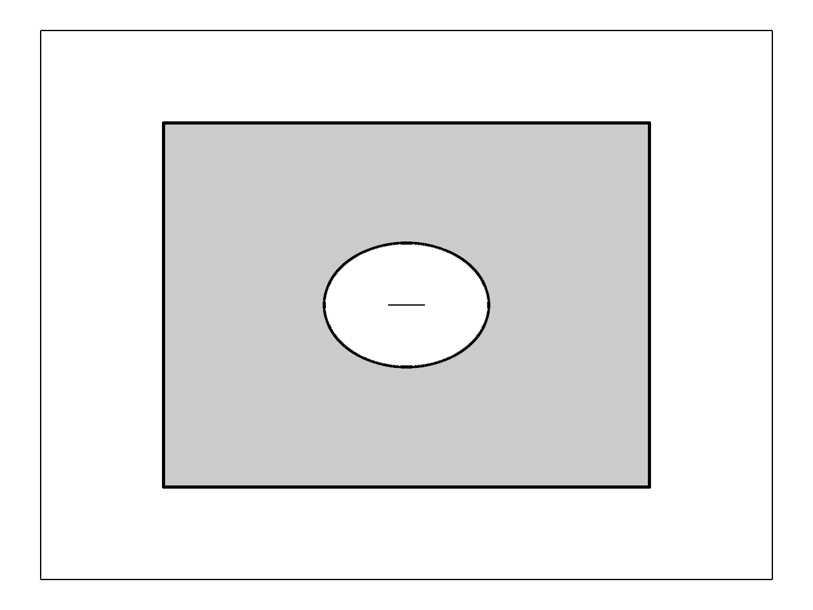

# 18.1 · A retained depth and radius pyramid

**Goal:** Exercise actual depth levels and cache release. · **Steps:** 9 · **Source:** [engine/gpu/ssao.rs](../../../src/engine/gpu/ssao.rs) · [engine/gpu/ssao/pipelines.rs](../../../src/engine/gpu/ssao/pipelines.rs) · [shaders/ssao.wgsl](../../../src/shaders/ssao.wgsl) · [shaders/triangle.wgsl](../../../src/shaders/triangle.wgsl) · [shaders/ink_visibility.wgsl](../../../src/shaders/ink_visibility.wgsl) · [engine/gpu/surface_outline.rs](../../../src/engine/gpu/surface_outline.rs) · [engine/gpu/render.rs](../../../src/engine/gpu/render.rs) · [engine/performance.rs](../../../src/engine/performance.rs) · [engine/gpu/timing.rs](../../../src/engine/gpu/timing.rs) · [app/command/tool/elements.rs](../../../src/app/command/tool/elements.rs) (`src/shaders/hzb.wgsl,src/shaders/ssao.wgsl,src/app/wood_elements.rs`)

<div class="webgpu-schematic" style="width:100%;margin:6px auto;">
<svg xmlns="http://www.w3.org/2000/svg" width="1120" height="188" viewBox="0 0 1120 188" style="width:100%;max-width:100%;height:auto;display:block;margin:0 auto;" role="img">
  <defs>
    <marker id="arr" viewBox="0 0 10 10" refX="8" refY="5" markerWidth="6" markerHeight="6" orient="auto">
      <path d="M 0 1 L 9 5 L 0 9 z" fill="#111111"/>
    </marker>
    <marker id="arrR" viewBox="0 0 10 10" refX="8" refY="5" markerWidth="6" markerHeight="6" orient="auto">
      <path d="M 0 1 L 9 5 L 0 9 z" fill="#dc2626"/>
    </marker>
    <marker id="arrG" viewBox="0 0 10 10" refX="8" refY="5" markerWidth="6" markerHeight="6" orient="auto">
      <path d="M 0 1 L 9 5 L 0 9 z" fill="#16a34a"/>
    </marker>
    <marker id="arrB" viewBox="0 0 10 10" refX="8" refY="5" markerWidth="6" markerHeight="6" orient="auto">
      <path d="M 0 1 L 9 5 L 0 9 z" fill="#2563eb"/>
    </marker>
  </defs>
  <rect x="2" y="2" width="1116" height="184" rx="10" fill="#ffffff" stroke="#111111" stroke-width="2"/>
  <rect x="14" y="12" width="344" height="164" rx="8" fill="#ffffff" stroke="#111111" stroke-width="1.5"/>
  <text paint-order="stroke fill" stroke="#ffffff" stroke-width="5" stroke-linejoin="round" x="186" y="30" text-anchor="middle" font-family="monospace" font-size="10.5" font-weight="700" fill="#111111">HZB Max-Depth Mip Pyramid + SSAO Hemisphere Samples</text>
  <rect x="56" y="54" width="64" height="64" fill="#dbeafe" stroke="#111111" stroke-width="1.75"/>
  <rect x="130" y="68" width="42" height="42" fill="#93c5fd" stroke="#111111" stroke-width="1.75"/>
  <rect x="182" y="80" width="24" height="24" fill="#60a5fa" stroke="#111111" stroke-width="1.75"/>
  <path d="M 224 134 A 34 34 0 0 1 292 134" fill="#fef9c3" stroke="#111111" stroke-width="1.75"/>
  <line x1="258" y1="134" x2="240" y2="104" stroke="#dc2626" stroke-width="1.75" marker-end="url(#arrR)"/>
  <line x1="258" y1="134" x2="258" y2="96" stroke="#16a34a" stroke-width="1.75" marker-end="url(#arrG)"/>
  <line x1="258" y1="134" x2="278" y2="106" stroke="#2563eb" stroke-width="1.75" marker-end="url(#arrB)"/>
  <line x1="358" y1="94" x2="384" y2="94" stroke="#111111" stroke-width="2" marker-end="url(#arr)"/>
  <rect x="388" y="12" width="344" height="164" rx="8" fill="#ffffff" stroke="#111111" stroke-width="1.5"/>
  <text paint-order="stroke fill" stroke="#ffffff" stroke-width="5" stroke-linejoin="round" x="560" y="30" text-anchor="middle" font-family="monospace" font-size="10.5" font-weight="700" fill="#111111">WoodElement Timber Plate + Joint Cut Polylines &amp; Vectors</text>
  <polygon points="434,136 468,66 644,66 610,136" fill="#fde68a" stroke="#111111" stroke-width="2"/>
  <polygon points="518,66 558,66 548,92 508,92" fill="#ffffff" stroke="#dc2626" stroke-width="2"/>
  <line x1="533" y1="79" x2="533" y2="44" stroke="#dc2626" stroke-width="2.2" marker-end="url(#arrR)"/>
  <line x1="732" y1="94" x2="758" y2="94" stroke="#111111" stroke-width="2" marker-end="url(#arr)"/>
  <rect x="762" y="12" width="344" height="164" rx="8" fill="#ffffff" stroke="#111111" stroke-width="1.75"/>
  <text paint-order="stroke fill" stroke="#ffffff" stroke-width="5" stroke-linejoin="round" x="934" y="30" text-anchor="middle" font-family="monospace" font-size="10.5" font-weight="700" fill="#111111">Contact-Darkened Creases + Timber Joinery Scene</text>
  <rect x="806" y="44" width="256" height="118" rx="4" fill="#ffffff" stroke="#111111" stroke-width="2"/>
  <polygon points="838,138 874,66 1018,66 982,138" fill="#fcd34d" stroke="#111111" stroke-width="2"/>
  <polygon points="914,66 952,66 942,92 904,92" fill="#78350f" stroke="#111111" stroke-width="2"/>
</svg>
</div>

## <a id="checkpoint-89-copy-density-scaled-depth-reduction"></a>1. Reduce depth and radius at a bounded display resolution

**What this code does:** Write the density policy and nearest-positive depth/radius reduction.

### 1. `src/pyramid_size.rs`

Bound the reduced target dimensions and retain the existing numerical examples.

Create the file and type:

```rust
pub fn resolution(full: (u32, u32), dpr: f64) -> (u32, u32) {
    let scale = (1.0 / dpr.max(1.0)).clamp(0.25, 0.5);
    (
        (f64::from(full.0) * scale).ceil().max(1.0) as u32,
        (f64::from(full.1) * scale).ceil().max(1.0) as u32,
    )
}

#[cfg(test)]
mod tests {
    #[test]
    fn resolution_follows_device_pixels_without_a_navigation_mode() {
        assert_eq!(
            super::resolution((1920, 1080), 1.),
            (960, 540)
        );
        assert_eq!(
            super::resolution((3840, 2160), 2.),
            (1920, 1080)
        );
        assert_eq!(
            super::resolution((1179, 2556), 3.),
            (393, 852)
        );
        assert_eq!(
            super::resolution((1920, 1080), 5.),
            (480, 270)
        );
    }
}
```

### 2. `src/lib.rs`

Register the completed section component.

**Locate this existing block:**

```rust
mod cap_gpu_tests;
pub mod finite_project_source;
#[cfg(test)]
mod finite_scan_contract;
#[cfg(test)]
mod finite_tiles_contract;
pub mod source_mesh_topology;
```

Edit the existing block to match this code; keep unchanged lines:

```rust
mod cap_gpu_tests;

pub mod finite_project_source;
#[cfg(test)]
mod finite_scan_contract;
#[cfg(test)]
mod finite_tiles_contract;
pub mod pyramid_size;
pub mod source_mesh_topology;
```

### 3. `src/ambient_depth.wgsl`

Reduce depth and its radius witness together; mark bounded geometry occupancy.

Create the file and type:

```wgsl
@group(0) @binding(0) var linear: texture_2d<f32>;
@group(0) @binding(1) var radii: texture_2d<u32>;
@vertex fn vs_main(@builtin(vertex_index) i: u32) -> @builtin(position) vec4<f32> {
    let p = array<vec2<f32>, 3>(vec2<f32>(-1.0,-1.0), vec2<f32>(3.0,-1.0), vec2<f32>(-1.0,3.0));
    return vec4<f32>(p[i],0.0,1.0);
}
struct DepthRadius {
    @location(0) depth: f32,
    @location(1) radius: u32,
};
@fragment fn fs_reduce(@builtin(position) pixel: vec4<f32>) -> DepthRadius {
    let dims = vec2<i32>(textureDimensions(linear));
    let at = vec2<i32>(pixel.xy)*2;
    var nearest = 1e30;
    var radius = 0u;
    for (var i=0; i<4; i++) {
        let q = min(at+vec2<i32>(i%2,i/2),dims-1);
        let z = textureLoad(linear,q,0).x;
        if z>0.0 && z<nearest {
            nearest = z;
            radius = textureLoad(radii,q,0).x;
        }
    }
    return DepthRadius(select(nearest,0.0,nearest==1e30),radius);
}

@fragment fn fs_occupancy(@builtin(position) pixel: vec4<f32>) -> @location(0) f32 {
    let dims = vec2<i32>(textureDimensions(linear));
    let at = vec2<i32>(pixel.xy);
    for (var i=0; i<25; i++) {
        let q = clamp(at+vec2<i32>(i%5-2,i/5-2),vec2<i32>(0),dims-1);
        if textureLoad(linear,q,0).x>0.0 { return 1.0; }
    }
    return 0.0;
}
```

## <a id="checkpoint-89a-prepare-linear-original-depth-and-radius-addresses"></a>2. Prepare linear depth and radius addresses

**What this code does:** Prepare linear original depth and radius addresses.

### 1. `src/pyramid_prepare.wgsl`

Adapt the earlier forward-depth image to linear depth and packed radius addresses.

Create the file and type:

```wgsl
struct Frame{inverse:mat4x4<f32>,full:vec2<f32>,size:vec2<f32>,radius:f32,pad:vec3<f32>}
@group(0) @binding(0) var depth:texture_depth_2d;
@group(0) @binding(1) var<uniform> frame:Frame;
@vertex fn vs_main(@builtin(vertex_index) i:u32)->@builtin(position) vec4<f32>{let p=array<vec2<f32>,3>(vec2<f32>(-1.,-1.),vec2<f32>(3.,-1.),vec2<f32>(-1.,3.));return vec4<f32>(p[i],0.,1.);}
struct DepthRadius{@location(0) depth:f32,@location(1) radius:u32}
fn world(at:vec2<f32>,z:f32)->vec3<f32>{let uv=at/frame.full;let p=frame.inverse*vec4<f32>(uv.x*2.-1.,1.-uv.y*2.,z,1.);return p.xyz/p.w;}
@fragment fn fs_prepare(@builtin(position) pixel:vec4<f32>)->DepthRadius{
 let at=floor(pixel.xy/frame.size*frame.full)+0.5;let z=textureLoad(depth,vec2<i32>(at),0);if(z>=1.){return DepthRadius(0.,0u);}
 let origin=world(at,0.);let direction=normalize(world(at,1.)-origin);let p=world(at,z);let along=dot(p-origin,direction)/dot(direction,direction);
 let bits=(pack2x16float(vec2<f32>(frame.radius,0.))+2u)>>2u;let coord=vec2<u32>(pixel.xy);let encoded=(bits<<4u)|(coord.x&3u)|((coord.y&3u)<<2u);
 return DepthRadius(along,encoded);
}
```

## <a id="checkpoint-89b-own-six-real-depth-and-radius-levels"></a>3. Own six real depth and radius levels

**What this code does:** Own six real depth and radius levels.

### 1. `src/pyramid_image.rs`

Own exact mip views and actual texture allocation.

Create the file and type:

```rust
pub struct Image {
    pub texture: wgpu::Texture,
    pub view: wgpu::TextureView,
    pub levels: [wgpu::TextureView; 6],
    pub bytes: u64,
}
impl Image {
    pub fn new(
        device: &wgpu::Device,
        size: [u32; 2],
        format: wgpu::TextureFormat,
    ) -> Self {
        let texture = device.create_texture(&wgpu::TextureDescriptor {
            label: Some("ambient six-level image"),
            size: wgpu::Extent3d {
                width: size[0],
                height: size[1],
                depth_or_array_layers: 1,
            },
            mip_level_count: 6,
            sample_count: 1,
            dimension: wgpu::TextureDimension::D2,
            format,
            usage: wgpu::TextureUsages::RENDER_ATTACHMENT
                | wgpu::TextureUsages::TEXTURE_BINDING
                | wgpu::TextureUsages::COPY_SRC,
            view_formats: &[],
        });
        let view = texture.create_view(&Default::default());
        let levels = std::array::from_fn(|i| {
            texture.create_view(&wgpu::TextureViewDescriptor {
                base_mip_level: i as u32,
                mip_level_count: Some(1),
                ..Default::default()
            })
        });
        let bytes = (0..6)
            .map(|i| {
                u64::from(size[0] >> i)
                    * u64::from(size[1] >> i)
                    * u64::from(format.block_copy_size(None).unwrap())
            })
            .sum();
        Self {
            texture,
            view,
            levels,
            bytes,
        }
    }
}
```

### 2. `src/lib.rs`

Register the completed section component.

**Locate this existing block:**

```rust
mod cap_gpu_tests;

pub mod finite_project_source;
#[cfg(test)]
mod finite_scan_contract;
#[cfg(test)]
mod finite_tiles_contract;
pub mod pyramid_size;
pub mod source_mesh_topology;
```

Edit the existing block to match this code; keep unchanged lines:

```rust
mod cap_gpu_tests;

pub mod pyramid_size;

pub mod finite_project_source;
#[cfg(test)]
mod finite_scan_contract;
#[cfg(test)]
mod finite_tiles_contract;
pub mod pyramid_image;
pub mod source_mesh_topology;
```

## <a id="checkpoint-89c-build-prepare-and-nearest-depth-pipelines"></a>4. Build prepare and nearest-depth pipelines

**What this code does:** Build prepare and nearest-depth pipelines.

### 1. `src/pyramid_pipeline.rs`

Build current depth/radius preparation and reduction pipelines.

Create the file and type:

```rust
pub struct Pipelines {
    pub prepare: wgpu::RenderPipeline,
    pub reduce: wgpu::RenderPipeline,
    pub input: wgpu::BindGroupLayout,
    pub level: wgpu::BindGroupLayout,
}
fn pipeline(
    device: &wgpu::Device,
    shader: &str,
    fragment: &str,
    layout: &wgpu::BindGroupLayout,
) -> wgpu::RenderPipeline {
    let module = device.create_shader_module(wgpu::ShaderModuleDescriptor {
        label: Some("ambient linear-depth recipe"),
        source: wgpu::ShaderSource::Wgsl(shader.into()),
    });
    let layout = device.create_pipeline_layout(&wgpu::PipelineLayoutDescriptor {
        label: None,
        bind_group_layouts: &[Some(layout)],
        immediate_size: 0,
    });
    device.create_render_pipeline(&wgpu::RenderPipelineDescriptor {
        label: Some("ambient linear-depth pyramid"),
        layout: Some(&layout),
        vertex: wgpu::VertexState {
            module: &module,
            entry_point: Some("vs_main"),
            compilation_options: Default::default(),
            buffers: &[],
        },
        fragment: Some(wgpu::FragmentState {
            module: &module,
            entry_point: Some(fragment),
            compilation_options: Default::default(),
            targets: &[
                Some(wgpu::ColorTargetState {
                    format: wgpu::TextureFormat::R32Float,
                    blend: None,
                    write_mask: wgpu::ColorWrites::RED,
                }),
                Some(wgpu::ColorTargetState {
                    format: wgpu::TextureFormat::R16Uint,
                    blend: None,
                    write_mask: wgpu::ColorWrites::RED,
                }),
            ],
        }),
        primitive: Default::default(),
        depth_stencil: None,
        multisample: Default::default(),
        multiview_mask: None,
        cache: None,
    })
}
impl Pipelines {
    pub fn new(device: &wgpu::Device) -> Self {
        let texture = |binding, sample_type| {
            crate::text_gpu_support::texture_entry(
                binding,
                wgpu::ShaderStages::FRAGMENT,
                sample_type,
                false,
            )
        };
        let input = device.create_bind_group_layout(&wgpu::BindGroupLayoutDescriptor {
            label: Some("ambient original depth and camera"),
            entries: &[
                texture(0, wgpu::TextureSampleType::Depth),
                crate::tile_pipelines::entry(
                    1,
                    wgpu::ShaderStages::FRAGMENT,
                    wgpu::BufferBindingType::Uniform,
                ),
            ],
        });
        let level = device.create_bind_group_layout(&wgpu::BindGroupLayoutDescriptor {
            label: Some("ambient depth and radius level"),
            entries: &[
                texture(
                    0,
                    wgpu::TextureSampleType::Float {
                        filterable: false,
                    },
                ),
                texture(1, wgpu::TextureSampleType::Uint),
            ],
        });
        let prepare = pipeline(
            device,
            include_str!("pyramid_prepare.wgsl"),
            "fs_prepare",
            &input,
        );
        let reduce = pipeline(
            device,
            include_str!("ambient_depth.wgsl"),
            "fs_reduce",
            &level,
        );
        Self {
            prepare,
            reduce,
            input,
            level,
        }
    }
}
```

### 2. `src/lib.rs`

Register the completed section component.

**Locate this existing block:**

```rust
pub mod pyramid_size;

pub mod finite_project_source;
#[cfg(test)]
mod finite_scan_contract;
#[cfg(test)]
mod finite_tiles_contract;
pub mod pyramid_image;
pub mod source_mesh_topology;
```

Edit the existing block to match this code; keep unchanged lines:

```rust
pub mod pyramid_size;

pub mod pyramid_image;

pub mod finite_project_source;
#[cfg(test)]
mod finite_scan_contract;
#[cfg(test)]
mod finite_tiles_contract;
pub mod pyramid_pipeline;
pub mod source_mesh_topology;
```

## <a id="checkpoint-89d-prepare-cached-pyramid-inputs-and-images"></a>5. Prepare cached pyramid inputs and images

**What this code does:** Prepare cached pyramid inputs and images.

### 1. `src/pyramid_gpu.rs`

Own lazy pyramid images and their current depth input.

Create the file and type:

```rust
use crate::pyramid_image::Image;
struct Images {
    size: [u32; 2],
    pub linear: Image,
    pub radii: Image,
    groups: [wgpu::BindGroup; 5],
}
pub struct Pyramid {
    pipes: crate::pyramid_pipeline::Pipelines,
    frame: wgpu::Buffer,
    images: Option<Images>,
    input: Option<(wgpu::TextureView, wgpu::BindGroup)>,
    cached: Option<([u32; 16], [u32; 2], u32, [u64; 2])>,
    pub preparations: u64,
    pub writes: u64,
    pub passes: u64,
    pub error: Option<&'static str>,
}
impl Pyramid {
    pub fn new(device: &wgpu::Device) -> Self {
        Self {
            pipes: crate::pyramid_pipeline::Pipelines::new(device),
            frame: device.create_buffer(&wgpu::BufferDescriptor {
                label: Some("ambient earlier camera"),
                size: 112,
                usage: wgpu::BufferUsages::UNIFORM | wgpu::BufferUsages::COPY_DST,
                mapped_at_creation: false,
            }),
            images: None,
            input: None,
            cached: None,
            preparations: 0,
            writes: 0,
            passes: 0,
            error: None,
        }
    }
    fn prepare(
        &mut self,
        device: &wgpu::Device,
        depth: &wgpu::TextureView,
        full: [u32; 2],
        density: f32,
    ) {
        let (width, height) =
            crate::pyramid_size::resolution((full[0], full[1]), f64::from(density));
        let size = [width.max(32), height.max(32)];
        if self
            .images
            .as_ref()
            .is_none_or(|images| images.size != size)
        {
            let linear = Image::new(device, size, wgpu::TextureFormat::R32Float);
            let radii = Image::new(device, size, wgpu::TextureFormat::R16Uint);
            let groups = std::array::from_fn(|i| {
                device.create_bind_group(&wgpu::BindGroupDescriptor {
                    label: Some("ambient previous level"),
                    layout: &self.pipes.level,
                    entries: &[
                        wgpu::BindGroupEntry {
                            binding: 0,
                            resource: wgpu::BindingResource::TextureView(
                                &linear.levels[i],
                            ),
                        },
                        wgpu::BindGroupEntry {
                            binding: 1,
                            resource: wgpu::BindingResource::TextureView(
                                &radii.levels[i],
                            ),
                        },
                    ],
                })
            });
            self.images = Some(Images {
                size,
                linear,
                radii,
                groups,
            });
            self.cached = None;
            self.preparations += 1;
        }
        if self
            .input
            .as_ref()
            .is_none_or(|(old, _)| old != depth)
        {
            let group = device.create_bind_group(&wgpu::BindGroupDescriptor {
                label: Some("ambient source depth"),
                layout: &self.pipes.input,
                entries: &[
                    wgpu::BindGroupEntry {
                        binding: 0,
                        resource: wgpu::BindingResource::TextureView(depth),
                    },
                    wgpu::BindGroupEntry {
                        binding: 1,
                        resource: self.frame.as_entire_binding(),
                    },
                ],
            });
            self.input = Some((depth.clone(), group));
            self.cached = None;
        }
    }
}
```

### 2. `src/lib.rs`

Register the completed section component.

**Locate this existing block:**

```rust
pub mod pyramid_image;

pub mod finite_project_source;
#[cfg(test)]
mod finite_scan_contract;
#[cfg(test)]
mod finite_tiles_contract;
pub mod pyramid_pipeline;
pub mod source_mesh_topology;
```

Edit the existing block to match this code; keep unchanged lines:

```rust
pub mod pyramid_image;

pub mod pyramid_pipeline;

pub mod finite_project_source;
#[cfg(test)]
mod finite_scan_contract;
#[cfg(test)]
mod finite_tiles_contract;
pub mod pyramid_gpu;
pub mod source_mesh_topology;
```

## <a id="checkpoint-89e-encode-six-levels-only-when-inputs-change"></a>6. Encode six levels only when inputs change

**What this code does:** Encode six levels only when inputs change.

### 1. `src/pyramid_gpu.rs`

Validate the current camera and encode changed pyramid contents.

**Locate this existing block:**

```rust
    }
}
```

Edit the existing block to match this code; keep unchanged lines:

```rust
    }
    pub fn encode(
        &mut self,
        device: &wgpu::Device,
        queue: &wgpu::Queue,
        encoder: &mut wgpu::CommandEncoder,
        depth: &wgpu::TextureView,
        matrix: [f32; 16],
        full: [u32; 2],
        density: f32,
        revision: [u64; 2],
    ) {
        if full.contains(&0)
            || !density.is_finite()
            || density <= 0.
            || matrix.iter().any(|v| !v.is_finite())
        {
            self.error = Some("Invalid ambient depth view");
            self.cached = None;
            return;
        }
        self.prepare(device, depth, full, density);
        let key = (
            matrix.map(f32::to_bits),
            full,
            density.to_bits(),
            revision,
        );
        if self.cached == Some(key) {
            return;
        }
        let Some(inverse) =
            session_rust::Xform::from_matrix(matrix.map(f64::from)).inverse()
        else {
            self.error = Some("Ambient depth camera is singular");
            self.cached = None;
            return;
        };
        if inverse
            .m
            .iter()
            .any(|v| !(*v as f32).is_finite())
        {
            self.error = Some("Ambient inverse exceeds display range");
            self.cached = None;
            return;
        }
        let images = self.images.as_ref().unwrap();
        let mut bytes = inverse
            .m
            .into_iter()
            .flat_map(|v| (v as f32).to_ne_bytes())
            .collect::<Vec<_>>();
        bytes.extend(
            [
                full[0] as f32,
                full[1] as f32,
                images.size[0] as f32,
                images.size[1] as f32,
                0.05,
                0.,
                0.,
                0.,
                0.,
                0.,
                0.,
                0.,
            ]
            .into_iter()
            .flat_map(f32::to_ne_bytes),
        );
        queue.write_buffer(&self.frame, 0, &bytes);
        self.writes += 1;
        for level in 0..6 {
            let attachments = [
                &images.linear.levels[level],
                &images.radii.levels[level],
            ]
            .map(|view| {
                Some(wgpu::RenderPassColorAttachment {
                    view,
                    depth_slice: None,
                    resolve_target: None,
                    ops: wgpu::Operations {
                        load: wgpu::LoadOp::Clear(wgpu::Color::TRANSPARENT),
                        store: wgpu::StoreOp::Store,
                    },
                })
            });
            let mut pass = encoder.begin_render_pass(&wgpu::RenderPassDescriptor {
                label: Some("ambient nearest positive depth"),
                color_attachments: &attachments,
                ..Default::default()
            });
            if level == 0 {
                pass.set_pipeline(&self.pipes.prepare);
                pass.set_bind_group(0, &self.input.as_ref().unwrap().1, &[]);
            } else {
                pass.set_pipeline(&self.pipes.reduce);
                pass.set_bind_group(0, &images.groups[level - 1], &[]);
            }
            pass.draw(0..3, 0..1);
            self.passes += 1;
        }
        self.cached = Some(key);
        self.error = None;
    }
}
```

## <a id="checkpoint-89f-expose-actual-pyramid-allocation-and-levels"></a>7. Expose actual pyramid allocation and levels

**What this code does:** Expose actual pyramid allocation and levels.

### 1. `src/pyramid_gpu.rs`

Expose actual resources and preparation/write/pass counts.

**Locate this existing block:**

```rust
    }
}
```

Edit the existing block to match this code; keep unchanged lines:

```rust
    }
    pub fn usage(&self) -> [u64; 4] {
        [
            self.frame.size()
                + self
                    .images
                    .as_ref()
                    .map_or(0, |i| i.linear.bytes + i.radii.bytes),
            self.preparations,
            self.writes,
            self.passes,
        ]
    }
    pub fn linear(&self) -> Option<&Image> {
        self.images.as_ref().map(|i| &i.linear)
    }
    pub fn radii(&self) -> Option<&Image> {
        self.images.as_ref().map(|i| &i.radii)
    }
}
```

## <a id="checkpoint-89g-route-original-depth-into-the-pyramid-owner"></a>8. Route depth into the pyramid owner

**What this code does:** Route original depth into the pyramid owner.

### 1. `src/renderer.rs`

Connect the explicit cached depth owner before its supplied fixtures.

Edit these blocks from bottom to top. Keep the surrounding lines unchanged.

**Locate this block:**

```rust
                    *self.text_error.borrow_mut() = Some(error.to_string());
                }
            }
        }
```

Replace it with:

```rust
                    *self.text_error.borrow_mut() = Some(error.to_string());
                }
            }
        }
        if let Some(pyramid) = self.pyramid.borrow_mut().as_mut() {
            pyramid.encode(
                &self.device,
                &self.queue,
                &mut encoder,
                &self.depth,
                *transform,
                self.size,
                self.density,
                [self.pyramid_revision, clip_revision],
            );
        }
```

**Locate this block:**

```rust
        clip.solid = solid;
        self.caps.borrow_mut().enabled = enabled;
    }
    pub fn cap_error(&self) -> Option<&'static str> {
        self.caps.borrow().pick_error
    }
```

Replace it with:

```rust
        clip.solid = solid;
        self.caps.borrow_mut().enabled = enabled;
    }
    pub fn set_depth_pyramid(&self, enabled: bool) {
        let mut owner = self.pyramid.borrow_mut();
        if enabled {
            if owner.is_none() {
                *owner = Some(crate::pyramid_gpu::Pyramid::new(
                    &self.device,
                ));
            }
        } else {
            *owner = None;
        }
    }
    pub fn depth_pyramid_usage(&self) -> [u64; 4] {
        self.pyramid
            .borrow()
            .as_ref()
            .map_or([0; 4], crate::pyramid_gpu::Pyramid::usage)
    }
    pub fn depth_pyramid_error(&self) -> Option<&'static str> {
        self.pyramid
            .borrow()
            .as_ref()
            .and_then(|p| p.error)
    }
    pub fn cap_error(&self) -> Option<&'static str> {
        self.caps.borrow().pick_error
    }
```

**Locate this block:**

```rust
    }

    pub fn set_scene(&mut self, scene: &Scene, selected: Option<ObjectId>) {
        self.clipping.borrow_mut().set(scene);
        if let Some(outline) = self.outline.borrow_mut().as_mut() {
            outline.invalidate();
```

Replace it with:

```rust
    }

    pub fn set_scene(&mut self, scene: &Scene, selected: Option<ObjectId>) {
        self.pyramid_revision = self.pyramid_revision.wrapping_add(1);
        self.clipping.borrow_mut().set(scene);
        if let Some(outline) = self.outline.borrow_mut().as_mut() {
            outline.invalidate();
```

**Locate this block:**

```rust
        let measurement = crate::measure_gpu::Measurement::new(&device, format);
        let guides = crate::guide_gpu::Guide::new(&device, format);
        let mut renderer = Self {
            caps: std::cell::RefCell::new(crate::caps_gpu::Caps::new(&device)),
            clipping: std::cell::RefCell::new(crate::clipping_gpu::Clipping::new(
                &device,
```

Replace it with:

```rust
        let measurement = crate::measure_gpu::Measurement::new(&device, format);
        let guides = crate::guide_gpu::Guide::new(&device, format);
        let mut renderer = Self {
            pyramid: Default::default(),
            pyramid_revision: 0,
            caps: std::cell::RefCell::new(crate::caps_gpu::Caps::new(&device)),
            clipping: std::cell::RefCell::new(crate::clipping_gpu::Clipping::new(
                &device,
```

**Locate this block:**

```rust
pub struct Renderer {
    caps: std::cell::RefCell<crate::caps_gpu::Caps>,
    clipping: std::cell::RefCell<crate::clipping_gpu::Clipping>,
    tiles: std::cell::RefCell<crate::tile_gpu::Tiles>,
```

Replace it with:

```rust
pub struct Renderer {
    pyramid: std::cell::RefCell<Option<crate::pyramid_gpu::Pyramid>>,
    pyramid_revision: u64,
    caps: std::cell::RefCell<crate::caps_gpu::Caps>,
    clipping: std::cell::RefCell<crate::clipping_gpu::Clipping>,
    tiles: std::cell::RefCell<crate::tile_gpu::Tiles>,
```

### 2. `src/browser.rs`

Observe actual depth owner allocation and errors.

**Locate this existing block:**

```rust
    )?;
    canvas.set_attribute("data-clipping",&serde_json::json!({"usage":renderer.clipping_usage(),"caps":renderer.cap_usage(),"cap_error":renderer.cap_error(),"ink_flags":renderer.clipping_ink_bytes(),"error":renderer.clipping_error(),"rows":crate::clipping_rows::current(&editor.scene).ok().map(|rows|rows.iter().map(|r|serde_json::json!({"id":r.id.value(),"normal":r.plane.normal,"offset":r.plane.offset})).collect::<Vec<_>>())}).to_string())?;
    canvas.set_attribute(
```

Edit the existing block to match this code; keep unchanged lines:

```rust
    )?;
    canvas.set_attribute("data-clipping",&serde_json::json!({"usage":renderer.clipping_usage(),"caps":renderer.cap_usage(),"pyramid":renderer.depth_pyramid_usage(),"pyramid_error":renderer.depth_pyramid_error(),"cap_error":renderer.cap_error(),"ink_flags":renderer.clipping_ink_bytes(),"error":renderer.clipping_error(),"rows":crate::clipping_rows::current(&editor.scene).ok().map(|rows|rows.iter().map(|r|serde_json::json!({"id":r.id.value(),"normal":r.plane.normal,"offset":r.plane.offset})).collect::<Vec<_>>())}).to_string())?;
    canvas.set_attribute(
```

## <a id="checkpoint-89h-exercise-actual-depth-levels-and-cache-release"></a>9. Exercise actual depth levels and cache release

**What this code does:** Exercise actual depth levels and cache release.

### 1. `src/pyramid_gpu_tests.rs`

Copy supplied actual mip/readback and cache fixtures.

Create the file and type:

```rust
use crate::cap_gpu_tests::{pixels, renderer, scene, wait};
fn level(
    r: &crate::renderer::Renderer,
    texture: &wgpu::Texture,
    mip: u32,
    bytes: u32,
) -> Vec<u8> {
    let width = texture.width() >> mip;
    let height = texture.height() >> mip;
    let pitch = (width * bytes).div_ceil(256) * 256;
    let buffer = r
        .device
        .create_buffer(&wgpu::BufferDescriptor {
            label: Some("actual pyramid fixture"),
            size: u64::from(pitch) * u64::from(height),
            usage: wgpu::BufferUsages::MAP_READ | wgpu::BufferUsages::COPY_DST,
            mapped_at_creation: false,
        });
    let mut encoder = r
        .device
        .create_command_encoder(&Default::default());
    encoder.copy_texture_to_buffer(
        wgpu::TexelCopyTextureInfo {
            mip_level: mip,
            ..texture.as_image_copy()
        },
        wgpu::TexelCopyBufferInfo {
            buffer: &buffer,
            layout: wgpu::TexelCopyBufferLayout {
                offset: 0,
                bytes_per_row: Some(pitch),
                rows_per_image: Some(height),
            },
        },
        wgpu::Extent3d {
            width,
            height,
            depth_or_array_layers: 1,
        },
    );
    r.queue.submit([encoder.finish()]);
    let (tx, rx) = std::sync::mpsc::channel();
    buffer
        .slice(..)
        .map_async(wgpu::MapMode::Read, move |v| {
            tx.send(v).unwrap()
        });
    wait(r);
    rx.recv().unwrap().unwrap();
    let view = buffer.slice(..).get_mapped_range();
    let data = view
        .chunks_exact(pitch as usize)
        .flat_map(|r| r[..(width * bytes) as usize].iter().copied())
        .collect();
    drop(view);
    buffer.unmap();
    data
}
#[test]
fn actual_pyramid_uses_six_nearest_positive_depth_levels_and_keeps_radius_addresses() {
    let (scene, _) = scene(false);
    let r = renderer(&scene);
    r.set_depth_pyramid(true);
    pixels(&r);
    assert_eq!(r.depth_pyramid_error(), None);
    let owner = r.pyramid.borrow();
    let owner = owner.as_ref().unwrap();
    let linear = owner.linear().unwrap();
    let radii = owner.radii().unwrap();
    let mut previous: Option<(Vec<f32>, Vec<u16>, usize, usize)> = None;
    for mip in 0..6 {
        let width = (linear.texture.width() >> mip) as usize;
        let height = (linear.texture.height() >> mip) as usize;
        let depths = level(&r, &linear.texture, mip, 4)
            .chunks_exact(4)
            .map(|b| f32::from_le_bytes(b.try_into().unwrap()))
            .collect::<Vec<_>>();
        let encoded = level(&r, &radii.texture, mip, 2)
            .chunks_exact(2)
            .map(|b| u16::from_le_bytes(b.try_into().unwrap()))
            .collect::<Vec<_>>();
        assert!(
            depths
                .iter()
                .all(|z| z.is_finite() && *z >= 0.)
        );
        if let Some((before, radius, w, h)) = &previous {
            for y in 0..height {
                for x in 0..width {
                    let mut nearest = 1e30;
                    let mut chosen = 0;
                    for i in 0..4 {
                        let q =
                            (y * 2 + i / 2).min(h - 1) * w + (x * 2 + i % 2).min(w - 1);
                        if before[q] > 0. && before[q] < nearest {
                            nearest = before[q];
                            chosen = radius[q];
                        }
                    }
                    let expected = if nearest == 1e30 {
                        0.
                    } else {
                        nearest
                    };
                    assert_eq!(
                        depths[y * width + x],
                        expected,
                        "actual reduction mip{mip} at{x},{y}"
                    );
                    assert_eq!(encoded[y * width + x], chosen);
                }
            }
        } else {
            let index = 48 * width + 104;
            assert!(
                (depths[index] - 0.5).abs() < 1e-5,
                "original section depth: {}",
                depths[index]
            );
            assert_eq!(depths[0], 0., "empty depth stays absent");
            assert!(encoded[index] > 0);
        }
        previous = Some((depths, encoded, width, height));
    }
    assert_eq!(r.depth_pyramid_usage()[3], 6);
}
#[test]
fn actual_pyramid_caches_resting_views_rebuilds_on_resize_and_releases_on_disable() {
    let (scene, _) = scene(false);
    let mut r = renderer(&scene);
    r.set_depth_pyramid(true);
    pixels(&r);
    let first = r.depth_pyramid_usage();
    pixels(&r);
    assert_eq!(r.depth_pyramid_usage(), first);
    r.resize(crate::viewport::Viewport {
        width: 640,
        height: 480,
    });
    r.set_density(2.);
    let texture = r
        .device
        .create_texture(&wgpu::TextureDescriptor {
            label: None,
            size: wgpu::Extent3d {
                width: 640,
                height: 480,
                depth_or_array_layers: 1,
            },
            mip_level_count: 1,
            sample_count: 1,
            dimension: wgpu::TextureDimension::D2,
            format: wgpu::TextureFormat::Rgba8Unorm,
            usage: wgpu::TextureUsages::RENDER_ATTACHMENT,
            view_formats: &[],
        });
    r.draw(
        &texture.create_view(&Default::default()),
        &Default::default(),
        &crate::cap_gpu_tests::matrix(),
    );
    assert_eq!(r.depth_pyramid_usage()[1], 2);
    assert_eq!(r.depth_pyramid_usage()[3], 12);
    r.set_depth_pyramid(false);
    assert_eq!(r.depth_pyramid_usage(), [0; 4]);
}
```

### 2. `src/renderer.rs`

Register the supplied renderer-local GPU fixtures.

**Locate this existing block:**

```rust
        pixels
    }
}
```

Edit the existing block to match this code; keep unchanged lines:

```rust
        pixels
    }
}

#[cfg(all(test, not(target_arch = "wasm32")))]
#[path = "pyramid_gpu_tests.rs"]
mod pyramid_gpu_tests;
```

## Build & Run



```sh
npm --prefix ../session_tests run course -- dependencies 18.1
cd workspace/journey
REGEN_PROTO=0 cargo build --lib --locked --target wasm32-unknown-unknown -j1
REGEN_PROTO=0 CARGO_BUILD_JOBS=1 trunk serve --port 8780
cd ../..
npm --prefix ../session_tests run course -- check 18.1
npm --prefix ../session_tests run course -- save 18.1
```

Continue with [18.2 · Original contact metadata and ambient light](90-copy-maintained-original-contact-radius.md).
