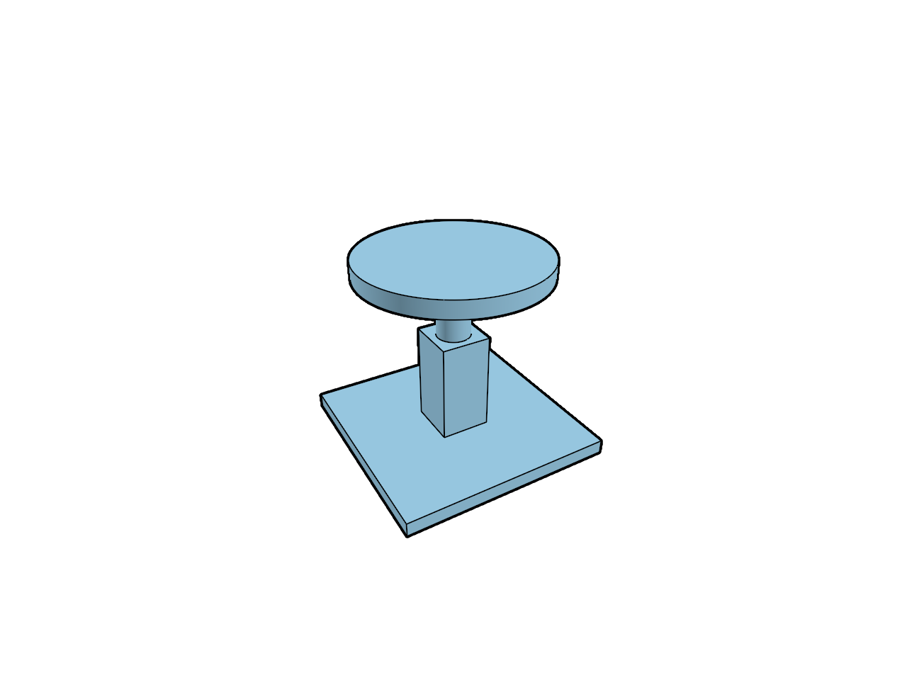

# 18.3 · Section-aware outlines and one presentation composite

**Goal:** Prove actual outlines and original ownership. · **Steps:** 10 · **Source:** [engine/gpu/ssao.rs](../../../src/engine/gpu/ssao.rs) · [engine/gpu/ssao/pipelines.rs](../../../src/engine/gpu/ssao/pipelines.rs) · [shaders/ssao.wgsl](../../../src/shaders/ssao.wgsl) · [shaders/triangle.wgsl](../../../src/shaders/triangle.wgsl) · [shaders/ink_visibility.wgsl](../../../src/shaders/ink_visibility.wgsl) · [engine/gpu/surface_outline.rs](../../../src/engine/gpu/surface_outline.rs) · [engine/gpu/render.rs](../../../src/engine/gpu/render.rs) · [engine/performance.rs](../../../src/engine/performance.rs) · [engine/gpu/timing.rs](../../../src/engine/gpu/timing.rs) · [app/command/tool/elements.rs](../../../src/app/command/tool/elements.rs) (`src/shaders/hzb.wgsl,src/shaders/ssao.wgsl,src/app/wood_elements.rs`)

<div class="webgpu-schematic" style="width:100%;margin:6px auto;">
<svg xmlns="http://www.w3.org/2000/svg" width="1120" height="200" viewBox="0 0 1120 200" style="width:100%;max-width:100%;height:auto;display:block;margin:0 auto;" role="img">
  <defs>
    <marker id="arr" viewBox="0 0 10 10" refX="8" refY="5" markerWidth="6" markerHeight="6" orient="auto">
      <path d="M 0 1 L 9 5 L 0 9 z" fill="#111111"/>
    </marker>
    <marker id="arrR" viewBox="0 0 10 10" refX="8" refY="5" markerWidth="6" markerHeight="6" orient="auto">
      <path d="M 0 1 L 9 5 L 0 9 z" fill="#dc2626"/>
    </marker>
    <marker id="arrG" viewBox="0 0 10 10" refX="8" refY="5" markerWidth="6" markerHeight="6" orient="auto">
      <path d="M 0 1 L 9 5 L 0 9 z" fill="#16a34a"/>
    </marker>
    <marker id="arrB" viewBox="0 0 10 10" refX="8" refY="5" markerWidth="6" markerHeight="6" orient="auto">
      <path d="M 0 1 L 9 5 L 0 9 z" fill="#2563eb"/>
    </marker>
  </defs>
  <rect x="2" y="2" width="1116" height="196" rx="10" fill="#ffffff" stroke="#111111" stroke-width="2"/>
  <rect x="16" y="14" width="248" height="172" rx="8" fill="#ffffff" stroke="#111111" stroke-width="1.75"/>
  <text paint-order="stroke fill" stroke="#ffffff" stroke-width="5" stroke-linejoin="round" x="140" y="34" text-anchor="middle" font-family="monospace" font-size="11.5" font-weight="700" fill="#111111">1. Lesson 18.3 Code</text>
  <rect x="34" y="48" width="212" height="24" rx="4" fill="#ffffff" stroke="#111111" stroke-width="1.25"/>
  <text paint-order="stroke fill" stroke="#ffffff" stroke-width="5" stroke-linejoin="round" x="140" y="64" text-anchor="middle" font-family="monospace" font-size="10" font-weight="700" fill="#111111">src/outline_caps.wgsl</text>
  <rect x="34" y="78" width="212" height="24" rx="4" fill="#ffffff" stroke="#111111" stroke-width="1.5"/>
  <text paint-order="stroke fill" stroke="#ffffff" stroke-width="5" stroke-linejoin="round" x="140" y="94" text-anchor="middle" font-family="monospace" font-size="10" font-weight="700" fill="#111111">src/outline_caps.rs</text>
  <rect x="34" y="108" width="212" height="24" rx="4" fill="#ffffff" stroke="#111111" stroke-width="1.25"/>
  <text paint-order="stroke fill" stroke="#ffffff" stroke-width="5" stroke-linejoin="round" x="140" y="124" text-anchor="middle" font-family="monospace" font-size="10" font-weight="700" fill="#111111">src/lib.rs</text>
  <text paint-order="stroke fill" stroke="#ffffff" stroke-width="5" stroke-linejoin="round" x="140" y="172" text-anchor="middle" font-family="monospace" font-size="9.5" fill="#111111">10 Coding Steps</text>
  <line x1="264" y1="100" x2="292" y2="100" stroke="#111111" stroke-width="2" marker-end="url(#arr)"/>
  <rect x="296" y="14" width="248" height="172" rx="8" fill="#ffffff" stroke="#111111" stroke-width="1.75"/>
  <text paint-order="stroke fill" stroke="#ffffff" stroke-width="5" stroke-linejoin="round" x="420" y="34" text-anchor="middle" font-family="monospace" font-size="11.5" font-weight="700" fill="#111111">2. session_viewer/src</text>
  <rect x="314" y="48" width="212" height="26" rx="4" fill="#ffffff" stroke="#111111" stroke-width="1.5"/>
  <text paint-order="stroke fill" stroke="#ffffff" stroke-width="5" stroke-linejoin="round" x="420" y="65" text-anchor="middle" font-family="monospace" font-size="10" font-weight="700" fill="#111111">src/shaders/hzb.wgsl</text>
  <rect x="314" y="80" width="212" height="26" rx="4" fill="#ffffff" stroke="#111111" stroke-width="1.5"/>
  <text paint-order="stroke fill" stroke="#ffffff" stroke-width="5" stroke-linejoin="round" x="420" y="97" text-anchor="middle" font-family="monospace" font-size="10" font-weight="700" fill="#111111">src/shaders/ssao.wgsl</text>
  <rect x="314" y="112" width="212" height="24" rx="4" fill="#ffffff" stroke="#111111" stroke-width="1.5"/>
  <text paint-order="stroke fill" stroke="#ffffff" stroke-width="5" stroke-linejoin="round" x="420" y="128" text-anchor="middle" font-family="monospace" font-size="9.5" font-weight="700" fill="#111111">✓ cargo check (wasm32)</text>
  <text paint-order="stroke fill" stroke="#ffffff" stroke-width="5" stroke-linejoin="round" x="420" y="172" text-anchor="middle" font-family="sans-serif" font-size="10" fill="#111111">Include visible section c…</text>
  <line x1="544" y1="100" x2="572" y2="100" stroke="#111111" stroke-width="2" marker-end="url(#arr)"/>
  <rect x="576" y="14" width="248" height="172" rx="8" fill="#ffffff" stroke="#111111" stroke-width="1.75"/>
  <text paint-order="stroke fill" stroke="#ffffff" stroke-width="5" stroke-linejoin="round" x="700" y="34" text-anchor="middle" font-family="monospace" font-size="11.5" font-weight="700" fill="#111111">3. HZB Mip Pyramid &amp; SSAO</text>
  <rect x="606" y="54" width="84" height="84" fill="#dbeafe" stroke="#111111" stroke-width="1.75"/>
  <text paint-order="stroke fill" stroke="#ffffff" stroke-width="5" stroke-linejoin="round" x="648" y="100" text-anchor="middle" font-family="monospace" font-size="9.5" font-weight="700" fill="#111111">Mip 0</text>
  <rect x="702" y="68" width="52" height="52" fill="#93c5fd" stroke="#111111" stroke-width="1.75"/>
  <text paint-order="stroke fill" stroke="#ffffff" stroke-width="5" stroke-linejoin="round" x="728" y="98" text-anchor="middle" font-family="monospace" font-size="9" font-weight="700" fill="#111111">Mip 1</text>
  <rect x="764" y="82" width="28" height="28" fill="#60a5fa" stroke="#111111" stroke-width="1.75"/>
  <text paint-order="stroke fill" stroke="#ffffff" stroke-width="5" stroke-linejoin="round" x="700" y="172" text-anchor="middle" font-family="monospace" font-size="9.5" fill="#111111">Section-aware outlines and…</text>
  <line x1="824" y1="100" x2="852" y2="100" stroke="#111111" stroke-width="2" marker-end="url(#arr)"/>
  <rect x="856" y="14" width="248" height="172" rx="8" fill="#ffffff" stroke="#111111" stroke-width="1.75"/>
  <text paint-order="stroke fill" stroke="#ffffff" stroke-width="5" stroke-linejoin="round" x="980" y="34" text-anchor="middle" font-family="monospace" font-size="11.5" font-weight="700" fill="#111111">4. Timber WoodElement &amp; Joints</text>
  <polygon points="888,122 924,62 1054,62 1018,122" fill="#fed7aa" stroke="#111111" stroke-width="2"/>
  <rect x="954" y="62" width="34" height="28" fill="#ffffff" stroke="#dc2626" stroke-width="2"/>
  <line x1="971" y1="46" x2="971" y2="76" stroke="#16a34a" stroke-width="2.25" marker-end="url(#arrG)"/>
  <text paint-order="stroke fill" stroke="#ffffff" stroke-width="5" stroke-linejoin="round" x="976" y="142" text-anchor="middle" font-family="monospace" font-size="9.5" font-weight="700" fill="#111111">Mortise/Tenon + Dir</text>
  <text paint-order="stroke fill" stroke="#ffffff" stroke-width="5" stroke-linejoin="round" x="980" y="172" text-anchor="middle" font-family="sans-serif" font-size="10" font-weight="700" fill="#111111">Prove actual outlines and…</text>
</svg>
</div>

Combine selected and all-solid coverage with visible caps and ambient presentation without blending contour alpha twice.

## Ownership and data flow

Source scope and selection are distinct inputs: global outlines cover eligible solids while selected outlines retain their own mask/resources. Include actual section coverage in the same visibility contract, cache mask bindings and derive one combined black contour alpha. Repeated unchanged frames reuse it, and Outline/Arctic commands change view state without replacing original geometry or adding history. A local source-face highlight remains separate from whole-object contours.

## The maintained implementation

engine/gpu/surface_outline.rs owns separate mask/alpha resources and OutlineKind; engine/gpu/clip.rs supplies visible section data. engine/gpu/pass.rs runs clipping, ambient and outline hooks in declared order and render.rs composites ink after faces. First-frame/sample-count behavior must use current pipeline and image owners.

All production paths above are relative to `session_viewer/src`. The implementation below preserves the runnable teaching sequence. Early `src/renderer.rs`, `src/browser.rs` and local WGSL are staged prerequisites; production drawing remains in `engine/gpu`, `engine/pipelines` and `src/shaders`. Later rendering lessons must converge to those maintained paths.

Production source reference: [engine/gpu/ssao.rs](../../../src/engine/gpu/ssao.rs), [engine/gpu/ssao/pipelines.rs](../../../src/engine/gpu/ssao/pipelines.rs), [shaders/ssao.wgsl](../../../src/shaders/ssao.wgsl), [shaders/triangle.wgsl](../../../src/shaders/triangle.wgsl), [shaders/ink_visibility.wgsl](../../../src/shaders/ink_visibility.wgsl), [engine/gpu/surface_outline.rs](../../../src/engine/gpu/surface_outline.rs), [engine/gpu/render.rs](../../../src/engine/gpu/render.rs), [engine/performance.rs](../../../src/engine/performance.rs), [engine/gpu/timing.rs](../../../src/engine/gpu/timing.rs), [app/command/tool/elements.rs](../../../src/app/command/tool/elements.rs), [build.rs](../../../build.rs).

## <a id="checkpoint-91-include-visible-section-coverage"></a>1. Include visible section coverage

<div class="webgpu-schematic" style="width:100%;margin:6px auto;">
<svg xmlns="http://www.w3.org/2000/svg" width="1120" height="72" viewBox="0 0 1120 72" style="width:100%;max-width:100%;height:auto;display:block;margin:0 auto;" role="img">
  <defs>
    <marker id="arr" viewBox="0 0 10 10" refX="8" refY="5" markerWidth="6" markerHeight="6" orient="auto">
      <path d="M 0 1 L 9 5 L 0 9 z" fill="#111111"/>
    </marker>
    <marker id="arrR" viewBox="0 0 10 10" refX="8" refY="5" markerWidth="6" markerHeight="6" orient="auto">
      <path d="M 0 1 L 9 5 L 0 9 z" fill="#dc2626"/>
    </marker>
    <marker id="arrG" viewBox="0 0 10 10" refX="8" refY="5" markerWidth="6" markerHeight="6" orient="auto">
      <path d="M 0 1 L 9 5 L 0 9 z" fill="#16a34a"/>
    </marker>
    <marker id="arrB" viewBox="0 0 10 10" refX="8" refY="5" markerWidth="6" markerHeight="6" orient="auto">
      <path d="M 0 1 L 9 5 L 0 9 z" fill="#2563eb"/>
    </marker>
  </defs>
  <rect x="2" y="2" width="1116" height="68" rx="10" fill="#ffffff" stroke="#111111" stroke-width="2"/>
  <rect x="14" y="10" width="252" height="52" rx="6" fill="#ffffff" stroke="#111111" stroke-width="1.5"/>
  <text paint-order="stroke fill" stroke="#ffffff" stroke-width="5" stroke-linejoin="round" x="140" y="30" text-anchor="middle" font-family="monospace" font-size="10.5" font-weight="700" fill="#111111">Step 1 of 10</text>
  <text paint-order="stroke fill" stroke="#ffffff" stroke-width="5" stroke-linejoin="round" x="140" y="48" text-anchor="middle" font-family="monospace" font-size="9.5" fill="#111111">src/outline_caps.wgsl</text>
  <line x1="266" y1="36" x2="292" y2="36" stroke="#111111" stroke-width="1.75" marker-end="url(#arr)"/>
  <rect x="296" y="10" width="252" height="52" rx="6" fill="#ffffff" stroke="#111111" stroke-width="1.5"/>
  <text paint-order="stroke fill" stroke="#ffffff" stroke-width="5" stroke-linejoin="round" x="422" y="30" text-anchor="middle" font-family="monospace" font-size="10" font-weight="700" fill="#111111">1. CPU / Rust Input</text>
  <text paint-order="stroke fill" stroke="#ffffff" stroke-width="5" stroke-linejoin="round" x="422" y="48" text-anchor="middle" font-family="sans-serif" font-size="9.5" fill="#111111">original visible surfaces</text>
  <line x1="548" y1="36" x2="574" y2="36" stroke="#111111" stroke-width="1.75" marker-end="url(#arr)"/>
  <rect x="578" y="10" width="252" height="52" rx="6" fill="#ffffff" stroke="#111111" stroke-width="1.5"/>
  <text paint-order="stroke fill" stroke="#ffffff" stroke-width="5" stroke-linejoin="round" x="704" y="30" text-anchor="middle" font-family="monospace" font-size="10" font-weight="700" fill="#111111">2. WebGPU / WGSL</text>
  <text paint-order="stroke fill" stroke="#ffffff" stroke-width="5" stroke-linejoin="round" x="704" y="48" text-anchor="middle" font-family="sans-serif" font-size="9.5" fill="#111111">max alpha</text>
  <line x1="830" y1="36" x2="856" y2="36" stroke="#111111" stroke-width="1.75" marker-end="url(#arr)"/>
  <rect x="860" y="10" width="246" height="52" rx="6" fill="#ffffff" stroke="#111111" stroke-width="1.75"/>
  <text paint-order="stroke fill" stroke="#ffffff" stroke-width="5" stroke-linejoin="round" x="983" y="30" text-anchor="middle" font-family="monospace" font-size="10" font-weight="700" fill="#111111">3. -&gt; src/shaders/hzb.wgsl</text>
  <text paint-order="stroke fill" stroke="#ffffff" stroke-width="5" stroke-linejoin="round" x="983" y="48" text-anchor="middle" font-family="sans-serif" font-size="9.5" fill="#111111">one black outline</text>
</svg>
</div>

**What this code does:** Include visible section coverage.

### 1. `src/outline_caps.wgsl`

Add exact visible section coverage without source mutation.

Create the file and type:

```wgsl
@group(0) @binding(0) var sections:texture_2d<f32>;
@group(0) @binding(1) var<uniform> radius:vec4<f32>;
@vertex fn vs_main(@builtin(vertex_index) i:u32)->@builtin(position) vec4<f32>{
 let p=array<vec2<f32>,3>(vec2<f32>(-1.,-1.),vec2<f32>(3.,-1.),vec2<f32>(-1.,3.));return vec4<f32>(p[i],0.,1.);
}
struct Coverage{@location(0) value:f32,@builtin(frag_depth) depth:f32}
@fragment fn fs_main(@builtin(position) p:vec4<f32>)->Coverage{
 if(any(vec2<u32>(p.xy)>=textureDimensions(sections))){discard;}
 let cap=textureLoad(sections,vec2<i32>(p.xy),0).xy;
 if(cap.y<0.5 || (radius.y>0.5 && cap.y<8.5)){discard;}
 return Coverage(1.,cap.x);
}
```

## <a id="checkpoint-91a-cache-visible-section-bindings"></a>2. Cache visible section bindings

<div class="webgpu-schematic" style="width:100%;margin:6px auto;">
<svg xmlns="http://www.w3.org/2000/svg" width="1120" height="72" viewBox="0 0 1120 72" style="width:100%;max-width:100%;height:auto;display:block;margin:0 auto;" role="img">
  <defs>
    <marker id="arr" viewBox="0 0 10 10" refX="8" refY="5" markerWidth="6" markerHeight="6" orient="auto">
      <path d="M 0 1 L 9 5 L 0 9 z" fill="#111111"/>
    </marker>
    <marker id="arrR" viewBox="0 0 10 10" refX="8" refY="5" markerWidth="6" markerHeight="6" orient="auto">
      <path d="M 0 1 L 9 5 L 0 9 z" fill="#dc2626"/>
    </marker>
    <marker id="arrG" viewBox="0 0 10 10" refX="8" refY="5" markerWidth="6" markerHeight="6" orient="auto">
      <path d="M 0 1 L 9 5 L 0 9 z" fill="#16a34a"/>
    </marker>
    <marker id="arrB" viewBox="0 0 10 10" refX="8" refY="5" markerWidth="6" markerHeight="6" orient="auto">
      <path d="M 0 1 L 9 5 L 0 9 z" fill="#2563eb"/>
    </marker>
  </defs>
  <rect x="2" y="2" width="1116" height="68" rx="10" fill="#ffffff" stroke="#111111" stroke-width="2"/>
  <rect x="14" y="10" width="252" height="52" rx="6" fill="#ffffff" stroke="#111111" stroke-width="1.5"/>
  <text paint-order="stroke fill" stroke="#ffffff" stroke-width="5" stroke-linejoin="round" x="140" y="30" text-anchor="middle" font-family="monospace" font-size="10.5" font-weight="700" fill="#111111">Step 2 of 10</text>
  <text paint-order="stroke fill" stroke="#ffffff" stroke-width="5" stroke-linejoin="round" x="140" y="48" text-anchor="middle" font-family="monospace" font-size="9.5" fill="#111111">src/outline_caps.rs, src/li…</text>
  <line x1="266" y1="36" x2="292" y2="36" stroke="#111111" stroke-width="1.75" marker-end="url(#arr)"/>
  <rect x="296" y="10" width="252" height="52" rx="6" fill="#ffffff" stroke="#111111" stroke-width="1.5"/>
  <text paint-order="stroke fill" stroke="#ffffff" stroke-width="5" stroke-linejoin="round" x="422" y="30" text-anchor="middle" font-family="monospace" font-size="10" font-weight="700" fill="#111111">1. CPU / Rust Input</text>
  <text paint-order="stroke fill" stroke="#ffffff" stroke-width="5" stroke-linejoin="round" x="422" y="48" text-anchor="middle" font-family="sans-serif" font-size="9.5" fill="#111111">original visible surfaces</text>
  <line x1="548" y1="36" x2="574" y2="36" stroke="#111111" stroke-width="1.75" marker-end="url(#arr)"/>
  <rect x="578" y="10" width="252" height="52" rx="6" fill="#ffffff" stroke="#111111" stroke-width="1.5"/>
  <text paint-order="stroke fill" stroke="#ffffff" stroke-width="5" stroke-linejoin="round" x="704" y="30" text-anchor="middle" font-family="monospace" font-size="10" font-weight="700" fill="#111111">2. WebGPU / WGSL</text>
  <text paint-order="stroke fill" stroke="#ffffff" stroke-width="5" stroke-linejoin="round" x="704" y="48" text-anchor="middle" font-family="sans-serif" font-size="9.5" fill="#111111">max alpha</text>
  <line x1="830" y1="36" x2="856" y2="36" stroke="#111111" stroke-width="1.75" marker-end="url(#arr)"/>
  <rect x="860" y="10" width="246" height="52" rx="6" fill="#ffffff" stroke="#111111" stroke-width="1.75"/>
  <text paint-order="stroke fill" stroke="#ffffff" stroke-width="5" stroke-linejoin="round" x="983" y="30" text-anchor="middle" font-family="monospace" font-size="10" font-weight="700" fill="#111111">3. -&gt; src/shaders/hzb.wgsl</text>
  <text paint-order="stroke fill" stroke="#ffffff" stroke-width="5" stroke-linejoin="round" x="983" y="48" text-anchor="middle" font-family="sans-serif" font-size="9.5" fill="#111111">one black outline</text>
</svg>
</div>

**What this code does:** Cache visible section bindings.

### 1. `src/outline_caps.rs`

Own the compatible visible section mask pipeline.

Create the file and type:

```rust
pub struct Caps {
    pipeline: wgpu::RenderPipeline,
    layout: wgpu::BindGroupLayout,
    input: Option<wgpu::TextureView>,
    group: Option<wgpu::BindGroup>,
}
impl Caps {
    pub fn new(device: &wgpu::Device) -> Self {
        use wgpu::{ShaderStages as Stages, TextureSampleType as Sample};
        let layout =
            device.create_bind_group_layout(&wgpu::BindGroupLayoutDescriptor {
                label: Some("visible cap coverage"),
                entries: &[
                    crate::text_gpu_support::texture_entry(
                        0,
                        Stages::FRAGMENT,
                        Sample::Float {
                            filterable: false,
                        },
                        false,
                    ),
                    wgpu::BindGroupLayoutEntry {
                        binding: 1,
                        visibility: Stages::FRAGMENT,
                        ty: wgpu::BindingType::Buffer {
                            ty: wgpu::BufferBindingType::Uniform,
                            has_dynamic_offset: false,
                            min_binding_size: wgpu::BufferSize::new(16),
                        },
                        count: None,
                    },
                ],
            });
        let shader = device.create_shader_module(wgpu::ShaderModuleDescriptor {
            label: Some("visible cap coverage"),
            source: wgpu::ShaderSource::Wgsl(include_str!("outline_caps.wgsl").into()),
        });
        let pipeline_layout =
            device.create_pipeline_layout(&wgpu::PipelineLayoutDescriptor {
                label: Some("visible cap coverage"),
                bind_group_layouts: &[Some(&layout)],
                immediate_size: 0,
            });
        let pipeline = device.create_render_pipeline(&wgpu::RenderPipelineDescriptor {
            label: Some("visible cap coverage"),
            layout: Some(&pipeline_layout),
            vertex: wgpu::VertexState {
                module: &shader,
                entry_point: Some("vs_main"),
                buffers: &[],
                compilation_options: Default::default(),
            },
            fragment: Some(wgpu::FragmentState {
                module: &shader,
                entry_point: Some("fs_main"),
                targets: &[Some(wgpu::TextureFormat::R8Unorm.into())],
                compilation_options: Default::default(),
            }),
            primitive: Default::default(),
            depth_stencil: Some(wgpu::DepthStencilState {
                format: crate::depth::FORMAT,
                depth_write_enabled: Some(false),
                depth_compare: Some(wgpu::CompareFunction::LessEqual),
                stencil: Default::default(),
                bias: Default::default(),
            }),
            multisample: Default::default(),
            multiview_mask: None,
            cache: None,
        });
        Self {
            pipeline,
            layout,
            input: None,
            group: None,
        }
    }
    pub fn prepare(
        &mut self,
        device: &wgpu::Device,
        input: &wgpu::TextureView,
        radius: &wgpu::Buffer,
    ) {
        if self.input.as_ref() == Some(input) {
            return;
        }
        self.group = Some(
            device.create_bind_group(&wgpu::BindGroupDescriptor {
                label: Some("visible cap coverage"),
                layout: &self.layout,
                entries: &[
                    wgpu::BindGroupEntry {
                        binding: 0,
                        resource: wgpu::BindingResource::TextureView(input),
                    },
                    wgpu::BindGroupEntry {
                        binding: 1,
                        resource: radius.as_entire_binding(),
                    },
                ],
            }),
        );
        self.input = Some(input.clone());
    }
    pub fn draw(&self, pass: &mut wgpu::RenderPass<'_>) {
        if let Some(group) = &self.group {
            pass.set_pipeline(&self.pipeline);
            pass.set_bind_group(0, group, &[]);
            pass.draw(0..3, 0..1);
        }
    }
}
```

### 2. `src/lib.rs`

Register the completed outline component.

**Locate this existing block:**

```rust
#[cfg(test)]
mod ambient_shader_contract;
#[cfg(test)]
mod arctic_tests;
pub mod finite_project_source;
#[cfg(test)]
mod finite_scan_contract;
#[cfg(test)]
mod finite_tiles_contract;
pub mod source_mesh_topology;
```

Edit the existing block to match this code; keep unchanged lines:

```rust
#[cfg(test)]
mod arctic_tests;

#[cfg(test)]
mod ambient_shader_contract;
pub mod finite_project_source;
#[cfg(test)]
mod finite_scan_contract;
#[cfg(test)]
mod finite_tiles_contract;
pub mod outline_caps;
pub mod source_mesh_topology;
```

## <a id="checkpoint-91b-combine-outline-alpha-once"></a>3. Combine outline alpha once

<div class="webgpu-schematic" style="width:100%;margin:6px auto;">
<svg xmlns="http://www.w3.org/2000/svg" width="1120" height="72" viewBox="0 0 1120 72" style="width:100%;max-width:100%;height:auto;display:block;margin:0 auto;" role="img">
  <defs>
    <marker id="arr" viewBox="0 0 10 10" refX="8" refY="5" markerWidth="6" markerHeight="6" orient="auto">
      <path d="M 0 1 L 9 5 L 0 9 z" fill="#111111"/>
    </marker>
    <marker id="arrR" viewBox="0 0 10 10" refX="8" refY="5" markerWidth="6" markerHeight="6" orient="auto">
      <path d="M 0 1 L 9 5 L 0 9 z" fill="#dc2626"/>
    </marker>
    <marker id="arrG" viewBox="0 0 10 10" refX="8" refY="5" markerWidth="6" markerHeight="6" orient="auto">
      <path d="M 0 1 L 9 5 L 0 9 z" fill="#16a34a"/>
    </marker>
    <marker id="arrB" viewBox="0 0 10 10" refX="8" refY="5" markerWidth="6" markerHeight="6" orient="auto">
      <path d="M 0 1 L 9 5 L 0 9 z" fill="#2563eb"/>
    </marker>
  </defs>
  <rect x="2" y="2" width="1116" height="68" rx="10" fill="#ffffff" stroke="#111111" stroke-width="2"/>
  <rect x="14" y="10" width="252" height="52" rx="6" fill="#ffffff" stroke="#111111" stroke-width="1.5"/>
  <text paint-order="stroke fill" stroke="#ffffff" stroke-width="5" stroke-linejoin="round" x="140" y="30" text-anchor="middle" font-family="monospace" font-size="10.5" font-weight="700" fill="#111111">Step 3 of 10</text>
  <text paint-order="stroke fill" stroke="#ffffff" stroke-width="5" stroke-linejoin="round" x="140" y="48" text-anchor="middle" font-family="monospace" font-size="9.5" fill="#111111">src/outline_composite.wgsl</text>
  <line x1="266" y1="36" x2="292" y2="36" stroke="#111111" stroke-width="1.75" marker-end="url(#arr)"/>
  <rect x="296" y="10" width="252" height="52" rx="6" fill="#ffffff" stroke="#111111" stroke-width="1.5"/>
  <text paint-order="stroke fill" stroke="#ffffff" stroke-width="5" stroke-linejoin="round" x="422" y="30" text-anchor="middle" font-family="monospace" font-size="10" font-weight="700" fill="#111111">1. CPU / Rust Input</text>
  <text paint-order="stroke fill" stroke="#ffffff" stroke-width="5" stroke-linejoin="round" x="422" y="48" text-anchor="middle" font-family="sans-serif" font-size="9.5" fill="#111111">original visible surfaces</text>
  <line x1="548" y1="36" x2="574" y2="36" stroke="#111111" stroke-width="1.75" marker-end="url(#arr)"/>
  <rect x="578" y="10" width="252" height="52" rx="6" fill="#ffffff" stroke="#111111" stroke-width="1.5"/>
  <text paint-order="stroke fill" stroke="#ffffff" stroke-width="5" stroke-linejoin="round" x="704" y="30" text-anchor="middle" font-family="monospace" font-size="10" font-weight="700" fill="#111111">2. WebGPU / WGSL</text>
  <text paint-order="stroke fill" stroke="#ffffff" stroke-width="5" stroke-linejoin="round" x="704" y="48" text-anchor="middle" font-family="sans-serif" font-size="9.5" fill="#111111">max alpha</text>
  <line x1="830" y1="36" x2="856" y2="36" stroke="#111111" stroke-width="1.75" marker-end="url(#arr)"/>
  <rect x="860" y="10" width="246" height="52" rx="6" fill="#ffffff" stroke="#111111" stroke-width="1.75"/>
  <text paint-order="stroke fill" stroke="#ffffff" stroke-width="5" stroke-linejoin="round" x="983" y="30" text-anchor="middle" font-family="monospace" font-size="10" font-weight="700" fill="#111111">3. -&gt; src/shaders/hzb.wgsl</text>
  <text paint-order="stroke fill" stroke="#ffffff" stroke-width="5" stroke-linejoin="round" x="983" y="48" text-anchor="middle" font-family="sans-serif" font-size="9.5" fill="#111111">one black outline</text>
</svg>
</div>

**What this code does:** Combine outline alpha once.

### 1. `src/outline_composite.wgsl`

Combine current global and selected alpha in one shader.

Create the file and type:

```wgsl
@group(0) @binding(0) var global_alpha:texture_2d<f32>;
@group(0) @binding(1) var selected_alpha:texture_2d<f32>;
@vertex fn vs_main(@builtin(vertex_index) i:u32)->@builtin(position) vec4<f32>{let p=array<vec2<f32>,3>(vec2<f32>(-1.,-1.),vec2<f32>(3.,-1.),vec2<f32>(-1.,3.));return vec4<f32>(p[i],0.,1.);}
@fragment fn fs_main(@builtin(position) p:vec4<f32>)->@location(0) vec4<f32>{let xy=vec2<i32>(p.xy);return vec4<f32>(0.,0.,0.,max(textureLoad(global_alpha,xy,0).r,textureLoad(selected_alpha,xy,0).r));}
```

## <a id="checkpoint-91c-cache-one-black-outline-composite"></a>4. Cache one black outline composite

<div class="webgpu-schematic" style="width:100%;margin:6px auto;">
<svg xmlns="http://www.w3.org/2000/svg" width="1120" height="72" viewBox="0 0 1120 72" style="width:100%;max-width:100%;height:auto;display:block;margin:0 auto;" role="img">
  <defs>
    <marker id="arr" viewBox="0 0 10 10" refX="8" refY="5" markerWidth="6" markerHeight="6" orient="auto">
      <path d="M 0 1 L 9 5 L 0 9 z" fill="#111111"/>
    </marker>
    <marker id="arrR" viewBox="0 0 10 10" refX="8" refY="5" markerWidth="6" markerHeight="6" orient="auto">
      <path d="M 0 1 L 9 5 L 0 9 z" fill="#dc2626"/>
    </marker>
    <marker id="arrG" viewBox="0 0 10 10" refX="8" refY="5" markerWidth="6" markerHeight="6" orient="auto">
      <path d="M 0 1 L 9 5 L 0 9 z" fill="#16a34a"/>
    </marker>
    <marker id="arrB" viewBox="0 0 10 10" refX="8" refY="5" markerWidth="6" markerHeight="6" orient="auto">
      <path d="M 0 1 L 9 5 L 0 9 z" fill="#2563eb"/>
    </marker>
  </defs>
  <rect x="2" y="2" width="1116" height="68" rx="10" fill="#ffffff" stroke="#111111" stroke-width="2"/>
  <rect x="14" y="10" width="252" height="52" rx="6" fill="#ffffff" stroke="#111111" stroke-width="1.5"/>
  <text paint-order="stroke fill" stroke="#ffffff" stroke-width="5" stroke-linejoin="round" x="140" y="30" text-anchor="middle" font-family="monospace" font-size="10.5" font-weight="700" fill="#111111">Step 4 of 10</text>
  <text paint-order="stroke fill" stroke="#ffffff" stroke-width="5" stroke-linejoin="round" x="140" y="48" text-anchor="middle" font-family="monospace" font-size="9.5" fill="#111111">src/outline_composite.rs, s…</text>
  <line x1="266" y1="36" x2="292" y2="36" stroke="#111111" stroke-width="1.75" marker-end="url(#arr)"/>
  <rect x="296" y="10" width="252" height="52" rx="6" fill="#ffffff" stroke="#111111" stroke-width="1.5"/>
  <text paint-order="stroke fill" stroke="#ffffff" stroke-width="5" stroke-linejoin="round" x="422" y="30" text-anchor="middle" font-family="monospace" font-size="10" font-weight="700" fill="#111111">1. CPU / Rust Input</text>
  <text paint-order="stroke fill" stroke="#ffffff" stroke-width="5" stroke-linejoin="round" x="422" y="48" text-anchor="middle" font-family="sans-serif" font-size="9.5" fill="#111111">original visible surfaces</text>
  <line x1="548" y1="36" x2="574" y2="36" stroke="#111111" stroke-width="1.75" marker-end="url(#arr)"/>
  <rect x="578" y="10" width="252" height="52" rx="6" fill="#ffffff" stroke="#111111" stroke-width="1.5"/>
  <text paint-order="stroke fill" stroke="#ffffff" stroke-width="5" stroke-linejoin="round" x="704" y="30" text-anchor="middle" font-family="monospace" font-size="10" font-weight="700" fill="#111111">2. WebGPU / WGSL</text>
  <text paint-order="stroke fill" stroke="#ffffff" stroke-width="5" stroke-linejoin="round" x="704" y="48" text-anchor="middle" font-family="sans-serif" font-size="9.5" fill="#111111">max alpha</text>
  <line x1="830" y1="36" x2="856" y2="36" stroke="#111111" stroke-width="1.75" marker-end="url(#arr)"/>
  <rect x="860" y="10" width="246" height="52" rx="6" fill="#ffffff" stroke="#111111" stroke-width="1.75"/>
  <text paint-order="stroke fill" stroke="#ffffff" stroke-width="5" stroke-linejoin="round" x="983" y="30" text-anchor="middle" font-family="monospace" font-size="10" font-weight="700" fill="#111111">3. -&gt; src/shaders/hzb.wgsl</text>
  <text paint-order="stroke fill" stroke="#ffffff" stroke-width="5" stroke-linejoin="round" x="983" y="48" text-anchor="middle" font-family="sans-serif" font-size="9.5" fill="#111111">one black outline</text>
</svg>
</div>

**What this code does:** Cache one black outline composite.

### 1. `src/outline_composite.rs`

Own one compatible cached outline composition.

Create the file and type:

```rust
pub struct Composite {
    pipeline: wgpu::RenderPipeline,
    layout: wgpu::BindGroupLayout,
    inputs: Option<[wgpu::TextureView; 2]>,
    group: Option<wgpu::BindGroup>,
}
impl Composite {
    pub fn new(device: &wgpu::Device, format: wgpu::TextureFormat) -> Self {
        let layout =
            device.create_bind_group_layout(&wgpu::BindGroupLayoutDescriptor {
                label: Some("max outline alpha"),
                entries: &[0, 1].map(|n| {
                    crate::text_gpu_support::texture_entry(
                        n,
                        wgpu::ShaderStages::FRAGMENT,
                        wgpu::TextureSampleType::Float {
                            filterable: false,
                        },
                        false,
                    )
                }),
            });
        let shader = device.create_shader_module(wgpu::ShaderModuleDescriptor {
            label: Some("max outline alpha"),
            source: wgpu::ShaderSource::Wgsl(
                include_str!("outline_composite.wgsl").into(),
            ),
        });
        let pipeline_layout =
            device.create_pipeline_layout(&wgpu::PipelineLayoutDescriptor {
                label: Some("max outline alpha"),
                bind_group_layouts: &[Some(&layout)],
                immediate_size: 0,
            });
        let pipeline = device.create_render_pipeline(&wgpu::RenderPipelineDescriptor {
            label: Some("one black outline blend"),
            layout: Some(&pipeline_layout),
            vertex: wgpu::VertexState {
                module: &shader,
                entry_point: Some("vs_main"),
                buffers: &[],
                compilation_options: Default::default(),
            },
            fragment: Some(wgpu::FragmentState {
                module: &shader,
                entry_point: Some("fs_main"),
                targets: &[Some(wgpu::ColorTargetState {
                    format,
                    blend: Some(wgpu::BlendState::ALPHA_BLENDING),
                    write_mask: wgpu::ColorWrites::ALL,
                })],
                compilation_options: Default::default(),
            }),
            primitive: Default::default(),
            depth_stencil: None,
            multisample: Default::default(),
            multiview_mask: None,
            cache: None,
        });
        Self {
            pipeline,
            layout,
            inputs: None,
            group: None,
        }
    }
    pub fn draw(
        &mut self,
        device: &wgpu::Device,
        encoder: &mut wgpu::CommandEncoder,
        colour: &wgpu::TextureView,
        global: &wgpu::TextureView,
        selected: Option<&wgpu::TextureView>,
    ) {
        let inputs = [
            global.clone(),
            selected.unwrap_or(global).clone(),
        ];
        if self.inputs.as_ref() != Some(&inputs) {
            self.group = Some(
                device.create_bind_group(&wgpu::BindGroupDescriptor {
                    label: Some("max outline alpha"),
                    layout: &self.layout,
                    entries: &[0, 1].map(|n| wgpu::BindGroupEntry {
                        binding: n,
                        resource: wgpu::BindingResource::TextureView(
                            &inputs[n as usize],
                        ),
                    }),
                }),
            );
            self.inputs = Some(inputs);
        }
        let mut pass = encoder.begin_render_pass(&wgpu::RenderPassDescriptor {
            label: Some("one black outline blend"),
            color_attachments: &[Some(wgpu::RenderPassColorAttachment {
                view: colour,
                depth_slice: None,
                resolve_target: None,
                ops: wgpu::Operations {
                    load: wgpu::LoadOp::Load,
                    store: wgpu::StoreOp::Store,
                },
            })],
            ..Default::default()
        });
        pass.set_pipeline(&self.pipeline);
        pass.set_bind_group(0, self.group.as_ref().unwrap(), &[]);
        pass.draw(0..3, 0..1);
    }
}
```

### 2. `src/lib.rs`

Register the completed outline component.

**Locate this existing block:**

```rust
mod arctic_tests;

#[cfg(test)]
mod ambient_shader_contract;
pub mod finite_project_source;
#[cfg(test)]
mod finite_scan_contract;
#[cfg(test)]
mod finite_tiles_contract;
pub mod outline_caps;
pub mod source_mesh_topology;
```

Edit the existing block to match this code; keep unchanged lines:

```rust
mod arctic_tests;

pub mod outline_caps;

#[cfg(test)]
mod ambient_shader_contract;
pub mod finite_project_source;
#[cfg(test)]
mod finite_scan_contract;
#[cfg(test)]
mod finite_tiles_contract;
pub mod outline_composite;
pub mod source_mesh_topology;
```

## <a id="checkpoint-91d-separate-source-scope-from-outline-selection"></a>5. Separate source scope from outline selection

<div class="webgpu-schematic" style="width:100%;margin:6px auto;">
<svg xmlns="http://www.w3.org/2000/svg" width="1120" height="72" viewBox="0 0 1120 72" style="width:100%;max-width:100%;height:auto;display:block;margin:0 auto;" role="img">
  <defs>
    <marker id="arr" viewBox="0 0 10 10" refX="8" refY="5" markerWidth="6" markerHeight="6" orient="auto">
      <path d="M 0 1 L 9 5 L 0 9 z" fill="#111111"/>
    </marker>
    <marker id="arrR" viewBox="0 0 10 10" refX="8" refY="5" markerWidth="6" markerHeight="6" orient="auto">
      <path d="M 0 1 L 9 5 L 0 9 z" fill="#dc2626"/>
    </marker>
    <marker id="arrG" viewBox="0 0 10 10" refX="8" refY="5" markerWidth="6" markerHeight="6" orient="auto">
      <path d="M 0 1 L 9 5 L 0 9 z" fill="#16a34a"/>
    </marker>
    <marker id="arrB" viewBox="0 0 10 10" refX="8" refY="5" markerWidth="6" markerHeight="6" orient="auto">
      <path d="M 0 1 L 9 5 L 0 9 z" fill="#2563eb"/>
    </marker>
  </defs>
  <rect x="2" y="2" width="1116" height="68" rx="10" fill="#ffffff" stroke="#111111" stroke-width="2"/>
  <rect x="14" y="10" width="252" height="52" rx="6" fill="#ffffff" stroke="#111111" stroke-width="1.5"/>
  <text paint-order="stroke fill" stroke="#ffffff" stroke-width="5" stroke-linejoin="round" x="140" y="30" text-anchor="middle" font-family="monospace" font-size="10.5" font-weight="700" fill="#111111">Step 5 of 10</text>
  <text paint-order="stroke fill" stroke="#ffffff" stroke-width="5" stroke-linejoin="round" x="140" y="48" text-anchor="middle" font-family="monospace" font-size="9.5" fill="#111111">src/outline_gpu.rs</text>
  <line x1="266" y1="36" x2="292" y2="36" stroke="#111111" stroke-width="1.75" marker-end="url(#arr)"/>
  <rect x="296" y="10" width="252" height="52" rx="6" fill="#ffffff" stroke="#111111" stroke-width="1.5"/>
  <text paint-order="stroke fill" stroke="#ffffff" stroke-width="5" stroke-linejoin="round" x="422" y="30" text-anchor="middle" font-family="monospace" font-size="10" font-weight="700" fill="#111111">1. CPU / Rust Input</text>
  <text paint-order="stroke fill" stroke="#ffffff" stroke-width="5" stroke-linejoin="round" x="422" y="48" text-anchor="middle" font-family="sans-serif" font-size="9.5" fill="#111111">original visible surfaces</text>
  <line x1="548" y1="36" x2="574" y2="36" stroke="#111111" stroke-width="1.75" marker-end="url(#arr)"/>
  <rect x="578" y="10" width="252" height="52" rx="6" fill="#ffffff" stroke="#111111" stroke-width="1.5"/>
  <text paint-order="stroke fill" stroke="#ffffff" stroke-width="5" stroke-linejoin="round" x="704" y="30" text-anchor="middle" font-family="monospace" font-size="10" font-weight="700" fill="#111111">2. WebGPU / WGSL</text>
  <text paint-order="stroke fill" stroke="#ffffff" stroke-width="5" stroke-linejoin="round" x="704" y="48" text-anchor="middle" font-family="sans-serif" font-size="9.5" fill="#111111">max alpha</text>
  <line x1="830" y1="36" x2="856" y2="36" stroke="#111111" stroke-width="1.75" marker-end="url(#arr)"/>
  <rect x="860" y="10" width="246" height="52" rx="6" fill="#fef9c3" stroke="#111111" stroke-width="1.75"/>
  <text paint-order="stroke fill" stroke="#ffffff" stroke-width="5" stroke-linejoin="round" x="983" y="30" text-anchor="middle" font-family="monospace" font-size="10" font-weight="700" fill="#111111">3. -&gt; src/shaders/hzb.wgsl</text>
  <text paint-order="stroke fill" stroke="#ffffff" stroke-width="5" stroke-linejoin="round" x="983" y="48" text-anchor="middle" font-family="sans-serif" font-size="9.5" fill="#111111">one black outline</text>
</svg>
</div>

**What this code does:** Separate source scope from outline selection.

### 1. `src/outline_gpu.rs`

Own cap coverage and an explicit independent all-solid scope.

Edit these blocks from bottom to top. Keep the surrounding lines unchanged.

**Locate this block:**

```rust
            self.release();
            return;
        }
        self.prepare(ctx, size, density);
        let key = Key {
            transform,
            size,
            density: density.to_bits(),
            revision: self.revision,
            clipping: clip_revision,
        };
```

Replace it with:

```rust
            self.release();
            return;
        }
        self.prepare(ctx, size, density, false);
        let key = Key {
            transform,
            size,
            density: density.to_bits(),
            revision: self.revision,
            clipping: clip_revision,
            all: false,
        };
```

**Locate this block:**

```rust
        ctx.queue.write_buffer(
            &self.radius,
            0,
            &[radius, 1., block as f32, 0.]
                .into_iter()
                .flat_map(f32::to_ne_bytes)
                .collect::<Vec<_>>(),
        );
        if self.tap_radius != Some(radius) {
            let table = crate::outline_math::taps(radius);
```

Replace it with:

```rust
        ctx.queue.write_buffer(
            &self.radius,
            0,
            &[
                radius,
                if all {
                    0.
                } else {
                    1.
                },
                block as f32,
                0.,
            ]
            .into_iter()
            .flat_map(f32::to_ne_bytes)
            .collect::<Vec<_>>(),
        );
        if self.tap_radius != Some(radius) {
            let table = crate::outline_math::taps(radius);
```

**Locate this block:**

```rust
            },
        )
    }
    fn prepare(&mut self, ctx: &GpuCtx, size: [u32; 2], density: f32) {
        let radius = crate::outline_math::radius(
            (size[0], size[1]),
            size[0] as f64 / density as f64,
```

Replace it with:

```rust
            },
        )
    }
    fn prepare(&mut self, ctx: &GpuCtx, size: [u32; 2], density: f32, all: bool) {
        let radius = crate::outline_math::radius(
            (size[0], size[1]),
            size[0] as f64 / density as f64,
```

**Locate this block:**

```rust
            });
        Self {
            mask_pipeline: mask_pipeline(&ctx.device),
            pool_pipeline: fullscreen(
                &ctx.device,
                &shader,
```

Replace it with:

```rust
            });
        Self {
            mask_pipeline: mask_pipeline(&ctx.device),
            caps: crate::outline_caps::Caps::new(&ctx.device),
            pool_pipeline: fullscreen(
                &ctx.device,
                &shader,
```

**Locate this block:**

```rust
    clipping: u64,
}

pub struct Outline {
    mask_pipeline: wgpu::RenderPipeline,
    pool_pipeline: wgpu::RenderPipeline,
    dilate_pipeline: wgpu::RenderPipeline,
    alpha_pipeline: wgpu::RenderPipeline,
```

Replace it with:

```rust
    clipping: u64,
    all: bool,
}

pub struct Outline {
    mask_pipeline: wgpu::RenderPipeline,
    caps: crate::outline_caps::Caps,
    pool_pipeline: wgpu::RenderPipeline,
    dilate_pipeline: wgpu::RenderPipeline,
    alpha_pipeline: wgpu::RenderPipeline,
```

## <a id="checkpoint-91e-prepare-masks-without-a-second-blend"></a>6. Prepare masks without a second blend

<div class="webgpu-schematic" style="width:100%;margin:6px auto;">
<svg xmlns="http://www.w3.org/2000/svg" width="1120" height="72" viewBox="0 0 1120 72" style="width:100%;max-width:100%;height:auto;display:block;margin:0 auto;" role="img">
  <defs>
    <marker id="arr" viewBox="0 0 10 10" refX="8" refY="5" markerWidth="6" markerHeight="6" orient="auto">
      <path d="M 0 1 L 9 5 L 0 9 z" fill="#111111"/>
    </marker>
    <marker id="arrR" viewBox="0 0 10 10" refX="8" refY="5" markerWidth="6" markerHeight="6" orient="auto">
      <path d="M 0 1 L 9 5 L 0 9 z" fill="#dc2626"/>
    </marker>
    <marker id="arrG" viewBox="0 0 10 10" refX="8" refY="5" markerWidth="6" markerHeight="6" orient="auto">
      <path d="M 0 1 L 9 5 L 0 9 z" fill="#16a34a"/>
    </marker>
    <marker id="arrB" viewBox="0 0 10 10" refX="8" refY="5" markerWidth="6" markerHeight="6" orient="auto">
      <path d="M 0 1 L 9 5 L 0 9 z" fill="#2563eb"/>
    </marker>
  </defs>
  <rect x="2" y="2" width="1116" height="68" rx="10" fill="#ffffff" stroke="#111111" stroke-width="2"/>
  <rect x="14" y="10" width="252" height="52" rx="6" fill="#ffffff" stroke="#111111" stroke-width="1.5"/>
  <text paint-order="stroke fill" stroke="#ffffff" stroke-width="5" stroke-linejoin="round" x="140" y="30" text-anchor="middle" font-family="monospace" font-size="10.5" font-weight="700" fill="#111111">Step 6 of 10</text>
  <text paint-order="stroke fill" stroke="#ffffff" stroke-width="5" stroke-linejoin="round" x="140" y="48" text-anchor="middle" font-family="monospace" font-size="9.5" fill="#111111">src/outline_gpu.rs</text>
  <line x1="266" y1="36" x2="292" y2="36" stroke="#111111" stroke-width="1.75" marker-end="url(#arr)"/>
  <rect x="296" y="10" width="252" height="52" rx="6" fill="#ffffff" stroke="#111111" stroke-width="1.5"/>
  <text paint-order="stroke fill" stroke="#ffffff" stroke-width="5" stroke-linejoin="round" x="422" y="30" text-anchor="middle" font-family="monospace" font-size="10" font-weight="700" fill="#111111">1. CPU / Rust Input</text>
  <text paint-order="stroke fill" stroke="#ffffff" stroke-width="5" stroke-linejoin="round" x="422" y="48" text-anchor="middle" font-family="sans-serif" font-size="9.5" fill="#111111">original visible surfaces</text>
  <line x1="548" y1="36" x2="574" y2="36" stroke="#111111" stroke-width="1.75" marker-end="url(#arr)"/>
  <rect x="578" y="10" width="252" height="52" rx="6" fill="#ffffff" stroke="#111111" stroke-width="1.5"/>
  <text paint-order="stroke fill" stroke="#ffffff" stroke-width="5" stroke-linejoin="round" x="704" y="30" text-anchor="middle" font-family="monospace" font-size="10" font-weight="700" fill="#111111">2. WebGPU / WGSL</text>
  <text paint-order="stroke fill" stroke="#ffffff" stroke-width="5" stroke-linejoin="round" x="704" y="48" text-anchor="middle" font-family="sans-serif" font-size="9.5" fill="#111111">max alpha</text>
  <line x1="830" y1="36" x2="856" y2="36" stroke="#111111" stroke-width="1.75" marker-end="url(#arr)"/>
  <rect x="860" y="10" width="246" height="52" rx="6" fill="#ffffff" stroke="#111111" stroke-width="1.75"/>
  <text paint-order="stroke fill" stroke="#ffffff" stroke-width="5" stroke-linejoin="round" x="983" y="30" text-anchor="middle" font-family="monospace" font-size="10" font-weight="700" fill="#111111">3. -&gt; src/shaders/hzb.wgsl</text>
  <text paint-order="stroke fill" stroke="#ffffff" stroke-width="5" stroke-linejoin="round" x="983" y="48" text-anchor="middle" font-family="sans-serif" font-size="9.5" fill="#111111">one black outline</text>
</svg>
</div>

**What this code does:** Prepare masks without a second blend.

### 1. `src/outline_gpu.rs`

Separate cached mask preparation from black composition.

**Locate this existing block:**

```rust
    ) {
        if !meshes.iter().any(GpuMesh::selected) {
            self.release();
            return;
        }
        self.prepare(ctx, size, density, false);
        let key = Key {
            transform,
            size,
            density: density.to_bits(),
            revision: self.revision,
            clipping: clip_revision,
            all: false,
        };
        let m = self.masks.as_ref().unwrap();
        if self.key.as_ref() != Some(&key) {
            {
                let mut pass = encoder.begin_render_pass(&wgpu::RenderPassDescriptor {
                    label: Some("selected visible coverage"),
                    color_attachments: &[Some(wgpu::RenderPassColorAttachment {
                        view: &m.coverage.view,
                        depth_slice: None,
                        resolve_target: None,
                        ops: wgpu::Operations {
                            load: wgpu::LoadOp::Clear(wgpu::Color::TRANSPARENT),
                            store: wgpu::StoreOp::Store,
                        },
                    })],
                    depth_stencil_attachment: Some(
                        wgpu::RenderPassDepthStencilAttachment {
                            view: depth,
                            depth_ops: Some(wgpu::Operations {
                                load: wgpu::LoadOp::Load,
                                store: wgpu::StoreOp::Store,
                            }),
                            stencil_ops: None,
                        },
                    ),
                    ..Default::default()
                });
                pass.set_pipeline(&self.mask_pipeline);
                pass.set_bind_group(0, view_group, &[]);
                pass.set_bind_group(2, clipping, &[]);
                for mesh in meshes.iter().filter(|m| m.selected()) {
                    mesh.draw(&mut pass);
                }
            }
            raster(
                encoder,
                &m.coarse.view,
                &self.pool_pipeline,
                &[&m.pool],
            );
            raster(
                encoder,
                &m.dilated.view,
                &self.dilate_pipeline,
                &[&m.dilate],
            );
            raster(
                encoder,
                &m.alpha.view,
                &self.alpha_pipeline,
                &[&m.search, &m.search, &self.tap_group],
            );
            self.key = Some(key);
            self.rebuilds += 1;
        } else {
            self.skips += 1;
        }
        {
            let mut pass = encoder.begin_render_pass(&wgpu::RenderPassDescriptor {
                label: Some("selected black silhouette"),
                color_attachments: &[Some(wgpu::RenderPassColorAttachment {
                    view: colour,
                    depth_slice: None,
                    resolve_target: None,
                    ops: wgpu::Operations {
                        load: wgpu::LoadOp::Load,
                        store: wgpu::StoreOp::Store,
                    },
                })],
                ..Default::default()
            });
            pass.set_pipeline(&self.composite_pipeline);
            pass.set_bind_group(0, &m.composite, &[]);
            pass.draw(0..3, 0..1);
        }
        self.draws += 1;
    }
```

Edit the existing block to match this code; keep unchanged lines:

```rust
    ) {
        self.encode_masks(
            ctx,
            encoder,
            depth,
            view_group,
            meshes,
            transform,
            size,
            density,
            clipping,
            clip_revision,
            false,
            None,
        );
        if let Some(m) = self.masks.as_ref() {
            self.composite(encoder, colour, &m.composite);
        }
    }
    pub fn encode_masks(
        &mut self,
        ctx: &GpuCtx,
        encoder: &mut wgpu::CommandEncoder,
        depth: &wgpu::TextureView,
        view_group: &wgpu::BindGroup,
        meshes: &[GpuMesh],
        transform: [f32; 16],
        size: [u32; 2],
        density: f32,
        clipping: &wgpu::BindGroup,
        clip_revision: u64,
        all: bool,
        sections: Option<&wgpu::TextureView>,
    ) {
        if !meshes.iter().any(|m| all || m.selected()) {
            self.release();
            return;
        }
        self.prepare(ctx, size, density, all);
        if let Some(sections) = sections {
            self.caps
                .prepare(&ctx.device, sections, &self.radius);
        }
        let key = Key {
            transform,
            size,
            density: density.to_bits(),
            revision: self.revision,
            clipping: clip_revision,
            all,
        };
        let m = self.masks.as_ref().unwrap();
        if self.key.as_ref() != Some(&key) {
            {
                let mut pass = encoder.begin_render_pass(&wgpu::RenderPassDescriptor {
                    label: Some("selected visible coverage"),
                    color_attachments: &[Some(wgpu::RenderPassColorAttachment {
                        view: &m.coverage.view,
                        depth_slice: None,
                        resolve_target: None,
                        ops: wgpu::Operations {
                            load: wgpu::LoadOp::Clear(wgpu::Color::TRANSPARENT),
                            store: wgpu::StoreOp::Store,
                        },
                    })],
                    depth_stencil_attachment: Some(
                        wgpu::RenderPassDepthStencilAttachment {
                            view: depth,
                            depth_ops: Some(wgpu::Operations {
                                load: wgpu::LoadOp::Load,
                                store: wgpu::StoreOp::Store,
                            }),
                            stencil_ops: None,
                        },
                    ),
                    ..Default::default()
                });
                pass.set_pipeline(&self.mask_pipeline);
                pass.set_bind_group(0, view_group, &[]);
                pass.set_bind_group(2, clipping, &[]);
                for mesh in meshes.iter().filter(|m| all || m.selected()) {
                    mesh.draw(&mut pass);
                }
                if sections.is_some() {
                    self.caps.draw(&mut pass);
                }
            }
            raster(
                encoder,
                &m.coarse.view,
                &self.pool_pipeline,
                &[&m.pool],
            );
            raster(
                encoder,
                &m.dilated.view,
                &self.dilate_pipeline,
                &[&m.dilate],
            );
            raster(
                encoder,
                &m.alpha.view,
                &self.alpha_pipeline,
                &[&m.search, &m.search, &self.tap_group],
            );
            self.key = Some(key);
            self.rebuilds += 1;
        } else {
            self.skips += 1;
        }
        self.draws += 1;
    }
    pub fn alpha_view(&self) -> Option<&wgpu::TextureView> {
        self.masks.as_ref().map(|m| &m.alpha.view)
    }
    fn composite(
        &self,
        encoder: &mut wgpu::CommandEncoder,
        colour: &wgpu::TextureView,
        group: &wgpu::BindGroup,
    ) {
        let mut pass = encoder.begin_render_pass(&wgpu::RenderPassDescriptor {
            label: Some("selected black silhouette"),
            color_attachments: &[Some(wgpu::RenderPassColorAttachment {
                view: colour,
                depth_slice: None,
                resolve_target: None,
                ops: wgpu::Operations {
                    load: wgpu::LoadOp::Load,
                    store: wgpu::StoreOp::Store,
                },
            })],
            ..Default::default()
        });
        pass.set_pipeline(&self.composite_pipeline);
        pass.set_bind_group(0, group, &[]);
        pass.draw(0..3, 0..1);
    }
```

## <a id="checkpoint-91f-own-independent-global-outline-resources"></a>7. Own independent global outline resources

<div class="webgpu-schematic" style="width:100%;margin:6px auto;">
<svg xmlns="http://www.w3.org/2000/svg" width="1120" height="72" viewBox="0 0 1120 72" style="width:100%;max-width:100%;height:auto;display:block;margin:0 auto;" role="img">
  <defs>
    <marker id="arr" viewBox="0 0 10 10" refX="8" refY="5" markerWidth="6" markerHeight="6" orient="auto">
      <path d="M 0 1 L 9 5 L 0 9 z" fill="#111111"/>
    </marker>
    <marker id="arrR" viewBox="0 0 10 10" refX="8" refY="5" markerWidth="6" markerHeight="6" orient="auto">
      <path d="M 0 1 L 9 5 L 0 9 z" fill="#dc2626"/>
    </marker>
    <marker id="arrG" viewBox="0 0 10 10" refX="8" refY="5" markerWidth="6" markerHeight="6" orient="auto">
      <path d="M 0 1 L 9 5 L 0 9 z" fill="#16a34a"/>
    </marker>
    <marker id="arrB" viewBox="0 0 10 10" refX="8" refY="5" markerWidth="6" markerHeight="6" orient="auto">
      <path d="M 0 1 L 9 5 L 0 9 z" fill="#2563eb"/>
    </marker>
  </defs>
  <rect x="2" y="2" width="1116" height="68" rx="10" fill="#ffffff" stroke="#111111" stroke-width="2"/>
  <rect x="14" y="10" width="252" height="52" rx="6" fill="#ffffff" stroke="#111111" stroke-width="1.5"/>
  <text paint-order="stroke fill" stroke="#ffffff" stroke-width="5" stroke-linejoin="round" x="140" y="30" text-anchor="middle" font-family="monospace" font-size="10.5" font-weight="700" fill="#111111">Step 7 of 10</text>
  <text paint-order="stroke fill" stroke="#ffffff" stroke-width="5" stroke-linejoin="round" x="140" y="48" text-anchor="middle" font-family="monospace" font-size="9.5" fill="#111111">src/renderer.rs</text>
  <line x1="266" y1="36" x2="292" y2="36" stroke="#111111" stroke-width="1.75" marker-end="url(#arr)"/>
  <rect x="296" y="10" width="252" height="52" rx="6" fill="#ffffff" stroke="#111111" stroke-width="1.5"/>
  <text paint-order="stroke fill" stroke="#ffffff" stroke-width="5" stroke-linejoin="round" x="422" y="30" text-anchor="middle" font-family="monospace" font-size="10" font-weight="700" fill="#111111">1. CPU / Rust Input</text>
  <text paint-order="stroke fill" stroke="#ffffff" stroke-width="5" stroke-linejoin="round" x="422" y="48" text-anchor="middle" font-family="sans-serif" font-size="9.5" fill="#111111">original visible surfaces</text>
  <line x1="548" y1="36" x2="574" y2="36" stroke="#111111" stroke-width="1.75" marker-end="url(#arr)"/>
  <rect x="578" y="10" width="252" height="52" rx="6" fill="#ffffff" stroke="#111111" stroke-width="1.5"/>
  <text paint-order="stroke fill" stroke="#ffffff" stroke-width="5" stroke-linejoin="round" x="704" y="30" text-anchor="middle" font-family="monospace" font-size="10" font-weight="700" fill="#111111">2. WebGPU / WGSL</text>
  <text paint-order="stroke fill" stroke="#ffffff" stroke-width="5" stroke-linejoin="round" x="704" y="48" text-anchor="middle" font-family="sans-serif" font-size="9.5" fill="#111111">max alpha</text>
  <line x1="830" y1="36" x2="856" y2="36" stroke="#111111" stroke-width="1.75" marker-end="url(#arr)"/>
  <rect x="860" y="10" width="246" height="52" rx="6" fill="#ffffff" stroke="#111111" stroke-width="1.75"/>
  <text paint-order="stroke fill" stroke="#ffffff" stroke-width="5" stroke-linejoin="round" x="983" y="30" text-anchor="middle" font-family="monospace" font-size="10" font-weight="700" fill="#111111">3. -&gt; src/shaders/hzb.wgsl</text>
  <text paint-order="stroke fill" stroke="#ffffff" stroke-width="5" stroke-linejoin="round" x="983" y="48" text-anchor="middle" font-family="sans-serif" font-size="9.5" fill="#111111">one black outline</text>
</svg>
</div>

**What this code does:** Own independent global outline resources.

### 1. `src/renderer.rs`

Own independent global masks and derived cache invalidation.

Edit these blocks from bottom to top. Keep the surrounding lines unchanged.

**Locate this block:**

```rust
#[cfg(all(test, not(target_arch = "wasm32")))]
impl Renderer {
    pub fn outline_alpha(&self) -> Vec<u8> {
        let owner = self.outline.borrow();
        let Some(outline) = owner.as_ref() else {
```

Replace it with:

```rust
#[cfg(all(test, not(target_arch = "wasm32")))]
impl Renderer {
    pub fn outline_alpha(&self) -> Vec<u8> {
        self.read_outline_alpha(false)
    }
    pub fn global_outline_alpha(&self) -> Vec<u8> {
        self.read_outline_alpha(true)
    }
    fn read_outline_alpha(&self, global: bool) -> Vec<u8> {
        let owner = if global {
            self.global_outline.borrow()
        } else {
            self.outline.borrow()
        };
        let Some(outline) = owner.as_ref() else {
```

**Locate this block:**

```rust
            }
        }
    }
    pub fn outline_usage(&self) -> [u64; 4] {
        self.outline
            .borrow()
```

Replace it with:

```rust
            }
        }
    }
    pub fn set_outlines(&self, on: bool) {
        self.outlines_enabled.set(on);
        if !on {
            self.global_outline.borrow_mut().take();
            self.outline_composite.borrow_mut().take();
        }
    }
    pub fn global_outline_usage(&self) -> [u64; 4] {
        self.global_outline
            .borrow()
            .as_ref()
            .map_or([0; 4], |o| o.usage())
    }
    pub fn outline_usage(&self) -> [u64; 4] {
        self.outline
            .borrow()
```

**Locate this block:**

```rust
        if let Some(outline) = self.outline.borrow_mut().as_mut() {
            outline.invalidate();
        }
        for mesh in &mut self.meshes {
            if let Some(row) = scene
                .objects()
```

Replace it with:

```rust
        if let Some(outline) = self.outline.borrow_mut().as_mut() {
            outline.invalidate();
        }
        if let Some(outline) = self.global_outline.borrow_mut().as_mut() {
            outline.invalidate();
        }
        for mesh in &mut self.meshes {
            if let Some(row) = scene
                .objects()
```

**Locate this block:**

```rust
        if let Some(outline) = self.outline.borrow_mut().as_mut() {
            outline.invalidate();
        }
        self.highlight.set(
            &self.device,
            &self.pipeline.get_bind_group_layout(1),
```

Replace it with:

```rust
        if let Some(outline) = self.outline.borrow_mut().as_mut() {
            outline.invalidate();
        }
        if let Some(outline) = self.global_outline.borrow_mut().as_mut() {
            outline.invalidate();
        }
        self.highlight.set(
            &self.device,
            &self.pipeline.get_bind_group_layout(1),
```

**Locate this block:**

```rust
        if let Some(outline) = self.outline.borrow_mut().as_mut() {
            outline.invalidate();
        }
        self.picker.cancel();
        self.faces.clear();
        self.preview
```

Replace it with:

```rust
        if let Some(outline) = self.outline.borrow_mut().as_mut() {
            outline.invalidate();
        }
        if let Some(outline) = self.global_outline.borrow_mut().as_mut() {
            outline.invalidate();
        }
        self.picker.cancel();
        self.faces.clear();
        self.preview
```

**Locate this block:**

```rust
            cloud_view: Default::default(),
            cloud_error: Default::default(),
            outline: Default::default(),
            full_text_fonts: Default::default(),
            presentation_text: Default::default(),
            scene_text: Default::default(),
```

Replace it with:

```rust
            cloud_view: Default::default(),
            cloud_error: Default::default(),
            outline: Default::default(),
            global_outline: Default::default(),
            outlines_enabled: Default::default(),
            outline_composite: Default::default(),
            full_text_fonts: Default::default(),
            presentation_text: Default::default(),
            scene_text: Default::default(),
```

**Locate this block:**

```rust
    outline: std::cell::RefCell<Option<crate::outline_gpu::Outline>>,
    text: std::cell::RefCell<Option<crate::scene_text_gpu::Lane>>,
    text_error: std::cell::RefCell<Option<String>>,
    full_text_fonts: std::cell::RefCell<Option<Vec<Vec<u8>>>>,
```

Replace it with:

```rust
    outline: std::cell::RefCell<Option<crate::outline_gpu::Outline>>,
    global_outline: std::cell::RefCell<Option<crate::outline_gpu::Outline>>,
    outlines_enabled: std::cell::Cell<bool>,
    outline_composite: std::cell::RefCell<Option<crate::outline_composite::Composite>>,
    text: std::cell::RefCell<Option<crate::scene_text_gpu::Lane>>,
    text_error: std::cell::RefCell<Option<String>>,
    full_text_fonts: std::cell::RefCell<Option<Vec<Vec<u8>>>>,
```

## <a id="checkpoint-91g-draw-all-solid-and-selected-coverage-consistently"></a>8. Draw all-solid and selected coverage consistently

<div class="webgpu-schematic" style="width:100%;margin:6px auto;">
<svg xmlns="http://www.w3.org/2000/svg" width="1120" height="72" viewBox="0 0 1120 72" style="width:100%;max-width:100%;height:auto;display:block;margin:0 auto;" role="img">
  <defs>
    <marker id="arr" viewBox="0 0 10 10" refX="8" refY="5" markerWidth="6" markerHeight="6" orient="auto">
      <path d="M 0 1 L 9 5 L 0 9 z" fill="#111111"/>
    </marker>
    <marker id="arrR" viewBox="0 0 10 10" refX="8" refY="5" markerWidth="6" markerHeight="6" orient="auto">
      <path d="M 0 1 L 9 5 L 0 9 z" fill="#dc2626"/>
    </marker>
    <marker id="arrG" viewBox="0 0 10 10" refX="8" refY="5" markerWidth="6" markerHeight="6" orient="auto">
      <path d="M 0 1 L 9 5 L 0 9 z" fill="#16a34a"/>
    </marker>
    <marker id="arrB" viewBox="0 0 10 10" refX="8" refY="5" markerWidth="6" markerHeight="6" orient="auto">
      <path d="M 0 1 L 9 5 L 0 9 z" fill="#2563eb"/>
    </marker>
  </defs>
  <rect x="2" y="2" width="1116" height="68" rx="10" fill="#ffffff" stroke="#111111" stroke-width="2"/>
  <rect x="14" y="10" width="252" height="52" rx="6" fill="#ffffff" stroke="#111111" stroke-width="1.5"/>
  <text paint-order="stroke fill" stroke="#ffffff" stroke-width="5" stroke-linejoin="round" x="140" y="30" text-anchor="middle" font-family="monospace" font-size="10.5" font-weight="700" fill="#111111">Step 8 of 10</text>
  <text paint-order="stroke fill" stroke="#ffffff" stroke-width="5" stroke-linejoin="round" x="140" y="48" text-anchor="middle" font-family="monospace" font-size="9.5" fill="#111111">src/renderer.rs</text>
  <line x1="266" y1="36" x2="292" y2="36" stroke="#111111" stroke-width="1.75" marker-end="url(#arr)"/>
  <rect x="296" y="10" width="252" height="52" rx="6" fill="#ffffff" stroke="#111111" stroke-width="1.5"/>
  <text paint-order="stroke fill" stroke="#ffffff" stroke-width="5" stroke-linejoin="round" x="422" y="30" text-anchor="middle" font-family="monospace" font-size="10" font-weight="700" fill="#111111">1. CPU / Rust Input</text>
  <text paint-order="stroke fill" stroke="#ffffff" stroke-width="5" stroke-linejoin="round" x="422" y="48" text-anchor="middle" font-family="sans-serif" font-size="9.5" fill="#111111">original visible surfaces</text>
  <line x1="548" y1="36" x2="574" y2="36" stroke="#111111" stroke-width="1.75" marker-end="url(#arr)"/>
  <rect x="578" y="10" width="252" height="52" rx="6" fill="#ffffff" stroke="#111111" stroke-width="1.5"/>
  <text paint-order="stroke fill" stroke="#ffffff" stroke-width="5" stroke-linejoin="round" x="704" y="30" text-anchor="middle" font-family="monospace" font-size="10" font-weight="700" fill="#111111">2. WebGPU / WGSL</text>
  <text paint-order="stroke fill" stroke="#ffffff" stroke-width="5" stroke-linejoin="round" x="704" y="48" text-anchor="middle" font-family="sans-serif" font-size="9.5" fill="#111111">max alpha</text>
  <line x1="830" y1="36" x2="856" y2="36" stroke="#111111" stroke-width="1.75" marker-end="url(#arr)"/>
  <rect x="860" y="10" width="246" height="52" rx="6" fill="#fef9c3" stroke="#111111" stroke-width="1.75"/>
  <text paint-order="stroke fill" stroke="#ffffff" stroke-width="5" stroke-linejoin="round" x="983" y="30" text-anchor="middle" font-family="monospace" font-size="10" font-weight="700" fill="#111111">3. -&gt; src/shaders/hzb.wgsl</text>
  <text paint-order="stroke fill" stroke="#ffffff" stroke-width="5" stroke-linejoin="round" x="983" y="48" text-anchor="middle" font-family="sans-serif" font-size="9.5" fill="#111111">one black outline</text>
</svg>
</div>

**What this code does:** Draw all-solid and selected coverage consistently.

### 1. `src/renderer.rs`

Route visible original and cap masks into one black outline pass.

**Locate this existing block:**

```rust
        }
        if self.meshes.iter().any(GpuMesh::selected) {
            let mut outline = self.outline.borrow_mut();
            let outline = outline.get_or_insert_with(|| {
                crate::outline_gpu::Outline::new(&self.text_context(), self.format)
            });
            outline.encode(
                &self.text_context(),
                &mut encoder,
                view,
                &self.depth,
                &self.view_group,
                &self.meshes,
                *transform,
                self.size,
                self.density,
                &clip_group,
                clip_revision,
            );
        } else {
            self.outline.borrow_mut().take();
        }
```

Edit the existing block to match this code; keep unchanged lines:

```rust
        }
        if self.outlines_enabled.get() && !self.meshes.is_empty() {
            let ctx = self.text_context();
            let caps = self.caps.borrow();
            let mut global = self.global_outline.borrow_mut();
            let global = global.get_or_insert_with(|| {
                crate::outline_gpu::Outline::new(&ctx, self.format)
            });
            global.encode_masks(
                &ctx,
                &mut encoder,
                &self.depth,
                &self.view_group,
                &self.meshes,
                *transform,
                self.size,
                self.density,
                &clip_group,
                clip_revision,
                true,
                Some(&caps.depth.view),
            );
            let mut selected = self.outline.borrow_mut();
            if self.meshes.iter().any(GpuMesh::selected) {
                let selected = selected.get_or_insert_with(|| {
                    crate::outline_gpu::Outline::new(&ctx, self.format)
                });
                selected.encode_masks(
                    &ctx,
                    &mut encoder,
                    &self.depth,
                    &self.view_group,
                    &self.meshes,
                    *transform,
                    self.size,
                    self.density,
                    &clip_group,
                    clip_revision,
                    false,
                    Some(&caps.depth.view),
                );
            } else {
                selected.take();
            }
            if let Some(alpha) = global.alpha_view() {
                self.outline_composite
                    .borrow_mut()
                    .get_or_insert_with(|| {
                        crate::outline_composite::Composite::new(
                            &self.device,
                            self.format,
                        )
                    })
                    .draw(
                        &self.device,
                        &mut encoder,
                        view,
                        alpha,
                        selected
                            .as_ref()
                            .and_then(|s| s.alpha_view()),
                    );
            }
        } else {
            self.global_outline.borrow_mut().take();
            self.outline_composite.borrow_mut().take();
            if self.meshes.iter().any(GpuMesh::selected) {
                let mut outline = self.outline.borrow_mut();
                let outline = outline.get_or_insert_with(|| {
                    crate::outline_gpu::Outline::new(&self.text_context(), self.format)
                });
                outline.encode(
                    &self.text_context(),
                    &mut encoder,
                    view,
                    &self.depth,
                    &self.view_group,
                    &self.meshes,
                    *transform,
                    self.size,
                    self.density,
                    &clip_group,
                    clip_revision,
                );
            } else {
                self.outline.borrow_mut().take();
            }
        }
```

## <a id="checkpoint-91h-connect-outline-and-arctic-presentation-commands"></a>9. Connect Outline and Arctic presentation commands

<div class="webgpu-schematic" style="width:100%;margin:6px auto;">
<svg xmlns="http://www.w3.org/2000/svg" width="1120" height="72" viewBox="0 0 1120 72" style="width:100%;max-width:100%;height:auto;display:block;margin:0 auto;" role="img">
  <defs>
    <marker id="arr" viewBox="0 0 10 10" refX="8" refY="5" markerWidth="6" markerHeight="6" orient="auto">
      <path d="M 0 1 L 9 5 L 0 9 z" fill="#111111"/>
    </marker>
    <marker id="arrR" viewBox="0 0 10 10" refX="8" refY="5" markerWidth="6" markerHeight="6" orient="auto">
      <path d="M 0 1 L 9 5 L 0 9 z" fill="#dc2626"/>
    </marker>
    <marker id="arrG" viewBox="0 0 10 10" refX="8" refY="5" markerWidth="6" markerHeight="6" orient="auto">
      <path d="M 0 1 L 9 5 L 0 9 z" fill="#16a34a"/>
    </marker>
    <marker id="arrB" viewBox="0 0 10 10" refX="8" refY="5" markerWidth="6" markerHeight="6" orient="auto">
      <path d="M 0 1 L 9 5 L 0 9 z" fill="#2563eb"/>
    </marker>
  </defs>
  <rect x="2" y="2" width="1116" height="68" rx="10" fill="#ffffff" stroke="#111111" stroke-width="2"/>
  <rect x="14" y="10" width="252" height="52" rx="6" fill="#ffffff" stroke="#111111" stroke-width="1.5"/>
  <text paint-order="stroke fill" stroke="#ffffff" stroke-width="5" stroke-linejoin="round" x="140" y="30" text-anchor="middle" font-family="monospace" font-size="10.5" font-weight="700" fill="#111111">Step 9 of 10</text>
  <text paint-order="stroke fill" stroke="#ffffff" stroke-width="5" stroke-linejoin="round" x="140" y="48" text-anchor="middle" font-family="monospace" font-size="9.5" fill="#111111">src/editor.rs, src/commands…</text>
  <line x1="266" y1="36" x2="292" y2="36" stroke="#111111" stroke-width="1.75" marker-end="url(#arr)"/>
  <rect x="296" y="10" width="252" height="52" rx="6" fill="#ffffff" stroke="#111111" stroke-width="1.5"/>
  <text paint-order="stroke fill" stroke="#ffffff" stroke-width="5" stroke-linejoin="round" x="422" y="30" text-anchor="middle" font-family="monospace" font-size="10" font-weight="700" fill="#111111">1. CPU / Rust Input</text>
  <text paint-order="stroke fill" stroke="#ffffff" stroke-width="5" stroke-linejoin="round" x="422" y="48" text-anchor="middle" font-family="sans-serif" font-size="9.5" fill="#111111">original visible surfaces</text>
  <line x1="548" y1="36" x2="574" y2="36" stroke="#111111" stroke-width="1.75" marker-end="url(#arr)"/>
  <rect x="578" y="10" width="252" height="52" rx="6" fill="#ffffff" stroke="#111111" stroke-width="1.5"/>
  <text paint-order="stroke fill" stroke="#ffffff" stroke-width="5" stroke-linejoin="round" x="704" y="30" text-anchor="middle" font-family="monospace" font-size="10" font-weight="700" fill="#111111">2. WebGPU / WGSL</text>
  <text paint-order="stroke fill" stroke="#ffffff" stroke-width="5" stroke-linejoin="round" x="704" y="48" text-anchor="middle" font-family="sans-serif" font-size="9.5" fill="#111111">max alpha</text>
  <line x1="830" y1="36" x2="856" y2="36" stroke="#111111" stroke-width="1.75" marker-end="url(#arr)"/>
  <rect x="860" y="10" width="246" height="52" rx="6" fill="#ffffff" stroke="#111111" stroke-width="1.75"/>
  <text paint-order="stroke fill" stroke="#ffffff" stroke-width="5" stroke-linejoin="round" x="983" y="30" text-anchor="middle" font-family="monospace" font-size="10" font-weight="700" fill="#111111">3. -&gt; src/shaders/hzb.wgsl</text>
  <text paint-order="stroke fill" stroke="#ffffff" stroke-width="5" stroke-linejoin="round" x="983" y="48" text-anchor="middle" font-family="sans-serif" font-size="9.5" fill="#111111">one black outline</text>
</svg>
</div>

**What this code does:** Connect Outline and Arctic presentation commands.

### 1. `src/editor.rs`

Connect current presentation commands and explicit browser outline diagnostics.

**Locate this existing block:**

```rust
    Arctic(Option<bool>),
    Clipping(crate::clipping_input::Request),
    SelectLasso,
    LassoPress {
        at: [f64; 2],
        size: [f64; 2],
        density: f64,
        pointer: i32,
    },
    LassoMove {
        at: [f64; 2],
        pointer: i32,
    },
    LassoRelease {
        at: [f64; 2],
        pointer: i32,
        add: bool,
        remove: bool,
    },
    LassoCancel,
    AddGroup(String),
    AddEdge,
    StreamRefresh,
    Trim,
    TrimPick(Option<ObjectId>),
    TrimScreen {
        screen: [f32; 2],
        size: [f64; 2],
        commit: bool,
    },
    CancelTrim,
    TextBegin(String),
    Explode,
    Query(crate::selection_query::Query),
    Arrowhead(session_rust::Arrowhead),
    Escape,
    NamedView(crate::camera::View),
    Measure(crate::measure_mark::Kind),
    MeasureDistance(String),
    BoundingBox,
    Split,
    SplitPick(Option<ObjectId>),
    CancelSplit,
    Project(Vec<String>),
    ExtendBegin {
        distance: Option<f64>,
        asking: bool,
    },
    ExtendPick(Option<ObjectId>),
    Interval(crate::interval_geometry::Interval),
    GatherBegin {
        recipe: &'static crate::gather_input::Recipe,
        text: String,
    },
    GatherPick(Option<ObjectId>),
    BeginTransformation(crate::transform_draft::Kind),
    ScaleFactor(f64),
    RotateWorld {
        axis: crate::gizmo::Axis,
        degrees: f64,
    },
    Transformation {
        kind: crate::transform_draft::Kind,
        delta: session_rust::Xform,
    },
    PrimitiveBegin {
        shape: &'static crate::primitive_shape::Shape,
        option: usize,
        text: String,
    },
    ToolSides(usize),
    ConstructionPlane(Option<crate::cplane::CPlane>),
    PlaneMenu,
    Plane3,
    Draw {
        shape: crate::tool::Shape,
        text: String,
    },
    ToolText(String),
    FinishTool,
    CloseTool,
    CanvasStart {
        from: [f32; 2],
        to: [f32; 2],
        size: [f64; 2],
        modified: bool,
        pointer: i32,
    },
    CanvasMove {
        screen: [f32; 2],
        size: [f64; 2],
    },
    CanvasRelease {
        screen: [f32; 2],
        size: [f64; 2],
        add: bool,
        remove: bool,
    },
    CanvasHit(Option<ObjectId>),
    CanvasCancel,
    SelectRows {
        ids: Vec<ObjectId>,
        add: bool,
        remove: bool,
    },
    PanScreen {
        delta: [f64; 2],
        size: [f64; 2],
    },
    ZoomAt {
        factor: f32,
        screen: [f32; 2],
    },
    Touch(Vec<Action>),
    LayerEdit {
        key: String,
        edit: crate::layer_edit::Edit,
    },
    LayerProperty {
        key: String,
        property: crate::layer_properties::Property,
    },
    TreePick {
        ids: Vec<ObjectId>,
        additive: bool,
    },
    GizmoPress {
        pointer: i32,
        screen: [f32; 2],
        size: [f64; 2],
        modified: bool,
    },
    GizmoTouch {
        pointer: i32,
        screen: [f32; 2],
        size: [f64; 2],
    },
    GizmoMove {
        pointer: i32,
        screen: [f32; 2],
        size: [f64; 2],
        shift: bool,
    },
    GizmoRelease {
        pointer: i32,
        screen: [f32; 2],
        size: [f64; 2],
        shift: bool,
    },
    GizmoCancel,
    GizmoNumber(String),
    Snap(crate::snap::Setting),
    ToolScreen {
        screen: [f32; 2],
        size: [f64; 2],
        commit: bool,
    },
    BeginTool(crate::tool::Shape),
    ToolPoint([f64; 3]),
    ToolHover(Option<[f64; 3]>),
    CancelTool,
    Pick([f32; 2]),
    Picked(Option<ObjectId>),
    PickedTarget(Option<crate::pick_sources::Target>),
    PickedMany {
        target: Option<crate::pick_sources::Target>,
        additive: bool,
    },
    SelectAll,
    PickMode(crate::pick_sources::Mode),
    Live(Box<Scene>),
    Adopt {
        scene: Box<Scene>,
        replace: bool,
    },
    Import(Vec<u8>),
    Replace(Vec<u8>),
    ImportAt(
        Vec<u8>,
        std::rc::Rc<crate::reload_url::ReloadUrl>,
    ),
    ReplaceAt(
        Vec<u8>,
        std::rc::Rc<crate::reload_url::ReloadUrl>,
    ),
    Close,
    UnloadSources,
    Hide,
    Show,
    AddBox,
    AddNested,
    AddCloudLod,
    AddCloud,
    AddCad,
    AddInstances,
    AddShapeReuse,
    AddNestedInstances,
    AddSheet,
    AddText(crate::text::TextPlacement),
    AddSurface,
    AddLine,
    AddPoint,
    AddCurve,
    AddColours(crate::colour::Mode),
    NormalView(bool),
    Grid(Option<crate::grid::Settings>),
    AddNormals(crate::normal_example::Mode),
    Controls(bool),
    AddPolyline,
    AddArrow,
    Translate([f64; 3]),
    ToggleExtra,
    SelectNext,
    Delete,
    Undo,
    Redo,
    Background,
    Zoom(f32),
    Pan(f32, f32),
    Orbit(f64, f64),
    Isometric,
    ResetView,
    Fit,
    FitSelected,
    Projection(crate::camera::Projection),
}

#[derive(Debug, PartialEq, Eq)]
pub enum Change {
    View,
    Scene,
    Preview,
}

pub struct Editor {
    pub arctic: bool,
    pub clipping_enabled: bool,
    pub clipping_solid: bool,
    pub interaction_epoch: u64,
    pub lasso: Option<crate::lasso::Lasso>,
    pub trim: Option<crate::trim_draft::Draft>,
    pub last_text_height: f64,
    pub mark: Option<crate::measure_mark::Mark>,
    pub unit: crate::measure_mark::Unit,
    pub split: Option<crate::split_draft::Draft>,
    pub canvas_drag: Option<crate::canvas_drag::Drag>,
    pub gizmo_edit: Option<crate::gizmo_edit::Edit>,
    gizmo_hover: Option<crate::gizmo::Handle>,
    pub edit_preview: Option<crate::edit_preview::Preview>,
    pub transform_preview: Option<crate::gizmo_edit::Preview>,
    pub snapping: crate::snap::Settings,
    snap_index: Option<crate::snap_index::Index>,
    pub draft: Option<crate::tool::Draft>,
    pub construction_plane: Option<crate::cplane::CPlane>,
    pub plane_menu: bool,
    pub plane_only: bool,
    pub tool_status: String,
    pub scene: Scene,
    pub selected: Option<ObjectId>,
    pub selected_part: Option<crate::pick_sources::Part>,
    pub pick_mode: crate::pick_sources::Mode,
    objects: crate::object_selection::Objects,
    pub camera: Camera,
    pub background: Background,
    pub normal_view: bool,
    history: History,
    last_release: u64,
}

impl Default for Editor {
    fn default() -> Self {
        Self {
            arctic: false,
            clipping_enabled: true,
            clipping_solid: true,
            interaction_epoch: 0,
            lasso: None,
            trim: None,
            last_text_height: 0.,
            mark: None,
            unit: crate::measure_mark::Unit::Millimeters,
            split: None,
            canvas_drag: None,
            gizmo_edit: None,
            gizmo_hover: None,
            edit_preview: None,
            snapping: Default::default(),
            snap_index: None,
            transform_preview: None,
            draft: None,
            tool_status: String::new(),
            construction_plane: None,
            plane_menu: false,
            plane_only: false,
            scene: Scene::demo(),
            selected: None,
            selected_part: None,
            pick_mode: Default::default(),
            objects: Default::default(),
            camera: Camera::default(),
            background: Background::default(),
            normal_view: false,
            history: History::default(),
            last_release: 0,
        }
    }
}

impl Editor {
    pub fn display_scene(&self) -> &Scene {
        if let Some(scene) = self
            .trim
            .as_ref()
            .and_then(|t| t.preview.as_ref())
        {
            return scene;
        }
        self.canvas_drag
            .as_ref()
            .and_then(|d| d.preview.as_ref())
            .map_or_else(
                || {
                    self.gizmo_edit.as_ref().map_or_else(
                        || {
                            self.transform_preview.as_ref().map_or_else(
                                || {
                                    self.edit_preview
                                        .as_ref()
                                        .map_or(&self.scene, |p| &p.scene)
                                },
                                |p| p.scene(),
                            )
                        },
                        |g| g.preview.scene(),
                    )
                },
                |p| &p.scene,
            )
    }

    pub fn gizmo_origin(&self) -> Option<[f64; 3]> {
        if self.trim.is_some()
            || self.split.is_some()
            || self.draft.is_some()
            || self.canvas_drag.is_some()
        {
            return None;
        }
        if self
            .scene
            .clouds()
            .iter()
            .any(|r| r.controls_visible)
            || self
                .scene
                .streams()
                .iter()
                .any(|r| r.controls_visible)
        {
            return None;
        }
        if let Some(edit) = self.gizmo_edit.as_ref() {
            return Some(edit.origin());
        }
        if let Some(target) = self
            .selection()
            .filter(|_| self.selected_part.is_some())
        {
            return crate::part_preview::origin(&self.scene, target);
        }
        self.scene
            .bounds_of(&self.selected_objects())
            .map(|b| b.centre())
    }

    pub fn gizmo_hit(
        &self,
        screen: [f32; 2],
        size: [f64; 2],
    ) -> Option<crate::gizmo::Handle> {
        self.gizmo_hit_radius(screen, size, 8.)
    }

    pub fn gizmo_hit_radius(
        &self,
        screen: [f32; 2],
        size: [f64; 2],
        radius: f64,
    ) -> Option<crate::gizmo::Handle> {
        if size
            .iter()
            .any(|v| !v.is_finite() || *v <= 0.)
        {
            return None;
        }
        let origin = self.gizmo_origin()?;
        let scale = crate::widget_layout::world_per_pixel(
            &self.camera.view_projection(),
            origin,
            size[1],
        )?;
        let ray = self.camera.ray(screen)?;
        crate::gizmo::Gizmo::new(session_rust::Point::new(
            origin[0], origin[1], origin[2],
        ))
        .hit_with_radius(&ray.origin, &ray.direction, scale, radius)
    }

    pub fn number_prompt(
        &self,
        size: [f64; 2],
    ) -> Option<crate::number_box::NumberPrompt> {
        let edit = self.gizmo_edit.as_ref()?;
        let handle = edit.gizmo.typing?;
        let origin = edit.origin();
        let matrix = self.camera.view_projection();
        let scale = crate::widget_layout::world_per_pixel(&matrix, origin, size[1])?;
        let point = edit.gizmo.handle_point(handle, scale);
        let at = crate::snap_math::Screen {
            matrix: matrix.m,
            size,
        }
        .point([point[0], point[1], point[2]])?;
        let unit = handle.labels().2;
        Some(crate::number_box::NumberPrompt {
            handle,
            title: handle.title(),
            unit,
            hint: if unit == "factor" {
                "1"
            } else {
                "0"
            },
            at: at.map(|v| v as f32),
        })
    }

    pub fn gizmo_active(&self) -> f32 {
        crate::gizmo_edit::code(
            self.gizmo_edit
                .as_ref()
                .and_then(|e| e.active())
                .or(self.gizmo_hover),
        )
    }

    pub fn hover_gizmo(&mut self, screen: Option<([f32; 2], [f64; 2])>) {
        self.gizmo_hover = if self.gizmo_edit.is_some() {
            None
        } else {
            screen.and_then(|(point, size)| self.gizmo_hit(point, size))
        };
    }

    fn gizmo_press(
        &mut self,
        pointer: i32,
        screen: [f32; 2],
        size: [f64; 2],
        modified: bool,
    ) -> Result<Change, &'static str> {
        self.gizmo_press_radius(pointer, screen, size, modified, 8.)
    }

    fn gizmo_press_radius(
        &mut self,
        pointer: i32,
        screen: [f32; 2],
        size: [f64; 2],
        modified: bool,
        radius: f64,
    ) -> Result<Change, &'static str> {
        if modified
            || self.draft.is_some()
            || self
                .gizmo_edit
                .as_ref()
                .is_some_and(|g| g.pointer.is_some())
        {
            return Ok(Change::View);
        }
        let Some(handle) = self.gizmo_hit_radius(screen, size, radius) else {
            return Ok(Change::View);
        };
        let origin = self
            .gizmo_origin()
            .ok_or("No editable selection")?;
        let preview = crate::gizmo_edit::Preview::new(
            &self.scene,
            self.selected_objects(),
            self.selection()
                .filter(|_| self.selected_part.is_some()),
        )?;
        let ray = self
            .camera
            .ray(screen)
            .ok_or("Invalid handle ray")?;
        let gizmo = crate::gizmo::Gizmo::new(session_rust::Point::new(
            origin[0], origin[1], origin[2],
        ));
        self.gizmo_edit = crate::gizmo_edit::Edit::begin(
            gizmo, handle, &ray, preview, pointer, screen,
        );
        Ok(Change::View)
    }

    fn gizmo_move(
        &mut self,
        pointer: i32,
        screen: [f32; 2],
        size: [f64; 2],
        shift: bool,
    ) -> Result<Change, &'static str> {
        if size
            .iter()
            .any(|v| !v.is_finite() || *v <= 0.)
        {
            return Err("Invalid handle viewport");
        }
        let Some(ray) = self.camera.ray(screen) else {
            return Err("Invalid handle ray");
        };
        let Some(edit) = self.gizmo_edit.as_mut() else {
            return Ok(Change::View);
        };
        Ok(
            if edit.update(pointer, screen, size, &ray, shift)? {
                Change::Preview
            } else {
                Change::View
            },
        )
    }

    fn gizmo_release(
        &mut self,
        pointer: i32,
        screen: [f32; 2],
        size: [f64; 2],
        shift: bool,
    ) -> Result<Change, &'static str> {
        if self
            .gizmo_edit
            .as_ref()
            .is_none_or(|g| g.pointer != Some(pointer))
        {
            return Ok(Change::View);
        }
        self.gizmo_move(pointer, screen, size, shift)?;
        let edit = self.gizmo_edit.as_mut().unwrap();
        if edit.click() {
            self.tool_status = format!(
                "{}: type a value in {}, Enter applies, Esc closes",
                edit.active().unwrap().title(),
                edit.active().unwrap().labels().2
            );
            return Ok(Change::Preview);
        }
        let changed = edit
            .preview
            .commit(&mut self.scene, &mut self.history)?;
        self.gizmo_edit = None;
        self.tool_status = "Handle edit completed.".into();
        Ok(if changed {
            Change::Scene
        } else {
            Change::Preview
        })
    }

    fn gizmo_number(&mut self, text: &str) -> Result<Change, &'static str> {
        let edit = self
            .gizmo_edit
            .as_mut()
            .ok_or("No handle number is being requested")?;
        let handle = edit
            .gizmo
            .typing
            .ok_or("No handle number is being requested")?;
        let value = crate::gizmo::typed_value(handle, text)
            .map_err(|_| "Enter a finite number; scale needs a positive factor")?;
        let Some(value) = value else {
            self.gizmo_edit = None;
            return Ok(Change::Preview);
        };
        edit.preview
            .set(edit.gizmo.typed(handle, value))?;
        let changed = edit
            .preview
            .commit(&mut self.scene, &mut self.history)?;
        self.gizmo_edit = None;
        self.tool_status = format!(
            "{} {value} {}",
            handle.title(),
            handle.labels().2
        );
        Ok(if changed {
            Change::Scene
        } else {
            Change::Preview
        })
    }

    fn update_edit_preview(&mut self) -> Result<Change, &'static str> {
        if let Some(transform) = self
            .draft
            .as_ref()
            .and_then(|draft| draft.transform.as_ref())
        {
            let matrix = transform
                .preview(
                    self.draft
                        .as_ref()
                        .and_then(|draft| draft.cursor),
                )
                .unwrap_or_else(session_rust::Xform::identity);
            if let Some(preview) = self.transform_preview.as_mut() {
                preview.set(matrix)?;
                return Ok(Change::Preview);
            }
            return Ok(Change::View);
        }
        let Some(preview) = self.edit_preview.as_mut() else {
            return Ok(Change::View);
        };
        let offset = self
            .draft
            .as_ref()
            .and_then(|d| d.points.first().zip(d.cursor))
            .map(|(a, b)| std::array::from_fn::<_, 3, _>(|i| b[i] - a[i]))
            .unwrap_or([0.; 3]);
        preview.set(session_rust::Xform::translation(
            offset[0], offset[1], offset[2],
        ))?;
        Ok(Change::Preview)
    }

    pub fn scenes(&self) -> impl Iterator<Item = &Scene> {
        std::iter::once(&self.scene).chain(self.history.scenes())
    }

    pub fn presentation_scenes(&self) -> impl Iterator<Item = &Scene> {
        self.scenes()
            .chain(
                self.transform_preview
                    .iter()
                    .flat_map(|p| p.scenes()),
            )
            .chain(
                self.canvas_drag
                    .iter()
                    .filter_map(|d| d.preview.as_ref())
                    .flat_map(|p| p.scenes()),
            )
            .chain(
                self.edit_preview
                    .iter()
                    .flat_map(|p| p.scenes()),
            )
            .chain(
                self.gizmo_edit
                    .iter()
                    .flat_map(|g| g.preview.scenes()),
            )
    }

    pub fn reload_keys(&self) -> Vec<crate::rehydrate::ReloadKey> {
        let mut seen = std::collections::HashSet::new();
        self.scene
            .objects()
            .iter()
            .filter_map(crate::rehydrate::ReloadKey::of)
            .filter(|key| seen.insert(key.origin.id))
            .collect()
    }

    fn scenes_mut(&mut self) -> impl Iterator<Item = &mut Scene> {
        std::iter::once(&mut self.scene).chain(self.history.scenes_mut())
    }

    pub fn hydrate(
        &mut self,
        values: Vec<(crate::rehydrate::ReloadKey, Vec<u8>)>,
    ) -> Result<bool, &'static str> {
        if values.is_empty() {
            return Ok(false);
        }
        let mut seen = std::collections::HashSet::new();
        for (key, _) in &values {
            if !seen.insert(key.origin.id)
                || !self
                    .scene
                    .objects()
                    .iter()
                    .any(|row| key.matches(row))
            {
                return Ok(false);
            }
        }
        let prepared: Vec<_> = values
            .into_iter()
            .map(|(key, bytes)| crate::rehydrate::PreparedReload::new(key, &bytes))
            .collect::<Result<_, _>>()?;
        for plan in &prepared {
            if self
                .scenes()
                .flat_map(|scene| scene.objects())
                .filter(|row| plan.key.matches(row))
                .any(|row| !plan.validates(row))
            {
                return Err("Reloaded source GUID or metadata does not match");
            }
        }
        for scene in self.scenes_mut() {
            for plan in &prepared {
                scene.hydrate(plan);
            }
        }
        if self.edit_preview.take().is_some() {
            self.draft = None;
        }
        self.gizmo_edit = None;
        self.snap_index = None;
        Ok(true)
    }

    fn unload_sources(&mut self) -> Result<(), &'static str> {
        let mut origins: std::collections::HashSet<_> = self
            .scenes()
            .flat_map(|scene| scene.objects())
            .filter(|row| row.can_unload())
            .filter_map(|row| row.origin().map(|origin| origin.id))
            .collect();
        for row in self
            .scenes()
            .flat_map(|scene| scene.objects())
        {
            if let Some(origin) = row.origin() {
                if !row.can_unload() {
                    origins.remove(&origin.id);
                }
            }
        }
        if origins.is_empty() {
            return Err("No eligible imported sources to unload");
        }
        let epoch = self
            .last_release
            .checked_add(1)
            .ok_or("Release epochs exhausted")?;
        for scene in self.scenes_mut() {
            scene.unload(&origins, epoch);
        }
        self.last_release = epoch;
        Ok(())
    }

    pub fn move_object(
        &mut self,
        id: ObjectId,
        offset: [f64; 3],
    ) -> Result<Change, &'static str> {
        if !offset.iter().all(|value| value.is_finite()) {
            return Err("Move needs finite coordinates");
        }
        if !self.scene.contains(id) {
            return Err("Object not found");
        }
        let object = self
            .scene
            .objects()
            .iter()
            .find(|row| row.id == id);
        if self.scene.forest.readonly(id) {
            return Err("Object attributes follow their parent and are read only");
        }
        if object.is_some_and(|object| object.geometry().is_none()) {
            return Err("Reload editable sources before Move");
        }
        if offset.iter().all(|&value| value == 0.0) {
            return Ok(Change::View);
        }
        let ids = self.scene.with_descendants(&[id]);
        let delta = session_rust::Xform::translation(offset[0], offset[1], offset[2]);
        self.history
            .try_edit(&mut self.scene, |scene| {
                for id in ids {
                    let matrix = &delta
                        * &scene
                            .placement(id)
                            .ok_or("Object not found")?;
                    scene.place_following(id, matrix)?;
                }
                Ok(())
            })?;
        if self.edit_preview.take().is_some() {
            self.draft = None;
        }
        self.gizmo_edit = None;
        self.snap_index = None;
        Ok(Change::Scene)
    }

    pub fn delete_object(&mut self, id: ObjectId) -> Result<Change, &'static str> {
        if !self.scene.contains(id) {
            return Err("Object not found");
        }
        if self.scene.forest.readonly(id) {
            return Err("Object attributes follow their parent and are read only");
        }
        if self
            .scene
            .objects()
            .iter()
            .find(|row| row.id == id)
            .is_some_and(|row| row.geometry().is_none())
        {
            return Err("Reload editable sources before Delete");
        }
        let ids = self.scene.with_descendants(&[id]);
        self.history.edit(&mut self.scene, |scene| {
            for id in ids {
                scene.remove(id);
            }
        });
        if self.edit_preview.take().is_some() {
            self.draft = None;
        }
        self.objects.retain(&self.scene);
        if self.selected == Some(id) {
            self.selected = self.objects.primary();
            self.selected_part = None;
        }
        self.gizmo_edit = None;
        self.snap_index = None;
        Ok(Change::Scene)
    }

    pub fn selected_objects(&self) -> Vec<ObjectId> {
        if self.selected_part.is_some() {
            return Vec::new();
        }
        if self.objects.primary() == self.selected {
            self.objects.rows().to_vec()
        } else {
            self.selected
                .into_iter()
                .filter(|id| self.scene.pick_id(id.value()).is_some())
                .collect()
        }
    }

    pub fn select_objects(
        &mut self,
        rows: impl IntoIterator<Item = ObjectId>,
        additive: bool,
    ) {
        if additive {
            let old = self.selected_objects();
            self.objects.set(&self.scene, old, false);
        }
        let rows = crate::graph_edit::expand(&self.scene, rows);
        self.selected_part = None;
        self.objects.set(&self.scene, rows, additive);
        self.selected = self.objects.primary();
    }

    pub fn select_rows(&mut self, ids: Vec<ObjectId>, add: bool, remove: bool) {
        if remove {
            let old = self.selected_objects();
            self.objects.set(&self.scene, old, false);
            self.objects.remove(&self.scene, ids);
            self.selected = self.objects.primary();
            self.selected_part = None;
        } else {
            self.select_objects(ids, add);
        }
    }

    fn finish_canvas(&mut self) -> Result<Change, &'static str> {
        let Some(mut drag) = self.canvas_drag.take() else {
            return Ok(Change::View);
        };
        let (add, remove) = drag.released.unwrap_or((false, false));
        if let Some(preview) = drag.preview.take() {
            let changed = preview.commit(&mut self.scene, &mut self.history)?;
            if changed {
                self.snap_index = None;
            }
            return Ok(if changed {
                Change::Scene
            } else {
                Change::Preview
            });
        }
        if drag.missed {
            if let Some(rectangle) = drag.rectangle() {
                let ids = crate::rect_select::found(
                    &self.scene,
                    &self.camera.view_projection().m,
                    drag.size,
                    rectangle,
                );
                self.select_rows(ids, add, remove);
            }
        }
        Ok(Change::View)
    }

    fn repair_selection(&mut self) {
        if self.objects.primary() == self.selected && self.selected_part.is_none() {
            self.objects.retain(&self.scene);
            self.selected = self.objects.primary();
        } else {
            self.objects.clear();
        }
    }

    fn move_selection(&mut self, offset: [f64; 3]) -> Result<Change, &'static str> {
        if !offset.iter().all(|n| n.is_finite()) {
            return Err("Move needs finite coordinates");
        }
        let ids = self.selected_objects();
        if ids.is_empty() {
            return Err("Select an object before Move");
        }
        if offset.iter().all(|&n| n == 0.) {
            return Ok(Change::View);
        }
        let mut preview = crate::edit_preview::Preview::new(&self.scene, ids)?;
        preview.set(session_rust::Xform::translation(
            offset[0], offset[1], offset[2],
        ))?;
        preview.commit(&mut self.scene, &mut self.history)?;
        Ok(Change::Scene)
    }

    fn delete_selection(&mut self) -> Result<Change, &'static str> {
        if self.selected_part.is_some() {
            return Err("Use Select Object before Delete");
        }
        let ids = self.selected_objects();
        if ids.is_empty() {
            return Ok(Change::View);
        }
        if self
            .scene
            .objects()
            .iter()
            .any(|r| ids.contains(&r.id) && r.geometry().is_none())
        {
            return Err("Reload editable sources before Delete");
        }
        let ids = self.scene.with_descendants(&ids);
        self.history.edit(&mut self.scene, |scene| {
            for id in ids {
                scene.remove(id);
            }
        });
        self.objects.clear();
        self.selected = None;
        Ok(Change::Scene)
    }

    pub fn selection(&self) -> Option<crate::pick_sources::Target> {
        self.selected
            .map(|owner| crate::pick_sources::Target {
                owner,
                part: self
                    .selected_part
                    .unwrap_or(crate::pick_sources::Part::Object),
            })
    }

    pub fn whole_selection(&self) -> Option<ObjectId> {
        self.selected
            .filter(|_| self.selected_part.is_none())
    }

    pub fn drawing_plane(&self) -> crate::cplane::CPlane {
        self.construction_plane.unwrap_or_else(|| {
            crate::cplane::CPlane::view(
                &self
                    .camera
                    .orientation
                    .rotate_vector(session_rust::Vector::y_axis()),
            )
        })
    }
    pub fn tool_line(&self, text: &str) -> Option<Result<Action, &'static str>> {
        if self
            .draft
            .as_ref()
            .is_some_and(|d| d.tool.name() == "Clipping Plane")
        {
            if let Some(mode) = crate::clipping_geometry::Mode::parse(text.trim()) {
                return Some(Ok(Action::Clipping(
                    crate::clipping_input::Request::Begin(mode),
                )));
            }
        }
        if self.trim.is_some() {
            return match text.trim() {
                "" => Some(Ok(Action::Trim)),
                v if v.eq_ignore_ascii_case("Trim") => Some(Ok(Action::Trim)),
                v if v.eq_ignore_ascii_case("Escape")
                    || v.eq_ignore_ascii_case("Esc") =>
                {
                    Some(Ok(Action::CancelTrim))
                }
                _ => None,
            };
        }
        if self.mark.is_some() && text.trim().eq_ignore_ascii_case("Escape") {
            return Some(Ok(Action::CancelTool));
        }
        if self.split.is_some() {
            return match text.trim() {
                "" => Some(Ok(Action::Split)),
                v if v.eq_ignore_ascii_case("Split") => Some(Ok(Action::Split)),
                v if v.eq_ignore_ascii_case("Escape")
                    || v.eq_ignore_ascii_case("Esc") =>
                {
                    Some(Ok(Action::CancelSplit))
                }
                _ => None,
            };
        }
        if self.gizmo_edit.as_ref().is_some_and(|e| {
            e.gizmo.typing.is_some() || text.trim().eq_ignore_ascii_case("Escape")
        }) {
            return Some(Ok(
                if text.trim().eq_ignore_ascii_case("Escape") {
                    Action::GizmoCancel
                } else {
                    Action::GizmoNumber(text.to_owned())
                },
            ));
        }
        if self.plane_menu {
            return Some(
                crate::drawing_input::choice(text)
                    .ok_or("Choose XY, XZ, YZ, 3 Point, View or Cancel"),
            );
        }
        let draft = self.draft.as_ref()?;
        if draft.plane_points.is_none() {
            if let Some(label) = &draft.text {
                if label.asking
                    || text
                        .split_whitespace()
                        .next()
                        .is_some_and(|w| w.eq_ignore_ascii_case("Height"))
                {
                    return Some(Ok(Action::ToolText(text.into())));
                }
            }
        }

        if let Some(choice) = crate::drawing_input::choice(text) {
            return Some(Ok(choice));
        }
        if draft.extend.is_some() && draft.plane_points.is_none() {
            let word = text.trim();
            if word.is_empty()
                || word
                    .split_whitespace()
                    .next()
                    .is_some_and(|w| {
                        w.eq_ignore_ascii_case("Distance") || w.parse::<f64>().is_ok()
                    })
            {
                return Some(Ok(Action::ToolText(text.into())));
            }
            return None;
        }
        if let Some(choice) = crate::drawing_input::choice(text) {
            return Some(Ok(choice));
        }
        if draft.plane_points.is_none() {
            if let Some(gather) = &draft.gather {
                let first = text.split_whitespace().next();
                if text.trim().is_empty()
                    || first.is_some_and(|word| {
                        word.parse::<f64>().is_ok()
                            || word.contains(',')
                            || word.starts_with('w')
                            || word.starts_with('W')
                            || gather.recipe.option_in(&[word]).is_some()
                            || gather.recipe.choices().any(|choice| {
                                crate::primitive_options::compact(choice).starts_with(
                                    &crate::primitive_options::compact(word),
                                )
                            })
                            || !gather.typed.is_empty()
                    })
                {
                    return Some(Ok(Action::ToolText(text.into())));
                }
                return None;
            }
        }
        if draft.plane_points.is_none() && draft.primitive.is_some() {
            let words: Vec<_> = text.split_whitespace().collect();
            let primitive = draft.primitive.as_ref().unwrap();
            if text.trim().is_empty()
                || primitive.shape.option_in(&words).is_some()
                || words.first().is_some_and(|word| {
                    word.parse::<f64>().is_ok()
                        || crate::drawing_coords::parse_world(word).is_some()
                        || word.contains(',')
                        || word.contains('<')
                        || word.starts_with('@')
                })
            {
                return Some(Ok(Action::ToolText(text.to_owned())));
            }
            return None;
        }
        if draft.plane_points.is_none() && draft.transform.is_some() {
            let first = text.split_whitespace().next();
            if text.trim().is_empty()
                || first.is_some_and(|word| {
                    word.parse::<f64>().is_ok()
                        || word.contains(',')
                        || word.contains('<')
                        || word.starts_with('@')
                        || word.starts_with('w')
                        || word.starts_with('W')
                        || ["1D", "2D", "3D"]
                            .iter()
                            .any(|mode| word.eq_ignore_ascii_case(mode))
                })
            {
                return Some(Ok(Action::ToolText(text.into())));
            }
            return None;
        }
        if text.trim().eq_ignore_ascii_case("Close") && draft.tool.count() == 0 {
            return Some(Ok(Action::CloseTool));
        }
        if text.trim().is_empty() {
            return Some(Ok(
                if draft.tool.count() == 0 && !self.plane_only {
                    Action::FinishTool
                } else {
                    Action::CancelTool
                },
            ));
        }
        let word = text.trim();
        if word
            .split_whitespace()
            .next()
            .is_some_and(|s| s.eq_ignore_ascii_case("Sides"))
            && draft.tool.sides().is_some()
        {
            let parts: Vec<_> = word.split_whitespace().collect();
            return Some(match parts.as_slice() {
                [_name, value] => value
                    .parse::<usize>()
                    .ok()
                    .filter(|n| (3..crate::tool::MAX_POINTS).contains(n))
                    .map(Action::ToolSides)
                    .ok_or("Polygon sides must be between 3 and 4095"),
                _ => Err("Use Sides 6"),
            });
        }
        let coordinate = crate::drawing_coords::parse_world(word).is_some()
            || word.contains(',')
            || word.contains('<')
            || word.starts_with('@')
            || word.starts_with('w')
            || word.starts_with('W')
            || word
                .split_whitespace()
                .next()
                .is_some_and(|p| crate::drawing_coords::parse_world(p).is_some());
        coordinate.then(|| {
            let points = draft
                .plane_points
                .as_deref()
                .unwrap_or(&draft.points);
            crate::drawing_input::points(
                word,
                self.construction_plane,
                draft.frame,
                points,
                draft.cursor,
            )
            .map(|_| Action::ToolText(word.to_owned()))
        })
    }

    fn place_tool_point(&mut self, point: [f64; 3]) -> Result<Change, &'static str> {
        if self
            .draft
            .as_ref()
            .is_some_and(|d| d.project.is_some() && d.plane_points.is_none())
        {
            return self.project_points(&[point]);
        }
        if self
            .draft
            .as_ref()
            .is_some_and(|d| d.extend.is_some() && d.plane_points.is_none())
        {
            return Err("Extend uses curve-end clicks");
        }
        if self
            .draft
            .as_ref()
            .is_some_and(|d| d.gather.is_some() && d.plane_points.is_none())
        {
            return self.gather_point(point);
        }
        if self
            .draft
            .as_ref()
            .is_some_and(|d| d.transform.is_some() && d.plane_points.is_none())
        {
            return self.transform_point(point);
        }

        let draft = self
            .draft
            .as_mut()
            .ok_or("No point tool is running")?;
        if let Some(points) = draft.plane_points.as_mut() {
            let point = crate::tool_coords::checked(point)?;
            let mut picked = points.clone();
            picked.push(point);
            if picked.len() == 3 {
                let p: Vec<_> = picked
                    .iter()
                    .map(|p| session_rust::Point::new(p[0], p[1], p[2]))
                    .collect();
                let plane =
                    crate::cplane::CPlane::from_3_points(&p[0], &p[1], &p[2])
                        .ok_or("The three points are in line; pick the third again")?;
                draft.plane_points = None;
                self.apply(Action::ConstructionPlane(Some(plane)))?;
                if self.plane_only {
                    self.draft = None;
                    self.plane_only = false;
                }
                return Ok(Change::View);
            }
            *points = picked;
            self.tool_status = draft.prompt();
            return Ok(Change::View);
        }
        if draft.primitive.is_some() {
            return self.primitive_answer(session_rust::Point::new(
                point[0], point[1], point[2],
            ));
        }
        crate::drawing_coords::set_plane(self.construction_plane);
        let Some(built) = draft.submit(point)? else {
            self.tool_status = draft.prompt();
            self.snap_index = None;
            return self.update_edit_preview();
        };
        self.commit_tool(built)
    }

    fn commit_tool(
        &mut self,
        built: crate::tool::Built,
    ) -> Result<Change, &'static str> {
        if let crate::tool::Built::Text(point) = built {
            return self.commit_text(point);
        }
        if let crate::tool::Built::Measured(points) = built {
            return self.distance_mark(points);
        }
        let name = self
            .draft
            .as_ref()
            .ok_or("No point tool is running")?
            .tool
            .name();
        if let crate::tool::Built::Move(offset) = built {
            let preview = self
                .edit_preview
                .as_mut()
                .ok_or("No placement preview is running")?;
            preview.set(session_rust::Xform::translation(
                offset[0], offset[1], offset[2],
            ))?;
            let changed = preview.commit(&mut self.scene, &mut self.history)?;
            self.edit_preview = None;
            self.draft = None;
            self.tool_status = "Move completed.".into();
            return Ok(if changed {
                Change::Scene
            } else {
                Change::Preview
            });
        }
        self.history
            .try_edit(&mut self.scene, |scene| match built {
                crate::tool::Built::Point(point) => {
                    scene.insert_point(point).map(|_| ())
                }
                crate::tool::Built::Line(line) => scene.insert_line(line).map(|_| ()),
                crate::tool::Built::Polyline(line) => {
                    scene.insert_path(line).map(|_| ())
                }
                crate::tool::Built::Geometry(geometry) => {
                    crate::primitive_geometry::insert(scene, geometry).map(|_| ())
                }
                crate::tool::Built::Text(_) => {
                    unreachable!("Text adopts its original label owner")
                }
                crate::tool::Built::Measured(_) => {
                    unreachable!("Measurement changes no original geometry")
                }
                crate::tool::Built::Move(_) => {
                    unreachable!("Move uses its placement preview")
                }
            })?;
        if name == "Clipping Plane" {
            if let Some(row) = self.scene.objects().last() {
                self.select_rows(vec![row.id], false, false);
            }
        }
        self.draft = None;
        self.tool_status = format!("{name} created.");
        Ok(Change::Scene)
    }

    fn primitive_failure(&mut self, message: String) -> &'static str {
        self.tool_status = message;
        "Shape input invalid"
    }
    fn primitive_answer(
        &mut self,
        point: session_rust::Point,
    ) -> Result<Change, &'static str> {
        let draft = self
            .draft
            .as_mut()
            .ok_or("No shape tool is running")?;
        let result = draft
            .primitive
            .as_mut()
            .ok_or("No shape tool is running")?
            .accept(crate::primitive_shape::Answer::Point(
                point.clone(),
            ));
        let geometry = result.map_err(|message| self.primitive_failure(message))?;
        let draft = self.draft.as_mut().unwrap();
        draft
            .points
            .push([point[0], point[1], point[2]]);
        draft.cursor = None;
        draft.snapped = None;
        if let Some(geometry) = geometry {
            return self.commit_tool(crate::tool::Built::Geometry(geometry));
        }
        self.tool_status = draft.prompt();
        Ok(Change::View)
    }
    fn primitive_text(&mut self, text: &str) -> Result<Change, &'static str> {
        let draft = self
            .draft
            .as_mut()
            .ok_or("No shape tool is running")?;
        let result = draft
            .primitive
            .as_mut()
            .ok_or("No shape tool is running")?
            .text(text, draft.cursor, self.construction_plane);
        let geometry = result.map_err(|message| self.primitive_failure(message))?;
        let draft = self.draft.as_mut().unwrap();
        draft.points = draft
            .primitive
            .as_ref()
            .unwrap()
            .answers
            .iter()
            .filter_map(|answer| match answer {
                crate::primitive_shape::Answer::Point(p) => Some([p[0], p[1], p[2]]),
                _ => None,
            })
            .collect();
        draft.cursor = None;
        draft.snapped = None;
        if let Some(geometry) = geometry {
            return self.commit_tool(crate::tool::Built::Geometry(geometry));
        }
        self.tool_status = draft.prompt();
        Ok(Change::View)
    }
    fn apply_transform(
        &mut self,
        kind: crate::transform_draft::Kind,
        delta: &session_rust::Xform,
        ids: &[ObjectId],
        target: Option<crate::pick_sources::Target>,
    ) -> Result<Change, &'static str> {
        if !crate::placement::valid(&delta.m) {
            return Err("Transform must be finite, affine and invertible");
        }
        if kind == crate::transform_draft::Kind::Copy {
            if target.is_some() {
                return Err("Copy works on whole objects");
            }
            self.history
                .try_edit(&mut self.scene, |scene| {
                    crate::layer_edit::copy_objects(scene, ids, delta).map(|_| ())
                })?;
            return Ok(Change::Scene);
        }
        let mut preview =
            crate::gizmo_edit::Preview::new(&self.scene, ids.to_vec(), target)?;
        preview.set(delta.clone())?;
        let changed = preview.commit(&mut self.scene, &mut self.history)?;
        Ok(if changed {
            Change::Scene
        } else {
            Change::Preview
        })
    }
    fn begin_transform(
        &mut self,
        kind: crate::transform_draft::Kind,
    ) -> Result<Change, &'static str> {
        let owners = self.selected_objects();
        let target = self
            .selection()
            .filter(|_| self.selected_part.is_some());
        let preview = if kind == crate::transform_draft::Kind::Copy {
            if target.is_some() {
                return Err("Copy works on whole objects");
            }
            let mut candidate = self.scene.clone();
            crate::layer_edit::copy_objects(
                &mut candidate,
                &owners,
                &session_rust::Xform::identity(),
            )?;
            None
        } else {
            Some(crate::gizmo_edit::Preview::new(
                &self.scene,
                owners.clone(),
                target,
            )?)
        };
        let frame = self.construction_plane.unwrap_or_else(|| {
            crate::cplane::CPlane::view(
                &self
                    .camera
                    .orientation
                    .rotate_vector(session_rust::Vector::y_axis()),
            )
        });
        let mut draft = crate::tool::Draft::new(crate::tool::Shape::Transform(kind));
        draft.frame = frame;
        let transform = draft.transform.as_mut().unwrap();
        transform.frame = frame;
        transform.owners = owners;
        transform.target = target;
        self.edit_preview = None;
        self.transform_preview = preview;
        self.draft = Some(draft);
        self.snap_index = None;
        self.tool_status = self.draft.as_ref().unwrap().prompt();
        Ok(Change::Preview)
    }
    fn transform_outcome(
        &mut self,
        next: crate::transform_draft::Draft,
        outcome: crate::transform_draft::Outcome,
    ) -> Result<Change, &'static str> {
        // Validate the entire typed batch against a temporary scene before recording its separate Copy target transactions.
        let mut candidate = self.scene.clone();
        for delta in &outcome.transforms {
            if next.kind == crate::transform_draft::Kind::Copy {
                crate::layer_edit::copy_objects(&mut candidate, &next.owners, delta)?;
            } else {
                let mut preview = crate::gizmo_edit::Preview::new(
                    &candidate,
                    next.owners.clone(),
                    next.target,
                )?;
                preview.set(delta.clone())?;
                let mut history = crate::history::History::default();
                preview.commit(&mut candidate, &mut history)?;
            }
        }
        for delta in &outcome.transforms {
            self.apply_transform(next.kind, delta, &next.owners, next.target)?;
        }
        let changed = !outcome.transforms.is_empty();
        if outcome.finished {
            self.draft = None;
            self.transform_preview = None;
            self.tool_status = format!("{} completed.", next.kind.name());
            return Ok(if changed {
                Change::Scene
            } else {
                Change::Preview
            });
        }
        let draft = self
            .draft
            .as_mut()
            .ok_or("No transform tool is running")?;
        draft.points = next.points.clone();
        draft.transform = Some(next);
        draft.cursor = None;
        draft.snapped = None;
        self.tool_status = draft.prompt();
        if changed {
            self.snap_index = None;
            return Ok(Change::Scene);
        }
        self.update_edit_preview()
    }
    fn transform_point(&mut self, point: [f64; 3]) -> Result<Change, &'static str> {
        let mut next = self
            .draft
            .as_ref()
            .and_then(|draft| draft.transform.clone())
            .ok_or("No transform tool is running")?;
        let transform = next
            .accept(crate::primitive_shape::Answer::Point(
                session_rust::Point::new(point[0], point[1], point[2]),
            ))
            .map_err(|message| self.primitive_failure(message))?;
        let finished =
            transform.is_some() && next.kind != crate::transform_draft::Kind::Copy;
        self.transform_outcome(
            next,
            crate::transform_draft::Outcome {
                transforms: transform.into_iter().collect(),
                finished,
            },
        )
    }
    fn transform_text(&mut self, text: &str) -> Result<Change, &'static str> {
        let draft = self
            .draft
            .as_ref()
            .ok_or("No transform tool is running")?;
        let mut next = draft
            .transform
            .clone()
            .ok_or("No transform tool is running")?;
        let outcome = next
            .text(text, draft.cursor, self.construction_plane)
            .map_err(|message| self.primitive_failure(message))?;
        self.transform_outcome(next, outcome)
    }
    pub fn highlighted_objects(&self) -> Vec<ObjectId> {
        if let Some(trim) = &self.trim {
            return if trim.phase == crate::trim_draft::Phase::Parts {
                Vec::new()
            } else if trim.phase == crate::trim_draft::Phase::Targets {
                trim.targets.iter().map(|o| o.id).collect()
            } else {
                trim.cutters.iter().map(|o| o.id).collect()
            };
        }
        if let Some(split) = &self.split {
            return std::iter::once(split.target.id)
                .chain(split.cutters.iter().map(|o| o.id))
                .collect();
        }
        if let Some(extend) = self
            .draft
            .as_ref()
            .and_then(|d| d.extend.as_ref())
        {
            return extend
                .boundaries
                .iter()
                .map(|o| o.id)
                .collect();
        }
        self.draft
            .as_ref()
            .and_then(|d| d.gather.as_ref())
            .map_or_else(
                || self.selected_objects(),
                |g| {
                    g.progress
                        .picked()
                        .iter()
                        .filter_map(|row| {
                            g.curves
                                .iter()
                                .find(|(id, _)| id.value() == *row)
                                .map(|(id, _)| *id)
                        })
                        .collect()
                },
            )
    }
    pub fn gathering_curves(&self) -> bool {
        self.draft.as_ref().is_some_and(|d| {
            d.plane_points.is_none() && d.gather.as_ref().is_some_and(|g| g.picks())
        })
    }
    fn gather_adopt(
        &mut self,
        next: crate::gather_draft::Draft,
        made: Option<crate::gather_input::Made>,
    ) -> Result<Change, &'static str> {
        next.valid(&self.scene)
            .map_err(|message| self.primitive_failure(message))?;
        if let Some(made) = made {
            let mut ids = Vec::new();
            self.history
                .try_edit(&mut self.scene, |scene| {
                    ids = made
                        .geometries
                        .into_iter()
                        .map(|geometry| {
                            crate::primitive_geometry::insert(scene, geometry)
                        })
                        .collect::<Result<Vec<_>, _>>()?;
                    Ok(())
                })?;
            self.select_objects(ids, false);
            self.draft = None;
            self.tool_status = made.message;
            return Ok(Change::Scene);
        }
        let draft = self
            .draft
            .as_mut()
            .ok_or("No gathering tool is running")?;
        draft.points = next
            .answers
            .iter()
            .filter_map(|answer| {
                if let crate::gather_input::Answer::Point(p) = answer {
                    Some([p[0], p[1], p[2]])
                } else {
                    None
                }
            })
            .collect();
        draft.gather = Some(next);
        draft.cursor = None;
        draft.snapped = None;
        self.tool_status = draft.prompt();
        Ok(Change::View)
    }
    fn begin_gather(
        &mut self,
        recipe: &'static crate::gather_input::Recipe,
        text: &str,
    ) -> Result<Change, &'static str> {
        crate::drawing_coords::set_plane(self.construction_plane);
        let frame = self.construction_plane.unwrap_or_else(|| {
            crate::cplane::CPlane::view(
                &self
                    .camera
                    .orientation
                    .rotate_vector(session_rust::Vector::y_axis()),
            )
        });
        let next = crate::gather_draft::Draft::new(
            recipe,
            text,
            &self.scene,
            self.selected_objects(),
            frame,
        )
        .map_err(|message| self.primitive_failure(message))?;
        let made = next
            .build()
            .map_err(|message| self.primitive_failure(message))?;
        if made.is_some() {
            return self.gather_adopt(next, made);
        }
        self.apply(Action::BeginTool(
            crate::tool::Shape::Gather(recipe),
        ))?;
        self.select_objects([], false);
        self.gather_adopt(next, made)
    }
    fn gather_point(&mut self, point: [f64; 3]) -> Result<Change, &'static str> {
        let mut next = self
            .draft
            .as_ref()
            .and_then(|d| d.gather.clone())
            .ok_or("No gathering tool is running")?;
        next.valid(&self.scene)
            .map_err(|message| self.primitive_failure(message))?;
        let made = next
            .point(point)
            .map_err(|message| self.primitive_failure(message))?;
        self.gather_adopt(next, made)
    }
    fn gather_text(&mut self, text: &str) -> Result<Change, &'static str> {
        let mut next = self
            .draft
            .as_ref()
            .and_then(|d| d.gather.clone())
            .ok_or("No gathering tool is running")?;
        next.valid(&self.scene)
            .map_err(|message| self.primitive_failure(message))?;
        let made = next
            .text(text, self.construction_plane)
            .map_err(|message| self.primitive_failure(message))?;
        self.gather_adopt(next, made)
    }
    fn gather_pick(&mut self, id: Option<ObjectId>) -> Result<Change, &'static str> {
        let mut next = self
            .draft
            .as_ref()
            .and_then(|d| d.gather.clone())
            .ok_or("No gathering tool is running")?;
        next.valid(&self.scene)
            .map_err(|message| self.primitive_failure(message))?;
        let made = next
            .pick(&self.scene, id)
            .map_err(|message| self.primitive_failure(message))?;
        self.gather_adopt(next, made)
    }
    pub fn editing_boundaries(&self) -> bool {
        self.draft.as_ref().is_some_and(|d| {
            d.plane_points.is_none() && d.extend.as_ref().is_some_and(|e| !e.curves)
        })
    }
    fn commit_project(
        &mut self,
        project: crate::project_draft::Draft,
        plane: session_rust::Plane,
    ) -> Result<Change, &'static str> {
        let (edits, message) = project
            .prepare(&self.scene, &plane)
            .map_err(|message| self.primitive_failure(message))?;
        self.history
            .try_edit(&mut self.scene, |scene| {
                for (id, geometry) in edits {
                    scene.replace_original(id, geometry)?
                }
                Ok(())
            })?;
        self.select_objects(project.before, false);
        self.draft = None;
        self.tool_status = message;
        Ok(Change::Scene)
    }
    fn begin_project(&mut self, words: &[String]) -> Result<Change, &'static str> {
        crate::drawing_coords::set_plane(self.construction_plane);
        let plan = crate::project_geometry::parse(
            "Project To Plane",
            &words
                .iter()
                .map(String::as_str)
                .collect::<Vec<_>>(),
        )
        .map_err(|message| self.primitive_failure(message))?;
        let mut project =
            crate::project_draft::Draft::new(&self.scene, self.selected_objects())?;
        if plan.plane == "3Point" {
            let plane = project
                .accept(&plan.points)
                .map_err(|message| self.primitive_failure(message))?;
            if let Some(plane) = plane {
                return self.commit_project(project, plane);
            }
            self.apply(Action::BeginTool(
                crate::tool::Shape::Project,
            ))?;
            self.draft.as_mut().unwrap().project = Some(project);
            self.tool_status = self.draft.as_ref().unwrap().prompt();
            return Ok(Change::View);
        }
        let frame = match plan.plane {
            "XY" => crate::cplane::CPlane::Xy,
            "YZ" => crate::cplane::CPlane::Yz,
            "ZX" => crate::cplane::CPlane::Xz,
            _ => crate::cplane::CPlane::view(
                &self
                    .camera
                    .orientation
                    .rotate_vector(session_rust::Vector::y_axis()),
            ),
        };
        let (x, y) = frame.axes();
        self.commit_project(
            project,
            session_rust::Plane::from_point_normal(
                session_rust::Point::new(0., 0., 0.),
                x.cross(&y),
                None,
            ),
        )
    }
    fn project_points(&mut self, added: &[[f64; 3]]) -> Result<Change, &'static str> {
        let mut next = self
            .draft
            .as_ref()
            .and_then(|d| d.project.clone())
            .ok_or("No projection tool is running")?;
        let plane = next
            .accept(added)
            .map_err(|message| self.primitive_failure(message))?;
        if let Some(plane) = plane {
            return self.commit_project(next, plane);
        }
        let draft = self.draft.as_mut().unwrap();
        draft.points = next.points.clone();
        draft.project = Some(next);
        draft.cursor = None;
        draft.snapped = None;
        self.tool_status = draft.prompt();
        Ok(Change::View)
    }
    fn begin_extend(
        &mut self,
        distance: Option<f64>,
        asking: bool,
    ) -> Result<Change, &'static str> {
        let next = crate::extend_draft::Draft::new(
            &self.scene,
            self.selected_objects(),
            distance,
            asking,
        )
        .map_err(|message| self.primitive_failure(message))?;
        self.apply(Action::BeginTool(crate::tool::Shape::Extend))?;
        self.select_objects([], false);
        self.draft.as_mut().unwrap().extend = Some(next);
        self.tool_status = self.draft.as_ref().unwrap().prompt();
        Ok(Change::View)
    }
    fn extend_pick(&mut self, id: Option<ObjectId>) -> Result<Change, &'static str> {
        let mut next = self
            .draft
            .as_ref()
            .and_then(|d| d.extend.clone())
            .ok_or("No extension tool is running")?;
        next.pick(&self.scene, id)
            .map_err(|message| self.primitive_failure(message))?;
        self.draft.as_mut().unwrap().extend = Some(next);
        self.tool_status = self.draft.as_ref().unwrap().prompt();
        Ok(Change::View)
    }
    fn extend_text(&mut self, text: &str) -> Result<Change, &'static str> {
        let mut next = self
            .draft
            .as_ref()
            .and_then(|d| d.extend.clone())
            .ok_or("No extension tool is running")?;
        let finished = next
            .text(&self.scene, text)
            .map_err(|message| self.primitive_failure(message))?;
        if finished {
            self.select_objects(next.before, false);
            self.draft = None;
            self.tool_status = "Extend done".into();
            return Ok(Change::View);
        }
        self.draft.as_mut().unwrap().extend = Some(next);
        self.tool_status = self.draft.as_ref().unwrap().prompt();
        Ok(Change::View)
    }
    fn extend_screen(
        &mut self,
        screen: [f32; 2],
        size: [f64; 2],
        commit: bool,
    ) -> Result<Change, &'static str> {
        let mut next = self
            .draft
            .as_ref()
            .and_then(|d| d.extend.clone())
            .ok_or("No extension tool is running")?;
        let view = crate::snap_math::Screen {
            matrix: self.camera.view_projection().m,
            size,
        };
        next.follow(
            &self.scene,
            &view,
            [
                (screen[0] as f64 + 1.) * size[0] / 2.,
                (1. - screen[1] as f64) * size[1] / 2.,
            ],
        )
        .map_err(|message| self.primitive_failure(message))?;
        if commit {
            let hover = next.hover.clone().ok_or_else(|| {
                self.primitive_failure(if next.error.is_empty() {
                    "Click near a curve end".into()
                } else {
                    next.error.clone()
                })
            })?;
            hover.owner.valid(&self.scene)?;
            self.history
                .try_edit(&mut self.scene, |scene| {
                    scene.replace_original(hover.owner.id, hover.geometry)
                })?;
            let added = hover
                .tail
                .windows(2)
                .map(|p| {
                    (0..3)
                        .map(|i| (p[1][i] - p[0][i]).powi(2))
                        .sum::<f64>()
                        .sqrt()
                })
                .sum::<f64>();
            next.refreshed(&self.scene, hover.owner.id)
                .map_err(|message| self.primitive_failure(message))?;
            self.tool_status = format!("Extended by {added:.3} · Undo reverts it");
            self.draft.as_mut().unwrap().extend = Some(next);
            return Ok(Change::Scene);
        }
        self.draft.as_mut().unwrap().extend = Some(next);
        self.tool_status = self.draft.as_ref().unwrap().prompt();
        Ok(Change::View)
    }
    fn edit_interval(
        &mut self,
        interval: crate::interval_geometry::Interval,
    ) -> Result<Change, &'static str> {
        let ids = self.selected_objects();
        let [id] = ids.as_slice() else {
            return Err("Select one original curve");
        };
        let owner = crate::source_edit::Owner::capture(&self.scene, *id)?;
        let geometry = crate::interval_geometry::edited(&owner.source, interval)
            .map_err(|message| self.primitive_failure(message))?;
        owner.valid(&self.scene)?;
        self.history
            .try_edit(&mut self.scene, |scene| {
                scene.replace_original(*id, geometry)
            })?;
        self.draft = None;
        self.tool_status = "Geometry updated".into();
        Ok(Change::Scene)
    }
    fn split_command(&mut self) -> Result<Change, &'static str> {
        if self
            .split
            .as_ref()
            .is_some_and(|s| s.cutters.is_empty())
        {
            return Err("Select at least one cutter curve, then press Enter");
        }
        if let Some(next) = self.split.take() {
            let (pieces, regions) = next
                .prepare(&self.scene)
                .map_err(|message| self.primitive_failure(message))?;
            if regions < 2 {
                self.tool_status="No division: cutters must cross the curve or lie on the selected face".into();
                return Ok(Change::View);
            }
            self.history
                .try_edit(&mut self.scene, |scene| {
                    crate::split_draft::adopt(scene, next.target.id, pieces)
                })?;
            self.select_objects([next.target.id], false);
            self.tool_status = format!(
                "Split into {regions} regions · cutters retained · Undo restores the original"
            );
            return Ok(Change::Scene);
        }
        let id = self
            .selection()
            .map(|t| t.owner)
            .or(self.selected)
            .ok_or("Select a curve or one surface face, then run Split")?;
        let face = match self.selected_part {
            Some(crate::pick_sources::Part::Face(face)) => Some(face as usize),
            _ => None,
        };
        let next = crate::split_draft::Draft::new(&self.scene, id, face)
            .map_err(|message| self.primitive_failure(message))?;
        self.draft = None;
        self.gizmo_edit = None;
        self.edit_preview = None;
        self.transform_preview = None;
        self.tool_status = next.prompt();
        self.split = Some(next);
        Ok(Change::View)
    }
    fn split_pick(&mut self, id: Option<ObjectId>) -> Result<Change, &'static str> {
        let mut next = self
            .split
            .clone()
            .ok_or("Start Split first")?;
        next.pick(&self.scene, id)
            .map_err(|message| self.primitive_failure(message))?;
        self.tool_status = next.prompt();
        self.split = Some(next);
        Ok(Change::View)
    }
    fn measured_ids(&self) -> Vec<ObjectId> {
        if self.selected_part.is_some() {
            self.selected
                .into_iter()
                .filter(|id| self.scene.contains(*id))
                .collect()
        } else {
            self.selected_objects()
        }
    }
    fn measure_selection(
        &mut self,
        kind: crate::measure_mark::Kind,
    ) -> Result<Change, &'static str> {
        let face = match (self.selected, self.selected_part) {
            (Some(id), Some(crate::pick_sources::Part::Face(face))) => Some((id, face)),
            _ => None,
        };
        let (mark, message) = crate::measure_mark::selection(
            &self.scene,
            &self.measured_ids(),
            face,
            kind,
            self.unit,
        )
        .map_err(|message| self.primitive_failure(message))?;
        self.mark = Some(mark);
        self.tool_status = message;
        Ok(Change::View)
    }
    fn distance_mark(&mut self, points: [[f64; 3]; 2]) -> Result<Change, &'static str> {
        let (mark, message) =
            crate::measure_mark::distance(points[0], points[1], self.unit);
        self.mark = Some(mark);
        self.tool_status = message;
        self.draft = None;
        Ok(Change::View)
    }
    fn begin_measure_distance(&mut self, text: &str) -> Result<Change, &'static str> {
        crate::drawing_coords::set_plane(self.construction_plane);
        let frame = self.construction_plane.unwrap_or_else(|| {
            crate::cplane::CPlane::view(
                &self
                    .camera
                    .orientation
                    .rotate_vector(session_rust::Vector::y_axis()),
            )
        });
        let points = if text.trim().is_empty() {
            Vec::new()
        } else {
            crate::drawing_input::points(
                text,
                self.construction_plane,
                frame,
                &[],
                None,
            )?
        };
        if points.len() > 2 {
            return Err("Measure Distance takes two points");
        };
        self.apply(Action::BeginTool(
            crate::tool::Shape::Measure,
        ))?;
        self.snapping.objects = true;
        if !points.is_empty() {
            let built = self
                .draft
                .as_mut()
                .unwrap()
                .submit_many(&points)?;
            if let Some(crate::tool::Built::Measured(points)) = built {
                return self.distance_mark(points);
            }
        }
        self.tool_status = self.draft.as_ref().unwrap().prompt();
        Ok(Change::View)
    }
    fn bounding_box(&mut self) -> Result<Change, &'static str> {
        let ids = self.measured_ids();
        for id in &ids {
            if self
                .scene
                .objects()
                .iter()
                .any(|r| r.id == *id && r.geometry().is_none())
            {
                return Err("Reload original sources before BoundingBox");
            }
        }
        let bounds = crate::measure_mark::selected_bounds(&self.scene, &ids)
            .map_err(|message| self.primitive_failure(message))?;
        let mut original = crate::bounds_original::box_geometry(&bounds);
        original.name = "bounding box".into();
        let mut id = None;
        self.history
            .try_edit(&mut self.scene, |scene| {
                id = Some(crate::bounds_original::insert(
                    scene,
                    std::rc::Rc::new(original),
                )?);
                Ok(())
            })?;
        self.select_objects(id, false);
        self.tool_status = "Created a world axis aligned bounding box".into();
        Ok(Change::Scene)
    }
    pub fn guide_overlay(&self) -> crate::guide_gpu::Overlay {
        if let Some(trim) = &self.trim {
            return trim.overlay();
        }
        let mut overlay = crate::guide_gpu::Overlay::default();
        let red = [210. / 255., 40. / 255., 40. / 255., 1.];
        let Some(extend) = self
            .draft
            .as_ref()
            .and_then(|d| d.extend.as_ref())
        else {
            return overlay;
        };
        let label = if let Some(hover) = &extend.hover {
            overlay.wire(&hover.tail, red, true);
            hover.tail.last().map(|point| {
                let added = hover
                    .tail
                    .windows(2)
                    .map(|p| {
                        (p[1][0] - p[0][0])
                            .hypot(p[1][1] - p[0][1])
                            .hypot(p[1][2] - p[0][2])
                    })
                    .sum::<f64>();
                (*point, format!("+{added:.3}"))
            })
        } else if !extend.error.is_empty() {
            extend.last.and_then(|(id, end)| {
                let owner = &extend
                    .candidates
                    .iter()
                    .find(|c| c.0.id == id)?
                    .0;
                let (tip, _) = crate::extend_reach::tip(&owner.source, end)?;
                let p = tip.transformed(&owner.model);
                Some(([p[0], p[1], p[2]], extend.error.clone()))
            })
        } else {
            None
        };
        if let Some((point, word)) = label {
            overlay.marks.push(crate::marker::Marker {
                center: point.map(|v| v as f32),
                diameter: 6.,
                colour: red,
            });
            overlay.label = Some((point, word));
        }
        overlay
    }

    pub fn trimming_picks(&self) -> bool {
        self.trim.as_ref().is_some_and(|t| t.picks())
    }
    pub fn trimming_parts(&self) -> bool {
        self.trim
            .as_ref()
            .is_some_and(|t| !t.picks())
    }
    fn trim_command(&mut self) -> Result<Change, &'static str> {
        if self.trim.is_none() {
            if self.selected_part.is_some() {
                return Err("Trim starts from whole original objects");
            }
            let next =
                crate::trim_draft::Draft::new(&self.scene, self.selected_objects())
                    .map_err(|message| self.primitive_failure(message))?;
            self.apply(Action::CancelTool)?;
            self.select_objects([], false);
            self.tool_status = next.prompt();
            self.trim = Some(next);
            return Ok(Change::View);
        }
        if self.trimming_parts() {
            return self.commit_trim();
        }
        let mut trim = self.trim.take().unwrap();
        let result = trim.prepare(&self.scene, &self.camera);
        self.tool_status = trim.prompt();
        self.trim = Some(trim);
        result.map_err(|message| self.primitive_failure(message))?;
        Ok(Change::View)
    }
    fn commit_trim(&mut self) -> Result<Change, &'static str> {
        let trim = self.trim.take().ok_or("Start Trim first")?;
        let before = trim.before.clone();
        if !trim.changed() {
            self.select_objects(before, false);
            self.tool_status = "Trim cancelled · nothing changed".into();
            return Ok(Change::Preview);
        }
        let edits = trim
            .prepared_edits(&self.scene)
            .map_err(|message| {
                self.select_objects(before.clone(), false);
                self.primitive_failure(message)
            })?;
        let result = self
            .history
            .try_edit(&mut self.scene, |scene| {
                for (id, pieces) in edits {
                    crate::split_draft::adopt(scene, id, pieces)?
                }
                Ok(())
            });
        self.select_objects([], false);
        self.snap_index = None;
        result?;
        self.tool_status = "Trimmed originals · one Undo restores them".into();
        Ok(Change::Scene)
    }
    fn trim_screen(
        &mut self,
        screen: [f32; 2],
        size: [f64; 2],
        commit: bool,
    ) -> Result<Change, &'static str> {
        let mut trim = self.trim.take().ok_or("Start Trim first")?;
        let hit = trim.part_at(&self.camera, screen, size, commit);
        if !commit {
            trim.hover = hit;
            self.trim = Some(trim);
            return Ok(Change::View);
        }
        let result = hit
            .ok_or_else(|| "Click a remaining trim part".to_owned())
            .and_then(|(cut, part)| trim.remove(cut, part));
        let finish = match result {
            Ok(finish) => finish,
            Err(message) => {
                self.trim = Some(trim);
                return Err(self.primitive_failure(message));
            }
        };
        if !finish {
            if let Err(message) = trim.refresh_preview(&self.scene) {
                self.trim = Some(trim);
                return Err(self.primitive_failure(message));
            }
        }
        self.trim = Some(trim);
        if finish {
            self.commit_trim()
        } else {
            Ok(Change::Preview)
        }
    }
    fn explode_selected(&mut self) -> Result<Change, &'static str> {
        if self.selected_part.is_some() {
            return Err("Explode works on whole objects");
        }
        let plan =
            crate::explode_edit::Plan::prepare(&self.scene, &self.selected_objects())
                .map_err(|message| self.primitive_failure(message))?;
        let mut made = None;
        self.history
            .try_edit(&mut self.scene, |scene| {
                made = Some(plan.adopt(scene)?);
                Ok(())
            })?;
        self.select_objects(made.unwrap(), false);
        self.snap_index = None;
        Ok(Change::Scene)
    }
    fn curve_heads(
        &mut self,
        head: session_rust::Arrowhead,
    ) -> Result<Change, &'static str> {
        let mut edits = Vec::new();
        let mut curves = 0;
        for id in self.measured_ids() {
            let owner = crate::source_edit::Owner::capture(&self.scene, id)?;
            if let Some((next, changed)) =
                crate::curve_heads::headed(&owner.source, head)
            {
                curves += 1;
                if changed {
                    edits.push((id, next))
                }
            }
        }
        if curves == 0 {
            return Err("Arrowhead needs a selected line, polyline or curve");
        }
        if edits.is_empty() {
            return Ok(Change::View);
        }
        self.history
            .try_edit(&mut self.scene, |scene| {
                for (id, source) in edits {
                    scene.replace_original(id, source)?;
                }
                Ok(())
            })?;
        self.snap_index = None;
        Ok(Change::Scene)
    }
    fn begin_text(&mut self, words: String) -> Result<Change, &'static str> {
        let text = crate::text_draft::Draft::new(
            words,
            self.camera.distance,
            self.last_text_height,
        )?;
        self.apply(Action::BeginTool(crate::tool::Shape::Text))?;
        self.draft.as_mut().unwrap().text = Some(text);
        self.tool_status = self.draft.as_ref().unwrap().prompt();
        Ok(Change::View)
    }
    fn commit_text(&mut self, point: [f64; 3]) -> Result<Change, &'static str> {
        let draft = self
            .draft
            .as_ref()
            .ok_or("Start Text first")?;
        let text = draft
            .text
            .as_ref()
            .ok_or("Start Text first")?;
        let prepared = crate::scene_label::Prepared::new(std::rc::Rc::new(
            text.source(point, draft.frame, &self.camera),
        ))?;
        let height = text.height;
        self.history
            .try_edit(&mut self.scene, |scene| {
                scene.insert_text(prepared).map(|_| ())
            })?;
        self.last_text_height = height;
        self.draft = None;
        self.tool_status = "Created original scene text. Undo removes it.".into();
        Ok(Change::Scene)
    }
    fn clipping_begin(
        &mut self,
        mode: crate::clipping_geometry::Mode,
    ) -> Result<Change, &'static str> {
        if crate::clipping_rows::owners(&self.scene).len() >= 6 {
            return Err("At most six clipping planes");
        }
        self.apply(Action::CancelTool)?;
        let mut draft = crate::tool::Draft::new(crate::tool::Shape::Line);
        draft.frame = self.drawing_plane();
        draft.tool = Box::new(crate::clipping_tool::Clipping {
            mode,
            half: crate::clipping_rows::half_size(&self.scene),
        });
        self.tool_status = draft.prompt();
        self.draft = Some(draft);
        self.snap_index = None;
        Ok(Change::View)
    }
    fn clipping_request(
        &mut self,
        request: crate::clipping_input::Request,
    ) -> Result<Change, &'static str> {
        use crate::clipping_input::Request;
        match request {
            Request::Begin(mode) => self.clipping_begin(mode),
            Request::Create(mode, points) => {
                let tool = crate::clipping_tool::Clipping {
                    mode,
                    half: crate::clipping_rows::half_size(&self.scene),
                };
                let built = crate::tool::Tool::build(&tool, &points)?;
                self.clipping_begin(mode)?;
                self.commit_tool(built)
            }
            Request::Switch(on) => {
                self.clipping_enabled = on;
                self.tool_status = format!(
                    "Clipping Plane {}",
                    if on {
                        "On"
                    } else {
                        "Off"
                    }
                );
                Ok(Change::View)
            }
            Request::Fill(solid) => {
                self.clipping_solid = solid.unwrap_or(!self.clipping_solid);
                self.tool_status = format!(
                    "Clipping Plane Fill {}",
                    if self.clipping_solid {
                        "Solid"
                    } else {
                        "Hatch"
                    }
                );
                Ok(Change::View)
            }
            Request::Flip => {
                let ids = self.selected_objects();
                let owners = crate::clipping_rows::owners(&self.scene);
                let ids = ids
                    .into_iter()
                    .filter(|id| owners.contains(id))
                    .collect::<Vec<_>>();
                if ids.is_empty() {
                    return Err("Select a clipping plane to flip");
                }
                self.history
                    .try_edit(&mut self.scene, |scene| {
                        for id in &ids {
                            let plane = scene
                                .objects()
                                .iter()
                                .find(|r| r.id == *id)
                                .and_then(|r| r.original.as_ref());
                            let Some(session_rust::Geometry::Plane(plane)) = plane
                            else {
                                return Err("Missing original clipping plane");
                            };
                            let flipped = crate::clipping_geometry::flipped(plane);
                            scene.replace_original(
                                *id,
                                session_rust::Geometry::Plane(std::rc::Rc::new(
                                    flipped,
                                )),
                            )?;
                        }
                        Ok(())
                    })?;
                self.tool_status =
                    "Flipped clipping planes. Undo restores their original sides."
                        .into();
                Ok(Change::Scene)
            }
        }
    }
    fn tool_text(&mut self, text: &str) -> Result<Change, &'static str> {
        if let Some(label) = self
            .draft
            .as_mut()
            .filter(|d| d.plane_points.is_none())
            .and_then(|d| d.text.as_mut())
        {
            if label.asking
                || text
                    .split_whitespace()
                    .next()
                    .is_some_and(|w| w.eq_ignore_ascii_case("Height"))
            {
                label.height(text)?;
                self.tool_status = label.prompt();
                return Ok(Change::View);
            }
        }
        if self
            .draft
            .as_ref()
            .is_some_and(|d| d.extend.is_some() && d.plane_points.is_none())
        {
            return self.extend_text(text);
        }
        if self
            .draft
            .as_ref()
            .is_some_and(|d| d.gather.is_some() && d.plane_points.is_none())
        {
            return self.gather_text(text);
        }
        if self
            .draft
            .as_ref()
            .is_some_and(|d| d.transform.is_some() && d.plane_points.is_none())
        {
            return self.transform_text(text);
        }

        if self
            .draft
            .as_ref()
            .is_some_and(|d| d.primitive.is_some() && d.plane_points.is_none())
        {
            return self.primitive_text(text);
        }
        let draft = self
            .draft
            .as_ref()
            .ok_or("No point tool is running")?;
        let points = draft
            .plane_points
            .as_deref()
            .unwrap_or(&draft.points);
        let added = crate::drawing_input::points(
            text,
            self.construction_plane,
            draft.frame,
            points,
            draft.cursor,
        )?;
        if draft.plane_points.is_some() {
            if added.len() != 1 {
                return Err("Supply one construction-plane point at a time");
            }
            return self.place_tool_point(added[0]);
        }
        if self
            .draft
            .as_ref()
            .is_some_and(|d| d.project.is_some())
        {
            return self.project_points(&added);
        }
        let draft = self.draft.as_mut().unwrap();
        let Some(built) = draft.submit_many(&added)? else {
            self.tool_status = draft.prompt();
            self.snap_index = None;
            return self.update_edit_preview();
        };
        self.commit_tool(built)
    }

    pub fn snap_point(
        &mut self,
        screen: [f32; 2],
        size: [f64; 2],
    ) -> Option<crate::snap::Hit> {
        if let Some(primitive) = self.draft.as_ref()?.primitive.as_ref() {
            if primitive
                .next()
                .is_some_and(|ask| ask.kind == crate::primitive_shape::Kind::Height)
            {
                return primitive
                    .on_axis(&self.camera, screen)
                    .map(|point| crate::snap::Hit {
                        point,
                        kind: crate::snap::Kind::Near,
                        owner: None,
                    });
            }
        }
        if let Some(gather) = self.draft.as_ref()?.gather.as_ref() {
            if self.draft.as_ref()?.plane_points.is_none() {
                match gather.current() {
                    Some(
                        crate::gather_input::Step::Curves { .. }
                        | crate::gather_input::Step::Number { .. },
                    ) => return None,
                    Some(crate::gather_input::Step::Distance(_)) => {
                        return gather
                            .on_axis(&self.camera, screen)
                            .map(|point| crate::snap::Hit {
                                point,
                                kind: crate::snap::Kind::Near,
                                owner: None,
                            });
                    }
                    _ => {}
                }
            }
        }
        let ray = self.camera.ray(screen)?;
        let from = self.draft.as_ref()?.points.last().copied();
        let hit = if self.snapping.objects {
            let exclude = self
                .edit_preview
                .as_ref()
                .filter(|_| from.is_some())
                .map_or_else(Vec::new, |p| p.ids().to_vec());
            let index = self.snap_index.get_or_insert_with(|| {
                crate::snap_index::Index::new(&self.scene).excluding(&exclude)
            });
            let viewport = crate::snap_math::Screen {
                matrix: self.camera.view_projection().m,
                size,
            };
            index.query(
                viewport,
                &ray,
                [
                    (screen[0] as f64 + 1.) * size[0] / 2.,
                    (1. - screen[1] as f64) * size[1] / 2.,
                ],
                self.snapping.modes,
                from,
            )
        } else {
            None
        };
        let own = self
            .draft
            .as_ref()
            .filter(|d| {
                d.primitive.is_none()
                    && d.transform.is_none()
                    && d.gather.is_none()
                    && d.project.is_none()
                    && d.extend.is_none()
                    && d.tool.count() == 0
                    && d.points.len() >= 2
                    && self.snapping.objects
                    && self.snapping.modes & crate::snap::END != 0
            })
            .and_then(|d| {
                let point = *d.points.first()?;
                let viewport = crate::snap_math::Screen {
                    matrix: self.camera.view_projection().m,
                    size,
                };
                let p = viewport.point(point)?;
                let cursor = [
                    (screen[0] as f64 + 1.) * size[0] / 2.,
                    (1. - screen[1] as f64) * size[1] / 2.,
                ];
                ((p[0] - cursor[0]).hypot(p[1] - cursor[1]) <= 12.).then_some(
                    crate::snap::Hit {
                        point,
                        kind: crate::snap::Kind::End,
                        owner: None,
                    },
                )
            });
        own.or(hit).or_else(|| {
            let draft = self.draft.as_ref()?;
            let frame = self
                .construction_plane
                .unwrap_or(draft.frame);
            let through = if self.construction_plane.is_none() {
                draft.points.last().copied()
            } else {
                None
            };
            let point =
                crate::drawing_input::on_at(&self.camera, screen, frame, through)?;
            let (x, y) = frame.axes();
            let o = frame.origin();
            let point = if self.snapping.grid {
                crate::snap_math::grid(
                    point,
                    [o[0], o[1], o[2]],
                    [[x[0], x[1], x[2]], [y[0], y[1], y[2]]],
                    self.snapping.step,
                )?
            } else {
                point
            };
            Some(crate::snap::Hit {
                point,
                kind: if self.snapping.grid {
                    crate::snap::Kind::Grid
                } else {
                    crate::snap::Kind::Near
                },
                owner: None,
            })
        })
    }

    pub fn snap_usage(&self) -> [u64; 2] {
        self.snap_index
            .as_ref()
            .map_or([0, 0], |index| {
                [index.builds, index.visits as u64]
            })
    }

    pub fn apply(&mut self, action: Action) -> Result<Change, &'static str> {
        let action = match action {
            Action::Touch(actions) => {
                let mut change = Change::View;
                for action in actions {
                    let next = self.apply(action)?;
                    if next != Change::View {
                        change = next;
                    }
                }
                return Ok(change);
            }
            action => action,
        };
        if let Action::Arctic(on) = &action {
            self.arctic = on.unwrap_or(!self.arctic);
            self.tool_status = format!(
                "Arctic {}",
                if self.arctic {
                    "On"
                } else {
                    "Off"
                }
            );
            return Ok(Change::View);
        }
        if !matches!(
            &action,
            Action::Zoom(_)
                | Action::ZoomAt { .. }
                | Action::PanScreen { .. }
                | Action::Pan(_, _)
                | Action::Orbit(_, _)
                | Action::Fit
                | Action::FitSelected
                | Action::Projection(_)
                | Action::NamedView(_)
                | Action::Isometric
                | Action::ResetView
                | Action::Background
                | Action::NormalView(_)
                | Action::Grid(_)
                | Action::CanvasCancel
                | Action::ToolScreen {
                    commit: false,
                    ..
                }
                | Action::TrimScreen {
                    commit: false,
                    ..
                }
                | Action::ToolHover(_)
        ) {
            self.interaction_epoch = self.interaction_epoch.wrapping_add(1);
        }
        if matches!(&action, Action::Escape) {
            return if self.lasso.is_some() {
                self.apply(Action::LassoCancel)
            } else if self.trim.is_some() {
                self.apply(Action::CancelTrim)
            } else if self.split.is_some() {
                self.apply(Action::CancelSplit)
            } else if self.gizmo_edit.is_some() {
                self.apply(Action::GizmoCancel)
            } else if self.draft.is_some() || self.plane_menu {
                self.apply(Action::CancelTool)
            } else {
                self.apply(Action::Picked(None))
            };
        }
        if !matches!(
            &action,
            Action::Zoom(_)
                | Action::ZoomAt { .. }
                | Action::PanScreen { .. }
                | Action::Pan(_, _)
                | Action::Orbit(_, _)
                | Action::Fit
                | Action::FitSelected
                | Action::Projection(_)
                | Action::NamedView(_)
                | Action::Isometric
                | Action::ResetView
                | Action::Background
                | Action::NormalView(_)
                | Action::Grid(_)
                | Action::CanvasCancel
        ) {
            self.mark = None;
        }
        match action {
            Action::LassoPress {
                at,
                size,
                density,
                pointer,
            } => {
                if size
                    .iter()
                    .any(|v| !v.is_finite() || *v <= 0.)
                    || !density.is_finite()
                    || density <= 0.
                    || size.iter().any(|v| v * density > 32768.)
                    || at.iter().any(|v| !v.is_finite())
                {
                    return Err("Invalid lasso viewport");
                }
                let lasso = self
                    .lasso
                    .as_mut()
                    .ok_or("Start Select Lasso first")?;
                lasso.abandoned();
                lasso.size = size;
                lasso.density = density;
                lasso.pointer = Some(pointer);
                lasso.spacing = 2.;
                lasso
                    .points
                    .push((at[0] * density, at[1] * density));
                return Ok(Change::View);
            }
            Action::LassoMove { at, pointer } => {
                if let Some(lasso) = self
                    .lasso
                    .as_mut()
                    .filter(|l| l.pointer == Some(pointer))
                {
                    if at.iter().all(|v| v.is_finite()) {
                        let at = [
                            at[0].clamp(0., lasso.size[0]),
                            at[1].clamp(0., lasso.size[1]),
                        ];
                        lasso.follow((at[0] * lasso.density, at[1] * lasso.density));
                    }
                }
                return Ok(Change::View);
            }
            Action::LassoRelease {
                at,
                pointer,
                add,
                remove,
            } => {
                self.apply(Action::LassoMove { at, pointer })?;
                let Some(lasso) = self
                    .lasso
                    .as_mut()
                    .filter(|l| l.pointer == Some(pointer))
                else {
                    return Ok(Change::View);
                };
                lasso.pointer = None;
                if lasso.points.len() < 3 {
                    lasso.points.clear();
                    return Ok(Change::View);
                }
                let ids = lasso.found(&self.scene, &self.camera);
                lasso.points.clear();
                let ids = ids?;
                self.select_rows(ids, add && !remove, remove);
                self.lasso = None;
                self.tool_status = format!(
                    "{} selected inside the lasso",
                    self.selected_objects().len()
                );
                return Ok(Change::View);
            }
            Action::StreamRefresh => {
                self.snap_index = None;
                return Ok(Change::Scene);
            }
            Action::CanvasStart {
                from,
                to,
                size,
                modified,
                pointer,
            } => {
                self.canvas_drag =
                    crate::canvas_drag::Drag::new(from, to, size, modified);
                if let Some(drag) = self.canvas_drag.as_mut() {
                    drag.pointer = pointer;
                }
                return Ok(Change::View);
            }
            Action::CanvasMove { screen, size } => {
                if let Some(drag) = self.canvas_drag.as_mut() {
                    if drag.released.is_none()
                        && drag.size == size
                        && screen.iter().all(|v| v.is_finite())
                    {
                        drag.to = screen;
                        drag.update(&self.camera)?;
                    }
                    if drag.preview.is_some() {
                        return Ok(Change::Preview);
                    }
                }
                return Ok(Change::View);
            }
            Action::CanvasRelease {
                screen,
                size,
                add,
                remove,
            } => {
                if let Some(drag) = self.canvas_drag.as_mut() {
                    if drag.size != size {
                        self.canvas_drag = None;
                        return Ok(Change::Preview);
                    }
                    drag.to = screen;
                    drag.released = Some((add, remove));
                    drag.update(&self.camera)?;
                    if drag.preview.is_some() || drag.missed {
                        return self.finish_canvas();
                    }
                }
                return Ok(Change::View);
            }
            Action::CanvasHit(hit) => {
                let Some(drag) = self.canvas_drag.as_ref() else {
                    return Ok(Change::View);
                };
                let ids = hit.filter(|id| {
                    !drag.modified && self.scene.pick_id(id.value()).is_some()
                });
                if let Some(id) = ids {
                    let mut rows = self.selected_objects();
                    if !rows.contains(&id) {
                        self.select_objects([id], false);
                        rows = vec![id];
                    }
                    if let Err(error) = self.canvas_drag.as_mut().unwrap().grab(
                        &self.scene,
                        rows,
                        &self.camera,
                    ) {
                        self.canvas_drag = None;
                        return Err(error);
                    }
                } else {
                    self.canvas_drag.as_mut().unwrap().missed = true;
                }
                if self
                    .canvas_drag
                    .as_ref()
                    .unwrap()
                    .released
                    .is_some()
                {
                    return self.finish_canvas();
                }
                return Ok(Change::Preview);
            }
            Action::CanvasCancel => {
                let preview = self
                    .canvas_drag
                    .take()
                    .is_some_and(|d| d.preview.is_some());
                return Ok(if preview {
                    Change::Preview
                } else {
                    Change::View
                });
            }
            Action::SelectRows { ids, add, remove } => {
                if self.trimming_picks() {
                    for id in ids {
                        self.apply_action(Action::TrimPick(Some(id)))?;
                    }
                    return Ok(Change::View);
                }
                if self.trimming_parts() {
                    return Err("Trim now needs a part click");
                }
                if self.split.is_some() {
                    for id in ids {
                        self.split_pick(Some(id))?;
                    }
                    return Ok(Change::View);
                }
                self.select_rows(ids, add, remove);
                return Ok(Change::View);
            }
            _ => {}
        }
        self.canvas_drag = None;
        let keep_gizmo = matches!(
            &action,
            Action::GizmoPress { .. }
                | Action::GizmoTouch { .. }
                | Action::GizmoMove { .. }
                | Action::GizmoRelease { .. }
                | Action::GizmoCancel
                | Action::GizmoNumber(_)
                | Action::Zoom(_)
                | Action::ZoomAt { .. }
                | Action::PanScreen { .. }
                | Action::Pan(_, _)
                | Action::Orbit(_, _)
                | Action::Fit
                | Action::FitSelected
                | Action::Projection(_)
                | Action::NamedView(_)
                | Action::Isometric
                | Action::ResetView
                | Action::Background
                | Action::NormalView(_)
                | Action::Grid(_)
                | Action::Snap(_)
        );
        let keep_edit = matches!(
            &action,
            Action::GizmoPress { .. }
                | Action::GizmoTouch { .. }
                | Action::GizmoMove { .. }
                | Action::GizmoRelease { .. }
                | Action::GizmoCancel
                | Action::GizmoNumber(_)
                | Action::BeginTool(_)
                | Action::Draw { .. }
                | Action::ToolText(_)
                | Action::FinishTool
                | Action::CloseTool
                | Action::ConstructionPlane(_)
                | Action::PlaneMenu
                | Action::Plane3
                | Action::ToolSides(_)
                | Action::BeginTransformation(_)
                | Action::Transformation { .. }
                | Action::PrimitiveBegin { .. }
                | Action::GatherBegin { .. }
                | Action::GatherPick(_)
                | Action::Project(_)
                | Action::ExtendBegin { .. }
                | Action::ExtendPick(_)
                | Action::Interval(_)
                | Action::ToolPoint(_)
                | Action::ToolScreen { .. }
                | Action::ToolHover(_)
                | Action::CancelTool
                | Action::Snap(_)
                | Action::Zoom(_)
                | Action::ZoomAt { .. }
                | Action::PanScreen { .. }
                | Action::Pan(_, _)
                | Action::Orbit(_, _)
                | Action::Fit
                | Action::FitSelected
                | Action::Projection(_)
                | Action::NamedView(_)
                | Action::Isometric
                | Action::ResetView
                | Action::Background
                | Action::NormalView(_)
                | Action::Grid(_)
        );
        let mut change = self.apply_action(action)?;
        self.gizmo_hover = None;
        if !keep_gizmo && self.gizmo_edit.take().is_some() && change == Change::View {
            change = Change::Preview;
        }
        if !keep_edit
            && self
                .draft
                .as_ref()
                .is_some_and(|d| d.project.is_some() || d.extend.is_some())
        {
            self.apply_action(Action::CancelTool)?;
        }
        if !keep_edit
            && self
                .draft
                .as_ref()
                .is_some_and(|d| d.gather.is_some())
        {
            self.apply_action(Action::CancelTool)?;
        }
        if !keep_edit
            && self
                .draft
                .as_ref()
                .is_some_and(|d| d.transform.is_some())
        {
            self.transform_preview = None;
            self.draft = None;
            if change == Change::View {
                change = Change::Preview;
            }
        }
        if !keep_edit && self.edit_preview.take().is_some() {
            self.draft = None;
            if change == Change::View {
                change = Change::Preview;
            }
        }
        if change == Change::Scene {
            self.snap_index = None;
        }
        Ok(change)
    }

    fn apply_action(&mut self, action: Action) -> Result<Change, &'static str> {
        if self.lasso.is_some()
            && !matches!(
                &action,
                Action::SelectLasso
                    | Action::LassoCancel
                    | Action::Zoom(_)
                    | Action::ZoomAt { .. }
                    | Action::PanScreen { .. }
                    | Action::Pan(_, _)
                    | Action::Orbit(_, _)
                    | Action::NamedView(_)
                    | Action::Isometric
                    | Action::Projection(_)
                    | Action::Fit
                    | Action::FitSelected
                    | Action::ResetView
                    | Action::Grid(_)
                    | Action::ConstructionPlane(_)
            )
        {
            self.lasso = None;
        }
        if self.trim.is_some()
            && !matches!(
                &action,
                Action::Trim
                    | Action::TrimPick(_)
                    | Action::TrimScreen { .. }
                    | Action::CancelTrim
                    | Action::TreePick { .. }
                    | Action::ResetView
                    | Action::Zoom(_)
                    | Action::ZoomAt { .. }
                    | Action::PanScreen { .. }
                    | Action::Pan(_, _)
                    | Action::Orbit(_, _)
                    | Action::NamedView(_)
                    | Action::Isometric
                    | Action::Projection(_)
                    | Action::Fit
                    | Action::FitSelected
                    | Action::Grid(_)
                    | Action::NormalView(_)
                    | Action::Background
                    | Action::ConstructionPlane(_)
                    | Action::PlaneMenu
                    | Action::Plane3
            )
        {
            let trim = self.trim.take().unwrap();
            self.select_objects(trim.before, false);
        }

        if matches!(
            &action,
            Action::Close
                | Action::Undo
                | Action::Redo
                | Action::Adopt { .. }
                | Action::Live(_)
                | Action::Import(_)
                | Action::Replace(_)
                | Action::ImportAt(_, _)
                | Action::ReplaceAt(_, _)
        ) {
            self.draft = None;
            self.plane_menu = false;
            self.plane_only = false;
        }
        if self.split.is_some()
            && !matches!(
                &action,
                Action::Split
                    | Action::SplitPick(_)
                    | Action::CancelSplit
                    | Action::TreePick { .. }
                    | Action::Zoom(_)
                    | Action::ZoomAt { .. }
                    | Action::PanScreen { .. }
                    | Action::Pan(_, _)
                    | Action::Orbit(_, _)
                    | Action::Fit
                    | Action::FitSelected
                    | Action::Projection(_)
                    | Action::NamedView(_)
                    | Action::Isometric
                    | Action::ResetView
                    | Action::Background
                    | Action::NormalView(_)
                    | Action::Grid(_)
                    | Action::ConstructionPlane(_)
                    | Action::PlaneMenu
                    | Action::Plane3
            )
        {
            self.split = None;
        }
        match action {
            Action::Arctic(_) => {
```

Edit the existing block to match this code; keep unchanged lines:

```rust
    Arctic(Option<bool>),
    ViewOutline(Option<bool>),
    Clipping(crate::clipping_input::Request),
    SelectLasso,
    LassoPress {
        at: [f64; 2],
        size: [f64; 2],
        density: f64,
        pointer: i32,
    },
    LassoMove {
        at: [f64; 2],
        pointer: i32,
    },
    LassoRelease {
        at: [f64; 2],
        pointer: i32,
        add: bool,
        remove: bool,
    },
    LassoCancel,
    AddGroup(String),
    AddEdge,
    StreamRefresh,
    Trim,
    TrimPick(Option<ObjectId>),
    TrimScreen {
        screen: [f32; 2],
        size: [f64; 2],
        commit: bool,
    },
    CancelTrim,
    TextBegin(String),
    Explode,
    Query(crate::selection_query::Query),
    Arrowhead(session_rust::Arrowhead),
    Escape,
    NamedView(crate::camera::View),
    Measure(crate::measure_mark::Kind),
    MeasureDistance(String),
    BoundingBox,
    Split,
    SplitPick(Option<ObjectId>),
    CancelSplit,
    Project(Vec<String>),
    ExtendBegin {
        distance: Option<f64>,
        asking: bool,
    },
    ExtendPick(Option<ObjectId>),
    Interval(crate::interval_geometry::Interval),
    GatherBegin {
        recipe: &'static crate::gather_input::Recipe,
        text: String,
    },
    GatherPick(Option<ObjectId>),
    BeginTransformation(crate::transform_draft::Kind),
    ScaleFactor(f64),
    RotateWorld {
        axis: crate::gizmo::Axis,
        degrees: f64,
    },
    Transformation {
        kind: crate::transform_draft::Kind,
        delta: session_rust::Xform,
    },
    PrimitiveBegin {
        shape: &'static crate::primitive_shape::Shape,
        option: usize,
        text: String,
    },
    ToolSides(usize),
    ConstructionPlane(Option<crate::cplane::CPlane>),
    PlaneMenu,
    Plane3,
    Draw {
        shape: crate::tool::Shape,
        text: String,
    },
    ToolText(String),
    FinishTool,
    CloseTool,
    CanvasStart {
        from: [f32; 2],
        to: [f32; 2],
        size: [f64; 2],
        modified: bool,
        pointer: i32,
    },
    CanvasMove {
        screen: [f32; 2],
        size: [f64; 2],
    },
    CanvasRelease {
        screen: [f32; 2],
        size: [f64; 2],
        add: bool,
        remove: bool,
    },
    CanvasHit(Option<ObjectId>),
    CanvasCancel,
    SelectRows {
        ids: Vec<ObjectId>,
        add: bool,
        remove: bool,
    },
    PanScreen {
        delta: [f64; 2],
        size: [f64; 2],
    },
    ZoomAt {
        factor: f32,
        screen: [f32; 2],
    },
    Touch(Vec<Action>),
    LayerEdit {
        key: String,
        edit: crate::layer_edit::Edit,
    },
    LayerProperty {
        key: String,
        property: crate::layer_properties::Property,
    },
    TreePick {
        ids: Vec<ObjectId>,
        additive: bool,
    },
    GizmoPress {
        pointer: i32,
        screen: [f32; 2],
        size: [f64; 2],
        modified: bool,
    },
    GizmoTouch {
        pointer: i32,
        screen: [f32; 2],
        size: [f64; 2],
    },
    GizmoMove {
        pointer: i32,
        screen: [f32; 2],
        size: [f64; 2],
        shift: bool,
    },
    GizmoRelease {
        pointer: i32,
        screen: [f32; 2],
        size: [f64; 2],
        shift: bool,
    },
    GizmoCancel,
    GizmoNumber(String),
    Snap(crate::snap::Setting),
    ToolScreen {
        screen: [f32; 2],
        size: [f64; 2],
        commit: bool,
    },
    BeginTool(crate::tool::Shape),
    ToolPoint([f64; 3]),
    ToolHover(Option<[f64; 3]>),
    CancelTool,
    Pick([f32; 2]),
    Picked(Option<ObjectId>),
    PickedTarget(Option<crate::pick_sources::Target>),
    PickedMany {
        target: Option<crate::pick_sources::Target>,
        additive: bool,
    },
    SelectAll,
    PickMode(crate::pick_sources::Mode),
    Live(Box<Scene>),
    Adopt {
        scene: Box<Scene>,
        replace: bool,
    },
    Import(Vec<u8>),
    Replace(Vec<u8>),
    ImportAt(
        Vec<u8>,
        std::rc::Rc<crate::reload_url::ReloadUrl>,
    ),
    ReplaceAt(
        Vec<u8>,
        std::rc::Rc<crate::reload_url::ReloadUrl>,
    ),
    Close,
    UnloadSources,
    Hide,
    Show,
    AddBox,
    AddNested,
    AddCloudLod,
    AddCloud,
    AddCad,
    AddInstances,
    AddShapeReuse,
    AddNestedInstances,
    AddSheet,
    AddText(crate::text::TextPlacement),
    AddSurface,
    AddLine,
    AddPoint,
    AddCurve,
    AddColours(crate::colour::Mode),
    NormalView(bool),
    Grid(Option<crate::grid::Settings>),
    AddNormals(crate::normal_example::Mode),
    Controls(bool),
    AddPolyline,
    AddArrow,
    Translate([f64; 3]),
    ToggleExtra,
    SelectNext,
    Delete,
    Undo,
    Redo,
    Background,
    Zoom(f32),
    Pan(f32, f32),
    Orbit(f64, f64),
    Isometric,
    ResetView,
    Fit,
    FitSelected,
    Projection(crate::camera::Projection),
}

#[derive(Debug, PartialEq, Eq)]
pub enum Change {
    View,
    Scene,
    Preview,
}

pub struct Editor {
    pub arctic: bool,
    pub outlines: bool,
    pub clipping_enabled: bool,
    pub clipping_solid: bool,
    pub interaction_epoch: u64,
    pub lasso: Option<crate::lasso::Lasso>,
    pub trim: Option<crate::trim_draft::Draft>,
    pub last_text_height: f64,
    pub mark: Option<crate::measure_mark::Mark>,
    pub unit: crate::measure_mark::Unit,
    pub split: Option<crate::split_draft::Draft>,
    pub canvas_drag: Option<crate::canvas_drag::Drag>,
    pub gizmo_edit: Option<crate::gizmo_edit::Edit>,
    gizmo_hover: Option<crate::gizmo::Handle>,
    pub edit_preview: Option<crate::edit_preview::Preview>,
    pub transform_preview: Option<crate::gizmo_edit::Preview>,
    pub snapping: crate::snap::Settings,
    snap_index: Option<crate::snap_index::Index>,
    pub draft: Option<crate::tool::Draft>,
    pub construction_plane: Option<crate::cplane::CPlane>,
    pub plane_menu: bool,
    pub plane_only: bool,
    pub tool_status: String,
    pub scene: Scene,
    pub selected: Option<ObjectId>,
    pub selected_part: Option<crate::pick_sources::Part>,
    pub pick_mode: crate::pick_sources::Mode,
    objects: crate::object_selection::Objects,
    pub camera: Camera,
    pub background: Background,
    pub normal_view: bool,
    history: History,
    last_release: u64,
}

impl Default for Editor {
    fn default() -> Self {
        Self {
            arctic: false,
            outlines: false,
            clipping_enabled: true,
            clipping_solid: true,
            interaction_epoch: 0,
            lasso: None,
            trim: None,
            last_text_height: 0.,
            mark: None,
            unit: crate::measure_mark::Unit::Millimeters,
            split: None,
            canvas_drag: None,
            gizmo_edit: None,
            gizmo_hover: None,
            edit_preview: None,
            snapping: Default::default(),
            snap_index: None,
            transform_preview: None,
            draft: None,
            tool_status: String::new(),
            construction_plane: None,
            plane_menu: false,
            plane_only: false,
            scene: Scene::demo(),
            selected: None,
            selected_part: None,
            pick_mode: Default::default(),
            objects: Default::default(),
            camera: Camera::default(),
            background: Background::default(),
            normal_view: false,
            history: History::default(),
            last_release: 0,
        }
    }
}

impl Editor {
    pub fn display_scene(&self) -> &Scene {
        if let Some(scene) = self
            .trim
            .as_ref()
            .and_then(|t| t.preview.as_ref())
        {
            return scene;
        }
        self.canvas_drag
            .as_ref()
            .and_then(|d| d.preview.as_ref())
            .map_or_else(
                || {
                    self.gizmo_edit.as_ref().map_or_else(
                        || {
                            self.transform_preview.as_ref().map_or_else(
                                || {
                                    self.edit_preview
                                        .as_ref()
                                        .map_or(&self.scene, |p| &p.scene)
                                },
                                |p| p.scene(),
                            )
                        },
                        |g| g.preview.scene(),
                    )
                },
                |p| &p.scene,
            )
    }

    pub fn gizmo_origin(&self) -> Option<[f64; 3]> {
        if self.trim.is_some()
            || self.split.is_some()
            || self.draft.is_some()
            || self.canvas_drag.is_some()
        {
            return None;
        }
        if self
            .scene
            .clouds()
            .iter()
            .any(|r| r.controls_visible)
            || self
                .scene
                .streams()
                .iter()
                .any(|r| r.controls_visible)
        {
            return None;
        }
        if let Some(edit) = self.gizmo_edit.as_ref() {
            return Some(edit.origin());
        }
        if let Some(target) = self
            .selection()
            .filter(|_| self.selected_part.is_some())
        {
            return crate::part_preview::origin(&self.scene, target);
        }
        self.scene
            .bounds_of(&self.selected_objects())
            .map(|b| b.centre())
    }

    pub fn gizmo_hit(
        &self,
        screen: [f32; 2],
        size: [f64; 2],
    ) -> Option<crate::gizmo::Handle> {
        self.gizmo_hit_radius(screen, size, 8.)
    }

    pub fn gizmo_hit_radius(
        &self,
        screen: [f32; 2],
        size: [f64; 2],
        radius: f64,
    ) -> Option<crate::gizmo::Handle> {
        if size
            .iter()
            .any(|v| !v.is_finite() || *v <= 0.)
        {
            return None;
        }
        let origin = self.gizmo_origin()?;
        let scale = crate::widget_layout::world_per_pixel(
            &self.camera.view_projection(),
            origin,
            size[1],
        )?;
        let ray = self.camera.ray(screen)?;
        crate::gizmo::Gizmo::new(session_rust::Point::new(
            origin[0], origin[1], origin[2],
        ))
        .hit_with_radius(&ray.origin, &ray.direction, scale, radius)
    }

    pub fn number_prompt(
        &self,
        size: [f64; 2],
    ) -> Option<crate::number_box::NumberPrompt> {
        let edit = self.gizmo_edit.as_ref()?;
        let handle = edit.gizmo.typing?;
        let origin = edit.origin();
        let matrix = self.camera.view_projection();
        let scale = crate::widget_layout::world_per_pixel(&matrix, origin, size[1])?;
        let point = edit.gizmo.handle_point(handle, scale);
        let at = crate::snap_math::Screen {
            matrix: matrix.m,
            size,
        }
        .point([point[0], point[1], point[2]])?;
        let unit = handle.labels().2;
        Some(crate::number_box::NumberPrompt {
            handle,
            title: handle.title(),
            unit,
            hint: if unit == "factor" {
                "1"
            } else {
                "0"
            },
            at: at.map(|v| v as f32),
        })
    }

    pub fn gizmo_active(&self) -> f32 {
        crate::gizmo_edit::code(
            self.gizmo_edit
                .as_ref()
                .and_then(|e| e.active())
                .or(self.gizmo_hover),
        )
    }

    pub fn hover_gizmo(&mut self, screen: Option<([f32; 2], [f64; 2])>) {
        self.gizmo_hover = if self.gizmo_edit.is_some() {
            None
        } else {
            screen.and_then(|(point, size)| self.gizmo_hit(point, size))
        };
    }

    fn gizmo_press(
        &mut self,
        pointer: i32,
        screen: [f32; 2],
        size: [f64; 2],
        modified: bool,
    ) -> Result<Change, &'static str> {
        self.gizmo_press_radius(pointer, screen, size, modified, 8.)
    }

    fn gizmo_press_radius(
        &mut self,
        pointer: i32,
        screen: [f32; 2],
        size: [f64; 2],
        modified: bool,
        radius: f64,
    ) -> Result<Change, &'static str> {
        if modified
            || self.draft.is_some()
            || self
                .gizmo_edit
                .as_ref()
                .is_some_and(|g| g.pointer.is_some())
        {
            return Ok(Change::View);
        }
        let Some(handle) = self.gizmo_hit_radius(screen, size, radius) else {
            return Ok(Change::View);
        };
        let origin = self
            .gizmo_origin()
            .ok_or("No editable selection")?;
        let preview = crate::gizmo_edit::Preview::new(
            &self.scene,
            self.selected_objects(),
            self.selection()
                .filter(|_| self.selected_part.is_some()),
        )?;
        let ray = self
            .camera
            .ray(screen)
            .ok_or("Invalid handle ray")?;
        let gizmo = crate::gizmo::Gizmo::new(session_rust::Point::new(
            origin[0], origin[1], origin[2],
        ));
        self.gizmo_edit = crate::gizmo_edit::Edit::begin(
            gizmo, handle, &ray, preview, pointer, screen,
        );
        Ok(Change::View)
    }

    fn gizmo_move(
        &mut self,
        pointer: i32,
        screen: [f32; 2],
        size: [f64; 2],
        shift: bool,
    ) -> Result<Change, &'static str> {
        if size
            .iter()
            .any(|v| !v.is_finite() || *v <= 0.)
        {
            return Err("Invalid handle viewport");
        }
        let Some(ray) = self.camera.ray(screen) else {
            return Err("Invalid handle ray");
        };
        let Some(edit) = self.gizmo_edit.as_mut() else {
            return Ok(Change::View);
        };
        Ok(
            if edit.update(pointer, screen, size, &ray, shift)? {
                Change::Preview
            } else {
                Change::View
            },
        )
    }

    fn gizmo_release(
        &mut self,
        pointer: i32,
        screen: [f32; 2],
        size: [f64; 2],
        shift: bool,
    ) -> Result<Change, &'static str> {
        if self
            .gizmo_edit
            .as_ref()
            .is_none_or(|g| g.pointer != Some(pointer))
        {
            return Ok(Change::View);
        }
        self.gizmo_move(pointer, screen, size, shift)?;
        let edit = self.gizmo_edit.as_mut().unwrap();
        if edit.click() {
            self.tool_status = format!(
                "{}: type a value in {}, Enter applies, Esc closes",
                edit.active().unwrap().title(),
                edit.active().unwrap().labels().2
            );
            return Ok(Change::Preview);
        }
        let changed = edit
            .preview
            .commit(&mut self.scene, &mut self.history)?;
        self.gizmo_edit = None;
        self.tool_status = "Handle edit completed.".into();
        Ok(if changed {
            Change::Scene
        } else {
            Change::Preview
        })
    }

    fn gizmo_number(&mut self, text: &str) -> Result<Change, &'static str> {
        let edit = self
            .gizmo_edit
            .as_mut()
            .ok_or("No handle number is being requested")?;
        let handle = edit
            .gizmo
            .typing
            .ok_or("No handle number is being requested")?;
        let value = crate::gizmo::typed_value(handle, text)
            .map_err(|_| "Enter a finite number; scale needs a positive factor")?;
        let Some(value) = value else {
            self.gizmo_edit = None;
            return Ok(Change::Preview);
        };
        edit.preview
            .set(edit.gizmo.typed(handle, value))?;
        let changed = edit
            .preview
            .commit(&mut self.scene, &mut self.history)?;
        self.gizmo_edit = None;
        self.tool_status = format!(
            "{} {value} {}",
            handle.title(),
            handle.labels().2
        );
        Ok(if changed {
            Change::Scene
        } else {
            Change::Preview
        })
    }

    fn update_edit_preview(&mut self) -> Result<Change, &'static str> {
        if let Some(transform) = self
            .draft
            .as_ref()
            .and_then(|draft| draft.transform.as_ref())
        {
            let matrix = transform
                .preview(
                    self.draft
                        .as_ref()
                        .and_then(|draft| draft.cursor),
                )
                .unwrap_or_else(session_rust::Xform::identity);
            if let Some(preview) = self.transform_preview.as_mut() {
                preview.set(matrix)?;
                return Ok(Change::Preview);
            }
            return Ok(Change::View);
        }
        let Some(preview) = self.edit_preview.as_mut() else {
            return Ok(Change::View);
        };
        let offset = self
            .draft
            .as_ref()
            .and_then(|d| d.points.first().zip(d.cursor))
            .map(|(a, b)| std::array::from_fn::<_, 3, _>(|i| b[i] - a[i]))
            .unwrap_or([0.; 3]);
        preview.set(session_rust::Xform::translation(
            offset[0], offset[1], offset[2],
        ))?;
        Ok(Change::Preview)
    }

    pub fn scenes(&self) -> impl Iterator<Item = &Scene> {
        std::iter::once(&self.scene).chain(self.history.scenes())
    }

    pub fn presentation_scenes(&self) -> impl Iterator<Item = &Scene> {
        self.scenes()
            .chain(
                self.transform_preview
                    .iter()
                    .flat_map(|p| p.scenes()),
            )
            .chain(
                self.canvas_drag
                    .iter()
                    .filter_map(|d| d.preview.as_ref())
                    .flat_map(|p| p.scenes()),
            )
            .chain(
                self.edit_preview
                    .iter()
                    .flat_map(|p| p.scenes()),
            )
            .chain(
                self.gizmo_edit
                    .iter()
                    .flat_map(|g| g.preview.scenes()),
            )
    }

    pub fn reload_keys(&self) -> Vec<crate::rehydrate::ReloadKey> {
        let mut seen = std::collections::HashSet::new();
        self.scene
            .objects()
            .iter()
            .filter_map(crate::rehydrate::ReloadKey::of)
            .filter(|key| seen.insert(key.origin.id))
            .collect()
    }

    fn scenes_mut(&mut self) -> impl Iterator<Item = &mut Scene> {
        std::iter::once(&mut self.scene).chain(self.history.scenes_mut())
    }

    pub fn hydrate(
        &mut self,
        values: Vec<(crate::rehydrate::ReloadKey, Vec<u8>)>,
    ) -> Result<bool, &'static str> {
        if values.is_empty() {
            return Ok(false);
        }
        let mut seen = std::collections::HashSet::new();
        for (key, _) in &values {
            if !seen.insert(key.origin.id)
                || !self
                    .scene
                    .objects()
                    .iter()
                    .any(|row| key.matches(row))
            {
                return Ok(false);
            }
        }
        let prepared: Vec<_> = values
            .into_iter()
            .map(|(key, bytes)| crate::rehydrate::PreparedReload::new(key, &bytes))
            .collect::<Result<_, _>>()?;
        for plan in &prepared {
            if self
                .scenes()
                .flat_map(|scene| scene.objects())
                .filter(|row| plan.key.matches(row))
                .any(|row| !plan.validates(row))
            {
                return Err("Reloaded source GUID or metadata does not match");
            }
        }
        for scene in self.scenes_mut() {
            for plan in &prepared {
                scene.hydrate(plan);
            }
        }
        if self.edit_preview.take().is_some() {
            self.draft = None;
        }
        self.gizmo_edit = None;
        self.snap_index = None;
        Ok(true)
    }

    fn unload_sources(&mut self) -> Result<(), &'static str> {
        let mut origins: std::collections::HashSet<_> = self
            .scenes()
            .flat_map(|scene| scene.objects())
            .filter(|row| row.can_unload())
            .filter_map(|row| row.origin().map(|origin| origin.id))
            .collect();
        for row in self
            .scenes()
            .flat_map(|scene| scene.objects())
        {
            if let Some(origin) = row.origin() {
                if !row.can_unload() {
                    origins.remove(&origin.id);
                }
            }
        }
        if origins.is_empty() {
            return Err("No eligible imported sources to unload");
        }
        let epoch = self
            .last_release
            .checked_add(1)
            .ok_or("Release epochs exhausted")?;
        for scene in self.scenes_mut() {
            scene.unload(&origins, epoch);
        }
        self.last_release = epoch;
        Ok(())
    }

    pub fn move_object(
        &mut self,
        id: ObjectId,
        offset: [f64; 3],
    ) -> Result<Change, &'static str> {
        if !offset.iter().all(|value| value.is_finite()) {
            return Err("Move needs finite coordinates");
        }
        if !self.scene.contains(id) {
            return Err("Object not found");
        }
        let object = self
            .scene
            .objects()
            .iter()
            .find(|row| row.id == id);
        if self.scene.forest.readonly(id) {
            return Err("Object attributes follow their parent and are read only");
        }
        if object.is_some_and(|object| object.geometry().is_none()) {
            return Err("Reload editable sources before Move");
        }
        if offset.iter().all(|&value| value == 0.0) {
            return Ok(Change::View);
        }
        let ids = self.scene.with_descendants(&[id]);
        let delta = session_rust::Xform::translation(offset[0], offset[1], offset[2]);
        self.history
            .try_edit(&mut self.scene, |scene| {
                for id in ids {
                    let matrix = &delta
                        * &scene
                            .placement(id)
                            .ok_or("Object not found")?;
                    scene.place_following(id, matrix)?;
                }
                Ok(())
            })?;
        if self.edit_preview.take().is_some() {
            self.draft = None;
        }
        self.gizmo_edit = None;
        self.snap_index = None;
        Ok(Change::Scene)
    }

    pub fn delete_object(&mut self, id: ObjectId) -> Result<Change, &'static str> {
        if !self.scene.contains(id) {
            return Err("Object not found");
        }
        if self.scene.forest.readonly(id) {
            return Err("Object attributes follow their parent and are read only");
        }
        if self
            .scene
            .objects()
            .iter()
            .find(|row| row.id == id)
            .is_some_and(|row| row.geometry().is_none())
        {
            return Err("Reload editable sources before Delete");
        }
        let ids = self.scene.with_descendants(&[id]);
        self.history.edit(&mut self.scene, |scene| {
            for id in ids {
                scene.remove(id);
            }
        });
        if self.edit_preview.take().is_some() {
            self.draft = None;
        }
        self.objects.retain(&self.scene);
        if self.selected == Some(id) {
            self.selected = self.objects.primary();
            self.selected_part = None;
        }
        self.gizmo_edit = None;
        self.snap_index = None;
        Ok(Change::Scene)
    }

    pub fn selected_objects(&self) -> Vec<ObjectId> {
        if self.selected_part.is_some() {
            return Vec::new();
        }
        if self.objects.primary() == self.selected {
            self.objects.rows().to_vec()
        } else {
            self.selected
                .into_iter()
                .filter(|id| self.scene.pick_id(id.value()).is_some())
                .collect()
        }
    }

    pub fn select_objects(
        &mut self,
        rows: impl IntoIterator<Item = ObjectId>,
        additive: bool,
    ) {
        if additive {
            let old = self.selected_objects();
            self.objects.set(&self.scene, old, false);
        }
        let rows = crate::graph_edit::expand(&self.scene, rows);
        self.selected_part = None;
        self.objects.set(&self.scene, rows, additive);
        self.selected = self.objects.primary();
    }

    pub fn select_rows(&mut self, ids: Vec<ObjectId>, add: bool, remove: bool) {
        if remove {
            let old = self.selected_objects();
            self.objects.set(&self.scene, old, false);
            self.objects.remove(&self.scene, ids);
            self.selected = self.objects.primary();
            self.selected_part = None;
        } else {
            self.select_objects(ids, add);
        }
    }

    fn finish_canvas(&mut self) -> Result<Change, &'static str> {
        let Some(mut drag) = self.canvas_drag.take() else {
            return Ok(Change::View);
        };
        let (add, remove) = drag.released.unwrap_or((false, false));
        if let Some(preview) = drag.preview.take() {
            let changed = preview.commit(&mut self.scene, &mut self.history)?;
            if changed {
                self.snap_index = None;
            }
            return Ok(if changed {
                Change::Scene
            } else {
                Change::Preview
            });
        }
        if drag.missed {
            if let Some(rectangle) = drag.rectangle() {
                let ids = crate::rect_select::found(
                    &self.scene,
                    &self.camera.view_projection().m,
                    drag.size,
                    rectangle,
                );
                self.select_rows(ids, add, remove);
            }
        }
        Ok(Change::View)
    }

    fn repair_selection(&mut self) {
        if self.objects.primary() == self.selected && self.selected_part.is_none() {
            self.objects.retain(&self.scene);
            self.selected = self.objects.primary();
        } else {
            self.objects.clear();
        }
    }

    fn move_selection(&mut self, offset: [f64; 3]) -> Result<Change, &'static str> {
        if !offset.iter().all(|n| n.is_finite()) {
            return Err("Move needs finite coordinates");
        }
        let ids = self.selected_objects();
        if ids.is_empty() {
            return Err("Select an object before Move");
        }
        if offset.iter().all(|&n| n == 0.) {
            return Ok(Change::View);
        }
        let mut preview = crate::edit_preview::Preview::new(&self.scene, ids)?;
        preview.set(session_rust::Xform::translation(
            offset[0], offset[1], offset[2],
        ))?;
        preview.commit(&mut self.scene, &mut self.history)?;
        Ok(Change::Scene)
    }

    fn delete_selection(&mut self) -> Result<Change, &'static str> {
        if self.selected_part.is_some() {
            return Err("Use Select Object before Delete");
        }
        let ids = self.selected_objects();
        if ids.is_empty() {
            return Ok(Change::View);
        }
        if self
            .scene
            .objects()
            .iter()
            .any(|r| ids.contains(&r.id) && r.geometry().is_none())
        {
            return Err("Reload editable sources before Delete");
        }
        let ids = self.scene.with_descendants(&ids);
        self.history.edit(&mut self.scene, |scene| {
            for id in ids {
                scene.remove(id);
            }
        });
        self.objects.clear();
        self.selected = None;
        Ok(Change::Scene)
    }

    pub fn selection(&self) -> Option<crate::pick_sources::Target> {
        self.selected
            .map(|owner| crate::pick_sources::Target {
                owner,
                part: self
                    .selected_part
                    .unwrap_or(crate::pick_sources::Part::Object),
            })
    }

    pub fn whole_selection(&self) -> Option<ObjectId> {
        self.selected
            .filter(|_| self.selected_part.is_none())
    }

    pub fn drawing_plane(&self) -> crate::cplane::CPlane {
        self.construction_plane.unwrap_or_else(|| {
            crate::cplane::CPlane::view(
                &self
                    .camera
                    .orientation
                    .rotate_vector(session_rust::Vector::y_axis()),
            )
        })
    }
    pub fn tool_line(&self, text: &str) -> Option<Result<Action, &'static str>> {
        if self
            .draft
            .as_ref()
            .is_some_and(|d| d.tool.name() == "Clipping Plane")
        {
            if let Some(mode) = crate::clipping_geometry::Mode::parse(text.trim()) {
                return Some(Ok(Action::Clipping(
                    crate::clipping_input::Request::Begin(mode),
                )));
            }
        }
        if self.trim.is_some() {
            return match text.trim() {
                "" => Some(Ok(Action::Trim)),
                v if v.eq_ignore_ascii_case("Trim") => Some(Ok(Action::Trim)),
                v if v.eq_ignore_ascii_case("Escape")
                    || v.eq_ignore_ascii_case("Esc") =>
                {
                    Some(Ok(Action::CancelTrim))
                }
                _ => None,
            };
        }
        if self.mark.is_some() && text.trim().eq_ignore_ascii_case("Escape") {
            return Some(Ok(Action::CancelTool));
        }
        if self.split.is_some() {
            return match text.trim() {
                "" => Some(Ok(Action::Split)),
                v if v.eq_ignore_ascii_case("Split") => Some(Ok(Action::Split)),
                v if v.eq_ignore_ascii_case("Escape")
                    || v.eq_ignore_ascii_case("Esc") =>
                {
                    Some(Ok(Action::CancelSplit))
                }
                _ => None,
            };
        }
        if self.gizmo_edit.as_ref().is_some_and(|e| {
            e.gizmo.typing.is_some() || text.trim().eq_ignore_ascii_case("Escape")
        }) {
            return Some(Ok(
                if text.trim().eq_ignore_ascii_case("Escape") {
                    Action::GizmoCancel
                } else {
                    Action::GizmoNumber(text.to_owned())
                },
            ));
        }
        if self.plane_menu {
            return Some(
                crate::drawing_input::choice(text)
                    .ok_or("Choose XY, XZ, YZ, 3 Point, View or Cancel"),
            );
        }
        let draft = self.draft.as_ref()?;
        if draft.plane_points.is_none() {
            if let Some(label) = &draft.text {
                if label.asking
                    || text
                        .split_whitespace()
                        .next()
                        .is_some_and(|w| w.eq_ignore_ascii_case("Height"))
                {
                    return Some(Ok(Action::ToolText(text.into())));
                }
            }
        }

        if let Some(choice) = crate::drawing_input::choice(text) {
            return Some(Ok(choice));
        }
        if draft.extend.is_some() && draft.plane_points.is_none() {
            let word = text.trim();
            if word.is_empty()
                || word
                    .split_whitespace()
                    .next()
                    .is_some_and(|w| {
                        w.eq_ignore_ascii_case("Distance") || w.parse::<f64>().is_ok()
                    })
            {
                return Some(Ok(Action::ToolText(text.into())));
            }
            return None;
        }
        if let Some(choice) = crate::drawing_input::choice(text) {
            return Some(Ok(choice));
        }
        if draft.plane_points.is_none() {
            if let Some(gather) = &draft.gather {
                let first = text.split_whitespace().next();
                if text.trim().is_empty()
                    || first.is_some_and(|word| {
                        word.parse::<f64>().is_ok()
                            || word.contains(',')
                            || word.starts_with('w')
                            || word.starts_with('W')
                            || gather.recipe.option_in(&[word]).is_some()
                            || gather.recipe.choices().any(|choice| {
                                crate::primitive_options::compact(choice).starts_with(
                                    &crate::primitive_options::compact(word),
                                )
                            })
                            || !gather.typed.is_empty()
                    })
                {
                    return Some(Ok(Action::ToolText(text.into())));
                }
                return None;
            }
        }
        if draft.plane_points.is_none() && draft.primitive.is_some() {
            let words: Vec<_> = text.split_whitespace().collect();
            let primitive = draft.primitive.as_ref().unwrap();
            if text.trim().is_empty()
                || primitive.shape.option_in(&words).is_some()
                || words.first().is_some_and(|word| {
                    word.parse::<f64>().is_ok()
                        || crate::drawing_coords::parse_world(word).is_some()
                        || word.contains(',')
                        || word.contains('<')
                        || word.starts_with('@')
                })
            {
                return Some(Ok(Action::ToolText(text.to_owned())));
            }
            return None;
        }
        if draft.plane_points.is_none() && draft.transform.is_some() {
            let first = text.split_whitespace().next();
            if text.trim().is_empty()
                || first.is_some_and(|word| {
                    word.parse::<f64>().is_ok()
                        || word.contains(',')
                        || word.contains('<')
                        || word.starts_with('@')
                        || word.starts_with('w')
                        || word.starts_with('W')
                        || ["1D", "2D", "3D"]
                            .iter()
                            .any(|mode| word.eq_ignore_ascii_case(mode))
                })
            {
                return Some(Ok(Action::ToolText(text.into())));
            }
            return None;
        }
        if text.trim().eq_ignore_ascii_case("Close") && draft.tool.count() == 0 {
            return Some(Ok(Action::CloseTool));
        }
        if text.trim().is_empty() {
            return Some(Ok(
                if draft.tool.count() == 0 && !self.plane_only {
                    Action::FinishTool
                } else {
                    Action::CancelTool
                },
            ));
        }
        let word = text.trim();
        if word
            .split_whitespace()
            .next()
            .is_some_and(|s| s.eq_ignore_ascii_case("Sides"))
            && draft.tool.sides().is_some()
        {
            let parts: Vec<_> = word.split_whitespace().collect();
            return Some(match parts.as_slice() {
                [_name, value] => value
                    .parse::<usize>()
                    .ok()
                    .filter(|n| (3..crate::tool::MAX_POINTS).contains(n))
                    .map(Action::ToolSides)
                    .ok_or("Polygon sides must be between 3 and 4095"),
                _ => Err("Use Sides 6"),
            });
        }
        let coordinate = crate::drawing_coords::parse_world(word).is_some()
            || word.contains(',')
            || word.contains('<')
            || word.starts_with('@')
            || word.starts_with('w')
            || word.starts_with('W')
            || word
                .split_whitespace()
                .next()
                .is_some_and(|p| crate::drawing_coords::parse_world(p).is_some());
        coordinate.then(|| {
            let points = draft
                .plane_points
                .as_deref()
                .unwrap_or(&draft.points);
            crate::drawing_input::points(
                word,
                self.construction_plane,
                draft.frame,
                points,
                draft.cursor,
            )
            .map(|_| Action::ToolText(word.to_owned()))
        })
    }

    fn place_tool_point(&mut self, point: [f64; 3]) -> Result<Change, &'static str> {
        if self
            .draft
            .as_ref()
            .is_some_and(|d| d.project.is_some() && d.plane_points.is_none())
        {
            return self.project_points(&[point]);
        }
        if self
            .draft
            .as_ref()
            .is_some_and(|d| d.extend.is_some() && d.plane_points.is_none())
        {
            return Err("Extend uses curve-end clicks");
        }
        if self
            .draft
            .as_ref()
            .is_some_and(|d| d.gather.is_some() && d.plane_points.is_none())
        {
            return self.gather_point(point);
        }
        if self
            .draft
            .as_ref()
            .is_some_and(|d| d.transform.is_some() && d.plane_points.is_none())
        {
            return self.transform_point(point);
        }

        let draft = self
            .draft
            .as_mut()
            .ok_or("No point tool is running")?;
        if let Some(points) = draft.plane_points.as_mut() {
            let point = crate::tool_coords::checked(point)?;
            let mut picked = points.clone();
            picked.push(point);
            if picked.len() == 3 {
                let p: Vec<_> = picked
                    .iter()
                    .map(|p| session_rust::Point::new(p[0], p[1], p[2]))
                    .collect();
                let plane =
                    crate::cplane::CPlane::from_3_points(&p[0], &p[1], &p[2])
                        .ok_or("The three points are in line; pick the third again")?;
                draft.plane_points = None;
                self.apply(Action::ConstructionPlane(Some(plane)))?;
                if self.plane_only {
                    self.draft = None;
                    self.plane_only = false;
                }
                return Ok(Change::View);
            }
            *points = picked;
            self.tool_status = draft.prompt();
            return Ok(Change::View);
        }
        if draft.primitive.is_some() {
            return self.primitive_answer(session_rust::Point::new(
                point[0], point[1], point[2],
            ));
        }
        crate::drawing_coords::set_plane(self.construction_plane);
        let Some(built) = draft.submit(point)? else {
            self.tool_status = draft.prompt();
            self.snap_index = None;
            return self.update_edit_preview();
        };
        self.commit_tool(built)
    }

    fn commit_tool(
        &mut self,
        built: crate::tool::Built,
    ) -> Result<Change, &'static str> {
        if let crate::tool::Built::Text(point) = built {
            return self.commit_text(point);
        }
        if let crate::tool::Built::Measured(points) = built {
            return self.distance_mark(points);
        }
        let name = self
            .draft
            .as_ref()
            .ok_or("No point tool is running")?
            .tool
            .name();
        if let crate::tool::Built::Move(offset) = built {
            let preview = self
                .edit_preview
                .as_mut()
                .ok_or("No placement preview is running")?;
            preview.set(session_rust::Xform::translation(
                offset[0], offset[1], offset[2],
            ))?;
            let changed = preview.commit(&mut self.scene, &mut self.history)?;
            self.edit_preview = None;
            self.draft = None;
            self.tool_status = "Move completed.".into();
            return Ok(if changed {
                Change::Scene
            } else {
                Change::Preview
            });
        }
        self.history
            .try_edit(&mut self.scene, |scene| match built {
                crate::tool::Built::Point(point) => {
                    scene.insert_point(point).map(|_| ())
                }
                crate::tool::Built::Line(line) => scene.insert_line(line).map(|_| ()),
                crate::tool::Built::Polyline(line) => {
                    scene.insert_path(line).map(|_| ())
                }
                crate::tool::Built::Geometry(geometry) => {
                    crate::primitive_geometry::insert(scene, geometry).map(|_| ())
                }
                crate::tool::Built::Text(_) => {
                    unreachable!("Text adopts its original label owner")
                }
                crate::tool::Built::Measured(_) => {
                    unreachable!("Measurement changes no original geometry")
                }
                crate::tool::Built::Move(_) => {
                    unreachable!("Move uses its placement preview")
                }
            })?;
        if name == "Clipping Plane" {
            if let Some(row) = self.scene.objects().last() {
                self.select_rows(vec![row.id], false, false);
            }
        }
        self.draft = None;
        self.tool_status = format!("{name} created.");
        Ok(Change::Scene)
    }

    fn primitive_failure(&mut self, message: String) -> &'static str {
        self.tool_status = message;
        "Shape input invalid"
    }
    fn primitive_answer(
        &mut self,
        point: session_rust::Point,
    ) -> Result<Change, &'static str> {
        let draft = self
            .draft
            .as_mut()
            .ok_or("No shape tool is running")?;
        let result = draft
            .primitive
            .as_mut()
            .ok_or("No shape tool is running")?
            .accept(crate::primitive_shape::Answer::Point(
                point.clone(),
            ));
        let geometry = result.map_err(|message| self.primitive_failure(message))?;
        let draft = self.draft.as_mut().unwrap();
        draft
            .points
            .push([point[0], point[1], point[2]]);
        draft.cursor = None;
        draft.snapped = None;
        if let Some(geometry) = geometry {
            return self.commit_tool(crate::tool::Built::Geometry(geometry));
        }
        self.tool_status = draft.prompt();
        Ok(Change::View)
    }
    fn primitive_text(&mut self, text: &str) -> Result<Change, &'static str> {
        let draft = self
            .draft
            .as_mut()
            .ok_or("No shape tool is running")?;
        let result = draft
            .primitive
            .as_mut()
            .ok_or("No shape tool is running")?
            .text(text, draft.cursor, self.construction_plane);
        let geometry = result.map_err(|message| self.primitive_failure(message))?;
        let draft = self.draft.as_mut().unwrap();
        draft.points = draft
            .primitive
            .as_ref()
            .unwrap()
            .answers
            .iter()
            .filter_map(|answer| match answer {
                crate::primitive_shape::Answer::Point(p) => Some([p[0], p[1], p[2]]),
                _ => None,
            })
            .collect();
        draft.cursor = None;
        draft.snapped = None;
        if let Some(geometry) = geometry {
            return self.commit_tool(crate::tool::Built::Geometry(geometry));
        }
        self.tool_status = draft.prompt();
        Ok(Change::View)
    }
    fn apply_transform(
        &mut self,
        kind: crate::transform_draft::Kind,
        delta: &session_rust::Xform,
        ids: &[ObjectId],
        target: Option<crate::pick_sources::Target>,
    ) -> Result<Change, &'static str> {
        if !crate::placement::valid(&delta.m) {
            return Err("Transform must be finite, affine and invertible");
        }
        if kind == crate::transform_draft::Kind::Copy {
            if target.is_some() {
                return Err("Copy works on whole objects");
            }
            self.history
                .try_edit(&mut self.scene, |scene| {
                    crate::layer_edit::copy_objects(scene, ids, delta).map(|_| ())
                })?;
            return Ok(Change::Scene);
        }
        let mut preview =
            crate::gizmo_edit::Preview::new(&self.scene, ids.to_vec(), target)?;
        preview.set(delta.clone())?;
        let changed = preview.commit(&mut self.scene, &mut self.history)?;
        Ok(if changed {
            Change::Scene
        } else {
            Change::Preview
        })
    }
    fn begin_transform(
        &mut self,
        kind: crate::transform_draft::Kind,
    ) -> Result<Change, &'static str> {
        let owners = self.selected_objects();
        let target = self
            .selection()
            .filter(|_| self.selected_part.is_some());
        let preview = if kind == crate::transform_draft::Kind::Copy {
            if target.is_some() {
                return Err("Copy works on whole objects");
            }
            let mut candidate = self.scene.clone();
            crate::layer_edit::copy_objects(
                &mut candidate,
                &owners,
                &session_rust::Xform::identity(),
            )?;
            None
        } else {
            Some(crate::gizmo_edit::Preview::new(
                &self.scene,
                owners.clone(),
                target,
            )?)
        };
        let frame = self.construction_plane.unwrap_or_else(|| {
            crate::cplane::CPlane::view(
                &self
                    .camera
                    .orientation
                    .rotate_vector(session_rust::Vector::y_axis()),
            )
        });
        let mut draft = crate::tool::Draft::new(crate::tool::Shape::Transform(kind));
        draft.frame = frame;
        let transform = draft.transform.as_mut().unwrap();
        transform.frame = frame;
        transform.owners = owners;
        transform.target = target;
        self.edit_preview = None;
        self.transform_preview = preview;
        self.draft = Some(draft);
        self.snap_index = None;
        self.tool_status = self.draft.as_ref().unwrap().prompt();
        Ok(Change::Preview)
    }
    fn transform_outcome(
        &mut self,
        next: crate::transform_draft::Draft,
        outcome: crate::transform_draft::Outcome,
    ) -> Result<Change, &'static str> {
        // Validate the entire typed batch against a temporary scene before recording its separate Copy target transactions.
        let mut candidate = self.scene.clone();
        for delta in &outcome.transforms {
            if next.kind == crate::transform_draft::Kind::Copy {
                crate::layer_edit::copy_objects(&mut candidate, &next.owners, delta)?;
            } else {
                let mut preview = crate::gizmo_edit::Preview::new(
                    &candidate,
                    next.owners.clone(),
                    next.target,
                )?;
                preview.set(delta.clone())?;
                let mut history = crate::history::History::default();
                preview.commit(&mut candidate, &mut history)?;
            }
        }
        for delta in &outcome.transforms {
            self.apply_transform(next.kind, delta, &next.owners, next.target)?;
        }
        let changed = !outcome.transforms.is_empty();
        if outcome.finished {
            self.draft = None;
            self.transform_preview = None;
            self.tool_status = format!("{} completed.", next.kind.name());
            return Ok(if changed {
                Change::Scene
            } else {
                Change::Preview
            });
        }
        let draft = self
            .draft
            .as_mut()
            .ok_or("No transform tool is running")?;
        draft.points = next.points.clone();
        draft.transform = Some(next);
        draft.cursor = None;
        draft.snapped = None;
        self.tool_status = draft.prompt();
        if changed {
            self.snap_index = None;
            return Ok(Change::Scene);
        }
        self.update_edit_preview()
    }
    fn transform_point(&mut self, point: [f64; 3]) -> Result<Change, &'static str> {
        let mut next = self
            .draft
            .as_ref()
            .and_then(|draft| draft.transform.clone())
            .ok_or("No transform tool is running")?;
        let transform = next
            .accept(crate::primitive_shape::Answer::Point(
                session_rust::Point::new(point[0], point[1], point[2]),
            ))
            .map_err(|message| self.primitive_failure(message))?;
        let finished =
            transform.is_some() && next.kind != crate::transform_draft::Kind::Copy;
        self.transform_outcome(
            next,
            crate::transform_draft::Outcome {
                transforms: transform.into_iter().collect(),
                finished,
            },
        )
    }
    fn transform_text(&mut self, text: &str) -> Result<Change, &'static str> {
        let draft = self
            .draft
            .as_ref()
            .ok_or("No transform tool is running")?;
        let mut next = draft
            .transform
            .clone()
            .ok_or("No transform tool is running")?;
        let outcome = next
            .text(text, draft.cursor, self.construction_plane)
            .map_err(|message| self.primitive_failure(message))?;
        self.transform_outcome(next, outcome)
    }
    pub fn highlighted_objects(&self) -> Vec<ObjectId> {
        if let Some(trim) = &self.trim {
            return if trim.phase == crate::trim_draft::Phase::Parts {
                Vec::new()
            } else if trim.phase == crate::trim_draft::Phase::Targets {
                trim.targets.iter().map(|o| o.id).collect()
            } else {
                trim.cutters.iter().map(|o| o.id).collect()
            };
        }
        if let Some(split) = &self.split {
            return std::iter::once(split.target.id)
                .chain(split.cutters.iter().map(|o| o.id))
                .collect();
        }
        if let Some(extend) = self
            .draft
            .as_ref()
            .and_then(|d| d.extend.as_ref())
        {
            return extend
                .boundaries
                .iter()
                .map(|o| o.id)
                .collect();
        }
        self.draft
            .as_ref()
            .and_then(|d| d.gather.as_ref())
            .map_or_else(
                || self.selected_objects(),
                |g| {
                    g.progress
                        .picked()
                        .iter()
                        .filter_map(|row| {
                            g.curves
                                .iter()
                                .find(|(id, _)| id.value() == *row)
                                .map(|(id, _)| *id)
                        })
                        .collect()
                },
            )
    }
    pub fn gathering_curves(&self) -> bool {
        self.draft.as_ref().is_some_and(|d| {
            d.plane_points.is_none() && d.gather.as_ref().is_some_and(|g| g.picks())
        })
    }
    fn gather_adopt(
        &mut self,
        next: crate::gather_draft::Draft,
        made: Option<crate::gather_input::Made>,
    ) -> Result<Change, &'static str> {
        next.valid(&self.scene)
            .map_err(|message| self.primitive_failure(message))?;
        if let Some(made) = made {
            let mut ids = Vec::new();
            self.history
                .try_edit(&mut self.scene, |scene| {
                    ids = made
                        .geometries
                        .into_iter()
                        .map(|geometry| {
                            crate::primitive_geometry::insert(scene, geometry)
                        })
                        .collect::<Result<Vec<_>, _>>()?;
                    Ok(())
                })?;
            self.select_objects(ids, false);
            self.draft = None;
            self.tool_status = made.message;
            return Ok(Change::Scene);
        }
        let draft = self
            .draft
            .as_mut()
            .ok_or("No gathering tool is running")?;
        draft.points = next
            .answers
            .iter()
            .filter_map(|answer| {
                if let crate::gather_input::Answer::Point(p) = answer {
                    Some([p[0], p[1], p[2]])
                } else {
                    None
                }
            })
            .collect();
        draft.gather = Some(next);
        draft.cursor = None;
        draft.snapped = None;
        self.tool_status = draft.prompt();
        Ok(Change::View)
    }
    fn begin_gather(
        &mut self,
        recipe: &'static crate::gather_input::Recipe,
        text: &str,
    ) -> Result<Change, &'static str> {
        crate::drawing_coords::set_plane(self.construction_plane);
        let frame = self.construction_plane.unwrap_or_else(|| {
            crate::cplane::CPlane::view(
                &self
                    .camera
                    .orientation
                    .rotate_vector(session_rust::Vector::y_axis()),
            )
        });
        let next = crate::gather_draft::Draft::new(
            recipe,
            text,
            &self.scene,
            self.selected_objects(),
            frame,
        )
        .map_err(|message| self.primitive_failure(message))?;
        let made = next
            .build()
            .map_err(|message| self.primitive_failure(message))?;
        if made.is_some() {
            return self.gather_adopt(next, made);
        }
        self.apply(Action::BeginTool(
            crate::tool::Shape::Gather(recipe),
        ))?;
        self.select_objects([], false);
        self.gather_adopt(next, made)
    }
    fn gather_point(&mut self, point: [f64; 3]) -> Result<Change, &'static str> {
        let mut next = self
            .draft
            .as_ref()
            .and_then(|d| d.gather.clone())
            .ok_or("No gathering tool is running")?;
        next.valid(&self.scene)
            .map_err(|message| self.primitive_failure(message))?;
        let made = next
            .point(point)
            .map_err(|message| self.primitive_failure(message))?;
        self.gather_adopt(next, made)
    }
    fn gather_text(&mut self, text: &str) -> Result<Change, &'static str> {
        let mut next = self
            .draft
            .as_ref()
            .and_then(|d| d.gather.clone())
            .ok_or("No gathering tool is running")?;
        next.valid(&self.scene)
            .map_err(|message| self.primitive_failure(message))?;
        let made = next
            .text(text, self.construction_plane)
            .map_err(|message| self.primitive_failure(message))?;
        self.gather_adopt(next, made)
    }
    fn gather_pick(&mut self, id: Option<ObjectId>) -> Result<Change, &'static str> {
        let mut next = self
            .draft
            .as_ref()
            .and_then(|d| d.gather.clone())
            .ok_or("No gathering tool is running")?;
        next.valid(&self.scene)
            .map_err(|message| self.primitive_failure(message))?;
        let made = next
            .pick(&self.scene, id)
            .map_err(|message| self.primitive_failure(message))?;
        self.gather_adopt(next, made)
    }
    pub fn editing_boundaries(&self) -> bool {
        self.draft.as_ref().is_some_and(|d| {
            d.plane_points.is_none() && d.extend.as_ref().is_some_and(|e| !e.curves)
        })
    }
    fn commit_project(
        &mut self,
        project: crate::project_draft::Draft,
        plane: session_rust::Plane,
    ) -> Result<Change, &'static str> {
        let (edits, message) = project
            .prepare(&self.scene, &plane)
            .map_err(|message| self.primitive_failure(message))?;
        self.history
            .try_edit(&mut self.scene, |scene| {
                for (id, geometry) in edits {
                    scene.replace_original(id, geometry)?
                }
                Ok(())
            })?;
        self.select_objects(project.before, false);
        self.draft = None;
        self.tool_status = message;
        Ok(Change::Scene)
    }
    fn begin_project(&mut self, words: &[String]) -> Result<Change, &'static str> {
        crate::drawing_coords::set_plane(self.construction_plane);
        let plan = crate::project_geometry::parse(
            "Project To Plane",
            &words
                .iter()
                .map(String::as_str)
                .collect::<Vec<_>>(),
        )
        .map_err(|message| self.primitive_failure(message))?;
        let mut project =
            crate::project_draft::Draft::new(&self.scene, self.selected_objects())?;
        if plan.plane == "3Point" {
            let plane = project
                .accept(&plan.points)
                .map_err(|message| self.primitive_failure(message))?;
            if let Some(plane) = plane {
                return self.commit_project(project, plane);
            }
            self.apply(Action::BeginTool(
                crate::tool::Shape::Project,
            ))?;
            self.draft.as_mut().unwrap().project = Some(project);
            self.tool_status = self.draft.as_ref().unwrap().prompt();
            return Ok(Change::View);
        }
        let frame = match plan.plane {
            "XY" => crate::cplane::CPlane::Xy,
            "YZ" => crate::cplane::CPlane::Yz,
            "ZX" => crate::cplane::CPlane::Xz,
            _ => crate::cplane::CPlane::view(
                &self
                    .camera
                    .orientation
                    .rotate_vector(session_rust::Vector::y_axis()),
            ),
        };
        let (x, y) = frame.axes();
        self.commit_project(
            project,
            session_rust::Plane::from_point_normal(
                session_rust::Point::new(0., 0., 0.),
                x.cross(&y),
                None,
            ),
        )
    }
    fn project_points(&mut self, added: &[[f64; 3]]) -> Result<Change, &'static str> {
        let mut next = self
            .draft
            .as_ref()
            .and_then(|d| d.project.clone())
            .ok_or("No projection tool is running")?;
        let plane = next
            .accept(added)
            .map_err(|message| self.primitive_failure(message))?;
        if let Some(plane) = plane {
            return self.commit_project(next, plane);
        }
        let draft = self.draft.as_mut().unwrap();
        draft.points = next.points.clone();
        draft.project = Some(next);
        draft.cursor = None;
        draft.snapped = None;
        self.tool_status = draft.prompt();
        Ok(Change::View)
    }
    fn begin_extend(
        &mut self,
        distance: Option<f64>,
        asking: bool,
    ) -> Result<Change, &'static str> {
        let next = crate::extend_draft::Draft::new(
            &self.scene,
            self.selected_objects(),
            distance,
            asking,
        )
        .map_err(|message| self.primitive_failure(message))?;
        self.apply(Action::BeginTool(crate::tool::Shape::Extend))?;
        self.select_objects([], false);
        self.draft.as_mut().unwrap().extend = Some(next);
        self.tool_status = self.draft.as_ref().unwrap().prompt();
        Ok(Change::View)
    }
    fn extend_pick(&mut self, id: Option<ObjectId>) -> Result<Change, &'static str> {
        let mut next = self
            .draft
            .as_ref()
            .and_then(|d| d.extend.clone())
            .ok_or("No extension tool is running")?;
        next.pick(&self.scene, id)
            .map_err(|message| self.primitive_failure(message))?;
        self.draft.as_mut().unwrap().extend = Some(next);
        self.tool_status = self.draft.as_ref().unwrap().prompt();
        Ok(Change::View)
    }
    fn extend_text(&mut self, text: &str) -> Result<Change, &'static str> {
        let mut next = self
            .draft
            .as_ref()
            .and_then(|d| d.extend.clone())
            .ok_or("No extension tool is running")?;
        let finished = next
            .text(&self.scene, text)
            .map_err(|message| self.primitive_failure(message))?;
        if finished {
            self.select_objects(next.before, false);
            self.draft = None;
            self.tool_status = "Extend done".into();
            return Ok(Change::View);
        }
        self.draft.as_mut().unwrap().extend = Some(next);
        self.tool_status = self.draft.as_ref().unwrap().prompt();
        Ok(Change::View)
    }
    fn extend_screen(
        &mut self,
        screen: [f32; 2],
        size: [f64; 2],
        commit: bool,
    ) -> Result<Change, &'static str> {
        let mut next = self
            .draft
            .as_ref()
            .and_then(|d| d.extend.clone())
            .ok_or("No extension tool is running")?;
        let view = crate::snap_math::Screen {
            matrix: self.camera.view_projection().m,
            size,
        };
        next.follow(
            &self.scene,
            &view,
            [
                (screen[0] as f64 + 1.) * size[0] / 2.,
                (1. - screen[1] as f64) * size[1] / 2.,
            ],
        )
        .map_err(|message| self.primitive_failure(message))?;
        if commit {
            let hover = next.hover.clone().ok_or_else(|| {
                self.primitive_failure(if next.error.is_empty() {
                    "Click near a curve end".into()
                } else {
                    next.error.clone()
                })
            })?;
            hover.owner.valid(&self.scene)?;
            self.history
                .try_edit(&mut self.scene, |scene| {
                    scene.replace_original(hover.owner.id, hover.geometry)
                })?;
            let added = hover
                .tail
                .windows(2)
                .map(|p| {
                    (0..3)
                        .map(|i| (p[1][i] - p[0][i]).powi(2))
                        .sum::<f64>()
                        .sqrt()
                })
                .sum::<f64>();
            next.refreshed(&self.scene, hover.owner.id)
                .map_err(|message| self.primitive_failure(message))?;
            self.tool_status = format!("Extended by {added:.3} · Undo reverts it");
            self.draft.as_mut().unwrap().extend = Some(next);
            return Ok(Change::Scene);
        }
        self.draft.as_mut().unwrap().extend = Some(next);
        self.tool_status = self.draft.as_ref().unwrap().prompt();
        Ok(Change::View)
    }
    fn edit_interval(
        &mut self,
        interval: crate::interval_geometry::Interval,
    ) -> Result<Change, &'static str> {
        let ids = self.selected_objects();
        let [id] = ids.as_slice() else {
            return Err("Select one original curve");
        };
        let owner = crate::source_edit::Owner::capture(&self.scene, *id)?;
        let geometry = crate::interval_geometry::edited(&owner.source, interval)
            .map_err(|message| self.primitive_failure(message))?;
        owner.valid(&self.scene)?;
        self.history
            .try_edit(&mut self.scene, |scene| {
                scene.replace_original(*id, geometry)
            })?;
        self.draft = None;
        self.tool_status = "Geometry updated".into();
        Ok(Change::Scene)
    }
    fn split_command(&mut self) -> Result<Change, &'static str> {
        if self
            .split
            .as_ref()
            .is_some_and(|s| s.cutters.is_empty())
        {
            return Err("Select at least one cutter curve, then press Enter");
        }
        if let Some(next) = self.split.take() {
            let (pieces, regions) = next
                .prepare(&self.scene)
                .map_err(|message| self.primitive_failure(message))?;
            if regions < 2 {
                self.tool_status="No division: cutters must cross the curve or lie on the selected face".into();
                return Ok(Change::View);
            }
            self.history
                .try_edit(&mut self.scene, |scene| {
                    crate::split_draft::adopt(scene, next.target.id, pieces)
                })?;
            self.select_objects([next.target.id], false);
            self.tool_status = format!(
                "Split into {regions} regions · cutters retained · Undo restores the original"
            );
            return Ok(Change::Scene);
        }
        let id = self
            .selection()
            .map(|t| t.owner)
            .or(self.selected)
            .ok_or("Select a curve or one surface face, then run Split")?;
        let face = match self.selected_part {
            Some(crate::pick_sources::Part::Face(face)) => Some(face as usize),
            _ => None,
        };
        let next = crate::split_draft::Draft::new(&self.scene, id, face)
            .map_err(|message| self.primitive_failure(message))?;
        self.draft = None;
        self.gizmo_edit = None;
        self.edit_preview = None;
        self.transform_preview = None;
        self.tool_status = next.prompt();
        self.split = Some(next);
        Ok(Change::View)
    }
    fn split_pick(&mut self, id: Option<ObjectId>) -> Result<Change, &'static str> {
        let mut next = self
            .split
            .clone()
            .ok_or("Start Split first")?;
        next.pick(&self.scene, id)
            .map_err(|message| self.primitive_failure(message))?;
        self.tool_status = next.prompt();
        self.split = Some(next);
        Ok(Change::View)
    }
    fn measured_ids(&self) -> Vec<ObjectId> {
        if self.selected_part.is_some() {
            self.selected
                .into_iter()
                .filter(|id| self.scene.contains(*id))
                .collect()
        } else {
            self.selected_objects()
        }
    }
    fn measure_selection(
        &mut self,
        kind: crate::measure_mark::Kind,
    ) -> Result<Change, &'static str> {
        let face = match (self.selected, self.selected_part) {
            (Some(id), Some(crate::pick_sources::Part::Face(face))) => Some((id, face)),
            _ => None,
        };
        let (mark, message) = crate::measure_mark::selection(
            &self.scene,
            &self.measured_ids(),
            face,
            kind,
            self.unit,
        )
        .map_err(|message| self.primitive_failure(message))?;
        self.mark = Some(mark);
        self.tool_status = message;
        Ok(Change::View)
    }
    fn distance_mark(&mut self, points: [[f64; 3]; 2]) -> Result<Change, &'static str> {
        let (mark, message) =
            crate::measure_mark::distance(points[0], points[1], self.unit);
        self.mark = Some(mark);
        self.tool_status = message;
        self.draft = None;
        Ok(Change::View)
    }
    fn begin_measure_distance(&mut self, text: &str) -> Result<Change, &'static str> {
        crate::drawing_coords::set_plane(self.construction_plane);
        let frame = self.construction_plane.unwrap_or_else(|| {
            crate::cplane::CPlane::view(
                &self
                    .camera
                    .orientation
                    .rotate_vector(session_rust::Vector::y_axis()),
            )
        });
        let points = if text.trim().is_empty() {
            Vec::new()
        } else {
            crate::drawing_input::points(
                text,
                self.construction_plane,
                frame,
                &[],
                None,
            )?
        };
        if points.len() > 2 {
            return Err("Measure Distance takes two points");
        };
        self.apply(Action::BeginTool(
            crate::tool::Shape::Measure,
        ))?;
        self.snapping.objects = true;
        if !points.is_empty() {
            let built = self
                .draft
                .as_mut()
                .unwrap()
                .submit_many(&points)?;
            if let Some(crate::tool::Built::Measured(points)) = built {
                return self.distance_mark(points);
            }
        }
        self.tool_status = self.draft.as_ref().unwrap().prompt();
        Ok(Change::View)
    }
    fn bounding_box(&mut self) -> Result<Change, &'static str> {
        let ids = self.measured_ids();
        for id in &ids {
            if self
                .scene
                .objects()
                .iter()
                .any(|r| r.id == *id && r.geometry().is_none())
            {
                return Err("Reload original sources before BoundingBox");
            }
        }
        let bounds = crate::measure_mark::selected_bounds(&self.scene, &ids)
            .map_err(|message| self.primitive_failure(message))?;
        let mut original = crate::bounds_original::box_geometry(&bounds);
        original.name = "bounding box".into();
        let mut id = None;
        self.history
            .try_edit(&mut self.scene, |scene| {
                id = Some(crate::bounds_original::insert(
                    scene,
                    std::rc::Rc::new(original),
                )?);
                Ok(())
            })?;
        self.select_objects(id, false);
        self.tool_status = "Created a world axis aligned bounding box".into();
        Ok(Change::Scene)
    }
    pub fn guide_overlay(&self) -> crate::guide_gpu::Overlay {
        if let Some(trim) = &self.trim {
            return trim.overlay();
        }
        let mut overlay = crate::guide_gpu::Overlay::default();
        let red = [210. / 255., 40. / 255., 40. / 255., 1.];
        let Some(extend) = self
            .draft
            .as_ref()
            .and_then(|d| d.extend.as_ref())
        else {
            return overlay;
        };
        let label = if let Some(hover) = &extend.hover {
            overlay.wire(&hover.tail, red, true);
            hover.tail.last().map(|point| {
                let added = hover
                    .tail
                    .windows(2)
                    .map(|p| {
                        (p[1][0] - p[0][0])
                            .hypot(p[1][1] - p[0][1])
                            .hypot(p[1][2] - p[0][2])
                    })
                    .sum::<f64>();
                (*point, format!("+{added:.3}"))
            })
        } else if !extend.error.is_empty() {
            extend.last.and_then(|(id, end)| {
                let owner = &extend
                    .candidates
                    .iter()
                    .find(|c| c.0.id == id)?
                    .0;
                let (tip, _) = crate::extend_reach::tip(&owner.source, end)?;
                let p = tip.transformed(&owner.model);
                Some(([p[0], p[1], p[2]], extend.error.clone()))
            })
        } else {
            None
        };
        if let Some((point, word)) = label {
            overlay.marks.push(crate::marker::Marker {
                center: point.map(|v| v as f32),
                diameter: 6.,
                colour: red,
            });
            overlay.label = Some((point, word));
        }
        overlay
    }

    pub fn trimming_picks(&self) -> bool {
        self.trim.as_ref().is_some_and(|t| t.picks())
    }
    pub fn trimming_parts(&self) -> bool {
        self.trim
            .as_ref()
            .is_some_and(|t| !t.picks())
    }
    fn trim_command(&mut self) -> Result<Change, &'static str> {
        if self.trim.is_none() {
            if self.selected_part.is_some() {
                return Err("Trim starts from whole original objects");
            }
            let next =
                crate::trim_draft::Draft::new(&self.scene, self.selected_objects())
                    .map_err(|message| self.primitive_failure(message))?;
            self.apply(Action::CancelTool)?;
            self.select_objects([], false);
            self.tool_status = next.prompt();
            self.trim = Some(next);
            return Ok(Change::View);
        }
        if self.trimming_parts() {
            return self.commit_trim();
        }
        let mut trim = self.trim.take().unwrap();
        let result = trim.prepare(&self.scene, &self.camera);
        self.tool_status = trim.prompt();
        self.trim = Some(trim);
        result.map_err(|message| self.primitive_failure(message))?;
        Ok(Change::View)
    }
    fn commit_trim(&mut self) -> Result<Change, &'static str> {
        let trim = self.trim.take().ok_or("Start Trim first")?;
        let before = trim.before.clone();
        if !trim.changed() {
            self.select_objects(before, false);
            self.tool_status = "Trim cancelled · nothing changed".into();
            return Ok(Change::Preview);
        }
        let edits = trim
            .prepared_edits(&self.scene)
            .map_err(|message| {
                self.select_objects(before.clone(), false);
                self.primitive_failure(message)
            })?;
        let result = self
            .history
            .try_edit(&mut self.scene, |scene| {
                for (id, pieces) in edits {
                    crate::split_draft::adopt(scene, id, pieces)?
                }
                Ok(())
            });
        self.select_objects([], false);
        self.snap_index = None;
        result?;
        self.tool_status = "Trimmed originals · one Undo restores them".into();
        Ok(Change::Scene)
    }
    fn trim_screen(
        &mut self,
        screen: [f32; 2],
        size: [f64; 2],
        commit: bool,
    ) -> Result<Change, &'static str> {
        let mut trim = self.trim.take().ok_or("Start Trim first")?;
        let hit = trim.part_at(&self.camera, screen, size, commit);
        if !commit {
            trim.hover = hit;
            self.trim = Some(trim);
            return Ok(Change::View);
        }
        let result = hit
            .ok_or_else(|| "Click a remaining trim part".to_owned())
            .and_then(|(cut, part)| trim.remove(cut, part));
        let finish = match result {
            Ok(finish) => finish,
            Err(message) => {
                self.trim = Some(trim);
                return Err(self.primitive_failure(message));
            }
        };
        if !finish {
            if let Err(message) = trim.refresh_preview(&self.scene) {
                self.trim = Some(trim);
                return Err(self.primitive_failure(message));
            }
        }
        self.trim = Some(trim);
        if finish {
            self.commit_trim()
        } else {
            Ok(Change::Preview)
        }
    }
    fn explode_selected(&mut self) -> Result<Change, &'static str> {
        if self.selected_part.is_some() {
            return Err("Explode works on whole objects");
        }
        let plan =
            crate::explode_edit::Plan::prepare(&self.scene, &self.selected_objects())
                .map_err(|message| self.primitive_failure(message))?;
        let mut made = None;
        self.history
            .try_edit(&mut self.scene, |scene| {
                made = Some(plan.adopt(scene)?);
                Ok(())
            })?;
        self.select_objects(made.unwrap(), false);
        self.snap_index = None;
        Ok(Change::Scene)
    }
    fn curve_heads(
        &mut self,
        head: session_rust::Arrowhead,
    ) -> Result<Change, &'static str> {
        let mut edits = Vec::new();
        let mut curves = 0;
        for id in self.measured_ids() {
            let owner = crate::source_edit::Owner::capture(&self.scene, id)?;
            if let Some((next, changed)) =
                crate::curve_heads::headed(&owner.source, head)
            {
                curves += 1;
                if changed {
                    edits.push((id, next))
                }
            }
        }
        if curves == 0 {
            return Err("Arrowhead needs a selected line, polyline or curve");
        }
        if edits.is_empty() {
            return Ok(Change::View);
        }
        self.history
            .try_edit(&mut self.scene, |scene| {
                for (id, source) in edits {
                    scene.replace_original(id, source)?;
                }
                Ok(())
            })?;
        self.snap_index = None;
        Ok(Change::Scene)
    }
    fn begin_text(&mut self, words: String) -> Result<Change, &'static str> {
        let text = crate::text_draft::Draft::new(
            words,
            self.camera.distance,
            self.last_text_height,
        )?;
        self.apply(Action::BeginTool(crate::tool::Shape::Text))?;
        self.draft.as_mut().unwrap().text = Some(text);
        self.tool_status = self.draft.as_ref().unwrap().prompt();
        Ok(Change::View)
    }
    fn commit_text(&mut self, point: [f64; 3]) -> Result<Change, &'static str> {
        let draft = self
            .draft
            .as_ref()
            .ok_or("Start Text first")?;
        let text = draft
            .text
            .as_ref()
            .ok_or("Start Text first")?;
        let prepared = crate::scene_label::Prepared::new(std::rc::Rc::new(
            text.source(point, draft.frame, &self.camera),
        ))?;
        let height = text.height;
        self.history
            .try_edit(&mut self.scene, |scene| {
                scene.insert_text(prepared).map(|_| ())
            })?;
        self.last_text_height = height;
        self.draft = None;
        self.tool_status = "Created original scene text. Undo removes it.".into();
        Ok(Change::Scene)
    }
    fn clipping_begin(
        &mut self,
        mode: crate::clipping_geometry::Mode,
    ) -> Result<Change, &'static str> {
        if crate::clipping_rows::owners(&self.scene).len() >= 6 {
            return Err("At most six clipping planes");
        }
        self.apply(Action::CancelTool)?;
        let mut draft = crate::tool::Draft::new(crate::tool::Shape::Line);
        draft.frame = self.drawing_plane();
        draft.tool = Box::new(crate::clipping_tool::Clipping {
            mode,
            half: crate::clipping_rows::half_size(&self.scene),
        });
        self.tool_status = draft.prompt();
        self.draft = Some(draft);
        self.snap_index = None;
        Ok(Change::View)
    }
    fn clipping_request(
        &mut self,
        request: crate::clipping_input::Request,
    ) -> Result<Change, &'static str> {
        use crate::clipping_input::Request;
        match request {
            Request::Begin(mode) => self.clipping_begin(mode),
            Request::Create(mode, points) => {
                let tool = crate::clipping_tool::Clipping {
                    mode,
                    half: crate::clipping_rows::half_size(&self.scene),
                };
                let built = crate::tool::Tool::build(&tool, &points)?;
                self.clipping_begin(mode)?;
                self.commit_tool(built)
            }
            Request::Switch(on) => {
                self.clipping_enabled = on;
                self.tool_status = format!(
                    "Clipping Plane {}",
                    if on {
                        "On"
                    } else {
                        "Off"
                    }
                );
                Ok(Change::View)
            }
            Request::Fill(solid) => {
                self.clipping_solid = solid.unwrap_or(!self.clipping_solid);
                self.tool_status = format!(
                    "Clipping Plane Fill {}",
                    if self.clipping_solid {
                        "Solid"
                    } else {
                        "Hatch"
                    }
                );
                Ok(Change::View)
            }
            Request::Flip => {
                let ids = self.selected_objects();
                let owners = crate::clipping_rows::owners(&self.scene);
                let ids = ids
                    .into_iter()
                    .filter(|id| owners.contains(id))
                    .collect::<Vec<_>>();
                if ids.is_empty() {
                    return Err("Select a clipping plane to flip");
                }
                self.history
                    .try_edit(&mut self.scene, |scene| {
                        for id in &ids {
                            let plane = scene
                                .objects()
                                .iter()
                                .find(|r| r.id == *id)
                                .and_then(|r| r.original.as_ref());
                            let Some(session_rust::Geometry::Plane(plane)) = plane
                            else {
                                return Err("Missing original clipping plane");
                            };
                            let flipped = crate::clipping_geometry::flipped(plane);
                            scene.replace_original(
                                *id,
                                session_rust::Geometry::Plane(std::rc::Rc::new(
                                    flipped,
                                )),
                            )?;
                        }
                        Ok(())
                    })?;
                self.tool_status =
                    "Flipped clipping planes. Undo restores their original sides."
                        .into();
                Ok(Change::Scene)
            }
        }
    }
    fn tool_text(&mut self, text: &str) -> Result<Change, &'static str> {
        if let Some(label) = self
            .draft
            .as_mut()
            .filter(|d| d.plane_points.is_none())
            .and_then(|d| d.text.as_mut())
        {
            if label.asking
                || text
                    .split_whitespace()
                    .next()
                    .is_some_and(|w| w.eq_ignore_ascii_case("Height"))
            {
                label.height(text)?;
                self.tool_status = label.prompt();
                return Ok(Change::View);
            }
        }
        if self
            .draft
            .as_ref()
            .is_some_and(|d| d.extend.is_some() && d.plane_points.is_none())
        {
            return self.extend_text(text);
        }
        if self
            .draft
            .as_ref()
            .is_some_and(|d| d.gather.is_some() && d.plane_points.is_none())
        {
            return self.gather_text(text);
        }
        if self
            .draft
            .as_ref()
            .is_some_and(|d| d.transform.is_some() && d.plane_points.is_none())
        {
            return self.transform_text(text);
        }

        if self
            .draft
            .as_ref()
            .is_some_and(|d| d.primitive.is_some() && d.plane_points.is_none())
        {
            return self.primitive_text(text);
        }
        let draft = self
            .draft
            .as_ref()
            .ok_or("No point tool is running")?;
        let points = draft
            .plane_points
            .as_deref()
            .unwrap_or(&draft.points);
        let added = crate::drawing_input::points(
            text,
            self.construction_plane,
            draft.frame,
            points,
            draft.cursor,
        )?;
        if draft.plane_points.is_some() {
            if added.len() != 1 {
                return Err("Supply one construction-plane point at a time");
            }
            return self.place_tool_point(added[0]);
        }
        if self
            .draft
            .as_ref()
            .is_some_and(|d| d.project.is_some())
        {
            return self.project_points(&added);
        }
        let draft = self.draft.as_mut().unwrap();
        let Some(built) = draft.submit_many(&added)? else {
            self.tool_status = draft.prompt();
            self.snap_index = None;
            return self.update_edit_preview();
        };
        self.commit_tool(built)
    }

    pub fn snap_point(
        &mut self,
        screen: [f32; 2],
        size: [f64; 2],
    ) -> Option<crate::snap::Hit> {
        if let Some(primitive) = self.draft.as_ref()?.primitive.as_ref() {
            if primitive
                .next()
                .is_some_and(|ask| ask.kind == crate::primitive_shape::Kind::Height)
            {
                return primitive
                    .on_axis(&self.camera, screen)
                    .map(|point| crate::snap::Hit {
                        point,
                        kind: crate::snap::Kind::Near,
                        owner: None,
                    });
            }
        }
        if let Some(gather) = self.draft.as_ref()?.gather.as_ref() {
            if self.draft.as_ref()?.plane_points.is_none() {
                match gather.current() {
                    Some(
                        crate::gather_input::Step::Curves { .. }
                        | crate::gather_input::Step::Number { .. },
                    ) => return None,
                    Some(crate::gather_input::Step::Distance(_)) => {
                        return gather
                            .on_axis(&self.camera, screen)
                            .map(|point| crate::snap::Hit {
                                point,
                                kind: crate::snap::Kind::Near,
                                owner: None,
                            });
                    }
                    _ => {}
                }
            }
        }
        let ray = self.camera.ray(screen)?;
        let from = self.draft.as_ref()?.points.last().copied();
        let hit = if self.snapping.objects {
            let exclude = self
                .edit_preview
                .as_ref()
                .filter(|_| from.is_some())
                .map_or_else(Vec::new, |p| p.ids().to_vec());
            let index = self.snap_index.get_or_insert_with(|| {
                crate::snap_index::Index::new(&self.scene).excluding(&exclude)
            });
            let viewport = crate::snap_math::Screen {
                matrix: self.camera.view_projection().m,
                size,
            };
            index.query(
                viewport,
                &ray,
                [
                    (screen[0] as f64 + 1.) * size[0] / 2.,
                    (1. - screen[1] as f64) * size[1] / 2.,
                ],
                self.snapping.modes,
                from,
            )
        } else {
            None
        };
        let own = self
            .draft
            .as_ref()
            .filter(|d| {
                d.primitive.is_none()
                    && d.transform.is_none()
                    && d.gather.is_none()
                    && d.project.is_none()
                    && d.extend.is_none()
                    && d.tool.count() == 0
                    && d.points.len() >= 2
                    && self.snapping.objects
                    && self.snapping.modes & crate::snap::END != 0
            })
            .and_then(|d| {
                let point = *d.points.first()?;
                let viewport = crate::snap_math::Screen {
                    matrix: self.camera.view_projection().m,
                    size,
                };
                let p = viewport.point(point)?;
                let cursor = [
                    (screen[0] as f64 + 1.) * size[0] / 2.,
                    (1. - screen[1] as f64) * size[1] / 2.,
                ];
                ((p[0] - cursor[0]).hypot(p[1] - cursor[1]) <= 12.).then_some(
                    crate::snap::Hit {
                        point,
                        kind: crate::snap::Kind::End,
                        owner: None,
                    },
                )
            });
        own.or(hit).or_else(|| {
            let draft = self.draft.as_ref()?;
            let frame = self
                .construction_plane
                .unwrap_or(draft.frame);
            let through = if self.construction_plane.is_none() {
                draft.points.last().copied()
            } else {
                None
            };
            let point =
                crate::drawing_input::on_at(&self.camera, screen, frame, through)?;
            let (x, y) = frame.axes();
            let o = frame.origin();
            let point = if self.snapping.grid {
                crate::snap_math::grid(
                    point,
                    [o[0], o[1], o[2]],
                    [[x[0], x[1], x[2]], [y[0], y[1], y[2]]],
                    self.snapping.step,
                )?
            } else {
                point
            };
            Some(crate::snap::Hit {
                point,
                kind: if self.snapping.grid {
                    crate::snap::Kind::Grid
                } else {
                    crate::snap::Kind::Near
                },
                owner: None,
            })
        })
    }

    pub fn snap_usage(&self) -> [u64; 2] {
        self.snap_index
            .as_ref()
            .map_or([0, 0], |index| {
                [index.builds, index.visits as u64]
            })
    }

    pub fn apply(&mut self, action: Action) -> Result<Change, &'static str> {
        let action = match action {
            Action::Touch(actions) => {
                let mut change = Change::View;
                for action in actions {
                    let next = self.apply(action)?;
                    if next != Change::View {
                        change = next;
                    }
                }
                return Ok(change);
            }
            action => action,
        };
        if let Action::ViewOutline(on) = &action {
            self.outlines = on.unwrap_or(!self.outlines);
            self.tool_status = format!(
                "View Outline {}",
                if self.outlines {
                    "On"
                } else {
                    "Off"
                }
            );
            return Ok(Change::View);
        }
        if let Action::Arctic(on) = &action {
            self.arctic = on.unwrap_or(!self.arctic);
            if self.arctic {
                self.outlines = true;
            }
            self.tool_status = format!(
                "Arctic {}",
                if self.arctic {
                    "On"
                } else {
                    "Off"
                }
            );
            return Ok(Change::View);
        }
        if !matches!(
            &action,
            Action::Zoom(_)
                | Action::ZoomAt { .. }
                | Action::PanScreen { .. }
                | Action::Pan(_, _)
                | Action::Orbit(_, _)
                | Action::Fit
                | Action::FitSelected
                | Action::Projection(_)
                | Action::NamedView(_)
                | Action::Isometric
                | Action::ResetView
                | Action::Background
                | Action::NormalView(_)
                | Action::Grid(_)
                | Action::CanvasCancel
                | Action::ToolScreen {
                    commit: false,
                    ..
                }
                | Action::TrimScreen {
                    commit: false,
                    ..
                }
                | Action::ToolHover(_)
        ) {
            self.interaction_epoch = self.interaction_epoch.wrapping_add(1);
        }
        if matches!(&action, Action::Escape) {
            return if self.lasso.is_some() {
                self.apply(Action::LassoCancel)
            } else if self.trim.is_some() {
                self.apply(Action::CancelTrim)
            } else if self.split.is_some() {
                self.apply(Action::CancelSplit)
            } else if self.gizmo_edit.is_some() {
                self.apply(Action::GizmoCancel)
            } else if self.draft.is_some() || self.plane_menu {
                self.apply(Action::CancelTool)
            } else {
                self.apply(Action::Picked(None))
            };
        }
        if !matches!(
            &action,
            Action::Zoom(_)
                | Action::ZoomAt { .. }
                | Action::PanScreen { .. }
                | Action::Pan(_, _)
                | Action::Orbit(_, _)
                | Action::Fit
                | Action::FitSelected
                | Action::Projection(_)
                | Action::NamedView(_)
                | Action::Isometric
                | Action::ResetView
                | Action::Background
                | Action::NormalView(_)
                | Action::Grid(_)
                | Action::CanvasCancel
        ) {
            self.mark = None;
        }
        match action {
            Action::LassoPress {
                at,
                size,
                density,
                pointer,
            } => {
                if size
                    .iter()
                    .any(|v| !v.is_finite() || *v <= 0.)
                    || !density.is_finite()
                    || density <= 0.
                    || size.iter().any(|v| v * density > 32768.)
                    || at.iter().any(|v| !v.is_finite())
                {
                    return Err("Invalid lasso viewport");
                }
                let lasso = self
                    .lasso
                    .as_mut()
                    .ok_or("Start Select Lasso first")?;
                lasso.abandoned();
                lasso.size = size;
                lasso.density = density;
                lasso.pointer = Some(pointer);
                lasso.spacing = 2.;
                lasso
                    .points
                    .push((at[0] * density, at[1] * density));
                return Ok(Change::View);
            }
            Action::LassoMove { at, pointer } => {
                if let Some(lasso) = self
                    .lasso
                    .as_mut()
                    .filter(|l| l.pointer == Some(pointer))
                {
                    if at.iter().all(|v| v.is_finite()) {
                        let at = [
                            at[0].clamp(0., lasso.size[0]),
                            at[1].clamp(0., lasso.size[1]),
                        ];
                        lasso.follow((at[0] * lasso.density, at[1] * lasso.density));
                    }
                }
                return Ok(Change::View);
            }
            Action::LassoRelease {
                at,
                pointer,
                add,
                remove,
            } => {
                self.apply(Action::LassoMove { at, pointer })?;
                let Some(lasso) = self
                    .lasso
                    .as_mut()
                    .filter(|l| l.pointer == Some(pointer))
                else {
                    return Ok(Change::View);
                };
                lasso.pointer = None;
                if lasso.points.len() < 3 {
                    lasso.points.clear();
                    return Ok(Change::View);
                }
                let ids = lasso.found(&self.scene, &self.camera);
                lasso.points.clear();
                let ids = ids?;
                self.select_rows(ids, add && !remove, remove);
                self.lasso = None;
                self.tool_status = format!(
                    "{} selected inside the lasso",
                    self.selected_objects().len()
                );
                return Ok(Change::View);
            }
            Action::StreamRefresh => {
                self.snap_index = None;
                return Ok(Change::Scene);
            }
            Action::CanvasStart {
                from,
                to,
                size,
                modified,
                pointer,
            } => {
                self.canvas_drag =
                    crate::canvas_drag::Drag::new(from, to, size, modified);
                if let Some(drag) = self.canvas_drag.as_mut() {
                    drag.pointer = pointer;
                }
                return Ok(Change::View);
            }
            Action::CanvasMove { screen, size } => {
                if let Some(drag) = self.canvas_drag.as_mut() {
                    if drag.released.is_none()
                        && drag.size == size
                        && screen.iter().all(|v| v.is_finite())
                    {
                        drag.to = screen;
                        drag.update(&self.camera)?;
                    }
                    if drag.preview.is_some() {
                        return Ok(Change::Preview);
                    }
                }
                return Ok(Change::View);
            }
            Action::CanvasRelease {
                screen,
                size,
                add,
                remove,
            } => {
                if let Some(drag) = self.canvas_drag.as_mut() {
                    if drag.size != size {
                        self.canvas_drag = None;
                        return Ok(Change::Preview);
                    }
                    drag.to = screen;
                    drag.released = Some((add, remove));
                    drag.update(&self.camera)?;
                    if drag.preview.is_some() || drag.missed {
                        return self.finish_canvas();
                    }
                }
                return Ok(Change::View);
            }
            Action::CanvasHit(hit) => {
                let Some(drag) = self.canvas_drag.as_ref() else {
                    return Ok(Change::View);
                };
                let ids = hit.filter(|id| {
                    !drag.modified && self.scene.pick_id(id.value()).is_some()
                });
                if let Some(id) = ids {
                    let mut rows = self.selected_objects();
                    if !rows.contains(&id) {
                        self.select_objects([id], false);
                        rows = vec![id];
                    }
                    if let Err(error) = self.canvas_drag.as_mut().unwrap().grab(
                        &self.scene,
                        rows,
                        &self.camera,
                    ) {
                        self.canvas_drag = None;
                        return Err(error);
                    }
                } else {
                    self.canvas_drag.as_mut().unwrap().missed = true;
                }
                if self
                    .canvas_drag
                    .as_ref()
                    .unwrap()
                    .released
                    .is_some()
                {
                    return self.finish_canvas();
                }
                return Ok(Change::Preview);
            }
            Action::CanvasCancel => {
                let preview = self
                    .canvas_drag
                    .take()
                    .is_some_and(|d| d.preview.is_some());
                return Ok(if preview {
                    Change::Preview
                } else {
                    Change::View
                });
            }
            Action::SelectRows { ids, add, remove } => {
                if self.trimming_picks() {
                    for id in ids {
                        self.apply_action(Action::TrimPick(Some(id)))?;
                    }
                    return Ok(Change::View);
                }
                if self.trimming_parts() {
                    return Err("Trim now needs a part click");
                }
                if self.split.is_some() {
                    for id in ids {
                        self.split_pick(Some(id))?;
                    }
                    return Ok(Change::View);
                }
                self.select_rows(ids, add, remove);
                return Ok(Change::View);
            }
            _ => {}
        }
        self.canvas_drag = None;
        let keep_gizmo = matches!(
            &action,
            Action::GizmoPress { .. }
                | Action::GizmoTouch { .. }
                | Action::GizmoMove { .. }
                | Action::GizmoRelease { .. }
                | Action::GizmoCancel
                | Action::GizmoNumber(_)
                | Action::Zoom(_)
                | Action::ZoomAt { .. }
                | Action::PanScreen { .. }
                | Action::Pan(_, _)
                | Action::Orbit(_, _)
                | Action::Fit
                | Action::FitSelected
                | Action::Projection(_)
                | Action::NamedView(_)
                | Action::Isometric
                | Action::ResetView
                | Action::Background
                | Action::NormalView(_)
                | Action::Grid(_)
                | Action::Snap(_)
        );
        let keep_edit = matches!(
            &action,
            Action::GizmoPress { .. }
                | Action::GizmoTouch { .. }
                | Action::GizmoMove { .. }
                | Action::GizmoRelease { .. }
                | Action::GizmoCancel
                | Action::GizmoNumber(_)
                | Action::BeginTool(_)
                | Action::Draw { .. }
                | Action::ToolText(_)
                | Action::FinishTool
                | Action::CloseTool
                | Action::ConstructionPlane(_)
                | Action::PlaneMenu
                | Action::Plane3
                | Action::ToolSides(_)
                | Action::BeginTransformation(_)
                | Action::Transformation { .. }
                | Action::PrimitiveBegin { .. }
                | Action::GatherBegin { .. }
                | Action::GatherPick(_)
                | Action::Project(_)
                | Action::ExtendBegin { .. }
                | Action::ExtendPick(_)
                | Action::Interval(_)
                | Action::ToolPoint(_)
                | Action::ToolScreen { .. }
                | Action::ToolHover(_)
                | Action::CancelTool
                | Action::Snap(_)
                | Action::Zoom(_)
                | Action::ZoomAt { .. }
                | Action::PanScreen { .. }
                | Action::Pan(_, _)
                | Action::Orbit(_, _)
                | Action::Fit
                | Action::FitSelected
                | Action::Projection(_)
                | Action::NamedView(_)
                | Action::Isometric
                | Action::ResetView
                | Action::Background
                | Action::NormalView(_)
                | Action::Grid(_)
        );
        let mut change = self.apply_action(action)?;
        self.gizmo_hover = None;
        if !keep_gizmo && self.gizmo_edit.take().is_some() && change == Change::View {
            change = Change::Preview;
        }
        if !keep_edit
            && self
                .draft
                .as_ref()
                .is_some_and(|d| d.project.is_some() || d.extend.is_some())
        {
            self.apply_action(Action::CancelTool)?;
        }
        if !keep_edit
            && self
                .draft
                .as_ref()
                .is_some_and(|d| d.gather.is_some())
        {
            self.apply_action(Action::CancelTool)?;
        }
        if !keep_edit
            && self
                .draft
                .as_ref()
                .is_some_and(|d| d.transform.is_some())
        {
            self.transform_preview = None;
            self.draft = None;
            if change == Change::View {
                change = Change::Preview;
            }
        }
        if !keep_edit && self.edit_preview.take().is_some() {
            self.draft = None;
            if change == Change::View {
                change = Change::Preview;
            }
        }
        if change == Change::Scene {
            self.snap_index = None;
        }
        Ok(change)
    }

    fn apply_action(&mut self, action: Action) -> Result<Change, &'static str> {
        if self.lasso.is_some()
            && !matches!(
                &action,
                Action::SelectLasso
                    | Action::LassoCancel
                    | Action::Zoom(_)
                    | Action::ZoomAt { .. }
                    | Action::PanScreen { .. }
                    | Action::Pan(_, _)
                    | Action::Orbit(_, _)
                    | Action::NamedView(_)
                    | Action::Isometric
                    | Action::Projection(_)
                    | Action::Fit
                    | Action::FitSelected
                    | Action::ResetView
                    | Action::Grid(_)
                    | Action::ConstructionPlane(_)
            )
        {
            self.lasso = None;
        }
        if self.trim.is_some()
            && !matches!(
                &action,
                Action::Trim
                    | Action::TrimPick(_)
                    | Action::TrimScreen { .. }
                    | Action::CancelTrim
                    | Action::TreePick { .. }
                    | Action::ResetView
                    | Action::Zoom(_)
                    | Action::ZoomAt { .. }
                    | Action::PanScreen { .. }
                    | Action::Pan(_, _)
                    | Action::Orbit(_, _)
                    | Action::NamedView(_)
                    | Action::Isometric
                    | Action::Projection(_)
                    | Action::Fit
                    | Action::FitSelected
                    | Action::Grid(_)
                    | Action::NormalView(_)
                    | Action::Background
                    | Action::ConstructionPlane(_)
                    | Action::PlaneMenu
                    | Action::Plane3
            )
        {
            let trim = self.trim.take().unwrap();
            self.select_objects(trim.before, false);
        }

        if matches!(
            &action,
            Action::Close
                | Action::Undo
                | Action::Redo
                | Action::Adopt { .. }
                | Action::Live(_)
                | Action::Import(_)
                | Action::Replace(_)
                | Action::ImportAt(_, _)
                | Action::ReplaceAt(_, _)
        ) {
            self.draft = None;
            self.plane_menu = false;
            self.plane_only = false;
        }
        if self.split.is_some()
            && !matches!(
                &action,
                Action::Split
                    | Action::SplitPick(_)
                    | Action::CancelSplit
                    | Action::TreePick { .. }
                    | Action::Zoom(_)
                    | Action::ZoomAt { .. }
                    | Action::PanScreen { .. }
                    | Action::Pan(_, _)
                    | Action::Orbit(_, _)
                    | Action::Fit
                    | Action::FitSelected
                    | Action::Projection(_)
                    | Action::NamedView(_)
                    | Action::Isometric
                    | Action::ResetView
                    | Action::Background
                    | Action::NormalView(_)
                    | Action::Grid(_)
                    | Action::ConstructionPlane(_)
                    | Action::PlaneMenu
                    | Action::Plane3
            )
        {
            self.split = None;
        }
        match action {
            Action::ViewOutline(_) => {
                unreachable!("Outline presentation returned before editor mutation")
            }
            Action::Arctic(_) => {
```

### 2. `src/commands.rs`

Connect current presentation commands and explicit browser outline diagnostics.

Edit these blocks from bottom to top. Keep the surrounding lines unchanged.

**Locate this block:**

```rust
    {
        return Ok(Command::Editor(action));
    }
```

Replace it with:

```rust
    {
        return Ok(Command::Editor(action));
    }
    if name == "View Outline" {
        let on = match &words[count..] {
            [] => None,
            [word] if word.eq_ignore_ascii_case("On") => Some(true),
            [word] if word.eq_ignore_ascii_case("Off") => Some(false),
            _ => return Err("View Outline (On Off)".into()),
        };
        return Ok(Command::Editor(Action::ViewOutline(on)));
    }
```

**Locate this block:**

```rust
pub const ACTIONS: &[(&str, Factory)] = &[
    ("Arctic", || Action::Arctic(None)),
    ("Select By Name", || {
        Action::Query(crate::selection_query::Query::Name(
```

Replace it with:

```rust
pub const ACTIONS: &[(&str, Factory)] = &[
    ("View Outline", || Action::ViewOutline(None)),
    ("Arctic", || Action::Arctic(None)),
    ("Select By Name", || {
        Action::Query(crate::selection_query::Query::Name(
```

### 3. `src/browser.rs`

Connect current presentation commands and explicit browser outline diagnostics.

Edit these blocks from bottom to top. Keep the surrounding lines unchanged.

**Locate this block:**

```rust
        &serde_json::to_string(&placements)
            .map_err(|error| JsValue::from_str(&error.to_string()))?,
    )?;
    canvas.set_attribute("data-clipping",&serde_json::json!({"usage":renderer.clipping_usage(),"caps":renderer.cap_usage(),"ambient":renderer.ambient_usage(),"ambient_error":renderer.ambient_error(),"arctic":editor.arctic,"pyramid":renderer.depth_pyramid_usage(),"pyramid_error":renderer.depth_pyramid_error(),"cap_error":renderer.cap_error(),"ink_flags":renderer.clipping_ink_bytes(),"error":renderer.clipping_error(),"rows":crate::clipping_rows::current(&editor.scene).ok().map(|rows|rows.iter().map(|r|serde_json::json!({"id":r.id.value(),"normal":r.plane.normal,"offset":r.plane.offset})).collect::<Vec<_>>())}).to_string())?;
    canvas.set_attribute(
```

Replace it with:

```rust
        &serde_json::to_string(&placements)
            .map_err(|error| JsValue::from_str(&error.to_string()))?,
    )?;
    canvas.set_attribute("data-clipping",&serde_json::json!({"usage":renderer.clipping_usage(),"caps":renderer.cap_usage(),"ambient":renderer.ambient_usage(),"ambient_error":renderer.ambient_error(),"arctic":editor.arctic,"outlines":editor.outlines,"global_outline":renderer.global_outline_usage(),"pyramid":renderer.depth_pyramid_usage(),"pyramid_error":renderer.depth_pyramid_error(),"cap_error":renderer.cap_error(),"ink_flags":renderer.clipping_ink_bytes(),"error":renderer.clipping_error(),"rows":crate::clipping_rows::current(&editor.scene).ok().map(|rows|rows.iter().map(|r|serde_json::json!({"id":r.id.value(),"normal":r.plane.normal,"offset":r.plane.offset})).collect::<Vec<_>>())}).to_string())?;
    canvas.set_attribute(
```

**Locate this block:**

```rust
            renderer.set_ambient(editor.arctic);
            if let Err(error) =
                renderer.set_grid_on(editor.camera.grid, editor.drawing_plane())
            {
```

Replace it with:

```rust
            renderer.set_ambient(editor.arctic);
            renderer.set_outlines(editor.outlines);
            if let Err(error) =
                renderer.set_grid_on(editor.camera.grid, editor.drawing_plane())
            {
```

## <a id="checkpoint-91i-prove-actual-outlines-and-original-ownership"></a>10. Prove actual outlines and ownership

<div class="webgpu-schematic" style="width:100%;margin:6px auto;">
<svg xmlns="http://www.w3.org/2000/svg" width="1120" height="72" viewBox="0 0 1120 72" style="width:100%;max-width:100%;height:auto;display:block;margin:0 auto;" role="img">
  <defs>
    <marker id="arr" viewBox="0 0 10 10" refX="8" refY="5" markerWidth="6" markerHeight="6" orient="auto">
      <path d="M 0 1 L 9 5 L 0 9 z" fill="#111111"/>
    </marker>
    <marker id="arrR" viewBox="0 0 10 10" refX="8" refY="5" markerWidth="6" markerHeight="6" orient="auto">
      <path d="M 0 1 L 9 5 L 0 9 z" fill="#dc2626"/>
    </marker>
    <marker id="arrG" viewBox="0 0 10 10" refX="8" refY="5" markerWidth="6" markerHeight="6" orient="auto">
      <path d="M 0 1 L 9 5 L 0 9 z" fill="#16a34a"/>
    </marker>
    <marker id="arrB" viewBox="0 0 10 10" refX="8" refY="5" markerWidth="6" markerHeight="6" orient="auto">
      <path d="M 0 1 L 9 5 L 0 9 z" fill="#2563eb"/>
    </marker>
  </defs>
  <rect x="2" y="2" width="1116" height="68" rx="10" fill="#ffffff" stroke="#111111" stroke-width="2"/>
  <rect x="14" y="10" width="252" height="52" rx="6" fill="#ffffff" stroke="#111111" stroke-width="1.5"/>
  <text paint-order="stroke fill" stroke="#ffffff" stroke-width="5" stroke-linejoin="round" x="140" y="30" text-anchor="middle" font-family="monospace" font-size="10.5" font-weight="700" fill="#111111">Step 10 of 10</text>
  <text paint-order="stroke fill" stroke="#ffffff" stroke-width="5" stroke-linejoin="round" x="140" y="48" text-anchor="middle" font-family="monospace" font-size="9.5" fill="#111111">src/global_outline_tests.rs…</text>
  <line x1="266" y1="36" x2="292" y2="36" stroke="#111111" stroke-width="1.75" marker-end="url(#arr)"/>
  <rect x="296" y="10" width="252" height="52" rx="6" fill="#ffffff" stroke="#111111" stroke-width="1.5"/>
  <text paint-order="stroke fill" stroke="#ffffff" stroke-width="5" stroke-linejoin="round" x="422" y="30" text-anchor="middle" font-family="monospace" font-size="10" font-weight="700" fill="#111111">1. CPU / Rust Input</text>
  <text paint-order="stroke fill" stroke="#ffffff" stroke-width="5" stroke-linejoin="round" x="422" y="48" text-anchor="middle" font-family="sans-serif" font-size="9.5" fill="#111111">original visible surfaces</text>
  <line x1="548" y1="36" x2="574" y2="36" stroke="#111111" stroke-width="1.75" marker-end="url(#arr)"/>
  <rect x="578" y="10" width="252" height="52" rx="6" fill="#ffffff" stroke="#111111" stroke-width="1.5"/>
  <text paint-order="stroke fill" stroke="#ffffff" stroke-width="5" stroke-linejoin="round" x="704" y="30" text-anchor="middle" font-family="monospace" font-size="10" font-weight="700" fill="#111111">2. WebGPU / WGSL</text>
  <text paint-order="stroke fill" stroke="#ffffff" stroke-width="5" stroke-linejoin="round" x="704" y="48" text-anchor="middle" font-family="sans-serif" font-size="9.5" fill="#111111">max alpha</text>
  <line x1="830" y1="36" x2="856" y2="36" stroke="#111111" stroke-width="1.75" marker-end="url(#arr)"/>
  <rect x="860" y="10" width="246" height="52" rx="6" fill="#ffffff" stroke="#111111" stroke-width="1.75"/>
  <text paint-order="stroke fill" stroke="#ffffff" stroke-width="5" stroke-linejoin="round" x="983" y="30" text-anchor="middle" font-family="monospace" font-size="10" font-weight="700" fill="#111111">3. -&gt; src/shaders/hzb.wgsl</text>
  <text paint-order="stroke fill" stroke="#ffffff" stroke-width="5" stroke-linejoin="round" x="983" y="48" text-anchor="middle" font-family="sans-serif" font-size="9.5" fill="#111111">one black outline</text>
</svg>
</div>

**What this code does:** Prove actual outlines and original ownership.

### 1. `src/global_outline_tests.rs`

Copy supplied actual outline width, cap, cache and original-owner fixtures.

Create the file and type:

```rust
use crate::{
    cap_gpu_tests::{matrix, pixels, renderer, wait},
    prepared::PreparedMesh,
    scene::Scene,
};
use std::rc::Rc;
fn width_pixels(r: &super::Renderer) {
    let texture = r
        .device
        .create_texture(&wgpu::TextureDescriptor {
            label: Some("global CSS width"),
            size: wgpu::Extent3d {
                width: 320,
                height: 240,
                depth_or_array_layers: 1,
            },
            mip_level_count: 1,
            sample_count: 1,
            dimension: wgpu::TextureDimension::D2,
            format: wgpu::TextureFormat::Rgba8Unorm,
            usage: wgpu::TextureUsages::RENDER_ATTACHMENT,
            view_formats: &[],
        });
    r.draw(
        &texture.create_view(&Default::default()),
        &Default::default(),
        &session_rust::Xform::identity()
            .m
            .map(|v| v as f32),
    );
    wait(r);
}
#[test]
fn actual_global_curved_and_flat_silhouettes_keep_the_same_css_width_at_two_densities()
{
    let mut widths = Vec::new();
    for curved in [false, true] {
        let mut scene = Scene::demo();
        scene.clear();
        let id = if curved {
            scene
                .insert_cad(Rc::new(session_rust::BRep::create_cylinder(
                    0.4, 0.8,
                )))
                .unwrap()
        } else {
            let mut prepared =
                PreparedMesh::new(session_rust::Mesh::create_box(0.8, 0.8, 0.2))
                    .unwrap();
            prepared.model = session_rust::Xform::translation(0., 0., 0.5);
            scene.insert(prepared).unwrap()
        };
        let mut renderer = renderer(&scene);
        renderer.set_outlines(true);
        assert!(
            !renderer
                .meshes
                .iter()
                .any(crate::gpu_mesh::GpuMesh::selected)
        );
        let _ = id;
        let geometry = renderer.stats();
        let mut css = Vec::new();
        for density in [1., 2.] {
            renderer.set_density(density);
            width_pixels(&renderer);
            let alpha = renderer.global_outline_alpha();
            assert!(alpha.iter().any(|v| *v == 255));
            let row = &alpha[120 * 320..121 * 320];
            let width = row[160..]
                .iter()
                .map(|v| *v as f64 / 255.)
                .sum::<f64>()
                / density as f64;
            assert!(
                (0.7..1.7).contains(&width),
                "Actual outer silhouette CSS coverage remains bounded: {width}"
            );
            css.push(width);
            assert_eq!(&renderer.stats()[..2], &geometry[..2]);
        }
        assert!(
            (css[0] - css[1]).abs() < 0.5,
            "DPI keeps the outline in CSS units: {css:?}"
        );
        widths.push(css);
    }
    for i in 0..2 {
        assert!(
            (widths[0][i] - widths[1][i]).abs() < 0.25,
            "A smooth cylinder and flat box use one coverage width: {widths:?}"
        );
    }
}

#[test]
fn actual_global_and_selected_outlines_share_alpha_and_one_black_blend() {
    let mut scene = Scene::empty();
    let owner = scene
        .insert(PreparedMesh::new(crate::cap_gpu_tests::source(false)).unwrap())
        .unwrap();
    let original = scene.objects()[0]
        .geometry()
        .unwrap()
        .to_proto();
    let mut r = renderer(&scene);
    let plain = pixels(&r);
    let uploads = r.stats()[0];
    r.set_outlines(true);
    let global = pixels(&r);
    let alpha = r.global_outline_alpha();
    assert!(alpha.iter().filter(|v| **v > 0).count() > 300);
    let usage = r.global_outline_usage();
    assert_eq!(pixels(&r), global);
    assert_eq!(r.global_outline_usage()[1], usage[1]);
    assert!(r.global_outline_usage()[2] > usage[2]);
    r.select_objects(&scene, &[owner]).unwrap();
    let both = pixels(&r);
    assert_eq!(
        r.outline_alpha(),
        r.global_outline_alpha(),
        "same source and CSS width yield identical masks"
    );
    let mut boundary = 0;
    for (i, (&coverage, (a, b))) in alpha
        .iter()
        .zip(
            global
                .chunks_exact(4)
                .zip(both.chunks_exact(4)),
        )
        .enumerate()
    {
        if coverage > 0 && plain[i * 4..i * 4 + 3] == [255, 255, 255] {
            boundary += 1;
            assert_eq!(
                a, b,
                "selected plus global uses max alpha in one blend"
            );
        }
    }
    assert!(boundary > 200);
    assert_eq!(r.stats()[0], uploads);
    assert_eq!(
        scene.objects()[0]
            .geometry()
            .unwrap()
            .to_proto(),
        original
    );
    r.request_pick([0., 0.], matrix()).unwrap();
    wait(&r);
    let hit = r
        .take_pick(matrix())
        .expect("mapped original pick")
        .unwrap();
    assert_eq!(hit.unwrap()[0], owner.value());
    r.select_objects(&scene, &[]).unwrap();
    r.set_outlines(false);
    assert_eq!(r.global_outline_usage(), [0; 4]);
    assert_eq!(pixels(&r), plain);
    scene.clear();
    r.set_scene(&scene, None);
    r.set_outlines(true);
    pixels(&r);
    assert_eq!(r.global_outline_usage(), [0; 4]);
}
#[test]
fn actual_visible_cap_coverage_keeps_selected_and_global_masks_equal() {
    let (mut scene, owner) = crate::cap_gpu_tests::scene(false);
    let mut r = renderer(&scene);
    r.set_outlines(true);
    let global = pixels(&r);
    let alpha = r.global_outline_alpha();
    assert!(alpha.iter().any(|v| *v == 255));
    r.select_objects(&scene, &[owner]).unwrap();
    let selected = pixels(&r);
    assert_eq!(
        r.outline_alpha(),
        r.global_outline_alpha(),
        "selected visible cap marker joins original coverage"
    );
    for (i, v) in alpha.iter().enumerate() {
        if *v == 255 {
            assert!(
                global[i * 4..i * 4 + 3]
                    .iter()
                    .all(|v| *v < 12)
            );
            assert!(
                selected[i * 4..i * 4 + 3]
                    .iter()
                    .all(|v| *v < 12)
            );
        }
    }
    r.set_clipping(false, true);
    pixels(&r);
    assert_eq!(
        r.global_outline_alpha(),
        alpha,
        "horizontal cut and uncut original share the same outer XY silhouette"
    );
    assert_eq!(r.cap_usage()[0], 24);
    let side = crate::clipping_geometry::plane_from(
        crate::clipping_geometry::Mode::Yz,
        &[[0., 0., 0.]],
        0.9,
    )
    .unwrap();
    crate::plane_original::insert(&mut scene, Rc::new(side)).unwrap();
    r.set_scene(&scene, Some(owner));
    r.set_clipping(true, true);
    pixels(&r);
    assert_ne!(
        r.global_outline_alpha(),
        alpha,
        "changed section inputs cannot reuse stale coverage"
    );
}
#[test]
fn actual_global_outline_includes_locked_and_releases_hidden_originals() {
    let mut scene = Scene::empty();
    let mut source = crate::cap_gpu_tests::source(false);
    source.is_locked = true;
    let owner = scene
        .insert(PreparedMesh::new(source).unwrap())
        .unwrap();
    let mut r = renderer(&scene);
    r.set_outlines(true);
    pixels(&r);
    assert!(
        r.global_outline_alpha()
            .iter()
            .any(|v| *v == 255)
    );
    assert_eq!(scene.pick_id(owner.value()), None);
    Rc::make_mut(&mut scene.view)
        .hidden
        .insert(owner);
    r.set_scene(&scene, None);
    pixels(&r);
    assert!(r.global_outline_alpha().is_empty());
    assert_eq!(r.global_outline_usage(), [0; 4]);
}
```

### 2. `src/renderer.rs`

Register actual renderer-local outline fixtures.

**Locate this existing block:**

```rust
#[path = "ambient_gpu_tests.rs"]
mod ambient_gpu_tests;
```

Edit the existing block to match this code; keep unchanged lines:

```rust
#[path = "ambient_gpu_tests.rs"]
mod ambient_gpu_tests;

#[cfg(all(test, not(target_arch = "wasm32")))]
#[path = "global_outline_tests.rs"]
mod global_outline_tests;
```

### 3. `src/global_outline_command_tests.rs`

Copy supplied strict presentation/history/original fixtures.

Create the file and type:

```rust
use crate::{
    commands::{Command, parse},
    editor::{Action, Editor},
};
fn command(e: &mut Editor, line: &str) -> Result<crate::editor::Change, &'static str> {
    let Command::Editor(a) = parse(line).map_err(|_| "Invalid command")? else {
        return Err("Editor command");
    };
    e.apply(a)
}
#[test]
fn outline_and_arctic_strict_presentation_preserves_tool_history_and_originals() {
    let mut e = Editor::default();
    e.apply(Action::Close).unwrap();
    e.apply(Action::AddBox).unwrap();
    let id = e.scene.objects()[0].id;
    let original = e.scene.objects()[0]
        .geometry()
        .unwrap()
        .to_proto();
    e.select_objects([id], false);
    e.apply(Action::Translate([1., 0., 0.]))
        .unwrap();
    let moved = e.scene.placement(id).unwrap();
    e.apply(Action::Undo).unwrap();
    command(&mut e, "Line").unwrap();
    e.apply(Action::ToolPoint([0., 0., 0.]))
        .unwrap();
    let points = e.draft.as_ref().unwrap().points.clone();
    let epoch = e.interaction_epoch;
    for line in [
        "vIeW oUtLiNe On",
        "View Outline Off",
        "View Outline",
        "Arctic On",
        "Arctic Off",
    ] {
        command(&mut e, line).unwrap();
        assert_eq!(e.draft.as_ref().unwrap().points, points);
        assert_eq!(e.interaction_epoch, epoch);
        assert_eq!(
            e.scene.objects()[0]
                .geometry()
                .unwrap()
                .to_proto(),
            original
        );
    }
    assert!(
        e.outlines,
        "Arctic Off retains the independent Outline setting"
    );
    command(&mut e, "View Outline Off").unwrap();
    assert!(!e.outlines);
    command(&mut e, "Arctic On").unwrap();
    assert!(e.outlines);
    for line in [
        "View Outline No",
        "View Outline On Off",
        "View Outline On extra",
    ] {
        assert!(command(&mut e, line).is_err());
        assert!(e.outlines);
    }
    e.apply(Action::CancelTool).unwrap();
    e.apply(Action::Redo).unwrap();
    assert_eq!(e.scene.placement(id).unwrap().m, moved.m);
}
```

### 4. `src/lib.rs`

Register the completed outline component.

**Locate this existing block:**

```rust
pub mod outline_caps;

#[cfg(test)]
mod ambient_shader_contract;
pub mod finite_project_source;
#[cfg(test)]
mod finite_scan_contract;
#[cfg(test)]
mod finite_tiles_contract;
pub mod outline_composite;
pub mod source_mesh_topology;
```

Edit the existing block to match this code; keep unchanged lines:

```rust
pub mod outline_caps;

pub mod outline_composite;

#[cfg(test)]
mod ambient_shader_contract;
pub mod finite_project_source;
#[cfg(test)]
mod finite_scan_contract;
#[cfg(test)]
mod finite_tiles_contract;
#[cfg(test)]
mod global_outline_command_tests;
pub mod source_mesh_topology;
```

## Build & Run



```sh
npm --prefix ../session_tests run course -- dependencies 18.3
cd workspace/journey
REGEN_PROTO=0 cargo build --lib --locked --target wasm32-unknown-unknown -j1
REGEN_PROTO=0 CARGO_BUILD_JOBS=1 trunk serve --port 8780
cd ../..
npm --prefix ../session_tests run course -- check 18.3
npm --prefix ../session_tests run course -- save 18.3
```

Continue with [18.4 · Original Wood Elements and portable source records](92-link-current-wood-element-builders.md).
