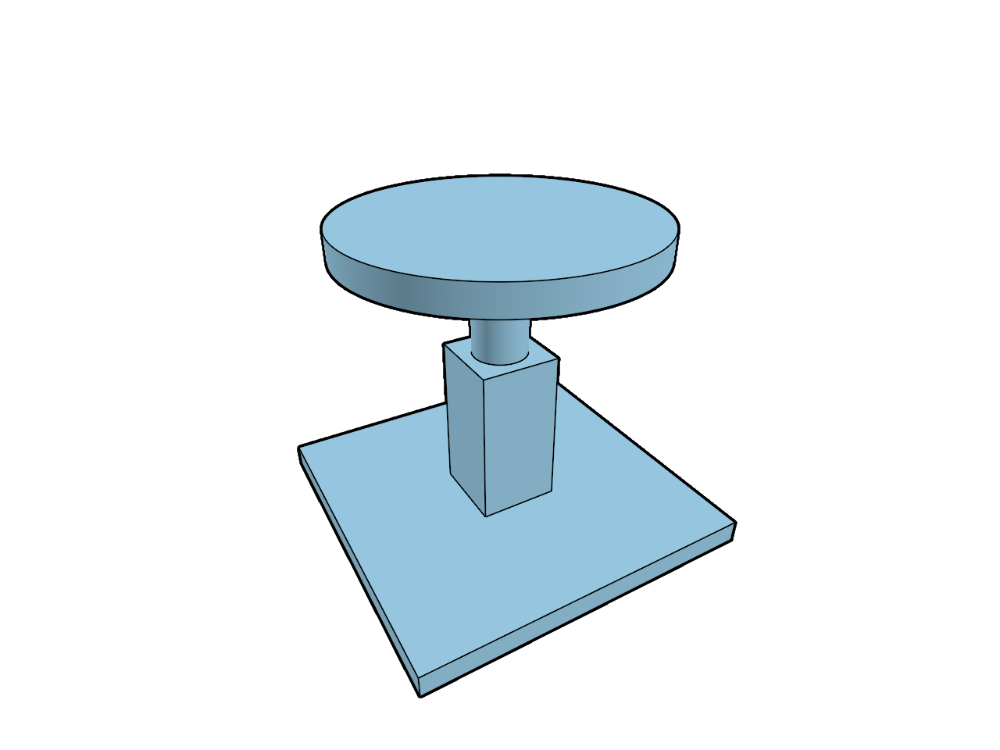

# 18.6 · Matched rendering comparisons from original sources

**Goal:** Prove the original comparison and inspect differences. · **Steps:** 4 · **Source:** [engine/gpu/ssao.rs](../../../src/engine/gpu/ssao.rs) · [engine/gpu/ssao/pipelines.rs](../../../src/engine/gpu/ssao/pipelines.rs) · [shaders/ssao.wgsl](../../../src/shaders/ssao.wgsl) · [shaders/triangle.wgsl](../../../src/shaders/triangle.wgsl)

<div class="webgpu-schematic" style="width:100%;margin:6px auto;">
<svg xmlns="http://www.w3.org/2000/svg" width="1120" height="188" viewBox="0 0 1120 188" style="width:100%;max-width:100%;height:auto;display:block;margin:0 auto;" role="img">
  <defs>
    <marker id="arr" viewBox="0 0 10 10" refX="8" refY="5" markerWidth="6" markerHeight="6" orient="auto">
      <path d="M 0 1 L 9 5 L 0 9 z" fill="#111111"/>
    </marker>
    <marker id="arrR" viewBox="0 0 10 10" refX="8" refY="5" markerWidth="6" markerHeight="6" orient="auto">
      <path d="M 0 1 L 9 5 L 0 9 z" fill="#dc2626"/>
    </marker>
    <marker id="arrG" viewBox="0 0 10 10" refX="8" refY="5" markerWidth="6" markerHeight="6" orient="auto">
      <path d="M 0 1 L 9 5 L 0 9 z" fill="#16a34a"/>
    </marker>
    <marker id="arrB" viewBox="0 0 10 10" refX="8" refY="5" markerWidth="6" markerHeight="6" orient="auto">
      <path d="M 0 1 L 9 5 L 0 9 z" fill="#2563eb"/>
    </marker>
  </defs>
  <rect x="2" y="2" width="1116" height="184" rx="10" fill="#ffffff" stroke="#111111" stroke-width="2"/>
  <rect x="14" y="12" width="344" height="164" rx="8" fill="#ffffff" stroke="#111111" stroke-width="1.5"/>
  <text paint-order="stroke fill" stroke="#ffffff" stroke-width="5" stroke-linejoin="round" x="186" y="30" text-anchor="middle" font-family="monospace" font-size="10.5" font-weight="700" fill="#111111">HZB Max-Depth Mip Pyramid + SSAO Hemisphere Samples</text>
  <rect x="56" y="54" width="64" height="64" fill="#dbeafe" stroke="#111111" stroke-width="1.75"/>
  <rect x="130" y="68" width="42" height="42" fill="#93c5fd" stroke="#111111" stroke-width="1.75"/>
  <rect x="182" y="80" width="24" height="24" fill="#60a5fa" stroke="#111111" stroke-width="1.75"/>
  <path d="M 224 134 A 34 34 0 0 1 292 134" fill="#fef9c3" stroke="#111111" stroke-width="1.75"/>
  <line x1="258" y1="134" x2="240" y2="104" stroke="#dc2626" stroke-width="1.75" marker-end="url(#arrR)"/>
  <line x1="258" y1="134" x2="258" y2="96" stroke="#16a34a" stroke-width="1.75" marker-end="url(#arrG)"/>
  <line x1="258" y1="134" x2="278" y2="106" stroke="#2563eb" stroke-width="1.75" marker-end="url(#arrB)"/>
  <line x1="358" y1="94" x2="384" y2="94" stroke="#111111" stroke-width="2" marker-end="url(#arr)"/>
  <rect x="388" y="12" width="344" height="164" rx="8" fill="#ffffff" stroke="#111111" stroke-width="1.5"/>
  <text paint-order="stroke fill" stroke="#ffffff" stroke-width="5" stroke-linejoin="round" x="560" y="30" text-anchor="middle" font-family="monospace" font-size="10.5" font-weight="700" fill="#111111">WoodElement Timber Plate + Joint Cut Polylines &amp; Vectors</text>
  <polygon points="434,136 468,66 644,66 610,136" fill="#fde68a" stroke="#111111" stroke-width="2"/>
  <polygon points="518,66 558,66 548,92 508,92" fill="#ffffff" stroke="#dc2626" stroke-width="2"/>
  <line x1="533" y1="79" x2="533" y2="44" stroke="#dc2626" stroke-width="2.2" marker-end="url(#arrR)"/>
  <line x1="732" y1="94" x2="758" y2="94" stroke="#111111" stroke-width="2" marker-end="url(#arr)"/>
  <rect x="762" y="12" width="344" height="164" rx="8" fill="#ffffff" stroke="#111111" stroke-width="1.75"/>
  <text paint-order="stroke fill" stroke="#ffffff" stroke-width="5" stroke-linejoin="round" x="934" y="30" text-anchor="middle" font-family="monospace" font-size="10.5" font-weight="700" fill="#111111">Contact-Darkened Creases + Timber Joinery Scene</text>
  <rect x="806" y="44" width="256" height="118" rx="4" fill="#ffffff" stroke="#111111" stroke-width="2"/>
  <polygon points="838,138 874,66 1018,66 982,138" fill="#fcd34d" stroke="#111111" stroke-width="2"/>
  <polygon points="914,66 952,66 942,92 904,92" fill="#78350f" stroke="#111111" stroke-width="2"/>
</svg>
</div>

## <a id="checkpoint-94-declare-the-rendering-comparison-contract"></a>1. Declare the rendering comparison contract

### 1. `src/comparison.rs`

Own one original comparison specimen and explicit maintained-renderer differences.

Create the file and type:

```rust
use prost::Message;
use session_rust::{BRep, Color, Session};

pub struct Difference {
    pub subject: &'static str,
    pub teaching: &'static str,
    pub maintained: &'static str,
    pub owner: &'static str,
}

pub const DIFFERENCES: &[Difference] = &[
    Difference {
        subject: "camera",
        teaching: "forward depth, scene units",
        maintained: "reversed depth, f64 camera, mm to metres and anchor rebasing",
        owner: "src/camera.rs",
    },
    Difference {
        subject: "surfaces",
        teaching: "per-owner glass drawing, separate normal prepass",
        maintained: "packed arenas, primitive IDs, MRT and adaptive 1x/4x MSAA",
        owner: "src/engine/gpu/render.rs",
    },
    Difference {
        subject: "ink",
        teaching: "finite tile lists and centreline depth predicate",
        maintained: "plane-fit visibility, sag profiles and ribbon convolution",
        owner: "src/shaders/ink_visibility.wgsl",
    },
    Difference {
        subject: "ambient",
        teaching: "current GTAO with an explicit forward-depth adapter",
        maintained: "current reversed-depth inputs and production pass order",
        owner: "src/engine/gpu/ssao.rs",
    },
    Difference {
        subject: "defaults",
        teaching: "white background, opacity 1, no ground grid",
        maintained: "linear 0.9 background, desktop opacity 0.95, grid on",
        owner: "src/engine/gpu/view.rs",
    },
];

pub fn specimen() -> Vec<u8> {
    let mut session = Session::new("viewer comparison");
    for (mut brep, z) in [
        (BRep::create_box(1500., 1500., 100.), -500.),
        (BRep::create_box(350., 350., 700.), -100.),
        (BRep::create_cylinder(120., 450.), 250.),
        (BRep::create_cylinder(650., 120.), 700.),
    ] {
        brep.surfacecolor = Color::new(0.35, 0.65, 0.85, 1.);
        brep.transform(&session_rust::Xform::translation(0., 0., z));
        session.add_brep(brep, None);
    }
    session.to_proto().encode_to_vec()
}

pub fn original_scene(bytes: &[u8]) -> Result<crate::scene::Scene, String> {
    let mut scene = crate::scene::Scene::empty();
    let source =
        crate::document_source::prepare(bytes, &session_rust::Xform::identity(), 0.)?;
    crate::document_geometry::append(
        &mut scene,
        &source,
        &session_rust::Xform::identity(),
        0.,
    )?;
    Ok(scene)
}
```

### 2. `src/lib.rs`

Register the comparison owner.

**Locate this existing block:**

```rust
#[cfg(test)]
mod ambient_shader_contract;
pub mod finite_project_source;
#[cfg(test)]
mod finite_scan_contract;
#[cfg(test)]
mod finite_tiles_contract;
#[cfg(test)]
mod opacity_command_tests;
pub mod source_mesh_topology;
```

Edit the existing block to match this code; keep unchanged lines:

```rust
#[cfg(test)]
mod opacity_command_tests;

#[cfg(test)]
mod ambient_shader_contract;
pub mod comparison;
pub mod finite_project_source;
#[cfg(test)]
mod finite_scan_contract;
#[cfg(test)]
mod finite_tiles_contract;
pub mod source_mesh_topology;
```

## <a id="checkpoint-94a-link-the-maintained-native-rendering-reference"></a>2. Link the maintained native rendering reference

### 1. `Cargo.toml`

Link the exact maintained viewer from the reconstructed checkpoint.

**Locate this existing block:**

```toml
pollster = "=0.4.0"
log = "=0.4.34"
```

Edit the existing block to match this code; keep unchanged lines:

```toml
pollster = "=0.4.0"
log = "=0.4.34"

[target.'cfg(not(target_arch = "wasm32"))'.dependencies]
current_viewer = { package = "session_viewer", path = "../.." }
```

## <a id="checkpoint-94b-read-actual-maintained-frames-without-source-mutation"></a>3. Read actual maintained frames without source mutation

### 1. `src/reference_example.rs`

Copy the supplied maintained-frame command line example.

Create the file and type:

```rust
#[cfg(not(target_arch = "wasm32"))]
struct Logger;
#[cfg(not(target_arch = "wasm32"))]
impl log::Log for Logger {
    fn enabled(&self, _: &log::Metadata) -> bool {
        true
    }
    fn log(&self, message: &log::Record) {
        eprintln!("[{}] {}", message.level(), message.args());
    }
    fn flush(&self) {}
}
#[cfg(not(target_arch = "wasm32"))]
fn main() {
    let _ = log::set_logger(&Logger);
    log::set_max_level(log::LevelFilter::Info);
    let output = std::env::args()
        .nth(1)
        .unwrap_or_else(|| "current.ppm".into());
    let source = std::env::args()
        .nth(2)
        .unwrap_or_else(|| "comparison.pb".into());
    if !std::path::Path::new(&source).exists() {
        std::fs::write(
            &source,
            viewer_journey::comparison::specimen(),
        )
        .unwrap();
    }
    print!(
        "{}",
        viewer_journey::reference_frame::render(
            std::path::Path::new(&source),
            std::path::Path::new(&output),
            [640, 480]
        )
    );
}
#[cfg(target_arch = "wasm32")]
fn main() {}
```

### 2. `Cargo.toml`

Expose the maintained reference as a native example.

**Locate this existing block:**

```toml
[target.'cfg(not(target_arch = "wasm32"))'.dependencies]
current_viewer = { package = "session_viewer", path = "../.." }
```

Edit the existing block to match this code; keep unchanged lines:

```toml
[target.'cfg(not(target_arch = "wasm32"))'.dependencies]
current_viewer = { package = "session_viewer", path = "../.." }

[[example]]
name = "reference"
path = "src/reference_example.rs"
```

### 3. `src/reference_frame.rs`

Supply the optional native comparison wrapper; the browser application does not call it.

Create the file and type:

```rust
use current_viewer::selftest::{SceneFile, render_scene};
use session_rust::Xform;
use std::path::Path;

pub fn render(source: &Path, output: &Path, size: [u32; 2]) -> String {
    render_scene(
        &[SceneFile {
            path: source.to_string_lossy().into_owned(),
            place: Xform::identity(),
            point_px: 0.,
            display_only: false,
        }],
        size[0],
        size[1],
        output.to_str().expect("UTF-8 output path"),
    )
}

pub fn rgb(bytes: &[u8], size: [u32; 2]) -> Result<&[u8], &'static str> {
    let header = format!("P6\n{} {}\n255\n", size[0], size[1]);
    let body = bytes
        .strip_prefix(header.as_bytes())
        .ok_or("Unexpected PPM header")?;
    if body.len() != size[0] as usize * size[1] as usize * 3 {
        return Err("Incomplete frame");
    }
    Ok(body)
}
```

### 4. `src/lib.rs`

Keep the maintained reference native-only.

**Locate this existing block:**

```rust
mod opacity_command_tests;

#[cfg(test)]
mod ambient_shader_contract;
pub mod comparison;
pub mod finite_project_source;
#[cfg(test)]
mod finite_scan_contract;
#[cfg(test)]
mod finite_tiles_contract;
pub mod source_mesh_topology;
```

Edit the existing block to match this code; keep unchanged lines:

```rust
mod opacity_command_tests;

pub mod comparison;

#[cfg(test)]
mod ambient_shader_contract;
pub mod finite_project_source;
#[cfg(test)]
mod finite_scan_contract;
#[cfg(test)]
mod finite_tiles_contract;
#[cfg(not(target_arch = "wasm32"))]
pub mod reference_frame;
pub mod source_mesh_topology;
```

## <a id="checkpoint-94c-prove-the-original-comparison-and-inspect-differences"></a>4. Prove the comparison and inspect differences

### 1. `src/comparison_tests.rs`

Copy supplied actual source and maintained-frame fixtures.

Create the file and type:

```rust
use crate::comparison;
use prost::Message;

#[test]
fn comparison_loads_the_same_four_original_solids() {
    let bytes = comparison::specimen();
    let source = session_rust::proto::Session::decode(bytes.as_slice()).unwrap();
    assert_eq!(
        source.objects.as_ref().unwrap().breps.len(),
        4
    );
    let scene = comparison::original_scene(&bytes).unwrap();
    assert_eq!(scene.objects().len(), 4);
    assert!(
        scene
            .objects()
            .iter()
            .all(|row| row.cad.is_some())
    );
    let mut camera = crate::camera::Camera::default();
    camera.isometric();
    camera.fit(&scene.bounds().unwrap());
    assert!(camera.radius > 500.);
    assert!(
        camera
            .view_projection()
            .m
            .iter()
            .all(|v| v.is_finite())
    );
}

#[cfg(not(target_arch = "wasm32"))]
#[test]
fn maintained_renderer_draws_the_original_curved_specimen() {
    let directory = std::env::temp_dir().join(format!(
        "viewer-course-reference-{}",
        std::process::id()
    ));
    std::fs::create_dir_all(&directory).unwrap();
    let source = directory.join("source.pb");
    let image = directory.join("current.ppm");
    let original = comparison::specimen();
    std::fs::write(&source, &original).unwrap();
    let report = crate::reference_frame::render(&source, &image, [640, 480]);
    assert!(report.contains("640x480"));
    let pixels = std::fs::read(&image).unwrap();
    let rgb = crate::reference_frame::rgb(&pixels, [640, 480]).unwrap();
    let blue = rgb
        .chunks_exact(3)
        .filter(|p| p[2] > p[0].saturating_add(20) && p[2] > p[1].saturating_add(10))
        .count();
    assert!(
        blue > 4000,
        "maintained original blue faces: {blue}"
    );
    assert_eq!(std::fs::read(&source).unwrap(), original);
    assert!(
        crate::reference_frame::rgb(&pixels[..pixels.len() - 1], [640, 480]).is_err()
    );
    std::fs::remove_dir_all(directory).unwrap();
}
```

### 2. `src/lib.rs`

Register supplied comparison fixtures.

**Locate this existing block:**

```rust
pub mod comparison;

#[cfg(test)]
mod ambient_shader_contract;
pub mod finite_project_source;
#[cfg(test)]
mod finite_scan_contract;
#[cfg(test)]
mod finite_tiles_contract;
#[cfg(not(target_arch = "wasm32"))]
pub mod reference_frame;
pub mod source_mesh_topology;
```

Edit the existing block to match this code; keep unchanged lines:

```rust
pub mod comparison;

#[cfg(not(target_arch = "wasm32"))]
pub mod reference_frame;

#[cfg(test)]
mod ambient_shader_contract;
#[cfg(test)]
mod comparison_tests;
pub mod finite_project_source;
#[cfg(test)]
mod finite_scan_contract;
#[cfg(test)]
mod finite_tiles_contract;
pub mod source_mesh_topology;
```

### 3. `index.html`

Package the actual original comparison and later metadata protobuf fixtures for browser acceptance.

**Locate this existing block:**

```html
  <link data-trunk rel="copy-dir" href="assets/text" data-target-path="text">
  <style>
```

Edit the existing block to match this code; keep unchanged lines:

```html
  <link data-trunk rel="copy-dir" href="assets/text" data-target-path="text">
  <link data-trunk rel="copy-dir" href="assets/pb" data-target-path="assets/pb">
  <style>
```

## Build & Run



```sh
npm --prefix ../session_tests run course -- dependencies 18.6
cd workspace/journey
REGEN_PROTO=0 cargo build --lib --locked --target wasm32-unknown-unknown -j1
REGEN_PROTO=0 CARGO_BUILD_JOBS=1 trunk serve --port 8780
cd ../..
npm --prefix ../session_tests run course -- check 18.6
npm --prefix ../session_tests run course -- save 18.6
```

Continue with [18.7 · Measured frame costs and dependency-aware cache reports](95-record-comparable-large-scene-conditions.md).
