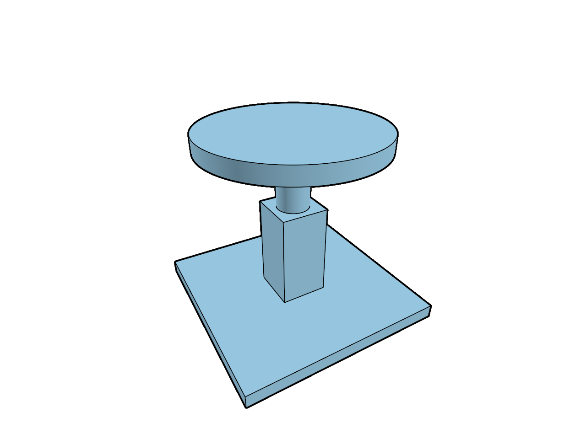

# 18.7 · Measured frame costs and dependency-aware cache reports

**Goal:** Prove cache invalidation and honest performance reports. · **Steps:** 7 · **Source:** [engine/gpu/ssao.rs](../../../src/engine/gpu/ssao.rs) · [engine/gpu/ssao/pipelines.rs](../../../src/engine/gpu/ssao/pipelines.rs) · [shaders/ssao.wgsl](../../../src/shaders/ssao.wgsl) · [shaders/triangle.wgsl](../../../src/shaders/triangle.wgsl) · [shaders/ink_visibility.wgsl](../../../src/shaders/ink_visibility.wgsl) · [engine/gpu/surface_outline.rs](../../../src/engine/gpu/surface_outline.rs) · [engine/gpu/render.rs](../../../src/engine/gpu/render.rs) · [engine/performance.rs](../../../src/engine/performance.rs) · [engine/gpu/timing.rs](../../../src/engine/gpu/timing.rs) · [app/command/tool/elements.rs](../../../src/app/command/tool/elements.rs) (`src/shaders/hzb.wgsl,src/shaders/ssao.wgsl,src/app/wood_elements.rs`)

<div class="webgpu-schematic" style="width:100%;margin:6px auto;">
<svg xmlns="http://www.w3.org/2000/svg" width="1120" height="188" viewBox="0 0 1120 188" style="width:100%;max-width:100%;height:auto;display:block;margin:0 auto;" role="img">
  <defs>
    <marker id="arr" viewBox="0 0 10 10" refX="8" refY="5" markerWidth="6" markerHeight="6" orient="auto">
      <path d="M 0 1 L 9 5 L 0 9 z" fill="#111111"/>
    </marker>
    <marker id="arrR" viewBox="0 0 10 10" refX="8" refY="5" markerWidth="6" markerHeight="6" orient="auto">
      <path d="M 0 1 L 9 5 L 0 9 z" fill="#dc2626"/>
    </marker>
    <marker id="arrG" viewBox="0 0 10 10" refX="8" refY="5" markerWidth="6" markerHeight="6" orient="auto">
      <path d="M 0 1 L 9 5 L 0 9 z" fill="#16a34a"/>
    </marker>
    <marker id="arrB" viewBox="0 0 10 10" refX="8" refY="5" markerWidth="6" markerHeight="6" orient="auto">
      <path d="M 0 1 L 9 5 L 0 9 z" fill="#2563eb"/>
    </marker>
  </defs>
  <rect x="2" y="2" width="1116" height="184" rx="10" fill="#ffffff" stroke="#111111" stroke-width="2"/>
  <rect x="14" y="12" width="344" height="164" rx="8" fill="#ffffff" stroke="#111111" stroke-width="1.5"/>
  <text paint-order="stroke fill" stroke="#ffffff" stroke-width="5" stroke-linejoin="round" x="186" y="30" text-anchor="middle" font-family="monospace" font-size="10.5" font-weight="700" fill="#111111">Curve Quadrature ∑ w_i ||C'(t_i)|| &amp; Surface Patch dA = ||Su×Sv||</text>
  <path d="M 56 138 Q 112 52 176 126" fill="none" stroke="#dc2626" stroke-width="2.5"/>
  <circle cx="84" cy="98" r="4" fill="#fef08a" stroke="#111111" stroke-width="1.5"/>
  <circle cx="116" cy="84" r="4" fill="#fef08a" stroke="#111111" stroke-width="1.5"/>
  <circle cx="148" cy="98" r="4" fill="#fef08a" stroke="#111111" stroke-width="1.5"/>
  <polygon points="196,136 226,74 288,74 258,136" fill="#dbeafe" stroke="#111111" stroke-width="1.75"/>
  <line x1="226" y1="105" x2="268" y2="105" stroke="#2563eb" stroke-width="2" marker-end="url(#arrB)"/>
  <line x1="226" y1="105" x2="242" y2="74" stroke="#16a34a" stroke-width="2" marker-end="url(#arrG)"/>
  <line x1="358" y1="94" x2="384" y2="94" stroke="#111111" stroke-width="2" marker-end="url(#arr)"/>
  <rect x="388" y="12" width="344" height="164" rx="8" fill="#ffffff" stroke="#111111" stroke-width="1.5"/>
  <text paint-order="stroke fill" stroke="#ffffff" stroke-width="5" stroke-linejoin="round" x="560" y="30" text-anchor="middle" font-family="monospace" font-size="10.5" font-weight="700" fill="#111111">Divergence Volume: V = (1/6) ∑ det(v0, v1, v2) &amp; Centroid C_g</text>
  <circle cx="448" cy="138" r="4.5" fill="#111111"/>
  <text paint-order="stroke fill" stroke="#ffffff" stroke-width="5" stroke-linejoin="round" x="448" y="154" text-anchor="middle" font-family="monospace" font-size="9" font-weight="700" fill="#111111">Origin O</text>
  <polygon points="448,138 556,58 656,92" fill="#dbeafe" fill-opacity="0.55" stroke="#2563eb" stroke-width="1.5" stroke-dasharray="4 3"/>
  <polygon points="556,58 656,92 596,142" fill="#93c5fd" stroke="#111111" stroke-width="2"/>
  <circle cx="576" cy="104" r="5" fill="#fef08a" stroke="#dc2626" stroke-width="2"/>
  <line x1="732" y1="94" x2="758" y2="94" stroke="#111111" stroke-width="2" marker-end="url(#arr)"/>
  <rect x="762" y="12" width="344" height="164" rx="8" fill="#ffffff" stroke="#111111" stroke-width="1.75"/>
  <text paint-order="stroke fill" stroke="#ffffff" stroke-width="5" stroke-linejoin="round" x="934" y="30" text-anchor="middle" font-family="monospace" font-size="10.5" font-weight="700" fill="#111111">Exact Length, Area, Volume &amp; Centroid Marker</text>
  <rect x="806" y="44" width="256" height="118" rx="4" fill="#ffffff" stroke="#111111" stroke-width="2"/>
  <polygon points="846,136 894,64 988,64 940,136" fill="#dbeafe" stroke="#111111" stroke-width="2"/>
  <circle cx="917" cy="100" r="6" fill="#fef08a" stroke="#dc2626" stroke-width="2.2"/>
  <text paint-order="stroke fill" stroke="#ffffff" stroke-width="5" stroke-linejoin="round" x="1016" y="96" text-anchor="middle" font-family="monospace" font-size="9.5" font-weight="700" fill="#111111">C_g</text>
</svg>
</div>

## <a id="checkpoint-95-record-comparable-large-scene-conditions"></a>1. Record comparable large scene conditions

**What this code does:** Record comparable large scene conditions.

### 1. `src/bench_config.rs`

Own explicit conditions instead of unqualified performance claims.

Create the file and type:

```rust
#[derive(Clone, Debug, PartialEq, serde::Serialize, serde::Deserialize)]
pub struct Conditions {
    pub machine: String,
    pub browser: String,
    pub adapter: String,
    pub scene_sha256: String,
    pub viewport: [u32; 2],
    pub dpr: f64,
    pub camera: String,
    pub settings: String,
    pub measurement: String,
}

impl Conditions {
    pub fn validate(&self) -> Result<(), &'static str> {
        if [
            &self.machine,
            &self.browser,
            &self.adapter,
            &self.camera,
            &self.settings,
            &self.measurement,
        ]
        .iter()
        .any(|v| v.trim().is_empty())
        {
            return Err("Record every measurement condition");
        }
        if self.scene_sha256.len() != 64
            || !self
                .scene_sha256
                .bytes()
                .all(|v| v.is_ascii_hexdigit())
        {
            return Err("Record the original scene SHA-256");
        }
        if self.viewport.contains(&0) || !self.dpr.is_finite() || self.dpr <= 0. {
            return Err("Invalid viewport or pixel density");
        }
        Ok(())
    }
}
```

### 2. `src/lib.rs`

Register the completed performance owner.

**Locate this existing block:**

```rust
#[cfg(test)]
mod ambient_shader_contract;
#[cfg(test)]
mod comparison_tests;
pub mod finite_project_source;
```

Edit the existing block to match this code; keep unchanged lines:

```rust
#[cfg(test)]
mod comparison_tests;

#[cfg(test)]
mod ambient_shader_contract;
pub mod bench_config;
pub mod finite_project_source;
```

## <a id="checkpoint-95a-measure-warmed-frame-times-and-the-slow-tail"></a>2. Measure warmed frame times and the slow tail

**What this code does:** Measure warmed frame times and the slow tail.

### 1. `src/bench_samples.rs`

Summarize real samples with an explicit warmup and slow-frame tail.

Create the file and type:

```rust
#[derive(Debug, PartialEq, serde::Serialize)]
pub struct Summary {
    pub samples: usize,
    pub median_ms: f64,
    pub p95_ms: f64,
    pub max_ms: f64,
}

pub fn summarize(samples: &[f64], warmup: usize) -> Result<Summary, &'static str> {
    if samples
        .iter()
        .any(|v| !v.is_finite() || *v <= 0.)
    {
        return Err("Frame durations must be positive and finite");
    }
    let measured = samples
        .get(warmup..)
        .filter(|v| !v.is_empty())
        .ok_or("No measured frames after warmup")?;
    let mut sorted = measured.to_vec();
    sorted.sort_by(f64::total_cmp);
    let count = sorted.len();
    let middle = count / 2;
    let median = if count % 2 == 0 {
        sorted[middle - 1] * 0.5 + sorted[middle] * 0.5
    } else {
        sorted[middle]
    };
    let rank = (count * 95).div_ceil(100) - 1;
    Ok(Summary {
        samples: count,
        median_ms: median,
        p95_ms: sorted[rank],
        max_ms: sorted[count - 1],
    })
}
```

### 2. `src/lib.rs`

Register the completed performance owner.

**Locate this existing block:**

```rust
mod comparison_tests;

#[cfg(test)]
mod ambient_shader_contract;
pub mod bench_config;
pub mod finite_project_source;
```

Edit the existing block to match this code; keep unchanged lines:

```rust
mod comparison_tests;

pub mod bench_config;

#[cfg(test)]
mod ambient_shader_contract;
pub mod bench_samples;
pub mod finite_project_source;
```

## <a id="checkpoint-95b-reject-incomparable-before-and-after-runs"></a>3. Reject incomparable before and after runs

**What this code does:** Reject incomparable before and after runs.

### 1. `src/bench_compare.rs`

Compare matched measurements and retain original-source memory accounting.

Create the file and type:

```rust
use crate::{
    bench_config::Conditions,
    bench_samples::{Summary, summarize},
};

#[derive(serde::Serialize, serde::Deserialize)]
pub struct Run {
    pub conditions: Conditions,
    pub revision: String,
    pub warmup: usize,
    pub frame_ms: Vec<f64>,
    pub gpu_buffers: u64,
    pub gpu_textures: u64,
    pub original_bytes: u64,
}

pub struct Comparison {
    pub before: Summary,
    pub after: Summary,
    pub median_change_ms: f64,
    pub p95_change_ms: f64,
}

pub fn compare(before: &Run, after: &Run) -> Result<Comparison, &'static str> {
    before.conditions.validate()?;
    after.conditions.validate()?;
    if before.conditions != after.conditions {
        return Err("Runs have different hardware, scene or rendering conditions");
    }
    if before.revision.trim().is_empty() || after.revision.trim().is_empty() {
        return Err("Record both renderer revisions");
    }
    if before.original_bytes != after.original_bytes {
        return Err(
            "Original source memory changed; inspect retention before comparing",
        );
    }
    let a = summarize(&before.frame_ms, before.warmup)?;
    let b = summarize(&after.frame_ms, after.warmup)?;
    Ok(Comparison {
        median_change_ms: b.median_ms - a.median_ms,
        p95_change_ms: b.p95_ms - a.p95_ms,
        before: a,
        after: b,
    })
}
```

### 2. `src/lib.rs`

Register the completed performance owner.

**Locate this existing block:**

```rust
pub mod bench_config;

#[cfg(test)]
mod ambient_shader_contract;
pub mod bench_samples;
pub mod finite_project_source;
```

Edit the existing block to match this code; keep unchanged lines:

```rust
pub mod bench_config;

pub mod bench_samples;

#[cfg(test)]
mod ambient_shader_contract;
pub mod bench_compare;
pub mod finite_project_source;
```

## <a id="checkpoint-95c-witness-immutable-tree-inputs-across-camera-frames"></a>4. Witness immutable tree inputs across camera frames

**What this code does:** Witness immutable tree inputs across camera frames.

### 1. `src/tree_witness.rs`

Witness shared layer inputs without retaining geometry payloads.

Create the file and type:

```rust
use crate::{
    hierarchy::Document,
    scene::{ObjectId, Scene},
    view_flags::Flags,
};
use std::{
    collections::{HashMap, HashSet},
    rc::Rc,
};

pub struct Witness {
    documents: Vec<Rc<Document>>,
    groups: Rc<HashSet<(u32, String)>>,
    graphs: Rc<HashMap<u32, Rc<session_rust::Graph>>>,
    view: Rc<Flags>,
    selection: Vec<ObjectId>,
    epoch: u64,
}

impl Witness {
    pub fn new(scene: &Scene, selection: &[ObjectId], epoch: u64) -> Self {
        Self {
            documents: scene.forest.documents.clone(),
            groups: scene.groups.clone(),
            graphs: scene.graphs.clone(),
            view: scene.view.clone(),
            selection: selection.to_vec(),
            epoch,
        }
    }
    pub fn matches(&self, scene: &Scene, selection: &[ObjectId], epoch: u64) -> bool {
        self.epoch == epoch
            && self.selection == selection
            && Rc::ptr_eq(&self.groups, &scene.groups)
            && Rc::ptr_eq(&self.graphs, &scene.graphs)
            && Rc::ptr_eq(&self.view, &scene.view)
            && self.documents.len() == scene.forest.documents.len()
            && self
                .documents
                .iter()
                .zip(&scene.forest.documents)
                .all(|(a, b)| Rc::ptr_eq(a, b))
    }
}
```

### 2. `src/lib.rs`

Register the completed performance owner.

**Locate this existing block:**

```rust
pub mod bench_samples;

#[cfg(test)]
mod ambient_shader_contract;
pub mod bench_compare;
pub mod finite_project_source;
#[cfg(test)]
mod finite_scan_contract;
#[cfg(test)]
mod finite_tiles_contract;
pub mod source_mesh_topology;

#[cfg(target_arch = "wasm32")]
```

Edit the existing block to match this code; keep unchanged lines:

```rust
pub mod bench_samples;

pub mod bench_compare;

#[cfg(test)]
mod ambient_shader_contract;
pub mod finite_project_source;
#[cfg(test)]
mod finite_scan_contract;
#[cfg(test)]
mod finite_tiles_contract;
pub mod source_mesh_topology;
pub mod tree_witness;

#[cfg(target_arch = "wasm32")]
```

## <a id="checkpoint-95d-reuse-layer-rows-while-rotating-and-zooming"></a>5. Reuse layer rows while rotating and zooming

**What this code does:** Reuse layer rows while rotating and zooming.

### 1. `src/tree_panel.rs`

Cache unchanged scene/selection/epoch inputs before rebuilding layer state.

**Locate this existing block:**

```rust
pub struct TreePanel {
    pub graph_open: bool,
    pub graph: Vec<(String, String, String, String)>,
    pub edit: Option<(String, crate::layer_edit::Edit)>,
    pub rename: Option<(String, String)>,
    pub rename_error: String,
    rename_focus: bool,
    pub confirm: Option<(String, usize)>,
    pub property: Option<(String, crate::layer_properties::Property)>,
    pub menu_rects: Vec<egui::Rect>,
    states: std::collections::HashMap<String, RowState>,
    pub open: bool,
    pub rows: Vec<Row>,
    pub selected: Vec<ObjectId>,
    expanded: HashSet<String>,
    pub rect: Option<egui::Rect>,
    pub action: Option<(Vec<ObjectId>, bool)>,
    page: usize,
}
impl TreePanel {
    pub fn refresh(&mut self, scene: &crate::scene::Scene, selected: Vec<ObjectId>) {
        self.graph = crate::graph_edit::rows(scene);
```

Edit the existing block to match this code; keep unchanged lines:

```rust
pub struct TreePanel {
    witness: Option<crate::tree_witness::Witness>,
    pub refreshes: u64,
    pub graph_open: bool,
    pub graph: Vec<(String, String, String, String)>,
    pub edit: Option<(String, crate::layer_edit::Edit)>,
    pub rename: Option<(String, String)>,
    pub rename_error: String,
    rename_focus: bool,
    pub confirm: Option<(String, usize)>,
    pub property: Option<(String, crate::layer_properties::Property)>,
    pub menu_rects: Vec<egui::Rect>,
    states: std::collections::HashMap<String, RowState>,
    pub open: bool,
    pub rows: Vec<Row>,
    pub selected: Vec<ObjectId>,
    expanded: HashSet<String>,
    pub rect: Option<egui::Rect>,
    pub action: Option<(Vec<ObjectId>, bool)>,
    page: usize,
}
impl TreePanel {
    pub fn refresh_cached(
        &mut self,
        scene: &crate::scene::Scene,
        selected: Vec<ObjectId>,
        epoch: u64,
    ) {
        if self
            .witness
            .as_ref()
            .is_some_and(|w| w.matches(scene, &selected, epoch))
        {
            return;
        }
        self.refresh(scene, selected.clone());
        self.witness = Some(crate::tree_witness::Witness::new(
            scene, &selected, epoch,
        ));
        self.refreshes += 1;
    }

    pub fn refresh(&mut self, scene: &crate::scene::Scene, selected: Vec<ObjectId>) {
        self.witness = None;
        self.graph = crate::graph_edit::rows(scene);
```

### 2. `src/browser.rs`

Use the cache from the actual teaching frame loop.

**Locate this existing block:**

```rust
                });
            panel
                .tree
                .refresh(&editor.scene, editor.selected_objects());
            if let Err(error) = renderer.set_preview(editor.draft.as_ref()) {
```

Edit the existing block to match this code; keep unchanged lines:

```rust
                });
            panel.tree.refresh_cached(
                &editor.scene,
                editor.selected_objects(),
                editor.interaction_epoch,
            );
            if let Err(error) = renderer.set_preview(editor.draft.as_ref()) {
```

## <a id="checkpoint-95e-borrow-graph-edges-and-index-their-labels"></a>6. Borrow graph edges and index their labels

<div class="webgpu-schematic" style="width:100%;margin:6px auto;">
<svg xmlns="http://www.w3.org/2000/svg" width="1120" height="188" viewBox="0 0 1120 188" style="width:100%;max-width:100%;height:auto;display:block;margin:0 auto;" role="img">
  <defs>
    <marker id="arr" viewBox="0 0 10 10" refX="8" refY="5" markerWidth="6" markerHeight="6" orient="auto">
      <path d="M 0 1 L 9 5 L 0 9 z" fill="#111111"/>
    </marker>
    <marker id="arrR" viewBox="0 0 10 10" refX="8" refY="5" markerWidth="6" markerHeight="6" orient="auto">
      <path d="M 0 1 L 9 5 L 0 9 z" fill="#dc2626"/>
    </marker>
    <marker id="arrG" viewBox="0 0 10 10" refX="8" refY="5" markerWidth="6" markerHeight="6" orient="auto">
      <path d="M 0 1 L 9 5 L 0 9 z" fill="#16a34a"/>
    </marker>
    <marker id="arrB" viewBox="0 0 10 10" refX="8" refY="5" markerWidth="6" markerHeight="6" orient="auto">
      <path d="M 0 1 L 9 5 L 0 9 z" fill="#2563eb"/>
    </marker>
  </defs>
  <rect x="2" y="2" width="1116" height="184" rx="10" fill="#ffffff" stroke="#111111" stroke-width="2"/>
  <rect x="14" y="12" width="344" height="164" rx="8" fill="#ffffff" stroke="#111111" stroke-width="1.5"/>
  <text paint-order="stroke fill" stroke="#ffffff" stroke-width="5" stroke-linejoin="round" x="186" y="30" text-anchor="middle" font-family="monospace" font-size="10.5" font-weight="700" fill="#111111">HZB Max-Depth Mip Pyramid + SSAO Hemisphere Samples</text>
  <rect x="56" y="54" width="64" height="64" fill="#dbeafe" stroke="#111111" stroke-width="1.75"/>
  <rect x="130" y="68" width="42" height="42" fill="#93c5fd" stroke="#111111" stroke-width="1.75"/>
  <rect x="182" y="80" width="24" height="24" fill="#60a5fa" stroke="#111111" stroke-width="1.75"/>
  <path d="M 224 134 A 34 34 0 0 1 292 134" fill="#fef9c3" stroke="#111111" stroke-width="1.75"/>
  <line x1="258" y1="134" x2="240" y2="104" stroke="#dc2626" stroke-width="1.75" marker-end="url(#arrR)"/>
  <line x1="258" y1="134" x2="258" y2="96" stroke="#16a34a" stroke-width="1.75" marker-end="url(#arrG)"/>
  <line x1="258" y1="134" x2="278" y2="106" stroke="#2563eb" stroke-width="1.75" marker-end="url(#arrB)"/>
  <line x1="358" y1="94" x2="384" y2="94" stroke="#111111" stroke-width="2" marker-end="url(#arr)"/>
  <rect x="388" y="12" width="344" height="164" rx="8" fill="#ffffff" stroke="#111111" stroke-width="1.5"/>
  <text paint-order="stroke fill" stroke="#ffffff" stroke-width="5" stroke-linejoin="round" x="560" y="30" text-anchor="middle" font-family="monospace" font-size="10.5" font-weight="700" fill="#111111">WoodElement Timber Plate + Joint Cut Polylines &amp; Vectors</text>
  <polygon points="434,136 468,66 644,66 610,136" fill="#fde68a" stroke="#111111" stroke-width="2"/>
  <polygon points="518,66 558,66 548,92 508,92" fill="#ffffff" stroke="#dc2626" stroke-width="2"/>
  <line x1="533" y1="79" x2="533" y2="44" stroke="#dc2626" stroke-width="2.2" marker-end="url(#arrR)"/>
  <line x1="732" y1="94" x2="758" y2="94" stroke="#111111" stroke-width="2" marker-end="url(#arr)"/>
  <rect x="762" y="12" width="344" height="164" rx="8" fill="#ffffff" stroke="#111111" stroke-width="1.75"/>
  <text paint-order="stroke fill" stroke="#ffffff" stroke-width="5" stroke-linejoin="round" x="934" y="30" text-anchor="middle" font-family="monospace" font-size="10.5" font-weight="700" fill="#111111">Contact-Darkened Creases + Timber Joinery Scene</text>
  <rect x="806" y="44" width="256" height="118" rx="4" fill="#ffffff" stroke="#111111" stroke-width="2"/>
  <polygon points="838,138 874,66 1018,66 982,138" fill="#fcd34d" stroke="#111111" stroke-width="2"/>
  <polygon points="914,66 952,66 942,92 904,92" fill="#78350f" stroke="#111111" stroke-width="2"/>
</svg>
</div>

**What this code does:** Borrow graph edges and index their labels.

### 1. `src/graph_edit.rs`

Avoid full graph protobuf conversion and repeated node scans for display rows.

**Locate this existing block:**

```rust
pub fn rows(scene: &Scene) -> Vec<(String, String, String, String)> {
    scene
        .forest
        .documents
        .iter()
        .flat_map(|doc| {
            let graph = scene
                .graphs
                .get(&doc.key)
                .map(|g| g.to_proto())
                .or_else(|| {
                    doc.header
                        .as_ref()
                        .and_then(|h| h.header.graph.clone())
                });
            let name = |guid: &str| {
                doc.nodes
                    .iter()
                    .find(|n| {
                        n.source.name == guid
                            || n.object
                                .is_some_and(|id| scene.row_guid(id) == Some(guid))
                    })
                    .map_or_else(|| guid.to_owned(), |n| n.label.clone())
            };
            graph
                .into_iter()
                .flat_map(|g| {
                    g.edges.into_iter().map(|edge| {
                        (
                            doc.label.clone(),
                            name(&edge.v0),
                            name(&edge.v1),
                            edge.attribute,
                        )
                    })
                })
                .collect::<Vec<_>>()
        })
        .collect()
}
```

Edit the existing block to match this code; keep unchanged lines:

```rust
pub fn rows(scene: &Scene) -> Vec<(String, String, String, String)> {
    let mut rows = Vec::new();
    for doc in &scene.forest.documents {
        let mut labels = std::collections::HashMap::new();
        for node in &doc.nodes {
            labels
                .entry(node.source.name.as_str())
                .or_insert(node.label.as_str());
            if let Some(guid) = node.object.and_then(|id| scene.row_guid(id)) {
                labels
                    .entry(guid)
                    .or_insert(node.label.as_str());
            }
        }
        let mut push = |from: &str, to: &str, attribute: &str| {
            rows.push((
                doc.label.clone(),
                labels
                    .get(from)
                    .copied()
                    .unwrap_or(from)
                    .to_owned(),
                labels
                    .get(to)
                    .copied()
                    .unwrap_or(to)
                    .to_owned(),
                attribute.to_owned(),
            ))
        };
        if let Some(graph) = scene.graphs.get(&doc.key) {
            for (u, neighbors) in &graph.edges {
                for (v, edge) in neighbors {
                    if u <= v {
                        push(&edge.v0, &edge.v1, &edge.attribute);
                    }
                }
            }
        } else if let Some(graph) = doc
            .header
            .as_ref()
            .and_then(|h| h.header.graph.as_ref())
        {
            for edge in &graph.edges {
                push(&edge.v0, &edge.v1, &edge.attribute);
            }
        }
    }
    rows
}
```

## <a id="checkpoint-95f-prove-cache-invalidation-and-honest-performance-reports"></a>7. Prove cache invalidation and honest performance reports

**What this code does:** Prove cache invalidation and honest performance reports.

### 1. `src/bench_tests.rs`

Copy supplied invalid-data, comparability, original-source, cache and history fixtures.

Create the file and type:

```rust
use crate::{
    bench_compare::{Run, compare},
    bench_config::Conditions,
    bench_samples::summarize,
};
fn run() -> Run {
    Run {
        conditions: Conditions {
            machine: "Lenovo fixture".into(),
            browser: "Chrome fixture".into(),
            adapter: "recorded adapter".into(),
            scene_sha256: "a".repeat(64),
            viewport: [1280, 720],
            dpr: 1.,
            camera: "saved pose and orbit path".into(),
            settings: "same opacity, AO, outlines and MSAA".into(),
            measurement: "presented browser frames".into(),
        },
        revision: "before".into(),
        warmup: 2,
        frame_ms: vec![500., 200., 16., 17., 18., 20.],
        gpu_buffers: 100,
        gpu_textures: 200,
        original_bytes: 300,
    }
}
#[test]
fn warmup_and_slow_tail_are_reported_separately() {
    let values: Vec<f64> = std::iter::once(5000.)
        .chain((1..=100).map(|v| v as f64))
        .collect();
    let s = summarize(&values, 1).unwrap();
    assert_eq!(s.samples, 100);
    assert_eq!(s.median_ms, 50.5);
    assert_eq!(s.p95_ms, 95.);
    assert_eq!(s.max_ms, 100.);
}
#[test]
fn missing_or_invalid_timings_are_never_performance_evidence() {
    for (values, warmup) in [
        (vec![], 0),
        (vec![16.], 1),
        (vec![f64::NAN], 0),
        (vec![0.], 0),
        (vec![f64::INFINITY], 0),
    ] {
        assert!(summarize(&values, warmup).is_err());
    }
}
#[test]
fn comparisons_reject_changed_scene_hardware_and_quality() {
    let a = run();
    let mut b = run();
    b.revision = "after".into();
    b.frame_ms = vec![400., 100., 10., 11., 12., 13.];
    let result = compare(&a, &b).unwrap();
    assert_eq!(result.median_change_ms, -6.);
    assert_eq!(result.p95_change_ms, -7.);
    b.conditions.adapter = "different GPU".into();
    assert!(compare(&a, &b).is_err());
    b.conditions = a.conditions.clone();
    b.conditions.scene_sha256 = "b".repeat(64);
    assert!(compare(&a, &b).is_err());
    b.conditions = a.conditions.clone();
    b.conditions.settings = "AO disabled".into();
    assert!(compare(&a, &b).is_err());
    b.conditions = a.conditions.clone();
    b.original_bytes = 0;
    assert!(compare(&a, &b).is_err());
}
#[test]
fn records_round_trip_conditions_without_invented_measurements() {
    let a = run();
    let bytes = serde_json::to_vec(&a).unwrap();
    let b: Run = serde_json::from_slice(&bytes).unwrap();
    assert_eq!(b.conditions, a.conditions);
    assert_eq!(b.frame_ms, a.frame_ms);
    assert!(compare(&a, &b).is_ok());
}
#[test]
fn tree_cache_reuses_camera_frames_but_refreshes_edits_and_history() {
    use crate::editor::{Action, Editor};
    let mut e = Editor::default();
    e.apply(Action::Close).unwrap();
    e.apply(Action::AddBox).unwrap();
    let id = e.scene.objects()[0].id;
    let original = crate::source_edit::original(&e.scene, id).unwrap();
    let mut panel = crate::tree_panel::TreePanel::default();
    panel.refresh_cached(
        &e.scene,
        e.selected_objects(),
        e.interaction_epoch,
    );
    assert_eq!(panel.refreshes, 1);
    let before = panel
        .rows
        .iter()
        .map(|r| r.label.clone())
        .collect::<Vec<_>>();
    for _ in 0..20 {
        e.apply(Action::Orbit(0.01, 0.)).unwrap();
        panel.refresh_cached(
            &e.scene,
            e.selected_objects(),
            e.interaction_epoch,
        );
    }
    assert_eq!(panel.refreshes, 1);
    assert!(crate::source_edit::same(
        &original,
        &crate::source_edit::original(&e.scene, id).unwrap()
    ));
    e.apply(Action::SelectAll).unwrap();
    panel.refresh_cached(
        &e.scene,
        e.selected_objects(),
        e.interaction_epoch,
    );
    assert_eq!(panel.refreshes, 2);
    e.apply(Action::Hide).unwrap();
    panel.refresh_cached(
        &e.scene,
        e.selected_objects(),
        e.interaction_epoch,
    );
    assert_eq!(panel.refreshes, 3);
    e.apply(Action::Undo).unwrap();
    panel.refresh_cached(
        &e.scene,
        e.selected_objects(),
        e.interaction_epoch,
    );
    assert_eq!(panel.refreshes, 4);
    assert!(panel.rows.is_empty());
    e.apply(Action::Redo).unwrap();
    panel.refresh_cached(
        &e.scene,
        e.selected_objects(),
        e.interaction_epoch,
    );
    assert_eq!(panel.refreshes, 5);
    assert_eq!(
        panel
            .rows
            .iter()
            .map(|r| r.label.clone())
            .collect::<Vec<_>>(),
        before
    );
    e.apply(Action::Close).unwrap();
    panel.refresh_cached(
        &e.scene,
        e.selected_objects(),
        e.interaction_epoch,
    );
    assert!(panel.rows.is_empty());
    assert!(panel.graph.is_empty());
}
#[test]
fn graph_rows_keep_one_original_edge_and_document_labels() {
    use crate::editor::{Action, Editor};
    let mut e = Editor::default();
    e.apply(Action::Close).unwrap();
    e.apply(Action::AddBox).unwrap();
    e.apply(Action::AddBox).unwrap();
    e.apply(Action::SelectAll).unwrap();
    e.apply(Action::AddEdge).unwrap();
    let before = e
        .scene
        .graphs
        .iter()
        .map(|(key, graph)| (*key, graph.to_proto()))
        .collect::<Vec<_>>();
    let rows = crate::graph_edit::rows(&e.scene);
    assert_eq!(rows.len(), 1);
    assert!(!rows[0].0.is_empty());
    assert!(!rows[0].1.is_empty());
    assert!(!rows[0].2.is_empty());
    assert_eq!(rows[0].3, "");
    assert_eq!(
        e.scene
            .graphs
            .iter()
            .map(|(key, graph)| (*key, graph.to_proto()))
            .collect::<Vec<_>>(),
        before
    );
    e.apply(Action::Undo).unwrap();
    assert!(crate::graph_edit::rows(&e.scene).is_empty());
    e.apply(Action::Redo).unwrap();
    assert_eq!(crate::graph_edit::rows(&e.scene), rows);
}
```

### 2. `src/lib.rs`

Register supplied performance correctness fixtures.

**Locate this existing block:**

```rust
pub mod bench_compare;

#[cfg(test)]
mod ambient_shader_contract;
pub mod finite_project_source;
#[cfg(test)]
mod finite_scan_contract;
#[cfg(test)]
mod finite_tiles_contract;
pub mod source_mesh_topology;
pub mod tree_witness;

#[cfg(target_arch = "wasm32")]
```

Edit the existing block to match this code; keep unchanged lines:

```rust
pub mod bench_compare;

pub mod tree_witness;

#[cfg(test)]
mod ambient_shader_contract;
#[cfg(test)]
mod bench_tests;
pub mod finite_project_source;
#[cfg(test)]
mod finite_scan_contract;
#[cfg(test)]
mod finite_tiles_contract;
pub mod source_mesh_topology;

#[cfg(target_arch = "wasm32")]
```

## Build & Run



```sh
npm --prefix ../session_tests run course -- dependencies 18.7
cd workspace/journey
REGEN_PROTO=0 cargo build --lib --locked --target wasm32-unknown-unknown -j1
REGEN_PROTO=0 CARGO_BUILD_JOBS=1 trunk serve --port 8780
cd ../..
npm --prefix ../session_tests run course -- check 18.7
npm --prefix ../session_tests run course -- save 18.7
```

Continue with [19.1 · Complete source metadata and the actual command contract](96-retain-non-drawing-originals-and-validate-raw-planes.md).
