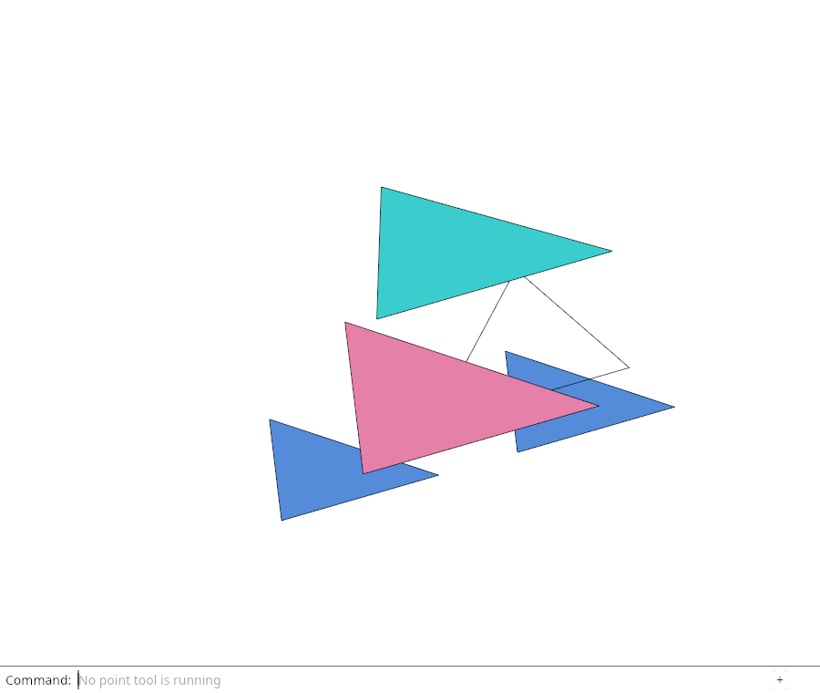

# 22.6 · Original display controls and remaining integration boundaries

**Goal:** Display original CAD fallback curves through the existing joined path lane while retaining coherent source borders and independent family controls. Route ordinary lines through the exact production ribbon shader, storage rows and independent integer coverage. · **Steps:** 5 · **Source:** [engine/gpu/render.rs](../../../src/engine/gpu/render.rs) · [engine/gpu/pass.rs](../../../src/engine/gpu/pass.rs) · [engine/gpu/targets.rs](../../../src/engine/gpu/targets.rs) · [engine/gpu/frame.rs](../../../src/engine/gpu/frame.rs)

<div class="webgpu-schematic" style="width:100%;margin:6px auto;">
<svg xmlns="http://www.w3.org/2000/svg" width="1120" height="188" viewBox="0 0 1120 188" style="width:100%;max-width:100%;height:auto;display:block;margin:0 auto;" role="img">
  <defs>
    <marker id="arr" viewBox="0 0 10 10" refX="8" refY="5" markerWidth="6" markerHeight="6" orient="auto">
      <path d="M 0 1 L 9 5 L 0 9 z" fill="#111111"/>
    </marker>
    <marker id="arrR" viewBox="0 0 10 10" refX="8" refY="5" markerWidth="6" markerHeight="6" orient="auto">
      <path d="M 0 1 L 9 5 L 0 9 z" fill="#dc2626"/>
    </marker>
    <marker id="arrG" viewBox="0 0 10 10" refX="8" refY="5" markerWidth="6" markerHeight="6" orient="auto">
      <path d="M 0 1 L 9 5 L 0 9 z" fill="#16a34a"/>
    </marker>
    <marker id="arrB" viewBox="0 0 10 10" refX="8" refY="5" markerWidth="6" markerHeight="6" orient="auto">
      <path d="M 0 1 L 9 5 L 0 9 z" fill="#2563eb"/>
    </marker>
  </defs>
  <rect x="2" y="2" width="1116" height="184" rx="10" fill="#ffffff" stroke="#111111" stroke-width="2"/>
  <rect x="14" y="12" width="344" height="164" rx="8" fill="#ffffff" stroke="#111111" stroke-width="1.5"/>
  <text paint-order="stroke fill" stroke="#ffffff" stroke-width="5" stroke-linejoin="round" x="186" y="30" text-anchor="middle" font-family="monospace" font-size="10.5" font-weight="700" fill="#111111">Quad UV ∈ [0, 1]² -&gt; Grid Cell (row = ⌊4v⌋, col = ⌊4u⌋)</text>
  <rect x="84" y="48" width="172" height="106" fill="#f8fafc" stroke="#111111" stroke-width="1.75"/>
  <line x1="127" y1="48" x2="127" y2="154" stroke="#111111" stroke-width="1.2"/>
  <line x1="170" y1="48" x2="170" y2="154" stroke="#111111" stroke-width="1.2"/>
  <line x1="213" y1="48" x2="213" y2="154" stroke="#111111" stroke-width="1.2"/>
  <line x1="84" y1="74" x2="256" y2="74" stroke="#111111" stroke-width="1.2"/>
  <line x1="84" y1="101" x2="256" y2="101" stroke="#111111" stroke-width="1.2"/>
  <line x1="84" y1="128" x2="256" y2="128" stroke="#111111" stroke-width="1.2"/>
  <rect x="84" y="48" width="43" height="26" fill="#dcfce7" stroke="#16a34a" stroke-width="2"/>
  <rect x="127" y="74" width="43" height="27" fill="#dcfce7" stroke="#16a34a" stroke-width="2"/>
  <rect x="170" y="101" width="43" height="27" fill="#dcfce7" stroke="#16a34a" stroke-width="2"/>
  <rect x="213" y="128" width="43" height="26" fill="#fef08a" stroke="#dc2626" stroke-width="2"/>
  <line x1="358" y1="94" x2="384" y2="94" stroke="#111111" stroke-width="2" marker-end="url(#arr)"/>
  <rect x="388" y="12" width="344" height="164" rx="8" fill="#ffffff" stroke="#111111" stroke-width="1.5"/>
  <text paint-order="stroke fill" stroke="#ffffff" stroke-width="5" stroke-linejoin="round" x="560" y="30" text-anchor="middle" font-family="monospace" font-size="10.5" font-weight="700" fill="#111111">Columns: X_basis (R), Y_basis (G), Z_basis (B), Translation (T)</text>
  <rect x="434" y="54" width="56" height="92" fill="#fee2e2" stroke="#dc2626" stroke-width="1.5"/>
  <text paint-order="stroke fill" stroke="#ffffff" stroke-width="5" stroke-linejoin="round" x="462" y="104" text-anchor="middle" font-family="monospace" font-size="10" font-weight="700" fill="#dc2626">Col 0</text>
  <rect x="498" y="54" width="56" height="92" fill="#dcfce7" stroke="#16a34a" stroke-width="1.5"/>
  <text paint-order="stroke fill" stroke="#ffffff" stroke-width="5" stroke-linejoin="round" x="526" y="104" text-anchor="middle" font-family="monospace" font-size="10" font-weight="700" fill="#16a34a">Col 1</text>
  <rect x="562" y="54" width="56" height="92" fill="#dbeafe" stroke="#2563eb" stroke-width="1.5"/>
  <text paint-order="stroke fill" stroke="#ffffff" stroke-width="5" stroke-linejoin="round" x="590" y="104" text-anchor="middle" font-family="monospace" font-size="10" font-weight="700" fill="#2563eb">Col 2</text>
  <rect x="626" y="54" width="56" height="92" fill="#fef9c3" stroke="#d97706" stroke-width="1.5"/>
  <text paint-order="stroke fill" stroke="#ffffff" stroke-width="5" stroke-linejoin="round" x="654" y="104" text-anchor="middle" font-family="monospace" font-size="10" font-weight="700" fill="#111111">tx,ty,tz</text>
  <line x1="732" y1="94" x2="758" y2="94" stroke="#111111" stroke-width="2" marker-end="url(#arr)"/>
  <rect x="762" y="12" width="344" height="164" rx="8" fill="#ffffff" stroke="#111111" stroke-width="1.75"/>
  <text paint-order="stroke fill" stroke="#ffffff" stroke-width="5" stroke-linejoin="round" x="934" y="30" text-anchor="middle" font-family="monospace" font-size="10.5" font-weight="700" fill="#111111">Live 4×4 Transform Matrix Card in Viewport</text>
  <rect x="806" y="44" width="256" height="118" rx="4" fill="#ffffff" stroke="#111111" stroke-width="2"/>
  <rect x="836" y="56" width="196" height="94" rx="4" fill="#f8fafc" stroke="#111111" stroke-width="1.75"/>
  <text paint-order="stroke fill" stroke="#ffffff" stroke-width="5" stroke-linejoin="round" x="934" y="82" text-anchor="middle" font-family="monospace" font-size="10.5" font-weight="700" fill="#111111">[ 1.0  0.0  0.0  12.4 ]</text>
  <text paint-order="stroke fill" stroke="#ffffff" stroke-width="5" stroke-linejoin="round" x="934" y="104" text-anchor="middle" font-family="monospace" font-size="10.5" font-weight="700" fill="#111111">[ 0.0  1.0  0.0  -3.2 ]</text>
  <text paint-order="stroke fill" stroke="#ffffff" stroke-width="5" stroke-linejoin="round" x="934" y="126" text-anchor="middle" font-family="monospace" font-size="10.5" font-weight="700" fill="#111111">[ 0.0  0.0  1.0   0.8 ]</text>
</svg>
</div>

## <a id="checkpoint-96zzzzzzzm-retain-visible-instance-ranges"></a>1. Retain visible instance ranges

<div class="webgpu-schematic" style="width:100%;margin:6px auto;">
<svg xmlns="http://www.w3.org/2000/svg" width="1120" height="188" viewBox="0 0 1120 188" style="width:100%;max-width:100%;height:auto;display:block;margin:0 auto;" role="img">
  <defs>
    <marker id="arr" viewBox="0 0 10 10" refX="8" refY="5" markerWidth="6" markerHeight="6" orient="auto">
      <path d="M 0 1 L 9 5 L 0 9 z" fill="#111111"/>
    </marker>
    <marker id="arrR" viewBox="0 0 10 10" refX="8" refY="5" markerWidth="6" markerHeight="6" orient="auto">
      <path d="M 0 1 L 9 5 L 0 9 z" fill="#dc2626"/>
    </marker>
    <marker id="arrG" viewBox="0 0 10 10" refX="8" refY="5" markerWidth="6" markerHeight="6" orient="auto">
      <path d="M 0 1 L 9 5 L 0 9 z" fill="#16a34a"/>
    </marker>
    <marker id="arrB" viewBox="0 0 10 10" refX="8" refY="5" markerWidth="6" markerHeight="6" orient="auto">
      <path d="M 0 1 L 9 5 L 0 9 z" fill="#2563eb"/>
    </marker>
  </defs>
  <rect x="2" y="2" width="1116" height="184" rx="10" fill="#ffffff" stroke="#111111" stroke-width="2"/>
  <rect x="14" y="12" width="344" height="164" rx="8" fill="#ffffff" stroke="#111111" stroke-width="1.5"/>
  <text paint-order="stroke fill" stroke="#ffffff" stroke-width="5" stroke-linejoin="round" x="186" y="30" text-anchor="middle" font-family="monospace" font-size="10.5" font-weight="700" fill="#111111">CPU Camera / View Uniform (16-Byte Aligned)</text>
  <rect x="52" y="48" width="268" height="106" rx="6" fill="#f8fafc" stroke="#111111" stroke-width="1.75"/>
  <rect x="66" y="58" width="240" height="38" fill="#dbeafe" stroke="#2563eb" stroke-width="1.5"/>
  <text paint-order="stroke fill" stroke="#ffffff" stroke-width="5" stroke-linejoin="round" x="186" y="81" text-anchor="middle" font-family="monospace" font-size="9.5" font-weight="700" fill="#111111">view_proj: [[f32; 4]; 4] (64B)</text>
  <rect x="66" y="104" width="240" height="36" fill="#fef08a" stroke="#d97706" stroke-width="1.5"/>
  <text paint-order="stroke fill" stroke="#ffffff" stroke-width="5" stroke-linejoin="round" x="186" y="126" text-anchor="middle" font-family="monospace" font-size="9.5" font-weight="700" fill="#111111">eye_pos / viewport_px (16B)</text>
  <line x1="358" y1="94" x2="384" y2="94" stroke="#111111" stroke-width="2" marker-end="url(#arr)"/>
  <rect x="388" y="12" width="344" height="164" rx="8" fill="#ffffff" stroke="#111111" stroke-width="1.5"/>
  <text paint-order="stroke fill" stroke="#ffffff" stroke-width="5" stroke-linejoin="round" x="560" y="30" text-anchor="middle" font-family="monospace" font-size="10.5" font-weight="700" fill="#111111">queue.write_buffer -&gt; wgpu::BindGroup (@group(0))</text>
  <rect x="424" y="50" width="272" height="102" rx="6" fill="#ffffff" stroke="#111111" stroke-width="1.75"/>
  <rect x="442" y="64" width="236" height="32" rx="4" fill="#dcfce7" stroke="#16a34a" stroke-width="1.5"/>
  <text paint-order="stroke fill" stroke="#ffffff" stroke-width="5" stroke-linejoin="round" x="560" y="84" text-anchor="middle" font-family="monospace" font-size="9.5" font-weight="700" fill="#111111">BufferUsages::UNIFORM | COPY_DST</text>
  <rect x="442" y="106" width="236" height="32" rx="4" fill="#dbeafe" stroke="#2563eb" stroke-width="1.5"/>
  <text paint-order="stroke fill" stroke="#ffffff" stroke-width="5" stroke-linejoin="round" x="560" y="126" text-anchor="middle" font-family="monospace" font-size="9.5" font-weight="700" fill="#2563eb">pass.set_bind_group(0, &amp;bg, &amp;[])</text>
  <line x1="732" y1="94" x2="758" y2="94" stroke="#111111" stroke-width="2" marker-end="url(#arr)"/>
  <rect x="762" y="12" width="344" height="164" rx="8" fill="#ffffff" stroke="#111111" stroke-width="1.75"/>
  <text paint-order="stroke fill" stroke="#ffffff" stroke-width="5" stroke-linejoin="round" x="934" y="30" text-anchor="middle" font-family="monospace" font-size="10.5" font-weight="700" fill="#111111">GPU Shader Uniform Read: var&lt;uniform&gt;</text>
  <rect x="806" y="44" width="256" height="118" rx="4" fill="#ffffff" stroke="#111111" stroke-width="2"/>
  <text paint-order="stroke fill" stroke="#ffffff" stroke-width="5" stroke-linejoin="round" x="934" y="76" text-anchor="middle" font-family="monospace" font-size="9.5" font-weight="700" fill="#2563eb">@group(0) @binding(0)</text>
  <text paint-order="stroke fill" stroke="#ffffff" stroke-width="5" stroke-linejoin="round" x="934" y="98" text-anchor="middle" font-family="monospace" font-size="9.5" font-weight="700" fill="#111111">var&lt;uniform&gt; u: Uniforms;</text>
  <rect x="828" y="114" width="212" height="32" rx="4" fill="#dcfce7" stroke="#16a34a" stroke-width="1.5"/>
  <text paint-order="stroke fill" stroke="#ffffff" stroke-width="5" stroke-linejoin="round" x="934" y="134" text-anchor="middle" font-family="monospace" font-size="9.5" font-weight="700" fill="#111111">u.view_proj * vec4(p, 1.0)</text>
</svg>
</div>

Keep absolute original query addresses while filtering existing instance buffers with merged CPU ranges.

### 1. `src/ink_ranges.rs`

Retain merged contiguous CPU instance ranges and filter draw submission without copying geometry or rebasing GPU instance indices. Empty metadata preserves the existing whole lane. Retain one complete draw when all populated families remain visible, and skip the metadata scan when no populated family is visible.

Create the file and type:

```rust
use std::ops::Range;
pub const EDGES: u8 = 1;
pub const LINES: u8 = 2;
pub const POINTS: u8 = 4;
pub const CONTROLS: u8 = 8;
pub const VERTICES: u8 = 16;

pub struct Runs {
    parts: Vec<(u8, Range<u32>)>,
    present: u8,
    pub mask: u8,
}
impl Default for Runs {
    fn default() -> Self {
        Self {
            parts: Vec::new(),
            present: 0,
            mask: u8::MAX,
        }
    }
}
impl Runs {
    pub fn push(&mut self, kind: u8, start: u32, end: u32) {
        if start >= end {
            return;
        }
        self.present |= kind;
        if let Some((previous, range)) = self.parts.last_mut()
            && *previous == kind
            && range.end == start
        {
            range.end = end;
            return;
        }
        self.parts.push((kind, start..end));
    }
    pub fn visible(&self, count: u32) -> impl Iterator<Item = Range<u32>> + '_ {
        let all = self.mask != 0 && self.mask & self.present == self.present;
        let parts: &[_] = if all || self.mask & self.present == 0 {
            &[]
        } else {
            &self.parts
        };
        all.then_some(0..count).into_iter().chain(
            parts
                .iter()
                .filter(|(kind, _)| self.mask & kind != 0)
                .map(|(_, range)| range.clone()),
        )
    }
}
```

### 2. `src/lib.rs`

Share one allocation-free range iterator between ordinary and finite colour/query drawing.

**Locate this existing block:**

```rust
pub mod finite_ink;

#[cfg(test)]
```

Edit the existing block to match this code; keep unchanged lines:

```rust
pub mod finite_ink;
pub mod ink_ranges;

#[cfg(test)]
```

### 3. `src/stroke_gpu.rs`

Keep presentation metadata beside the existing lane; it owns no GPU resource. Default to complete retained draws so existing lanes preserve their behaviour. Use the same CPU ranges in finite colour drawing. Use absolute retained ranges for finite integer queries too. Keep full buffer bindings and absolute first-instance values in draw; do not compact source addresses. Keep full buffer bindings and absolute first-instance values in pick; do not compact source addresses.

Edit these blocks from bottom to top. Keep the surrounding lines unchanged.

**Locate this block:**

```rust
            })
        });
        Self {
            flags: None,
```

Replace it with:

```rust
            })
        });
        Self {
            ranges: Default::default(),
            flags: None,
```

**Locate this block:**

```rust
                self.vertices_per_instance,
                tables,
                depth,
            )
        } else {
            self.pick(pass, view, crop)
```

Replace it with:

```rust
                self.vertices_per_instance,
                tables,
                depth,
                &self.ranges,
            )
        } else {
            self.pick(pass, view, crop)
```

**Locate this block:**

```rust
        pass.set_bind_group(1, crop, &[]);
        pass.set_vertex_buffer(0, vertices.slice(..));
        pass.set_vertex_buffer(1, ids.slice(..));
        pass.draw(
            0..self.vertices_per_instance,
            0..(self.data.len() as u64 / self.stride) as u32,
        );
    }

    pub fn pick_finite(
```

Replace it with:

```rust
        pass.set_bind_group(1, crop, &[]);
        pass.set_vertex_buffer(0, vertices.slice(..));
        pass.set_vertex_buffer(1, ids.slice(..));
        for instances in self
            .ranges
            .visible((self.data.len() as u64 / self.stride) as u32)
        {
            pass.draw(0..self.vertices_per_instance, instances);
        }
    }

    pub fn pick_finite(
```

**Locate this block:**

```rust
        pass.set_pipeline(&self.pipeline.active);
        pass.set_bind_group(0, view, &[]);
        pass.set_vertex_buffer(0, vertices.slice(..));
        pass.draw(
            0..self.vertices_per_instance,
            0..(self.data.len() as u64 / self.stride) as u32,
        );
    }

    pub fn set_ids(
```

Replace it with:

```rust
        pass.set_pipeline(&self.pipeline.active);
        pass.set_bind_group(0, view, &[]);
        pass.set_vertex_buffer(0, vertices.slice(..));
        for instances in self
            .ranges
            .visible((self.data.len() as u64 / self.stride) as u32)
        {
            pass.draw(0..self.vertices_per_instance, instances);
        }
    }

    pub fn set_ids(
```

**Locate this block:**

```rust
                    .expect("Finite original clipping flags"),
                (self.data.len() as u64 / self.stride) as u32,
                self.vertices_per_instance,
            )
        }) {
            return;
```

Replace it with:

```rust
                    .expect("Finite original clipping flags"),
                (self.data.len() as u64 / self.stride) as u32,
                self.vertices_per_instance,
                &self.ranges,
            )
        }) {
            return;
```

**Locate this block:**

```rust
pub struct Lane {
    flags: Option<wgpu::Buffer>,
    flag_data: Vec<u32>,
    varying: bool,
```

Replace it with:

```rust
pub struct Lane {
    pub ranges: crate::ink_ranges::Runs,
    flags: Option<wgpu::Buffer>,
    flag_data: Vec<u32>,
    varying: bool,
```

### 4. `src/finite_ink.rs`

Give finite drawing the retained CPU range iterator. Retain one query bind-group preparation before all visible absolute draws. Apply identical visible instance ranges to finite draw without rebinding or copying the original vertex/ID/metadata buffers. Apply identical visible instance ranges to finite pick without rebinding or copying the original vertex/ID/metadata buffers.

**Locate this existing block:**

```rust
        verts: u32,
    ) -> bool {
        let bindings = self.bindings.borrow();
        let Some((_, _, _, _, group)) = bindings.as_ref() else {
            return false;
        };
        pass.set_pipeline(&self.color.active.0);
        pass.set_bind_group(0, view, &[]);
        pass.set_bind_group(1, group, &[]);
        pass.set_vertex_buffer(0, vertices.slice(..));
        pass.set_vertex_buffer(1, flags.slice(..));
        pass.draw(0..verts, 0..count);
        true
    }
    pub fn pick(
        &self,
        device: &wgpu::Device,
        pass: &mut wgpu::RenderPass<'_>,
        view: &wgpu::BindGroup,
        crop: &wgpu::BindGroup,
        vertices: &wgpu::Buffer,
        ids: &wgpu::Buffer,
        flags: &wgpu::Buffer,
        count: u32,
        verts: u32,
        tables: &Tables,
        depth: &wgpu::TextureView,
    ) {
        let group = self.group(device, &self.query, tables, depth);
        pass.set_pipeline(&self.pick);
        pass.set_bind_group(0, view, &[]);
        pass.set_bind_group(1, crop, &[]);
        pass.set_bind_group(2, &group, &[]);
        pass.set_vertex_buffer(0, vertices.slice(..));
        pass.set_vertex_buffer(1, ids.slice(..));
        pass.set_vertex_buffer(2, flags.slice(..));
        pass.draw(0..verts, 0..count);
    }
```

Edit the existing block to match this code; keep unchanged lines:

```rust
        verts: u32,
        ranges: &crate::ink_ranges::Runs,
    ) -> bool {
        let bindings = self.bindings.borrow();
        let Some((_, _, _, _, group)) = bindings.as_ref() else {
            return false;
        };
        pass.set_pipeline(&self.color.active.0);
        pass.set_bind_group(0, view, &[]);
        pass.set_bind_group(1, group, &[]);
        pass.set_vertex_buffer(0, vertices.slice(..));
        pass.set_vertex_buffer(1, flags.slice(..));
        for instances in ranges.visible(count) {
            pass.draw(0..verts, instances);
        }
        true
    }
    pub fn pick(
        &self,
        device: &wgpu::Device,
        pass: &mut wgpu::RenderPass<'_>,
        view: &wgpu::BindGroup,
        crop: &wgpu::BindGroup,
        vertices: &wgpu::Buffer,
        ids: &wgpu::Buffer,
        flags: &wgpu::Buffer,
        count: u32,
        verts: u32,
        tables: &Tables,
        depth: &wgpu::TextureView,
        ranges: &crate::ink_ranges::Runs,
    ) {
        let group = self.group(device, &self.query, tables, depth);
        pass.set_pipeline(&self.pick);
        pass.set_bind_group(0, view, &[]);
        pass.set_bind_group(1, crop, &[]);
        pass.set_bind_group(2, &group, &[]);
        pass.set_vertex_buffer(0, vertices.slice(..));
        pass.set_vertex_buffer(1, ids.slice(..));
        pass.set_vertex_buffer(2, flags.slice(..));
        for instances in ranges.visible(count) {
            pass.draw(0..verts, instances);
        }
    }
```

### 5. `src/ink_range_gpu_tests.rs`

Actual Native GPU witness: nonzero first-instance ranges retain the original middle colour and original owner, hide both outside owners, restore exact pixels, and retain all source records/uploads in finite and ordinary paths at one/four samples.

Create the file and type:

```rust
use super::*;
use crate::{
    cap_gpu_tests::{at, matrix, pixels, renderer, wait},
    ink_ranges::{EDGES, LINES, POINTS},
};
#[test]
fn actual_filtered_instances_keep_absolute_colour_and_original_query_addresses() {
    for legacy in [false, true] {
        let mut scene = Scene::empty();
        for i in 0..3 {
            let mut p = session_rust::Point::new((i as f64 - 1.) * 0.5, 0., -0.5);
            p.width = 12.;
            p.pointcolor = session_rust::Color::new(
                if i == 0 {
                    1.
                } else {
                    0.
                },
                if i == 1 {
                    1.
                } else {
                    0.
                },
                if i == 2 {
                    1.
                } else {
                    0.
                },
                1.,
            );
            scene
                .insert_point(
                    crate::marker::PreparedPoint::new(std::rc::Rc::new(p)).unwrap(),
                )
                .unwrap();
        }
        let original = scene
            .points()
            .iter()
            .map(|r| r.prepared.source.to_proto())
            .collect::<Vec<_>>();
        let ids = scene
            .points()
            .iter()
            .map(|r| r.id)
            .collect::<Vec<_>>();
        let mut r = renderer(&scene);
        if legacy {
            r.markers.use_legacy_fixture();
        }
        r.markers.ranges.push(EDGES, 0, 1);
        r.markers.ranges.push(LINES, 1, 2);
        r.markers.ranges.push(POINTS, 2, 3);
        for count in [1, 4] {
            r.set_samples(count);
            let all = pixels(&r);
            assert!(
                at(&all, 80, 120)[0] > 240
                    && at(&all, 160, 120)[1] > 240
                    && at(&all, 240, 120)[2] > 240
            );
            let usage = r.point_usage();
            let source_ids = r.sources.marker_ids.clone();
            r.markers.ranges.mask = LINES;
            let filtered = pixels(&r);
            assert_eq!(
                at(&filtered, 80, 120),
                at(&filtered, 20, 120)
            );
            assert_eq!(
                at(&filtered, 240, 120),
                at(&filtered, 20, 120)
            );
            assert_eq!(
                at(&filtered, 160, 120),
                at(&all, 160, 120),
                "A nonzero first_instance retains the middle source colour"
            );
            for (x, owner) in [
                (0., Some(ids[1].value())),
                (-0.5, None),
                (0.5, None),
            ] {
                r.request_pick([x, 0.], matrix()).unwrap();
                wait(&r);
                assert_eq!(
                    r.take_pick(matrix())
                        .unwrap()
                        .unwrap()
                        .map(|v| v[0]),
                    owner,
                    "Integer queries use the same absolute source range as colour"
                );
            }
            assert_eq!(
                r.point_usage(),
                usage,
                "Presentation filtering keeps the original GPU marker upload"
            );
            assert_eq!(r.sources.marker_ids, source_ids);
            assert_eq!(
                scene
                    .points()
                    .iter()
                    .map(|r| r.prepared.source.to_proto())
                    .collect::<Vec<_>>(),
                original
            );
            r.markers.ranges.mask = u8::MAX;
            assert!(
                pixels(&r) == all,
                "Returning the mask restores exact pixels without repacking instances"
            );
            assert_eq!(r.point_usage(), usage);
        }
    }
}
```

### 6. `src/renderer.rs`

Supply the actual GPU range/address regression as a child of the renderer.

**Locate this existing block:**

```rust
};

pub struct Renderer {
```

Edit the existing block to match this code; keep unchanged lines:

```rust
};

#[cfg(all(test, not(target_arch = "wasm32")))]
#[path = "ink_range_gpu_tests.rs"]
mod range_tests;

pub struct Renderer {
```

### 7. `src/ink_pixels_tests.rs`

Adapt the existing supplied actual finite-ink GPU observer to the explicit all-visible range argument, preserving every coverage/owner/pixel assertion.

Edit these blocks from bottom to top. Keep the surrounding lines unchanged.

**Locate this block:**

```rust
            },
            tables,
            &target.depth,
        );
```

Replace it with:

```rust
            },
            tables,
            &target.depth,
            &Default::default(),
        );
```

**Locate this block:**

```rust
                6
            }
        ));
    }
    target.resolve(&mut encoder, &single);
```

Replace it with:

```rust
                6
            },
            &Default::default()
        ));
    }
    target.resolve(&mut encoder, &single);
```

## <a id="checkpoint-96zzzzzzzn-prepare-original-ink-families"></a>2. Prepare ink families

Classify retained original borders, points and controls once while preserving source query keys and complete buffer bindings.

### 1. `src/ink_ranges.rs`

Account the retained CPU range capacity without adding GPU storage.

**Locate this existing block:**

```rust
    }
    pub fn visible(&self, count: u32) -> impl Iterator<Item = Range<u32>> + '_ {
```

Edit the existing block to match this code; keep unchanged lines:

```rust
    }
    pub fn bytes(&self) -> usize {
        self.parts.capacity() * std::mem::size_of::<(u8, Range<u32>)>()
    }
    pub fn visible(&self, count: u32) -> impl Iterator<Item = Range<u32>> + '_ {
```

### 2. `src/pick_sources.rs`

Retain source-family boundaries beside original query addresses while preparing a changed scene. Remember the absolute start of each original border run. Classify actual original Plane/OBB borders as Lines; mesh, NURBS and CAD borders follow Edges. Merge adjacent equal families once. Retain the existing mesh-vertex, ordinary-point and active-control ordering without copying marker positions. Keep active control-net ranges independent of ordinary line visibility. Close the active control-net run while retaining absolute original buffer offsets. Store three compact original marker-family intervals; active controls keep their existing owners and subaddresses. Include range metadata in source preparation memory accounting.

Edit these blocks from bottom to top. Keep the surrounding lines unchanged.

**Locate this block:**

```rust
    }

    pub fn bytes(&self) -> usize {
        (self.faces.capacity() + self.edges.capacity() + self.controls.capacity())
            * std::mem::size_of::<Target>()
            + self.mesh_bases.capacity() * std::mem::size_of::<(ObjectId, u32)>()
```

Replace it with:

```rust
    }

    pub fn bytes(&self) -> usize {
        self.mesh_runs.bytes()
            + self.marker_runs.bytes()
            + (self.faces.capacity() + self.edges.capacity() + self.controls.capacity())
                * std::mem::size_of::<Target>()
            + self.mesh_bases.capacity() * std::mem::size_of::<(ObjectId, u32)>()
```

**Locate this block:**

```rust
                .marker_ids
                .push(id(row.parent, ids[1]));
        }
        for row in scene
            .sheets()
            .iter()
```

Replace it with:

```rust
                .marker_ids
                .push(id(row.parent, ids[1]));
        }
        sources
            .marker_runs
            .push(crate::ink_ranges::VERTICES, 0, vertex_end);
        sources.marker_runs.push(
            crate::ink_ranges::POINTS,
            vertex_end,
            point_end,
        );
        sources.marker_runs.push(
            crate::ink_ranges::CONTROLS,
            point_end,
            sources.marker_ids.len() as u32,
        );
        for row in scene
            .sheets()
            .iter()
```

**Locate this block:**

```rust
                .mesh_metadata
                .extend([0, crate::packed_vertex::NO_NORMAL]);
        }
        for row in scene.control_markers_at(anchor) {
            let ids = append(
                &mut sources.controls,
```

Replace it with:

```rust
                .mesh_metadata
                .extend([0, crate::packed_vertex::NO_NORMAL]);
        }
        sources.mesh_runs.push(
            crate::ink_ranges::CONTROLS,
            control_start,
            sources.mesh_ink.len() as u32,
        );
        for row in scene.control_markers_at(anchor) {
            let ids = append(
                &mut sources.controls,
```

**Locate this block:**

```rust
        {
            sources.marker_ids.push(id(row.id, 1));
        }
        for (owner, stroke) in scene.control_nets_at(anchor) {
            sources.mesh_ink.push(stroke);
            sources.mesh_ids.push([owner.value(), 0]);
```

Replace it with:

```rust
        {
            sources.marker_ids.push(id(row.id, 1));
        }
        let point_end = sources.marker_ids.len() as u32;
        let control_start = sources.mesh_ink.len() as u32;
        for (owner, stroke) in scene.control_nets_at(anchor) {
            sources.mesh_ink.push(stroke);
            sources.mesh_ids.push([owner.value(), 0]);
```

**Locate this block:**

```rust
                sources.path_ids.push(id(row.id, ids[1]));
            }
        }
        for row in scene
            .points()
            .iter()
```

Replace it with:

```rust
                sources.path_ids.push(id(row.id, ids[1]));
            }
        }
        let vertex_end = sources.marker_ids.len() as u32;
        for row in scene
            .points()
            .iter()
```

**Locate this block:**

```rust
                ]);
                sources.mesh_metadata.extend([flag, facing]);
            }
        }
        for row in scene
            .lines()
```

Replace it with:

```rust
                ]);
                sources.mesh_metadata.extend([flag, facing]);
            }
            let kind = if line_frame {
                crate::ink_ranges::LINES
            } else {
                crate::ink_ranges::EDGES
            };
            sources.mesh_runs.push(
                kind,
                ink_start,
                sources.mesh_ink.len() as u32,
            );
        }
        for row in scene
            .lines()
```

**Locate this block:**

```rust
            .iter()
            .filter(|row| scene.visible(row.id))
        {
            let derived = scene.forest.derived(row.id);
            let owner = crate::feature_owner::display_owner(scene, row.id)
                .map_or(0, ObjectId::value);
```

Replace it with:

```rust
            .iter()
            .filter(|row| scene.visible(row.id))
        {
            let ink_start = sources.mesh_ink.len() as u32;
            let line_frame = matches!(
                &row.original,
                Some(session_rust::Geometry::Plane(_) | session_rust::Geometry::OBB(_))
            );
            let derived = scene.forest.derived(row.id);
            let owner = crate::feature_owner::display_owner(scene, row.id)
                .map_or(0, ObjectId::value);
```

**Locate this block:**

```rust
pub struct Sources {
    pub sheet_bases: std::collections::HashMap<(ObjectId, usize), u32>,
    pub faces: Vec<Target>,
    pub edges: Vec<Target>,
```

Replace it with:

```rust
pub struct Sources {
    pub mesh_runs: crate::ink_ranges::Runs,
    pub marker_runs: crate::ink_ranges::Runs,
    pub sheet_bases: std::collections::HashMap<(ObjectId, usize), u32>,
    pub faces: Vec<Target>,
    pub edges: Vec<Target>,
```

### 3. `src/renderer.rs`

Move prepared CPU ranges into the existing lanes after the unchanged geometry/ID upload. Default whole-lane drawing remains one draw. Keep retained range capacity accounted after ownership moves from source preparation to the lanes.

Edit these blocks from bottom to top. Keep the surrounding lines unchanged.

**Locate this block:**

```rust
            count,
            bytes,
            self.faces.bytes(),
            self.sources.bytes() as u64,
        ]
```

Replace it with:

```rust
            count,
            bytes,
            self.faces.bytes(),
            (self.sources.bytes()
                + self.mesh_ink.ranges.bytes()
                + self.markers.ranges.bytes()) as u64,
        ]
```

**Locate this block:**

```rust
            .expect("Line owners match");
    }

    pub fn request_pick(
```

Replace it with:

```rust
            .expect("Line owners match");
        self.mesh_ink.ranges = std::mem::take(&mut self.sources.mesh_runs);
        self.markers.ranges = std::mem::take(&mut self.sources.marker_runs);
    }

    pub fn request_pick(
```

### 4. `src/ink_range_gpu_tests.rs`

The supplied absolute-range witness deliberately chooses its own synthetic family split after normal source-family preparation.

**Locate this existing block:**

```rust
        }
        r.markers.ranges.push(EDGES, 0, 1);
```

Edit the existing block to match this code; keep unchanged lines:

```rust
        }
        r.markers.ranges = Default::default();
        r.markers.ranges.push(EDGES, 0, 1);
```

### 5. `src/pick_sources.rs`

Original Plane/OBB frames answer Object queries without invented proxy MeshEdge keys. Existing wanted() discards zero subaddresses before query depth/output in Edge/Control modes; no extra buffer or mode upload.

**Locate this existing block:**

```rust
                    });
                let ids = append(
                    &mut sources.edges,
                    Kind::Edge,
                    Target {
                        owner: row.id,
                        part,
                    },
                )?;
                let (width, colour) = row.mesh.parts.pen(index);
```

Edit the existing block to match this code; keep unchanged lines:

```rust
                    });
                let ids = if line_frame {
                    [owner, 0]
                } else {
                    append(
                        &mut sources.edges,
                        Kind::Edge,
                        Target {
                            owner: row.id,
                            part,
                        },
                    )?
                };
                let (width, colour) = row.mesh.parts.pen(index);
```

## <a id="checkpoint-96zzzzzzzo-show-original-ink-families"></a>3. Show ink families

Apply one retained visibility owner to actual colour, original queries and selected highlights while preserving active controls and shared sources.

### 1. `src/ink_ranges.rs`

Keep one presentation value for ordinary families. Mesh vertex markers require Edges and Vertices; active controls remain independent.

**Locate this existing block:**

```rust
pub const VERTICES: u8 = 16;

pub struct Runs {
```

Edit the existing block to match this code; keep unchanged lines:

```rust
pub const VERTICES: u8 = 16;

#[derive(Clone, Copy, Debug, PartialEq, Eq)]
pub struct Visibility {
    pub edges: bool,
    pub lines: bool,
    pub points: bool,
    pub vertices: bool,
}
impl Default for Visibility {
    fn default() -> Self {
        Self {
            edges: true,
            lines: true,
            points: true,
            vertices: true,
        }
    }
}
impl Visibility {
    pub fn mask(self) -> u8 {
        let mut mask = CONTROLS;
        if self.edges {
            mask |= EDGES;
            if self.vertices {
                mask |= VERTICES;
            }
        }
        if self.lines {
            mask |= LINES;
        }
        if self.points {
            mask |= POINTS;
        }
        mask
    }
}

pub struct Runs {
```

### 2. `src/renderer.rs`

Retain current family visibility independently from immutable scene/source ownership. Start with every ordinary family visible. An actual visibility change cancels stale original queries and changes CPU draw masks without uploading geometry, IDs or settings. Repeated values return immediately. Reapply the same presentation masks after an actual source/rebase preparation without changing original sources or absolute addresses. Original drawing-sheet pens follow Lines together with editable line and curve ink. Gate actual sheet owner queries with the same Lines value as colour; cloud visibility remains independent of ordinary point dots.

Edit these blocks from bottom to top. Keep the surrounding lines unchanged.

**Locate this block:**

```rust
                .draw(&mut pass, &self.view_group);
            self.strokes
                .draw(&mut pass, &self.view_group);
            self.sheets.draw(&mut pass);
            self.paths.draw(&mut pass, &self.view_group);
```

Replace it with:

```rust
                .draw(&mut pass, &self.view_group);
            self.strokes
                .draw(&mut pass, &self.view_group);
            if self.ink_visibility.lines {
                self.sheets.draw(&mut pass);
            }
            self.paths.draw(&mut pass, &self.view_group);
```

**Locate this block:**

```rust
        }
    }

    pub fn set_pick_mode(&mut self, mode: crate::pick_sources::Mode) {
        if self.pick_mode != mode {
            self.cancel_pick();
```

Replace it with:

```rust
        }
    }

    fn apply_ink_visibility(&mut self) {
        let mask = self.ink_visibility.mask();
        self.mesh_ink.ranges.mask = mask;
        self.markers.ranges.mask = mask;
        for lane in [&mut self.strokes, &mut self.paths] {
            lane.ranges.mask = if self.ink_visibility.lines {
                u8::MAX
            } else {
                0
            };
        }
    }
    pub fn set_ink_visibility(&mut self, value: crate::ink_ranges::Visibility) {
        if self.ink_visibility == value {
            return;
        }
        self.ink_visibility = value;
        self.cancel_pick();
        self.apply_ink_visibility();
    }

    pub fn set_pick_mode(&mut self, mode: crate::pick_sources::Mode) {
        if self.pick_mode != mode {
            self.cancel_pick();
```

**Locate this block:**

```rust
                &self.faces,
                self.text.borrow().as_ref(),
                self.clouds.borrow().as_ref(),
                Some(&self.sheets),
                Some(&tables),
                &clipping.group,
                &clipping.buffer,
```

Replace it with:

```rust
                &self.faces,
                self.text.borrow().as_ref(),
                self.clouds.borrow().as_ref(),
                self.ink_visibility
                    .lines
                    .then_some(&self.sheets),
                Some(&tables),
                &clipping.group,
                &clipping.buffer,
```

**Locate this block:**

```rust
            .expect("Line owners match");
        self.mesh_ink.ranges = std::mem::take(&mut self.sources.mesh_runs);
        self.markers.ranges = std::mem::take(&mut self.sources.marker_runs);
    }

    pub fn request_pick(
```

Replace it with:

```rust
            .expect("Line owners match");
        self.mesh_ink.ranges = std::mem::take(&mut self.sources.mesh_runs);
        self.markers.ranges = std::mem::take(&mut self.sources.marker_runs);
        self.apply_ink_visibility();
    }

    pub fn request_pick(
```

**Locate this block:**

```rust
        let measurement = crate::measure_gpu::Measurement::new(&device, format);
        let guides = crate::guide_gpu::Guide::new(&device, format);
        let mut renderer = Self {
            surface_options: Default::default(),
            world_bounds: Default::default(),
            space: Default::default(),
```

Replace it with:

```rust
        let measurement = crate::measure_gpu::Measurement::new(&device, format);
        let guides = crate::guide_gpu::Guide::new(&device, format);
        let mut renderer = Self {
            ink_visibility: Default::default(),
            surface_options: Default::default(),
            world_bounds: Default::default(),
            space: Default::default(),
```

**Locate this block:**

```rust
pub struct Renderer {
    surface_options: std::cell::Cell<[bool; 2]>,
    world_bounds: std::cell::RefCell<Option<crate::bounds::Bounds>>,
    space: crate::render_space::Origin,
```

Replace it with:

```rust
pub struct Renderer {
    ink_visibility: crate::ink_ranges::Visibility,
    surface_options: std::cell::Cell<[bool; 2]>,
    world_bounds: std::cell::RefCell<Option<crate::bounds::Bounds>>,
    space: crate::render_space::Origin,
```

### 3. `src/highlight.rs`

Retain the selected stroke family once when a target changes, avoiding a scene lookup per frame. Object highlight borders and paths use the ordinary Lines family. Keep mesh/CAD/surface edge highlights under Edges and Plane/OBB border highlights under Lines. Selected ordinary objects retain line-family highlight semantics. Gate retained stroke/path highlights with their source family instead of leaving hidden originals highlighted. Hide selected ordinary point dots with Points while keeping active source and cloud-point editing highlights independent.

**Locate this existing block:**

```rust
pub struct Highlight {
    target: Option<Target>,
    mesh: Option<GpuMesh>,
    strokes: Lane,
    paths: Lane,
    markers: Lane,
}

impl Highlight {
    #[cfg(test)]
    pub(crate) fn geometry_for_test(
        &self,
    ) -> Option<&Rc<crate::gpu_geometry::GpuGeometry>> {
        self.mesh.as_ref().map(|m| &m.geometry)
    }
    pub fn set_samples(&mut self, gpu: &wgpu::Device, samples: u32) {
        for lane in [
            &mut self.strokes,
            &mut self.paths,
            &mut self.markers,
        ] {
            lane.set_samples(gpu, samples);
        }
    }
    pub fn rebase_face(
        &mut self,
        queue: &wgpu::Queue,
        anchor: [f64; 3],
        target: Option<Target>,
    ) -> bool {
        if self.target != target
            || !target.is_some_and(|t| matches!(t.part, Part::Face(_)))
        {
            return false;
        }
        let Some(mesh) = self.mesh.as_mut() else {
            return false;
        };
        mesh.rebase(queue, anchor);
        true
    }

    pub fn new(device: &wgpu::Device, format: wgpu::TextureFormat) -> Self {
        Self {
            target: None,
            mesh: None,
            strokes: Lane::new(device, format),
            paths: Lane::joined(device, format),
            markers: Lane::markers(device, format),
        }
    }

    pub fn enable_finite(
        &mut self,
        device: &wgpu::Device,
        format: wgpu::TextureFormat,
    ) {
        self.strokes
            .enable_finite(device, format, true);
        for lane in [&mut self.paths, &mut self.markers] {
            lane.enable_finite(device, format, false)
        }
    }
    pub fn finite_frame(
        &self,
        device: &wgpu::Device,
        tables: &crate::finite_ink::Tables,
        depth: &wgpu::TextureView,
    ) {
        for lane in [&self.strokes, &self.paths, &self.markers] {
            lane.finite_frame(device, tables, depth)
        }
    }
    pub fn set(
        &mut self,
        device: &wgpu::Device,
        layout: &wgpu::BindGroupLayout,
        scene: &Scene,
        target: Option<Target>,
    ) -> Result<(), &'static str> {
        self.set_at(device, layout, scene, target, [0.; 3])
    }
    pub fn set_at(
        &mut self,
        device: &wgpu::Device,
        layout: &wgpu::BindGroupLayout,
        scene: &Scene,
        target: Option<Target>,
        anchor: [f64; 3],
    ) -> Result<(), &'static str> {
        self.target = target.filter(|t| t.valid(scene));
        self.mesh = None;
        let mut strokes = Vec::new();
        let mut paths = Vec::new();
        let mut markers = Vec::new();
        let yellow = crate::colour::selection();
        if let Some(target) = self.target {
            match target.part {
                Part::Face(key) => {
                    let row = scene
                        .objects()
                        .iter()
                        .find(|r| r.id == target.owner)
                        .unwrap();
                    let face = row
                        .mesh
                        .parts
                        .faces
                        .iter()
                        .position(|&f| f == key)
                        .unwrap() as u32;
                    // Highlights own derived display data; changing selection changes presentation without mutating source geometry or adding a document history transaction.
                    let mut vertices = Vec::new();
                    let mut normals = Vec::new();
                    let mut indices = Vec::new();
                    for (tri, &source) in row
                        .mesh
                        .indices()
                        .chunks_exact(3)
                        .zip(&row.mesh.parts.triangles)
                    {
                        if source == face {
                            for &index in tri {
                                indices.push(vertices.len() as u32);
                                vertices.push(row.mesh.vertices()[index as usize]);
                                normals.push(row.mesh.normals()[index as usize]);
                            }
                        }
                    }
                    let display = crate::mesh::Mesh::new(vertices, indices)?
                        .with_normals(normals)?;
                    let mut object = row.clone();
                    object.mesh = Rc::new(display);
                    self.mesh = Some(GpuMesh::upload_at(
                        device, layout, &object, true, anchor,
                    ));
                }
                Part::BRepEdge(edge) => {
                    let row = scene
                        .objects()
                        .iter()
                        .find(|r| r.id == target.owner)
                        .unwrap();
                    let points = &row
                        .cad
                        .as_ref()
                        .unwrap()
                        .edges
                        .iter()
                        .find(|border| border.edge == edge)
                        .unwrap()
                        .points;
                    for pair in points.windows(2) {
                        let ends = [pair[0], pair[1]].map(|p| {
                            crate::render_space::placed(&row.model, anchor)
                                .transform_point(&session_rust::Point::new(
                                    p[0], p[1], p[2],
                                ))
                                .to_f32()
                        });
                        strokes.push(crate::stroke::Stroke {
                            start: ends[0],
                            end: ends[1],
                            colour: yellow,
                            width: 3.,
                        });
                    }
                }
                Part::SurfaceEdge(edge) => {
                    let row = scene
                        .objects()
                        .iter()
                        .find(|r| r.id == target.owner)
                        .unwrap();
                    let surface = row.surface.as_ref().unwrap();
                    let boundary = surface
                        .grid
                        .boundaries
                        .iter()
                        .find(|b| b.edge == edge)
                        .unwrap();
                    for ends in &boundary.segments {
                        let ends = ends.map(|index| {
                            let p = surface.grid.samples[index as usize].point;
                            crate::render_space::placed(&row.model, anchor)
                                .transform_point(&session_rust::Point::new(
                                    p[0], p[1], p[2],
                                ))
                                .to_f32()
                        });
                        strokes.push(crate::stroke::Stroke {
                            start: ends[0],
                            end: ends[1],
                            colour: yellow,
                            width: 3.,
                        });
                    }
                }
                Part::MeshEdge(a, b) => {
                    let row = scene
                        .objects()
                        .iter()
                        .find(|r| r.id == target.owner)
                        .unwrap();
                    let index = row
                        .mesh
                        .parts
                        .edges
                        .iter()
                        .position(|&edge| edge == (a, b))
                        .unwrap();
                    let ends = row.mesh.parts.endpoints[index].map(|p| {
                        crate::render_space::placed(&row.model, anchor)
                            .transform_point(&session_rust::Point::new(
                                p[0], p[1], p[2],
                            ))
                            .to_f32()
                    });
                    strokes.push(crate::stroke::Stroke {
                        start: ends[0],
                        end: ends[1],
                        colour: yellow,
                        width: 3.,
                    });
                }
                Part::PathEdge(index) => {
                    let row = scene
                        .paths()
                        .iter()
                        .find(|r| r.id == target.owner)
                        .unwrap();
                    let points = row.points_at(anchor);
                    strokes.push(crate::stroke::Stroke {
                        start: points[index].to_f32(),
                        end: points[index + 1].to_f32(),
                        colour: yellow,
                        width: row.prepared.width + 2.,
                    });
                }
                Part::Curve => {
                    if let Some(row) = scene
                        .lines()
                        .iter()
                        .find(|r| r.id == target.owner)
                    {
                        strokes.push(crate::stroke::Stroke {
                            colour: yellow,
                            width: row.prepared.display.width + 2.,
                            ..row.stroke_at(anchor)
                        });
                    } else if let Some(row) = scene
                        .paths()
                        .iter()
                        .find(|r| r.id == target.owner)
                    {
                        paths.extend(row.segments_at(anchor).into_iter().map(
                            |mut segment| {
                                segment.stroke.colour = yellow;
                                segment.stroke.width += 2.;
                                segment
                            },
                        ));
                    }
                }
                Part::Control(_) | Part::SourceControl(_) => {
                    let marker = scene
                        .control_markers_at(anchor)
                        .into_iter()
                        .find(|m| m.parent == target.owner && m.part == target.part)
                        .unwrap();
                    markers.push(crate::marker::Marker {
                        colour: [1., 1., 0., 1.],
                        ..marker.display
                    });
                }
                Part::CloudPoint(id) => {
                    let p =
                        crate::cloud_pick::position_at(scene, target.owner, id, anchor)
                            .ok_or("Cloud point is missing")?;
                    markers.push(crate::marker::Marker {
                        center: p.to_f32(),
                        diameter: 11.,
                        colour: yellow,
                    });
                }
                Part::SheetEntity(_) | Part::Object => {}
            }
        }
        let flag = self.target.map_or(0, |t| {
            if crate::clipping_rows::owners(scene).contains(&t.owner) {
                4096
            } else {
                0
            }
        });
        let count = strokes.len();
        self.strokes.set(device, strokes)?;
        self.strokes
            .set_flags(device, vec![flag; count])?;
        self.paths.set_chains(device, paths)?;
        self.markers.set_points(device, markers)?;
        Ok(())
    }

    pub fn objects(
        &mut self,
        device: &wgpu::Device,
        scene: &Scene,
        ids: &[crate::scene::ObjectId],
    ) -> Result<(), &'static str> {
        self.objects_at(device, scene, ids, [0.; 3])
    }
    pub fn objects_at(
        &mut self,
        device: &wgpu::Device,
        scene: &Scene,
        ids: &[crate::scene::ObjectId],
        anchor: [f64; 3],
    ) -> Result<(), &'static str> {
        self.target = None;
        self.mesh = None;
        let yellow = crate::colour::selection();
        self.strokes.set(
            device,
            scene
                .lines()
                .iter()
                .filter(|r| ids.contains(&r.id) && scene.visible(r.id))
                .map(|r| crate::stroke::Stroke {
                    colour: yellow,
                    width: r.prepared.display.width + 2.,
                    ..r.stroke_at(anchor)
                })
                .chain(
                    scene
                        .objects()
                        .iter()
                        .filter(|r| {
                            ids.contains(&r.id)
                                && scene.visible(r.id)
                                && r.mesh.indices().is_empty()
                        })
                        .flat_map(|r| {
                            r.mesh
                                .parts
                                .endpoints
                                .iter()
                                .map(move |pair| {
                                    let ends = pair.map(|p| {
                                        crate::render_space::placed(&r.model, anchor)
                                            .transform_point(&session_rust::Point::new(
                                                p[0], p[1], p[2],
                                            ))
                                            .to_f32()
                                    });
                                    crate::stroke::Stroke {
                                        start: ends[0],
                                        end: ends[1],
                                        colour: yellow,
                                        width: 3.,
                                    }
                                })
                        }),
                ),
        )?;
        let planes = crate::clipping_rows::owners(scene);
        let flags = scene
            .lines()
            .iter()
            .filter(|r| ids.contains(&r.id) && scene.visible(r.id))
            .map(|_| 0)
            .chain(
                scene
                    .objects()
                    .iter()
                    .filter(|r| {
                        ids.contains(&r.id)
                            && scene.visible(r.id)
                            && r.mesh.indices().is_empty()
                    })
                    .flat_map(|r| {
                        std::iter::repeat_n(
                            if planes.contains(&r.id) {
                                4096
                            } else {
                                0
                            },
                            r.mesh.parts.endpoints.len(),
                        )
                    }),
            )
            .collect();
        self.strokes.set_flags(device, flags)?;
        self.paths.set_chains(
            device,
            scene
                .paths()
                .iter()
                .filter(|r| ids.contains(&r.id) && scene.visible(r.id))
                .flat_map(|r| {
                    r.segments_at(anchor)
                        .into_iter()
                        .map(|mut s| {
                            s.stroke.colour = yellow;
                            s.stroke.width += 2.;
                            s
                        })
                }),
        )?;
        self.markers.set_points(
            device,
            scene
                .points()
                .iter()
                .filter(|r| ids.contains(&r.id) && scene.visible(r.id))
                .map(|r| crate::marker::Marker {
                    colour: yellow,
                    diameter: r.prepared.display.diameter + 4.,
                    ..r.marker_at(anchor)
                }),
        )?;
        Ok(())
    }

    pub fn mesh(&self, pass: &mut wgpu::RenderPass<'_>) {
        if let Some(mesh) = &self.mesh {
            mesh.draw_pulled(pass);
        }
    }
    pub fn ink(&self, pass: &mut wgpu::RenderPass<'_>, view: &wgpu::BindGroup) {
        self.strokes.draw(pass, view);
        self.paths.draw(pass, view);
    }
    pub fn points(&self, pass: &mut wgpu::RenderPass<'_>, view: &wgpu::BindGroup) {
        self.markers.draw(pass, view);
    }
```

Edit the existing block to match this code; keep unchanged lines:

```rust
pub struct Highlight {
    edge: bool,
    target: Option<Target>,
    mesh: Option<GpuMesh>,
    strokes: Lane,
    paths: Lane,
    markers: Lane,
}

impl Highlight {
    #[cfg(test)]
    pub(crate) fn geometry_for_test(
        &self,
    ) -> Option<&Rc<crate::gpu_geometry::GpuGeometry>> {
        self.mesh.as_ref().map(|m| &m.geometry)
    }
    pub fn set_samples(&mut self, gpu: &wgpu::Device, samples: u32) {
        for lane in [
            &mut self.strokes,
            &mut self.paths,
            &mut self.markers,
        ] {
            lane.set_samples(gpu, samples);
        }
    }
    pub fn rebase_face(
        &mut self,
        queue: &wgpu::Queue,
        anchor: [f64; 3],
        target: Option<Target>,
    ) -> bool {
        if self.target != target
            || !target.is_some_and(|t| matches!(t.part, Part::Face(_)))
        {
            return false;
        }
        let Some(mesh) = self.mesh.as_mut() else {
            return false;
        };
        mesh.rebase(queue, anchor);
        true
    }

    pub fn new(device: &wgpu::Device, format: wgpu::TextureFormat) -> Self {
        Self {
            edge: false,
            target: None,
            mesh: None,
            strokes: Lane::new(device, format),
            paths: Lane::joined(device, format),
            markers: Lane::markers(device, format),
        }
    }

    pub fn enable_finite(
        &mut self,
        device: &wgpu::Device,
        format: wgpu::TextureFormat,
    ) {
        self.strokes
            .enable_finite(device, format, true);
        for lane in [&mut self.paths, &mut self.markers] {
            lane.enable_finite(device, format, false)
        }
    }
    pub fn finite_frame(
        &self,
        device: &wgpu::Device,
        tables: &crate::finite_ink::Tables,
        depth: &wgpu::TextureView,
    ) {
        for lane in [&self.strokes, &self.paths, &self.markers] {
            lane.finite_frame(device, tables, depth)
        }
    }
    pub fn set(
        &mut self,
        device: &wgpu::Device,
        layout: &wgpu::BindGroupLayout,
        scene: &Scene,
        target: Option<Target>,
    ) -> Result<(), &'static str> {
        self.set_at(device, layout, scene, target, [0.; 3])
    }
    pub fn set_at(
        &mut self,
        device: &wgpu::Device,
        layout: &wgpu::BindGroupLayout,
        scene: &Scene,
        target: Option<Target>,
        anchor: [f64; 3],
    ) -> Result<(), &'static str> {
        self.target = target.filter(|t| t.valid(scene));
        self.edge = self.target.is_some_and(|t| {
            matches!(
                t.part,
                Part::BRepEdge(_) | Part::SurfaceEdge(_)
            ) || matches!(t.part, Part::MeshEdge(_, _))
                && !scene
                    .objects()
                    .iter()
                    .find(|r| r.id == t.owner)
                    .is_some_and(|r| {
                        matches!(
                            &r.original,
                            Some(
                                session_rust::Geometry::Plane(_)
                                    | session_rust::Geometry::OBB(_)
                            )
                        )
                    })
        });
        self.mesh = None;
        let mut strokes = Vec::new();
        let mut paths = Vec::new();
        let mut markers = Vec::new();
        let yellow = crate::colour::selection();
        if let Some(target) = self.target {
            match target.part {
                Part::Face(key) => {
                    let row = scene
                        .objects()
                        .iter()
                        .find(|r| r.id == target.owner)
                        .unwrap();
                    let face = row
                        .mesh
                        .parts
                        .faces
                        .iter()
                        .position(|&f| f == key)
                        .unwrap() as u32;
                    // Highlights own derived display data; changing selection changes presentation without mutating source geometry or adding a document history transaction.
                    let mut vertices = Vec::new();
                    let mut normals = Vec::new();
                    let mut indices = Vec::new();
                    for (tri, &source) in row
                        .mesh
                        .indices()
                        .chunks_exact(3)
                        .zip(&row.mesh.parts.triangles)
                    {
                        if source == face {
                            for &index in tri {
                                indices.push(vertices.len() as u32);
                                vertices.push(row.mesh.vertices()[index as usize]);
                                normals.push(row.mesh.normals()[index as usize]);
                            }
                        }
                    }
                    let display = crate::mesh::Mesh::new(vertices, indices)?
                        .with_normals(normals)?;
                    let mut object = row.clone();
                    object.mesh = Rc::new(display);
                    self.mesh = Some(GpuMesh::upload_at(
                        device, layout, &object, true, anchor,
                    ));
                }
                Part::BRepEdge(edge) => {
                    let row = scene
                        .objects()
                        .iter()
                        .find(|r| r.id == target.owner)
                        .unwrap();
                    let points = &row
                        .cad
                        .as_ref()
                        .unwrap()
                        .edges
                        .iter()
                        .find(|border| border.edge == edge)
                        .unwrap()
                        .points;
                    for pair in points.windows(2) {
                        let ends = [pair[0], pair[1]].map(|p| {
                            crate::render_space::placed(&row.model, anchor)
                                .transform_point(&session_rust::Point::new(
                                    p[0], p[1], p[2],
                                ))
                                .to_f32()
                        });
                        strokes.push(crate::stroke::Stroke {
                            start: ends[0],
                            end: ends[1],
                            colour: yellow,
                            width: 3.,
                        });
                    }
                }
                Part::SurfaceEdge(edge) => {
                    let row = scene
                        .objects()
                        .iter()
                        .find(|r| r.id == target.owner)
                        .unwrap();
                    let surface = row.surface.as_ref().unwrap();
                    let boundary = surface
                        .grid
                        .boundaries
                        .iter()
                        .find(|b| b.edge == edge)
                        .unwrap();
                    for ends in &boundary.segments {
                        let ends = ends.map(|index| {
                            let p = surface.grid.samples[index as usize].point;
                            crate::render_space::placed(&row.model, anchor)
                                .transform_point(&session_rust::Point::new(
                                    p[0], p[1], p[2],
                                ))
                                .to_f32()
                        });
                        strokes.push(crate::stroke::Stroke {
                            start: ends[0],
                            end: ends[1],
                            colour: yellow,
                            width: 3.,
                        });
                    }
                }
                Part::MeshEdge(a, b) => {
                    let row = scene
                        .objects()
                        .iter()
                        .find(|r| r.id == target.owner)
                        .unwrap();
                    let index = row
                        .mesh
                        .parts
                        .edges
                        .iter()
                        .position(|&edge| edge == (a, b))
                        .unwrap();
                    let ends = row.mesh.parts.endpoints[index].map(|p| {
                        crate::render_space::placed(&row.model, anchor)
                            .transform_point(&session_rust::Point::new(
                                p[0], p[1], p[2],
                            ))
                            .to_f32()
                    });
                    strokes.push(crate::stroke::Stroke {
                        start: ends[0],
                        end: ends[1],
                        colour: yellow,
                        width: 3.,
                    });
                }
                Part::PathEdge(index) => {
                    let row = scene
                        .paths()
                        .iter()
                        .find(|r| r.id == target.owner)
                        .unwrap();
                    let points = row.points_at(anchor);
                    strokes.push(crate::stroke::Stroke {
                        start: points[index].to_f32(),
                        end: points[index + 1].to_f32(),
                        colour: yellow,
                        width: row.prepared.width + 2.,
                    });
                }
                Part::Curve => {
                    if let Some(row) = scene
                        .lines()
                        .iter()
                        .find(|r| r.id == target.owner)
                    {
                        strokes.push(crate::stroke::Stroke {
                            colour: yellow,
                            width: row.prepared.display.width + 2.,
                            ..row.stroke_at(anchor)
                        });
                    } else if let Some(row) = scene
                        .paths()
                        .iter()
                        .find(|r| r.id == target.owner)
                    {
                        paths.extend(row.segments_at(anchor).into_iter().map(
                            |mut segment| {
                                segment.stroke.colour = yellow;
                                segment.stroke.width += 2.;
                                segment
                            },
                        ));
                    }
                }
                Part::Control(_) | Part::SourceControl(_) => {
                    let marker = scene
                        .control_markers_at(anchor)
                        .into_iter()
                        .find(|m| m.parent == target.owner && m.part == target.part)
                        .unwrap();
                    markers.push(crate::marker::Marker {
                        colour: [1., 1., 0., 1.],
                        ..marker.display
                    });
                }
                Part::CloudPoint(id) => {
                    let p =
                        crate::cloud_pick::position_at(scene, target.owner, id, anchor)
                            .ok_or("Cloud point is missing")?;
                    markers.push(crate::marker::Marker {
                        center: p.to_f32(),
                        diameter: 11.,
                        colour: yellow,
                    });
                }
                Part::SheetEntity(_) | Part::Object => {}
            }
        }
        let flag = self.target.map_or(0, |t| {
            if crate::clipping_rows::owners(scene).contains(&t.owner) {
                4096
            } else {
                0
            }
        });
        let count = strokes.len();
        self.strokes.set(device, strokes)?;
        self.strokes
            .set_flags(device, vec![flag; count])?;
        self.paths.set_chains(device, paths)?;
        self.markers.set_points(device, markers)?;
        Ok(())
    }

    pub fn objects(
        &mut self,
        device: &wgpu::Device,
        scene: &Scene,
        ids: &[crate::scene::ObjectId],
    ) -> Result<(), &'static str> {
        self.objects_at(device, scene, ids, [0.; 3])
    }
    pub fn objects_at(
        &mut self,
        device: &wgpu::Device,
        scene: &Scene,
        ids: &[crate::scene::ObjectId],
        anchor: [f64; 3],
    ) -> Result<(), &'static str> {
        self.edge = false;
        self.target = None;
        self.mesh = None;
        let yellow = crate::colour::selection();
        self.strokes.set(
            device,
            scene
                .lines()
                .iter()
                .filter(|r| ids.contains(&r.id) && scene.visible(r.id))
                .map(|r| crate::stroke::Stroke {
                    colour: yellow,
                    width: r.prepared.display.width + 2.,
                    ..r.stroke_at(anchor)
                })
                .chain(
                    scene
                        .objects()
                        .iter()
                        .filter(|r| {
                            ids.contains(&r.id)
                                && scene.visible(r.id)
                                && r.mesh.indices().is_empty()
                        })
                        .flat_map(|r| {
                            r.mesh
                                .parts
                                .endpoints
                                .iter()
                                .map(move |pair| {
                                    let ends = pair.map(|p| {
                                        crate::render_space::placed(&r.model, anchor)
                                            .transform_point(&session_rust::Point::new(
                                                p[0], p[1], p[2],
                                            ))
                                            .to_f32()
                                    });
                                    crate::stroke::Stroke {
                                        start: ends[0],
                                        end: ends[1],
                                        colour: yellow,
                                        width: 3.,
                                    }
                                })
                        }),
                ),
        )?;
        let planes = crate::clipping_rows::owners(scene);
        let flags = scene
            .lines()
            .iter()
            .filter(|r| ids.contains(&r.id) && scene.visible(r.id))
            .map(|_| 0)
            .chain(
                scene
                    .objects()
                    .iter()
                    .filter(|r| {
                        ids.contains(&r.id)
                            && scene.visible(r.id)
                            && r.mesh.indices().is_empty()
                    })
                    .flat_map(|r| {
                        std::iter::repeat_n(
                            if planes.contains(&r.id) {
                                4096
                            } else {
                                0
                            },
                            r.mesh.parts.endpoints.len(),
                        )
                    }),
            )
            .collect();
        self.strokes.set_flags(device, flags)?;
        self.paths.set_chains(
            device,
            scene
                .paths()
                .iter()
                .filter(|r| ids.contains(&r.id) && scene.visible(r.id))
                .flat_map(|r| {
                    r.segments_at(anchor)
                        .into_iter()
                        .map(|mut s| {
                            s.stroke.colour = yellow;
                            s.stroke.width += 2.;
                            s
                        })
                }),
        )?;
        self.markers.set_points(
            device,
            scene
                .points()
                .iter()
                .filter(|r| ids.contains(&r.id) && scene.visible(r.id))
                .map(|r| crate::marker::Marker {
                    colour: yellow,
                    diameter: r.prepared.display.diameter + 4.,
                    ..r.marker_at(anchor)
                }),
        )?;
        Ok(())
    }

    pub fn mesh(&self, pass: &mut wgpu::RenderPass<'_>) {
        if let Some(mesh) = &self.mesh {
            mesh.draw_pulled(pass);
        }
    }
    pub fn ink(
        &self,
        pass: &mut wgpu::RenderPass<'_>,
        view: &wgpu::BindGroup,
        visible: crate::ink_ranges::Visibility,
    ) {
        if self.edge && visible.edges || !self.edge && visible.lines {
            self.strokes.draw(pass, view);
        }
        if visible.lines {
            self.paths.draw(pass, view);
        }
    }
    pub fn points(
        &self,
        pass: &mut wgpu::RenderPass<'_>,
        view: &wgpu::BindGroup,
        visible: crate::ink_ranges::Visibility,
    ) {
        if visible.points
            || self.target.is_some_and(|t| {
                matches!(
                    t.part,
                    Part::Control(_) | Part::SourceControl(_) | Part::CloudPoint(_)
                )
            })
        {
            self.markers.draw(pass, view);
        }
    }
```

### 4. `src/renderer.rs`

Use the same retained visibility owner for actual ink highlights. Use the same retained visibility owner for actual points highlights.

**Locate this existing block:**

```rust
            pass.set_bind_group(2, &clip_group, &[]);
            self.highlight
                .ink(&mut pass, &self.view_group);
            self.mesh_ink
                .draw(&mut pass, &self.view_group);
            self.strokes
                .draw(&mut pass, &self.view_group);
            if self.ink_visibility.lines {
                self.sheets.draw(&mut pass);
            }
            self.paths.draw(&mut pass, &self.view_group);
            self.markers
                .draw(&mut pass, &self.view_group);
            self.highlight
                .points(&mut pass, &self.view_group);
            self.preview
```

Edit the existing block to match this code; keep unchanged lines:

```rust
            pass.set_bind_group(2, &clip_group, &[]);
            self.highlight.ink(
                &mut pass,
                &self.view_group,
                self.ink_visibility,
            );
            self.mesh_ink
                .draw(&mut pass, &self.view_group);
            self.strokes
                .draw(&mut pass, &self.view_group);
            if self.ink_visibility.lines {
                self.sheets.draw(&mut pass);
            }
            self.paths.draw(&mut pass, &self.view_group);
            self.markers
                .draw(&mut pass, &self.view_group);
            self.highlight.points(
                &mut pass,
                &self.view_group,
                self.ink_visibility,
            );
            self.preview
```

### 5. `src/ink_visibility_gpu_tests.rs`

Supply an actual Native GPU object/query/occlusion/stale-answer witness for original Plane/OBB and the real mesh edge behind, at both colour counts, exact pixel return and source/upload identity. This source-only witness still requires real execution; other family/highlight/control/shared tests remain required.

Create the file and type:

```rust
use super::*;
use crate::{
    cap_gpu_tests::{matrix, pixels, renderer, wait},
    ink_ranges::Visibility,
    pick_sources::{Mode, Part, Target},
};
use session_rust::{Mesh, OBB, Point, Vector, Xform};
use std::rc::Rc;
fn query(r: &mut Renderer, scene: &Scene, mode: Mode) -> Option<Target> {
    r.set_pick_mode(mode);
    r.request_pick([0., 0.2], matrix()).unwrap();
    wait(r);
    r.take_pick(matrix())
        .unwrap()
        .unwrap()
        .and_then(|v| r.resolve_pick(scene, v))
}
fn original_documents(scene: &Scene) -> Vec<Vec<u8>> {
    crate::archive::Bundle::decode(&crate::scene_archive::save(scene).unwrap())
        .unwrap()
        .documents
}
#[test]
fn actual_original_frames_keep_object_only_queries_and_reveal_the_real_edge_behind() {
    for kind in ["plane", "obb"] {
        let mut scene = Scene::empty();
        let mut mesh = Mesh::from_vertices_and_faces(
            vec![
                Point::new(-0.6, 0.2, -0.8),
                Point::new(0.6, 0.2, -0.8),
                Point::new(0., -0.6, -0.8),
            ],
            vec![vec![0, 1, 2]],
        );
        mesh.set_linecolors(vec![], vec![6.]);
        let solid = scene
            .insert(crate::prepared::PreparedMesh::new(mesh).unwrap())
            .unwrap();
        let frame = if kind == "plane" {
            let id = crate::plane_original::insert(
                &mut scene,
                Rc::new(session_rust::Plane::xy_plane()),
            )
            .unwrap();
            scene
                .place(
                    id,
                    &Xform::translation(0., 0., -0.3)
                        * &Xform::scale_xyz(0.2, 0.2, 0.2),
                )
                .unwrap();
            id
        } else {
            crate::bounds_original::insert(
                &mut scene,
                Rc::new(OBB::new(
                    Point::new(0., 0., -0.35),
                    Vector::x_axis(),
                    Vector::y_axis(),
                    Vector::z_axis(),
                    Vector::new(0.2, 0.2, 0.05),
                )),
            )
            .unwrap()
        };
        let original = original_documents(&scene);
        let prepared = scene
            .objects()
            .iter()
            .map(|r| r.mesh.clone())
            .collect::<Vec<_>>();
        let mut r = renderer(&scene);
        r.set_opacity(1.);
        r.set_lighting(false, false);
        assert!(
            !r.sources
                .edges
                .iter()
                .any(|t| t.owner == frame),
            "An original frame must not invent proxy MeshEdge subparts"
        );
        for samples in [1, 4] {
            r.set_samples(samples);
            r.set_ink_visibility(Visibility::default());
            let all = pixels(&r);
            let usage = (
                r.stats()[0],
                r.uploaded_bytes(),
                r.part_usage(),
                r.point_usage(),
                r.stroke_usage(),
            );
            assert_eq!(
                query(&mut r, &scene, Mode::Object),
                Some(Target {
                    owner: frame,
                    part: Part::Object
                })
            );
            assert_eq!(
                query(&mut r, &scene, Mode::Edge),
                Some(Target {
                    owner: solid,
                    part: Part::MeshEdge(0, 1)
                }),
                "The real source edge behind an object-only frame must remain queryable"
            );
            r.set_ink_visibility(Visibility {
                edges: false,
                ..Default::default()
            });
            pixels(&r);
            assert_eq!(query(&mut r, &scene, Mode::Edge), None);
            assert_eq!(
                query(&mut r, &scene, Mode::Object),
                Some(Target {
                    owner: frame,
                    part: Part::Object
                })
            );
            r.set_ink_visibility(Visibility::default());
            r.set_pick_mode(Mode::Object);
            r.request_pick([0., 0.2], matrix()).unwrap();
            r.set_ink_visibility(Visibility {
                lines: false,
                ..Default::default()
            });
            wait(&r);
            assert!(
                r.take_pick(matrix()).is_none(),
                "A visibility change cancels the pending old frame hit"
            );
            let hidden = pixels(&r);
            assert!(hidden != all);
            assert_eq!(
                query(&mut r, &scene, Mode::Object),
                Some(Target {
                    owner: solid,
                    part: Part::Object
                })
            );
            assert_eq!(
                query(&mut r, &scene, Mode::Edge),
                Some(Target {
                    owner: solid,
                    part: Part::MeshEdge(0, 1)
                })
            );
            r.set_ink_visibility(Visibility::default());
            assert!(pixels(&r) == all);
            assert_eq!(
                (
                    r.stats()[0],
                    r.uploaded_bytes(),
                    r.part_usage(),
                    r.point_usage(),
                    r.stroke_usage()
                ),
                usage,
                "Family changes retain original geometry, IDs, buffers and source uploads"
            );
            assert_eq!(original_documents(&scene), original);
            for (before, row) in prepared.iter().zip(scene.objects()) {
                assert!(Rc::ptr_eq(before, &row.mesh));
            }
        }
    }
}
```

### 6. `src/renderer.rs`

Supply the actual original-frame visibility/query regression as a renderer child module.

**Locate this existing block:**

```rust
mod range_tests;

pub struct Renderer {
```

Edit the existing block to match this code; keep unchanged lines:

```rust
mod range_tests;

#[cfg(all(test, not(target_arch = "wasm32")))]
#[path = "ink_visibility_gpu_tests.rs"]
mod visibility_tests;

pub struct Renderer {
```

### 7. `src/ink_visibility_gpu_tests.rs`

Supply actual colour/original-owner query/highlight/control regressions for retained shared meshes, ordinary points, lines and sheet pens at both projections/counts. Export six labelled real frames for critical inspection. No acceptance is implied by preparation.

**Locate this existing block:**

```rust
    }
}
```

Edit the existing block to match this code; keep unchanged lines:

```rust
    }
}

fn probe(
    r: &mut Renderer,
    scene: &Scene,
    m: [f32; 16],
    p: [f64; 3],
    mode: Mode,
) -> Option<Target> {
    r.set_pick_mode(mode);
    r.request_pick(
        super::contact_feature_tests::project(m, p),
        m,
    )
    .unwrap();
    wait(r);
    r.take_pick(m)
        .unwrap()
        .unwrap()
        .and_then(|v| r.resolve_pick(scene, v))
}
fn visibility_picture(name: &str, image: &[u8]) {
    crate::sample_test_proof::write(
        std::path::Path::new("visibility-pixels").join(format!("{name}.rgba")),
        image,
    )
    .unwrap();
}
#[test]
fn actual_mixed_families_keep_shared_sources_highlights_queries_and_active_controls() {
    let mut scene = Scene::empty();
    let mut mesh = Mesh::from_vertices_and_faces(
        vec![
            Point::new(-0.9, -0.75, -0.5),
            Point::new(-0.3, -0.75, -0.5),
            Point::new(-0.6, -0.2, -0.5),
        ],
        vec![vec![0, 1, 2]],
    );
    mesh.set_linecolors(vec![], vec![6.]);
    mesh.set_pointcolors(vec![
        session_rust::Color::new(1., 0.2, 0.1, 1.),
        session_rust::Color::new(0.1, 0.8, 0.2, 1.),
        session_rust::Color::new(0.2, 0.3, 1., 1.),
    ]);
    let left = scene
        .insert(crate::prepared::PreparedMesh::new(mesh).unwrap())
        .unwrap();
    let right = scene.copy_row(left, false).unwrap();
    scene
        .place(right, Xform::translation(1.2, 0., 0.))
        .unwrap();
    assert!(Rc::ptr_eq(
        &scene.objects()[0].mesh,
        &scene.objects()[1].mesh
    ));
    let mut line = session_rust::Line::new(-0.85, 0.65, -0.5, -0.45, 0.65, -0.5);
    line.width = 6.;
    let line = scene
        .insert_line(crate::stroke::PreparedLine::new(Rc::new(line)).unwrap())
        .unwrap();
    let mut point = Point::new(0.65, 0.65, -0.5);
    point.width = 14.;
    point.pointcolor = session_rust::Color::new(0.1, 0.25, 0.9, 1.);
    let point = scene
        .insert_point(crate::marker::PreparedPoint::new(Rc::new(point)).unwrap())
        .unwrap();
    let mut sheet = crate::sheet_example::source();
    sheet.coords = vec![-0.2, 0.65, -0.5, 0.2, 0.65, -0.5];
    sheet.colors = vec![0xff00_0000];
    sheet.widths = vec![0.025];
    sheet.segment_count = 1;
    sheet.entity_count = 1;
    sheet.source_ids = vec![0];
    sheet.meta = String::new();
    let sheet = scene
        .insert_sheet(Rc::new(
            crate::sheet_source::Prepared::new(Rc::new(sheet)).unwrap(),
        ))
        .unwrap();
    let mut source = session_rust::NurbsCurve::create(
        false,
        2,
        &[
            Point::new(-0.2, 0., -0.5),
            Point::new(0., 0.4, -0.5),
            Point::new(0.2, 0., -0.5),
        ],
    );
    source.width = 4.;
    let curve = scene
        .insert_path(crate::chain::PreparedChain::curve(Rc::new(source)).unwrap())
        .unwrap();
    scene.owner_controls(curve).unwrap();
    let original = original_documents(&scene);
    let mut r = renderer(&scene);
    r.set_opacity(1.);
    r.set_lighting(false, false);
    r.set_highlight(
        &scene,
        Some(Target {
            owner: line,
            part: Part::Curve,
        }),
    )
    .unwrap();
    for projection in [
        crate::camera::Projection::Orthographic,
        crate::camera::Projection::Perspective,
    ] {
        let mut camera = crate::camera::Camera::default();
        camera.set_view(crate::camera::View::Top);
        camera.projection = projection;
        camera.target = [0., 0., -0.5];
        camera.distance = 3.;
        camera.aspect = 4. / 3.;
        r.cloud_camera(&camera);
        let m = camera.uniform();
        for samples in [1, 4] {
            r.set_samples(samples);
            r.set_ink_visibility(Visibility::default());
            let all = crate::cap_gpu_tests::pixels_at(&r, m);
            let usage = (
                r.stats()[0],
                r.uploaded_bytes(),
                r.part_usage(),
                r.point_usage(),
                r.stroke_usage(),
                r.path_usage(),
                r.sheet_usage(),
            );
            let geometry = r
                .geometry_owners()
                .cloned()
                .collect::<Vec<_>>();
            assert_eq!(
                probe(
                    &mut r,
                    &scene,
                    m,
                    [-0.65, 0.65, -0.5],
                    Mode::Object
                )
                .unwrap()
                .owner,
                line
            );
            assert_eq!(
                probe(
                    &mut r,
                    &scene,
                    m,
                    [0., 0.65, -0.5],
                    Mode::Object
                )
                .unwrap()
                .owner,
                sheet
            );
            assert_eq!(
                probe(
                    &mut r,
                    &scene,
                    m,
                    [0.65, 0.65, -0.5],
                    Mode::Object
                )
                .unwrap()
                .owner,
                point
            );
            for (owner, x) in [(left, -0.6), (right, 0.6)] {
                assert_eq!(
                    probe(
                        &mut r,
                        &scene,
                        m,
                        [x, -0.75, -0.5],
                        Mode::Edge
                    ),
                    Some(Target {
                        owner,
                        part: Part::MeshEdge(0, 1)
                    })
                );
            }
            if projection == crate::camera::Projection::Orthographic {
                visibility_picture(
                    if samples == 1 {
                        "all-one"
                    } else {
                        "all-four"
                    },
                    &all,
                );
            }
            for (name, visible) in [
                (
                    "lines-off",
                    Visibility {
                        lines: false,
                        ..Default::default()
                    },
                ),
                (
                    "edges-off",
                    Visibility {
                        edges: false,
                        ..Default::default()
                    },
                ),
                (
                    "points-off",
                    Visibility {
                        points: false,
                        ..Default::default()
                    },
                ),
                (
                    "vertices-off",
                    Visibility {
                        vertices: false,
                        ..Default::default()
                    },
                ),
                (
                    "ink-off-controls",
                    Visibility {
                        edges: false,
                        lines: false,
                        points: false,
                        vertices: false,
                    },
                ),
            ] {
                r.set_ink_visibility(visible);
                let image = crate::cap_gpu_tests::pixels_at(&r, m);
                assert!(
                    image != all,
                    "The actual {name} frame must change its intended visible family"
                );
                assert_eq!(
                    probe(
                        &mut r,
                        &scene,
                        m,
                        [-0.65, 0.65, -0.5],
                        Mode::Object
                    )
                    .map(|t| t.owner),
                    visible.lines.then_some(line)
                );
                assert_eq!(
                    probe(
                        &mut r,
                        &scene,
                        m,
                        [0., 0.65, -0.5],
                        Mode::Object
                    )
                    .map(|t| t.owner),
                    visible.lines.then_some(sheet)
                );
                assert_eq!(
                    probe(
                        &mut r,
                        &scene,
                        m,
                        [0.65, 0.65, -0.5],
                        Mode::Object
                    )
                    .map(|t| t.owner),
                    visible.points.then_some(point)
                );
                for (owner, x) in [(left, -0.6), (right, 0.6)] {
                    assert_eq!(
                        probe(
                            &mut r,
                            &scene,
                            m,
                            [x, -0.75, -0.5],
                            Mode::Edge
                        ),
                        visible.edges.then_some(Target {
                            owner,
                            part: Part::MeshEdge(0, 1)
                        })
                    );
                }
                assert_eq!(
                    probe(
                        &mut r,
                        &scene,
                        m,
                        [-0.2, 0., -0.5],
                        Mode::Control
                    ),
                    Some(Target {
                        owner: curve,
                        part: Part::Control(0)
                    }),
                    "Active original controls remain independent of ordinary family flags"
                );
                assert_eq!(
                    (
                        r.stats()[0],
                        r.uploaded_bytes(),
                        r.part_usage(),
                        r.point_usage(),
                        r.stroke_usage(),
                        r.path_usage(),
                        r.sheet_usage()
                    ),
                    usage
                );
                if projection == crate::camera::Projection::Orthographic && samples == 4
                {
                    visibility_picture(name, &image);
                }
                r.set_ink_visibility(Visibility::default());
                assert!(
                    crate::cap_gpu_tests::pixels_at(&r, m) == all,
                    "Exact {name} return without source/ID repacking"
                );
            }
            for owner in [left, right] {
                r.set_highlight(&scene, None).unwrap();
                let base = crate::cap_gpu_tests::pixels_at(&r, m);
                r.set_highlight(
                    &scene,
                    Some(Target {
                        owner,
                        part: Part::MeshEdge(0, 1),
                    }),
                )
                .unwrap();
                let marked = crate::cap_gpu_tests::pixels_at(&r, m);
                assert!(
                    marked != base,
                    "The actual selected mesh edge must be visibly highlighted"
                );
                r.set_ink_visibility(Visibility {
                    edges: false,
                    ..Default::default()
                });
                let hidden = crate::cap_gpu_tests::pixels_at(&r, m);
                r.set_highlight(&scene, None).unwrap();
                assert!(
                    crate::cap_gpu_tests::pixels_at(&r, m) == hidden,
                    "Hide Edges also hides the retained selected-edge highlight"
                );
                r.set_ink_visibility(Visibility::default());
            }
            r.set_highlight(
                &scene,
                Some(Target {
                    owner: line,
                    part: Part::Curve,
                }),
            )
            .unwrap();
            assert!(crate::cap_gpu_tests::pixels_at(&r, m) == all);
            assert_eq!(original_documents(&scene), original);
            for (before, current) in geometry.iter().zip(r.geometry_owners()) {
                assert!(Rc::ptr_eq(before, current));
            }
        }
    }
}
```

### 8. `src/sub_id.rs`

Name the existing Object-only ink sentinel. It has no decoded subpart but retains ink priority in the bounded query window.

**Locate this existing block:**

```rust
pub const FACE: u32 = 0x2000_0000;
pub const CONTROL: u32 = 0x4000_0000;
```

Edit the existing block to match this code; keep unchanged lines:

```rust
pub const OBJECT_INK: u32 = 1;
pub const FACE: u32 = 0x2000_0000;
pub const CONTROL: u32 = 0x4000_0000;
```

### 9. `src/pick_sources.rs`

Visible original Plane/OBB borders keep Object-only ownership and the same ink priority as ordinary original points. Genuine rear edges remain queryable in Edge mode. Reuse the same named existing sentinel for ordinary points instead of duplicating a magic value.

Edit these blocks from bottom to top. Keep the surrounding lines unchanged.

**Locate this block:**

```rust
            .iter()
            .filter(|row| scene.visible(row.id))
        {
            sources.marker_ids.push(id(row.id, 1));
        }
```

Replace it with:

```rust
            .iter()
            .filter(|row| scene.visible(row.id))
        {
            sources
                .marker_ids
                .push(id(row.id, sub_id::OBJECT_INK));
        }
```

**Locate this block:**

```rust
                let ids = if line_frame {
                    [owner, 0]
                } else {
                    append(
                        &mut sources.edges,
```

Replace it with:

```rust
                let ids = if line_frame {
                    [owner, sub_id::OBJECT_INK]
                } else {
                    append(
                        &mut sources.edges,
```

### 10. `src/ink_visibility_gpu_tests.rs`

Compare every decoded original Session field and map entry, independent of protobuf map serialization order. Keep exact source, placement, owner, buffer and pixel assertions.

**Locate this existing block:**

```rust
}
fn original_documents(scene: &Scene) -> Vec<Vec<u8>> {
    crate::archive::Bundle::decode(&crate::scene_archive::save(scene).unwrap())
        .unwrap()
        .documents
}
```

Edit the existing block to match this code; keep unchanged lines:

```rust
}
fn original_documents(scene: &Scene) -> Vec<session_rust::proto::Session> {
    use prost::Message;
    crate::archive::Bundle::decode(&crate::scene_archive::save(scene).unwrap())
        .unwrap()
        .documents
        .into_iter()
        .map(|bytes| session_rust::proto::Session::decode(bytes.as_slice()).unwrap())
        .collect()
}
```

### 11. `src/highlight.rs`

Keep the yellow CAD-edge fringe wider than its original source pen while retaining the black core and finite occlusion. Use the original surface pen width for its selected boundary fringe. Derive the selected mesh-edge fringe from the actual source pen, rather than assuming a one-pixel edge. Retain the original black-core draw order.

Edit these blocks from bottom to top. Keep the surrounding lines unchanged.

**Locate this block:**

```rust
                        start: ends[0],
                        end: ends[1],
                        colour: yellow,
                        width: 3.,
                    });
```

Replace it with:

```rust
                        start: ends[0],
                        end: ends[1],
                        colour: yellow,
                        width: row.mesh.parts.pen(index).0 + 2.,
                    });
```

**Locate this block:**

```rust
                        strokes.push(crate::stroke::Stroke {
                            start: ends[0],
                            end: ends[1],
                            colour: yellow,
                            width: 3.,
                        });
                    }
                }
                Part::MeshEdge(a, b) => {
```

Replace it with:

```rust
                        strokes.push(crate::stroke::Stroke {
                            start: ends[0],
                            end: ends[1],
                            colour: yellow,
                            width: crate::mesh_pens::width(surface.source.width) + 2.,
                        });
                    }
                }
                Part::MeshEdge(a, b) => {
```

**Locate this block:**

```rust
                            colour: yellow,
                            width: 3.,
                        });
                    }
                }
                Part::SurfaceEdge(edge) => {
```

Replace it with:

```rust
                            colour: yellow,
                            width: crate::mesh_pens::width(
                                row.cad.as_ref().unwrap().source.width,
                            ) + 2.,
                        });
                    }
                }
                Part::SurfaceEdge(edge) => {
```

### 12. `src/ink_visibility_gpu_tests.rs`

Capture each actual selected wide mesh edge for direct black-core/yellow-fringe inspection, retaining both exact highlight and source/visibility assertions.

**Locate this existing block:**

```rust
                let marked = crate::cap_gpu_tests::pixels_at(&r, m);
                assert!(
```

Edit the existing block to match this code; keep unchanged lines:

```rust
                let marked = crate::cap_gpu_tests::pixels_at(&r, m);
                if projection == crate::camera::Projection::Orthographic && samples == 4
                {
                    visibility_picture(
                        if owner == left {
                            "selected-left-edge"
                        } else {
                            "selected-right-edge"
                        },
                        &marked,
                    );
                }
                assert!(
```

## <a id="checkpoint-96zzzzzzzp-apply-semantic-view-controls"></a>4. Apply semantic view controls

Apply one retained editor presentation state before the first frame and after view commands while preserving original edits and history.

### 1. `src/ink_ranges.rs`

Use named source families in semantic view commands rather than numeric selectors.

**Locate this existing block:**

```rust
#[derive(Clone, Copy, Debug, PartialEq, Eq)]
pub struct Visibility {
```

Edit the existing block to match this code; keep unchanged lines:

```rust
#[derive(Clone, Copy, Debug, PartialEq, Eq)]
pub enum Family {
    Edges,
    Lines,
    Points,
}

#[derive(Clone, Copy, Debug, PartialEq, Eq)]
pub struct Visibility {
```

### 2. `src/editor.rs`

Keep presentation commands distinct from document mutations. Retain global family flags in the editor through normal input and device recovery. Start with all ordinary source families visible. Family flags and Xray return before history/source mutation. Repeating Xray Off preserves an already nonzero opacity, matching the maintained toggle contract. Keep the document-action match exhaustive after early presentation handling.

Edit these blocks from bottom to top. Keep the surrounding lines unchanged.

**Locate this block:**

```rust
            Action::Opacity(_) => {
                unreachable!("Opacity presentation returned before document mutation")
            }
```

Replace it with:

```rust
            Action::Opacity(_) => {
                unreachable!("Opacity presentation returned before document mutation")
            }
            Action::ViewInk(..) | Action::ViewXray(_) => {
                unreachable!("View presentation returned before document mutation")
            }
```

**Locate this block:**

```rust
            self.tool_status = format!("Opacity {value}");
            return Ok(Change::View);
        }
        if let Action::ViewOutline(on) = &action {
            self.outlines = on.unwrap_or(!self.outlines);
            self.tool_status = format!(
```

Replace it with:

```rust
            self.tool_status = format!("Opacity {value}");
            return Ok(Change::View);
        }
        if let Action::ViewInk(kind, on) = &action {
            let (flag, name) = match kind {
                crate::ink_ranges::Family::Edges => {
                    (&mut self.ink_visibility.edges, "Edges")
                }
                crate::ink_ranges::Family::Lines => {
                    (&mut self.ink_visibility.lines, "Lines")
                }
                crate::ink_ranges::Family::Points => {
                    (&mut self.ink_visibility.points, "Points")
                }
            };
            *flag = *on;
            self.tool_status = format!(
                "View {name} {}",
                if *on {
                    "On"
                } else {
                    "Off"
                }
            );
            return Ok(Change::View);
        }
        if let Action::ViewXray(on) = &action {
            let enabled = on.unwrap_or(self.opacity != 0.);
            if enabled != (self.opacity == 0.) {
                self.opacity = if enabled {
                    0.
                } else {
                    1.
                };
            }
            self.tool_status = format!(
                "View Xray {}",
                if enabled {
                    "On"
                } else {
                    "Off"
                }
            );
            return Ok(Change::View);
        }
        if let Action::ViewOutline(on) = &action {
            self.outlines = on.unwrap_or(!self.outlines);
            self.tool_status = format!(
```

**Locate this block:**

```rust
impl Default for Editor {
    fn default() -> Self {
        Self {
            element: None,
            element_attributes: false,
            element_interactions: true,
```

Replace it with:

```rust
impl Default for Editor {
    fn default() -> Self {
        Self {
            ink_visibility: Default::default(),
            element: None,
            element_attributes: false,
            element_interactions: true,
```

**Locate this block:**

```rust
    pub lit: bool,
    pub backfaces: bool,
    pub outlines: bool,
    pub clipping_enabled: bool,
    pub clipping_solid: bool,
    pub interaction_epoch: u64,
```

Replace it with:

```rust
    pub lit: bool,
    pub backfaces: bool,
    pub outlines: bool,
    pub ink_visibility: crate::ink_ranges::Visibility,
    pub clipping_enabled: bool,
    pub clipping_solid: bool,
    pub interaction_epoch: u64,
```

**Locate this block:**

```rust
    ViewOutline(Option<bool>),
    Clipping(crate::clipping_input::Request),
    SelectLasso,
    LassoPress {
```

Replace it with:

```rust
    ViewOutline(Option<bool>),
    ViewInk(crate::ink_ranges::Family, bool),
    ViewXray(Option<bool>),
    Clipping(crate::clipping_input::Request),
    SelectLasso,
    LassoPress {
```

### 3. `src/commands.rs`

Connect explicit Show/Hide family names and reuse existing hide-selected/show-all actions. No invented canvas letter shortcuts. Use the existing optional On/Off parser for Xray.

Edit these blocks from bottom to top. Keep the surrounding lines unchanged.

**Locate this block:**

```rust
        };
        return Ok(Command::Editor(Action::ViewOutline(on)));
    }
```

Replace it with:

```rust
        };
        return Ok(Command::Editor(Action::ViewOutline(on)));
    }
    if name == "View Xray" {
        let on = crate::element_input::visibility(&words[count..])?;
        return Ok(Command::Editor(Action::ViewXray(on)));
    }
```

**Locate this block:**

```rust
    ("Opacity", || Action::Opacity(1.)),
    ("View Outline", || Action::ViewOutline(None)),
    ("Arctic", || Action::Arctic(None)),
    ("View Lighting", || Action::Lighting(None)),
```

Replace it with:

```rust
    ("Opacity", || Action::Opacity(1.)),
    ("View Show Edges", || {
        Action::ViewInk(crate::ink_ranges::Family::Edges, true)
    }),
    ("View Hide Edges", || {
        Action::ViewInk(crate::ink_ranges::Family::Edges, false)
    }),
    ("View Show Lines", || {
        Action::ViewInk(crate::ink_ranges::Family::Lines, true)
    }),
    ("View Hide Lines", || {
        Action::ViewInk(crate::ink_ranges::Family::Lines, false)
    }),
    ("View Show Points", || {
        Action::ViewInk(crate::ink_ranges::Family::Points, true)
    }),
    ("View Hide Points", || {
        Action::ViewInk(crate::ink_ranges::Family::Points, false)
    }),
    ("View Xray", || Action::ViewXray(None)),
    ("View Hide Selected", || Action::Hide),
    ("View Show All", || Action::Show),
    ("View Outline", || Action::ViewOutline(None)),
    ("Arctic", || Action::Arctic(None)),
    ("View Lighting", || Action::Lighting(None)),
```

### 4. `src/browser_defaults.rs`

Read mesh-marker and outline presence overrides once alongside existing browser view defaults; ordinary points and controls stay independent.

**Locate this existing block:**

```rust
    let query = query();
    editor.lit = query.as_ref().is_some_and(|q| q.has("lit"));
```

Edit the existing block to match this code; keep unchanged lines:

```rust
    let query = query();
    editor.ink_visibility.vertices = !query
        .as_ref()
        .is_some_and(|q| q.has("nomarkers"));
    editor.outlines = query
        .as_ref()
        .is_some_and(|q| q.has("outlines"));
    editor.lit = query.as_ref().is_some_and(|q| q.has("lit"));
```

### 5. `src/browser.rs`

Share one presentation update for startup/recovery and subsequent semantic input, retaining the existing grid policy until its separately authorized corrective lesson. Apply the retained editor presentation before the first actual draw, including recovery, rather than waiting for later input. Actual first-frame GPU/default/recovery proof remains required. Apply changed presentation immediately before any resized/requeued query or colour work through the same startup owner.

Edit these blocks from bottom to top. Keep the surrounding lines unchanged.

**Locate this block:**

```rust
    }
    Some(action)
}
```

Replace it with:

```rust
    }
    Some(action)
}

fn display(renderer: &mut Renderer, editor: &Editor) -> Result<(), &'static str> {
    renderer.set_clipping(
        editor.clipping_enabled,
        editor.clipping_solid,
    );
    renderer.set_opacity(editor.opacity);
    renderer.set_lighting(editor.lit, editor.backfaces);
    renderer.set_ambient(editor.arctic);
    renderer.set_outlines(editor.outlines);
    renderer.set_ink_visibility(editor.ink_visibility);
    renderer.set_grid_on(editor.camera.grid, editor.drawing_plane())
}
```

**Locate this block:**

```rust
                    return;
                }
            }
            renderer.set_clipping(
                editor.clipping_enabled,
                editor.clipping_solid,
            );
            renderer.set_opacity(editor.opacity);
            renderer.set_lighting(editor.lit, editor.backfaces);
            renderer.set_ambient(editor.arctic);
            renderer.set_outlines(editor.outlines);
            if let Err(error) =
                renderer.set_grid_on(editor.camera.grid, editor.drawing_plane())
            {
                report(error);
                return;
            }
```

Replace it with:

```rust
                    return;
                }
            }
            if let Err(error) = display(&mut renderer, &editor) {
                report(error);
                return;
            }
```

**Locate this block:**

```rust
    );
    crate::browser_phase::finish("renderer setup", pipeline_started, 0, "GPU");
    renderer.resize(Viewport { width, height });
    inspect(&editor, &renderer)?;
```

Replace it with:

```rust
    );
    display(&mut renderer, &editor).map_err(JsValue::from_str)?;
    crate::browser_phase::finish("renderer setup", pipeline_started, 0, "GPU");
    renderer.resize(Viewport { width, height });
    inspect(&editor, &renderer)?;
```

### 6. `src/view_command_tests.rs`

Supply semantic command/draft/camera/history/source retention and Xray nonzero-opacity boundary regressions.

Create the file and type:

```rust
use crate::{
    commands::Command,
    editor::{Action, Change, Editor},
};
fn apply(editor: &mut Editor, text: &str) -> Change {
    let Command::Editor(action) = crate::commands::parse(text).unwrap() else {
        panic!("Expected semantic editor command")
    };
    editor.apply(action).unwrap()
}
fn documents(editor: &Editor) -> Vec<session_rust::proto::Session> {
    use prost::Message;
    crate::archive::Bundle::decode(&crate::scene_archive::save(&editor.scene).unwrap())
        .unwrap()
        .documents
        .into_iter()
        .map(|bytes| session_rust::proto::Session::decode(bytes.as_slice()).unwrap())
        .collect()
}
#[test]
fn semantic_family_commands_preserve_active_draft_original_sources_camera_and_history()
{
    let mut e = Editor::default();
    e.scene = crate::scene::Scene::empty();
    e.scene
        .insert(
            crate::prepared::PreparedMesh::triangle(
                [[0., 0., 0.], [1., 0., 0.], [0., 1., 0.]],
                [0.2, 0.4, 0.6],
            )
            .unwrap(),
        )
        .unwrap();
    apply(&mut e, "Line");
    assert!(e.draft.is_some());
    let history = e.scenes().count();
    let original = documents(&e);
    let camera = e.camera.uniform();
    let source = e.scene.objects()[0].mesh.clone();
    for (text, expected) in [
        ("View Hide Edges", [false, true, true]),
        ("View Hide Lines", [false, false, true]),
        ("View Hide Points", [false, false, false]),
        ("View Show Edges", [true, false, false]),
        ("View Show Lines", [true, true, false]),
        ("View Show Points", [true, true, true]),
    ] {
        assert!(
            e.tool_line(text).is_none(),
            "A view command must reach the semantic registry while drawing"
        );
        assert_eq!(apply(&mut e, text), Change::View);
        assert_eq!(
            [
                e.ink_visibility.edges,
                e.ink_visibility.lines,
                e.ink_visibility.points
            ],
            expected
        );
        assert!(e.draft.is_some());
        assert_eq!(e.scenes().count(), history);
        assert_eq!(e.camera.uniform(), camera);
        assert_eq!(documents(&e), original);
        assert!(std::rc::Rc::ptr_eq(
            &source,
            &e.scene.objects()[0].mesh
        ));
    }
    for text in [
        "View Hide Edges Off",
        "View Show Lines extra",
        "View Hide Points 1",
    ] {
        assert!(crate::commands::parse(text).is_err());
    }
    assert_eq!(e.scenes().count(), history);
    assert!(e.draft.is_some());
}
#[test]
fn xray_on_off_and_toggle_preserve_nonzero_opacity_until_an_actual_switch() {
    let mut e = Editor::default();
    e.scene = crate::scene::Scene::empty();
    e.opacity = 0.95;
    let history = e.scenes().count();
    let camera = e.camera.uniform();
    for (text, opacity) in [
        ("View Xray Off", 0.95),
        ("View Xray On", 0.),
        ("View Xray On", 0.),
        ("View Xray Off", 1.),
        ("View Xray Off", 1.),
        ("View Xray", 0.),
        ("View Xray", 1.),
    ] {
        assert_eq!(apply(&mut e, text), Change::View);
        assert_eq!(e.opacity, opacity);
        assert_eq!(e.scenes().count(), history);
        assert_eq!(e.camera.uniform(), camera);
        assert!(e.scene.all_ids().is_empty());
    }
    assert!(crate::commands::parse("View Xray invalid").is_err());
    assert_eq!(e.opacity, 1.);
}
```

### 7. `src/lib.rs`

Supply actual editor/command state tests without adding production work.

**Locate this existing block:**

```rust
pub mod ink_ranges;

#[cfg(test)]
```

Edit the existing block to match this code; keep unchanged lines:

```rust
pub mod ink_ranges;
#[cfg(test)]
mod view_command_tests;

#[cfg(test)]
```

## <a id="checkpoint-96zzzzzzzq-draw-original-cad-wire-curves"></a>5. Draw CAD wire curves

<div class="webgpu-schematic" style="width:100%;margin:6px auto;">
<svg xmlns="http://www.w3.org/2000/svg" width="1120" height="188" viewBox="0 0 1120 188" style="width:100%;max-width:100%;height:auto;display:block;margin:0 auto;" role="img">
  <defs>
    <marker id="arr" viewBox="0 0 10 10" refX="8" refY="5" markerWidth="6" markerHeight="6" orient="auto">
      <path d="M 0 1 L 9 5 L 0 9 z" fill="#111111"/>
    </marker>
    <marker id="arrR" viewBox="0 0 10 10" refX="8" refY="5" markerWidth="6" markerHeight="6" orient="auto">
      <path d="M 0 1 L 9 5 L 0 9 z" fill="#dc2626"/>
    </marker>
    <marker id="arrG" viewBox="0 0 10 10" refX="8" refY="5" markerWidth="6" markerHeight="6" orient="auto">
      <path d="M 0 1 L 9 5 L 0 9 z" fill="#16a34a"/>
    </marker>
    <marker id="arrB" viewBox="0 0 10 10" refX="8" refY="5" markerWidth="6" markerHeight="6" orient="auto">
      <path d="M 0 1 L 9 5 L 0 9 z" fill="#2563eb"/>
    </marker>
  </defs>
  <rect x="2" y="2" width="1116" height="184" rx="10" fill="#ffffff" stroke="#111111" stroke-width="2"/>
  <rect x="14" y="12" width="344" height="164" rx="8" fill="#ffffff" stroke="#111111" stroke-width="1.5"/>
  <text paint-order="stroke fill" stroke="#ffffff" stroke-width="5" stroke-linejoin="round" x="186" y="30" text-anchor="middle" font-family="monospace" font-size="10.5" font-weight="700" fill="#111111">Corner Tangents t0, t1 &amp; Miter Vector m = (n0+n1)/dot</text>
  <polyline points="58,136 164,66 270,136" fill="none" stroke="#111111" stroke-width="2" stroke-dasharray="4 3"/>
  <polygon points="48,122 164,44 280,122 260,150 164,88 68,150" fill="#dbeafe" fill-opacity="0.7" stroke="#2563eb" stroke-width="1.75"/>
  <line x1="164" y1="66" x2="164" y2="44" stroke="#dc2626" stroke-width="2.5" marker-end="url(#arrR)"/>
  <text paint-order="stroke fill" stroke="#ffffff" stroke-width="5" stroke-linejoin="round" x="192" y="54" font-family="monospace" font-size="9.5" font-weight="700" fill="#dc2626">m</text>
  <line x1="358" y1="94" x2="384" y2="94" stroke="#111111" stroke-width="2" marker-end="url(#arr)"/>
  <rect x="388" y="12" width="344" height="164" rx="8" fill="#ffffff" stroke="#111111" stroke-width="1.5"/>
  <text paint-order="stroke fill" stroke="#ffffff" stroke-width="5" stroke-linejoin="round" x="560" y="30" text-anchor="middle" font-family="monospace" font-size="10.5" font-weight="700" fill="#111111">Round Cap SDF (||uv|| &lt;= 1) + Arc-Length Dash Modulo</text>
  <circle cx="468" cy="102" r="28" fill="#dcfce7" stroke="#16a34a" stroke-width="2"/>
  <line x1="468" y1="102" x2="496" y2="102" stroke="#dc2626" stroke-width="2"/>
  <rect x="526" y="88" width="46" height="28" fill="#dbeafe" stroke="#111111" stroke-width="1.75"/>
  <rect x="592" y="88" width="24" height="28" fill="none" stroke="#94a3b8" stroke-width="1.5" stroke-dasharray="3 3"/>
  <rect x="636" y="88" width="46" height="28" fill="#dbeafe" stroke="#111111" stroke-width="1.75"/>
  <line x1="732" y1="94" x2="758" y2="94" stroke="#111111" stroke-width="2" marker-end="url(#arr)"/>
  <rect x="762" y="12" width="344" height="164" rx="8" fill="#ffffff" stroke="#111111" stroke-width="1.75"/>
  <text paint-order="stroke fill" stroke="#ffffff" stroke-width="5" stroke-linejoin="round" x="934" y="30" text-anchor="middle" font-family="monospace" font-size="10.5" font-weight="700" fill="#111111">Clean Mitered Corners &amp; Dashed CAD Strokes</text>
  <rect x="806" y="44" width="256" height="118" rx="4" fill="#ffffff" stroke="#111111" stroke-width="2"/>
  <polyline points="834,136 904,68 974,136" fill="none" stroke="#111111" stroke-width="6" stroke-linejoin="miter" stroke-linecap="round"/>
  <line x1="964" y1="74" x2="1044" y2="136" stroke="#2563eb" stroke-width="4" stroke-dasharray="10 6" stroke-linecap="round"/>
</svg>
</div>

### 1. `src/cad_boundary.rs`

Validate a face-free original wire without inventing a face. Preserve the general BRep validator and all coherent face-boundary guards.

**Locate this existing block:**

```rust
pub fn validate(source: &BRep) -> Result<(), &'static str> {
    if !source.is_valid() {
        return Err("BRep topology contains an invalid reference");
```

Edit the existing block to match this code; keep unchanged lines:

```rust
pub fn validate(source: &BRep) -> Result<(), &'static str> {
    let b = &source;
    let index = |i: i32, n: usize| i >= 0 && (i as usize) < n;
    let wire = b.m_faces.is_empty()
        && b.m_shells.is_empty()
        && b.m_solids.is_empty()
        && !b.m_edges.is_empty()
        && b.m_edges.iter().all(|e| {
            index(e.start_vertex, b.m_vertices.len())
                && index(e.end_vertex, b.m_vertices.len())
                && (e.degenerated || index(e.curve_3d_index, b.m_curves_3d.len()))
                && e.pcurves.iter().all(|p| {
                    index(p.surface_index, b.m_surfaces.len())
                        && index(p.curve_2d_index, b.m_curves_2d.len())
                        && (p.curve_2d_index_2 < 0
                            || index(p.curve_2d_index_2, b.m_curves_2d.len()))
                })
        })
        && b.m_wires.iter().all(|w| {
            !w.edges.is_empty()
                && w.edges
                    .iter()
                    .all(|r| index(r.index, b.m_edges.len()))
        });
    if !b.is_valid() && !wire {
        return Err("BRep topology contains an invalid reference");
```

### 2. `src/cad_display.rs`

Retain original fallback curve samples beside coherent boundaries. Use the existing joined path lane rather than introducing a family buffer or drawing overlapping capsules. Sample original face-free curves without inventing mesh faces or mapped boundary addresses; preserve sampled bounds. Retain the fallback curve source keys and samples. Use one existing joined-stroke helper for ordinary and selected original CAD wires, with precise placed points and no duplicate scene owner.

**Locate this existing block:**

```rust
    pub samples: Vec<crate::cad_face::Sample>,
    pub face_count: usize,
    pub edge_ids: Vec<usize>,
}

pub fn prepare(
    source: Rc<session_rust::BRep>,
) -> Result<(Prepared, crate::prepared::PreparedMesh), &'static str> {
    let boundary = crate::cad_boundary::Prepared::new(source.clone())?;
    let data = crate::cad_face::prepare(&boundary)?;
    let mut proxy =
        session_rust::Mesh::from_vertices_and_faces(data.points, data.faces);
    proxy.set_guid(source.guid().to_owned());
    proxy.name = source.name.clone();
    proxy.is_visible = source.is_visible;
    proxy.is_locked = source.is_locked;
    proxy.set_objectcolor(source.surfacecolor.clone());
    let mut display = crate::mesh::Mesh::new(data.vertices, data.indices)?
        .with_normals(data.normals)?;
    display.parts.faces = (0..boundary.faces.len()).collect();
    display.parts.triangles = data.face_ids;
    let (mut edges, mut edge_ids) = (Vec::new(), Vec::new());
    for chain in boundary.chains.iter().flatten() {
        let points = boundary
            .points(chain.edge)
            .ok_or("Missing CAD boundary sample")?;
        for pair in chain.keys.windows(2) {
            let mesh = &boundary.faces[chain.face];
            let ends = [pair[0], pair[1]].map(|key| {
                let v = &mesh.vertex[&key];
                [v.x, v.y, v.z]
            });
            display.parts.edges.push((
                data.keys[chain.face][&pair[0]] as usize,
                data.keys[chain.face][&pair[1]] as usize,
            ));
            display.parts.endpoints.push(ends);
            edge_ids.push(chain.edge);
        }
        edges.push(Boundary {
            edge: chain.edge,
            points,
        });
    }
    let prepared = Prepared {
        source,
        edges,
        samples: data.samples,
        face_count: boundary.faces.len(),
        edge_ids,
    };
    let mesh = crate::prepared::PreparedMesh {
        geometry: Rc::new(proxy),
        display,
        source: None,
        model: Xform::identity(),
    };
    Ok((prepared, mesh))
}
```

Edit the existing block to match this code; keep unchanged lines:

```rust
    pub samples: Vec<crate::cad_face::Sample>,
    pub wires: Vec<Boundary>,
    pub face_count: usize,
    pub edge_ids: Vec<usize>,
}

pub fn prepare(
    source: Rc<session_rust::BRep>,
) -> Result<(Prepared, crate::prepared::PreparedMesh), &'static str> {
    let boundary = crate::cad_boundary::Prepared::new(source.clone())?;
    let mut data = crate::cad_face::prepare(&boundary)?;
    let mut wires = Vec::new();
    let mut seen = std::collections::HashSet::new();
    for (edge, chain) in boundary.chains.iter().enumerate() {
        let e = &source.m_edges[edge];
        if chain.is_some()
            || e.degenerated
            || e.curve_3d_index < 0
            || !seen.insert(e.curve_3d_index)
        {
            continue;
        }
        let points =
            crate::curve::sample(&source.m_curves_3d[e.curve_3d_index as usize])?;
        if data.vertices.len() + points.len() > 1 << 20 {
            return Err("CAD wire sample budget exceeded");
        }
        for p in &points {
            data.points
                .push(session_rust::Point::new(p[0], p[1], p[2]));
            data.vertices.push([
                p[0] as f32,
                p[1] as f32,
                p[2] as f32,
                0.,
                0.,
                0.,
            ]);
            data.normals.push([0., 0., 1.]);
        }
        wires.push(Boundary { edge, points });
    }
    let mut proxy =
        session_rust::Mesh::from_vertices_and_faces(data.points, data.faces);
    proxy.set_guid(source.guid().to_owned());
    proxy.name = source.name.clone();
    proxy.is_visible = source.is_visible;
    proxy.is_locked = source.is_locked;
    proxy.set_objectcolor(source.surfacecolor.clone());
    let mut display = crate::mesh::Mesh::new(data.vertices, data.indices)?
        .with_normals(data.normals)?;
    display.parts.faces = (0..boundary.faces.len()).collect();
    display.parts.triangles = data.face_ids;
    let (mut edges, mut edge_ids) = (Vec::new(), Vec::new());
    for chain in boundary.chains.iter().flatten() {
        let points = boundary
            .points(chain.edge)
            .ok_or("Missing CAD boundary sample")?;
        for pair in chain.keys.windows(2) {
            let mesh = &boundary.faces[chain.face];
            let ends = [pair[0], pair[1]].map(|key| {
                let v = &mesh.vertex[&key];
                [v.x, v.y, v.z]
            });
            display.parts.edges.push((
                data.keys[chain.face][&pair[0]] as usize,
                data.keys[chain.face][&pair[1]] as usize,
            ));
            display.parts.endpoints.push(ends);
            edge_ids.push(chain.edge);
        }
        edges.push(Boundary {
            edge: chain.edge,
            points,
        });
    }
    let prepared = Prepared {
        source,
        edges,
        samples: data.samples,
        face_count: boundary.faces.len(),
        edge_ids,
        wires,
    };
    let mesh = crate::prepared::PreparedMesh {
        geometry: Rc::new(proxy),
        display,
        source: None,
        model: Xform::identity(),
    };
    Ok((prepared, mesh))
}

pub fn wires(
    row: &crate::scene::Object,
    anchor: [f64; 3],
    colour: Option<[f32; 4]>,
    extra: f32,
) -> Vec<crate::chain::Segment> {
    let Some(cad) = &row.cad else {
        return Vec::new();
    };
    let model = crate::render_space::placed(&row.model, anchor);
    cad.wires
        .iter()
        .flat_map(|wire| {
            let mut points = Vec::new();
            for p in &wire.points {
                let p = model
                    .transform_point(&session_rust::Point::new(p[0], p[1], p[2]))
                    .to_f32();
                if points.last() != Some(&p) {
                    points.push(p);
                }
            }
            crate::chain::segments(
                &points,
                colour.unwrap_or([0., 0., 0., 1.]),
                crate::mesh_pens::width(cad.source.width) + extra,
                0,
            )
        })
        .collect()
}
```

### 3. `src/chain.rs`

Share the existing joined-stroke helper, retaining its complete original join and closed-chain body. Use the shared source pen parameters. Retain start arrow semantics. Retain end arrow semantics. Close the shared helper after the unchanged segment iterator.

**Locate this existing block:**

```rust
    pub fn segments(&self) -> Vec<Segment> {
        let points = &self.points;
        let last = points.len().saturating_sub(1);
        let closed = last > 1 && points.first() == points.last();
        points
            .windows(2)
            .enumerate()
            .map(|(i, ends)| Segment {
                stroke: Stroke {
                    start: ends[0],
                    end: ends[1],
                    colour: self.colour,
                    width: self.width,
                },
                previous: if i > 0 {
                    points[i - 1]
                } else if closed {
                    points[last - 1]
                } else {
                    ends[0]
                },
                next: if i + 2 <= last {
                    points[i + 2]
                } else if closed {
                    points[1]
                } else {
                    ends[1]
                },
                heads: if closed {
                    0
                } else {
                    (if i == 0 {
                        self.heads & 2
                    } else {
                        0
                    }) | (if i + 1 == last {
                        self.heads & 1
                    } else {
                        0
                    })
                },
            })
            .collect()
    }
}
```

Edit the existing block to match this code; keep unchanged lines:

```rust
    pub fn segments(&self) -> Vec<Segment> {
        segments(
            &self.points,
            self.colour,
            self.width,
            self.heads,
        )
    }
}
pub fn segments(
    points: &[[f32; 3]],
    colour: [f32; 4],
    width: f32,
    heads: u32,
) -> Vec<Segment> {
    let last = points.len().saturating_sub(1);
    let closed = last > 1 && points.first() == points.last();
    points
        .windows(2)
        .enumerate()
        .map(|(i, ends)| Segment {
            stroke: Stroke {
                start: ends[0],
                end: ends[1],
                colour,
                width,
            },
            previous: if i > 0 {
                points[i - 1]
            } else if closed {
                points[last - 1]
            } else {
                ends[0]
            },
            next: if i + 2 <= last {
                points[i + 2]
            } else if closed {
                points[1]
            } else {
                ends[1]
            },
            heads: if closed {
                0
            } else {
                (if i == 0 {
                    heads & 2
                } else {
                    0
                }) | (if i + 1 == last {
                    heads & 1
                } else {
                    0
                })
            },
        })
        .collect()
}
```

### 4. `src/pick_sources.rs`

Prepare fallback path records once alongside their original Object-only query IDs. Append fallback IDs in the same order as their joined path records. They follow Lines and never create BRepEdge subparts.

Edit these blocks from bottom to top. Keep the surrounding lines unchanged.

**Locate this block:**

```rust
                sources.path_ids.push(id(row.id, ids[1]));
            }
        }
```

Replace it with:

```rust
                sources.path_ids.push(id(row.id, ids[1]));
            }
        }
        for row in scene
            .objects()
            .iter()
            .filter(|r| scene.visible(r.id))
        {
            let colour = scene.view.edges.get(&row.id).map(|c| {
                [
                    c[0] as f32 / 255.,
                    c[1] as f32 / 255.,
                    c[2] as f32 / 255.,
                    1.,
                ]
            });
            let wires = crate::cad_display::wires(row, anchor, colour, 0.);
            sources.path_ids.extend(std::iter::repeat_n(
                id(row.id, sub_id::OBJECT_INK),
                wires.len(),
            ));
            sources.wire_segments.extend(wires);
        }
```

**Locate this block:**

```rust
    pub line_ids: Vec<[u32; 2]>,
    pub path_ids: Vec<[u32; 2]>,
    pub mesh_markers: Vec<crate::marker::Marker>,
    pub marker_ids: Vec<[u32; 2]>,
```

Replace it with:

```rust
    pub line_ids: Vec<[u32; 2]>,
    pub wire_segments: Vec<crate::chain::Segment>,
    pub path_ids: Vec<[u32; 2]>,
    pub mesh_markers: Vec<crate::marker::Marker>,
    pub marker_ids: Vec<[u32; 2]>,
```

### 5. `src/renderer.rs`

Upload the prepared fallback spans through the existing path buffer and visibility/query policy.

**Locate this existing block:**

```rust
                        segments
                    }),
            )
```

Edit the existing block to match this code; keep unchanged lines:

```rust
                        segments
                    })
                    .chain(std::mem::take(
                        &mut self.sources.wire_segments,
                    )),
            )
```

### 6. `src/highlight.rs`

Selected mixed and face-free CAD wires use the same joined highlight lane and source pen width, keeping black centers and Lines masks.

**Locate this existing block:**

```rust
                        })
                }),
        )?;
```

Edit the existing block to match this code; keep unchanged lines:

```rust
                        })
                })
                .chain(
                    scene
                        .objects()
                        .iter()
                        .filter(|r| ids.contains(&r.id) && scene.visible(r.id))
                        .flat_map(|r| {
                            crate::cad_display::wires(r, anchor, Some(yellow), 2.)
                        }),
                ),
        )?;
```

### 7. `src/cad_shape_cache.rs`

Rigid-source replay must transform fallback curve samples together with mapped edges; retain original source records and precise models.

**Locate this existing block:**

```rust
        prepared.source = source.clone();
        for edge in &mut prepared.edges {
            for p in &mut edge.points {
```

Edit the existing block to match this code; keep unchanged lines:

```rust
        prepared.source = source.clone();
        for edge in prepared
            .edges
            .iter_mut()
            .chain(&mut prepared.wires)
        {
            for p in &mut edge.points {
```

### 8. `src/cap_gpu_tests.rs`

Supply a format-parameterized real GPU readback helper while keeping every existing Unorm fixture unchanged; matched maintained comparisons need actual sRGB targets, not edited pixels.

**Locate this existing block:**

```rust
pub(crate) fn pixels_at(r: &Renderer, transform: [f32; 16]) -> Vec<u8> {
    let texture = r
        .device
        .create_texture(&wgpu::TextureDescriptor {
            label: Some("original cap pixel fixture"),
            size: wgpu::Extent3d {
                width: 320,
                height: 240,
                depth_or_array_layers: 1,
            },
            mip_level_count: 1,
            sample_count: 1,
            dimension: wgpu::TextureDimension::D2,
            format: wgpu::TextureFormat::Rgba8Unorm,
            usage: wgpu::TextureUsages::RENDER_ATTACHMENT
```

Edit the existing block to match this code; keep unchanged lines:

```rust
pub(crate) fn pixels_at(r: &Renderer, transform: [f32; 16]) -> Vec<u8> {
    pixels_format(r, transform, wgpu::TextureFormat::Rgba8Unorm)
}
pub(crate) fn pixels_format(
    r: &Renderer,
    transform: [f32; 16],
    format: wgpu::TextureFormat,
) -> Vec<u8> {
    let texture = r
        .device
        .create_texture(&wgpu::TextureDescriptor {
            label: Some("original cap pixel fixture"),
            size: wgpu::Extent3d {
                width: 320,
                height: 240,
                depth_or_array_layers: 1,
            },
            mip_level_count: 1,
            sample_count: 1,
            dimension: wgpu::TextureDimension::D2,
            format,
            usage: wgpu::TextureUsages::RENDER_ATTACHMENT
```

### 9. `src/cad_wire_tests.rs`

Supply independent original-wire topology validation and actual mixed/family/query/shared-source/selection/archive GPU witnesses.

Create the file and type:

```rust
use crate::{cad_display, scene::Scene};
use session_rust::{BRep, NurbsCurve, Point, Xform};
use std::rc::Rc;

fn add_wire(b: &mut BRep) -> usize {
    let points = [
        Point::new(-0.8, 0.7, -0.3),
        Point::new(0., 1., -0.3),
        Point::new(0.8, 0.7, -0.3),
    ];
    let curve = NurbsCurve::create(false, 2, &points);
    let a = b.add_vertex(&points[0], 0.);
    let z = b.add_vertex(&points[2], 0.);
    let c = b.add_curve_3d(&curve);
    let edge = b.add_edge(c as i32, a as i32, z as i32);
    b.add_wire(&[session_rust::brep::BRepRef::new(
        edge as i32,
        session_rust::brep::BRepOrientation::Forward,
    )]);
    edge
}
fn original(mixed: bool) -> BRep {
    let mut b = if mixed {
        BRep::create_block_with_hole(0.8, 0.6, 0.2, 0.12)
    } else {
        BRep::new()
    };
    b.set_guid(
        if mixed {
            "b6802f09-1be8-4cc6-a96c-bcae7869d902"
        } else {
            "b6802f09-1be8-4cc6-a96c-bcae7869d901"
        }
        .into(),
    );
    b.name = if mixed {
        "Original bore and detached wire"
    } else {
        "Original face-free wire"
    }
    .into();
    b.width = 4.;
    b.surfacecolor = session_rust::Color::new(0.35, 0.65, 0.85, 1.);
    add_wire(&mut b);
    b
}
fn documents(scene: &Scene) -> Vec<session_rust::proto::Session> {
    use prost::Message;
    crate::archive::Bundle::decode(&crate::scene_archive::save(scene).unwrap())
        .unwrap()
        .documents
        .into_iter()
        .map(|bytes| session_rust::proto::Session::decode(bytes.as_slice()).unwrap())
        .collect()
}
#[test]
fn original_wire_topology_keeps_source_and_rejects_invalid_references_without_fake_faces()
 {
    let wire = original(false);
    assert!(
        !wire.is_valid(),
        "The kernel's general BRep validator requires a face; do not change the kernel or insert one"
    );
    let (prepared, display) = cad_display::prepare(Rc::new(wire.clone())).unwrap();
    assert_eq!(prepared.source.to_proto(), wire.to_proto());
    assert_eq!(prepared.face_count, 0);
    assert_eq!(prepared.wires.len(), 1);
    assert!(display.display.indices().is_empty());
    assert!(!prepared.wires[0].points.is_empty());
    for change in 0..8 {
        let mut bad = wire.clone();
        match change {
            0 => bad.m_edges[0].start_vertex = -1,
            1 => bad.m_edges[0].end_vertex = 100,
            2 => bad.m_edges[0].curve_3d_index = 100,
            3 => bad.m_wires[0].edges[0].index = 100,
            4 => bad.m_curves_3d[0].m_cv[0] = f64::NAN,
            5 => bad.m_wires[0].edges.clear(),
            6 => bad.m_edges[0]
                .pcurves
                .push(session_rust::brep::BRepCurveOnSurface {
                    surface_index: 99,
                    curve_2d_index: 99,
                    curve_2d_index_2: -1,
                }),
            _ => bad
                .m_shells
                .push(session_rust::brep::BRepShell { faces: vec![] }),
        }
        assert!(cad_display::prepare(Rc::new(bad)).is_err());
    }
    let mut repeated = wire.clone();
    for _ in 0..128 {
        repeated
            .m_edges
            .push(wire.m_edges[0].clone());
    }
    let original_repeated = repeated.to_proto();
    let (deduplicated, display) = cad_display::prepare(Rc::new(repeated)).unwrap();
    assert_eq!(deduplicated.wires.len(), 1);
    assert_eq!(
        deduplicated.source.to_proto(),
        original_repeated
    );
    assert_eq!(
        display.display.vertices().len(),
        deduplicated.wires[0].points.len()
    );
    let points = (0..64)
        .map(|i| Point::new(i as f64 / 63., (i % 2) as f64, 0.))
        .collect::<Vec<_>>();
    let long = NurbsCurve::create(false, 1, &points);
    let mut bounded = BRep::new();
    let start = bounded.add_vertex(&points[0], 0.);
    let end = bounded.add_vertex(&points[63], 0.);
    for _ in 0..2000 {
        let curve = bounded.add_curve_3d(&long);
        let edge = bounded.add_edge(curve as i32, start as i32, end as i32);
        bounded.add_wire(&[session_rust::brep::BRepRef::new(
            edge as i32,
            session_rust::brep::BRepOrientation::Forward,
        )]);
    }
    assert!(matches!(
        cad_display::prepare(Rc::new(bounded)),
        Err("CAD wire sample budget exceeded")
    ));
    let mixed = original(true);
    assert!(mixed.is_valid());
    let (prepared, mesh) = cad_display::prepare(Rc::new(mixed.clone())).unwrap();
    assert!(!prepared.edge_ids.is_empty());
    assert!(prepared.wires.len() == 1);
    assert!(!mesh.display.indices().is_empty());
    assert_eq!(prepared.source.to_proto(), mixed.to_proto());
    let mut cache = crate::cad_shape_cache::Cache::default();
    cache
        .prepare(Rc::new(mixed.clone()))
        .unwrap();
    let motion = &Xform::translation(25., -12., 9.) * &Xform::rotation_z(37., true);
    let shifted = Rc::new(mixed.transformed(&motion));
    let (replayed, _) = cache.prepare(shifted.clone()).unwrap();
    let (independent, _) = cad_display::prepare(shifted.clone()).unwrap();
    assert_eq!(
        cache.replays, 1,
        "A congruent mixed CAD source reuses the recorded walk"
    );
    assert_eq!(replayed.wires.len(), independent.wires.len());
    for (a, b) in replayed.wires.iter().zip(&independent.wires) {
        assert_eq!(a.edge, b.edge);
        assert_eq!(a.points.len(), b.points.len());
        for (a, b) in a.points.iter().zip(&b.points) {
            for i in 0..3 {
                assert!(
                    (a[i] - b[i]).abs() < 1e-9,
                    "Replayed original wire coordinates"
                );
            }
        }
    }
    assert_eq!(
        replayed.source.to_proto(),
        shifted.to_proto()
    );
}

#[cfg(not(target_arch = "wasm32"))]
#[test]
fn actual_original_wire_and_mixed_cad_keep_family_queries_shared_sources_selection_and_archives()
 {
    use crate::{
        camera::{Camera, Projection, View},
        cap_gpu_tests::{pixels_at, pixels_format, renderer, wait},
        ink_ranges::Visibility,
        pick_sources::{Mode, Part, Target},
    };
    fn source_upload_bytes(r: &crate::renderer::Renderer) -> u64 {
        r.uploaded_bytes() - r.stats()[3] as u64 - r.instance_usage()[4]
    }
    fn project(m: [f32; 16], p: [f64; 3]) -> [f32; 2] {
        let c: [f64; 4] = std::array::from_fn(|i| {
            (0..3)
                .map(|j| m[j * 4 + i] as f64 * p[j])
                .sum::<f64>()
                + m[12 + i] as f64
        });
        [(c[0] / c[3]) as f32, (c[1] / c[3]) as f32]
    }
    fn query(
        r: &mut crate::renderer::Renderer,
        scene: &Scene,
        m: [f32; 16],
        p: [f64; 3],
        mode: Mode,
    ) -> Option<Target> {
        r.set_pick_mode(mode);
        r.request_pick(project(m, p), m).unwrap();
        wait(r);
        r.take_pick(m)
            .unwrap()
            .unwrap()
            .and_then(|v| r.resolve_pick(scene, v))
    }
    for mixed in [false, true] {
        let source = Rc::new(original(mixed));
        let before = source.to_proto();
        let mut scene = Scene::empty();
        let place = &Xform::translation(2.2, 0., 0.) * &Xform::scale_xyz(-1., 0.8, 1.3);
        let input = session_rust::proto::Session {
            objects: Some(session_rust::proto::Objects {
                instances: vec![
                    session_rust::proto::InstanceRef {
                        guid: "b6802f09-1be8-4cc6-a96c-bcae7869d911".into(),
                        definition_guid: source.guid().into(),
                        ..Default::default()
                    },
                    session_rust::proto::InstanceRef {
                        guid: "b6802f09-1be8-4cc6-a96c-bcae7869d912".into(),
                        definition_guid: source.guid().into(),
                        xform: Some(place.to_proto()),
                        ..Default::default()
                    },
                ],
                ..Default::default()
            }),
            definitions: Some(session_rust::proto::Objects {
                breps: vec![before.clone()],
                ..Default::default()
            }),
            ..Default::default()
        };
        crate::scene_document::import(
            &mut scene,
            &prost::Message::encode_to_vec(&input),
            "",
            &Xform::identity(),
            0.,
        )
        .unwrap();
        assert_eq!(scene.objects().len(), 2);
        let owner = scene.objects()[0].id;
        let copy = scene.objects()[1].id;
        assert_eq!(
            scene.objects()[0].model.m,
            Xform::identity().m
        );
        assert_eq!(scene.objects()[1].model.m, place.m);
        assert_eq!(
            scene.objects()[0]
                .cad
                .as_ref()
                .unwrap()
                .source
                .to_proto(),
            before
        );
        let saved = documents(&scene);
        let bytes = crate::scene_archive::save(&scene).unwrap();
        let kind = if mixed {
            "mixed"
        } else {
            "wire"
        };
        crate::sample_test_proof::write(format!("cad-wire/{kind}.json"), &serde_json::to_vec_pretty(&serde_json::json!({"bytes":bytes,"guid":source.guid(),"scope":"Actual original CAD archive from focused Native fixture; all later source-bound Browser checks still required."})).unwrap()).unwrap();
        crate::sample_test_proof::write(format!("cad-wire/{kind}.session"), &bytes)
            .unwrap();
        let bundle = crate::archive::Bundle::decode(&bytes).unwrap();
        assert_eq!(bundle.documents.len(), 1);
        crate::sample_test_proof::write(
            format!("cad-wire/{kind}.pb"),
            &bundle.documents[0],
        )
        .unwrap();
        let prepared = scene.objects()[0]
            .cad
            .as_ref()
            .unwrap()
            .clone();
        assert!(Rc::ptr_eq(
            &prepared,
            scene.objects()[1].cad.as_ref().unwrap()
        ));
        let mut r = renderer(&scene);
        let format = wgpu::TextureFormat::Rgba8UnormSrgb;
        let mut matched = crate::renderer::Renderer::new(
            r.device.clone(),
            r.queue.clone(),
            format,
            &scene,
        );
        matched.resize(crate::viewport::Viewport {
            width: 320,
            height: 240,
        });
        matched.set_opacity(1.);
        matched.set_lighting(false, false);
        r.set_opacity(1.);
        r.set_lighting(false, false);
        assert!(!crate::pick_sources::Sources::new(&scene)
            .unwrap()
            .edges
            .iter()
            .any(|t| matches!(t.part, Part::BRepEdge(e) if e == source.m_edges.len()-1)));
        for projection in [
            Projection::Orthographic,
            Projection::Perspective,
        ] {
            let mut camera = Camera::default();
            camera.set_view(View::Top);
            camera.target = [1.1, 0.4, 0.];
            camera.distance = 6.;
            camera.aspect = 4. / 3.;
            camera.projection = projection;
            r.cloud_camera(&camera);
            let m = camera.uniform();
            for samples in [1, 4] {
                r.set_samples(samples);
                r.set_ink_visibility(Visibility::default());
                let all = pixels_at(&r, m);
                let usage = (
                    [r.stats()[0], r.stats()[1]],
                    source_upload_bytes(&r),
                    r.part_usage(),
                    r.stroke_usage(),
                    r.path_usage(),
                );
                for (id, p) in [
                    (owner, [0., 0.85, -0.3]),
                    (copy, [2.2, 0.68, -0.39]),
                ] {
                    assert_eq!(
                        query(&mut r, &scene, m, p, Mode::Object),
                        Some(Target {
                            owner: id,
                            part: Part::Object
                        })
                    );
                    assert_eq!(
                        query(&mut r, &scene, m, p, Mode::Edge),
                        None,
                        "A fallback wire has no mapped BRepEdge query address"
                    );
                }
                r.set_ink_visibility(Visibility {
                    edges: false,
                    ..Default::default()
                });
                let no_edges = pixels_at(&r, m);
                assert_eq!(
                    query(
                        &mut r,
                        &scene,
                        m,
                        [0., 0.85, -0.3],
                        Mode::Object
                    )
                    .unwrap()
                    .owner,
                    owner
                );
                assert_eq!(
                    no_edges == all,
                    !mixed,
                    "Only mapped face borders follow Edges"
                );
                r.set_ink_visibility(Visibility {
                    lines: false,
                    ..Default::default()
                });
                let no_lines = pixels_at(&r, m);
                assert_ne!(no_lines, all);
                assert_eq!(
                    query(
                        &mut r,
                        &scene,
                        m,
                        [0., 0.85, -0.3],
                        Mode::Object
                    ),
                    None
                );
                r.set_ink_visibility(Visibility::default());
                assert_eq!(pixels_at(&r, m), all);
                r.select_objects(&scene, &[owner, copy])
                    .unwrap();
                let selected = pixels_at(&r, m);
                assert_ne!(selected, all);
                r.set_ink_visibility(Visibility {
                    lines: false,
                    ..Default::default()
                });
                let hidden_selected = pixels_at(&r, m);
                r.set_highlight(&scene, None).unwrap();
                r.select_objects(&scene, &[]).unwrap();
                let hidden_unselected = pixels_at(&r, m);
                if !mixed {
                    assert_eq!(
                        hidden_selected, hidden_unselected,
                        "Hide Lines also hides selected wire ink"
                    );
                }
                for p in [[0., 0.85, -0.3], [2.2, 0.68, -0.39]] {
                    let at = project(m, p);
                    let x = ((at[0] + 1.) * 160.).round() as usize;
                    let y = ((1. - at[1]) * 120.).round() as usize;
                    for j in y.saturating_sub(3)..(y + 4).min(240) {
                        for i in x.saturating_sub(3)..(x + 4).min(320) {
                            assert_eq!(
                                crate::cap_gpu_tests::at(&hidden_selected, i, j),
                                crate::cap_gpu_tests::at(&hidden_unselected, i, j),
                                "No selected fallback wire may survive Hide Lines over the independent face selection"
                            );
                        }
                    }
                }
                r.set_ink_visibility(Visibility::default());
                assert_eq!(pixels_at(&r, m), all);
                assert_eq!(
                    (
                        [r.stats()[0], r.stats()[1]],
                        source_upload_bytes(&r),
                        r.part_usage(),
                        r.stroke_usage(),
                        r.path_usage()
                    ),
                    usage
                );
                assert_eq!(documents(&scene), saved);
                assert_eq!(source.to_proto(), before);
                assert_eq!(prepared.source.to_proto(), before);
                assert!(Rc::ptr_eq(
                    &prepared,
                    scene.objects()[0].cad.as_ref().unwrap()
                ));
                if projection == Projection::Orthographic {
                    matched.cloud_camera(&camera);
                    matched.set_samples(samples);
                    let encoded = pixels_format(&matched, m, format);
                    crate::sample_test_proof::write(
                        format!("cad-wire/{kind}-matched-{samples}.rgba"),
                        &encoded,
                    )
                    .unwrap();
                    if samples == 4 {
                        crate::sample_test_proof::write(format!("cad-wire/{kind}-pose.json"), &serde_json::to_vec_pretty(&serde_json::json!({"matchedFormat":"Rgba8UnormSrgb","componentFormat":"Rgba8Unorm","projection":"Orthographic","viewport":[320,240],"target":camera.target,"distance":camera.distance,"matrix":m})).unwrap()).unwrap();
                    }
                    for (name, image) in [
                        ("all", &all),
                        ("no-edges", &no_edges),
                        ("no-lines", &no_lines),
                        ("selected", &selected),
                    ] {
                        crate::sample_test_proof::write(
                            format!(
                                "cad-wire/{}-{name}-{samples}.rgba",
                                if mixed {
                                    "mixed"
                                } else {
                                    "wire"
                                }
                            ),
                            image,
                        )
                        .unwrap();
                    }
                }
            }
        }
        let bounds = scene.bounds().unwrap();
        assert!(
            bounds.min[0] <= -0.8 && bounds.max[0] >= 2.99 && bounds.max[1] >= 0.849
        );
        assert_eq!(documents(&scene), saved);
    }
}
```

### 10. `src/lib.rs`

Supply original CAD wire regressions without production code.

**Locate this existing block:**

```rust
pub mod finite_sources;

pub mod finite_ink;
```

Edit the existing block to match this code; keep unchanged lines:

```rust
pub mod finite_sources;

#[cfg(test)]
mod cad_wire_tests;
pub mod finite_ink;
```

### 11. `src/production_ribbon.wgsl`

Copy the exact compiled production ribbon source and shared visibility/prelude without substitute coverage math.

Create the file and type:

```wgsl
struct StrokeSegment {
p0x: f32,
p0y: f32,
p0z: f32,
radius: f32,
p1x: f32,
p1y: f32,
p1z: f32,
instance_id: u32,
color: u32,
facing: u32,
previous: u32,
next: u32,
sag: f32,
}
const HEAD_MARK: u32 = 0xfffffffeu;
const FLAG_HEADS: u32 = 32768u;
@group(3) @binding(0) var<storage, read> segments: array<StrokeSegment>;
@group(3) @binding(1) var<storage, read> source_edges: array<u32>;
@group(3) @binding(2) var<uniform> edge_selection: vec4<u32>;
fn edge_faces_camera(facing: u32, n0: vec3<f32>, n1: vec3<f32>, to_eye: vec3<f32>) -> bool {
if (facing == FACING_UNKNOWN) {
return true;
}
return dot(n0, to_eye) > 0.0 || dot(n1, to_eye) > 0.0;
}
fn half_width_px(radius: f32, w: f32) -> f32 {
if (radius < 0.0) { return -radius * line.thickness; }
if (radius > 0.0) {
if (line.ortho_h > 0.0) {
return radius * line.vp_h * 0.5 / line.ortho_h;
}
return radius * line.proj_y * line.vp_h * 0.5 / w;
}
return line.thickness * 0.5;
}
const FILTER_REACH: f32 = 0.70711;
const HEAD_PENS: f32 = 10.0;
const HEAD_ASPECT: f32 = 0.4;
fn head_px(pens: f32, hw: f32, most: f32) -> f32 {
return min(max(pens * line.thickness, hw * 6.0), most);
}
fn tuck(head: f32, half: f32, hw: f32) -> f32 {
return min(clamp(head * (1.0 - (hw + 1.0) / max(half, 1e-3)) - 1.0, FILTER_REACH, 1.0), head * 0.5);
}
const HEAD_STEPS: u32 = 8u;
const NO_CUT: vec2<f32> = vec2<f32>(0.0, 3.0e38);
fn screen_of(id: u32, q: vec3<f32>) -> vec3<f32> {
let c = mvp * vec4<f32>(place(id, q), 1.0);
if (c.w <= 0.0 || c.z > c.w) {
return vec3<f32>(0.0);
}
return vec3<f32>((c.xy / c.w * 0.5 + 0.5) * vec2<f32>(line.vp_w, line.vp_h), c.w);
}
fn head_plane(iid: u32, forward: bool, near: vec3<f32>, far: vec3<f32>, radius: f32, floor_hw: f32) -> vec2<f32> {
var row = iid;
var back = near;
var at = far;
var gone = 0.0;
let most = 4.0 * max(HEAD_PENS * line.thickness, 6.0 * max(half_width_px(radius, far.z), floor_hw));
for (var k = 0u; k < HEAD_STEPS; k++) {
let link = select(segments[row].previous, segments[row].next, forward);
if (link == HEAD_MARK) {
let hw_tip = max(half_width_px(radius, at.z), floor_hw);
let hw = max(hw_tip, max(half_width_px(radius, back.z), floor_hw));
let head = head_px(HEAD_PENS, hw_tip, 3.0e38);
let under = head - tuck(head, head * HEAD_ASPECT, hw);
let run = at.xy - back.xy;
if (gone >= under || dot(run, run) < 1e-12) {
return NO_CUT;
}
let dir = normalize(run);
return vec2<f32>(atan2(dir.y, dir.x), dot(at.xy, dir) - under);
}
if (link >= arrayLength(&segments) || gone > most) {
return NO_CUT;
}
let seg = placed_segment(link);
let q = screen_of(seg.instance_id, select(vec3<f32>(seg.p0x, seg.p0y, seg.p0z), vec3<f32>(seg.p1x, seg.p1y, seg.p1z), forward));
if (q.z <= 0.0) {
return NO_CUT;
}
back = at;
at = q;
gone += distance(back.xy, at.xy);
row = link;
}
return NO_CUT;
}
fn head_cut(p: vec2<f32>, cut: vec2<f32>) -> bool {
return dot(p, vec2<f32>(cos(cut.x), sin(cut.x))) >= cut.y;
}
fn box_cdf(t: f32, hi: f32, lo: f32, m: f32, q: f32) -> f32 {
let s = clamp(t, -hi, hi);
let e = hi - abs(s);
let tail = select(e * e / q, 1.0 - e * e / q, s > 0.0);
return select(tail, 0.5 + s / m, abs(s) <= lo);
}
fn band_area(d: f32, hw: f32, g: vec2<f32>) -> f32 {
let a = abs(g.x);
let b = abs(g.y);
let hi = 0.5 * (a + b);
let lo = 0.5 * abs(a - b);
let m = max(max(a, b), 1e-6);
let q = max(2.0 * a * b, 1e-6);
return box_cdf(hw - d, hi, lo, m, q) + box_cdf(hw + d, hi, lo, m, q) - 1.0;
}
fn floor_hairline(px: f32) -> f32 {
return max(px, 0.5);
}
fn hairline_fade(px: f32) -> f32 {
if (px < 0.5) {
return max(px / 0.5, HAIRLINE_MIN_ALPHA);
}
return 1.0;
}
struct VsOut {
@builtin(position) pos: vec4<f32>,
@location(0) color: vec4<f32>,
@location(1) @interpolate(linear) p: vec2<f32>,
@location(2) @interpolate(flat) a: vec2<f32>,
@location(3) @interpolate(flat) b: vec2<f32>,
@location(4) @interpolate(flat) hw0: f32,
@location(5) @interpolate(flat) hw1: f32,
@location(6) @interpolate(flat) style: vec3<f32>,
@location(7) @interpolate(flat) inst_id: u32,
@location(8) @interpolate(flat) segment_index: u32,
@location(9) @interpolate(flat) end_depth: vec4<f32>,
@location(10) @interpolate(flat) source_edge: u32,
@location(11) @interpolate(flat) start_join: vec4<f32>,
@location(12) @interpolate(flat) end_join: vec4<f32>,
@location(13) @interpolate(flat) head_cuts: vec4<f32>,
@location(14) @interpolate(flat) sag: vec2<f32>,
};
fn resolve_width(in: VsOut, h: f32) -> vec2<f32> {
let raw = mix(in.hw0, in.hw1, h);
return vec2<f32>(floor_hairline(raw), select(hairline_fade(raw), 1.0, in.style.x > 0.5));
}
fn dead_vertex() -> VsOut {
var dead: VsOut;
dead.pos = vec4<f32>(3.0, 3.0, 0.5, 1.0);
return dead;
}
fn corner_of(k: u32) -> u32 {
if (k == 0u) {
return 0u;
}
if (k == 1u) {
return 1u;
}
if (k == 2u || k == 3u) {
return 2u;
}
if (k == 4u) {
return 1u;
}
return 3u;
}
var<private> through_faces: bool = false;
fn silhouette_only(seg: StrokeSegment) -> bool {
return (bitcast<u32>(seg.sag) & 0x80000000u) != 0u;
}
fn on_silhouette(seg: StrokeSegment) -> bool {
if (seg.facing == FACING_UNKNOWN) {
return false;
}
let inst = instances[seg.instance_id];
let p0 = place(seg.instance_id, vec3<f32>(seg.p0x, seg.p0y, seg.p0z));
let p1 = place(seg.instance_id, vec3<f32>(seg.p1x, seg.p1y, seg.p1z));
let n0 = face_normal(inst.model, oct16_decode(seg.facing & 0xffffu));
let n1 = face_normal(inst.model, oct16_decode(seg.facing >> 16u));
let to_eye = toward_eye((p0 + p1) * 0.5);
return dot(n0, to_eye) * dot(n1, to_eye) <= 0.0;
}
fn neighbor_visible(seg: StrokeSegment) -> bool {
if (seg.color == 0x01000000u) { return true; }
if (silhouette_only(seg)) {
return on_silhouette(seg);
}
let inst = instances[seg.instance_id];
let glass = through_faces && line.opacity < 1.0;
if ((inst.flags & (FLAG_INSIDE | FLAG_OPEN)) != 0u || seg.facing == FACING_UNKNOWN || line.opacity <= 0.0 || glass) {
return true;
}
let p0 = place(seg.instance_id, vec3<f32>(seg.p0x, seg.p0y, seg.p0z));
let p1 = place(seg.instance_id, vec3<f32>(seg.p1x, seg.p1y, seg.p1z));
let n0 = face_normal(inst.model, oct16_decode(seg.facing & 0xffffu));
let n1 = face_normal(inst.model, oct16_decode(seg.facing >> 16u));
return edge_faces_camera(seg.facing, n0, n1, toward_eye((p0+p1)*0.5));
}
fn sag_terms(w: vec3<f32>, c: vec4<f32>, sag: f32) -> vec2<f32> {
let toward = toward_eye(w);
let eye_distance = select(length(vec3<f32>(line.eye_x, line.eye_y, line.eye_z) - w), 0.0, line.ortho_h > 0.0);
let roundoff = max(length(w), eye_distance) * DEPTH_REL_TOL;
let rise = max(sag, roundoff);
if (c.w <= 0.0) {
return vec2<f32>(0.0);
}
let lifted = mvp * vec4<f32>(w + normalize(toward) * rise, 1.0);
if (lifted.w <= 0.0) {
return vec2<f32>(0.0);
}
return vec2<f32>(abs(lifted.z / lifted.w - c.z / c.w), half_width_px(rise, c.w));
}
fn segment_covered(flags: u32, s0: vec2<f32>, s1: vec2<f32>, d0: f32, d1: f32, sag: vec2<f32>) -> bool {
if ((flags & FLAG_SMOOTH) == 0u || line.opacity < 1.0 || clip_active()) {
return false;
}
let a = vec2<f32>(s0.x, line.vp_h - s0.y);
let primitive = ink_primitive(a, 0u);
if (primitive == 0u || primitive > arrayLength(&projected)) {
return false;
}
let triangle = projected[primitive - 1u];
let b = vec2<f32>(s1.x, line.vp_h - s1.y);
let hit0 = projected_triangle_at(triangle, a + line.origin);
let hit1 = projected_triangle_at(triangle, b + line.origin);
let tolerance = max(abs(d0), abs(d1)) * DEPTH_REL_TOL + ink_sag_slack(sag, triangle.gradient.xy);
return hit0.y > 0.5 && hit1.y > 0.5 && hit0.x > d0 + tolerance && hit1.x > d1 + tolerance;
}
var<private> slot_row: u32 = 0xffffffffu;
fn placed_segment(index: u32) -> StrokeSegment {
var seg = segments[index];
seg.instance_id = select(slot_row, seg.instance_id, slot_row == 0xffffffffu);
return seg;
}
fn join_plane(before: u32, after: u32) -> vec4<f32> {
if (before == 0xffffffffu || after == 0xffffffffu || before >= arrayLength(&segments) || after >= arrayLength(&segments)) {
return vec4<f32>(0.0);
}
let a = placed_segment(before);
let b = placed_segment(after);
if (!neighbor_visible(a) || !neighbor_visible(b)) {
return vec4<f32>(0.0);
}
let c0 = mvp * vec4<f32>(place(a.instance_id, vec3<f32>(a.p0x, a.p0y, a.p0z)), 1.0);
let c1 = mvp * vec4<f32>(place(a.instance_id, vec3<f32>(a.p1x, a.p1y, a.p1z)), 1.0);
let c2 = mvp * vec4<f32>(place(b.instance_id, vec3<f32>(b.p1x, b.p1y, b.p1z)), 1.0);
if (c0.w <= 0.0 || c1.w <= 0.0 || c2.w <= 0.0 || c0.z > c0.w || c1.z > c1.w || c2.z > c2.w) {
return vec4<f32>(0.0);
}
let vp = vec2<f32>(line.vp_w, line.vp_h);
let p0 = (c0.xy/c0.w*0.5+0.5)*vp;
let p1 = (c1.xy/c1.w*0.5+0.5)*vp;
let p2 = (c2.xy/c2.w*0.5+0.5)*vp;
let d0 = p1-p0;
let d1 = p2-p1;
if (dot(d0, d0) < 1e-8 || dot(d1, d1) < 1e-8) {
return vec4<f32>(0.0);
}
let normal = normalize(d0)+normalize(d1);
if (dot(normal, normal) < 1e-8) {
return vec4<f32>(0.0);
}
return vec4<f32>(normalize(normal), p1);
}
fn screen_line(e0: vec4<f32>, e1: vec4<f32>, s0: vec2<f32>, s1: vec2<f32>, dir: vec2<f32>, vp: vec2<f32>) -> vec4<f32> {
let centre = vp * 0.5;
let ndc = cross(vec3<f32>(e0.x, e0.y, e0.w), vec3<f32>(e1.x, e1.y, e1.w));
let px = vec3<f32>(2.0 * ndc.x / vp.x, 2.0 * ndc.y / vp.y, ndc.z - ndc.x - ndc.y);
let scale = length(px.xy);
if (scale < 1e-20) {
return vec4<f32>(s0, dir);
}
let normal = px.xy / scale;
let foot = centre - normal * (dot(normal, centre) + px.z / scale);
var along = vec2<f32>(-normal.y, normal.x);
if (dot(along, s1 - s0) < 0.0) {
along = -along;
}
return vec4<f32>(foot, along);
}
fn stroke_vertex(vid: u32, layer: u32) -> VsOut {
let iid = vid / 6u;
let corner = corner_of(vid % 6u);
let seg = placed_segment(iid);
let inst = instances[seg.instance_id];
let selected = (inst.flags & FLAG_SELECTED) != 0u ||
(edge_selection.x == seg.instance_id && edge_selection.y != 0xffffffffu &&
edge_selection.y == source_edges[iid]);
if ((layer == 1u && selected) || (layer == 2u && !selected)) {
return dead_vertex();
}
if ((inst.flags & FLAG_HIDDEN) != 0u) {
return dead_vertex();
}
if (!neighbor_visible(seg)) {
return dead_vertex();
}
let model = inst.model;
let w0 = place(seg.instance_id, vec3<f32>(seg.p0x, seg.p0y, seg.p0z));
let w1 = place(seg.instance_id, vec3<f32>(seg.p1x, seg.p1y, seg.p1z));
if (clip_active() && clip_cut_both(inst.flags, w0, w1)) {
return dead_vertex();
}
var c0 = mvp * vec4<f32>(w0, 1.0);
var c1 = mvp * vec4<f32>(w1, 1.0);
let contact = seg.color == 0x01000000u;
if (contact && seg.facing != FACING_UNKNOWN) {
let normal = face_normal(inst.model, oct16_decode(seg.facing & 0xffffu));
c0 = depth_layer(c0, w0, normal, LAYER_CONTACT);
c1 = depth_layer(c1, w1, normal, LAYER_CONTACT);
}
let at_end1 = corner >= 2u;
let side = select(-1.0, 1.0, (corner & 1u) == 1u);
let f0 = c0.z - c0.w;
let f1 = c1.z - c1.w;
if (f0 > 0.0 && f1 > 0.0) {
return dead_vertex();
}
let e0 = select(c0, mix(c0, c1, f0 / (f0 - f1)), f0 > 0.0);
let e1 = select(c1, mix(c1, c0, f1 / (f1 - f0)), f1 > 0.0);
let clip = select(e0, e1, at_end1);
let vp = vec2<f32>(line.vp_w, line.vp_h);
let s0 = (e0.xy / e0.w * 0.5 + 0.5) * vp;
let s1 = (e1.xy / e1.w * 0.5 + 0.5) * vp;
let raw0 = max(half_width_px(seg.radius, e0.w), select(0.0, line.thickness, selected));
let raw1 = max(half_width_px(seg.radius, e1.w), select(0.0, line.thickness, selected));
let reach = 2.0 * (max(max(raw0, raw1), 0.5) + FILTER_REACH);
if (any(max(s0, s1) + reach < vec2<f32>(0.0)) || any(min(s0, s1) - reach > vp)) {
return dead_vertex();
}
let sag = max(sag_terms(w0, c0, abs(seg.sag)), sag_terms(w1, c1, abs(seg.sag)));
if (segment_covered(inst.flags, s0, s1, e0.z / e0.w, e1.z / e1.w, sag)) {
return dead_vertex();
}
let d = s1 - s0;
let len = length(d);
let dir = select(vec2<f32>(1.0, 0.0), d / len, len > 1e-6);
let n = vec2<f32>(-dir.y, dir.x);
let px = floor_hairline(select(raw0, raw1, at_end1));
let along = select(-1.0, 1.0, at_end1);
let p = select(s0, s1, at_end1) + (n * side + dir * along) * (px + FILTER_REACH);
var o: VsOut;
let ndc = (p / vp - 0.5) * 2.0;
o.pos = vec4<f32>(ndc * clip.w, clip.z, clip.w);
var color = edge_color(unpack4x8unorm(seg.color), inst);
if (selected) {
color = vec4<f32>(SELECT_COLOR, color.a);
}
if (contact) {
color = vec4<f32>(0.0, 0.0, 0.0, 1.0);
}
o.color = color;
o.p = p;
let anchored = screen_line(c0, c1, s0, s1, dir, vp);
let near_centre = anchored.xy;
o.a = near_centre;
o.b = anchored.zw;
o.hw0 = raw0;
o.hw1 = raw1;
o.inst_id = seg.instance_id;
o.segment_index = iid;
o.source_edge = source_edges[iid];
o.end_depth = vec4<f32>(e0.z / e0.w, e1.z / e1.w, dot(s0 - near_centre, anchored.zw), dot(s1 - near_centre, anchored.zw));
o.start_join = join_plane(seg.previous, iid);
o.end_join = join_plane(iid, seg.next);
let floor_hw = select(0.0, line.thickness, selected);
let near = vec3<f32>(s0, e0.w);
let far = vec3<f32>(s1, e1.w);
let headed = (inst.flags & FLAG_HEADS) != 0u && seg.facing == FACING_UNKNOWN;
var cuts = vec4<f32>(NO_CUT, NO_CUT);
if (headed && f1 <= 0.0) {
cuts = vec4<f32>(head_plane(iid, true, near, far, seg.radius, floor_hw), cuts.zw);
}
if (headed && f0 <= 0.0) {
cuts = vec4<f32>(cuts.xy, head_plane(iid, false, far, near, seg.radius, floor_hw));
}
o.head_cuts = cuts;
o.sag = sag;
o.style = vec3<f32>(
select(0.0, 1.0, seg.facing != FACING_UNKNOWN),
select(0.0, 1.0, f0 > 0.0 || (headed && seg.previous == 0xffffffffu)),
select(0.0, 1.0, f1 > 0.0 || (headed && seg.next == 0xffffffffu)),
);
return o;
}
@vertex
fn vs_main(@builtin(vertex_index) vid: u32, @location(0) slot: u32) -> VsOut {
slot_row = slot;
through_faces = true;
return stroke_vertex(vid, 0u);
}
@vertex
fn vs_unselected(@builtin(vertex_index) vid: u32, @location(0) slot: u32) -> VsOut {
slot_row = slot;
through_faces = true;
return stroke_vertex(vid, 1u);
}
@vertex
fn vs_selected(@builtin(vertex_index) vid: u32, @location(0) slot: u32) -> VsOut {
slot_row = slot;
through_faces = true;
return stroke_vertex(vid, 2u);
}
@vertex
fn vs_front(@builtin(vertex_index) vid: u32, @location(0) slot: u32) -> VsOut {
slot_row = slot;
return stroke_vertex(vid, 0u);
}
@vertex
fn vs_front_unselected(@builtin(vertex_index) vid: u32, @location(0) slot: u32) -> VsOut {
slot_row = slot;
return stroke_vertex(vid, 1u);
}
@vertex
fn vs_front_selected(@builtin(vertex_index) vid: u32, @location(0) slot: u32) -> VsOut {
slot_row = slot;
return stroke_vertex(vid, 2u);
}
fn coverage(in: VsOut) -> f32 {
let pixel = vec2<f32>(in.pos.x, line.vp_h-in.pos.y);
if (dot(pixel-in.start_join.zw, in.start_join.xy) < 0.0) {
return 0.0;
}
if (any(in.end_join.xy != vec2<f32>(0.0)) && dot(pixel-in.end_join.zw, in.end_join.xy) >= 0.0) {
return 0.0;
}
if (head_cut(pixel, in.head_cuts.xy) || head_cut(pixel, in.head_cuts.zw)) {
return 0.0;
}
let pa = in.p - in.a;
let dir = in.b;
let len = in.end_depth.w - in.end_depth.z;
let along = dot(pa, dir);
let h = clamp((along - in.end_depth.z) / max(len, 1e-6), 0.0, 1.0);
let v = pa - dir * clamp(along, in.end_depth.z, in.end_depth.w);
let d = length(v);
let hf = resolve_width(in, h);
if (len > 1e-6 && any(in.style.yz > vec2<f32>(0.5))) {
let t = along - in.end_depth.z;
let reach = 0.5 * (abs(dir.x) + abs(dir.y));
let flat0 = in.style.y > 0.5 && t < reach;
let flat1 = in.style.z > 0.5 && t > len - reach;
if (flat0 || flat1) {
let n = vec2<f32>(-dir.y, dir.x);
let across = clamp(band_area(abs(dot(pa, n)), hf.x, n), 0.0, 1.0);
let a = abs(dir.x);
let b = abs(dir.y);
let lo = 0.5 * abs(a - b);
let m = max(max(a, b), 1e-6);
let q = max(2.0 * a * b, 1e-6);
let inside0 = select(1.0, box_cdf(t, reach, lo, m, q), flat0);
let inside1 = select(1.0, box_cdf(len - t, reach, lo, m, q), flat1);
return across * inside0 * inside1 * hf.y;
}
}
let g = select(vec2<f32>(1.0, 0.0), v / d, d > 1e-6);
return clamp(band_area(d, hf.x, g), 0.0, 1.0) * hf.y;
}
fn ink_axis(in: VsOut) -> InkAxis {
let dir = in.b;
let span = in.end_depth.w - in.end_depth.z;
let len = max(span, 1e-6);
let along = clamp(dot(in.p - in.a, dir), in.end_depth.z, in.end_depth.w);
let at = in.a + dir * along;
let weighted = (in.end_depth.x * (in.end_depth.w - along) + in.end_depth.y * (along - in.end_depth.z)) / len;
let depth = select(in.end_depth.x, weighted, span > 1e-6);
let slope = (in.end_depth.y - in.end_depth.x) / max(len, 1e-3);
return InkAxis(vec2<f32>(at.x, line.vp_h - at.y), depth, vec2<f32>(dir.x, -dir.y), slope, in.sag);
}
fn axis_cut(in: VsOut) -> bool {
if (!clip_active()) {
return false;
}
let axis = ink_axis(in);
return clip_cut_ink_ndc(instances[in.inst_id].flags, clip_ndc(axis.at + line.origin, line.frame, axis.depth));
}
@fragment
fn fs_main(in: VsOut, @builtin(sample_index) sample: u32) -> InkColor {
let covered = coverage(in);
if (covered <= 0.0 || axis_cut(in)) {
discard;
}
let hidden = !ink_visible(in.pos.xy, ink_axis(in), sample, (instances[in.inst_id].flags & FLAG_SMOOTH) != 0u);
let alpha = covered * through_glass(hidden);
if (alpha <= 0.0) {
discard;
}
return InkColor(vec4<f32>(in.color.rgb, in.color.a * alpha));
}
@fragment
fn fs_mask(in: VsOut, @builtin(sample_index) sample: u32) -> @location(0) vec4<f32> {
let alpha = coverage(in);
if (alpha <= 0.0 || axis_cut(in) || !ink_visible(in.pos.xy, ink_axis(in), sample, (instances[in.inst_id].flags & FLAG_SMOOTH) != 0u)) {
discard;
}
return vec4<f32>(alpha);
}
struct MaskPair {
@location(0) solid: vec4<f32>,
@location(1) selected: vec4<f32>,
};
@fragment
fn fs_masks(in: VsOut, @builtin(sample_index) sample: u32) -> MaskPair {
let alpha = coverage(in);
if (alpha <= 0.0 || axis_cut(in) || !ink_visible(in.pos.xy, ink_axis(in), sample, (instances[in.inst_id].flags & FLAG_SMOOTH) != 0u)) {
discard;
}
return MaskPair(vec4<f32>(alpha), vec4<f32>(0.0));
}
@fragment
fn fs_masks_selected(in: VsOut, @builtin(sample_index) sample: u32) -> MaskPair {
let alpha = coverage(in);
if (alpha <= 0.0 || axis_cut(in) || !ink_visible(in.pos.xy, ink_axis(in), sample, (instances[in.inst_id].flags & FLAG_SMOOTH) != 0u)) {
discard;
}
return MaskPair(vec4<f32>(alpha), vec4<f32>(alpha));
}
const SEGMENT_BIT: u32 = 0x80000000u;
@fragment
fn fs_id(in: VsOut) -> @location(0) vec2<u32> {
if (coverage(in) <= 0.0 || axis_cut(in) || !ink_visible(in.pos.xy, ink_axis(in), 0u, (instances[in.inst_id].flags & FLAG_SMOOTH) != 0u)) {
discard;
}
return vec2<u32>(in.inst_id + 1u, (in.segment_index + 1u) | SEGMENT_BIT);
}
@fragment
fn fs_edge_id(in: VsOut) -> @location(0) vec2<u32> {
if (in.source_edge == 0xffffffffu || coverage(in) <= 0.0 || axis_cut(in) || !ink_visible(in.pos.xy, ink_axis(in), 0u, (instances[in.inst_id].flags & FLAG_SMOOTH) != 0u)) {
discard;
}
return vec2<u32>(in.inst_id + 1u, (in.segment_index + 1u) | 0x80000000u);
}

@group(2) @binding(2) var scene_depth_single: texture_depth_2d;
@group(2) @binding(3) var scene_depth_msaa: texture_depth_multisampled_2d;
override SCENE_MSAA: bool = false;
@group(2) @binding(4) var scene_primitive_single: texture_2d<u32>;
@group(2) @binding(5) var scene_primitive_msaa: texture_multisampled_2d<u32>;
const DEPTH_REL_TOL: f32 = 1.9073486e-6;
const SLOPE_PX: f32 = 0.00390625;
const KINK: f32 = 0.03125;
const SLOPE_INVALID: f32 = 0.99951171875;
struct InkColor {
@location(0) color: vec4<f32>,
};
struct InkAxis {
at: vec2<f32>,
depth: f32,
along: vec2<f32>,
slope: f32,
sag: vec2<f32>,
};
fn ink_sag_slack(sag: vec2<f32>, gradient: vec2<f32>) -> f32 {
return sag.x + sag.y * (abs(gradient.x) + abs(gradient.y));
}
fn ink_depth(pixel: vec2<f32>, sample: u32) -> f32 {
if (any(pixel < vec2<f32>(0.0)) || any(pixel >= vec2<f32>(line.vp_w, line.vp_h))) {
return 0.0;
}
let at = vec2<i32>(pixel);
if (SCENE_MSAA) {
return textureLoad(scene_depth_msaa, at, i32(sample));
}
return textureLoad(scene_depth_single, at, 0);
}
fn ink_tolerance(depth: f32, slope: f32, lever: f32) -> f32 {
return abs(depth) * DEPTH_REL_TOL + abs(slope) * SLOPE_PX * (1.0 + lever);
}
fn ink_pair_planar(pixel: vec2<f32>, dir: vec2<f32>, z: f32, sample: u32) -> bool {
let z_side = ink_depth(pixel + dir, sample);
if (z_side == 0.0) {
return false;
}
let z_far = ink_depth(pixel + dir * 2.0, sample);
if (z_far == 0.0) {
return true;
}
let g = z_side - z;
let g_far = z_far - z_side;
return abs(g_far - g) <= abs(z) * DEPTH_REL_TOL + KINK * (abs(g) + abs(g_far));
}
fn ink_carry_visible(predicted: f32, z: f32, depth: f32, tolerance: f32) -> bool {
if (z > depth + abs(depth) * DEPTH_REL_TOL) {
return abs(predicted - depth) <= tolerance;
}
return predicted <= depth + tolerance;
}
fn ink_step(pixel: vec2<f32>, axis: InkAxis) -> vec2<f32> {
let perp = vec2<f32>(-axis.along.y, axis.along.x);
var step = vec2<f32>(sign(perp.x), 0.0);
if (abs(perp.y) > abs(perp.x)) {
step = vec2<f32>(0.0, sign(perp.y));
}
return select(step, -step, dot(pixel - axis.at, step) < 0.0);
}
fn ink_axis_visible(pixel: vec2<f32>, axis: InkAxis, sample: u32) -> bool {
let z = ink_depth(pixel, sample);
if (z == 0.0) {
return true;
}
let step = ink_step(pixel, axis);
var side = step;
if (!ink_pair_planar(pixel, side, z, sample)) {
side = -step;
if (!ink_pair_planar(pixel, side, z, sample)) {
return z <= axis.depth + abs(axis.depth) * DEPTH_REL_TOL;
}
}
let z_side = ink_depth(pixel + side, sample);
let e = axis.at - pixel;
let det = axis.along.x * side.y - axis.along.y * side.x;
let a = (e.x * side.y - e.y * side.x) / det;
let b = (axis.along.x * e.y - axis.along.y * e.x) / det;
let g = z_side - z;
let predicted = z + a * axis.slope + b * g;
let tolerance = ink_tolerance(axis.depth, abs(g) + abs(axis.slope), abs(b)) + ink_sag_slack(axis.sag, vec2<f32>(g, axis.slope));
return ink_carry_visible(predicted, z, axis.depth, tolerance);
}
fn ink_disc_fragment_visible(pixel: vec2<f32>, centre: vec2<f32>, depth: f32, sample: u32) -> bool {
let z = ink_depth(pixel, sample);
if (z == 0.0) {
return true;
}
let d = pixel - centre;
var along_x = vec2<f32>(select(1.0, -1.0, d.x < 0.0), 0.0);
var along_y = vec2<f32>(0.0, select(1.0, -1.0, d.y < 0.0));
if (!ink_pair_planar(pixel, along_x, z, sample)) {
along_x = -along_x;
if (!ink_pair_planar(pixel, along_x, z, sample)) {
return z <= depth + abs(depth) * DEPTH_REL_TOL;
}
}
if (!ink_pair_planar(pixel, along_y, z, sample)) {
along_y = -along_y;
if (!ink_pair_planar(pixel, along_y, z, sample)) {
return z <= depth + abs(depth) * DEPTH_REL_TOL;
}
}
let gx = (ink_depth(pixel + along_x, sample) - z) * along_x.x;
let gy = (ink_depth(pixel + along_y, sample) - z) * along_y.y;
let predicted = z - d.x * gx - d.y * gy;
return ink_carry_visible(predicted, z, depth, ink_tolerance(depth, abs(gx) + abs(gy), abs(d.x) + abs(d.y)));
}
fn toward_eye(point: vec3<f32>) -> vec3<f32> {
if (line.ortho_h > 0.0) {
return vec3<f32>(mvp[0].z, mvp[1].z, mvp[2].z);
}
return vec3<f32>(line.eye_x, line.eye_y, line.eye_z) - point;
}
fn ink_disc_visible(pixel: vec2<f32>, centre: vec2<f32>, depth: f32, sample: u32) -> bool {
if (!ink_disc_fragment_visible(pixel, centre, depth, sample)) {
return false;
}
let source_pixel = floor(centre) + fract(pixel);
return !ink_disc_source_hidden(source_pixel, centre, depth, sample);
}
fn ink_disc_source_hidden(pixel: vec2<f32>, centre: vec2<f32>, depth: f32, sample: u32) -> bool {
let z = ink_depth(pixel, sample);
if (z == 0.0) {
return false;
}
let d = pixel - centre;
for (var x = 0u; x < 2u; x++) {
let dx = vec2<f32>(select(1.0, -1.0, x == 1u), 0.0);
if (!ink_pair_planar(pixel, dx, z, sample)) {
continue;
}
let gx = (ink_depth(pixel + dx, sample) - z) * dx.x;
for (var y = 0u; y < 2u; y++) {
let dy = vec2<f32>(0.0, select(1.0, -1.0, y == 1u));
if (!ink_pair_planar(pixel, dy, z, sample)) {
continue;
}
let gy = (ink_depth(pixel + dy, sample) - z) * dy.y;
let diagonal = ink_depth(pixel + dx + dy, sample);
let expected = z + gx * dx.x + gy * dy.y;
if (diagonal == 0.0 || abs(diagonal - expected) > ink_tolerance(z, abs(gx) + abs(gy), 2.0)) {
continue;
}
let predicted = z - d.x * gx - d.y * gy;
if (predicted > depth + ink_tolerance(depth, abs(gx) + abs(gy), abs(d.x) + abs(d.y))) {
return true;
}
}
}
return false;
}
fn ink_visible_plane(pixel: vec2<f32>, axis: InkAxis, sample: u32) -> bool {
let z = ink_depth(pixel, sample);
if (z == 0.0) {
return true;
}
let primitive = ink_primitive(pixel, sample);
var gradient = vec2<f32>(0.0);
if (primitive != 0u) {
let triangle = min(primitive, arrayLength(&projected)) - 1u;
if (projected[triangle].edge3.w < 3.0) {
return ink_axis_visible(pixel, axis, sample);
}
gradient = projected[triangle].gradient.xy;
}
if (any(abs(gradient) >= vec2<f32>(SLOPE_INVALID))) {
return ink_axis_visible(pixel, axis, sample);
}
let delta = axis.at - pixel;
let predicted = z + dot(gradient, delta);
let tolerance = ink_tolerance(axis.depth, abs(gradient.x)+abs(gradient.y), abs(delta.x)+abs(delta.y)) + ink_sag_slack(axis.sag, gradient);
return ink_carry_visible(predicted, z, axis.depth, tolerance);
}
@group(2) @binding(6) var<storage, read> projected: array<ProjectedTriangle>;
fn ink_primitive(pixel: vec2<f32>, sample: u32) -> u32 {
if (any(pixel < vec2<f32>(0.0)) || any(pixel >= vec2<f32>(line.vp_w, line.vp_h))) {
return 0u;
}
var halves: vec2<u32>;
if (SCENE_MSAA) {
halves = textureLoad(scene_primitive_msaa, vec2<i32>(pixel), i32(sample)).xy;
} else {
halves = textureLoad(scene_primitive_single, vec2<i32>(pixel), 0).xy;
}
return halves.x | (halves.y << 16u);
}
@group(2) @binding(7) var<storage, read> triangle_tiles: array<vec4<u32>>;
fn ink_hit_cut(at: vec2<f32>, depth: f32) -> bool {
return clip_active() && clip_cut_ndc(0u, clip_ndc(at, line.frame, depth));
}
fn ink_cap_visible(plane: u32, axis: InkAxis) -> bool {
let slope = clip_plane_slope(plane, line.frame);
let depth = clip_plane_depth(plane, clip_ndc(axis.at + line.origin, line.frame, 0.0).xy);
return depth <= axis.depth + ink_tolerance(axis.depth, abs(slope.x) + abs(slope.y), 1.0);
}
fn ink_exact_floor(axis: InkAxis, triangle: ProjectedTriangle) -> f32 {
return axis.depth + abs(axis.depth) * DEPTH_REL_TOL + ink_sag_slack(axis.sag, triangle.gradient.xy);
}
fn ink_visible(pixel: vec2<f32>, axis: InkAxis, sample: u32, boundary: bool) -> bool {
var fit_at = pixel;
if (clip_active()) {
let under = floor(axis.at) + fract(pixel);
let cap = ink_primitive(under, sample);
if (clip_is_cap(cap)) {
return ink_cap_visible(clip_cap_plane(cap), axis);
}
if (clip_is_cap(ink_primitive(pixel, sample))) {
fit_at = under;
}
}
let source_pixel = floor(axis.at) + fract(pixel);
if (ink_primitive(source_pixel, sample) == 0u && ink_depth(source_pixel, sample) > axis.depth + ink_tolerance(axis.depth, 0.0, 0.0)) {
return false;
}
let plane_visible = ink_visible_plane(fit_at, axis, sample);
if (plane_visible && !boundary) {
return true;
}
if (triangle_tiles[0].x==0u) {
return plane_visible;
}
let at = axis.at + line.origin;
let fringe = ink_primitive(fit_at, sample);
if (fringe!=0u && !(clip_active() && clip_is_cap(fringe))) {
let fringe_hit = projected_triangle_at(projected[fringe-1u], at);
if (fringe_hit.y>0.5 && fringe_hit.x>ink_exact_floor(axis, projected[fringe-1u]) && !ink_hit_cut(at, fringe_hit.x)) {
return false;
}
}
let source_base = floor(axis.at-fract(fit_at))+fract(fit_at);
for (var i = 0u;i<4u;i++) {
let primitive = ink_primitive(source_base+vec2<f32>(f32(i&1u), f32(i>>1u)), sample);
if (primitive==0u || primitive==fringe || (clip_active() && clip_is_cap(primitive))) {
continue;
}
let hit = projected_triangle_at(projected[primitive-1u], at);
if (hit.y>0.5 && hit.x>ink_exact_floor(axis, projected[primitive-1u]) && !ink_hit_cut(at, hit.x)) {
return false;
}
}
if (plane_visible) { return true; }
if (any(at<vec2<f32>(0.0)) || any(at>=line.frame)) {
return false;
}
let span = f32(visibility_tile_span_of(u32(line.frame.x), u32(line.frame.y)));
let size = vec2<u32>(ceil(line.frame/span));
let cell = vec2<u32>(at/span);
let head = triangle_tiles[1u+cell.y*size.x+cell.x];
if (head.w!=0u || head.z!=head.x) {
return false;
}
for (var i = 0u;i<head.x;i++) {
let offset = head.y+i*2u;
let nearest = bitcast<f32>(triangle_tiles[(offset+1u)/4u][(offset+1u)%4u]);
if (nearest<=axis.depth+abs(axis.depth)*DEPTH_REL_TOL) {
continue;
}
let primitive = triangle_tiles[offset/4u][offset%4u];
let bounds = projected[primitive-1u].bounds;
if (any(at<bounds.xy-SLOPE_PX) || any(at>bounds.zw+SLOPE_PX)) {
continue;
}
let hit = projected_triangle_at(projected[primitive-1u], at);
if (hit.y>0.5 && hit.x>ink_exact_floor(axis, projected[primitive-1u]) && !ink_hit_cut(at, hit.x)) {
return false;
}
}
return true;
}
fn through_glass(hidden: bool) -> f32 {
let glass = line.opacity > 0.0 && line.opacity < 1.0;
return select(1.0, select(0.0, 1.0 - line.opacity, glass), hidden);
}
struct ProjectedTriangle {
edge0: vec4<f32>,
edge1: vec4<f32>,
edge2: vec4<f32>,
edge3: vec4<f32>,
gradient: vec4<f32>,
bounds: vec4<f32>,
};
fn projected_triangle_at(triangle: ProjectedTriangle, at: vec2<f32>) -> vec2<f32> {
if (triangle.edge3.w<3.0) {
return vec2<f32>(0.0);
}
if (any(at<triangle.bounds.xy-0.00390625) || any(at>triangle.bounds.zw+0.00390625)) {
return vec2<f32>(0.0);
}
let distances = vec4<f32>(dot(triangle.edge0.xy, at)+triangle.edge0.z,
dot(triangle.edge1.xy, at)+triangle.edge1.z,
dot(triangle.edge2.xy, at)+triangle.edge2.z,
dot(triangle.edge3.xy, at)+triangle.edge3.z);
if (any(distances<vec4<f32>(-0.00390625))) {
return vec2<f32>(0.0);
}
let depth = triangle.edge2.w+dot(triangle.gradient.xy, at-vec2<f32>(triangle.edge0.w, triangle.edge1.w));
return vec2<f32>(depth, 1.0);
}
fn visibility_tile_span_of(width: u32, height: u32) -> u32 {
var span = 4u;
while (((width+span-1u)/span)*((height+span-1u)/span)>262144u) {
span*=2u;
}
return span;
}
fn visibility_tile_span() -> u32 {
return visibility_tile_span_of(u32(line.vp_w), u32(line.vp_h));
}

@group(0) @binding(0) var<uniform> mvp: mat4x4<f32>;
@group(1) @binding(0) var<uniform> line: LineUniform;
@group(1) @binding(1) var<uniform> clipping: ClipUniform;
struct Instance {
model: mat4x4<f32>,
color: vec4<f32>,
flags: u32,
ao_radius: f32,
spacing: f32,
edge_color: u32,
};
@group(2) @binding(0) var<storage, read> instances: array<Instance>;
@group(2) @binding(1) var<storage, read> translations: array<vec4<f32>>;
struct LineUniform {
thickness: f32,
proj_y: f32,
ortho_h: f32,
vp_h: f32,
vp_w: f32,
eye_x: f32,
eye_y: f32,
eye_z: f32,
anchor: vec3<f32>,
feather: f32,
lit: f32,
backface: f32,
origin: vec2<f32>,
frame: vec2<f32>,
opacity: f32,
plane_size: f32,
};
const FLAG_SELECTED: u32 = 1u;
const FLAG_HIDDEN: u32 = 2u;
const FLAG_INSIDE: u32 = 4u;
const FLAG_PRINT: u32 = 8u;
const FLAG_OPEN: u32 = 16u;
const FLAG_SHEET: u32 = 32u;
const FLAG_SMOOTH: u32 = 64u;
const FLAG_SINGLE: u32 = 128u;
const FLAG_COLOR: u32 = 256u;
fn object_color(authored: vec4<f32>, inst: Instance) -> vec4<f32> {
return select(authored * inst.color, vec4<f32>(inst.color.rgb, authored.a), (inst.flags & FLAG_COLOR) != 0u);
}
fn edge_color(authored: vec4<f32>, inst: Instance) -> vec4<f32> {
if ((inst.flags & 1024u) == 0u) {
return object_color(authored, inst);
}
if ((inst.flags & 512u) != 0u) {
return vec4<f32>(unpack4x8unorm(inst.edge_color).rgb, authored.a);
}
return authored;
}
const FACING_UNKNOWN: u32 = 0xffffffffu;
const DISC_ID_TAG: u32 = 0x40000000u;
const SELECT_COLOR: vec3<f32> = vec3<f32>(1.0, 1.0, 0.0);
const MM_TO_M: f32 = 0.001;
const HAIRLINE_MIN_ALPHA: f32 = 0.5;
const LAYER_CONTACT: u32 = 1u;
const LAYER_STEP: f32 = 4.7683716e-7;
const LAYER_SLOPE: f32 = 0.125;
const LAYER_CLAMP: f32 = 1.0e-4;
fn depth_slope(world: vec3<f32>, n: vec3<f32>) -> f32 {
let u = normalize(cross(n, select(vec3<f32>(1.0, 0.0, 0.0), vec3<f32>(0.0, 1.0, 0.0), abs(n.x) > 0.9)));
let v = cross(n, u);
let reach = select(length(vec3<f32>(line.eye_x, line.eye_y, line.eye_z) - world), line.ortho_h, line.ortho_h > 0.0) * 0.01;
let c0 = mvp * vec4<f32>(world, 1.0);
let cu = mvp * vec4<f32>(world + u * reach, 1.0);
let cv = mvp * vec4<f32>(world + v * reach, 1.0);
if (c0.w <= 0.0 || cu.w <= 0.0 || cv.w <= 0.0) {
return 0.0;
}
let px = vec2<f32>(line.vp_w, line.vp_h) * 0.5;
let p0 = vec3<f32>(c0.xy / c0.w * px, c0.z / c0.w);
let du = vec3<f32>(cu.xy / cu.w * px, cu.z / cu.w) - p0;
let dv = vec3<f32>(cv.xy / cv.w * px, cv.z / cv.w) - p0;
let det = du.x * dv.y - du.y * dv.x;
if (abs(det) < 1e-12) {
return 0.0;
}
let gx = (du.z * dv.y - dv.z * du.y) / det;
let gy = (du.x * dv.z - dv.x * du.z) / det;
return max(abs(gx), abs(gy));
}
fn depth_layer(clip: vec4<f32>, world: vec3<f32>, n: vec3<f32>, layer: u32) -> vec4<f32> {
let z = abs(clip.z / clip.w);
let pull = min(LAYER_STEP * z + LAYER_SLOPE * depth_slope(world, n), LAYER_CLAMP * z) * f32(layer);
return vec4<f32>(clip.xy, clip.z + pull * clip.w, clip.w);
}
fn place(i: u32, p: vec3<f32>) -> vec3<f32> {
return (instances[i].model * vec4<f32>(p, 1.0)).xyz + translations[i].xyz;
}

struct ClipUniform {
planes: array<vec4<f32>, 6>,
screen: array<vec4<f32>, 6>,
hatch: array<vec4<f32>, 6>,
hatch_w: array<vec4<f32>, 6>,
sides: array<vec4<f32>, 2>,
count: u32,
samples: u32,
fill: u32,
spacing: f32,
width: f32,
outline: f32,
pad1: f32,
pad2: f32,
};
override CLIPPING: bool = true;
const FLAG_CLIPPING_PLANE: u32 = 4096u;
const FLAG_CLOSED: u32 = 8192u;
const FLAG_INWARD: u32 = 16384u;
const CAP_PRIMITIVE: u32 = 0xfffffff0u;
const SELECTED_CROSSING: f32 = 64.0;
const CLIP_OFFSETS = array<vec2<f32>, 4>(
vec2<f32>(-0.125, -0.375),
vec2<f32>(0.375, -0.125),
vec2<f32>(-0.375, 0.125),
vec2<f32>(0.125, 0.375),
);
fn clip_active() -> bool {
return CLIPPING && clipping.count != 0u;
}
const CLIP_SLACK: f32 = 7.62939453125e-6;
fn clip_distance(i: u32, p: vec3<f32>) -> f32 {
let plane = clipping.planes[i];
let slack = CLIP_SLACK * (abs(p.x) + abs(p.y) + abs(p.z) + abs(plane.w));
return dot(plane.xyz, p) + plane.w - slack;
}
fn clip_cut(flags: u32, p: vec3<f32>) -> bool {
if ((flags & FLAG_CLIPPING_PLANE) != 0u) {
return false;
}
for (var i = 0u; i < clipping.count; i++) {
if (clip_distance(i, p) < 0.0) {
return true;
}
}
return false;
}
fn clip_ink_outside(plane: vec4<f32>, point: vec4<f32>) -> bool {
let rounding = 9.5367431640625e-7 * dot(abs(plane), abs(point));
return dot(plane, point) < -rounding;
}
fn clip_cut_both(flags: u32, a: vec3<f32>, b: vec3<f32>) -> bool {
if ((flags & FLAG_CLIPPING_PLANE) != 0u) {
return false;
}
for (var i = 0u; i < clipping.count; i++) {
let plane = clipping.planes[i];
if (clip_ink_outside(plane, vec4<f32>(a, 1.0)) && clip_ink_outside(plane, vec4<f32>(b, 1.0))) {
return true;
}
}
return false;
}
fn clip_ndc(px: vec2<f32>, frame: vec2<f32>, z: f32) -> vec3<f32> {
return vec3<f32>(px.x / frame.x * 2.0 - 1.0, 1.0 - px.y / frame.y * 2.0, z);
}
fn clip_cut_ndc(flags: u32, ndc: vec3<f32>) -> bool {
if ((flags & FLAG_CLIPPING_PLANE) != 0u) {
return false;
}
for (var i = 0u; i < clipping.count; i++) {
if (dot(clipping.screen[i], vec4<f32>(ndc, 1.0)) < 0.0) {
return true;
}
}
return false;
}
fn clip_cut_ink_ndc(flags: u32, ndc: vec3<f32>) -> bool {
if ((flags & FLAG_CLIPPING_PLANE) != 0u) {
return false;
}
for (var i = 0u; i < clipping.count; i++) {
if (clip_ink_outside(clipping.screen[i], vec4<f32>(ndc, 1.0))) {
return true;
}
}
return false;
}
fn clip_samples(value: f32, slope: vec2<f32>) -> u32 {
if (clipping.samples <= 1u) {
return select(0u, 1u, value >= 0.0);
}
var mask = 0u;
for (var k = 0u; k < 4u; k++) {
if (value + dot(slope, CLIP_OFFSETS[k]) >= 0.0) {
mask |= 1u << k;
}
}
return mask;
}
fn clip_mask(flags: u32, p: vec3<f32>) -> u32 {
var mask = 0xffffffffu;
for (var i = 0u; i < clipping.count; i++) {
let s = clip_distance(i, p);
mask &= clip_samples(s, vec2<f32>(dpdx(s), dpdy(s)));
}
return select(mask, 0xffffffffu, (flags & FLAG_CLIPPING_PLANE) != 0u);
}
fn clip_eye_side(i: u32) -> f32 {
return clipping.sides[i / 4u][i % 4u];
}
fn clip_plane_depth(i: u32, ndc: vec2<f32>) -> f32 {
let s = clipping.screen[i];
return -(s.x * ndc.x + s.y * ndc.y + s.w) / s.z;
}
fn clip_plane_slope(i: u32, frame: vec2<f32>) -> vec2<f32> {
let s = clipping.screen[i];
return vec2<f32>(-s.x / s.z * 2.0 / frame.x, s.y / s.z * 2.0 / frame.y);
}
fn clip_is_cap(primitive: u32) -> bool {
return primitive >= CAP_PRIMITIVE;
}
fn clip_cap_plane(primitive: u32) -> u32 {
return (primitive - CAP_PRIMITIVE) / 2u;
}
fn clip_pick_word(plane: u32, px: vec2<f32>, size: vec2<u32>) -> u32 {
let at = min(vec2<u32>(px), size - 1u);
return ((plane * size.y + at.y) * size.x + at.x) * 4u;
}

fn transform_normal(model: mat3x3<f32>, normal: vec3<f32>) -> vec3<f32> {
let x = model[0];
let y = model[1];
let z = model[2];
let det = dot(x, cross(y, z));
let scale = length(x) * length(y) * length(z);
if (scale == 0.0 || abs(det) <= scale * 1e-12 || dot(normal, normal) == 0.0) {
return vec3<f32>(0.0);
}
let transformed = mat3x3<f32>(cross(y, z), cross(z, x), cross(x, y)) * normal * sign(det);
if (dot(transformed, transformed) == 0.0) {
return vec3<f32>(0.0);
}
return normalize(transformed);
}
fn face_normal(model: mat4x4<f32>, normal: vec3<f32>) -> vec3<f32> {
return transform_normal(mat3x3<f32>(model[0].xyz, model[1].xyz, model[2].xyz), normal);
}
fn oct16_decode(p: u32) -> vec3<f32> {
let e = vec2<f32>(f32(i32(p << 24u) >> 24u) / 127.0, f32(i32(p << 16u) >> 24u) / 127.0);
var n = vec3<f32>(e, 1.0 - abs(e.x) - abs(e.y));
if (n.z < 0.0) {
let s = vec2<f32>(select(1.0, -1.0, n.x < 0.0), select(1.0, -1.0, n.y < 0.0));
n = vec3<f32>((1.0 - abs(n.y)) * s.x, (1.0 - abs(n.x)) * s.y, n.z);
}
return normalize(n);
}
fn oct32_decode(p: u32) -> vec3<f32> {
if (p == 0x80008000u) {
return vec3<f32>(0.0);
}
let e = unpack2x16snorm(p);
var n = vec3<f32>(e, 1.0 - abs(e.x) - abs(e.y));
if (n.z < 0.0) {
let s = vec2<f32>(select(1.0, -1.0, n.x < 0.0), select(1.0, -1.0, n.y < 0.0));
n = vec3<f32>((1.0 - abs(n.y)) * s.x, (1.0 - abs(n.x)) * s.y, n.z);
}
return normalize(n);
}

struct PhysicalColor {
@location(0) color: vec4<f32>,
@location(1) primitive: vec2<u32>,
}
struct PhysicalId {
@location(0) id: vec2<u32>,
@location(1) primitive: vec2<u32>,
}
fn physical_primitive(primitive: u32) -> vec2<u32> {
return vec2<u32>(primitive & 0xffffu, primitive >> 16u);
}
```

### 12. `src/production_ribbon_provenance.json`

Record production source hashes, composition and the copied storage ABI.

Create the file and type:

```json
{
  "authority": "session_viewer/src",
  "scope": "Exact ordinary ribbon shader, storage layout and line preprocessing; chain/vector/mesh-edge/marker integration remains staged.",
  "assembly": "build.rs expand+minify; pipelines::shared(pipelines::ink_source(shader!(ribbon.wgsl)))",
  "compiled_shader_sha256": "a48adab74a1102c086d360b1a3d6e53498f690789ff4cfb3b32ae59265d06d34",
  "sources": [
    {
      "path": "build.rs",
      "sha256": "868449c0976bf081f2a3bdf270c1ca0842f923b33a9b9e34dfcb0804c7f5363f"
    },
    {
      "path": "src/engine/pipelines/mod.rs",
      "sha256": "50590524bc796a7839dbf7fc075ad278909b53050fdb47c6e721d5d9f6c1bee5"
    },
    {
      "path": "src/engine/pipelines/layouts.rs",
      "sha256": "2152f1a6ab2fe4fd17e7d3a3eea01606dcab2a6b80ba69bf0760a216d42d3f45"
    },
    {
      "path": "src/engine/gpu/segments.rs",
      "sha256": "a152ead3eb15a3e44ceab8f11cb3d804c549d879a4871d1897c9bdeaf760aeb6"
    },
    {
      "path": "src/engine/gpu/frame.rs",
      "sha256": "4e4d3a6251be85d0bc246ffbead385bd0361a11b4b73245f9980710fa0032228"
    },
    {
      "path": "src/engine/gpu/instance.rs",
      "sha256": "89198da7abf06d41040aae716580d539eab2eed5b4e68763f348c5b7de31bd70"
    },
    {
      "path": "src/engine/gpu/slots.rs",
      "sha256": "ef303f3f3e534502a9d90561955d840c091dcf9b2f1f69fea4f5540fbbfc18fd"
    },
    {
      "path": "src/app/walk/curves.rs",
      "sha256": "4da38304e6eb4dbed57d0406fe36a9dc4da823eb4f044d4434160983792756d7"
    },
    {
      "path": "src/app/walk/encode.rs",
      "sha256": "a925576401ada960e52a28d669f7bee634c5c4213cc74207846c3a5a22af3a83"
    },
    {
      "path": "src/shaders/clip.wgsl",
      "sha256": "975782a36e64719e00eba623a42f28a39919c03035a71525e384d97ad3837544"
    },
    {
      "path": "src/shaders/ink_visibility.wgsl",
      "sha256": "17111b9fc09de6d3f344f39f83f31d4dfbb8c57f92fe1763f635f73cb0a3a475"
    },
    {
      "path": "src/shaders/normals.wgsl",
      "sha256": "1776ddecbef8a7ca5454216697fb4d4aff07e631ea3452a885b6a47df8056733"
    },
    {
      "path": "src/shaders/physical.wgsl",
      "sha256": "197265d033815c44654368907825505fd55b03ee29cbb3ffa7bf04d3a4dd6c35"
    },
    {
      "path": "src/shaders/projected_triangle.wgsl",
      "sha256": "3e569eabf25978668964bec693e0e250d8e634900fdd4d14808db6338a815b73"
    },
    {
      "path": "src/shaders/ribbon.wgsl",
      "sha256": "950172d6d383b37009bd9c8d6e1edb63adf835e7b2926e91aba043f6a22f9f3f"
    },
    {
      "path": "src/shaders/scene.wgsl",
      "sha256": "e17b1d992b7c986e48abececae70cb1be1edc356125a0ae1f2805cd6a6a73281"
    }
  ],
  "abi": {
    "segment_bytes": 52,
    "instance_bytes": 96,
    "line_uniform_bytes": 80,
    "radius_offset": 12,
    "color_offset": 32,
    "previous_offset": 40,
    "next_offset": 44,
    "sag_offset": 48
  },
  "preprocessing": [
    "curves::walk_line",
    "encode::encode_width",
    "encode::pack_rgba",
    "segments::joined_rows standalone defaults"
  ],
  "integration_limits": [
    "Other ink families retain their existing staged path.",
    "The canonical camera-cut flat-cap assertion is preserved and may expose the known production/course terminal conflict.",
    "Projected triangle and cap integration require the existing finite visibility checks; matching empty scenes does not accept them."
  ]
}
```

### 13. `src/production_ribbon.rs`

Pack original ordinary lines and production frame uniforms in the actual storage layout.

Create the file and type:

```rust
use crate::scene::{ObjectId, Scene};

pub const SOURCE: &str = include_str!("production_ribbon.wgsl");
pub const PROVENANCE: &str = include_str!("production_ribbon_provenance.json");

#[repr(C)]
#[derive(Clone, Copy)]
pub struct Segment {
    pub p0: [f32; 3],
    pub radius: f32,
    pub p1: [f32; 3],
    pub instance_id: u32,
    pub color: u32,
    pub facing: u32,
    pub previous: u32,
    pub next: u32,
    pub sag: f32,
}

const _: () = {
    assert!(std::mem::size_of::<Segment>() == 52);
    assert!(std::mem::offset_of!(Segment, radius) == 12);
    assert!(std::mem::offset_of!(Segment, color) == 32);
};

pub fn encode_width(width: f64) -> f32 {
    if width.is_finite() && width > 0.0 && (width - 1.0).abs() > 1e-9 {
        -(width as f32) * 0.5
    } else {
        0.0
    }
}

pub fn pack_rgba(color: [f32; 4]) -> u32 {
    let quant8 = |v: f32| ((v.clamp(0.0, 1.0) * 255.0 + 0.5) as u32) & 0xff;
    quant8(color[0])
        | quant8(color[1]) << 8
        | quant8(color[2]) << 16
        | quant8(color[3]) << 24
}

pub fn floats(bytes: &mut Vec<u8>, values: impl IntoIterator<Item = f32>) {
    bytes.extend(values.into_iter().flat_map(f32::to_ne_bytes));
}

pub struct Rows {
    pub segments: Vec<u8>,
    pub objects: Vec<u8>,
    pub translations: Vec<u8>,
    pub owners: Vec<u32>,
}

pub fn rows(
    scene: &Scene,
    anchor: [f64; 3],
    selected: &[ObjectId],
    storage_limit: u64,
) -> Result<Rows, &'static str> {
    let lines: Vec<_> = scene
        .lines()
        .iter()
        .filter(|row| scene.visible(row.id))
        .collect();
    let count = lines
        .iter()
        .map(|row| row.id.value())
        .max()
        .unwrap_or(1) as usize;
    if count as u64 > storage_limit / 96 {
        return Err("Production line object rows exceed the device limit");
    }
    let mut objects = Vec::with_capacity(count * 96);
    let identity = session_rust::Xform::identity().to_f32();
    for _ in 0..count {
        floats(&mut objects, identity);
        floats(&mut objects, [1.0; 4]);
        objects.extend(2u32.to_ne_bytes());
        objects.extend([0; 12]);
    }
    let mut translations = vec![0; count * 16];
    let mut segments = Vec::with_capacity(lines.len() * 52);
    let mut owners = Vec::with_capacity(lines.len());
    for row in lines {
        let source = &row.prepared.source;
        let owner = row.id.value();
        let index = owner
            .checked_sub(1)
            .ok_or("Invalid original line owner")?;
        let model = row.model.to_f32();
        let mut local = model;
        local[12..15].fill(0.0);
        let mut object = Vec::with_capacity(96);
        floats(&mut object, local);
        let override_color = scene.face_rgba(row.id);
        floats(
            &mut object,
            override_color.unwrap_or([1.0; 4]),
        );
        let flags = u32::from(selected.contains(&row.id))
            | if override_color.is_some() {
                256
            } else {
                0
            };
        object.extend(flags.to_ne_bytes());
        object.extend([0; 12]);
        objects[index as usize * 96..(index as usize + 1) * 96]
            .copy_from_slice(&object);
        let translation = std::array::from_fn::<_, 4, _>(|i| {
            if i < 3 {
                (row.model.m[12 + i] - anchor[i]) as f32
            } else {
                0.0
            }
        });
        let offset = index as usize * 16;
        for (out, value) in translations[offset..offset + 16]
            .chunks_exact_mut(4)
            .zip(translation)
        {
            out.copy_from_slice(&value.to_ne_bytes());
        }
        let segment = Segment {
            p0: [
                source[0] as f32,
                source[1] as f32,
                source[2] as f32,
            ],
            radius: encode_width(source.width),
            p1: [
                source[3] as f32,
                source[4] as f32,
                source[5] as f32,
            ],
            instance_id: index,
            color: pack_rgba(source.linecolor.to_f32()),
            facing: u32::MAX,
            previous: u32::MAX,
            next: u32::MAX,
            sag: 0.0,
        };
        floats(&mut segments, segment.p0);
        floats(&mut segments, [segment.radius]);
        floats(&mut segments, segment.p1);
        segments.extend(
            [
                segment.instance_id,
                segment.color,
                segment.facing,
                segment.previous,
                segment.next,
            ]
            .into_iter()
            .flat_map(u32::to_ne_bytes),
        );
        floats(&mut segments, [segment.sag]);
        owners.push(owner);
    }
    Ok(Rows {
        segments,
        objects,
        translations,
        owners,
    })
}

pub fn line_uniform(
    matrix: [f32; 16],
    size: [u32; 2],
    density: f32,
    opacity: f32,
    anchor: [f64; 3],
) -> Vec<u8> {
    let frame = session_rust::Xform::from_matrix(matrix.map(f64::from));
    let eye = frame.eye();
    let mut bytes = Vec::with_capacity(80);
    floats(
        &mut bytes,
        [
            density,
            1.0 / (60.0_f32 * 0.5).to_radians().tan() * 0.001,
            frame.ortho_half_height() as f32,
            size[1] as f32,
            size[0] as f32,
            eye[0] as f32,
            eye[1] as f32,
            eye[2] as f32,
        ],
    );
    floats(&mut bytes, anchor.map(|v| v as f32));
    floats(
        &mut bytes,
        [
            1.0,
            0.0,
            0.0,
            0.0,
            0.0,
            size[0] as f32,
            size[1] as f32,
            opacity,
            100.0,
        ],
    );
    assert_eq!(bytes.len(), 80);
    bytes
}

pub fn pick_frame(
    matrix: [f32; 16],
    mut line: Vec<u8>,
    window: crate::pick_window::Window,
) -> ([f32; 16], Vec<u8>) {
    let [x, y, w, h] = window.draw;
    let (fw, fh) = (
        window.full[0].max(1) as f32,
        window.full[1].max(1) as f32,
    );
    let (w, h) = (w.max(1) as f32, h.max(1) as f32);
    let (sx, sy) = (fw / w, fh / h);
    let crop = [
        sx,
        0.0,
        0.0,
        0.0,
        0.0,
        sy,
        0.0,
        0.0,
        0.0,
        0.0,
        1.0,
        0.0,
        sx - 2.0 * x as f32 / w - 1.0,
        1.0 - (fh - 2.0 * y as f32) / h,
        0.0,
        1.0,
    ];
    let mut mvp = [0.0; 16];
    for col in 0..4 {
        for row in 0..4 {
            mvp[col * 4 + row] = (0..4)
                .map(|k| crop[k * 4 + row] * matrix[col * 4 + k])
                .sum();
        }
    }
    let read =
        |offset| f32::from_ne_bytes(line[offset..offset + 4].try_into().unwrap());
    let ratio = fh / h;
    let values = [
        (4, read(4) * ratio),
        (8, read(8) / ratio),
        (12, h),
        (16, w),
        (56, x as f32),
        (60, y as f32),
    ];
    for (offset, value) in values {
        line[offset..offset + 4].copy_from_slice(&value.to_ne_bytes());
    }
    (mvp, line)
}
```

### 14. `src/production_ribbon_gpu.rs`

Own production ordinary-line color and independent integer pipelines with the same four bind groups.

Create the file and type:

```rust
use crate::production_ribbon::{self as ribbon, Rows};
use std::cell::RefCell;
use wgpu::util::DeviceExt;
use wgpu::{BufferBindingType, ShaderStages};

fn storage(binding: u32, stages: ShaderStages) -> wgpu::BindGroupLayoutEntry {
    crate::tile_pipelines::entry(
        binding,
        stages,
        BufferBindingType::Storage { read_only: true },
    )
}

fn uniform(binding: u32, stages: ShaderStages) -> wgpu::BindGroupLayoutEntry {
    crate::tile_pipelines::entry(binding, stages, BufferBindingType::Uniform)
}

fn layouts(device: &wgpu::Device) -> [wgpu::BindGroupLayout; 4] {
    let vf = ShaderStages::VERTEX_FRAGMENT;
    let line = ShaderStages::VERTEX_FRAGMENT | ShaderStages::COMPUTE;
    let texture = |binding, stages, sample_type, multisampled| {
        crate::text_gpu_support::texture_entry(
            binding,
            stages,
            sample_type,
            multisampled,
        )
    };
    let entries = [
        vec![uniform(0, ShaderStages::VERTEX)],
        vec![uniform(0, line), uniform(1, line)],
        vec![
            storage(0, vf),
            storage(1, vf),
            texture(
                2,
                ShaderStages::FRAGMENT,
                wgpu::TextureSampleType::Depth,
                false,
            ),
            texture(
                3,
                ShaderStages::FRAGMENT,
                wgpu::TextureSampleType::Depth,
                true,
            ),
            texture(4, vf, wgpu::TextureSampleType::Uint, false),
            texture(5, vf, wgpu::TextureSampleType::Uint, true),
            storage(6, vf),
            storage(7, ShaderStages::FRAGMENT),
        ],
        vec![
            storage(0, ShaderStages::VERTEX),
            storage(1, ShaderStages::VERTEX),
            uniform(2, ShaderStages::VERTEX),
        ],
    ];
    entries.map(|entries| {
        device.create_bind_group_layout(&wgpu::BindGroupLayoutDescriptor {
            label: Some("production ribbon layout"),
            entries: &entries,
        })
    })
}

fn buffer(
    device: &wgpu::Device,
    bytes: &[u8],
    minimum: usize,
    usage: wgpu::BufferUsages,
) -> wgpu::Buffer {
    let zero = vec![0; minimum];
    device.create_buffer_init(&wgpu::util::BufferInitDescriptor {
        label: Some("production ribbon data"),
        contents: if bytes.is_empty() {
            &zero
        } else {
            bytes
        },
        usage: usage | wgpu::BufferUsages::COPY_DST,
    })
}

fn group(
    device: &wgpu::Device,
    layout: &wgpu::BindGroupLayout,
    resources: Vec<(u32, wgpu::BindingResource<'_>)>,
) -> wgpu::BindGroup {
    device.create_bind_group(&wgpu::BindGroupDescriptor {
        label: Some("production ribbon bindings"),
        layout,
        entries: &resources
            .into_iter()
            .map(|(binding, resource)| wgpu::BindGroupEntry {
                binding,
                resource,
            })
            .collect::<Vec<_>>(),
    })
}

fn pipeline(
    device: &wgpu::Device,
    shader: &wgpu::ShaderModule,
    layouts: &[wgpu::BindGroupLayout; 4],
    format: wgpu::TextureFormat,
    samples: u32,
    picking: bool,
) -> wgpu::RenderPipeline {
    let layout = device.create_pipeline_layout(&wgpu::PipelineLayoutDescriptor {
        label: Some("production ordinary ribbon"),
        bind_group_layouts: &layouts.iter().map(Some).collect::<Vec<_>>(),
        immediate_size: 0,
    });
    let constants = [("SCENE_MSAA", f64::from(samples > 1))];
    let attributes = wgpu::vertex_attr_array![0 => Uint32];
    device.create_render_pipeline(&wgpu::RenderPipelineDescriptor {
        label: Some("production ordinary ribbon"),
        layout: Some(&layout),
        vertex: wgpu::VertexState {
            module: shader,
            entry_point: Some(if picking {
                "vs_front"
            } else {
                "vs_main"
            }),
            buffers: &[wgpu::VertexBufferLayout {
                array_stride: 8,
                step_mode: wgpu::VertexStepMode::Instance,
                attributes: &attributes,
            }],
            compilation_options: wgpu::PipelineCompilationOptions {
                constants: &constants,
                ..Default::default()
            },
        },
        fragment: Some(wgpu::FragmentState {
            module: shader,
            entry_point: Some(if picking {
                "fs_id"
            } else {
                "fs_main"
            }),
            compilation_options: wgpu::PipelineCompilationOptions {
                constants: &constants,
                ..Default::default()
            },
            targets: &[Some(wgpu::ColorTargetState {
                format,
                blend: (!picking).then_some(wgpu::BlendState::ALPHA_BLENDING),
                write_mask: wgpu::ColorWrites::ALL,
            })],
        }),
        primitive: Default::default(),
        depth_stencil: Some(wgpu::DepthStencilState {
            format: wgpu::TextureFormat::Depth32Float,
            depth_write_enabled: Some(false),
            depth_compare: Some(wgpu::CompareFunction::Always),
            stencil: Default::default(),
            bias: Default::default(),
        }),
        multisample: wgpu::MultisampleState {
            count: samples,
            ..Default::default()
        },
        multiview_mask: None,
        cache: None,
    })
}

pub(crate) struct Frame {
    groups: [wgpu::BindGroup; 4],
}

pub(crate) struct Lane {
    layouts: [wgpu::BindGroupLayout; 4],
    shader: RefCell<Option<wgpu::ShaderModule>>,
    color: RefCell<Option<crate::sample_pipelines::Variants<wgpu::RenderPipeline>>>,
    pick: RefCell<Option<wgpu::RenderPipeline>>,
    samples: u32,
    format: wgpu::TextureFormat,
    matrix: wgpu::Buffer,
    line: wgpu::Buffer,
    pick_matrix: wgpu::Buffer,
    pick_line: wgpu::Buffer,
    objects: wgpu::Buffer,
    translations: wgpu::Buffer,
    segments: wgpu::Buffer,
    edges: wgpu::Buffer,
    selection: wgpu::Buffer,
    slot: wgpu::Buffer,
    empty_depth: [wgpu::TextureView; 2],
    empty_primitive: [wgpu::TextureView; 2],
    rows: Rows,
    ids: Vec<[u32; 2]>,
    pub visible: bool,
    pub uploads: u64,
    pub uploaded_bytes: u64,
    pub anchor: [f64; 3],
    frame: RefCell<Option<Frame>>,
}

impl Lane {
    pub fn new(device: &wgpu::Device, format: wgpu::TextureFormat) -> Self {
        let layouts = layouts(device);
        let ub = |size| {
            buffer(
                device,
                &[],
                size,
                wgpu::BufferUsages::UNIFORM,
            )
        };
        let sb = |size| {
            buffer(
                device,
                &[],
                size,
                wgpu::BufferUsages::STORAGE,
            )
        };
        let image = |format, samples| {
            device
                .create_texture(&wgpu::TextureDescriptor {
                    label: Some("unused production ribbon attachment"),
                    size: wgpu::Extent3d {
                        width: 1,
                        height: 1,
                        depth_or_array_layers: 1,
                    },
                    mip_level_count: 1,
                    sample_count: samples,
                    dimension: wgpu::TextureDimension::D2,
                    format,
                    usage: wgpu::TextureUsages::TEXTURE_BINDING
                        | wgpu::TextureUsages::RENDER_ATTACHMENT,
                    view_formats: &[],
                })
                .create_view(&Default::default())
        };
        Self {
            layouts,
            shader: RefCell::new(None),
            color: RefCell::new(None),
            pick: RefCell::new(None),
            samples: 1,
            format,
            matrix: ub(64),
            line: ub(80),
            pick_matrix: ub(64),
            pick_line: ub(80),
            objects: sb(96),
            translations: sb(16),
            segments: sb(52),
            edges: sb(4),
            selection: buffer(
                device,
                &[255; 16],
                16,
                wgpu::BufferUsages::UNIFORM,
            ),
            slot: buffer(
                device,
                &[255, 255, 255, 255, 0, 0, 0, 0],
                8,
                wgpu::BufferUsages::VERTEX,
            ),
            empty_depth: [
                image(wgpu::TextureFormat::Depth32Float, 1),
                image(wgpu::TextureFormat::Depth32Float, 4),
            ],
            empty_primitive: [
                image(wgpu::TextureFormat::Rg16Uint, 1),
                image(wgpu::TextureFormat::Rg16Uint, 4),
            ],
            rows: Rows {
                segments: Vec::new(),
                objects: Vec::new(),
                translations: Vec::new(),
                owners: Vec::new(),
            },
            ids: Vec::new(),
            visible: true,
            uploads: 0,
            uploaded_bytes: 0,
            anchor: [0.0; 3],
            frame: RefCell::new(None),
        }
    }

    pub fn set_samples(&mut self, _device: &wgpu::Device, samples: u32) {
        assert!(matches!(samples, 1 | 4));
        self.samples = samples;
    }

    fn shader(&self, device: &wgpu::Device) -> wgpu::ShaderModule {
        self.shader
            .borrow_mut()
            .get_or_insert_with(|| {
                device.create_shader_module(wgpu::ShaderModuleDescriptor {
                    label: Some("exact production ribbon"),
                    source: wgpu::ShaderSource::Wgsl(ribbon::SOURCE.into()),
                })
            })
            .clone()
    }

    fn prepare_color(&self, device: &wgpu::Device) {
        let shader = self.shader(device);
        let mut color = self.color.borrow_mut();
        if let Some(color) = color.as_mut() {
            color.select(self.samples, || {
                pipeline(
                    device,
                    &shader,
                    &self.layouts,
                    self.format,
                    self.samples,
                    false,
                )
            });
        } else {
            *color = Some(crate::sample_pipelines::Variants::new(
                pipeline(
                    device,
                    &shader,
                    &self.layouts,
                    self.format,
                    self.samples,
                    false,
                ),
                self.samples,
            ));
        }
    }

    pub fn set_scene(
        &mut self,
        device: &wgpu::Device,
        scene: &crate::scene::Scene,
        ids: &[[u32; 2]],
        anchor: [f64; 3],
        selected: &[crate::scene::ObjectId],
    ) -> Result<(), &'static str> {
        let limit = u64::from(
            device
                .limits()
                .max_storage_buffer_binding_size,
        );
        let rows = ribbon::rows(scene, anchor, selected, limit)?;
        if ids.len() != rows.owners.len() {
            return Err("Production line owners must match original IDs");
        }
        if [
            &rows.segments,
            &rows.objects,
            &rows.translations,
        ]
        .iter()
        .any(|data| data.len() as u64 > limit)
        {
            return Err("Production line storage exceeds the device limit");
        }
        if rows.owners.len() > u32::MAX as usize / 6 {
            return Err("Too many production line vertices");
        }
        if rows.segments != self.rows.segments {
            self.segments = buffer(
                device,
                &rows.segments,
                52,
                wgpu::BufferUsages::STORAGE,
            );
            self.edges = buffer(
                device,
                &vec![255; rows.owners.len() * 4],
                4,
                wgpu::BufferUsages::STORAGE,
            );
            self.uploads += 1;
            self.uploaded_bytes += rows.segments.len() as u64;
        }
        if rows.objects != self.rows.objects {
            self.objects = buffer(
                device,
                &rows.objects,
                96,
                wgpu::BufferUsages::STORAGE,
            );
        }
        if rows.translations != self.rows.translations {
            self.translations = buffer(
                device,
                &rows.translations,
                16,
                wgpu::BufferUsages::STORAGE,
            );
        }
        self.rows = rows;
        self.ids = ids.to_vec();
        self.anchor = anchor;
        self.frame.borrow_mut().take();
        Ok(())
    }

    fn bindings(
        &self,
        device: &wgpu::Device,
        matrix: &wgpu::Buffer,
        line: &wgpu::Buffer,
        clipping: &wgpu::Buffer,
        tables: &crate::finite_ink::Tables,
        depth: &wgpu::TextureView,
        samples: u32,
    ) -> Frame {
        let one = usize::from(samples == 1);
        let depths = if one == 1 {
            [depth, &self.empty_depth[1]]
        } else {
            [&self.empty_depth[0], depth]
        };
        let primitives = if one == 1 {
            [&tables.primitive, &self.empty_primitive[1]]
        } else {
            [&self.empty_primitive[0], &tables.primitive]
        };
        Frame {
            groups: [
                group(
                    device,
                    &self.layouts[0],
                    vec![(0, matrix.as_entire_binding())],
                ),
                group(
                    device,
                    &self.layouts[1],
                    vec![
                        (0, line.as_entire_binding()),
                        (1, clipping.as_entire_binding()),
                    ],
                ),
                group(
                    device,
                    &self.layouts[2],
                    vec![
                        (0, self.objects.as_entire_binding()),
                        (1, self.translations.as_entire_binding()),
                        (
                            2,
                            wgpu::BindingResource::TextureView(depths[0]),
                        ),
                        (
                            3,
                            wgpu::BindingResource::TextureView(depths[1]),
                        ),
                        (
                            4,
                            wgpu::BindingResource::TextureView(primitives[0]),
                        ),
                        (
                            5,
                            wgpu::BindingResource::TextureView(primitives[1]),
                        ),
                        (6, tables.projected.as_entire_binding()),
                        (7, tables.tiles.as_entire_binding()),
                    ],
                ),
                group(
                    device,
                    &self.layouts[3],
                    vec![
                        (0, self.segments.as_entire_binding()),
                        (1, self.edges.as_entire_binding()),
                        (2, self.selection.as_entire_binding()),
                    ],
                ),
            ],
        }
    }

    pub fn prepare(
        &self,
        device: &wgpu::Device,
        queue: &wgpu::Queue,
        matrix: [f32; 16],
        size: [u32; 2],
        density: f32,
        opacity: f32,
        clipping: &wgpu::Buffer,
        tables: &crate::finite_ink::Tables,
        depth: &wgpu::TextureView,
    ) {
        if self.rows.owners.is_empty() {
            return;
        }
        self.prepare_color(device);
        let bytes = matrix
            .into_iter()
            .flat_map(f32::to_ne_bytes)
            .collect::<Vec<_>>();
        queue.write_buffer(&self.matrix, 0, &bytes);
        queue.write_buffer(
            &self.line,
            0,
            &ribbon::line_uniform(matrix, size, density, opacity, self.anchor),
        );
        *self.frame.borrow_mut() = Some(self.bindings(
            device,
            &self.matrix,
            &self.line,
            clipping,
            tables,
            depth,
            self.samples,
        ));
    }

    pub fn prepare_pick(
        &self,
        device: &wgpu::Device,
        queue: &wgpu::Queue,
        matrix: [f32; 16],
        window: crate::pick_window::Window,
        density: f32,
        clipping: &wgpu::Buffer,
        tables: &crate::finite_ink::Tables,
        depth: &wgpu::TextureView,
    ) -> Frame {
        if self.visible && !self.rows.owners.is_empty() {
            self.pick
                .borrow_mut()
                .get_or_insert_with(|| {
                    pipeline(
                        device,
                        &self.shader(device),
                        &self.layouts,
                        wgpu::TextureFormat::Rg32Uint,
                        1,
                        true,
                    )
                });
        }
        let line = ribbon::line_uniform(
            matrix,
            window.full,
            density,
            1.0,
            self.anchor,
        );
        let (matrix, line) = ribbon::pick_frame(matrix, line, window);
        queue.write_buffer(
            &self.pick_matrix,
            0,
            &matrix
                .into_iter()
                .flat_map(f32::to_ne_bytes)
                .collect::<Vec<_>>(),
        );
        queue.write_buffer(&self.pick_line, 0, &line);
        self.bindings(
            device,
            &self.pick_matrix,
            &self.pick_line,
            clipping,
            tables,
            depth,
            1,
        )
    }

    fn draw_with(
        &self,
        pass: &mut wgpu::RenderPass<'_>,
        frame: &Frame,
        pipeline: &wgpu::RenderPipeline,
    ) {
        if !self.visible || self.rows.owners.is_empty() {
            return;
        }
        pass.set_pipeline(pipeline);
        for (index, group) in frame.groups.iter().enumerate() {
            pass.set_bind_group(index as u32, group, &[]);
        }
        pass.set_vertex_buffer(0, self.slot.slice(..));
        pass.draw(0..6 * self.rows.owners.len() as u32, 0..1);
    }

    pub fn draw(&self, pass: &mut wgpu::RenderPass<'_>) {
        if let (Some(frame), Some(color)) = (
            self.frame.borrow().as_ref(),
            self.color.borrow().as_ref(),
        ) {
            self.draw_with(pass, frame, &color.active);
        }
    }

    pub fn pick(
        &self,
        pass: &mut wgpu::RenderPass<'_>,
        frame: &Frame,
        mode: crate::pick_sources::Mode,
    ) {
        if matches!(
            mode,
            crate::pick_sources::Mode::Object | crate::pick_sources::Mode::Edge
        ) {
            if let Some(pipeline) = self.pick.borrow().as_ref() {
                self.draw_with(pass, frame, pipeline);
            }
        }
    }

    pub fn translate(&self, pixel: [u32; 2]) -> [u32; 2] {
        if pixel[1] & 0x8000_0000 != 0 {
            let row = (pixel[1] & 0x7fff_ffff).wrapping_sub(1) as usize;
            if self.rows.owners.get(row) == Some(&pixel[0]) {
                return self.ids[row];
            }
        }
        pixel
    }

    pub fn usage(&self) -> [u64; 2] {
        [
            self.rows.owners.len() as u64,
            self.segments.size(),
        ]
    }
    pub fn pick_bytes(&self) -> u64 {
        self.ids.capacity() as u64 * 8
    }
    pub fn clipping_bytes(&self) -> [u64; 2] {
        [
            self.objects.size(),
            self.rows.objects.capacity() as u64,
        ]
    }
}
```

### 15. `src/lib.rs`

Register the copied production ordinary-line owner.

**Locate this existing block:**

```rust
mod point_input_tests;
mod render_space;
```

Edit the existing block to match this code; keep unchanged lines:

```rust
mod point_input_tests;
pub mod production_ribbon;
mod production_ribbon_gpu;
mod render_space;
```

### 16. `src/renderer.rs`

Ordinary lines use the production ribbon owner. Construct the production storage ribbon pipelines once. Keep finite adapters on the ink families that remain staged. Select production color samples independently from its single-sample query pipeline. Retain the selected-object flag in production instance rows. Keep original local coordinates and separate model/translation placement instead of flattening endpoints. The production owner retains the original course ID translation beside its rows. Exclude ordinary lines from the staged integer ink pipelines. Pass the production ordinary-line owner to fresh integer rendering. Translate production segment addresses before nearest-hit selection. Keep Hide Lines synchronized across production ordinary lines and staged paths. Update production object flags and placement with selection state. Account for production object flags stored in instance records. Bind actual frame depths, primitive addresses and tile buffers to the production ribbon path. Draw exact production ribbon coverage and restore staged-family clipping bindings afterward.

Edit these blocks from bottom to top. Keep the surrounding lines unchanged.

**Locate this block:**

```rust
            );
            self.mesh_ink
                .draw(&mut pass, &self.view_group);
            self.strokes
                .draw(&mut pass, &self.view_group);
            if self.ink_visibility.lines {
```

Replace it with:

```rust
            );
            self.mesh_ink
                .draw(&mut pass, &self.view_group);
            self.strokes.draw(&mut pass);
            pass.set_bind_group(2, &clip_group, &[]);
            if self.ink_visibility.lines {
```

**Locate this block:**

```rust
            tiles: tiles.buffer.clone(),
            primitive: self.targets.primitive.view.clone(),
        };
        for lane in [
            &self.mesh_ink,
            &self.strokes,
            &self.paths,
            &self.markers,
        ] {
            lane.finite_frame(&self.device, &tables, &self.targets.depth);
        }
        self.highlight
            .finite_frame(&self.device, &tables, &self.targets.depth);
        {
```

Replace it with:

```rust
            tiles: tiles.buffer.clone(),
            primitive: self.targets.primitive.view.clone(),
        };
        for lane in [&self.mesh_ink, &self.paths, &self.markers] {
            lane.finite_frame(&self.device, &tables, &self.targets.depth);
        }
        self.strokes.prepare(
            &self.device,
            &self.queue,
            *transform,
            self.size,
            self.density,
            self.opacity.get(),
            &self.clipping.borrow().buffer,
            &tables,
            &self.targets.depth,
        );
        self.highlight
            .finite_frame(&self.device, &tables, &self.targets.depth);
        {
```

**Locate this block:**

```rust
    pub fn clipping_ink_bytes(&self) -> [u64; 2] {
        [
            &self.mesh_ink,
            &self.strokes,
            &self.paths,
            &self.markers,
            &self.grid,
        ]
        .into_iter()
        .map(crate::stroke_gpu::Lane::clipping_bytes)
        .fold(self.highlight.clipping_bytes(), |a, b| {
            [a[0] + b[0], a[1] + b[1]]
        })
```

Replace it with:

```rust
    pub fn clipping_ink_bytes(&self) -> [u64; 2] {
        [
            &self.mesh_ink,
            &self.paths,
            &self.markers,
            &self.grid,
        ]
        .into_iter()
        .map(crate::stroke_gpu::Lane::clipping_bytes)
        .chain(std::iter::once(
            self.strokes.clipping_bytes(),
        ))
        .fold(self.highlight.clipping_bytes(), |a, b| {
            [a[0] + b[0], a[1] + b[1]]
        })
```

**Locate this block:**

```rust
            &self.instance_rows,
            false,
        )?;
        self.tiles.borrow_mut().set_records(
            &self.device,
            &self.meshes,
```

Replace it with:

```rust
            &self.instance_rows,
            false,
        )?;
        self.strokes.set_scene(
            &self.device,
            scene,
            &self.sources.line_ids,
            anchor,
            ids,
        )?;
        self.tiles.borrow_mut().set_records(
            &self.device,
            &self.meshes,
```

**Locate this block:**

```rust
        let mask = self.ink_visibility.mask();
        self.mesh_ink.ranges.mask = mask;
        self.markers.ranges.mask = mask;
        for lane in [&mut self.strokes, &mut self.paths] {
            lane.ranges.mask = if self.ink_visibility.lines {
                u8::MAX
            } else {
                0
            };
        }
    }
    pub fn set_ink_visibility(&mut self, value: crate::ink_ranges::Visibility) {
        if self.ink_visibility == value {
```

Replace it with:

```rust
        let mask = self.ink_visibility.mask();
        self.mesh_ink.ranges.mask = mask;
        self.markers.ranges.mask = mask;
        self.strokes.visible = self.ink_visibility.lines;
        self.paths.ranges.mask = if self.ink_visibility.lines {
            u8::MAX
        } else {
            0
        };
    }
    pub fn set_ink_visibility(&mut self, value: crate::ink_ranges::Visibility) {
        if self.ink_visibility == value {
```

**Locate this block:**

```rust
                return Some(Err(error));
            }
        };
        match self.picker.take(view) {
            Some(Ok(crate::pick_gpu::Reply::Hit(hit))) => {
                self.pick_cursor = None;
                Some(Ok(hit))
```

Replace it with:

```rust
                return Some(Err(error));
            }
        };
        match self
            .picker
            .take_mapped(view, |pixel| self.strokes.translate(pixel))
        {
            Some(Ok(crate::pick_gpu::Reply::Hit(hit))) => {
                self.pick_cursor = None;
                Some(Ok(hit))
```

**Locate this block:**

```rust
                &clipping.buffer,
                Some(&mut self.caps.borrow_mut()),
                Some(&self.instances),
            );
        }
    }
```

Replace it with:

```rust
                &clipping.buffer,
                Some(&mut self.caps.borrow_mut()),
                Some(&self.instances),
                Some(&self.strokes),
            );
        }
    }
```

**Locate this block:**

```rust
                &self.queue,
                request,
                &self.meshes,
                &[
                    &self.mesh_ink,
                    &self.strokes,
                    &self.paths,
                    &self.markers,
                ],
                &self.faces,
                self.text.borrow().as_ref(),
                self.clouds.borrow().as_ref(),
```

Replace it with:

```rust
                &self.queue,
                request,
                &self.meshes,
                &[&self.mesh_ink, &self.paths, &self.markers],
                &self.faces,
                self.text.borrow().as_ref(),
                self.clouds.borrow().as_ref(),
```

**Locate this block:**

```rust
                self.sources.path_ids.iter().copied(),
            )
            .expect("Path owners match");
        self.strokes
            .set_ids(
                &self.device,
                self.sources.line_ids.iter().copied(),
            )
            .expect("Line owners match");
        self.mesh_ink.ranges = std::mem::take(&mut self.sources.mesh_runs);
        self.markers.ranges = std::mem::take(&mut self.sources.marker_runs);
        self.apply_ink_visibility();
```

Replace it with:

```rust
                self.sources.path_ids.iter().copied(),
            )
            .expect("Path owners match");
        self.mesh_ink.ranges = std::mem::take(&mut self.sources.mesh_runs);
        self.markers.ranges = std::mem::take(&mut self.sources.marker_runs);
        self.apply_ink_visibility();
```

**Locate this block:**

```rust
            )
            .expect("Prepared path placement fits the display range");
        self.strokes
            .set(
                &self.device,
                scene
                    .lines()
                    .iter()
                    .filter(|row| scene.visible(row.id))
                    .map(|row| {
                        let mut stroke = row.stroke_at(anchor);
                        if let Some(colour) = scene.face_rgba(row.id) {
                            stroke.colour = colour;
                        }
                        stroke
                    }),
            )
            .expect("Prepared line placement fits the display range");
        self.markers
            .set_ids(
                &self.device,
```

Replace it with:

```rust
            )
            .expect("Prepared path placement fits the display range");
        self.strokes
            .set_scene(
                &self.device,
                scene,
                &self.sources.line_ids,
                anchor,
                &[],
            )
            .expect("Prepared production line rows");
        self.markers
            .set_ids(
                &self.device,
```

**Locate this block:**

```rust
            )
            .expect("Empty selection");
        self.set_source_ink(scene);
        let layout = self
            .surfaces
            .active
```

Replace it with:

```rust
            )
            .expect("Empty selection");
        self.set_source_ink(scene);
        self.strokes
            .set_scene(
                &self.device,
                scene,
                &self.sources.line_ids,
                self.anchor(),
                selected.as_slice(),
            )
            .expect("Prepared production line rows");
        let layout = self
            .surfaces
            .active
```

**Locate this block:**

```rust
            .set_samples(device, self.format, count);
        for lane in [
            &mut self.mesh_ink,
            &mut self.strokes,
            &mut self.paths,
            &mut self.markers,
            &mut self.grid,
        ] {
            lane.set_samples(device, count);
        }
        self.highlight.set_samples(device, count);
        self.preview.set_samples(device, count);
        self.measurement.set_samples(device, count);
```

Replace it with:

```rust
            .set_samples(device, self.format, count);
        for lane in [
            &mut self.mesh_ink,
            &mut self.paths,
            &mut self.markers,
            &mut self.grid,
        ] {
            lane.set_samples(device, count);
        }
        self.strokes.set_samples(device, count);
        self.highlight.set_samples(device, count);
        self.preview.set_samples(device, count);
        self.measurement.set_samples(device, count);
```

**Locate this block:**

```rust
        renderer
            .mesh_ink
            .enable_finite(&renderer.device, format, true);
        for lane in [
            &mut renderer.strokes,
            &mut renderer.paths,
            &mut renderer.markers,
        ] {
            lane.enable_finite(&renderer.device, format, false);
        }
        renderer
```

Replace it with:

```rust
        renderer
            .mesh_ink
            .enable_finite(&renderer.device, format, true);
        for lane in [&mut renderer.paths, &mut renderer.markers] {
            lane.enable_finite(&renderer.device, format, false);
        }
        renderer
```

**Locate this block:**

```rust
            format,
            1,
        );
        let strokes = crate::stroke_gpu::Lane::new(&device, format);
        let paths = crate::stroke_gpu::Lane::joined(&device, format);
        let markers = crate::stroke_gpu::Lane::markers(&device, format);
        let grid = crate::stroke_gpu::Lane::grid(&device, format);
```

Replace it with:

```rust
            format,
            1,
        );
        let strokes = crate::production_ribbon_gpu::Lane::new(&device, format);
        let paths = crate::stroke_gpu::Lane::joined(&device, format);
        let markers = crate::stroke_gpu::Lane::markers(&device, format);
        let grid = crate::stroke_gpu::Lane::grid(&device, format);
```

**Locate this block:**

```rust
    targets: crate::frame_targets::Targets,
    strokes: crate::stroke_gpu::Lane,
    paths: crate::stroke_gpu::Lane,
    markers: crate::stroke_gpu::Lane,
    grid: crate::stroke_gpu::Lane,
```

Replace it with:

```rust
    targets: crate::frame_targets::Targets,
    strokes: crate::production_ribbon_gpu::Lane,
    paths: crate::stroke_gpu::Lane,
    markers: crate::stroke_gpu::Lane,
    grid: crate::stroke_gpu::Lane,
```

### 17. `src/pick_gpu.rs`

Legacy picker construction has no production ordinary-line owner. Allow fresh queries to include the production ordinary-line owner. Carry the original matrix and density into production cropped query uniforms. Preserve the existing picker API and adapt production addresses before decoding. Apply original source IDs to every cursor-window pixel before existing tie-breaking and hit selection.

Edit these blocks from bottom to top. Keep the surrounding lines unchanged.

**Locate this block:**

```rust
        }
        let bytes = image.readback.slice(..).get_mapped_range();
        let result = if current {
            image.window.closest(&bytes).map(Reply::Hit)
        } else {
```

Replace it with:

```rust
        }
        let bytes = image.readback.slice(..).get_mapped_range();
        let result = if current {
            let mut mapped = bytes.to_vec();
            for row in mapped.chunks_exact_mut(image.window.row_bytes() as usize) {
                for pixel in
                    row[..image.window.copy[2] as usize * 8].chunks_exact_mut(8)
                {
                    let raw = [
                        u32::from_le_bytes(pixel[..4].try_into().unwrap()),
                        u32::from_le_bytes(pixel[4..].try_into().unwrap()),
                    ];
                    let ids = remap(raw);
                    pixel[..4].copy_from_slice(&ids[0].to_le_bytes());
                    pixel[4..].copy_from_slice(&ids[1].to_le_bytes());
                }
            }
            image.window.closest(&mapped).map(Reply::Hit)
        } else {
```

**Locate this block:**

```rust
        &mut self,
        view: crate::pick_view::View,
    ) -> Option<Result<Reply, &'static str>> {
        let status = self
            .active
            .as_ref()?
```

Replace it with:

```rust
        &mut self,
        view: crate::pick_view::View,
    ) -> Option<Result<Reply, &'static str>> {
        self.take_mapped(view, |pixel| pixel)
    }

    pub fn take_mapped(
        &mut self,
        view: crate::pick_view::View,
        remap: impl Fn([u32; 2]) -> [u32; 2],
    ) -> Option<Result<Reply, &'static str>> {
        let status = self
            .active
            .as_ref()?
```

**Locate this block:**

```rust
            &self.crop,
            clipping_buffer,
            records.map(|rows| (rows, &self.record_pipeline)),
        )]);
        let ready = Arc::new(AtomicU8::new(0));
        self.active = Some(Flight {
```

Replace it with:

```rust
            &self.crop,
            clipping_buffer,
            records.map(|rows| (rows, &self.record_pipeline)),
            ordinary,
            request.transform,
            request.density,
        )]);
        let ready = Arc::new(AtomicU8::new(0));
        self.active = Some(Flight {
```

**Locate this block:**

```rust
        clipping_buffer: &wgpu::Buffer,
        caps: Option<&mut crate::caps_gpu::Caps>,
        records: Option<&crate::instance_gpu::Lane>,
    ) {
        assert!(
            self.active.is_none(),
```

Replace it with:

```rust
        clipping_buffer: &wgpu::Buffer,
        caps: Option<&mut crate::caps_gpu::Caps>,
        records: Option<&crate::instance_gpu::Lane>,
        ordinary: Option<&crate::production_ribbon_gpu::Lane>,
    ) {
        assert!(
            self.active.is_none(),
```

**Locate this block:**

```rust
            device, queue, queued, meshes, ink, faces, text, clouds, sheets, None,
            &group, &buffer, None, None,
        )
    }
    pub(crate) fn submit_finite(
```

Replace it with:

```rust
            device, queue, queued, meshes, ink, faces, text, clouds, sheets, None,
            &group, &buffer, None, None, None,
        )
    }
    pub(crate) fn submit_finite(
```

### 18. `src/pick_encode.rs`

Supply production ordinary-line resources to the existing bounded query pass. Use exact production coverage and visibility against fresh query depth and primitive addresses.

Edit these blocks from bottom to top. Keep the surrounding lines unchanged.

**Locate this block:**

```rust
            );
        }
    }
```

Replace it with:

```rust
            );
        }
    }
    if let (Some(ordinary), Some(tables)) = (ordinary, tables.as_ref()) {
        let frame = ordinary.prepare_pick(
            device,
            &ctx.queue,
            transform,
            window,
            density,
            clipping_buffer,
            tables,
            &image.depth,
        );
        let mut pass = overlay(
            &mut encoder,
            image,
            "production ordinary line IDs",
            false,
        );
        ordinary.pick(&mut pass, &frame, mode);
    }
```

**Locate this block:**

```rust
    )>,
) -> wgpu::CommandBuffer {
    let mut encoder = device.create_command_encoder(&Default::default());
    let mesh_crop =
```

Replace it with:

```rust
    )>,
    ordinary: Option<&crate::production_ribbon_gpu::Lane>,
    transform: [f32; 16],
    density: f32,
) -> wgpu::CommandBuffer {
    let mut encoder = device.create_command_encoder(&Default::default());
    let mesh_crop =
```

### 19. `src/finite_ink.rs`

Compile retained finite color variants only when nonempty ink is bound, and integer variants only when a real query draws, preserving the shader recipes and independent single-sample ownership.

**Locate this existing block:**

```rust
}
use std::cell::RefCell;
pub struct Ink {
    color: crate::sample_pipelines::Variants<(
        wgpu::RenderPipeline,
        wgpu::BindGroupLayout,
    )>,
    pick: wgpu::RenderPipeline,
    query: wgpu::BindGroupLayout,
    spec: (wgpu::TextureFormat, u64, bool, bool),
    bindings: RefCell<
        Option<(
            wgpu::Buffer,
            wgpu::Buffer,
            wgpu::TextureView,
            wgpu::TextureView,
            wgpu::BindGroup,
        )>,
    >,
}
#[derive(Clone)]
pub struct Tables {
    pub projected: wgpu::Buffer,
    pub tiles: wgpu::Buffer,
    pub primitive: wgpu::TextureView,
}
use crate::stroke_gpu::attributes;
fn layout(device: &wgpu::Device, samples: u32) -> wgpu::BindGroupLayout {
    let layout = device.create_bind_group_layout(&wgpu::BindGroupLayoutDescriptor {
        label: Some("finite ink coverage"),
        entries: &[
            crate::tile_pipelines::entry(
                0,
                wgpu::ShaderStages::FRAGMENT,
                wgpu::BufferBindingType::Storage { read_only: true },
            ),
            crate::tile_pipelines::entry(
                1,
                wgpu::ShaderStages::FRAGMENT,
                wgpu::BufferBindingType::Storage { read_only: true },
            ),
            wgpu::BindGroupLayoutEntry {
                binding: 2,
                visibility: wgpu::ShaderStages::FRAGMENT,
                ty: wgpu::BindingType::Texture {
                    sample_type: wgpu::TextureSampleType::Depth,
                    view_dimension: wgpu::TextureViewDimension::D2,
                    multisampled: samples == 4,
                },
                count: None,
            },
            crate::text_gpu_support::texture_entry(
                4,
                wgpu::ShaderStages::FRAGMENT,
                wgpu::TextureSampleType::Uint,
                samples == 4,
            ),
        ],
    });
    layout
}
impl Ink {
    pub fn new(
        device: &wgpu::Device,
        format: wgpu::TextureFormat,
        stride: u64,
        grid: bool,
        varying: bool,
    ) -> Self {
        Self::with_samples(device, format, stride, grid, varying, 1)
    }
    pub fn with_samples(
        device: &wgpu::Device,
        format: wgpu::TextureFormat,
        stride: u64,
        grid: bool,
        varying: bool,
        samples: u32,
    ) -> Self {
        assert!(matches!(samples, 1 | 4));
        let attrs = attributes(stride);
        let view = crate::surface_view::layout(device);
        let crop = crate::gpu_layout::uniform(device, 80);
        let query = layout(device, 1);
        let layout = if samples == 1 {
            query.clone()
        } else {
            layout(device, samples)
        };
        let color = pipeline(
            device, format, stride, grid, false, varying, samples, &view, &crop,
            &layout, attrs,
        );
        let pick = pipeline(
            device, format, stride, grid, true, varying, 1, &view, &crop, &query, attrs,
        );
        Self {
            color: crate::sample_pipelines::Variants::new((color, layout), samples),
            pick,
            query,
            spec: (format, stride, grid, varying),
            bindings: RefCell::new(None),
        }
    }
    pub fn set_samples(&mut self, device: &wgpu::Device, samples: u32) {
        let (format, stride, grid, varying) = self.spec;
        if self.color.select(samples, || {
            let layout = if samples == 1 {
                self.query.clone()
            } else {
                layout(device, samples)
            };
            let view = crate::surface_view::layout(device);
            let crop = crate::gpu_layout::uniform(device, 80);
            (
                pipeline(
                    device,
                    format,
                    stride,
                    grid,
                    false,
                    varying,
                    samples,
                    &view,
                    &crop,
                    &layout,
                    attributes(stride),
                ),
                layout,
            )
        }) {
            self.bindings.get_mut().take();
        }
    }
    pub fn clear_bindings(&mut self) {
        self.bindings.get_mut().take();
    }
    fn group(
        &self,
        device: &wgpu::Device,
        layout: &wgpu::BindGroupLayout,
        tables: &Tables,
        depth: &wgpu::TextureView,
    ) -> wgpu::BindGroup {
        device.create_bind_group(&wgpu::BindGroupDescriptor {
            label: Some("finite original ink coverage"),
            layout,
            entries: &[
                wgpu::BindGroupEntry {
                    binding: 0,
                    resource: tables.projected.as_entire_binding(),
                },
                wgpu::BindGroupEntry {
                    binding: 1,
                    resource: tables.tiles.as_entire_binding(),
                },
                wgpu::BindGroupEntry {
                    binding: 2,
                    resource: wgpu::BindingResource::TextureView(depth),
                },
                wgpu::BindGroupEntry {
                    binding: 4,
                    resource: wgpu::BindingResource::TextureView(&tables.primitive),
                },
            ],
        })
    }
    pub fn set(
        &self,
        device: &wgpu::Device,
        tables: &Tables,
        depth: &wgpu::TextureView,
    ) {
        let mut bindings = self.bindings.borrow_mut();
        if bindings
            .as_ref()
            .is_some_and(|(p, t, d, i, _)| {
                p == &tables.projected
                    && t == &tables.tiles
                    && d == depth
                    && i == &tables.primitive
            })
        {
            return;
        }
        let group = self.group(device, &self.color.active.1, tables, depth);
        *bindings = Some((
            tables.projected.clone(),
            tables.tiles.clone(),
            depth.clone(),
            tables.primitive.clone(),
            group,
        ));
    }
    pub fn draw(
        &self,
        pass: &mut wgpu::RenderPass<'_>,
        view: &wgpu::BindGroup,
        vertices: &wgpu::Buffer,
        flags: &wgpu::Buffer,
        count: u32,
        verts: u32,
        ranges: &crate::ink_ranges::Runs,
    ) -> bool {
        let bindings = self.bindings.borrow();
        let Some((_, _, _, _, group)) = bindings.as_ref() else {
            return false;
        };
        pass.set_pipeline(&self.color.active.0);
        pass.set_bind_group(0, view, &[]);
        pass.set_bind_group(1, group, &[]);
        pass.set_vertex_buffer(0, vertices.slice(..));
        pass.set_vertex_buffer(1, flags.slice(..));
        for instances in ranges.visible(count) {
            pass.draw(0..verts, instances);
        }
        true
    }
    pub fn pick(
        &self,
        device: &wgpu::Device,
        pass: &mut wgpu::RenderPass<'_>,
        view: &wgpu::BindGroup,
        crop: &wgpu::BindGroup,
        vertices: &wgpu::Buffer,
        ids: &wgpu::Buffer,
        flags: &wgpu::Buffer,
        count: u32,
        verts: u32,
        tables: &Tables,
        depth: &wgpu::TextureView,
        ranges: &crate::ink_ranges::Runs,
    ) {
        let group = self.group(device, &self.query, tables, depth);
        pass.set_pipeline(&self.pick);
        pass.set_bind_group(0, view, &[]);
```

Edit the existing block to match this code; keep unchanged lines:

```rust
}
use crate::stroke_gpu::attributes;
use std::cell::{OnceCell, RefCell};
use std::rc::Rc;

#[derive(Debug)]
struct DeferredPipeline {
    device: wgpu::Device,
    spec: (
        wgpu::TextureFormat,
        u64,
        bool,
        bool,
        bool,
        u32,
    ),
    view: wgpu::BindGroupLayout,
    crop: wgpu::BindGroupLayout,
    coverage: wgpu::BindGroupLayout,
    value: OnceCell<wgpu::RenderPipeline>,
}

#[derive(Clone, Debug)]
struct Pipeline(Rc<DeferredPipeline>);

impl PartialEq for Pipeline {
    fn eq(&self, other: &Self) -> bool {
        Rc::ptr_eq(&self.0, &other.0)
    }
}
impl Eq for Pipeline {}

impl Pipeline {
    fn new(
        device: &wgpu::Device,
        format: wgpu::TextureFormat,
        stride: u64,
        grid: bool,
        picking: bool,
        varying: bool,
        samples: u32,
        view: &wgpu::BindGroupLayout,
        crop: &wgpu::BindGroupLayout,
        coverage: &wgpu::BindGroupLayout,
    ) -> Self {
        Self(Rc::new(DeferredPipeline {
            device: device.clone(),
            spec: (
                format, stride, grid, picking, varying, samples,
            ),
            view: view.clone(),
            crop: crop.clone(),
            coverage: coverage.clone(),
            value: OnceCell::new(),
        }))
    }

    fn get(&self) -> &wgpu::RenderPipeline {
        self.0.value.get_or_init(|| {
            let (format, stride, grid, picking, varying, samples) = self.0.spec;
            pipeline(
                &self.0.device,
                format,
                stride,
                grid,
                picking,
                varying,
                samples,
                &self.0.view,
                &self.0.crop,
                &self.0.coverage,
                attributes(stride),
            )
        })
    }
}

pub struct Ink {
    color: crate::sample_pipelines::Variants<(Pipeline, wgpu::BindGroupLayout)>,
    pick: Pipeline,
    query: wgpu::BindGroupLayout,
    spec: (wgpu::TextureFormat, u64, bool, bool),
    bindings: RefCell<
        Option<(
            wgpu::Buffer,
            wgpu::Buffer,
            wgpu::TextureView,
            wgpu::TextureView,
            wgpu::BindGroup,
        )>,
    >,
}

#[derive(Clone)]
pub struct Tables {
    pub projected: wgpu::Buffer,
    pub tiles: wgpu::Buffer,
    pub primitive: wgpu::TextureView,
}

fn layout(device: &wgpu::Device, samples: u32) -> wgpu::BindGroupLayout {
    device.create_bind_group_layout(&wgpu::BindGroupLayoutDescriptor {
        label: Some("finite ink coverage"),
        entries: &[
            crate::tile_pipelines::entry(
                0,
                wgpu::ShaderStages::FRAGMENT,
                wgpu::BufferBindingType::Storage { read_only: true },
            ),
            crate::tile_pipelines::entry(
                1,
                wgpu::ShaderStages::FRAGMENT,
                wgpu::BufferBindingType::Storage { read_only: true },
            ),
            wgpu::BindGroupLayoutEntry {
                binding: 2,
                visibility: wgpu::ShaderStages::FRAGMENT,
                ty: wgpu::BindingType::Texture {
                    sample_type: wgpu::TextureSampleType::Depth,
                    view_dimension: wgpu::TextureViewDimension::D2,
                    multisampled: samples == 4,
                },
                count: None,
            },
            crate::text_gpu_support::texture_entry(
                4,
                wgpu::ShaderStages::FRAGMENT,
                wgpu::TextureSampleType::Uint,
                samples == 4,
            ),
        ],
    })
}

impl Ink {
    pub fn new(
        device: &wgpu::Device,
        format: wgpu::TextureFormat,
        stride: u64,
        grid: bool,
        varying: bool,
    ) -> Self {
        Self::with_samples(device, format, stride, grid, varying, 1)
    }

    pub fn with_samples(
        device: &wgpu::Device,
        format: wgpu::TextureFormat,
        stride: u64,
        grid: bool,
        varying: bool,
        samples: u32,
    ) -> Self {
        assert!(matches!(samples, 1 | 4));
        let view = crate::surface_view::layout(device);
        let crop = crate::gpu_layout::uniform(device, 80);
        let query = layout(device, 1);
        let coverage = if samples == 1 {
            query.clone()
        } else {
            layout(device, samples)
        };
        let color = Pipeline::new(
            device, format, stride, grid, false, varying, samples, &view, &crop,
            &coverage,
        );
        let pick = Pipeline::new(
            device, format, stride, grid, true, varying, 1, &view, &crop, &query,
        );
        Self {
            color: crate::sample_pipelines::Variants::new((color, coverage), samples),
            pick,
            query,
            spec: (format, stride, grid, varying),
            bindings: RefCell::new(None),
        }
    }

    pub fn set_samples(&mut self, device: &wgpu::Device, samples: u32) {
        let (format, stride, grid, varying) = self.spec;
        if self.color.select(samples, || {
            let coverage = if samples == 1 {
                self.query.clone()
            } else {
                layout(device, samples)
            };
            let view = crate::surface_view::layout(device);
            let crop = crate::gpu_layout::uniform(device, 80);
            (
                Pipeline::new(
                    device, format, stride, grid, false, varying, samples, &view,
                    &crop, &coverage,
                ),
                coverage,
            )
        }) {
            self.bindings.get_mut().take();
        }
    }

    pub fn clear_bindings(&mut self) {
        self.bindings.get_mut().take();
    }

    fn group(
        &self,
        device: &wgpu::Device,
        layout: &wgpu::BindGroupLayout,
        tables: &Tables,
        depth: &wgpu::TextureView,
    ) -> wgpu::BindGroup {
        device.create_bind_group(&wgpu::BindGroupDescriptor {
            label: Some("finite original ink coverage"),
            layout,
            entries: &[
                wgpu::BindGroupEntry {
                    binding: 0,
                    resource: tables.projected.as_entire_binding(),
                },
                wgpu::BindGroupEntry {
                    binding: 1,
                    resource: tables.tiles.as_entire_binding(),
                },
                wgpu::BindGroupEntry {
                    binding: 2,
                    resource: wgpu::BindingResource::TextureView(depth),
                },
                wgpu::BindGroupEntry {
                    binding: 4,
                    resource: wgpu::BindingResource::TextureView(&tables.primitive),
                },
            ],
        })
    }

    pub fn set(
        &self,
        device: &wgpu::Device,
        tables: &Tables,
        depth: &wgpu::TextureView,
    ) {
        self.color.active.0.get();
        let mut bindings = self.bindings.borrow_mut();
        if bindings
            .as_ref()
            .is_some_and(|(p, t, d, i, _)| {
                p == &tables.projected
                    && t == &tables.tiles
                    && d == depth
                    && i == &tables.primitive
            })
        {
            return;
        }
        let group = self.group(device, &self.color.active.1, tables, depth);
        *bindings = Some((
            tables.projected.clone(),
            tables.tiles.clone(),
            depth.clone(),
            tables.primitive.clone(),
            group,
        ));
    }

    pub fn draw(
        &self,
        pass: &mut wgpu::RenderPass<'_>,
        view: &wgpu::BindGroup,
        vertices: &wgpu::Buffer,
        flags: &wgpu::Buffer,
        count: u32,
        verts: u32,
        ranges: &crate::ink_ranges::Runs,
    ) -> bool {
        let bindings = self.bindings.borrow();
        let Some((_, _, _, _, group)) = bindings.as_ref() else {
            return false;
        };
        pass.set_pipeline(self.color.active.0.get());
        pass.set_bind_group(0, view, &[]);
        pass.set_bind_group(1, group, &[]);
        pass.set_vertex_buffer(0, vertices.slice(..));
        pass.set_vertex_buffer(1, flags.slice(..));
        for instances in ranges.visible(count) {
            pass.draw(0..verts, instances);
        }
        true
    }

    pub fn pick(
        &self,
        device: &wgpu::Device,
        pass: &mut wgpu::RenderPass<'_>,
        view: &wgpu::BindGroup,
        crop: &wgpu::BindGroup,
        vertices: &wgpu::Buffer,
        ids: &wgpu::Buffer,
        flags: &wgpu::Buffer,
        count: u32,
        verts: u32,
        tables: &Tables,
        depth: &wgpu::TextureView,
        ranges: &crate::ink_ranges::Runs,
    ) {
        if count == 0
            || ranges
                .visible(count)
                .all(|range| range.is_empty())
        {
            return;
        }
        let group = self.group(device, &self.query, tables, depth);
        pass.set_pipeline(self.pick.get());
        pass.set_bind_group(0, view, &[]);
```

### 20. `src/cap_gpu_tests.rs`

On Windows, require the verified CPU DX12 adapter and task-local DXC before opening the GPU test device; preserve all rendering and pixel assertions.

**Locate this existing block:**

```rust
pub(crate) fn renderer(scene: &Scene) -> Renderer {
    let instance = wgpu::Instance::new(wgpu::InstanceDescriptor {
        backends: wgpu::Backends::VULKAN,
        flags: Default::default(),
        memory_budget_thresholds: Default::default(),
        backend_options: Default::default(),
        display: None,
    });
    let adapter =
        pollster::block_on(instance.request_adapter(&Default::default())).unwrap();
    let (device, queue) =
        pollster::block_on(adapter.request_device(&Default::default())).unwrap();
    device.on_uncaptured_error(std::sync::Arc::new(|e| {
        panic!("actual original cap: {e}")
    }));
    let mut renderer = Renderer::new(
        device,
        queue,
        wgpu::TextureFormat::Rgba8Unorm,
        scene,
    );
    renderer.resize(Viewport {
        width: 320,
        height: 240,
    });
    renderer
}
pub(crate) fn wait(r: &Renderer) {
```

Edit the existing block to match this code; keep unchanged lines:

```rust
pub(crate) fn renderer(scene: &Scene) -> Renderer {
    let backends = if cfg!(windows) {
        wgpu::Backends::DX12
    } else {
        wgpu::Backends::VULKAN
    };
    let mut backend_options = wgpu::BackendOptions::default();
    if cfg!(windows) {
        let executable = std::env::current_exe()
            .expect("Locate the task-local WARP test executable");
        let directory = executable
            .parent()
            .expect("WARP test executable directory");
        let compiler = directory.join("dxcompiler.dll");
        assert!(
            compiler.is_file() && directory.join("dxil.dll").is_file(),
            "Copy this test executable beside the task-local DXC 1.9 dxcompiler.dll and dxil.dll; no global DLL installation is used"
        );
        backend_options.dx12.shader_compiler = wgpu::Dx12Compiler::DynamicDxc {
            dxc_path: compiler.to_string_lossy().into_owned(),
        };
        eprintln!(
            "actual original cap test DXC: {}",
            compiler.display()
        );
    }
    let instance = wgpu::Instance::new(wgpu::InstanceDescriptor {
        backends,
        flags: Default::default(),
        memory_budget_thresholds: Default::default(),
        backend_options,
        display: None,
    });
    let adapter = if cfg!(windows) {
        pollster::block_on(instance.enumerate_adapters(backends)).into_iter().find(|adapter| {
            let info = adapter.get_info();
            info.backend == wgpu::Backend::Dx12
                && info.device_type == wgpu::DeviceType::Cpu
                && info.vendor == 0x1414 && info.device == 0x8c
                && info.name.eq_ignore_ascii_case("Microsoft Basic Render Driver")
        }).expect("Native Windows GPU tests require the Microsoft Basic Render Driver DX12 CPU adapter (1414:008c)")
    } else {
        pollster::block_on(instance.request_adapter(&Default::default())).unwrap()
    };
    let info = adapter.get_info();
    if cfg!(windows) {
        assert_eq!(info.backend, wgpu::Backend::Dx12);
        assert_eq!(info.device_type, wgpu::DeviceType::Cpu);
        assert_eq!((info.vendor, info.device), (0x1414, 0x8c));
        assert!(
            info.name
                .eq_ignore_ascii_case("Microsoft Basic Render Driver")
        );
        eprintln!("actual original cap test software adapter: {info:?}");
    }
    let (device, queue) =
        pollster::block_on(adapter.request_device(&Default::default())).unwrap();
    device.on_uncaptured_error(std::sync::Arc::new(|e| {
        panic!("actual original cap: {e}")
    }));
    let mut renderer = Renderer::new(
        device,
        queue,
        wgpu::TextureFormat::Rgba8Unorm,
        scene,
    );
    renderer.resize(Viewport {
        width: 320,
        height: 240,
    });
    renderer
}

pub(crate) fn wait(r: &Renderer) {
```

### 21. `src/production_ribbon_gpu.rs`

Keep object selection and the ordinary Curve target separate while sharing production selected coverage. Start ordinary-line selection and subobject targeting empty. Use actual production FLAG_SELECTED for selected ordinary objects and their Curve target. Retain object selection when a Curve target is added or cleared. Ordinary Curve targets use the production selected row; clearing a target retains independently selected objects.

Edit these blocks from bottom to top. Keep the surrounding lines unchanged.

**Locate this block:**

```rust
        }
        self.rows = rows;
        self.ids = ids.to_vec();
        self.anchor = anchor;
        self.frame.borrow_mut().take();
        Ok(())
    }
```

Replace it with:

```rust
        }
        self.rows = rows;
        self.ids = ids.to_vec();
        self.selected = selected.to_vec();
        self.anchor = anchor;
        self.frame.borrow_mut().take();
        Ok(())
    }

    pub fn clear_highlight(&mut self) {
        self.highlighted = None;
    }

    pub fn set_highlight(
        &mut self,
        device: &wgpu::Device,
        scene: &crate::scene::Scene,
        target: Option<crate::pick_sources::Target>,
    ) -> Result<(), &'static str> {
        let highlighted = target
            .filter(|target| {
                target.valid(scene)
                    && matches!(target.part, crate::pick_sources::Part::Curve)
                    && scene
                        .lines()
                        .iter()
                        .any(|row| row.id == target.owner)
            })
            .map(|target| target.owner);
        if highlighted == self.highlighted {
            return Ok(());
        }
        self.highlighted = highlighted;
        let ids = self.ids.clone();
        let selected = self.selected.clone();
        self.set_scene(device, scene, &ids, self.anchor, &selected)
    }
```

**Locate this block:**

```rust
                .limits()
                .max_storage_buffer_binding_size,
        );
        let rows = ribbon::rows(scene, anchor, selected, limit)?;
        if ids.len() != rows.owners.len() {
            return Err("Production line owners must match original IDs");
        }
```

Replace it with:

```rust
                .limits()
                .max_storage_buffer_binding_size,
        );
        let mut flags = selected.to_vec();
        if let Some(owner) = self.highlighted {
            if !flags.contains(&owner) {
                flags.push(owner);
            }
        }
        let rows = ribbon::rows(scene, anchor, &flags, limit)?;
        if ids.len() != rows.owners.len() {
            return Err("Production line owners must match original IDs");
        }
```

**Locate this block:**

```rust
                owners: Vec::new(),
            },
            ids: Vec::new(),
            visible: true,
            uploads: 0,
            uploaded_bytes: 0,
```

Replace it with:

```rust
                owners: Vec::new(),
            },
            ids: Vec::new(),
            selected: Vec::new(),
            highlighted: None,
            visible: true,
            uploads: 0,
            uploaded_bytes: 0,
```

**Locate this block:**

```rust
    ids: Vec<[u32; 2]>,
    pub visible: bool,
    pub uploads: u64,
    pub uploaded_bytes: u64,
```

Replace it with:

```rust
    ids: Vec<[u32; 2]>,
    selected: Vec<crate::scene::ObjectId>,
    highlighted: Option<crate::scene::ObjectId>,
    pub visible: bool,
    pub uploads: u64,
    pub uploaded_bytes: u64,
```

### 22. `src/renderer.rs`

Reset the ordinary Curve target when a new scene resets highlight presentation. Route an ordinary-line Curve target through production flags while keeping staged highlights for other families. Match object-selection presentation replacement while preserving a Curve target across the browser call to select_objects([]).

Edit these blocks from bottom to top. Keep the surrounding lines unchanged.

**Locate this block:**

```rust
            &self.instance_rows,
            false,
        )?;
        self.strokes.set_scene(
```

Replace it with:

```rust
            &self.instance_rows,
            false,
        )?;
        if !ids.is_empty() {
            self.strokes.clear_highlight();
        }
        self.strokes.set_scene(
```

**Locate this block:**

```rust
        if let Some(outline) = self.global_outline.borrow_mut().as_mut() {
            outline.invalidate();
        }
        let anchor = self.anchor();
        self.highlight.set_at(
            &self.device,
```

Replace it with:

```rust
        if let Some(outline) = self.global_outline.borrow_mut().as_mut() {
            outline.invalidate();
        }
        self.strokes
            .set_highlight(&self.device, scene, target)?;
        let anchor = self.anchor();
        self.highlight.set_at(
            &self.device,
```

**Locate this block:**

```rust
            .expect("Empty selection");
        self.set_source_ink(scene);
        self.strokes
            .set_scene(
```

Replace it with:

```rust
            .expect("Empty selection");
        self.strokes.clear_highlight();
        self.set_source_ink(scene);
        self.strokes
            .set_scene(
```

### 23. `src/highlight.rs`

Ordinary-line Curve highlighting is owned by the production ribbon; retain the existing joined-path Curve highlight. Remove the divergent yellow underlay for selected ordinary lines; keep frame and other non-face object highlights. Keep legacy highlight metadata aligned with the remaining non-ordinary-line rows.

**Locate this existing block:**

```rust
                    if let Some(row) = scene
                        .lines()
                        .iter()
                        .find(|r| r.id == target.owner)
                    {
                        strokes.push(crate::stroke::Stroke {
                            colour: yellow,
                            width: row.prepared.display.width + 2.,
                            ..row.stroke_at(anchor)
                        });
                    } else if let Some(row) = scene
                        .paths()
                        .iter()
                        .find(|r| r.id == target.owner)
                    {
                        paths.extend(row.segments_at(anchor).into_iter().map(
                            |mut segment| {
                                segment.stroke.colour = yellow;
                                segment.stroke.width += 2.;
                                segment
                            },
                        ));
                    }
                }
                Part::Control(_) | Part::SourceControl(_) => {
                    let marker = scene
                        .control_markers_at(anchor)
                        .into_iter()
                        .find(|m| m.parent == target.owner && m.part == target.part)
                        .unwrap();
                    markers.push(crate::marker::Marker {
                        colour: [1., 1., 0., 1.],
                        ..marker.display
                    });
                }
                Part::CloudPoint(id) => {
                    let p =
                        crate::cloud_pick::position_at(scene, target.owner, id, anchor)
                            .ok_or("Cloud point is missing")?;
                    markers.push(crate::marker::Marker {
                        center: p.to_f32(),
                        diameter: 11.,
                        colour: yellow,
                    });
                }
                Part::SheetEntity(_) | Part::Object => {}
            }
        }
        let flag = self.target.map_or(0, |t| {
            if crate::clipping_rows::owners(scene).contains(&t.owner) {
                4096
            } else {
                0
            }
        });
        let count = strokes.len();
        self.strokes.set(device, strokes)?;
        self.strokes
            .set_flags(device, vec![flag; count])?;
        self.paths.set_chains(device, paths)?;
        self.markers.set_points(device, markers)?;
        Ok(())
    }

    pub fn objects(
        &mut self,
        device: &wgpu::Device,
        scene: &Scene,
        ids: &[crate::scene::ObjectId],
    ) -> Result<(), &'static str> {
        self.objects_at(device, scene, ids, [0.; 3])
    }
    pub fn objects_at(
        &mut self,
        device: &wgpu::Device,
        scene: &Scene,
        ids: &[crate::scene::ObjectId],
        anchor: [f64; 3],
    ) -> Result<(), &'static str> {
        self.edge = false;
        self.target = None;
        self.mesh = None;
        let yellow = crate::colour::selection();
        self.strokes.set(
            device,
            scene
                .lines()
                .iter()
                .filter(|r| ids.contains(&r.id) && scene.visible(r.id))
                .map(|r| crate::stroke::Stroke {
                    colour: yellow,
                    width: r.prepared.display.width + 2.,
                    ..r.stroke_at(anchor)
                })
                .chain(
                    scene
                        .objects()
                        .iter()
                        .filter(|r| {
                            ids.contains(&r.id)
                                && scene.visible(r.id)
                                && r.mesh.indices().is_empty()
                        })
                        .flat_map(|r| {
                            r.mesh
                                .parts
                                .endpoints
                                .iter()
                                .map(move |pair| {
                                    let ends = pair.map(|p| {
                                        crate::render_space::placed(&r.model, anchor)
                                            .transform_point(&session_rust::Point::new(
                                                p[0], p[1], p[2],
                                            ))
                                            .to_f32()
                                    });
                                    crate::stroke::Stroke {
                                        start: ends[0],
                                        end: ends[1],
                                        colour: yellow,
                                        width: 3.,
                                    }
                                })
                        }),
                ),
        )?;
        let planes = crate::clipping_rows::owners(scene);
        let flags = scene
            .lines()
            .iter()
            .filter(|r| ids.contains(&r.id) && scene.visible(r.id))
            .map(|_| 0)
            .chain(
                scene
                    .objects()
                    .iter()
                    .filter(|r| {
                        ids.contains(&r.id)
                            && scene.visible(r.id)
                            && r.mesh.indices().is_empty()
                    })
                    .flat_map(|r| {
                        std::iter::repeat_n(
                            if planes.contains(&r.id) {
                                4096
                            } else {
                                0
                            },
                            r.mesh.parts.endpoints.len(),
                        )
                    }),
            )
            .collect();
```

Edit the existing block to match this code; keep unchanged lines:

```rust
                    if let Some(row) = scene
                        .paths()
                        .iter()
                        .find(|r| r.id == target.owner)
                    {
                        paths.extend(row.segments_at(anchor).into_iter().map(
                            |mut segment| {
                                segment.stroke.colour = yellow;
                                segment.stroke.width += 2.;
                                segment
                            },
                        ));
                    }
                }
                Part::Control(_) | Part::SourceControl(_) => {
                    let marker = scene
                        .control_markers_at(anchor)
                        .into_iter()
                        .find(|m| m.parent == target.owner && m.part == target.part)
                        .unwrap();
                    markers.push(crate::marker::Marker {
                        colour: [1., 1., 0., 1.],
                        ..marker.display
                    });
                }
                Part::CloudPoint(id) => {
                    let p =
                        crate::cloud_pick::position_at(scene, target.owner, id, anchor)
                            .ok_or("Cloud point is missing")?;
                    markers.push(crate::marker::Marker {
                        center: p.to_f32(),
                        diameter: 11.,
                        colour: yellow,
                    });
                }
                Part::SheetEntity(_) | Part::Object => {}
            }
        }
        let flag = self.target.map_or(0, |t| {
            if crate::clipping_rows::owners(scene).contains(&t.owner) {
                4096
            } else {
                0
            }
        });
        let count = strokes.len();
        self.strokes.set(device, strokes)?;
        self.strokes
            .set_flags(device, vec![flag; count])?;
        self.paths.set_chains(device, paths)?;
        self.markers.set_points(device, markers)?;
        Ok(())
    }

    pub fn objects(
        &mut self,
        device: &wgpu::Device,
        scene: &Scene,
        ids: &[crate::scene::ObjectId],
    ) -> Result<(), &'static str> {
        self.objects_at(device, scene, ids, [0.; 3])
    }
    pub fn objects_at(
        &mut self,
        device: &wgpu::Device,
        scene: &Scene,
        ids: &[crate::scene::ObjectId],
        anchor: [f64; 3],
    ) -> Result<(), &'static str> {
        self.edge = false;
        self.target = None;
        self.mesh = None;
        let yellow = crate::colour::selection();
        self.strokes.set(
            device,
            scene
                .objects()
                .iter()
                .filter(|r| {
                    ids.contains(&r.id)
                        && scene.visible(r.id)
                        && r.mesh.indices().is_empty()
                })
                .flat_map(|r| {
                    r.mesh
                        .parts
                        .endpoints
                        .iter()
                        .map(move |pair| {
                            let ends = pair.map(|p| {
                                crate::render_space::placed(&r.model, anchor)
                                    .transform_point(&session_rust::Point::new(
                                        p[0], p[1], p[2],
                                    ))
                                    .to_f32()
                            });
                            crate::stroke::Stroke {
                                start: ends[0],
                                end: ends[1],
                                colour: yellow,
                                width: 3.,
                            }
                        })
                }),
        )?;
        let planes = crate::clipping_rows::owners(scene);
        let flags = scene
            .objects()
            .iter()
            .filter(|r| {
                ids.contains(&r.id)
                    && scene.visible(r.id)
                    && r.mesh.indices().is_empty()
            })
            .flat_map(|r| {
                std::iter::repeat_n(
                    if planes.contains(&r.id) {
                        4096
                    } else {
                        0
                    },
                    r.mesh.parts.endpoints.len(),
                )
            })
            .collect();
```

### 24. `src/cap_gpu_tests.rs`

Keep the pixel and query assertions unchanged while bounding software WARP readback to thirty seconds on Windows; retain the original five-second wait elsewhere.

**Locate this existing block:**

```rust
pub(crate) fn wait(r: &Renderer) {
    r.device
        .poll(wgpu::PollType::Wait {
            submission_index: None,
            timeout: Some(std::time::Duration::from_secs(5)),
        })
        .unwrap();
}
pub(crate) fn pixels(r: &Renderer) -> Vec<u8> {
```

Edit the existing block to match this code; keep unchanged lines:

```rust
pub(crate) fn wait(r: &Renderer) {
    let seconds = if cfg!(windows) {
        30
    } else {
        5
    };
    r.device
        .poll(wgpu::PollType::Wait {
            submission_index: None,
            timeout: Some(std::time::Duration::from_secs(seconds)),
        })
        .unwrap();
}

pub(crate) fn pixels(r: &Renderer) -> Vec<u8> {
```

### 25. `src/line_placement_gpu_tests.rs`

Fresh native GPU Object and Curve queries follow an original standalone Line through translation, mirrored nonuniform placement and a distant camera-origin rebase; actual color pixels and retained source/archive data are checked independently.

Create the file and type:

```rust
use crate::{
    cap_gpu_tests::{at, pixels_at, renderer, wait},
    pick_sources::{Mode, Part, Target},
    renderer::Renderer,
    scene::Scene,
};
use prost::Message;
use session_rust::{Color, Line, Point, Xform, proto};
use std::rc::Rc;

fn project(matrix: [f32; 16], point: [f64; 3]) -> [f32; 2] {
    let point = point.map(|value| value as f32);
    let clip: [f32; 4] = std::array::from_fn(|row| {
        point
            .iter()
            .enumerate()
            .fold(matrix[12 + row], |sum, (i, value)| {
                sum + matrix[i * 4 + row] * value
            })
    });
    [clip[0] / clip[3], clip[1] / clip[3]]
}

fn archive(scene: &Scene) -> (Vec<proto::Session>, serde_json::Value) {
    let bundle =
        crate::archive::Bundle::decode(&crate::scene_archive::save(scene).unwrap())
            .unwrap();
    (
        bundle
            .documents
            .iter()
            .map(|bytes| proto::Session::decode(bytes.as_slice()).unwrap())
            .collect(),
        serde_json::to_value(bundle.metadata).unwrap(),
    )
}

fn pick(
    gpu: &mut Renderer,
    scene: &Scene,
    matrix: [f32; 16],
    point: [f64; 3],
    mode: Mode,
) -> Option<Target> {
    gpu.set_pick_mode(mode);
    gpu.request_pick(project(matrix, point), matrix)
        .unwrap();
    wait(gpu);
    gpu.take_pick(matrix)
        .expect("Fresh GPU query completed")
        .unwrap()
        .and_then(|raw| gpu.resolve_pick(scene, raw))
}

fn pixel(image: &[u8], matrix: [f32; 16], point: [f64; 3]) -> [u8; 4] {
    let ndc = project(matrix, point);
    let x = ((ndc[0] + 1.) * 160.).floor() as usize;
    let y = ((1. - ndc[1]) * 120.).floor() as usize;
    assert!(x < 320 && y < 240);
    at(image, x, y).try_into().unwrap()
}

#[test]
fn standalone_line_fresh_gpu_picks_follow_placement_and_rebase_without_rewriting_source()
 {
    let mut line = Line::new(-0.625, -0.375, -0.5, -0.125, -0.375, -0.5);
    line.width = 8.;
    line.linecolor = Color::new(0., 1., 0., 1.);
    let source = Rc::new(line);
    let mut scene = Scene::empty();
    let owner = scene
        .insert_line(crate::stroke::PreparedLine::new(source.clone()).unwrap())
        .unwrap();
    let original = source.to_proto();
    let initial_archive = archive(&scene);
    let mut gpu = renderer(&scene);
    let mut camera = crate::camera_defaults_tests::top_fixture();
    camera.projection = crate::camera::Projection::Orthographic;
    camera.aspect = 4. / 3.;
    let mirror =
        &Xform::translation(-0.375, -0.25, 0.) * &Xform::scale_xyz(-1.5, 0.5, 1.);
    let far = [
        1_000_000_000.,
        -1_000_000_000.,
        1_000_000_000.,
    ];
    let poses = [
        (Xform::identity(), [0.; 3]),
        (Xform::translation(0.75, 0.75, 0.), [0.; 3]),
        (mirror.clone(), [0.; 3]),
        (
            &Xform::translation(far[0], far[1], far[2]) * &mirror,
            far,
        ),
    ];
    let mut previous = None;
    let mut mirror_pixels = None;
    for (index, (model, origin)) in poses.into_iter().enumerate() {
        scene
            .place_line(owner, model.clone())
            .unwrap();
        let placed_archive = archive(&scene);
        let saved_lines = placed_archive
            .0
            .iter()
            .flat_map(|doc| &doc.objects.as_ref().unwrap().lines)
            .collect::<Vec<_>>();
        assert_eq!(
            saved_lines,
            [&original],
            "Placement stores a transform, preserving the original Line protobuf"
        );
        gpu.set_scene(&scene, None);
        camera.target = origin;
        let rebase = gpu
            .prepare_origin(
                &camera,
                &scene,
                None,
                &[],
                index as f64 * 1000.,
            )
            .unwrap();
        assert_eq!(gpu.anchor(), origin);
        if index == 3 {
            assert!(
                rebase.moved,
                "Distant placement must exercise an actual origin change"
            );
        }
        let matrix = gpu.camera_matrix(&camera);
        let midpoint = model.transform_point(&Point::new(-0.375, -0.375, -0.5));
        let local = std::array::from_fn(|i| midpoint[i] - origin[i]);
        let old = if index == 3 {
            Some([-0.375, -0.375, -0.5])
        } else {
            previous
        };
        for (mode, part) in [
            (Mode::Object, Part::Object),
            (Mode::Edge, Part::Curve),
        ] {
            assert_eq!(
                pick(&mut gpu, &scene, matrix, local, mode),
                Some(Target { owner, part }),
                "Fresh pick at placed midpoint, pose {index}"
            );
            if let Some(old) = old {
                assert_eq!(
                    pick(&mut gpu, &scene, matrix, old, mode),
                    None,
                    "Old pose must miss a fresh GPU query, pose {index}"
                );
            }
        }
        let image = pixels_at(&gpu, matrix);
        let green = pixel(&image, matrix, local);
        assert!(
            green[1] > 220 && green[0] < 30 && green[2] < 30,
            "Actual placed line pixels, pose {index}: {green:?}"
        );
        if let Some(old) = old {
            assert_eq!(
                pixel(&image, matrix, old),
                [255; 4],
                "Old pose has no rendered line, pose {index}"
            );
        }
        if index == 2 {
            mirror_pixels = Some(image.clone());
        }
        if index == 3 {
            assert_eq!(
                Some(image),
                mirror_pixels,
                "Far origin retains the complete mirrored line image"
            );
        }
        assert_eq!(scene.lines()[0].id, owner);
        assert_eq!(
            scene.row_guid(owner),
            Some(original.guid.as_str())
        );
        assert!(Rc::ptr_eq(
            &scene.lines()[0].prepared.source,
            &source
        ));
        assert_eq!(source.to_proto(), original);
        assert_eq!(
            archive(&scene),
            placed_archive,
            "GPU queries and rendering do not mutate the placed archive"
        );
        previous = Some(local);
    }
    scene
        .place_line(owner, Xform::identity())
        .unwrap();
    assert_eq!(
        archive(&scene),
        initial_archive,
        "Restoring placement restores the complete original archive"
    );
}
```

### 26. `src/lib.rs`

Register the native placed-line GPU regression using the existing guarded CPU renderer without adding a tutorial checkpoint or changing existing assertions.

**Locate this existing block:**

```rust
#[cfg(all(test, not(target_arch = "wasm32")))]
mod sample_test_proof;
```

Edit the existing block to match this code; keep unchanged lines:

```rust
#[cfg(all(test, not(target_arch = "wasm32")))]
mod sample_test_proof;

#[cfg(all(test, not(target_arch = "wasm32")))]
mod line_placement_gpu_tests;
```

### 27. `src/production_splat.wgsl`

Reuse the exact compiled production splat projection, world clipping, normals and disc coverage.

Create the file and type:

```wgsl
struct CloudUniform {
size: f32,
vp_w: f32,
vp_h: f32,
edl: f32,
_pad0: f32,
_pad1: f32,
origin: vec2<f32>,
frame: vec2<f32>,
};
@group(0) @binding(0) var<uniform> cloud: CloudUniform;
@group(0) @binding(1) var<uniform> clipping: ClipUniform;
const REC_WORDS: u32 = 40u;
const NO_NORMALS: u32 = 0xffffffffu;
@group(1) @binding(0) var<storage, read> table: array<u32>;
@group(1) @binding(1) var<storage, read> positions: array<f32>;
@group(1) @binding(2) var<storage, read> colors: array<u32>;
@group(1) @binding(3) var<storage, read> normals: array<u32>;
struct Splat {
px: vec2<i32>,
r: f32,
z: f32,
color: u32,
row: u32,
instance: u32,
ok: bool,
};
fn rec_f(base: u32, w: u32) -> f32 {
return bitcast<f32>(table[base + w]);
}
fn record_of(gid: u32) -> u32 {
let n = table[0];
var lo = 0u;
var hi = n;
while (hi - lo > 1u) {
let mid = (lo + hi) / 2u;
if (table[4u + mid * REC_WORDS + 22u] <= gid) {
lo = mid;
} else {
hi = mid;
}
}
return lo;
}
fn project(gid: u32) -> Splat {
var s: Splat;
s.ok = false;
if (gid >= table[1]) {
return s;
}
let base = 4u + record_of(gid) * REC_WORDS;
let offset = gid - table[base + 22u];
let i = table[base + 20u] + offset;
let m = mat4x4<f32>(
vec4<f32>(rec_f(base, 0u), rec_f(base, 1u), rec_f(base, 2u), rec_f(base, 3u)),
vec4<f32>(rec_f(base, 4u), rec_f(base, 5u), rec_f(base, 6u), rec_f(base, 7u)),
vec4<f32>(rec_f(base, 8u), rec_f(base, 9u), rec_f(base, 10u), rec_f(base, 11u)),
vec4<f32>(rec_f(base, 12u), rec_f(base, 13u), rec_f(base, 14u), rec_f(base, 15u)),
);
s.row = i;
s.instance = table[base + 37u];
let point = vec3<f32>(positions[i * 3u], positions[i * 3u + 1u], positions[i * 3u + 2u]);
if (clip_active()) {
let rot = mat3x3<f32>(
vec3<f32>(rec_f(base, 24u), rec_f(base, 25u), rec_f(base, 26u)),
vec3<f32>(rec_f(base, 28u), rec_f(base, 29u), rec_f(base, 30u)),
vec3<f32>(rec_f(base, 32u), rec_f(base, 33u), rec_f(base, 34u)),
);
let world = rot * point + vec3<f32>(rec_f(base, 27u), rec_f(base, 31u), rec_f(base, 35u));
if (clip_cut(table[base + 38u], world)) {
return s;
}
}
let clip = m * vec4<f32>(point, 1.0);
if (clip.w <= 0.0) {
return s;
}
let ndc = clip.xyz / clip.w;
if (ndc.z < 0.0 || ndc.z > 1.0) {
return s;
}
let r_min = rec_f(base, 19u);
s.r = clamp(bitcast<f32>(table[base + 23u]) * cloud.frame.y / clip.w, r_min, 8.0);
let x = (ndc.x * 0.5 + 0.5) * cloud.frame.x - cloud.origin.x;
let y = (0.5 - ndc.y * 0.5) * cloud.frame.y - cloud.origin.y;
if (x < -s.r || y < -s.r || x >= cloud.vp_w + s.r || y >= cloud.vp_h + s.r) {
return s;
}
s.px = vec2<i32>(i32(x), i32(y));
s.z = ndc.z;
let tint = vec4<f32>(rec_f(base, 16u), rec_f(base, 17u), rec_f(base, 18u), 1.0);
var rgba = unpack4x8unorm(colors[i]) * tint;
if ((table[base + 38u] & 256u) != 0u) {
rgba = vec4<f32>(tint.rgb, rgba.a);
}
let nrm_first = table[base + 36u];
if (nrm_first != NO_NORMALS) {
let packed_n = normals[nrm_first + offset];
let rot = mat3x3<f32>(
vec3<f32>(rec_f(base, 24u), rec_f(base, 25u), rec_f(base, 26u)),
vec3<f32>(rec_f(base, 28u), rec_f(base, 29u), rec_f(base, 30u)),
vec3<f32>(rec_f(base, 32u), rec_f(base, 33u), rec_f(base, 34u)),
);
let nw = transform_normal(rot, oct16_decode(packed_n));
let light = normalize(vec3<f32>(0.4, 0.4, 0.8));
let lambert = 0.25 + 0.75 * abs(dot(nw, light));
rgba = vec4<f32>(rgba.rgb * lambert, rgba.a);
}
if ((table[base + 38u] & 1u) != 0u || table[base + 39u] == i + 1u) {
rgba = vec4<f32>(1.0, 1.0, 0.0, 1.0);
}
s.color = pack4x8unorm(rgba);
s.ok = true;
return s;
}
struct PointOut {
@builtin(position) pos: vec4<f32>,
@location(0) @interpolate(flat) center: vec2<i32>,
@location(1) @interpolate(flat) rr: f32,
@location(2) @interpolate(flat) color: vec4<f32>,
@location(3) @interpolate(flat) row: u32,
@location(4) @interpolate(flat) instance: u32,
};
@vertex
fn vs_point(@builtin(vertex_index) vid: u32) -> PointOut {
var o: PointOut;
let s = project(vid / 6u);
if (!s.ok) {
o.pos = vec4<f32>(3.0, 3.0, 0.5, 1.0);
return o;
}
let ir = i32(ceil(s.r - 0.5));
let corner_rr = 2.0 * f32(ir * ir) - 0.001;
let lo = vec2<f32>(f32(s.px.x - ir), f32(s.px.y - ir));
let hi = vec2<f32>(f32(s.px.x + ir + 1), f32(s.px.y + ir + 1));
let c = vid % 6u;
let right = c == 1u || c == 4u || c == 5u;
let bottom = c == 2u || c == 3u || c == 5u;
let p = vec2<f32>(select(lo.x, hi.x, right), select(lo.y, hi.y, bottom));
o.pos = vec4<f32>(p.x / cloud.vp_w * 2.0 - 1.0, 1.0 - p.y / cloud.vp_h * 2.0, s.z, 1.0);
o.center = s.px;
o.rr = select(s.r * s.r, min(s.r * s.r, corner_rr), ir >= 1);
o.color = unpack4x8unorm(s.color);
o.row = s.row;
o.instance = s.instance;
return o;
}
fn outside(in: PointOut) -> bool {
let q = vec2<i32>(floor(in.pos.xy));
let d = q - in.center;
return f32(d.x * d.x + d.y * d.y) > in.rr;
}
@fragment
fn fs_point(in: PointOut) -> @location(0) vec4<f32> {
if (outside(in)) {
discard;
}
return in.color;
}
@fragment
fn fs_point_id(in: PointOut) -> PhysicalId {
if (outside(in)) {
discard;
}
return PhysicalId(vec2<u32>(in.instance + 1u, in.row + 1u), vec2<u32>(0u));
}
struct ClipUniform {
planes: array<vec4<f32>, 6>,
screen: array<vec4<f32>, 6>,
hatch: array<vec4<f32>, 6>,
hatch_w: array<vec4<f32>, 6>,
sides: array<vec4<f32>, 2>,
count: u32,
samples: u32,
fill: u32,
spacing: f32,
width: f32,
outline: f32,
pad1: f32,
pad2: f32,
};
override CLIPPING: bool = true;
const FLAG_CLIPPING_PLANE: u32 = 4096u;
const FLAG_CLOSED: u32 = 8192u;
const FLAG_INWARD: u32 = 16384u;
const CAP_PRIMITIVE: u32 = 0xfffffff0u;
const SELECTED_CROSSING: f32 = 64.0;
const CLIP_OFFSETS = array<vec2<f32>, 4>(
vec2<f32>(-0.125, -0.375),
vec2<f32>(0.375, -0.125),
vec2<f32>(-0.375, 0.125),
vec2<f32>(0.125, 0.375),
);
fn clip_active() -> bool {
return CLIPPING && clipping.count != 0u;
}
const CLIP_SLACK: f32 = 7.62939453125e-6;
fn clip_distance(i: u32, p: vec3<f32>) -> f32 {
let plane = clipping.planes[i];
let slack = CLIP_SLACK * (abs(p.x) + abs(p.y) + abs(p.z) + abs(plane.w));
return dot(plane.xyz, p) + plane.w - slack;
}
fn clip_cut(flags: u32, p: vec3<f32>) -> bool {
if ((flags & FLAG_CLIPPING_PLANE) != 0u) {
return false;
}
for (var i = 0u; i < clipping.count; i++) {
if (clip_distance(i, p) < 0.0) {
return true;
}
}
return false;
}
fn clip_ink_outside(plane: vec4<f32>, point: vec4<f32>) -> bool {
let rounding = 9.5367431640625e-7 * dot(abs(plane), abs(point));
return dot(plane, point) < -rounding;
}
fn clip_cut_both(flags: u32, a: vec3<f32>, b: vec3<f32>) -> bool {
if ((flags & FLAG_CLIPPING_PLANE) != 0u) {
return false;
}
for (var i = 0u; i < clipping.count; i++) {
let plane = clipping.planes[i];
if (clip_ink_outside(plane, vec4<f32>(a, 1.0)) && clip_ink_outside(plane, vec4<f32>(b, 1.0))) {
return true;
}
}
return false;
}
fn clip_ndc(px: vec2<f32>, frame: vec2<f32>, z: f32) -> vec3<f32> {
return vec3<f32>(px.x / frame.x * 2.0 - 1.0, 1.0 - px.y / frame.y * 2.0, z);
}
fn clip_cut_ndc(flags: u32, ndc: vec3<f32>) -> bool {
if ((flags & FLAG_CLIPPING_PLANE) != 0u) {
return false;
}
for (var i = 0u; i < clipping.count; i++) {
if (dot(clipping.screen[i], vec4<f32>(ndc, 1.0)) < 0.0) {
return true;
}
}
return false;
}
fn clip_cut_ink_ndc(flags: u32, ndc: vec3<f32>) -> bool {
if ((flags & FLAG_CLIPPING_PLANE) != 0u) {
return false;
}
for (var i = 0u; i < clipping.count; i++) {
if (clip_ink_outside(clipping.screen[i], vec4<f32>(ndc, 1.0))) {
return true;
}
}
return false;
}
fn clip_samples(value: f32, slope: vec2<f32>) -> u32 {
if (clipping.samples <= 1u) {
return select(0u, 1u, value >= 0.0);
}
var mask = 0u;
for (var k = 0u; k < 4u; k++) {
if (value + dot(slope, CLIP_OFFSETS[k]) >= 0.0) {
mask |= 1u << k;
}
}
return mask;
}
fn clip_mask(flags: u32, p: vec3<f32>) -> u32 {
var mask = 0xffffffffu;
for (var i = 0u; i < clipping.count; i++) {
let s = clip_distance(i, p);
mask &= clip_samples(s, vec2<f32>(dpdx(s), dpdy(s)));
}
return select(mask, 0xffffffffu, (flags & FLAG_CLIPPING_PLANE) != 0u);
}
fn clip_eye_side(i: u32) -> f32 {
return clipping.sides[i / 4u][i % 4u];
}
fn clip_plane_depth(i: u32, ndc: vec2<f32>) -> f32 {
let s = clipping.screen[i];
return -(s.x * ndc.x + s.y * ndc.y + s.w) / s.z;
}
fn clip_plane_slope(i: u32, frame: vec2<f32>) -> vec2<f32> {
let s = clipping.screen[i];
return vec2<f32>(-s.x / s.z * 2.0 / frame.x, s.y / s.z * 2.0 / frame.y);
}
fn clip_is_cap(primitive: u32) -> bool {
return primitive >= CAP_PRIMITIVE;
}
fn clip_cap_plane(primitive: u32) -> u32 {
return (primitive - CAP_PRIMITIVE) / 2u;
}
fn clip_pick_word(plane: u32, px: vec2<f32>, size: vec2<u32>) -> u32 {
let at = min(vec2<u32>(px), size - 1u);
return ((plane * size.y + at.y) * size.x + at.x) * 4u;
}

fn transform_normal(model: mat3x3<f32>, normal: vec3<f32>) -> vec3<f32> {
let x = model[0];
let y = model[1];
let z = model[2];
let det = dot(x, cross(y, z));
let scale = length(x) * length(y) * length(z);
if (scale == 0.0 || abs(det) <= scale * 1e-12 || dot(normal, normal) == 0.0) {
return vec3<f32>(0.0);
}
let transformed = mat3x3<f32>(cross(y, z), cross(z, x), cross(x, y)) * normal * sign(det);
if (dot(transformed, transformed) == 0.0) {
return vec3<f32>(0.0);
}
return normalize(transformed);
}
fn face_normal(model: mat4x4<f32>, normal: vec3<f32>) -> vec3<f32> {
return transform_normal(mat3x3<f32>(model[0].xyz, model[1].xyz, model[2].xyz), normal);
}
fn oct16_decode(p: u32) -> vec3<f32> {
let e = vec2<f32>(f32(i32(p << 24u) >> 24u) / 127.0, f32(i32(p << 16u) >> 24u) / 127.0);
var n = vec3<f32>(e, 1.0 - abs(e.x) - abs(e.y));
if (n.z < 0.0) {
let s = vec2<f32>(select(1.0, -1.0, n.x < 0.0), select(1.0, -1.0, n.y < 0.0));
n = vec3<f32>((1.0 - abs(n.y)) * s.x, (1.0 - abs(n.x)) * s.y, n.z);
}
return normalize(n);
}
fn oct32_decode(p: u32) -> vec3<f32> {
if (p == 0x80008000u) {
return vec3<f32>(0.0);
}
let e = unpack2x16snorm(p);
var n = vec3<f32>(e, 1.0 - abs(e.x) - abs(e.y));
if (n.z < 0.0) {
let s = vec2<f32>(select(1.0, -1.0, n.x < 0.0), select(1.0, -1.0, n.y < 0.0));
n = vec3<f32>((1.0 - abs(n.y)) * s.x, (1.0 - abs(n.x)) * s.y, n.z);
}
return normalize(n);
}

struct PhysicalColor {
@location(0) color: vec4<f32>,
@location(1) primitive: vec2<u32>,
}
struct PhysicalId {
@location(0) id: vec2<u32>,
@location(1) primitive: vec2<u32>,
}
fn physical_primitive(primitive: u32) -> vec2<u32> {
return vec2<u32>(primitive & 0xffffu, primitive >> 16u);
}
```

### 28. `src/production_splat_resolve.wgsl`

Reuse the exact compiled production opaque depth and eye-dome resolve.

Create the file and type:

```wgsl
struct CloudUniform {
size: f32,
vp_w: f32,
vp_h: f32,
edl: f32,
_pad0: f32,
_pad1: f32,
origin: vec2<f32>,
frame: vec2<f32>,
};
@group(0) @binding(0) var<uniform> cloud: CloudUniform;
@group(1) @binding(0) var sdepth: texture_depth_2d;
@group(1) @binding(1) var scolor: texture_2d<f32>;
struct VsOut {
@builtin(position) pos: vec4<f32>,
};
@vertex
fn vs_main(@builtin(vertex_index) vid: u32) -> VsOut {
var o: VsOut;
let x = f32(i32(vid & 1u) * 4 - 1);
let y = f32(i32(vid >> 1u) * 4 - 1);
o.pos = vec4<f32>(x, y, 0.0, 1.0);
return o;
}
struct FsOut {
@location(0) color: vec4<f32>,
@location(1) primitive: vec2<u32>,
@builtin(frag_depth) depth: f32,
};
fn log_depth(d: f32) -> f32 {
return -log2(max(d, 1.0e-7));
}
fn shade(in: VsOut) -> FsOut {
let pix = vec2<i32>(in.pos.xy);
let d = textureLoad(sdepth, pix, 0);
if (d == 0.0) {
discard;
}
var o: FsOut;
var rgb = textureLoad(scolor, pix, 0).rgb;
if (cloud.edl > 0.0) {
let w = i32(cloud.vp_w);
let h = i32(cloud.vp_h);
let me = log_depth(d);
var sum = 0.0;
var taps = array<vec2<i32>, 4>(vec2<i32>(-1, 0), vec2<i32>(1, 0), vec2<i32>(0, -1), vec2<i32>(0, 1));
for (var k = 0; k < 4; k++) {
let q = pix + taps[k];
if (q.x < 0 || q.y < 0 || q.x >= w || q.y >= h) {
continue;
}
let nd = textureLoad(sdepth, q, 0);
if (nd == 0.0) {
continue;
}
sum += max(0.0, me - log_depth(nd));
}
let shade = max(exp(-sum * 75.0 * cloud.edl), 0.25);
rgb *= shade;
}
o.color = vec4<f32>(rgb, 1.0);
o.depth = d;
o.primitive = vec2<u32>(0u);
return o;
}
@fragment
fn fs_main(in: VsOut) -> FsOut {
return shade(in);
}

fn transform_normal(model: mat3x3<f32>, normal: vec3<f32>) -> vec3<f32> {
let x = model[0];
let y = model[1];
let z = model[2];
let det = dot(x, cross(y, z));
let scale = length(x) * length(y) * length(z);
if (scale == 0.0 || abs(det) <= scale * 1e-12 || dot(normal, normal) == 0.0) {
return vec3<f32>(0.0);
}
let transformed = mat3x3<f32>(cross(y, z), cross(z, x), cross(x, y)) * normal * sign(det);
if (dot(transformed, transformed) == 0.0) {
return vec3<f32>(0.0);
}
return normalize(transformed);
}
fn face_normal(model: mat4x4<f32>, normal: vec3<f32>) -> vec3<f32> {
return transform_normal(mat3x3<f32>(model[0].xyz, model[1].xyz, model[2].xyz), normal);
}
fn oct16_decode(p: u32) -> vec3<f32> {
let e = vec2<f32>(f32(i32(p << 24u) >> 24u) / 127.0, f32(i32(p << 16u) >> 24u) / 127.0);
var n = vec3<f32>(e, 1.0 - abs(e.x) - abs(e.y));
if (n.z < 0.0) {
let s = vec2<f32>(select(1.0, -1.0, n.x < 0.0), select(1.0, -1.0, n.y < 0.0));
n = vec3<f32>((1.0 - abs(n.y)) * s.x, (1.0 - abs(n.x)) * s.y, n.z);
}
return normalize(n);
}
fn oct32_decode(p: u32) -> vec3<f32> {
if (p == 0x80008000u) {
return vec3<f32>(0.0);
}
let e = unpack2x16snorm(p);
var n = vec3<f32>(e, 1.0 - abs(e.x) - abs(e.y));
if (n.z < 0.0) {
let s = vec2<f32>(select(1.0, -1.0, n.x < 0.0), select(1.0, -1.0, n.y < 0.0));
n = vec3<f32>((1.0 - abs(n.y)) * s.x, (1.0 - abs(n.x)) * s.y, n.z);
}
return normalize(n);
}

struct PhysicalColor {
@location(0) color: vec4<f32>,
@location(1) primitive: vec2<u32>,
}
struct PhysicalId {
@location(0) id: vec2<u32>,
@location(1) primitive: vec2<u32>,
}
fn physical_primitive(primitive: u32) -> vec2<u32> {
return vec2<u32>(primitive & 0xffffu, primitive >> 16u);
}
```

### 29. `src/production_cloud_provenance.json`

Record the production composition hashes, GPU layouts and bounded ownership adapter.

Create the file and type:

```json
{
  "authority": "session_viewer/src",
  "scope": "Exact production splat projection, clipping, normal shading, disc coverage and EDL resolve; course cached-ID output has a separate page-address uniform.",
  "assembly": "build.rs expand+minify; pipelines::shared(shader!(splat.wgsl)); pipelines::shared(shader!(splat_resolve.wgsl))",
  "compiled_point_sha256": "d9936427c09332d370790b7ddb550783df26363fb8f299a92b577f1feba222a5",
  "compiled_resolve_sha256": "2172311744b1b1fbb6599e3c930e111bc565ca260199d4d76f5d30e6d7d90469",
  "sources": [
    {
      "path": "build.rs",
      "sha256": "868449c0976bf081f2a3bdf270c1ca0842f923b33a9b9e34dfcb0804c7f5363f"
    },
    {
      "path": "src/engine/pipelines/mod.rs",
      "sha256": "50590524bc796a7839dbf7fc075ad278909b53050fdb47c6e721d5d9f6c1bee5"
    },
    {
      "path": "src/engine/pipelines/layouts.rs",
      "sha256": "2152f1a6ab2fe4fd17e7d3a3eea01606dcab2a6b80ba69bf0760a216d42d3f45"
    },
    {
      "path": "src/engine/gpu/splat.rs",
      "sha256": "d73fee1ea1d342651adc059ffd6c0c5faef1eb1046a055c6e722ba7299c843ea"
    },
    {
      "path": "src/engine/gpu/render.rs",
      "sha256": "48150fc2c3afa9a453af5fa0d0aa35768ed42ee57454a3c46ef0016a518dfabc"
    },
    {
      "path": "src/engine/gpu/frame.rs",
      "sha256": "4e4d3a6251be85d0bc246ffbead385bd0361a11b4b73245f9980710fa0032228"
    },
    {
      "path": "src/engine/gpu/lod.rs",
      "sha256": "75dc349e43f44ca3bbbcc26a88f7bc3d56189a4268b0a2e3523e7903e9148a08"
    },
    {
      "path": "src/app/walk/cloud.rs",
      "sha256": "813e12a5731d575101f15a1f18c5d5db2759ab400ba0d8e1701b7047f37207ce"
    },
    {
      "path": "src/camera.rs",
      "sha256": "2eb0d51723129bdea1cddc3f35760217923959afe2a50dfe1fc6e129c8a3d58f"
    },
    {
      "path": "src/shaders/splat.wgsl",
      "sha256": "38fa50b2d6aedcf8dd923f534a21b6f05fc4a94c32b6855e2d2ecd6b3559eda4"
    },
    {
      "path": "src/shaders/splat_resolve.wgsl",
      "sha256": "529a0f871e59615087bce401df552a09243406da12240c3c84c64663a9decc0a"
    },
    {
      "path": "src/shaders/clip.wgsl",
      "sha256": "975782a36e64719e00eba623a42f28a39919c03035a71525e384d97ad3837544"
    },
    {
      "path": "src/shaders/normals.wgsl",
      "sha256": "1776ddecbef8a7ca5454216697fb4d4aff07e631ea3452a885b6a47df8056733"
    },
    {
      "path": "src/shaders/physical.wgsl",
      "sha256": "197265d033815c44654368907825505fd55b03ee29cbb3ffa7bf04d3a4dd6c35"
    }
  ],
  "abi": {
    "header_bytes": 16,
    "record_bytes": 160,
    "cloud_uniform_bytes": 48,
    "clip_uniform_bytes": 448,
    "tint_offset": 64,
    "first_offset": 80,
    "count_offset": 84,
    "cumulative_offset": 88,
    "k_offset": 92,
    "rotation_offset": 96,
    "normals_offset": 144,
    "instance_offset": 148,
    "flags_offset": 152,
    "selected_point_offset": 156
  },
  "pipelines": {
    "point": {
      "samples": 1,
      "color": "Rgba8Unorm",
      "depth": "Depth32Float",
      "compare": "Greater",
      "blend": null
    },
    "resolve": {
      "samples": [
        1,
        4
      ],
      "primitive": "Rg16Uint",
      "compare": "Greater",
      "blend": null
    }
  },
  "adapter": {
    "source": "cloud_point_ids.wgsl",
    "sha256": "85dde767f2dd1ce362c0507971aa7a76008ad630a957669d7ae000b68a7e69e5",
    "role": "Retains the exact production vertex/project/outside functions; the output-only fragment adds cached integer ownership using a separate group 2 page-address uniform.",
    "selected_point": "Word 39 remains the production optional selected row plus one; zero while the existing course control highlight owner is in use.",
    "camera": "The course perspective matrix has homogeneous millimetre scale; its existing k multiplier of 1000 preserves production k/clip.w. Both radius terms receive physical point size."
  },
  "integration_limits": [
    "The course retains its cached integer-ID texture and snapshot-local page-address translation.",
    "Individual control-point highlighting remains owned by the existing course highlight overlay.",
    "Fresh 2-million-point LOD, streamed eviction, placements and full shared-family acceptance remain required."
  ]
}
```

### 30. `src/production_cloud.rs`

Name the production 160-byte record and keep its optional selected point separate from pick ownership.

Create the file and type:

```rust
pub const POINT_SOURCE: &str = include_str!("production_splat.wgsl");
pub const RESOLVE_SOURCE: &str = include_str!("production_splat_resolve.wgsl");
pub const PROVENANCE: &str = include_str!("production_cloud_provenance.json");

pub fn point_source() -> String {
    format!(
        "{POINT_SOURCE}\n{}",
        include_str!("cloud_point_ids.wgsl")
    )
}

#[repr(C)]
#[derive(Clone, Copy)]
pub struct SplatRecord {
    pub mvp_model: [f32; 16],
    pub tint: [f32; 4],
    pub first: u32,
    pub count: u32,
    pub cum: u32,
    pub k: f32,
    pub rot: [f32; 12],
    pub nrm_first: u32,
    pub instance: u32,
    pub flags: u32,
    pub selected_point: u32,
}

const _: () = {
    assert!(std::mem::size_of::<SplatRecord>() == 160);
    assert!(std::mem::offset_of!(SplatRecord, tint) == 64);
    assert!(std::mem::offset_of!(SplatRecord, first) == 80);
    assert!(std::mem::offset_of!(SplatRecord, k) == 92);
    assert!(std::mem::offset_of!(SplatRecord, rot) == 96);
    assert!(std::mem::offset_of!(SplatRecord, selected_point) == 156);
};

impl SplatRecord {
    pub fn append(&self, bytes: &mut Vec<u8>) {
        let words = self
            .mvp_model
            .map(f32::to_bits)
            .into_iter()
            .chain(self.tint.map(f32::to_bits))
            .chain([
                self.first,
                self.count,
                self.cum,
                self.k.to_bits(),
            ])
            .chain(self.rot.map(f32::to_bits))
            .chain([
                self.nrm_first,
                self.instance,
                self.flags,
                self.selected_point,
            ]);
        bytes.extend(words.flat_map(u32::to_ne_bytes));
    }
}
```

### 31. `src/cloud_point_ids.wgsl`

Attach the course cached integer ownership output to production disc coverage through its own uniform.

Create the file and type:

```wgsl
// Page ownership belongs to the cached ID output, outside the production splat record.
@group(2) @binding(0) var<uniform> page_address: vec4<u32>;

struct CachedPoint {
    @location(0) color: vec4<f32>,
    @location(1) owner: vec2<u32>,
};

@fragment
fn fs_cached_point(in: PointOut) -> CachedPoint {
    if (outside(in)) {
        discard;
    }
    return CachedPoint(in.color, vec2<u32>(in.instance + 1u, in.row + page_address.x + 1u));
}
```

### 32. `src/lib.rs`

Register the extracted production cloud source and record layout.

**Locate this existing block:**

```rust
pub mod cloud_gpu;

pub mod cloud_pick;
```

Edit the existing block to match this code; keep unchanged lines:

```rust
pub mod cloud_gpu;
pub mod production_cloud;

pub mod cloud_pick;
```

### 33. `src/cloud_gpu.rs`

Each draw owns a small page-address uniform independently of its production splat records. Bind production cloud and clipping uniforms together and retain a separate ownership layout. Use the existing anchored clipping buffer with the exact production group-zero binding layout. Share the existing 48-byte cloud settings and 448-byte clipping data with the production shader. Retain the production frame bind group and the independent page-address layout. Retarget the exact production resolve entry points at one or four samples. Retain source columns, record buffers and page ownership across scene refreshes; update addresses when the resident page snapshot changes. Run exact production clipping from the shared frame binding. Bind the current page ownership only for the cached integer output. Resolve color, eye-dome shading and physical depth through the original production bindings. Include retained per-page ownership uniforms in cloud memory accounting. Match production strict reverse-depth comparison so coincident source points preserve their first color and identity. Declare the production frame layout and independent page ownership alongside the retained query layouts. Match production group zero exactly; page addresses use their own 16-byte uniform. Return both production and adapter layouts to the cloud owner. Compile the verbatim production disc and resolve sources; the small output adapter preserves the course cached integer queries. Production applies framebuffer density before both the minimum disc radius and its spacing radius. Upload the production record ABI with physical point size and keep its optional point-selection word independent of streamed ownership.

Edit these blocks from bottom to top. Keep the surrounding lines unchanged.

**Locate this block:**

```rust
            .checked_add(range.count)
            .filter(|n| *n <= u32::MAX / 6)
            .ok_or("Cloud vertex count exceeds the draw limit")?;
        let words = m
            .map(f32::to_bits)
            .into_iter()
            .chain([
                rgb[0].to_bits(),
                rgb[1].to_bits(),
                rgb[2].to_bits(),
                (px * density * 0.5).max(0.5).to_bits(),
            ])
            .chain([
                range.first - row.rows.start,
                range.count,
                cumulative,
                radius_factor(range, px, scale, view.ortho_h).to_bits(),
            ])
            .chain(rot.map(f32::to_bits))
            .chain([
                if draw.columns.has_normals {
                    range.first - row.rows.start
                } else {
                    u32::MAX
                },
                instance,
                flags,
                row.address,
            ]);
        bytes.extend(words.flat_map(u32::to_ne_bytes));
    }
```

Replace it with:

```rust
            .checked_add(range.count)
            .filter(|n| *n <= u32::MAX / 6)
            .ok_or("Cloud vertex count exceeds the draw limit")?;
        crate::production_cloud::SplatRecord {
            mvp_model: m,
            tint: [rgb[0], rgb[1], rgb[2], (px * 0.5).max(0.5)],
            first: range.first - row.rows.start,
            count: range.count,
            cum: cumulative,
            k: radius_factor(range, px, scale, view.ortho_h),
            rot,
            nrm_first: if draw.columns.has_normals {
                range.first - row.rows.start
            } else {
                u32::MAX
            },
            instance,
            flags,
            selected_point: 0,
        }
        .append(&mut bytes);
    }
```

**Locate this block:**

```rust
    let rgb = draw
        .color
        .map_or([1., 1., 1.], |c| [c[0], c[1], c[2]]);
    let px = row.point_px;
    let flags = u32::from(draw.selected)
        | if draw.color.is_some() {
            256
```

Replace it with:

```rust
    let rgb = draw
        .color
        .map_or([1., 1., 1.], |c| [c[0], c[1], c[2]]);
    let px = row.point_px * density;
    let flags = u32::from(draw.selected)
        | if draw.color.is_some() {
            256
```

**Locate this block:**

```rust
    let resolve = pipeline(
        &ctx.device,
        &resolver,
        &[
            &layouts.image,
            &layouts.window,
            &layouts.uniform,
        ],
        "vertex",
        "color",
        &[format, crate::primitive_image::FORMAT],
        1,
    );
    let pick = pipeline(
        &ctx.device,
        &resolver,
        &[&layouts.image, &layouts.window],
        "vertex",
        "pick",
```

Replace it with:

```rust
    let resolve = pipeline(
        &ctx.device,
        &resolver,
        &[&layouts.frame, &layouts.image],
        "vs_main",
        "fs_main",
        &[format, crate::primitive_image::FORMAT],
        1,
    );
    let pick = pipeline(
        &ctx.device,
        &pick_shader,
        &[&layouts.image, &layouts.window],
        "vertex",
        "pick",
```

**Locate this block:**

```rust
    let shader = ctx
        .device
        .create_shader_module(wgpu::ShaderModuleDescriptor {
            label: Some("current production cloud discs"),
            source: wgpu::ShaderSource::Wgsl(
                crate::clipping_gpu::source(include_str!("cloud_points.wgsl"), 2, 0)
                    .into(),
            ),
        });
    let resolver = ctx
        .device
        .create_shader_module(wgpu::ShaderModuleDescriptor {
            label: Some("forward-depth cloud resolve"),
            source: wgpu::ShaderSource::Wgsl(include_str!("cloud_resolve.wgsl").into()),
        });
    let point = pipeline(
        &ctx.device,
        &shader,
        &[
            &layouts.uniform,
            &layouts.columns,
            &crate::clipping_gpu::layout(&ctx.device),
        ],
        "vs_point",
        "fs_point",
        &[
            wgpu::TextureFormat::Rgba8Unorm,
            wgpu::TextureFormat::Rg32Uint,
```

Replace it with:

```rust
    let shader = ctx
        .device
        .create_shader_module(wgpu::ShaderModuleDescriptor {
            label: Some("production cloud discs with cached ownership"),
            source: wgpu::ShaderSource::Wgsl(
                crate::production_cloud::point_source().into(),
            ),
        });
    let resolver = ctx
        .device
        .create_shader_module(wgpu::ShaderModuleDescriptor {
            label: Some("production cloud resolve"),
            source: wgpu::ShaderSource::Wgsl(
                crate::production_cloud::RESOLVE_SOURCE.into(),
            ),
        });
    let pick_shader = ctx
        .device
        .create_shader_module(wgpu::ShaderModuleDescriptor {
            label: Some("cached cloud integer query"),
            source: wgpu::ShaderSource::Wgsl(include_str!("cloud_resolve.wgsl").into()),
        });
    let point = pipeline(
        &ctx.device,
        &shader,
        &[
            &layouts.frame,
            &layouts.columns,
            &layouts.address,
        ],
        "vs_point",
        "fs_cached_point",
        &[
            wgpu::TextureFormat::Rgba8Unorm,
            wgpu::TextureFormat::Rg32Uint,
```

**Locate this block:**

```rust
                ],
            });
    Layouts {
        uniform,
        window: window_layout,
        columns: columns_layout,
```

Replace it with:

```rust
                ],
            });
    Layouts {
        frame,
        address,
        uniform,
        window: window_layout,
        columns: columns_layout,
```

**Locate this block:**

```rust
}

struct Layouts {
    uniform: wgpu::BindGroupLayout,
    window: wgpu::BindGroupLayout,
    columns: wgpu::BindGroupLayout,
    image: wgpu::BindGroupLayout,
}
fn layouts(ctx: &GpuCtx) -> Layouts {
    let uniform = crate::gpu_layout::uniform(&ctx.device, 48);
    let window_layout = crate::gpu_layout::uniform(&ctx.device, 16);
    let storage = |binding| wgpu::BindGroupLayoutEntry {
```

Replace it with:

```rust
}

struct Layouts {
    frame: wgpu::BindGroupLayout,
    address: wgpu::BindGroupLayout,
    uniform: wgpu::BindGroupLayout,
    window: wgpu::BindGroupLayout,
    columns: wgpu::BindGroupLayout,
    image: wgpu::BindGroupLayout,
}
fn layouts(ctx: &GpuCtx) -> Layouts {
    let frame = ctx
        .device
        .create_bind_group_layout(&wgpu::BindGroupLayoutDescriptor {
            label: Some("production cloud and clipping frame"),
            entries: &[0, 1].map(|binding| wgpu::BindGroupLayoutEntry {
                binding,
                visibility: wgpu::ShaderStages::VERTEX_FRAGMENT,
                ty: wgpu::BindingType::Buffer {
                    ty: wgpu::BufferBindingType::Uniform,
                    has_dynamic_offset: false,
                    min_binding_size: None,
                },
                count: None,
            }),
        });
    let address = crate::gpu_layout::uniform(&ctx.device, 16);
    let uniform = crate::gpu_layout::uniform(&ctx.device, 48);
    let window_layout = crate::gpu_layout::uniform(&ctx.device, 16);
    let storage = |binding| wgpu::BindGroupLayoutEntry {
```

**Locate this block:**

```rust
        depth_stencil: Some(wgpu::DepthStencilState {
            format: crate::depth::FORMAT,
            depth_write_enabled: Some(true),
            depth_compare: Some(crate::depth::CLOSER_EQUAL),
            stencil: Default::default(),
            bias: Default::default(),
        }),
```

Replace it with:

```rust
        depth_stencil: Some(wgpu::DepthStencilState {
            format: crate::depth::FORMAT,
            depth_write_enabled: Some(true),
            depth_compare: Some(crate::depth::CLOSER),
            stencil: Default::default(),
            bias: Default::default(),
        }),
```

**Locate this block:**

```rust
                + self
                    .draws
                    .iter()
                    .map(|d| d.records.size())
                    .sum::<u64>()
                + targets
                + self.settings.size()
```

Replace it with:

```rust
                + self
                    .draws
                    .iter()
                    .map(|d| d.records.size() + d.address.size())
                    .sum::<u64>()
                + targets
                + self.settings.size()
```

**Locate this block:**

```rust
            return;
        };
        pass.set_pipeline(&self.resolve.active);
        pass.set_bind_group(0, &t.group, &[]);
        pass.set_bind_group(1, &self.window_group, &[]);
        pass.set_bind_group(2, &self.settings_group, &[]);
        pass.draw(0..3, 0..1);
    }
    pub fn pick(
```

Replace it with:

```rust
            return;
        };
        pass.set_pipeline(&self.resolve.active);
        pass.set_bind_group(0, &self.frame_group, &[]);
        pass.set_bind_group(1, &t.group, &[]);
        pass.draw(0..3, 0..1);
    }
    pub fn pick(
```

**Locate this block:**

```rust
                ..Default::default()
            });
            pass.set_pipeline(&self.point);
            pass.set_bind_group(2, &self.clipping, &[]);
            pass.set_bind_group(0, &self.settings_group, &[]);
            for draw in &self.draws {
                if draw.total > 0 {
                    pass.set_bind_group(1, &draw.group, &[]);
                    pass.draw(0..6 * draw.total, 0..1);
                }
            }
```

Replace it with:

```rust
                ..Default::default()
            });
            pass.set_pipeline(&self.point);
            pass.set_bind_group(0, &self.frame_group, &[]);
            for draw in &self.draws {
                if draw.total > 0 {
                    pass.set_bind_group(1, &draw.group, &[]);
                    pass.set_bind_group(2, &draw.address_group, &[]);
                    pass.draw(0..6 * draw.total, 0..1);
                }
            }
```

**Locate this block:**

```rust
                        (3, columns.normals.as_entire_binding()),
                    ],
                );
                (records, group)
            };
            let id = row.id;
            draws.push(Draw {
                row,
                columns,
                records,
                group,
                visible: scene.visible(id),
                pickable: scene.pick_id(id.value()).is_some(),
                selected: selected.contains(&id),
```

Replace it with:

```rust
                        (3, columns.normals.as_entire_binding()),
                    ],
                );
                let address = ctx
                    .device
                    .create_buffer(&wgpu::BufferDescriptor {
                        label: Some("cloud page pick address"),
                        size: 16,
                        usage: wgpu::BufferUsages::UNIFORM
                            | wgpu::BufferUsages::COPY_DST,
                        mapped_at_creation: false,
                    });
                let address_group = resource_group(
                    ctx,
                    &self.address_layout,
                    "cloud page ownership",
                    [(0, address.as_entire_binding())],
                );
                (records, group, address, address_group)
            };
            ctx.queue.write_buffer(
                &address,
                0,
                &[row.address, 0, 0, 0]
                    .into_iter()
                    .flat_map(u32::to_ne_bytes)
                    .collect::<Vec<_>>(),
            );
            let id = row.id;
            draws.push(Draw {
                row,
                columns,
                records,
                group,
                address,
                address_group,
                visible: scene.visible(id),
                pickable: scene.pick_id(id.value()).is_some(),
                selected: selected.contains(&id),
```

**Locate this block:**

```rust
        let mut old = std::mem::take(&mut self.draws);
        let mut draws = Vec::with_capacity(candidates.len());
        for (row, columns) in candidates {
            let (records, group) = if let Some(i) = old.iter().position(|draw| {
                draw.row.id == row.id
                    && draw.row.rows == row.rows
                    && Rc::ptr_eq(&draw.columns, &columns)
            }) {
                let draw = old.swap_remove(i);
                (draw.records, draw.group)
            } else {
                let records = ctx
                    .device
```

Replace it with:

```rust
        let mut old = std::mem::take(&mut self.draws);
        let mut draws = Vec::with_capacity(candidates.len());
        for (row, columns) in candidates {
            let (records, group, address, address_group) = if let Some(i) =
                old.iter().position(|draw| {
                    draw.row.id == row.id
                        && draw.row.rows == row.rows
                        && Rc::ptr_eq(&draw.columns, &columns)
                }) {
                let draw = old.swap_remove(i);
                (
                    draw.records,
                    draw.group,
                    draw.address,
                    draw.address_group,
                )
            } else {
                let records = ctx
                    .device
```

**Locate this block:**

```rust
                &ctx.device,
                &self.resolver,
                &[
                    &self.image_layout,
                    &self.pick.get_bind_group_layout(1),
                    &self.point.get_bind_group_layout(0),
                ],
                "vertex",
                "color",
                &[self.format, crate::primitive_image::FORMAT],
                samples,
            )
```

Replace it with:

```rust
                &ctx.device,
                &self.resolver,
                &[
                    &self.point.get_bind_group_layout(0),
                    &self.image_layout,
                ],
                "vs_main",
                "fs_main",
                &[self.format, crate::primitive_image::FORMAT],
                samples,
            )
```

**Locate this block:**

```rust
        );
        let ([point, resolve, pick], resolver) = pipelines(ctx, format, &layouts);
        Self {
            clipping: clipping.clone(),
            clip_revision: 0,
            point,
            resolve: Variants::new(resolve, 1),
```

Replace it with:

```rust
        );
        let ([point, resolve, pick], resolver) = pipelines(ctx, format, &layouts);
        Self {
            frame_group,
            address_layout: layouts.address,
            clip_revision: 0,
            point,
            resolve: Variants::new(resolve, 1),
```

**Locate this block:**

```rust
            "cloud frame settings",
            [(0, settings.as_entire_binding())],
        );
        let window = make_buffer("cloud pick origin", 16);
        let window_group = resource_group(
            ctx,
```

Replace it with:

```rust
            "cloud frame settings",
            [(0, settings.as_entire_binding())],
        );
        let frame_group = resource_group(
            ctx,
            &layouts.frame,
            "production cloud frame",
            [
                (0, settings.as_entire_binding()),
                (1, clipping.as_entire_binding()),
            ],
        );
        let window = make_buffer("cloud pick origin", 16);
        let window_group = resource_group(
            ctx,
```

**Locate this block:**

```rust
    pub fn new(
        ctx: &GpuCtx,
        format: wgpu::TextureFormat,
        clipping: &wgpu::BindGroup,
    ) -> Self {
        let layouts = layouts(ctx);
        let make_buffer = |label, size| {
```

Replace it with:

```rust
    pub fn new(
        ctx: &GpuCtx,
        format: wgpu::TextureFormat,
        clipping: &wgpu::Buffer,
    ) -> Self {
        let layouts = layouts(ctx);
        let make_buffer = |label, size| {
```

**Locate this block:**

```rust
}

pub struct Lane {
    clipping: wgpu::BindGroup,
    clip_revision: u64,
    point: wgpu::RenderPipeline,
    resolve: Variants<wgpu::RenderPipeline>,
```

Replace it with:

```rust
}

pub struct Lane {
    frame_group: wgpu::BindGroup,
    address_layout: wgpu::BindGroupLayout,
    clip_revision: u64,
    point: wgpu::RenderPipeline,
    resolve: Variants<wgpu::RenderPipeline>,
```

**Locate this block:**

```rust
    group: wgpu::BindGroup,
    visible: bool,
    pickable: bool,
    selected: bool,
```

Replace it with:

```rust
    group: wgpu::BindGroup,
    address: wgpu::Buffer,
    address_group: wgpu::BindGroup,
    visible: bool,
    pickable: bool,
    selected: bool,
```

### 34. `src/renderer.rs`

Connect the actual anchored clipping buffer to production cloud projection. Validate the cloud modules actually used by the current renderer.

Edit these blocks from bottom to top. Keep the surrounding lines unchanged.

**Locate this block:**

```rust
            crate::cloud_gpu::Lane::new(
                &self.text_context(),
                self.format,
                &self.clipping.borrow().group,
            )
```

Replace it with:

```rust
            crate::cloud_gpu::Lane::new(
                &self.text_context(),
                self.format,
                &self.clipping.borrow().buffer,
            )
```

**Locate this block:**

```rust
            &device,
            crate::clipping_gpu::source(include_str!("cloud_points.wgsl"), 2, 0),
            "Cloud points",
        );
        crate::shader_check::check(
            &device,
            include_str!("cloud_resolve.wgsl").into(),
            "Cloud resolve",
        );
        crate::shader_check::check(
            &device,
```

Replace it with:

```rust
            &device,
            crate::production_cloud::point_source(),
            "Production cloud points",
        );
        crate::shader_check::check(
            &device,
            crate::production_cloud::RESOLVE_SOURCE.into(),
            "Production cloud resolve",
        );
        crate::shader_check::check(
            &device,
```

### 35. `src/cloud_production_gpu_tests.rs`

Supply real GPU regressions for unintended page-dependent highlighting and first-source ownership at equal depth.

Create the file and type:

```rust
use crate::{
    cap_gpu_tests,
    cloud::Prepared,
    pick_sources::{Mode, Part},
    scene::Scene,
};
use session_rust::{PointCloud, Xform};
use std::rc::Rc;

#[test]
fn extracted_production_cloud_modules_validate_with_the_cached_identity_adapter() {
    use wgpu::naga;
    for source in [
        crate::production_cloud::point_source(),
        crate::production_cloud::RESOLVE_SOURCE.to_owned(),
    ] {
        let module = naga::front::wgsl::parse_str(&source)
            .unwrap_or_else(|error| panic!("{}", error.emit_to_string(&source)));
        naga::valid::Validator::new(
            naga::valid::ValidationFlags::all(),
            naga::valid::Capabilities::all(),
        )
        .validate(&module)
        .unwrap();
        assert!(
            module
                .entry_points
                .iter()
                .any(|entry| entry.stage == naga::ShaderStage::Vertex)
        );
        assert!(
            module
                .entry_points
                .iter()
                .any(|entry| entry.stage == naga::ShaderStage::Fragment)
        );
    }
}

#[test]
fn streamed_cloud_page_addresses_never_highlight_an_unselected_original_point() {
    let prepared = crate::range_example::prepared();
    let ids: Vec<_> = prepared
        .pages()
        .iter()
        .map(|page| page.value.ids.clone())
        .collect();
    let mut scene = Scene::empty();
    let owner = scene
        .insert_stream(prepared.clone(), Xform::identity(), 12.0)
        .unwrap();
    scene.cloud_controls(Some(owner));
    let mut renderer = cap_gpu_tests::renderer(&scene);
    renderer.set_pick_mode(Mode::Control);
    let matrix = cap_gpu_tests::reversed(Xform::identity().to_f32());
    for density in [1.0, 2.0] {
        renderer.set_density(density);
        for samples in [1, 4] {
            renderer.set_samples(samples);
            let pixels = cap_gpu_tests::pixels_at(&renderer, matrix);
            for x in [80, 240] {
                let blue = cap_gpu_tests::at(&pixels, x, 60);
                assert!(
                    blue[2] > 240 && blue[0] < 10 && blue[1] < 10,
                    "Both original points on the second page stay blue: {blue:?}"
                );
            }
            assert!(
                !pixels
                    .chunks_exact(4)
                    .any(|p| p[0] > 240 && p[1] > 240 && p[2] < 20),
                "A page address must never become point selection"
            );
            renderer
                .request_pick([0.5, 0.5], matrix)
                .unwrap();
            cap_gpu_tests::wait(&renderer);
            let hit = renderer
                .take_pick(matrix)
                .unwrap()
                .unwrap()
                .unwrap();
            let target = renderer.resolve_pick(&scene, hit).unwrap();
            assert_eq!(target.owner, owner);
            assert_eq!(target.part, Part::CloudPoint(16_777_217));
        }
    }
    assert_eq!(
        prepared
            .pages()
            .iter()
            .map(|page| page.value.ids.clone())
            .collect::<Vec<_>>(),
        ids
    );
}

#[test]
fn equal_depth_cloud_points_keep_the_first_original_colour_and_pick_identity() {
    let mut proto = PointCloud::from_coords(
        vec![0.0, 0.0, 0.3, 0.0, 0.0, 0.3],
        vec![255, 0, 0, 255, 0, 0, 255, 255],
        vec![],
    )
    .to_proto();
    proto.point_size = 12.0;
    proto.point_ids = vec![u32::MAX, 16_777_217];
    let source = Rc::new(PointCloud::from_proto(proto));
    let _ = source.guid();
    let original = source.to_proto();
    let mut scene = Scene::empty();
    let owner = scene
        .insert_cloud(Prepared::new(source.clone()).unwrap())
        .unwrap();
    scene.cloud_controls(Some(owner));
    let mut renderer = cap_gpu_tests::renderer(&scene);
    renderer.set_pick_mode(Mode::Control);
    let matrix = cap_gpu_tests::reversed(Xform::identity().to_f32());
    for samples in [1, 4] {
        renderer.set_samples(samples);
        let pixels = cap_gpu_tests::pixels_at(&renderer, matrix);
        let center = cap_gpu_tests::at(&pixels, 160, 120);
        assert!(
            center[0] > 240 && center[1] < 10 && center[2] < 10,
            "Production strict depth preserves the first original point: {center:?}"
        );
        renderer
            .request_pick([0.0, 0.0], matrix)
            .unwrap();
        cap_gpu_tests::wait(&renderer);
        let hit = renderer
            .take_pick(matrix)
            .unwrap()
            .unwrap()
            .unwrap();
        let target = renderer.resolve_pick(&scene, hit).unwrap();
        assert_eq!(target.owner, owner);
        assert_eq!(target.part, Part::CloudPoint(u32::MAX));
    }
    assert_eq!(source.to_proto(), original);
}
```

### 36. `src/lib.rs`

Register focused native ownership and depth regressions without changing existing assertions.

**Locate this existing block:**

```rust
pub mod cloud_gpu;
pub mod production_cloud;
```

Edit the existing block to match this code; keep unchanged lines:

```rust
pub mod cloud_gpu;
#[cfg(all(test, not(target_arch = "wasm32")))]
mod cloud_production_gpu_tests;
pub mod production_cloud;
```

### 37. `src/gpu_test_adapter.rs`

Use the existing strict Microsoft CPU DX12 identity and adjacent task-local DXC guard for native Windows GPU tests; retain the original Vulkan/default-adapter path on other platforms. Device descriptors remain owned by each test.

Create the file and type:

```rust
pub(crate) fn adapter() -> wgpu::Adapter {
    let backends = if cfg!(windows) {
        wgpu::Backends::DX12
    } else {
        wgpu::Backends::VULKAN
    };
    let mut backend_options = wgpu::BackendOptions::default();
    if cfg!(windows) {
        let executable = std::env::current_exe()
            .expect("Locate the task-local WARP test executable");
        let directory = executable
            .parent()
            .expect("WARP test executable directory");
        let compiler = directory.join("dxcompiler.dll");
        assert!(
            compiler.is_file() && directory.join("dxil.dll").is_file(),
            "Copy this test executable beside the task-local DXC 1.9 dxcompiler.dll and dxil.dll; no global DLL installation is used"
        );
        backend_options.dx12.shader_compiler = wgpu::Dx12Compiler::DynamicDxc {
            dxc_path: compiler.to_string_lossy().into_owned(),
        };
        eprintln!(
            "actual native GPU test DXC: {}",
            compiler.display()
        );
    }
    let instance = wgpu::Instance::new(wgpu::InstanceDescriptor {
        backends,
        flags: Default::default(),
        memory_budget_thresholds: Default::default(),
        backend_options,
        display: None,
    });
    let adapter = if cfg!(windows) {
        pollster::block_on(instance.enumerate_adapters(backends)).into_iter().find(|adapter| {
            let info = adapter.get_info();
            info.backend == wgpu::Backend::Dx12
                && info.device_type == wgpu::DeviceType::Cpu
                && info.vendor == 0x1414 && info.device == 0x8c
                && info.name.eq_ignore_ascii_case("Microsoft Basic Render Driver")
        }).expect("Native Windows GPU tests require the Microsoft Basic Render Driver DX12 CPU adapter (1414:008c)")
    } else {
        pollster::block_on(instance.request_adapter(&Default::default())).unwrap()
    };
    let info = adapter.get_info();
    if cfg!(windows) {
        assert_eq!(info.backend, wgpu::Backend::Dx12);
        assert_eq!(info.device_type, wgpu::DeviceType::Cpu);
        assert_eq!((info.vendor, info.device), (0x1414, 0x8c));
        assert!(
            info.name
                .eq_ignore_ascii_case("Microsoft Basic Render Driver")
        );
        eprintln!("actual native GPU test software adapter: {info:?}");
    }
    adapter
}
```

### 38. `src/lib.rs`

Register the shared test-only adapter selector without adding runtime or browser initialization.

**Locate this existing block:**

```rust
mod cap_gpu_tests;

pub mod pyramid_size;
```

Edit the existing block to match this code; keep unchanged lines:

```rust
mod cap_gpu_tests;

#[cfg(test)]
mod gpu_test_adapter;

pub mod pyramid_size;
```

### 39. `src/ambient_contact_tests.rs`

Select the guarded software adapter on Windows while preserving this test's exact device request, required limits, error handler, renderer settings, readback deadlines and assertions.

**Locate this existing block:**

```rust
fn low_renderer(s: &Scene) -> super::Renderer {
    let instance = wgpu::Instance::new(wgpu::InstanceDescriptor {
        backends: wgpu::Backends::VULKAN,
        flags: Default::default(),
        memory_budget_thresholds: Default::default(),
        backend_options: Default::default(),
        display: None,
    });
    let adapter =
        pollster::block_on(instance.request_adapter(&Default::default())).unwrap();
    let mut request = wgpu::DeviceDescriptor::default();
```

Edit the existing block to match this code; keep unchanged lines:

```rust
fn low_renderer(s: &Scene) -> super::Renderer {
    let adapter = crate::gpu_test_adapter::adapter();
    let mut request = wgpu::DeviceDescriptor::default();
```

### 40. `src/clipping_gpu_tests.rs`

Select the guarded software adapter on Windows while preserving this test's exact device request, required limits, error handler, renderer settings, readback deadlines and assertions.

**Locate this existing block:**

```rust
) -> Renderer {
    let instance = wgpu::Instance::new(wgpu::InstanceDescriptor {
        backends: wgpu::Backends::VULKAN,
        flags: Default::default(),
        memory_budget_thresholds: Default::default(),
        backend_options: Default::default(),
        display: None,
    });
    let adapter =
        pollster::block_on(instance.request_adapter(&Default::default())).unwrap();
    let mut descriptor = wgpu::DeviceDescriptor::default();
```

Edit the existing block to match this code; keep unchanged lines:

```rust
) -> Renderer {
    let adapter = crate::gpu_test_adapter::adapter();
    let mut descriptor = wgpu::DeviceDescriptor::default();
```

### 41. `src/command_inventory_tests.rs`

Select the guarded software adapter on Windows while preserving this test's exact device request, required limits, error handler, renderer settings, readback deadlines and assertions.

**Locate this existing block:**

```rust
    let scene = Scene::empty();
    let instance = wgpu::Instance::new(wgpu::InstanceDescriptor {
        backends: wgpu::Backends::VULKAN,
        flags: Default::default(),
        memory_budget_thresholds: Default::default(),
        backend_options: Default::default(),
        display: None,
    });
    let adapter =
        pollster::block_on(instance.request_adapter(&Default::default())).unwrap();
    let (device, queue) =
```

Edit the existing block to match this code; keep unchanged lines:

```rust
    let scene = Scene::empty();
    let adapter = crate::gpu_test_adapter::adapter();
    let (device, queue) =
```

### 42. `src/contact_boundary_tests.rs`

Select the guarded software adapter on Windows while preserving this test's exact device request, required limits, error handler, renderer settings, readback deadlines and assertions.

**Locate this existing block:**

```rust
fn renderer(scene: &Scene, bounded: bool) -> Renderer {
    let instance = wgpu::Instance::new(wgpu::InstanceDescriptor {
        backends: wgpu::Backends::VULKAN,
        flags: Default::default(),
        memory_budget_thresholds: Default::default(),
        backend_options: Default::default(),
        display: None,
    });
    let adapter =
        pollster::block_on(instance.request_adapter(&Default::default())).unwrap();
    let mut descriptor = wgpu::DeviceDescriptor::default();
```

Edit the existing block to match this code; keep unchanged lines:

```rust
fn renderer(scene: &Scene, bounded: bool) -> Renderer {
    let adapter = crate::gpu_test_adapter::adapter();
    let mut descriptor = wgpu::DeviceDescriptor::default();
```

### 43. `src/finite_visibility_tests.rs`

Select the guarded software adapter on Windows while preserving this test's exact device request, required limits, error handler, renderer settings, readback deadlines and assertions.

**Locate this existing block:**

```rust
) -> Renderer {
    let instance = wgpu::Instance::new(wgpu::InstanceDescriptor {
        backends: wgpu::Backends::VULKAN,
        flags: Default::default(),
        memory_budget_thresholds: Default::default(),
        backend_options: Default::default(),
        display: None,
    });
    let adapter =
        pollster::block_on(instance.request_adapter(&Default::default())).unwrap();
    let mut descriptor = wgpu::DeviceDescriptor::default();
```

Edit the existing block to match this code; keep unchanged lines:

```rust
) -> Renderer {
    let adapter = crate::gpu_test_adapter::adapter();
    let mut descriptor = wgpu::DeviceDescriptor::default();
```

### 44. `src/frame_target_tests.rs`

Select the guarded software adapter on Windows while preserving this test's exact device request, required limits, error handler, renderer settings, readback deadlines and assertions.

**Locate this existing block:**

```rust
fn actual_samples_keep_depth_and_integer_addresses_and_resolve_only_colour() {
    let instance = wgpu::Instance::new(wgpu::InstanceDescriptor {
        backends: wgpu::Backends::VULKAN,
        flags: Default::default(),
        memory_budget_thresholds: Default::default(),
        backend_options: Default::default(),
        display: None,
    });
    let adapter =
        pollster::block_on(instance.request_adapter(&Default::default())).unwrap();
    let (device, queue) =
```

Edit the existing block to match this code; keep unchanged lines:

```rust
fn actual_samples_keep_depth_and_integer_addresses_and_resolve_only_colour() {
    let adapter = crate::gpu_test_adapter::adapter();
    let (device, queue) =
```

### 45. `src/grid_hardware_tests.rs`

Select the guarded software adapter on Windows while preserving this test's exact device request, required limits, error handler, renderer settings, readback deadlines and assertions.

**Locate this existing block:**

```rust
fn renderer(scene: &Scene, format: wgpu::TextureFormat) -> Renderer {
    let instance = wgpu::Instance::new(wgpu::InstanceDescriptor {
        backends: wgpu::Backends::VULKAN,
        flags: Default::default(),
        memory_budget_thresholds: Default::default(),
        backend_options: Default::default(),
        display: None,
    });
    let adapter =
        pollster::block_on(instance.request_adapter(&Default::default())).unwrap();
    let (device, queue) =
```

Edit the existing block to match this code; keep unchanged lines:

```rust
fn renderer(scene: &Scene, format: wgpu::TextureFormat) -> Renderer {
    let adapter = crate::gpu_test_adapter::adapter();
    let (device, queue) =
```

### 46. `src/pick_gpu_tests.rs`

Select the guarded software adapter on Windows while preserving this test's exact device request, required limits, error handler, renderer settings, readback deadlines and assertions.

**Locate this existing block:**

```rust
fn renderer(scene: &Scene) -> Renderer {
    let instance = wgpu::Instance::new(wgpu::InstanceDescriptor {
        backends: wgpu::Backends::VULKAN,
        flags: Default::default(),
        memory_budget_thresholds: Default::default(),
        backend_options: Default::default(),
        display: None,
    });
    let adapter = pollster::block_on(instance.request_adapter(&Default::default()))
        .expect("Actual GPU adapter");
    let (device, queue) =
```

Edit the existing block to match this code; keep unchanged lines:

```rust
fn renderer(scene: &Scene) -> Renderer {
    let adapter = crate::gpu_test_adapter::adapter();
    let (device, queue) =
```

### 47. `src/sample_composition_tests.rs`

Select the guarded software adapter on Windows while preserving this test's exact device request, required limits, error handler, renderer settings, readback deadlines and assertions.

**Locate this existing block:**

```rust
    crate::sample_test_proof::write("composition-owners.json", serde_json::to_vec_pretty(&owners.iter().map(|(id, point)| serde_json::json!({"id": id.value(), "guid": scene.row_guid(*id).unwrap(), "world": point})).collect::<Vec<_>>()).unwrap()).unwrap();
    let instance = wgpu::Instance::new(wgpu::InstanceDescriptor {
        backends: wgpu::Backends::VULKAN,
        flags: Default::default(),
        memory_budget_thresholds: Default::default(),
        backend_options: Default::default(),
        display: None,
    });
    let adapter =
        pollster::block_on(instance.request_adapter(&Default::default())).unwrap();
    let (device, queue) =
```

Edit the existing block to match this code; keep unchanged lines:

```rust
    crate::sample_test_proof::write("composition-owners.json", serde_json::to_vec_pretty(&owners.iter().map(|(id, point)| serde_json::json!({"id": id.value(), "guid": scene.row_guid(*id).unwrap(), "world": point})).collect::<Vec<_>>()).unwrap()).unwrap();
    let adapter = crate::gpu_test_adapter::adapter();
    let (device, queue) =
```

### 48. `src/sample_positions_tests.rs`

Select the guarded software adapter on Windows while preserving this test's exact device request, required limits, error handler, renderer settings, readback deadlines and assertions.

**Locate this existing block:**

```rust
fn actual_sample_coordinates_are_measured_without_a_fixed_pattern() {
    let instance = wgpu::Instance::new(wgpu::InstanceDescriptor {
        backends: wgpu::Backends::VULKAN,
        flags: Default::default(),
        memory_budget_thresholds: Default::default(),
        backend_options: Default::default(),
        display: None,
    });
    let adapter =
        pollster::block_on(instance.request_adapter(&Default::default())).unwrap();
    let (device, queue) =
```

Edit the existing block to match this code; keep unchanged lines:

```rust
fn actual_sample_coordinates_are_measured_without_a_fixed_pattern() {
    let adapter = crate::gpu_test_adapter::adapter();
    let (device, queue) =
```

### 49. `src/text_atlas_tests.rs`

Select the guarded software adapter on Windows while preserving this test's exact device request, required limits, error handler, renderer settings, readback deadlines and assertions.

**Locate this existing block:**

```rust
fn device() -> (wgpu::Device, wgpu::Queue) {
    let instance = wgpu::Instance::new(wgpu::InstanceDescriptor {
        backends: wgpu::Backends::VULKAN,
        flags: Default::default(),
        memory_budget_thresholds: Default::default(),
        backend_options: Default::default(),
        display: None,
    });
    let adapter =
        pollster::block_on(instance.request_adapter(&Default::default())).unwrap();
    pollster::block_on(adapter.request_device(&Default::default())).unwrap()
```

Edit the existing block to match this code; keep unchanged lines:

```rust
fn device() -> (wgpu::Device, wgpu::Queue) {
    let adapter = crate::gpu_test_adapter::adapter();
    pollster::block_on(adapter.request_device(&Default::default())).unwrap()
```

### 50. `src/tile_gpu_tests.rs`

Select the guarded software adapter on Windows while preserving this test's exact device request, required limits, error handler, renderer settings, readback deadlines and assertions.

**Locate this existing block:**

```rust
    let scene = Scene::demo();
    let instance = wgpu::Instance::new(wgpu::InstanceDescriptor {
        backends: wgpu::Backends::VULKAN,
        flags: Default::default(),
        memory_budget_thresholds: Default::default(),
        backend_options: Default::default(),
        display: None,
    });
    let adapter =
        pollster::block_on(instance.request_adapter(&Default::default())).unwrap();
    let (device, queue) =
```

Edit the existing block to match this code; keep unchanged lines:

```rust
    let scene = Scene::demo();
    let adapter = crate::gpu_test_adapter::adapter();
    let (device, queue) =
```

### 51. `src/widget_tests.rs`

Select the guarded software adapter on Windows while preserving this test's exact device request, required limits, error handler, renderer settings, readback deadlines and assertions.

**Locate this existing block:**

```rust
fn renderer(scene: &Scene) -> Renderer {
    let instance = wgpu::Instance::new(wgpu::InstanceDescriptor {
        backends: wgpu::Backends::VULKAN,
        flags: Default::default(),
        memory_budget_thresholds: Default::default(),
        backend_options: Default::default(),
        display: None,
    });
    let adapter = pollster::block_on(instance.request_adapter(&Default::default()))
        .expect("Actual GPU adapter");
    let (device, queue) =
```

Edit the existing block to match this code; keep unchanged lines:

```rust
fn renderer(scene: &Scene) -> Renderer {
    let adapter = crate::gpu_test_adapter::adapter();
    let (device, queue) =
```

### 52. `src/cap_gpu_tests.rs`

Select the guarded software adapter on Windows while preserving this test's exact device request, required limits, error handler, renderer settings, readback deadlines and assertions.

**Locate this existing block:**

```rust
pub(crate) fn renderer(scene: &Scene) -> Renderer {
    let backends = if cfg!(windows) {
        wgpu::Backends::DX12
    } else {
        wgpu::Backends::VULKAN
    };
    let mut backend_options = wgpu::BackendOptions::default();
    if cfg!(windows) {
        let executable = std::env::current_exe()
            .expect("Locate the task-local WARP test executable");
        let directory = executable
            .parent()
            .expect("WARP test executable directory");
        let compiler = directory.join("dxcompiler.dll");
        assert!(
            compiler.is_file() && directory.join("dxil.dll").is_file(),
            "Copy this test executable beside the task-local DXC 1.9 dxcompiler.dll and dxil.dll; no global DLL installation is used"
        );
        backend_options.dx12.shader_compiler = wgpu::Dx12Compiler::DynamicDxc {
            dxc_path: compiler.to_string_lossy().into_owned(),
        };
        eprintln!(
            "actual original cap test DXC: {}",
            compiler.display()
        );
    }
    let instance = wgpu::Instance::new(wgpu::InstanceDescriptor {
        backends,
        flags: Default::default(),
        memory_budget_thresholds: Default::default(),
        backend_options,
        display: None,
    });
    let adapter = if cfg!(windows) {
        pollster::block_on(instance.enumerate_adapters(backends)).into_iter().find(|adapter| {
            let info = adapter.get_info();
            info.backend == wgpu::Backend::Dx12
                && info.device_type == wgpu::DeviceType::Cpu
                && info.vendor == 0x1414 && info.device == 0x8c
                && info.name.eq_ignore_ascii_case("Microsoft Basic Render Driver")
        }).expect("Native Windows GPU tests require the Microsoft Basic Render Driver DX12 CPU adapter (1414:008c)")
    } else {
        pollster::block_on(instance.request_adapter(&Default::default())).unwrap()
    };
    let info = adapter.get_info();
    if cfg!(windows) {
        assert_eq!(info.backend, wgpu::Backend::Dx12);
        assert_eq!(info.device_type, wgpu::DeviceType::Cpu);
        assert_eq!((info.vendor, info.device), (0x1414, 0x8c));
        assert!(
            info.name
                .eq_ignore_ascii_case("Microsoft Basic Render Driver")
        );
        eprintln!("actual original cap test software adapter: {info:?}");
    }
    let (device, queue) =
```

Edit the existing block to match this code; keep unchanged lines:

```rust
pub(crate) fn renderer(scene: &Scene) -> Renderer {
    let adapter = crate::gpu_test_adapter::adapter();
    let (device, queue) =
```

### 53. `src/stroke_gpu.rs`

Keep the existing legacy stroke draw and integer-pick shader recipes in stable lazy handles. Compile only when a visible legacy draw or pick uses the pipeline; finite-enabled lanes no longer compile unused legacy pipelines during construction.

Edit these blocks from bottom to top. Keep the surrounding lines unchanged.

**Locate this block:**

```rust
        pickable: bool,
        physical: bool,
    ) -> Self {
        let view_layout = crate::surface_view::layout(device);
        let crop_layout = crate::gpu_layout::uniform(device, 80);
        let pick_layout =
            device.create_pipeline_layout(&wgpu::PipelineLayoutDescriptor {
                label: Some("ink pick settings"),
                bind_group_layouts: &[Some(&view_layout), Some(&crop_layout)],
                immediate_size: 0,
            });
        let pick_source = match stride {
            48 => include_str!("guide_pick.wgsl"),
            44 => include_str!("stroke_pick.wgsl"),
            72 => include_str!("chain_pick.wgsl"),
            32 => include_str!("marker_pick.wgsl"),
            _ => unreachable!(),
        };
        let pick_shader = pickable.then(|| {
            device.create_shader_module(wgpu::ShaderModuleDescriptor {
                label: Some("ink IDs"),
                source: wgpu::ShaderSource::Wgsl(
                    format!(
                        "{source}\n{}\n{pick_source}",
                        include_str!("pick_crop.wgsl")
                    )
                    .into(),
                ),
            })
        });
        let strict_depth = depth.depth_compare == Some(crate::depth::CLOSER);
        let pipeline = crate::sample_pipelines::Variants::new(
            pipeline(
                device,
                format,
                source,
                stride,
                attributes,
                depth.clone(),
                physical,
                1,
            ),
            1,
        );
        let pick_pipeline = pick_shader.as_ref().map(|pick_shader| {
            device.create_render_pipeline(&wgpu::RenderPipelineDescriptor {
                label: Some("ink IDs"),
                layout: Some(&pick_layout),
                vertex: wgpu::VertexState {
                    module: &pick_shader,
                    entry_point: Some("pick_vertex"),
                    compilation_options: Default::default(),
                    buffers: &[
                        wgpu::VertexBufferLayout {
                            array_stride: stride,
                            step_mode: wgpu::VertexStepMode::Instance,
                            attributes,
                        },
                        wgpu::VertexBufferLayout {
                            array_stride: 8,
                            step_mode: wgpu::VertexStepMode::Instance,
                            attributes: &wgpu::vertex_attr_array![7 => Uint32x2],
                        },
                    ],
                },
                fragment: Some(wgpu::FragmentState {
                    module: &pick_shader,
                    entry_point: Some("pick_fragment"),
                    compilation_options: Default::default(),
                    targets: &[Some(wgpu::TextureFormat::Rg32Uint.into())],
                }),
                primitive: Default::default(),
                depth_stencil: Some(crate::depth::ink()),
                multisample: Default::default(),
                multiview_mask: None,
                cache: None,
            })
        });
        Self {
```

Replace it with:

```rust
        pickable: bool,
        physical: bool,
    ) -> Self {
        let strict_depth = depth.depth_compare == Some(crate::depth::CLOSER);
        let pipeline = crate::sample_pipelines::Variants::new(
            Pipeline::new(
                device,
                source,
                stride,
                attributes,
                Some((format, depth.clone(), physical, 1)),
            ),
            1,
        );
        let pick_pipeline =
            pickable.then(|| Pipeline::new(device, source, stride, attributes, None));
        Self {
```

**Locate this block:**

```rust
        ) else {
            return;
        };
        pass.set_pipeline(pipeline);
        pass.set_bind_group(0, view, &[]);
        pass.set_bind_group(1, crop, &[]);
        pass.set_vertex_buffer(0, vertices.slice(..));
```

Replace it with:

```rust
        ) else {
            return;
        };
        if self
            .ranges
            .visible((self.data.len() as u64 / self.stride) as u32)
            .next()
            .is_none()
        {
            return;
        }
        pass.set_pipeline(pipeline.get());
        pass.set_bind_group(0, view, &[]);
        pass.set_bind_group(1, crop, &[]);
        pass.set_vertex_buffer(0, vertices.slice(..));
```

**Locate this block:**

```rust
        }) {
            return;
        }
        pass.set_pipeline(&self.pipeline.active);
        pass.set_bind_group(0, view, &[]);
        pass.set_vertex_buffer(0, vertices.slice(..));
        for instances in self
```

Replace it with:

```rust
        }) {
            return;
        }
        pass.set_pipeline(self.pipeline.active.get());
        pass.set_bind_group(0, view, &[]);
        pass.set_vertex_buffer(0, vertices.slice(..));
        for instances in self
```

**Locate this block:**

```rust
        let Some(vertices) = &self.vertices else {
            return;
        };
        if self.finite.as_ref().is_some_and(|ink| {
            ink.draw(
                pass,
```

Replace it with:

```rust
        let Some(vertices) = &self.vertices else {
            return;
        };
        if self
            .ranges
            .visible((self.data.len() as u64 / self.stride) as u32)
            .next()
            .is_none()
        {
            return;
        }
        if self.finite.as_ref().is_some_and(|ink| {
            ink.draw(
                pass,
```

**Locate this block:**

```rust
                    _ => unreachable!(),
                }
            };
            pipeline(
                device,
                *format,
                &source,
                self.stride,
                attributes(self.stride),
                depth.clone(),
                *physical,
                samples,
            )
        });
    }
```

Replace it with:

```rust
                    _ => unreachable!(),
                }
            };
            Pipeline::new(
                device,
                &source,
                self.stride,
                attributes(self.stride),
                Some((*format, depth.clone(), *physical, samples)),
            )
        });
    }
```

**Locate this block:**

```rust
    varying: bool,
    finite: Option<crate::finite_ink::Ink>,
    strict_depth: bool,
    pipeline: crate::sample_pipelines::Variants<wgpu::RenderPipeline>,
    recipe: (
        wgpu::TextureFormat,
        wgpu::DepthStencilState,
        bool,
    ),
    samples: u32,
    pick_pipeline: Option<wgpu::RenderPipeline>,
    ids: Option<wgpu::Buffer>,
    id_data: Vec<u8>,
    vertices: Option<wgpu::Buffer>,
```

Replace it with:

```rust
    varying: bool,
    finite: Option<crate::finite_ink::Ink>,
    strict_depth: bool,
    pipeline: crate::sample_pipelines::Variants<Pipeline>,
    recipe: (
        wgpu::TextureFormat,
        wgpu::DepthStencilState,
        bool,
    ),
    samples: u32,
    pick_pipeline: Option<Pipeline>,
    ids: Option<wgpu::Buffer>,
    id_data: Vec<u8>,
    vertices: Option<wgpu::Buffer>,
```

**Locate this block:**

```rust
}

pub struct Lane {
    pub ranges: crate::ink_ranges::Runs,
    flags: Option<wgpu::Buffer>,
```

Replace it with:

```rust
}

use std::cell::OnceCell;
use std::rc::Rc;

#[derive(Debug)]
struct DeferredPipeline {
    device: wgpu::Device,
    source: String,
    stride: u64,
    attributes: Vec<wgpu::VertexAttribute>,
    spec: Option<(
        wgpu::TextureFormat,
        wgpu::DepthStencilState,
        bool,
        u32,
    )>,
    value: OnceCell<wgpu::RenderPipeline>,
}

#[derive(Clone, Debug)]
struct Pipeline(Rc<DeferredPipeline>);

impl PartialEq for Pipeline {
    fn eq(&self, other: &Self) -> bool {
        Rc::ptr_eq(&self.0, &other.0)
    }
}
impl Eq for Pipeline {}

impl Pipeline {
    fn new(
        device: &wgpu::Device,
        source: &str,
        stride: u64,
        attributes: &[wgpu::VertexAttribute],
        spec: Option<(
            wgpu::TextureFormat,
            wgpu::DepthStencilState,
            bool,
            u32,
        )>,
    ) -> Self {
        Self(Rc::new(DeferredPipeline {
            device: device.clone(),
            source: source.into(),
            stride,
            attributes: attributes.into(),
            spec,
            value: OnceCell::new(),
        }))
    }

    fn get(&self) -> &wgpu::RenderPipeline {
        self.0
            .value
            .get_or_init(|| match &self.0.spec {
                Some((format, depth, physical, samples)) => pipeline(
                    &self.0.device,
                    *format,
                    &self.0.source,
                    self.0.stride,
                    &self.0.attributes,
                    depth.clone(),
                    *physical,
                    *samples,
                ),
                None => pick_pipeline(
                    &self.0.device,
                    &self.0.source,
                    self.0.stride,
                    &self.0.attributes,
                ),
            })
    }
}

fn pick_pipeline(
    device: &wgpu::Device,
    source: &str,
    stride: u64,
    attributes: &[wgpu::VertexAttribute],
) -> wgpu::RenderPipeline {
    let view_layout = crate::surface_view::layout(device);
    let crop_layout = crate::gpu_layout::uniform(device, 80);
    let pick_layout = device.create_pipeline_layout(&wgpu::PipelineLayoutDescriptor {
        label: Some("ink pick settings"),
        bind_group_layouts: &[Some(&view_layout), Some(&crop_layout)],
        immediate_size: 0,
    });
    let pick_source = match stride {
        48 => include_str!("guide_pick.wgsl"),
        44 => include_str!("stroke_pick.wgsl"),
        72 => include_str!("chain_pick.wgsl"),
        32 => include_str!("marker_pick.wgsl"),
        _ => unreachable!(),
    };
    let pick_shader = device.create_shader_module(wgpu::ShaderModuleDescriptor {
        label: Some("ink IDs"),
        source: wgpu::ShaderSource::Wgsl(
            format!(
                "{source}\n{}\n{pick_source}",
                include_str!("pick_crop.wgsl")
            )
            .into(),
        ),
    });
    device.create_render_pipeline(&wgpu::RenderPipelineDescriptor {
        label: Some("ink IDs"),
        layout: Some(&pick_layout),
        vertex: wgpu::VertexState {
            module: &pick_shader,
            entry_point: Some("pick_vertex"),
            compilation_options: Default::default(),
            buffers: &[
                wgpu::VertexBufferLayout {
                    array_stride: stride,
                    step_mode: wgpu::VertexStepMode::Instance,
                    attributes,
                },
                wgpu::VertexBufferLayout {
                    array_stride: 8,
                    step_mode: wgpu::VertexStepMode::Instance,
                    attributes: &wgpu::vertex_attr_array![7 => Uint32x2],
                },
            ],
        },
        fragment: Some(wgpu::FragmentState {
            module: &pick_shader,
            entry_point: Some("pick_fragment"),
            compilation_options: Default::default(),
            targets: &[Some(wgpu::TextureFormat::Rg32Uint.into())],
        }),
        primitive: Default::default(),
        depth_stencil: Some(crate::depth::ink()),
        multisample: Default::default(),
        multiview_mask: None,
        cache: None,
    })
}

pub struct Lane {
    pub ranges: crate::ink_ranges::Runs,
    flags: Option<wgpu::Buffer>,
```

### 54. `src/lib.rs`

Connect original Matrix component rows and plate-less titles through the existing scene, archive and render owners.

**Locate this existing block:**

```rust
mod marker_tests;
pub mod memory;
pub mod mesh;
pub mod normal_example;
#[cfg(test)]
mod normal_input_tests;
pub mod normals;
#[cfg(test)]
mod path_document_tests;
#[cfg(test)]
mod path_input_tests;
#[cfg(test)]
mod path_placement_tests;
#[cfg(test)]
mod point_document_tests;
#[cfg(test)]
mod point_input_tests;
pub mod production_ribbon;
```

Edit the existing block to match this code; keep unchanged lines:

```rust
mod marker_tests;
#[cfg(test)]
mod matrix_tests;
pub mod memory;
pub mod mesh;
pub mod normal_example;
#[cfg(test)]
mod normal_input_tests;
pub mod normals;
#[cfg(test)]
mod path_document_tests;
#[cfg(test)]
mod path_input_tests;
#[cfg(test)]
mod path_placement_tests;
#[cfg(test)]
mod point_document_tests;
#[cfg(test)]
mod point_input_tests;
pub mod production_matrix;
mod production_matrix_gpu;
mod production_matrix_walk;
pub mod production_ribbon;
```

### 55. `src/renderer.rs`

Connect original Matrix component rows and plate-less titles through the existing scene, archive and render owners.

Edit these blocks from bottom to top. Keep the surrounding lines unchanged.

**Locate this block:**

```rust
            self.mesh_ink
                .draw(&mut pass, &self.view_group);
            self.strokes.draw(&mut pass);
            pass.set_bind_group(2, &clip_group, &[]);
```

Replace it with:

```rust
            self.mesh_ink
                .draw(&mut pass, &self.view_group);
            self.strokes.draw(&mut pass);
            self.matrices.draw(&mut pass);
            pass.set_bind_group(2, &clip_group, &[]);
```

**Locate this block:**

```rust
            &tables,
            &self.targets.depth,
        );
        self.highlight
            .finite_frame(&self.device, &tables, &self.targets.depth);
        {
```

Replace it with:

```rust
            &tables,
            &self.targets.depth,
        );
        self.matrices.prepare(
            &self.device,
            &self.queue,
            *transform,
            self.size,
            self.density,
            self.opacity.get(),
            &self.clipping.borrow().buffer,
            &tables,
            &self.targets.depth,
        );
        self.highlight
            .finite_frame(&self.device, &tables, &self.targets.depth);
        {
```

**Locate this block:**

```rust
            anchor,
            ids,
        )?;
        self.tiles.borrow_mut().set_records(
            &self.device,
            &self.meshes,
```

Replace it with:

```rust
            anchor,
            ids,
        )?;
        self.matrices
            .set_scene(&self.device, scene, anchor, ids)?;
        self.tiles.borrow_mut().set_records(
            &self.device,
            &self.meshes,
```

**Locate this block:**

```rust
                Some(&mut self.caps.borrow_mut()),
                Some(&self.instances),
                Some(&self.strokes),
            );
        }
    }
```

Replace it with:

```rust
                Some(&mut self.caps.borrow_mut()),
                Some(&self.instances),
                Some(&self.strokes),
                Some(&self.matrices),
            );
        }
    }
```

**Locate this block:**

```rust
                &[],
            )
            .expect("Prepared production line rows");
        self.markers
            .set_ids(
                &self.device,
```

Replace it with:

```rust
                &[],
            )
            .expect("Prepared production line rows");
        self.matrices
            .set_scene(&self.device, scene, anchor, &[])
            .expect("Prepared matrix rows");
        self.markers
            .set_ids(
                &self.device,
```

**Locate this block:**

```rust
                selected.as_slice(),
            )
            .expect("Prepared production line rows");
        let layout = self
            .surfaces
            .active
```

Replace it with:

```rust
                selected.as_slice(),
            )
            .expect("Prepared production line rows");
        self.matrices
            .set_scene(
                &self.device,
                scene,
                self.anchor(),
                selected.as_slice(),
            )
            .expect("Prepared matrix rows");
        let layout = self
            .surfaces
            .active
```

**Locate this block:**

```rust
            lane.set_samples(device, count);
        }
        self.strokes.set_samples(device, count);
        self.highlight.set_samples(device, count);
        self.preview.set_samples(device, count);
        self.measurement.set_samples(device, count);
```

Replace it with:

```rust
            lane.set_samples(device, count);
        }
        self.strokes.set_samples(device, count);
        self.matrices.set_samples(device, count);
        self.highlight.set_samples(device, count);
        self.preview.set_samples(device, count);
        self.measurement.set_samples(device, count);
```

**Locate this block:**

```rust
            view_group,
            targets,
            strokes,
            paths,
            markers,
            grid,
```

Replace it with:

```rust
            view_group,
            targets,
            strokes,
            matrices,
            paths,
            markers,
            grid,
```

**Locate this block:**

```rust
            1,
        );
        let strokes = crate::production_ribbon_gpu::Lane::new(&device, format);
        let paths = crate::stroke_gpu::Lane::joined(&device, format);
        let markers = crate::stroke_gpu::Lane::markers(&device, format);
        let grid = crate::stroke_gpu::Lane::grid(&device, format);
```

Replace it with:

```rust
            1,
        );
        let strokes = crate::production_ribbon_gpu::Lane::new(&device, format);
        let matrices = crate::production_matrix_gpu::Lane::new(&device, format);
        let paths = crate::stroke_gpu::Lane::joined(&device, format);
        let markers = crate::stroke_gpu::Lane::markers(&device, format);
        let grid = crate::stroke_gpu::Lane::grid(&device, format);
```

**Locate this block:**

```rust
    strokes: crate::production_ribbon_gpu::Lane,
    paths: crate::stroke_gpu::Lane,
    markers: crate::stroke_gpu::Lane,
    grid: crate::stroke_gpu::Lane,
```

Replace it with:

```rust
    strokes: crate::production_ribbon_gpu::Lane,
    matrices: crate::production_matrix_gpu::Lane,
    paths: crate::stroke_gpu::Lane,
    markers: crate::stroke_gpu::Lane,
    grid: crate::stroke_gpu::Lane,
```

### 56. `src/scene.rs`

Connect original Matrix component rows and plate-less titles through the existing scene, archive and render owners.

Edit these blocks from bottom to top. Keep the surrounding lines unchanged.

**Locate this block:**

```rust
            .chain(self.clouds.iter().map(|r| r.id))
            .chain(self.streamed.iter().map(|r| r.id))
            .chain(self.sheets.iter().map(|r| r.id))
            .filter(|id| self.pick_id(id.value()).is_some())
```

Replace it with:

```rust
            .chain(self.clouds.iter().map(|r| r.id))
            .chain(self.streamed.iter().map(|r| r.id))
            .chain(self.sheets.iter().map(|r| r.id))
            .chain(self.matrices.iter().map(|r| r.id))
            .filter(|id| self.pick_id(id.value()).is_some())
```

**Locate this block:**

```rust
        self.clouds.retain(|row| row.id != id);
        self.streamed.retain(|row| row.id != id);
        self.sheets.retain(|row| row.id != id);
        if self.extra == Some(id) {
            self.extra = None;
        }
```

Replace it with:

```rust
        self.clouds.retain(|row| row.id != id);
        self.streamed.retain(|row| row.id != id);
        self.sheets.retain(|row| row.id != id);
        self.matrices.retain(|row| row.id != id);
        if self.extra == Some(id) {
            self.extra = None;
        }
```

**Locate this block:**

```rust
        self.clouds = Vec::new();
        self.streamed = Vec::new();
        self.sheets = Vec::new();
        self.texts = Vec::new();
        self.points = Vec::new();
        self.paths = Vec::new();
```

Replace it with:

```rust
        self.clouds = Vec::new();
        self.streamed = Vec::new();
        self.sheets = Vec::new();
        self.matrices = Vec::new();
        self.texts = Vec::new();
        self.points = Vec::new();
        self.paths = Vec::new();
```

**Locate this block:**

```rust
            .chain(self.streamed.iter().map(|r| r.guid.clone()))
            .chain(self.texts.iter().map(|r| r.guid.clone()))
            .chain(self.sheets.iter().map(|r| r.guid.clone()))
            .collect()
    }
```

Replace it with:

```rust
            .chain(self.streamed.iter().map(|r| r.guid.clone()))
            .chain(self.texts.iter().map(|r| r.guid.clone()))
            .chain(self.sheets.iter().map(|r| r.guid.clone()))
            .chain(self.matrices.iter().map(|r| r.guid.clone()))
            .collect()
    }
```

**Locate this block:**

```rust
        rows!(streamed);
        rows!(texts);
        rows!(sheets);
        for old in &ids {
            let id = remap[old];
            if let Some(owner) = source.instances.get(old) {
```

Replace it with:

```rust
        rows!(streamed);
        rows!(texts);
        rows!(sheets);
        rows!(matrices);
        for old in &ids {
            let id = remap[old];
            if let Some(owner) = source.instances.get(old) {
```

**Locate this block:**

```rust
                    .find(|row| row.id == id)
                    .map(|row| row.guid.as_str())
            })
    }

    pub(crate) fn append_document(
```

Replace it with:

```rust
                    .find(|row| row.id == id)
                    .map(|row| row.guid.as_str())
            })
            .or_else(|| {
                self.matrices
                    .iter()
                    .find(|row| row.id == id)
                    .map(|row| row.guid.as_str())
            })
    }

    pub(crate) fn append_document(
```

**Locate this block:**

```rust
            row.guid = guid;
            row.controls_visible = false;
            self.clouds.push(row);
        } else if let Some(row) = self.sheets.iter().find(|row| row.id == id) {
            let mut row = row.clone();
            row.id = copy;
```

Replace it with:

```rust
            row.guid = guid;
            row.controls_visible = false;
            self.clouds.push(row);
        } else if let Some(row) = self.matrices.iter().find(|row| row.id == id) {
            let mut row = row.clone();
            row.id = copy;
            row.guid = guid;
            self.matrices.push(row);
        } else if let Some(row) = self.sheets.iter().find(|row| row.id == id) {
            let mut row = row.clone();
            row.id = copy;
```

**Locate this block:**

```rust
            row.controls_visible = Some(row.id) == parent;
        }
    }
    pub fn sheets(&self) -> &[crate::sheet_source::Row] {
        &self.sheets
    }
```

Replace it with:

```rust
            row.controls_visible = Some(row.id) == parent;
        }
    }
    pub fn matrices(&self) -> &[crate::production_matrix::Row] {
        &self.matrices
    }
    pub fn insert_matrix(
        &mut self,
        source: Rc<session_rust::Component>,
    ) -> Result<ObjectId, &'static str> {
        crate::production_matrix::validate(&source)?;
        let next = self
            .next_id
            .checked_add(1)
            .ok_or("Object IDs exhausted")?;
        let id = ObjectId(self.next_id);
        let mut guid = source.guid.clone();
        let used = self.used_guids();
        while used.contains(&guid) {
            guid = uuid::Uuid::new_v4().to_string();
        }
        let name = source.name.clone();
        self.matrices
            .push(crate::production_matrix::Row {
                id,
                guid: guid.clone(),
                source,
                model: session_rust::Xform::identity(),
            });
        self.next_id = next;
        Rc::make_mut(&mut self.ids).insert(id);
        crate::layer_edit::attach_generated(self, id, guid, name)?;
        Ok(id)
    }
    pub fn place_matrix(
        &mut self,
        id: ObjectId,
        model: session_rust::Xform,
    ) -> Result<(), &'static str> {
        if !crate::placement::valid(&model.m) {
            return Err("Invalid matrix placement");
        }
        let row = self
            .matrices
            .iter_mut()
            .find(|r| r.id == id)
            .ok_or("Matrix is gone")?;
        let mut candidate = row.clone();
        candidate.model = model;
        let bounds = candidate.bounds();
        if bounds
            .min
            .into_iter()
            .chain(bounds.max)
            .any(|v| !(v as f32).is_finite())
        {
            return Err("Matrix placement exceeds display range");
        }
        *row = candidate;
        Ok(())
    }
    pub fn sheets(&self) -> &[crate::sheet_source::Row] {
        &self.sheets
    }
```

**Locate this block:**

```rust
        if let Some(row) = self.texts.iter().find(|row| row.id == id) {
            return row.bounds();
        }
        if let Some(row) = self.sheets.iter().find(|row| row.id == id) {
            return row.bounds();
        }
```

Replace it with:

```rust
        if let Some(row) = self.texts.iter().find(|row| row.id == id) {
            return row.bounds();
        }
        if let Some(row) = self.matrices.iter().find(|row| row.id == id) {
            return Some(row.bounds());
        }
        if let Some(row) = self.sheets.iter().find(|row| row.id == id) {
            return row.bounds();
        }
```

**Locate this block:**

```rust
            let model = &shift * &row.model;
            return self.place_cloud(id, model);
        }
        if let Some(row) = self.sheets.iter().find(|r| r.id == id) {
            let model = &shift * &row.model;
            return self.place_sheet(id, model);
```

Replace it with:

```rust
            let model = &shift * &row.model;
            return self.place_cloud(id, model);
        }
        if let Some(row) = self.matrices.iter().find(|r| r.id == id) {
            let model = &shift * &row.model;
            return self.place_matrix(id, model);
        }
        if let Some(row) = self.sheets.iter().find(|r| r.id == id) {
            let model = &shift * &row.model;
            return self.place_sheet(id, model);
```

**Locate this block:**

```rust
            self.place_cloud(id, model)
        } else if self.streamed.iter().any(|r| r.id == id) {
            self.place_stream(id, model)
        } else if self.sheets.iter().any(|r| r.id == id) {
            self.place_sheet(id, model)
        } else if self.texts.iter().any(|r| r.id == id) {
```

Replace it with:

```rust
            self.place_cloud(id, model)
        } else if self.streamed.iter().any(|r| r.id == id) {
            self.place_stream(id, model)
        } else if self.matrices.iter().any(|r| r.id == id) {
            self.place_matrix(id, model)
        } else if self.sheets.iter().any(|r| r.id == id) {
            self.place_sheet(id, model)
        } else if self.texts.iter().any(|r| r.id == id) {
```

**Locate this block:**

```rust
                    .find(|r| r.id == id)
                    .map(|r| r.model.clone())
            })
    }

    pub fn with_descendants(&self, ids: &[ObjectId]) -> Vec<ObjectId> {
```

Replace it with:

```rust
                    .find(|r| r.id == id)
                    .map(|r| r.model.clone())
            })
            .or_else(|| {
                self.matrices
                    .iter()
                    .find(|r| r.id == id)
                    .map(|r| r.model.clone())
            })
    }

    pub fn with_descendants(&self, ids: &[ObjectId]) -> Vec<ObjectId> {
```

**Locate this block:**

```rust
            }
        }
        for row in self
            .sheets
            .iter()
            .filter(|r| self.visible(r.id))
```

Replace it with:

```rust
            }
        }
        for row in self
            .matrices
            .iter()
            .filter(|r| self.visible(r.id))
        {
            let next = row.bounds();
            if let Some(bounds) = &mut bounds {
                bounds.include(next.min);
                bounds.include(next.max);
            } else {
                bounds = Some(next);
            }
        }
        for row in self
            .sheets
            .iter()
            .filter(|r| self.visible(r.id))
```

**Locate this block:**

```rust
            ids: Default::default(),
            view: Default::default(),
            forest: Default::default(),
            sheets: Vec::new(),
            streamed: Vec::new(),
            clouds: Vec::new(),
```

Replace it with:

```rust
            ids: Default::default(),
            view: Default::default(),
            forest: Default::default(),
            matrices: Vec::new(),
            sheets: Vec::new(),
            streamed: Vec::new(),
            clouds: Vec::new(),
```

**Locate this block:**

```rust
    pub forest: crate::hierarchy::Forest,
    sheets: Vec<crate::sheet_source::Row>,
    streamed: Vec<crate::range_cloud::Row>,
    clouds: Vec<crate::cloud::Row>,
```

Replace it with:

```rust
    pub forest: crate::hierarchy::Forest,
    matrices: Vec<crate::production_matrix::Row>,
    sheets: Vec<crate::sheet_source::Row>,
    streamed: Vec<crate::range_cloud::Row>,
    clouds: Vec<crate::cloud::Row>,
```

### 57. `src/pick_gpu.rs`

Connect original Matrix component rows and plate-less titles through the existing scene, archive and render owners.

Edit these blocks from bottom to top. Keep the surrounding lines unchanged.

**Locate this block:**

```rust
            clipping_buffer,
            records.map(|rows| (rows, &self.record_pipeline)),
            ordinary,
            request.transform,
```

Replace it with:

```rust
            clipping_buffer,
            records.map(|rows| (rows, &self.record_pipeline)),
            ordinary,
            matrices,
            request.transform,
```

**Locate this block:**

```rust
        caps: Option<&mut crate::caps_gpu::Caps>,
        records: Option<&crate::instance_gpu::Lane>,
        ordinary: Option<&crate::production_ribbon_gpu::Lane>,
    ) {
        assert!(
            self.active.is_none(),
```

Replace it with:

```rust
        caps: Option<&mut crate::caps_gpu::Caps>,
        records: Option<&crate::instance_gpu::Lane>,
        ordinary: Option<&crate::production_ribbon_gpu::Lane>,
        matrices: Option<&crate::production_matrix_gpu::Lane>,
    ) {
        assert!(
            self.active.is_none(),
```

**Locate this block:**

```rust
            device, queue, queued, meshes, ink, faces, text, clouds, sheets, None,
            &group, &buffer, None, None, None,
        )
    }
    pub(crate) fn submit_finite(
```

Replace it with:

```rust
            device, queue, queued, meshes, ink, faces, text, clouds, sheets, None,
            &group, &buffer, None, None, None, None,
        )
    }
    pub(crate) fn submit_finite(
```

### 58. `src/pick_encode.rs`

Connect original Matrix component rows and plate-less titles through the existing scene, archive and render owners.

Edit these blocks from bottom to top. Keep the surrounding lines unchanged.

**Locate this block:**

```rust
            );
        }
    }
```

Replace it with:

```rust
            );
        }
    }
    if let (Some(matrices), Some(tables)) = (matrices, tables.as_ref()) {
        let frame = matrices.prepare_pick(
            device,
            &ctx.queue,
            transform,
            window,
            density,
            clipping_buffer,
            tables,
            &image.depth,
        );
        let mut pass = overlay(
            &mut encoder,
            image,
            "production Matrix IDs",
            false,
        );
        matrices.pick(&mut pass, &frame, mode);
    }
```

**Locate this block:**

```rust
    ordinary: Option<&crate::production_ribbon_gpu::Lane>,
    transform: [f32; 16],
    density: f32,
) -> wgpu::CommandBuffer {
```

Replace it with:

```rust
    ordinary: Option<&crate::production_ribbon_gpu::Lane>,
    matrices: Option<&crate::production_matrix_gpu::Lane>,
    transform: [f32; 16],
    density: f32,
) -> wgpu::CommandBuffer {
```

### 59. `src/text.rs`

Connect original Matrix component rows and plate-less titles through the existing scene, archive and render owners.

**Locate this existing block:**

```rust
pub struct TextLabel {
    pub id: u32,
    pub object: Option<TextObject>,
    pub text: String,
    pub font_size: f32,
    pub line_height: f32,
    pub color: [u8; 4],
    pub placement: TextPlacement,
    pub clip: Option<[f32; 4]>,
}

impl TextLabel {
    pub fn ink_color(&self) -> [u8; 4] {
        if self
            .object
            .is_some_and(|object| object.selected)
        {
            [0, 0, 0, 255]
        } else {
            self.color
        }
    }
}

pub struct TextRun {
    pub label: TextLabel,
    pub buffer: Buffer,
}

pub struct TextDocument {
    pub fonts: FontSystem,
    pub runs: Vec<TextRun>,
    pub revision: u64,
    pub font_revision: u64,
    pub shape_count: u64,
    pub shaping_ms: f64,
}

impl TextDocument {
    pub fn new() -> Self {
        Self {
            fonts: bundled_fonts(),
            runs: Vec::new(),
            revision: 0,
            font_revision: 1,
            shape_count: 0,
            shaping_ms: 0.0,
        }
    }

    pub fn set_labels(&mut self, labels: Vec<TextLabel>) -> anyhow::Result<()> {
        let mut bytes = 0usize;
        let mut ids = std::collections::HashSet::new();

        for label in &labels {
            bytes = bytes.saturating_add(label.text.len());
            anyhow::ensure!(
                bytes <= MAX_TEXT_BYTES,
                "text document exceeds 256 KiB"
            );
            anyhow::ensure!(
                ids.insert(label.id),
                "duplicate text label ID {}",
                label.id
            );
            validate_label(label)?;
        }

        if self.runs.len() == labels.len() {
            let mut unchanged = true;

            for (run, label) in self.runs.iter().zip(&labels) {
                unchanged &= run.label == *label;
            }

            if unchanged {
                return Ok(());
            }
        }

        let previous = std::mem::take(&mut self.runs);
        let mut previous_by_id = std::collections::HashMap::new();

        for run in previous {
            previous_by_id.insert(run.label.id, run);
        }

        for label in labels {
            let old = previous_by_id.remove(&label.id);
            let buffer = match old {
                Some(run) if same_layout(&run.label, &label) => run.buffer,
                _ => {
                    self.shape_count += 1;
                    let started = crate::load_measure::now();
                    let buffer = shape(&mut self.fonts, &label);
                    self.shaping_ms += crate::load_measure::now() - started;
                    buffer
                }
            };
            self.runs.push(TextRun { label, buffer });
        }

        self.revision = self.revision.wrapping_add(1);
        Ok(())
    }

    pub fn replace_fonts(&mut self, sources: Vec<Vec<u8>>) -> anyhow::Result<()> {
        let sources = sources
            .into_iter()
            .map(|bytes| fontdb::Source::Binary(std::sync::Arc::new(bytes)))
            .collect();
        self.replace_sources(sources)
    }

    pub fn replace_sources(
        &mut self,
        sources: Vec<fontdb::Source>,
    ) -> anyhow::Result<()> {
        let mut db = fontdb::Database::new();

        for source in sources {
            let before = db.faces().count();
            db.load_font_source(source);
            anyhow::ensure!(
                db.faces().count() > before,
                "font data contains no usable face"
            );
        }

        anyhow::ensure!(db.faces().count() > 0, "font set is empty");
        db.set_sans_serif_family(FONT_FAMILY);
        self.fonts = FontSystem::new_with_locale_and_db("en-US".into(), db);

        for run in &mut self.runs {
            let started = crate::load_measure::now();
            run.buffer = shape(&mut self.fonts, &run.label);
            self.shaping_ms += crate::load_measure::now() - started;
            self.shape_count += 1;
        }

        self.font_revision = self.font_revision.wrapping_add(1);
        self.revision = self.revision.wrapping_add(1);
        Ok(())
    }

    pub fn clear(&mut self) {
        self.runs.clear();
        self.runs.shrink_to_fit();
        self.revision = self.revision.wrapping_add(1);
    }

    pub fn diagnostics(&self) -> Vec<GlyphDiagnostic> {
        let mut out = Vec::new();

        for run in &self.runs {
            for line in run.buffer.layout_runs() {
                for glyph in line.glyphs {
                    out.push(GlyphDiagnostic {
                        label: run.label.id,
                        line: line.line_i,
                        cluster: [glyph.start, glyph.end],
                        glyph: glyph.glyph_id,
                        font: format!("{:?}", glyph.font_id),
                        origin: [glyph.x, glyph.y],
                        advance: glyph.w,
                        offset: [
                            glyph.x_offset * glyph.font_size,
                            glyph.y_offset * glyph.font_size,
                        ],
                        baseline: line.line_y,
                        line_width: line.line_w,
                    });
                }
            }
        }

        out
    }
}

impl Default for TextDocument {
    fn default() -> Self {
        Self::new()
    }
}

#[derive(Clone, Debug, Serialize)]
pub struct GlyphDiagnostic {
    pub label: u32,
    pub line: usize,
    pub cluster: [usize; 2],
    pub glyph: u16,
    pub font: String,
    pub origin: [f32; 2],
    pub advance: f32,
    pub offset: [f32; 2],
    pub baseline: f32,
    pub line_width: f32,
}

pub fn covers(text: &str) -> bool {
    text.is_ascii()
        || text
            .chars()
            .all(|c| c.is_control() || bundled_glyph(c))
}

fn bundled_glyph(c: char) -> bool {
    thread_local! {
        static MAPS: Vec<ttf_parser::cmap::Table<'static>> = [FONT_BYTES, FALLBACK_BYTES, SYMBOL_BYTES]
            .into_iter()
            .filter_map(|bytes| {
                let face = ttf_parser::RawFace::parse(bytes, 0).ok()?;
                ttf_parser::cmap::Table::parse(face.table(ttf_parser::Tag::from_bytes(b"cmap"))?)
            })
            .collect();
    }

    MAPS.with(|maps| {
        maps.iter().any(|map| {
            map.subtables.into_iter().any(|table| {
                table.is_unicode() && table.glyph_index(u32::from(c)).is_some()
            })
        })
    })
}

fn bundled_fonts() -> FontSystem {
    let mut db = fontdb::Database::new();

    for bytes in [FONT_BYTES, FALLBACK_BYTES, SYMBOL_BYTES] {
        db.load_font_source(fontdb::Source::Binary(std::sync::Arc::new(
            bytes,
        )));
    }

    db.set_sans_serif_family(FONT_FAMILY);
    FontSystem::new_with_locale_and_db("en-US".into(), db)
}

pub fn validate_label(label: &TextLabel) -> anyhow::Result<()> {
    anyhow::ensure!(
        label.font_size.is_finite() && (1.0..=256.0).contains(&label.font_size),
        "font size must be 1..256 CSS px"
    );
    anyhow::ensure!(
        label.line_height.is_finite()
            && label.line_height >= label.font_size
            && label.line_height <= 1024.0,
        "invalid text line height"
    );
    let valid_placement = match label.placement {
        TextPlacement::Screen { left, top } => left.is_finite() && top.is_finite(),
        TextPlacement::Anchor { world, offset } => {
            world.iter().all(finite_f64) && offset.iter().all(finite_f32)
        }
        TextPlacement::Nameplate {
            world, padding, ..
        } => world.iter().all(finite_f64) && padding.iter().all(valid_padding),
        TextPlacement::WorldPlane {
            world,
            right,
            up,
            world_height,
        } => {
            world.iter().all(finite_f64)
                && valid_plane_axes(right, up)
                && world_height.is_finite()
                && world_height > 0.0
        }
        TextPlacement::WorldBillboard {
            world,
            world_height,
        } => {
            world.iter().all(finite_f64)
                && world_height.is_finite()
                && world_height > 0.0
        }
    };
    anyhow::ensure!(valid_placement, "invalid text placement");

    if let Some(c) = label.clip {
        anyhow::ensure!(
            c.iter().all(finite_f32) && c[2] >= c[0] && c[3] >= c[1],
            "invalid text clip rectangle"
        );
    }

    Ok(())
}

fn valid_plane_axes(right: [f64; 3], up: [f64; 3]) -> bool {
    let mut right_length = 0.0;
    let mut up_length = 0.0;
    let mut dot = 0.0;

    for axis in 0..3 {
        right_length += right[axis] * right[axis];
        up_length += up[axis] * up[axis];
        dot += right[axis] * up[axis];
    }

    (right_length.sqrt() - 1.0).abs() <= 1e-6
        && (up_length.sqrt() - 1.0).abs() <= 1e-6
        && dot.abs() <= 1e-6
}

fn finite_f32(value: &f32) -> bool {
    value.is_finite()
}

fn finite_f64(value: &f64) -> bool {
    value.is_finite()
}

fn valid_padding(value: &f32) -> bool {
    value.is_finite() && (0.0..=256.0).contains(value)
}

fn same_layout(a: &TextLabel, b: &TextLabel) -> bool {
    a.text == b.text && a.font_size == b.font_size && a.line_height == b.line_height
}

fn shape(fonts: &mut FontSystem, label: &TextLabel) -> Buffer {
    let mut buffer = Buffer::new(
        fonts,
        Metrics::new(label.font_size, label.line_height),
    );
    buffer.set_size(fonts, None, None);
    buffer.set_wrap(fonts, Wrap::None);
    buffer.set_text(
        fonts,
        &label.text,
        &Attrs::new()
            .family(Family::Name(FONT_FAMILY))
            .metadata(label.id as usize),
        Shaping::Advanced,
        None,
    );
    buffer.shape_until_scroll(fonts, false);
    buffer
}

#[cfg(test)]
mod tests {
    use super::*;

    pub(super) fn label(text: &str) -> TextLabel {
        TextLabel {
            object: None,
```

Edit the existing block to match this code; keep unchanged lines:

```rust
pub struct TextLabel {
    #[serde(default)]
    pub bare: bool,
    pub id: u32,
    pub object: Option<TextObject>,
    pub text: String,
    pub font_size: f32,
    pub line_height: f32,
    pub color: [u8; 4],
    pub placement: TextPlacement,
    pub clip: Option<[f32; 4]>,
}

impl TextLabel {
    pub fn ink_color(&self) -> [u8; 4] {
        if self
            .object
            .is_some_and(|object| object.selected)
        {
            [0, 0, 0, 255]
        } else {
            self.color
        }
    }
}

pub struct TextRun {
    pub label: TextLabel,
    pub buffer: Buffer,
}

pub struct TextDocument {
    pub fonts: FontSystem,
    pub runs: Vec<TextRun>,
    pub revision: u64,
    pub font_revision: u64,
    pub shape_count: u64,
    pub shaping_ms: f64,
}

impl TextDocument {
    pub fn new() -> Self {
        Self {
            fonts: bundled_fonts(),
            runs: Vec::new(),
            revision: 0,
            font_revision: 1,
            shape_count: 0,
            shaping_ms: 0.0,
        }
    }

    pub fn set_labels(&mut self, labels: Vec<TextLabel>) -> anyhow::Result<()> {
        let mut bytes = 0usize;
        let mut ids = std::collections::HashSet::new();

        for label in &labels {
            bytes = bytes.saturating_add(label.text.len());
            anyhow::ensure!(
                bytes <= MAX_TEXT_BYTES,
                "text document exceeds 256 KiB"
            );
            anyhow::ensure!(
                ids.insert(label.id),
                "duplicate text label ID {}",
                label.id
            );
            validate_label(label)?;
        }

        if self.runs.len() == labels.len() {
            let mut unchanged = true;

            for (run, label) in self.runs.iter().zip(&labels) {
                unchanged &= run.label == *label;
            }

            if unchanged {
                return Ok(());
            }
        }

        let previous = std::mem::take(&mut self.runs);
        let mut previous_by_id = std::collections::HashMap::new();

        for run in previous {
            previous_by_id.insert(run.label.id, run);
        }

        for label in labels {
            let old = previous_by_id.remove(&label.id);
            let buffer = match old {
                Some(run) if same_layout(&run.label, &label) => run.buffer,
                _ => {
                    self.shape_count += 1;
                    let started = crate::load_measure::now();
                    let buffer = shape(&mut self.fonts, &label);
                    self.shaping_ms += crate::load_measure::now() - started;
                    buffer
                }
            };
            self.runs.push(TextRun { label, buffer });
        }

        self.revision = self.revision.wrapping_add(1);
        Ok(())
    }

    pub fn replace_fonts(&mut self, sources: Vec<Vec<u8>>) -> anyhow::Result<()> {
        let sources = sources
            .into_iter()
            .map(|bytes| fontdb::Source::Binary(std::sync::Arc::new(bytes)))
            .collect();
        self.replace_sources(sources)
    }

    pub fn replace_sources(
        &mut self,
        sources: Vec<fontdb::Source>,
    ) -> anyhow::Result<()> {
        let mut db = fontdb::Database::new();

        for source in sources {
            let before = db.faces().count();
            db.load_font_source(source);
            anyhow::ensure!(
                db.faces().count() > before,
                "font data contains no usable face"
            );
        }

        anyhow::ensure!(db.faces().count() > 0, "font set is empty");
        db.set_sans_serif_family(FONT_FAMILY);
        self.fonts = FontSystem::new_with_locale_and_db("en-US".into(), db);

        for run in &mut self.runs {
            let started = crate::load_measure::now();
            run.buffer = shape(&mut self.fonts, &run.label);
            self.shaping_ms += crate::load_measure::now() - started;
            self.shape_count += 1;
        }

        self.font_revision = self.font_revision.wrapping_add(1);
        self.revision = self.revision.wrapping_add(1);
        Ok(())
    }

    pub fn clear(&mut self) {
        self.runs.clear();
        self.runs.shrink_to_fit();
        self.revision = self.revision.wrapping_add(1);
    }

    pub fn diagnostics(&self) -> Vec<GlyphDiagnostic> {
        let mut out = Vec::new();

        for run in &self.runs {
            for line in run.buffer.layout_runs() {
                for glyph in line.glyphs {
                    out.push(GlyphDiagnostic {
                        label: run.label.id,
                        line: line.line_i,
                        cluster: [glyph.start, glyph.end],
                        glyph: glyph.glyph_id,
                        font: format!("{:?}", glyph.font_id),
                        origin: [glyph.x, glyph.y],
                        advance: glyph.w,
                        offset: [
                            glyph.x_offset * glyph.font_size,
                            glyph.y_offset * glyph.font_size,
                        ],
                        baseline: line.line_y,
                        line_width: line.line_w,
                    });
                }
            }
        }

        out
    }
}

impl Default for TextDocument {
    fn default() -> Self {
        Self::new()
    }
}

#[derive(Clone, Debug, Serialize)]
pub struct GlyphDiagnostic {
    pub label: u32,
    pub line: usize,
    pub cluster: [usize; 2],
    pub glyph: u16,
    pub font: String,
    pub origin: [f32; 2],
    pub advance: f32,
    pub offset: [f32; 2],
    pub baseline: f32,
    pub line_width: f32,
}

pub fn covers(text: &str) -> bool {
    text.is_ascii()
        || text
            .chars()
            .all(|c| c.is_control() || bundled_glyph(c))
}

fn bundled_glyph(c: char) -> bool {
    thread_local! {
        static MAPS: Vec<ttf_parser::cmap::Table<'static>> = [FONT_BYTES, FALLBACK_BYTES, SYMBOL_BYTES]
            .into_iter()
            .filter_map(|bytes| {
                let face = ttf_parser::RawFace::parse(bytes, 0).ok()?;
                ttf_parser::cmap::Table::parse(face.table(ttf_parser::Tag::from_bytes(b"cmap"))?)
            })
            .collect();
    }

    MAPS.with(|maps| {
        maps.iter().any(|map| {
            map.subtables.into_iter().any(|table| {
                table.is_unicode() && table.glyph_index(u32::from(c)).is_some()
            })
        })
    })
}

fn bundled_fonts() -> FontSystem {
    let mut db = fontdb::Database::new();

    for bytes in [FONT_BYTES, FALLBACK_BYTES, SYMBOL_BYTES] {
        db.load_font_source(fontdb::Source::Binary(std::sync::Arc::new(
            bytes,
        )));
    }

    db.set_sans_serif_family(FONT_FAMILY);
    FontSystem::new_with_locale_and_db("en-US".into(), db)
}

pub fn validate_label(label: &TextLabel) -> anyhow::Result<()> {
    anyhow::ensure!(
        label.font_size.is_finite() && (1.0..=256.0).contains(&label.font_size),
        "font size must be 1..256 CSS px"
    );
    anyhow::ensure!(
        label.line_height.is_finite()
            && label.line_height >= label.font_size
            && label.line_height <= 1024.0,
        "invalid text line height"
    );
    let valid_placement = match label.placement {
        TextPlacement::Screen { left, top } => left.is_finite() && top.is_finite(),
        TextPlacement::Anchor { world, offset } => {
            world.iter().all(finite_f64) && offset.iter().all(finite_f32)
        }
        TextPlacement::Nameplate {
            world, padding, ..
        } => world.iter().all(finite_f64) && padding.iter().all(valid_padding),
        TextPlacement::WorldPlane {
            world,
            right,
            up,
            world_height,
        } => {
            world.iter().all(finite_f64)
                && valid_plane_axes(right, up)
                && world_height.is_finite()
                && world_height > 0.0
        }
        TextPlacement::WorldBillboard {
            world,
            world_height,
        } => {
            world.iter().all(finite_f64)
                && world_height.is_finite()
                && world_height > 0.0
        }
    };
    anyhow::ensure!(valid_placement, "invalid text placement");

    if let Some(c) = label.clip {
        anyhow::ensure!(
            c.iter().all(finite_f32) && c[2] >= c[0] && c[3] >= c[1],
            "invalid text clip rectangle"
        );
    }

    Ok(())
}

fn valid_plane_axes(right: [f64; 3], up: [f64; 3]) -> bool {
    let mut right_length = 0.0;
    let mut up_length = 0.0;
    let mut dot = 0.0;

    for axis in 0..3 {
        right_length += right[axis] * right[axis];
        up_length += up[axis] * up[axis];
        dot += right[axis] * up[axis];
    }

    (right_length.sqrt() - 1.0).abs() <= 1e-6
        && (up_length.sqrt() - 1.0).abs() <= 1e-6
        && dot.abs() <= 1e-6
}

fn finite_f32(value: &f32) -> bool {
    value.is_finite()
}

fn finite_f64(value: &f64) -> bool {
    value.is_finite()
}

fn valid_padding(value: &f32) -> bool {
    value.is_finite() && (0.0..=256.0).contains(value)
}

fn same_layout(a: &TextLabel, b: &TextLabel) -> bool {
    a.text == b.text && a.font_size == b.font_size && a.line_height == b.line_height
}

fn shape(fonts: &mut FontSystem, label: &TextLabel) -> Buffer {
    let mut buffer = Buffer::new(
        fonts,
        Metrics::new(label.font_size, label.line_height),
    );
    buffer.set_size(fonts, None, None);
    buffer.set_wrap(fonts, Wrap::None);
    buffer.set_text(
        fonts,
        &label.text,
        &Attrs::new()
            .family(Family::Name(FONT_FAMILY))
            .metadata(label.id as usize),
        Shaping::Advanced,
        None,
    );
    buffer.shape_until_scroll(fonts, false);
    buffer
}

#[cfg(test)]
mod tests {
    use super::*;

    pub(super) fn label(text: &str) -> TextLabel {
        TextLabel {
            bare: false,
            object: None,
```

### 60. `src/text_example.rs`

Connect original Matrix component rows and plate-less titles through the existing scene, archive and render owners.

**Locate this existing block:**

```rust
    crate::text::TextLabel {
        id: 1,
```

Edit the existing block to match this code; keep unchanged lines:

```rust
    crate::text::TextLabel {
        bare: false,
        id: 1,
```

### 61. `src/text_plane.wgsl`

Connect original Matrix component rows and plate-less titles through the existing scene, archive and render owners.

**Locate this existing block:**

```wgsl
    @location(5) original: vec4<f32>,
}

@group(0) @binding(0) var coverage_texture: texture_2d<f32>;
@group(0) @binding(1) var coverage_sampler: sampler;

@group(1) @binding(0) var<uniform> pick: mat4x4<f32>;

fn plane_vertex(position: vec4<f32>, uv: vec2<f32>, color: vec4<f32>, clip: vec4<f32>,
                object: u32, selected: f32) -> Vertex {
    var out: Vertex;
    out.original = position;
    out.position = position; out.uv = uv; out.color = color; out.clip = clip;
    out.object = object; out.selected = selected;
    return out;
}

@vertex
fn vs_main(@location(0) position: vec4<f32>, @location(1) uv: vec2<f32>,
           @location(2) color: vec4<f32>, @location(3) clip: vec4<f32>,
           @location(4) object: u32, @location(5) selected: f32) -> Vertex {
    return plane_vertex(position, uv, color, clip, object, selected);
}

@vertex
fn vs_id(@location(0) position: vec4<f32>, @location(1) uv: vec2<f32>,
         @location(2) color: vec4<f32>, @location(3) clip: vec4<f32>,
         @location(4) object: u32, @location(5) selected: f32) -> Vertex {
    var out = plane_vertex(position, uv, color, clip, object, selected);
    out.position = pick * position;
    return out;
}

fn plate_distance(uv: vec2<f32>) -> f32 {
    let half_size = vec2<f32>(textureDimensions(coverage_texture)) * 0.5;
    let radius = min(half_size.x, half_size.y);
    let q = abs((uv * 2.0 - 1.0) * half_size) - half_size + radius;
    return length(max(q, vec2<f32>(0.0))) + min(max(q.x, q.y), 0.0) - radius;
}

@fragment
fn fs_main(in: Vertex) -> @location(0) vec4<f32> {
    let original = in.original.xy / in.original.w;
    if (original.x < in.clip.x || original.y <= in.clip.y || original.x >= in.clip.z || original.y > in.clip.w) {
        discard;
    }

    let coverage = textureSample(coverage_texture, coverage_sampler, in.uv).r;
    let distance = plate_distance(in.uv);
    let plate_coverage = clamp(0.5 - distance / max(fwidth(distance), 0.001), 0.0, 1.0);
    let background = vec3<f32>(in.selected, in.selected, 0.0);
    return vec4<f32>(mix(background, in.color.rgb, coverage), in.color.a * plate_coverage);
}
```

Edit the existing block to match this code; keep unchanged lines:

```wgsl
    @location(5) original: vec4<f32>,
    @location(6) @interpolate(flat) plate: f32,
}

@group(0) @binding(0) var coverage_texture: texture_2d<f32>;
@group(0) @binding(1) var coverage_sampler: sampler;

@group(1) @binding(0) var<uniform> pick: mat4x4<f32>;

fn plane_vertex(position: vec4<f32>, uv: vec2<f32>, color: vec4<f32>, clip: vec4<f32>,
                object: u32, selected: f32, plate: f32) -> Vertex {
    var out: Vertex;
    out.original = position;
    out.position = position; out.uv = uv; out.color = color; out.clip = clip;
    out.object = object; out.selected = selected; out.plate = plate;
    return out;
}

@vertex
fn vs_main(@location(0) position: vec4<f32>, @location(1) uv: vec2<f32>,
           @location(2) color: vec4<f32>, @location(3) clip: vec4<f32>,
           @location(4) object: u32, @location(5) selected: f32, @location(6) plate: f32) -> Vertex {
    return plane_vertex(position, uv, color, clip, object, selected, plate);
}

@vertex
fn vs_id(@location(0) position: vec4<f32>, @location(1) uv: vec2<f32>,
         @location(2) color: vec4<f32>, @location(3) clip: vec4<f32>,
         @location(4) object: u32, @location(5) selected: f32, @location(6) plate: f32) -> Vertex {
    var out = plane_vertex(position, uv, color, clip, object, selected, plate);
    out.position = pick * position;
    return out;
}

fn plate_distance(uv: vec2<f32>) -> f32 {
    let half_size = vec2<f32>(textureDimensions(coverage_texture)) * 0.5;
    let radius = min(half_size.x, half_size.y);
    let q = abs((uv * 2.0 - 1.0) * half_size) - half_size + radius;
    return length(max(q, vec2<f32>(0.0))) + min(max(q.x, q.y), 0.0) - radius;
}

@fragment
fn fs_main(in: Vertex) -> @location(0) vec4<f32> {
    let original = in.original.xy / in.original.w;
    if (original.x < in.clip.x || original.y <= in.clip.y || original.x >= in.clip.z || original.y > in.clip.w) {
        discard;
    }

    let coverage = textureSample(coverage_texture, coverage_sampler, in.uv).r;
    let distance = plate_distance(in.uv);
    let plate_coverage = clamp(0.5 - distance / max(fwidth(distance), 0.001), 0.0, 1.0);
    let background = vec3<f32>(in.selected, in.selected, 0.0);
    let plated = vec4<f32>(mix(background, in.color.rgb, coverage), in.color.a * plate_coverage);
    let bare = vec4<f32>(in.color.rgb, in.color.a * coverage);
    return select(bare, plated, in.plate >= 0.5);
}
```

### 62. `src/scene_text_gpu.rs`

Connect original Matrix component rows and plate-less titles through the existing scene, archive and render owners.

**Locate this existing block:**

```rust
            let label = TextLabel {
                object: None,
                id: 1,
                text: "A".into(),
                font_size: 16.0,
                line_height: 24.0,
                color: [255; 4],
                placement: TextPlacement::Screen {
                    left: 12.25,
                    top: 8.5,
                },
                clip: None,
            };
            let placed = place(&label, &frame, frame.scale().unwrap()).unwrap();
            assert_eq!(placed.left, 12.25 * scale as f32);
            assert_eq!(
                placed.scale * label.font_size,
                16.0 * scale as f32
            );
        }
    }

    #[test]
    fn scene_anchor_preserves_rebased_depth_and_culls_near_plane() {
        let mut frame = frame(2.0);
        frame.origin = [1_000_000.0, 0.0, 0.0];
        let mut label = TextLabel {
            object: None,
            id: 1,
            text: "A".into(),
            font_size: 16.0,
            line_height: 24.0,
            color: [255; 4],
            placement: TextPlacement::Anchor {
                world: [1_000_000.0, 0.0, 0.25],
                offset: [0.0; 2],
            },
            clip: None,
        };
        let placed = place(&label, &frame, 2.0).unwrap();
        assert_eq!((placed.left, placed.top), (800.0, 600.0));
        assert_eq!(placed.depth, Some(0.25));
        label.placement = TextPlacement::Anchor {
            world: [1_000_000.0, 0.0, 1.01],
            offset: [0.0; 2],
        };
        assert!(place(&label, &frame, 2.0).is_none());
    }

    #[test]
    fn nameplate_center_padding_clip_and_scale_share_one_coordinate_system() {
        let mut document = TextDocument::new();
        let mut label = TextLabel {
            object: None,
```

Edit the existing block to match this code; keep unchanged lines:

```rust
            let label = TextLabel {
                bare: false,
                object: None,
                id: 1,
                text: "A".into(),
                font_size: 16.0,
                line_height: 24.0,
                color: [255; 4],
                placement: TextPlacement::Screen {
                    left: 12.25,
                    top: 8.5,
                },
                clip: None,
            };
            let placed = place(&label, &frame, frame.scale().unwrap()).unwrap();
            assert_eq!(placed.left, 12.25 * scale as f32);
            assert_eq!(
                placed.scale * label.font_size,
                16.0 * scale as f32
            );
        }
    }

    #[test]
    fn scene_anchor_preserves_rebased_depth_and_culls_near_plane() {
        let mut frame = frame(2.0);
        frame.origin = [1_000_000.0, 0.0, 0.0];
        let mut label = TextLabel {
            bare: false,
            object: None,
            id: 1,
            text: "A".into(),
            font_size: 16.0,
            line_height: 24.0,
            color: [255; 4],
            placement: TextPlacement::Anchor {
                world: [1_000_000.0, 0.0, 0.25],
                offset: [0.0; 2],
            },
            clip: None,
        };
        let placed = place(&label, &frame, 2.0).unwrap();
        assert_eq!((placed.left, placed.top), (800.0, 600.0));
        assert_eq!(placed.depth, Some(0.25));
        label.placement = TextPlacement::Anchor {
            world: [1_000_000.0, 0.0, 1.01],
            offset: [0.0; 2],
        };
        assert!(place(&label, &frame, 2.0).is_none());
    }

    #[test]
    fn nameplate_center_padding_clip_and_scale_share_one_coordinate_system() {
        let mut document = TextDocument::new();
        let mut label = TextLabel {
            bare: false,
            object: None,
```

### 63. `src/text_plane.rs`

Connect original Matrix component rows and plate-less titles through the existing scene, archive and render owners.

Edit these blocks from bottom to top. Keep the surrounding lines unchanged.

**Locate this block:**

```rust
        Self {
            cached: Vec::new(),
            draws: Vec::new(),
            vertices: GrowBuf::new(ctx, "world text vertices", 64, VERTS),
            layout,
```

Replace it with:

```rust
        Self {
            cached: Vec::new(),
            draws: Vec::new(),
            vertices: GrowBuf::new(ctx, "world text vertices", 68, VERTS),
            layout,
```

**Locate this block:**

```rust
            });
        device.create_render_pipeline(&wgpu::RenderPipelineDescriptor {
            label: Some("world text"), layout: Some(&pipeline_layout),
            vertex: wgpu::VertexState { module: &shader, entry_point: Some(if ids { "vs_id" } else { "vs_main" }), buffers: &[wgpu::VertexBufferLayout { array_stride: 64, step_mode: wgpu::VertexStepMode::Vertex,
                attributes: &wgpu::vertex_attr_array![0 => Float32x4, 1 => Float32x2, 2 => Float32x4, 3 => Float32x4, 4 => Uint32, 5 => Float32] }], compilation_options: Default::default() },
            fragment: Some(wgpu::FragmentState { module: &shader, entry_point: Some(if ids { "fs_id" } else { "fs_main" }), targets: &[Some(wgpu::ColorTargetState { format: target.format, blend: if ids { None } else { Some(wgpu::BlendState::ALPHA_BLENDING) }, write_mask: wgpu::ColorWrites::ALL })], compilation_options: Default::default() }),
            primitive: Default::default(), depth_stencil: Some(wgpu::DepthStencilState { format: wgpu::TextureFormat::Depth32Float, depth_write_enabled: Some(false), depth_compare: Some(crate::depth::CLOSER_EQUAL), stencil: Default::default(), bias: Default::default() }),
            multisample: wgpu::MultisampleState { count: target.samples, ..Default::default() }, multiview_mask: None, cache: None,
```

Replace it with:

```rust
            });
        device.create_render_pipeline(&wgpu::RenderPipelineDescriptor {
            label: Some("world text"), layout: Some(&pipeline_layout),
            vertex: wgpu::VertexState { module: &shader, entry_point: Some(if ids { "vs_id" } else { "vs_main" }), buffers: &[wgpu::VertexBufferLayout { array_stride: 68, step_mode: wgpu::VertexStepMode::Vertex,
                attributes: &wgpu::vertex_attr_array![0 => Float32x4, 1 => Float32x2, 2 => Float32x4, 3 => Float32x4, 4 => Uint32, 5 => Float32, 6 => Float32] }], compilation_options: Default::default() },
            fragment: Some(wgpu::FragmentState { module: &shader, entry_point: Some(if ids { "fs_id" } else { "fs_main" }), targets: &[Some(wgpu::ColorTargetState { format: target.format, blend: if ids { None } else { Some(wgpu::BlendState::ALPHA_BLENDING) }, write_mask: wgpu::ColorWrites::ALL })], compilation_options: Default::default() }),
            primitive: Default::default(), depth_stencil: Some(wgpu::DepthStencilState { format: wgpu::TextureFormat::Depth32Float, depth_write_enabled: Some(false), depth_compare: Some(crate::depth::CLOSER_EQUAL), stencil: Default::default(), bias: Default::default() }),
            multisample: wgpu::MultisampleState { count: target.samples, ..Default::default() }, multiview_mask: None, cache: None,
```

**Locate this block:**

```rust
            } else {
                0.0
            },
        ]);
    }
}
```

Replace it with:

```rust
            } else {
                0.0
            },
            if label.bare {
                0.0
            } else {
                1.0
            },
        ]);
    }
}
```

**Locate this block:**

```rust
fn append_quad(
    vertices: &mut Vec<[f32; 16]>,
    label: &TextLabel,
    extent: [f32; 4],
    frame: &TextFrame,
```

Replace it with:

```rust
fn append_quad(
    vertices: &mut Vec<[f32; 17]>,
    label: &TextLabel,
    extent: [f32; 4],
    frame: &TextFrame,
```

### 64. `src/geometry_snapshot.rs`

Connect original Matrix component rows and plate-less titles through the existing scene, archive and render owners.

**Locate this existing block:**

```rust
    }
    out.instances
```

Edit the existing block to match this code; keep unchanged lines:

```rust
    }
    for row in scene
        .matrices()
        .iter()
        .filter(|row| ids.contains(&row.id))
    {
        let mut source = row.source.to_proto();
        source.guid = row.guid.clone();
        if !guids.insert(source.guid.clone()) {
            return Err("Matrix GUID occurs twice within one saved document".into());
        }
        out.components.push(source);
    }
    out.instances
```

### 65. `src/scene_archive.rs`

Connect original Matrix component rows and plate-less titles through the existing scene, archive and render owners.

**Locate this existing block:**

```rust
        .chain(scene.sheets().iter().map(|row| row.id))
        .collect::<HashSet<_>>();
```

Edit the existing block to match this code; keep unchanged lines:

```rust
        .chain(scene.sheets().iter().map(|row| row.id))
        .chain(scene.matrices().iter().map(|row| row.id))
        .collect::<HashSet<_>>();
```

### 66. `src/archive_identity.rs`

Connect original Matrix component rows and plate-less titles through the existing scene, archive and render owners.

**Locate this existing block:**

```rust
    remap!(sheets);
}
```

Edit the existing block to match this code; keep unchanged lines:

```rust
    remap!(sheets);
    remap!(components);
}
```

### 67. `src/archive_document.rs`

Connect original Matrix component rows and plate-less titles through the existing scene, archive and render owners.

**Locate this existing block:**

```rust
    if let Some(metadata) = source.objects.as_ref() {
        objects.components = metadata.components.clone();
    }
```

Edit the existing block to match this code; keep unchanged lines:

```rust
    if let Some(metadata) = source.objects.as_ref() {
        objects.components.extend(
            metadata
                .components
                .iter()
                .filter(|component| component.type_name != "Matrix")
                .cloned(),
        );
    }
```

### 68. `src/document_geometry.rs`

Connect original Matrix component rows and plate-less titles through the existing scene, archive and render owners.

**Locate this existing block:**

```rust
    }
    let templates =
```

Edit the existing block to match this code; keep unchanged lines:

```rust
    }
    for source in loaded
        .document
        .objects
        .components
        .iter()
        .filter(|source| crate::production_matrix_walk::is_matrix(source))
    {
        let model = crate::nested_placement::model(&loaded.world, place, &source.guid);
        let id = scene
            .insert_matrix(std::rc::Rc::new(source.clone()))
            .map_err(str::to_owned)?;
        scene
            .place_matrix(id, model)
            .map_err(str::to_owned)?;
        owners.push((source.guid.clone(), id, source.name.clone()));
    }
    let templates =
```

### 69. `src/scene_document.rs`

Connect original Matrix component rows and plate-less titles through the existing scene, archive and render owners.

**Locate this existing block:**

```rust
    )?;
    scene.restore(candidate);
    Ok(key)
}

pub fn open(scene: &mut Scene, bytes: &[u8]) -> Result<(), String> {
    let bundle = crate::archive::Bundle::decode(bytes)?;
    let mut candidate = scene.clone();
    candidate.clear();
    let mut keys = Vec::new();
    for (source, meta) in bundle
        .documents
        .iter()
        .zip(&bundle.metadata.documents)
    {
        keys.push(import(
            &mut candidate,
            source,
            &meta.name,
            &Xform::from_matrix(meta.place),
            meta.point_px,
        )?);
    }
```

Edit the existing block to match this code; keep unchanged lines:

```rust
    )?;
    let titles = candidate
        .matrices()
        .iter()
        .filter(|row| {
            candidate
                .forest
                .documents
                .iter()
                .find(|doc| doc.key == key)
                .is_some_and(|doc| {
                    doc.nodes
                        .iter()
                        .any(|node| node.object == Some(row.id))
                })
        })
        .filter_map(|row| crate::production_matrix::title(&row.source, &row.model))
        .collect::<Vec<_>>();
    for title in titles {
        candidate
            .insert_text(
                crate::scene_label::Prepared::new(Rc::new(title))
                    .map_err(str::to_owned)?,
            )
            .map_err(str::to_owned)?;
    }
    scene.restore(candidate);
    Ok(key)
}

pub fn open(scene: &mut Scene, bytes: &[u8]) -> Result<(), String> {
    let bundle = crate::archive::Bundle::decode(bytes)?;
    let mut candidate = scene.clone();
    candidate.clear();
    let mut keys = Vec::new();
    for (source, meta) in bundle
        .documents
        .iter()
        .zip(&bundle.metadata.documents)
    {
        keys.push(import(
            &mut candidate,
            source,
            &meta.name,
            &Xform::from_matrix(meta.place),
            meta.point_px,
        )?);
    }
    if !bundle.metadata.texts.is_empty() {
        let generated = candidate
            .texts()
            .iter()
            .filter(|row| row.guid.starts_with("matrix-title/"))
            .map(|row| row.id)
            .collect::<Vec<_>>();
        for id in generated {
            candidate.remove(id);
        }
    }
```

### 70. `src/measure_mark.rs`

Connect original Matrix component rows and plate-less titles through the existing scene, archive and render owners.

**Locate this existing block:**

```rust
                TextLabel {
                    id,
```

Edit the existing block to match this code; keep unchanged lines:

```rust
                TextLabel {
                    bare: false,
                    id,
```

### 71. `src/text_geometry.rs`

Connect original Matrix component rows and plate-less titles through the existing scene, archive and render owners.

**Locate this existing block:**

```rust
    TextLabel {
        id: 0,
```

Edit the existing block to match this code; keep unchanged lines:

```rust
    TextLabel {
        bare: false,
        id: 0,
```

### 72. `src/production_matrix.wgsl`

Reuse the current Matrix shader, original component packing and explicit source/GPU ownership.

Create the file and type:

```wgsl
const HEADER_WORDS: u32 = 16u;
const VALUE_WORDS: u32 = 3u;
const SIGN_BIT: u32 = 0x80000000u;
const ROWS: u32 = 0u;
const COLS: u32 = 1u;
const INSTANCE: u32 = 2u;
const CELL: u32 = 3u;
const LOW: u32 = 4u;
const HIGH: u32 = 5u;
const LINE: u32 = 6u;
const MIN: u32 = 8u;
const MAX: u32 = 9u;
const ZERO: u32 = 10u;
const TEXT: u32 = 11u;
@group(3) @binding(0) var<storage, read> words: array<u32>;
const QUAD = array<vec2<f32>, 6>(
vec2<f32>(0.0, 0.0), vec2<f32>(1.0, 0.0), vec2<f32>(1.0, 1.0),
vec2<f32>(0.0, 0.0), vec2<f32>(1.0, 1.0), vec2<f32>(0.0, 1.0),
);
const TEXT_EM: f32 = 0.3;
const DIGIT_W: f32 = 0.42;
const DIGIT_H: f32 = 0.7;
const STROKE: f32 = 0.085;
const ADVANCE_DIGIT: f32 = 0.6;
const ADVANCE_DOT: f32 = 0.28;
const ADVANCE_MINUS: f32 = 0.56;
const ADVANCE_ONE: f32 = 0.34;
const LINE_PX: f32 = 1.0;
const FIT: f32 = 0.9;
const CHARS: u32 = 16u;
const MINUS: u32 = 10u;
const DOT: u32 = 11u;
const SEGMENTS = array<u32, 11>(63u, 6u, 91u, 79u, 102u, 109u, 125u, 7u, 127u, 111u, 64u);
struct VsOut {
@builtin(position) pos: vec4<f32>,
@location(0) uv: vec2<f32>,
@location(1) @interpolate(flat) block: u32,
};
fn float_at(block: u32, word: u32) -> f32 {
return bitcast<f32>(words[block + word]);
}
fn dead_matrix() -> VsOut {
var dead: VsOut;
dead.pos = vec4<f32>(3.0, 3.0, 0.5, 1.0);
return dead;
}
@vertex
fn vs_matrix(@builtin(vertex_index) vid: u32, @builtin(instance_index) block: u32) -> VsOut {
let rows = words[block + ROWS];
let cols = words[block + COLS];
let id = words[block + INSTANCE];
let inst = instances[id];
if (rows == 0u || cols == 0u || (inst.flags & FLAG_HIDDEN) != 0u) {
return dead_matrix();
}
let cell = float_at(block, CELL);
let at = QUAD[vid] * vec2<f32>(f32(cols), f32(rows));
let local = vec3<f32>((at.x - 0.5) * cell, (0.5 - at.y) * cell, 0.0);
let world = place(id, local);
if (clip_active() && clip_cut(inst.flags, world)) {
return dead_matrix();
}
var o: VsOut;
o.pos = mvp * vec4<f32>(world, 1.0);
o.uv = at;
o.block = block;
return o;
}
fn label(whole: u32, thousandths: u32, negative: bool, chars: ptr<function, array<u32, 16>>) -> u32 {
var decimals = 3u;
var fraction = thousandths;
if (fraction == 0u) {
decimals = 0u;
} else if (fraction % 100u == 0u) {
decimals = 1u;
fraction = fraction / 100u;
} else if (fraction % 10u == 0u) {
decimals = 2u;
fraction = fraction / 10u;
}
var reversed: array<u32, 16>;
var count = 0u;
for (var d = 0u; d < decimals; d++) {
reversed[count] = fraction % 10u;
count++;
fraction = fraction / 10u;
}
if (decimals > 0u) {
reversed[count] = DOT;
count++;
}
var n = whole;
loop {
reversed[count] = n % 10u;
count++;
n = n / 10u;
if (n == 0u || count >= CHARS - 1u) {
break;
}
}
if (negative && (whole > 0u || thousandths > 0u)) {
reversed[count] = MINUS;
count++;
}
for (var i = 0u; i < count; i++) {
(*chars)[i] = reversed[count - 1u - i];
}
return count;
}
fn advance(code: u32) -> f32 {
if (code == DOT) {
return ADVANCE_DOT;
}
if (code == 1u) {
return ADVANCE_ONE;
}
return select(ADVANCE_DIGIT, ADVANCE_MINUS, code == MINUS);
}
fn segment_distance(p: vec2<f32>, a: vec2<f32>, b: vec2<f32>) -> f32 {
let ab = b - a;
let t = clamp(dot(p - a, ab) / dot(ab, ab), 0.0, 1.0);
return length(p - a - ab * t);
}
fn glyph_distance(code: u32, p: vec2<f32>) -> f32 {
if (code == DOT) {
return length(p - vec2<f32>(0.1, STROKE * 0.5)) - STROKE * 0.75;
}
let w = DIGIT_W;
let h = DIGIT_H;
let m = h * 0.5;
let ends = array<vec4<f32>, 7>(
vec4<f32>(0.0, h, w, h), vec4<f32>(w, m, w, h), vec4<f32>(w, 0.0, w, m), vec4<f32>(0.0, 0.0, w, 0.0),
vec4<f32>(0.0, 0.0, 0.0, m), vec4<f32>(0.0, m, 0.0, h), vec4<f32>(0.0, m, w, m),
);
let lit = SEGMENTS[min(code, 10u)];
var d = 1e6;
for (var s = 0u; s < 7u; s++) {
if ((lit & (1u << s)) != 0u) {
d = min(d, segment_distance(p, ends[s].xy, ends[s].zw));
}
}
return d - STROKE * 0.5;
}
fn value_coverage(whole: u32, signed: u32, uv: vec2<f32>, cell_px: f32) -> f32 {
var chars: array<u32, 16>;
let count = label(whole, signed & ~SIGN_BIT, (signed & SIGN_BIT) != 0u, &chars);
var width = 0.0;
for (var i = 0u; i < count; i++) {
width += advance(chars[i]);
}
let em = min(TEXT_EM, FIT / width);
let p = vec2<f32>((uv.x - 0.5) / em + width * 0.5, (0.5 - uv.y) / em + DIGIT_H * 0.5);
let em_px = em * cell_px;
var x = 0.0;
var d = 1e6;
for (var i = 0u; i < count; i++) {
let step = advance(chars[i]);
var left = x + (step - select(DIGIT_W, 0.2, chars[i] == DOT)) * 0.5;
if (chars[i] == 1u) {
left = x + step * 0.5 - DIGIT_W;
}
d = min(d, glyph_distance(chars[i], p - vec2<f32>(left, 0.0)));
x += step;
}
return clamp(0.5 - d * em_px, 0.0, 1.0);
}
fn matrix_color(block: u32, uv: vec2<f32>, px: vec2<f32>, selected: bool) -> vec3<f32> {
let rows = words[block + ROWS];
let cols = words[block + COLS];
let col = min(u32(uv.x), cols - 1u);
let row = min(u32(uv.y), rows - 1u);
let inside = uv - vec2<f32>(f32(col), f32(row));
let at = block + HEADER_WORDS + (row * cols + col) * VALUE_WORDS;
let value = bitcast<f32>(words[at]);
let low = float_at(block, LOW);
let high = float_at(block, HIGH);
let t = select(1.0, clamp((value - low) / (high - low), 0.0, 1.0), high > low);
var color = mix(unpack4x8unorm(words[block + MIN]).rgb, unpack4x8unorm(words[block + MAX]).rgb, t);
if (abs(value) < 1e-12) {
color = unpack4x8unorm(words[block + ZERO]).rgb;
} else {
color = mix(color, unpack4x8unorm(words[block + TEXT]).rgb, value_coverage(words[at + 1u], words[at + 2u], inside, px.y));
}
let edge = min(min(inside.x, 1.0 - inside.x) * px.x, min(inside.y, 1.0 - inside.y) * px.y);
let pen = select(unpack4x8unorm(words[block + LINE]).rgb, SELECT_COLOR, selected);
return mix(color, pen, clamp(LINE_PX * 0.5 + 0.5 - edge, 0.0, 1.0));
}
fn matrix_hidden(pos: vec4<f32>, sample: u32) -> bool {
let z = ink_depth(pos.xy, sample);
return z > pos.z + ink_tolerance(pos.z, 0.0, 0.0) + 1e-6;
}
@fragment
fn fs_main(in: VsOut, @builtin(sample_index) sample: u32) -> InkColor {
let px = 1.0 / max(fwidth(in.uv), vec2<f32>(1e-6));
if (matrix_hidden(in.pos, sample)) {
discard;
}
let selected = (instances[words[in.block + INSTANCE]].flags & FLAG_SELECTED) != 0u;
return InkColor(vec4<f32>(matrix_color(in.block, in.uv, px, selected), 1.0));
}
@fragment
fn fs_id(in: VsOut) -> @location(0) vec2<u32> {
if (matrix_hidden(in.pos, 0u)) {
discard;
}
return vec2<u32>(words[in.block + INSTANCE] + 1u, 0u);
}

@group(2) @binding(2) var scene_depth_single: texture_depth_2d;
@group(2) @binding(3) var scene_depth_msaa: texture_depth_multisampled_2d;
override SCENE_MSAA: bool = false;
@group(2) @binding(4) var scene_primitive_single: texture_2d<u32>;
@group(2) @binding(5) var scene_primitive_msaa: texture_multisampled_2d<u32>;
const DEPTH_REL_TOL: f32 = 1.9073486e-6;
const SLOPE_PX: f32 = 0.00390625;
const KINK: f32 = 0.03125;
const SLOPE_INVALID: f32 = 0.99951171875;
struct InkColor {
@location(0) color: vec4<f32>,
};
struct InkAxis {
at: vec2<f32>,
depth: f32,
along: vec2<f32>,
slope: f32,
sag: vec2<f32>,
};
fn ink_sag_slack(sag: vec2<f32>, gradient: vec2<f32>) -> f32 {
return sag.x + sag.y * (abs(gradient.x) + abs(gradient.y));
}
fn ink_depth(pixel: vec2<f32>, sample: u32) -> f32 {
if (any(pixel < vec2<f32>(0.0)) || any(pixel >= vec2<f32>(line.vp_w, line.vp_h))) {
return 0.0;
}
let at = vec2<i32>(pixel);
if (SCENE_MSAA) {
return textureLoad(scene_depth_msaa, at, i32(sample));
}
return textureLoad(scene_depth_single, at, 0);
}
fn ink_tolerance(depth: f32, slope: f32, lever: f32) -> f32 {
return abs(depth) * DEPTH_REL_TOL + abs(slope) * SLOPE_PX * (1.0 + lever);
}
fn ink_pair_planar(pixel: vec2<f32>, dir: vec2<f32>, z: f32, sample: u32) -> bool {
let z_side = ink_depth(pixel + dir, sample);
if (z_side == 0.0) {
return false;
}
let z_far = ink_depth(pixel + dir * 2.0, sample);
if (z_far == 0.0) {
return true;
}
let g = z_side - z;
let g_far = z_far - z_side;
return abs(g_far - g) <= abs(z) * DEPTH_REL_TOL + KINK * (abs(g) + abs(g_far));
}
fn ink_carry_visible(predicted: f32, z: f32, depth: f32, tolerance: f32) -> bool {
if (z > depth + abs(depth) * DEPTH_REL_TOL) {
return abs(predicted - depth) <= tolerance;
}
return predicted <= depth + tolerance;
}
fn ink_step(pixel: vec2<f32>, axis: InkAxis) -> vec2<f32> {
let perp = vec2<f32>(-axis.along.y, axis.along.x);
var step = vec2<f32>(sign(perp.x), 0.0);
if (abs(perp.y) > abs(perp.x)) {
step = vec2<f32>(0.0, sign(perp.y));
}
return select(step, -step, dot(pixel - axis.at, step) < 0.0);
}
fn ink_axis_visible(pixel: vec2<f32>, axis: InkAxis, sample: u32) -> bool {
let z = ink_depth(pixel, sample);
if (z == 0.0) {
return true;
}
let step = ink_step(pixel, axis);
var side = step;
if (!ink_pair_planar(pixel, side, z, sample)) {
side = -step;
if (!ink_pair_planar(pixel, side, z, sample)) {
return z <= axis.depth + abs(axis.depth) * DEPTH_REL_TOL;
}
}
let z_side = ink_depth(pixel + side, sample);
let e = axis.at - pixel;
let det = axis.along.x * side.y - axis.along.y * side.x;
let a = (e.x * side.y - e.y * side.x) / det;
let b = (axis.along.x * e.y - axis.along.y * e.x) / det;
let g = z_side - z;
let predicted = z + a * axis.slope + b * g;
let tolerance = ink_tolerance(axis.depth, abs(g) + abs(axis.slope), abs(b)) + ink_sag_slack(axis.sag, vec2<f32>(g, axis.slope));
return ink_carry_visible(predicted, z, axis.depth, tolerance);
}
fn ink_disc_fragment_visible(pixel: vec2<f32>, centre: vec2<f32>, depth: f32, sample: u32) -> bool {
let z = ink_depth(pixel, sample);
if (z == 0.0) {
return true;
}
let d = pixel - centre;
var along_x = vec2<f32>(select(1.0, -1.0, d.x < 0.0), 0.0);
var along_y = vec2<f32>(0.0, select(1.0, -1.0, d.y < 0.0));
if (!ink_pair_planar(pixel, along_x, z, sample)) {
along_x = -along_x;
if (!ink_pair_planar(pixel, along_x, z, sample)) {
return z <= depth + abs(depth) * DEPTH_REL_TOL;
}
}
if (!ink_pair_planar(pixel, along_y, z, sample)) {
along_y = -along_y;
if (!ink_pair_planar(pixel, along_y, z, sample)) {
return z <= depth + abs(depth) * DEPTH_REL_TOL;
}
}
let gx = (ink_depth(pixel + along_x, sample) - z) * along_x.x;
let gy = (ink_depth(pixel + along_y, sample) - z) * along_y.y;
let predicted = z - d.x * gx - d.y * gy;
return ink_carry_visible(predicted, z, depth, ink_tolerance(depth, abs(gx) + abs(gy), abs(d.x) + abs(d.y)));
}
fn toward_eye(point: vec3<f32>) -> vec3<f32> {
if (line.ortho_h > 0.0) {
return vec3<f32>(mvp[0].z, mvp[1].z, mvp[2].z);
}
return vec3<f32>(line.eye_x, line.eye_y, line.eye_z) - point;
}
fn ink_disc_visible(pixel: vec2<f32>, centre: vec2<f32>, depth: f32, sample: u32) -> bool {
if (!ink_disc_fragment_visible(pixel, centre, depth, sample)) {
return false;
}
let source_pixel = floor(centre) + fract(pixel);
return !ink_disc_source_hidden(source_pixel, centre, depth, sample);
}
fn ink_disc_source_hidden(pixel: vec2<f32>, centre: vec2<f32>, depth: f32, sample: u32) -> bool {
let z = ink_depth(pixel, sample);
if (z == 0.0) {
return false;
}
let d = pixel - centre;
for (var x = 0u; x < 2u; x++) {
let dx = vec2<f32>(select(1.0, -1.0, x == 1u), 0.0);
if (!ink_pair_planar(pixel, dx, z, sample)) {
continue;
}
let gx = (ink_depth(pixel + dx, sample) - z) * dx.x;
for (var y = 0u; y < 2u; y++) {
let dy = vec2<f32>(0.0, select(1.0, -1.0, y == 1u));
if (!ink_pair_planar(pixel, dy, z, sample)) {
continue;
}
let gy = (ink_depth(pixel + dy, sample) - z) * dy.y;
let diagonal = ink_depth(pixel + dx + dy, sample);
let expected = z + gx * dx.x + gy * dy.y;
if (diagonal == 0.0 || abs(diagonal - expected) > ink_tolerance(z, abs(gx) + abs(gy), 2.0)) {
continue;
}
let predicted = z - d.x * gx - d.y * gy;
if (predicted > depth + ink_tolerance(depth, abs(gx) + abs(gy), abs(d.x) + abs(d.y))) {
return true;
}
}
}
return false;
}
fn ink_visible_plane(pixel: vec2<f32>, axis: InkAxis, sample: u32) -> bool {
let z = ink_depth(pixel, sample);
if (z == 0.0) {
return true;
}
let primitive = ink_primitive(pixel, sample);
var gradient = vec2<f32>(0.0);
if (primitive != 0u) {
let triangle = min(primitive, arrayLength(&projected)) - 1u;
if (projected[triangle].edge3.w < 3.0) {
return ink_axis_visible(pixel, axis, sample);
}
gradient = projected[triangle].gradient.xy;
}
if (any(abs(gradient) >= vec2<f32>(SLOPE_INVALID))) {
return ink_axis_visible(pixel, axis, sample);
}
let delta = axis.at - pixel;
let predicted = z + dot(gradient, delta);
let tolerance = ink_tolerance(axis.depth, abs(gradient.x)+abs(gradient.y), abs(delta.x)+abs(delta.y)) + ink_sag_slack(axis.sag, gradient);
return ink_carry_visible(predicted, z, axis.depth, tolerance);
}
@group(2) @binding(6) var<storage, read> projected: array<ProjectedTriangle>;
fn ink_primitive(pixel: vec2<f32>, sample: u32) -> u32 {
if (any(pixel < vec2<f32>(0.0)) || any(pixel >= vec2<f32>(line.vp_w, line.vp_h))) {
return 0u;
}
var halves: vec2<u32>;
if (SCENE_MSAA) {
halves = textureLoad(scene_primitive_msaa, vec2<i32>(pixel), i32(sample)).xy;
} else {
halves = textureLoad(scene_primitive_single, vec2<i32>(pixel), 0).xy;
}
return halves.x | (halves.y << 16u);
}
@group(2) @binding(7) var<storage, read> triangle_tiles: array<vec4<u32>>;
fn ink_hit_cut(at: vec2<f32>, depth: f32) -> bool {
return clip_active() && clip_cut_ndc(0u, clip_ndc(at, line.frame, depth));
}
fn ink_cap_visible(plane: u32, axis: InkAxis) -> bool {
let slope = clip_plane_slope(plane, line.frame);
let depth = clip_plane_depth(plane, clip_ndc(axis.at + line.origin, line.frame, 0.0).xy);
return depth <= axis.depth + ink_tolerance(axis.depth, abs(slope.x) + abs(slope.y), 1.0);
}
fn ink_exact_floor(axis: InkAxis, triangle: ProjectedTriangle) -> f32 {
return axis.depth + abs(axis.depth) * DEPTH_REL_TOL + ink_sag_slack(axis.sag, triangle.gradient.xy);
}
fn ink_visible(pixel: vec2<f32>, axis: InkAxis, sample: u32, boundary: bool) -> bool {
var fit_at = pixel;
if (clip_active()) {
let under = floor(axis.at) + fract(pixel);
let cap = ink_primitive(under, sample);
if (clip_is_cap(cap)) {
return ink_cap_visible(clip_cap_plane(cap), axis);
}
if (clip_is_cap(ink_primitive(pixel, sample))) {
fit_at = under;
}
}
let source_pixel = floor(axis.at) + fract(pixel);
if (ink_primitive(source_pixel, sample) == 0u && ink_depth(source_pixel, sample) > axis.depth + ink_tolerance(axis.depth, 0.0, 0.0)) {
return false;
}
let plane_visible = ink_visible_plane(fit_at, axis, sample);
if (plane_visible && !boundary) {
return true;
}
if (triangle_tiles[0].x==0u) {
return plane_visible;
}
let at = axis.at + line.origin;
let fringe = ink_primitive(fit_at, sample);
if (fringe!=0u && !(clip_active() && clip_is_cap(fringe))) {
let fringe_hit = projected_triangle_at(projected[fringe-1u], at);
if (fringe_hit.y>0.5 && fringe_hit.x>ink_exact_floor(axis, projected[fringe-1u]) && !ink_hit_cut(at, fringe_hit.x)) {
return false;
}
}
let source_base = floor(axis.at-fract(fit_at))+fract(fit_at);
for (var i = 0u;i<4u;i++) {
let primitive = ink_primitive(source_base+vec2<f32>(f32(i&1u), f32(i>>1u)), sample);
if (primitive==0u || primitive==fringe || (clip_active() && clip_is_cap(primitive))) {
continue;
}
let hit = projected_triangle_at(projected[primitive-1u], at);
if (hit.y>0.5 && hit.x>ink_exact_floor(axis, projected[primitive-1u]) && !ink_hit_cut(at, hit.x)) {
return false;
}
}
if (plane_visible) { return true; }
if (any(at<vec2<f32>(0.0)) || any(at>=line.frame)) {
return false;
}
let span = f32(visibility_tile_span_of(u32(line.frame.x), u32(line.frame.y)));
let size = vec2<u32>(ceil(line.frame/span));
let cell = vec2<u32>(at/span);
let head = triangle_tiles[1u+cell.y*size.x+cell.x];
if (head.w!=0u || head.z!=head.x) {
return false;
}
for (var i = 0u;i<head.x;i++) {
let offset = head.y+i*2u;
let nearest = bitcast<f32>(triangle_tiles[(offset+1u)/4u][(offset+1u)%4u]);
if (nearest<=axis.depth+abs(axis.depth)*DEPTH_REL_TOL) {
continue;
}
let primitive = triangle_tiles[offset/4u][offset%4u];
let bounds = projected[primitive-1u].bounds;
if (any(at<bounds.xy-SLOPE_PX) || any(at>bounds.zw+SLOPE_PX)) {
continue;
}
let hit = projected_triangle_at(projected[primitive-1u], at);
if (hit.y>0.5 && hit.x>ink_exact_floor(axis, projected[primitive-1u]) && !ink_hit_cut(at, hit.x)) {
return false;
}
}
return true;
}
fn through_glass(hidden: bool) -> f32 {
let glass = line.opacity > 0.0 && line.opacity < 1.0;
return select(1.0, select(0.0, 1.0 - line.opacity, glass), hidden);
}
struct ProjectedTriangle {
edge0: vec4<f32>,
edge1: vec4<f32>,
edge2: vec4<f32>,
edge3: vec4<f32>,
gradient: vec4<f32>,
bounds: vec4<f32>,
};
fn projected_triangle_at(triangle: ProjectedTriangle, at: vec2<f32>) -> vec2<f32> {
if (triangle.edge3.w<3.0) {
return vec2<f32>(0.0);
}
if (any(at<triangle.bounds.xy-0.00390625) || any(at>triangle.bounds.zw+0.00390625)) {
return vec2<f32>(0.0);
}
let distances = vec4<f32>(dot(triangle.edge0.xy, at)+triangle.edge0.z,
dot(triangle.edge1.xy, at)+triangle.edge1.z,
dot(triangle.edge2.xy, at)+triangle.edge2.z,
dot(triangle.edge3.xy, at)+triangle.edge3.z);
if (any(distances<vec4<f32>(-0.00390625))) {
return vec2<f32>(0.0);
}
let depth = triangle.edge2.w+dot(triangle.gradient.xy, at-vec2<f32>(triangle.edge0.w, triangle.edge1.w));
return vec2<f32>(depth, 1.0);
}
fn visibility_tile_span_of(width: u32, height: u32) -> u32 {
var span = 4u;
while (((width+span-1u)/span)*((height+span-1u)/span)>262144u) {
span*=2u;
}
return span;
}
fn visibility_tile_span() -> u32 {
return visibility_tile_span_of(u32(line.vp_w), u32(line.vp_h));
}

@group(0) @binding(0) var<uniform> mvp: mat4x4<f32>;
@group(1) @binding(0) var<uniform> line: LineUniform;
@group(1) @binding(1) var<uniform> clipping: ClipUniform;
struct Instance {
model: mat4x4<f32>,
color: vec4<f32>,
flags: u32,
ao_radius: f32,
spacing: f32,
edge_color: u32,
};
@group(2) @binding(0) var<storage, read> instances: array<Instance>;
@group(2) @binding(1) var<storage, read> translations: array<vec4<f32>>;
struct LineUniform {
thickness: f32,
proj_y: f32,
ortho_h: f32,
vp_h: f32,
vp_w: f32,
eye_x: f32,
eye_y: f32,
eye_z: f32,
anchor: vec3<f32>,
feather: f32,
lit: f32,
backface: f32,
origin: vec2<f32>,
frame: vec2<f32>,
opacity: f32,
plane_size: f32,
};
const FLAG_SELECTED: u32 = 1u;
const FLAG_HIDDEN: u32 = 2u;
const FLAG_INSIDE: u32 = 4u;
const FLAG_PRINT: u32 = 8u;
const FLAG_OPEN: u32 = 16u;
const FLAG_SHEET: u32 = 32u;
const FLAG_SMOOTH: u32 = 64u;
const FLAG_SINGLE: u32 = 128u;
const FLAG_COLOR: u32 = 256u;
fn object_color(authored: vec4<f32>, inst: Instance) -> vec4<f32> {
return select(authored * inst.color, vec4<f32>(inst.color.rgb, authored.a), (inst.flags & FLAG_COLOR) != 0u);
}
fn edge_color(authored: vec4<f32>, inst: Instance) -> vec4<f32> {
if ((inst.flags & 1024u) == 0u) {
return object_color(authored, inst);
}
if ((inst.flags & 512u) != 0u) {
return vec4<f32>(unpack4x8unorm(inst.edge_color).rgb, authored.a);
}
return authored;
}
const FACING_UNKNOWN: u32 = 0xffffffffu;
const DISC_ID_TAG: u32 = 0x40000000u;
const SELECT_COLOR: vec3<f32> = vec3<f32>(1.0, 1.0, 0.0);
const MM_TO_M: f32 = 0.001;
const HAIRLINE_MIN_ALPHA: f32 = 0.5;
const LAYER_CONTACT: u32 = 1u;
const LAYER_STEP: f32 = 4.7683716e-7;
const LAYER_SLOPE: f32 = 0.125;
const LAYER_CLAMP: f32 = 1.0e-4;
fn depth_slope(world: vec3<f32>, n: vec3<f32>) -> f32 {
let u = normalize(cross(n, select(vec3<f32>(1.0, 0.0, 0.0), vec3<f32>(0.0, 1.0, 0.0), abs(n.x) > 0.9)));
let v = cross(n, u);
let reach = select(length(vec3<f32>(line.eye_x, line.eye_y, line.eye_z) - world), line.ortho_h, line.ortho_h > 0.0) * 0.01;
let c0 = mvp * vec4<f32>(world, 1.0);
let cu = mvp * vec4<f32>(world + u * reach, 1.0);
let cv = mvp * vec4<f32>(world + v * reach, 1.0);
if (c0.w <= 0.0 || cu.w <= 0.0 || cv.w <= 0.0) {
return 0.0;
}
let px = vec2<f32>(line.vp_w, line.vp_h) * 0.5;
let p0 = vec3<f32>(c0.xy / c0.w * px, c0.z / c0.w);
let du = vec3<f32>(cu.xy / cu.w * px, cu.z / cu.w) - p0;
let dv = vec3<f32>(cv.xy / cv.w * px, cv.z / cv.w) - p0;
let det = du.x * dv.y - du.y * dv.x;
if (abs(det) < 1e-12) {
return 0.0;
}
let gx = (du.z * dv.y - dv.z * du.y) / det;
let gy = (du.x * dv.z - dv.x * du.z) / det;
return max(abs(gx), abs(gy));
}
fn depth_layer(clip: vec4<f32>, world: vec3<f32>, n: vec3<f32>, layer: u32) -> vec4<f32> {
let z = abs(clip.z / clip.w);
let pull = min(LAYER_STEP * z + LAYER_SLOPE * depth_slope(world, n), LAYER_CLAMP * z) * f32(layer);
return vec4<f32>(clip.xy, clip.z + pull * clip.w, clip.w);
}
fn place(i: u32, p: vec3<f32>) -> vec3<f32> {
return (instances[i].model * vec4<f32>(p, 1.0)).xyz + translations[i].xyz;
}

struct ClipUniform {
planes: array<vec4<f32>, 6>,
screen: array<vec4<f32>, 6>,
hatch: array<vec4<f32>, 6>,
hatch_w: array<vec4<f32>, 6>,
sides: array<vec4<f32>, 2>,
count: u32,
samples: u32,
fill: u32,
spacing: f32,
width: f32,
outline: f32,
pad1: f32,
pad2: f32,
};
override CLIPPING: bool = true;
const FLAG_CLIPPING_PLANE: u32 = 4096u;
const FLAG_CLOSED: u32 = 8192u;
const FLAG_INWARD: u32 = 16384u;
const CAP_PRIMITIVE: u32 = 0xfffffff0u;
const SELECTED_CROSSING: f32 = 64.0;
const CLIP_OFFSETS = array<vec2<f32>, 4>(
vec2<f32>(-0.125, -0.375),
vec2<f32>(0.375, -0.125),
vec2<f32>(-0.375, 0.125),
vec2<f32>(0.125, 0.375),
);
fn clip_active() -> bool {
return CLIPPING && clipping.count != 0u;
}
const CLIP_SLACK: f32 = 7.62939453125e-6;
fn clip_distance(i: u32, p: vec3<f32>) -> f32 {
let plane = clipping.planes[i];
let slack = CLIP_SLACK * (abs(p.x) + abs(p.y) + abs(p.z) + abs(plane.w));
return dot(plane.xyz, p) + plane.w - slack;
}
fn clip_cut(flags: u32, p: vec3<f32>) -> bool {
if ((flags & FLAG_CLIPPING_PLANE) != 0u) {
return false;
}
for (var i = 0u; i < clipping.count; i++) {
if (clip_distance(i, p) < 0.0) {
return true;
}
}
return false;
}
fn clip_ink_outside(plane: vec4<f32>, point: vec4<f32>) -> bool {
let rounding = 9.5367431640625e-7 * dot(abs(plane), abs(point));
return dot(plane, point) < -rounding;
}
fn clip_cut_both(flags: u32, a: vec3<f32>, b: vec3<f32>) -> bool {
if ((flags & FLAG_CLIPPING_PLANE) != 0u) {
return false;
}
for (var i = 0u; i < clipping.count; i++) {
let plane = clipping.planes[i];
if (clip_ink_outside(plane, vec4<f32>(a, 1.0)) && clip_ink_outside(plane, vec4<f32>(b, 1.0))) {
return true;
}
}
return false;
}
fn clip_ndc(px: vec2<f32>, frame: vec2<f32>, z: f32) -> vec3<f32> {
return vec3<f32>(px.x / frame.x * 2.0 - 1.0, 1.0 - px.y / frame.y * 2.0, z);
}
fn clip_cut_ndc(flags: u32, ndc: vec3<f32>) -> bool {
if ((flags & FLAG_CLIPPING_PLANE) != 0u) {
return false;
}
for (var i = 0u; i < clipping.count; i++) {
if (dot(clipping.screen[i], vec4<f32>(ndc, 1.0)) < 0.0) {
return true;
}
}
return false;
}
fn clip_cut_ink_ndc(flags: u32, ndc: vec3<f32>) -> bool {
if ((flags & FLAG_CLIPPING_PLANE) != 0u) {
return false;
}
for (var i = 0u; i < clipping.count; i++) {
if (clip_ink_outside(clipping.screen[i], vec4<f32>(ndc, 1.0))) {
return true;
}
}
return false;
}
fn clip_samples(value: f32, slope: vec2<f32>) -> u32 {
if (clipping.samples <= 1u) {
return select(0u, 1u, value >= 0.0);
}
var mask = 0u;
for (var k = 0u; k < 4u; k++) {
if (value + dot(slope, CLIP_OFFSETS[k]) >= 0.0) {
mask |= 1u << k;
}
}
return mask;
}
fn clip_mask(flags: u32, p: vec3<f32>) -> u32 {
var mask = 0xffffffffu;
for (var i = 0u; i < clipping.count; i++) {
let s = clip_distance(i, p);
mask &= clip_samples(s, vec2<f32>(dpdx(s), dpdy(s)));
}
return select(mask, 0xffffffffu, (flags & FLAG_CLIPPING_PLANE) != 0u);
}
fn clip_eye_side(i: u32) -> f32 {
return clipping.sides[i / 4u][i % 4u];
}
fn clip_plane_depth(i: u32, ndc: vec2<f32>) -> f32 {
let s = clipping.screen[i];
return -(s.x * ndc.x + s.y * ndc.y + s.w) / s.z;
}
fn clip_plane_slope(i: u32, frame: vec2<f32>) -> vec2<f32> {
let s = clipping.screen[i];
return vec2<f32>(-s.x / s.z * 2.0 / frame.x, s.y / s.z * 2.0 / frame.y);
}
fn clip_is_cap(primitive: u32) -> bool {
return primitive >= CAP_PRIMITIVE;
}
fn clip_cap_plane(primitive: u32) -> u32 {
return (primitive - CAP_PRIMITIVE) / 2u;
}
fn clip_pick_word(plane: u32, px: vec2<f32>, size: vec2<u32>) -> u32 {
let at = min(vec2<u32>(px), size - 1u);
return ((plane * size.y + at.y) * size.x + at.x) * 4u;
}
```

### 73. `src/production_matrix_walk.rs`

Reuse the current Matrix shader, original component packing and explicit source/GPU ownership.

Create the file and type:

```rust
use crate::production_matrix::Walk as Row;
use crate::production_matrix::{
    CELL_AT, COLS_AT, HEADER_WORDS, HIGH_AT, INSTANCE_AT, LINE_AT, LOW_AT, MAX_AT,
    MIN_AT, MatrixRows, ROWS_AT, SIGN_BIT, TEXT_AT, ZERO_AT,
};
use crate::production_ribbon::pack_rgba;
use serde_json::Value;
use session_rust::AABB;
use session_rust::objects::Component;

/// The component type a session stores a kernel Matrix as.
pub const TYPE_NAME: &str = "Matrix";

/// Title height over cell size.
pub const TITLE_EM: f64 = 0.35;

/// Defaults of a field the component leaves out: the kernel Matrix's BRG colours, a unit cell.
const MINCOLOR: [f32; 4] = [11.0 / 255.0, 25.0 / 255.0, 87.0 / 255.0, 1.0]; // BRG navy
const MAXCOLOR: [f32; 4] = [
    206.0 / 255.0,
    64.0 / 255.0,
    149.0 / 255.0,
    1.0,
]; // BRG pink
const ZEROCOLOR: [f32; 4] = [
    185.0 / 255.0,
    185.0 / 255.0,
    189.0 / 255.0,
    1.0,
]; // BRG grey
const TEXTCOLOR: [f32; 4] = [1.0, 1.0, 1.0, 1.0];
const LINECOLOR: [f32; 4] = [0.0, 0.0, 0.0, 1.0];

/// True when a session stores at least one kernel Matrix: drawable though it has no geometry.
pub fn holds_matrix(session: &session_rust::Session) -> bool {
    session
        .objects
        .components
        .iter()
        .any(is_matrix)
}

/// True for a component that holds a kernel Matrix.
pub fn is_matrix(component: &Component) -> bool {
    component.type_name == TYPE_NAME
}

/// A matrix component as one block of words for object row `row`: the shader draws its cells, edges and values.
pub fn walk(rows_out: &mut MatrixRows, component: &Component, row: u32) -> Row {
    let rows = count(component, "rows");
    let cols = count(component, "cols");
    let cell = component
        .extra
        .get("cell")
        .and_then(Value::as_f64)
        .unwrap_or(1.0) as f32;
    let data: Vec<f64> = component
        .extra
        .get("data")
        .and_then(Value::as_array)
        .map(|values| {
            values
                .iter()
                .map(|v| v.as_f64().unwrap_or(0.0))
                .collect()
        })
        .unwrap_or_default();

    if rows == 0 || cols == 0 || data.len() != rows as usize * cols as usize {
        return Row::thin(AABB::empty());
    }

    // the range the colours span: the non-zero entries
    let mut low = f64::INFINITY;
    let mut high = f64::NEG_INFINITY;

    for &value in &data {
        if value.abs() >= 1e-12 {
            low = low.min(value);
            high = high.max(value);
        }
    }

    let colors = [
        color(component, "mincolor", MINCOLOR),
        color(component, "maxcolor", MAXCOLOR),
        color(component, "zerocolor", ZEROCOLOR),
        color(component, "textcolor", TEXTCOLOR),
    ];
    let linecolor = color(component, "linecolor", LINECOLOR);

    // one block: the header the shader reads, then the values row by row
    let mut header = [0u32; HEADER_WORDS];
    header[ROWS_AT] = rows;
    header[COLS_AT] = cols;
    header[INSTANCE_AT] = row;
    header[CELL_AT] = cell.to_bits();
    header[LOW_AT] = (low as f32).to_bits();
    header[HIGH_AT] = (high as f32).to_bits();
    header[LINE_AT] = linecolor;
    header[MIN_AT] = colors[0];
    header[MAX_AT] = colors[1];
    header[ZERO_AT] = colors[2];
    header[TEXT_AT] = colors[3];
    rows_out.words.extend(header);

    // every value: its f32 for the colour, then exactly for the shader to write: whole part, thousandths and sign
    for &value in &data {
        let thousandths = (value.abs() * 1000.0).round().min(4.0e12) as u64;
        let sign = if value < 0.0 {
            SIGN_BIT
        } else {
            0
        };
        rows_out.words.push((value as f32).to_bits());
        rows_out
            .words
            .push((thousandths / 1000).min(u64::from(u32::MAX)) as u32);
        rows_out
            .words
            .push((thousandths % 1000) as u32 | sign);
    }

    // the cells, and the title above them
    let half = f64::from(cell) * 0.5;
    let mut bounds = AABB::empty();
    bounds.union_with_point(
        -half,
        half + f64::from(cell) * (TITLE_EM + 0.5),
        0.0,
    );
    bounds.union_with_point(
        f64::from(cols) * f64::from(cell) - half,
        half - f64::from(rows) * f64::from(cell),
        0.0,
    );
    Row::thin(bounds)
}

/// The title of a matrix component: its name, its object-space top-left corner, its height and colour.
pub fn title(component: &Component) -> Option<(String, [f64; 3], f64, [u8; 4])> {
    if component.name.trim().is_empty() {
        return None;
    }

    let cell = component
        .extra
        .get("cell")
        .and_then(Value::as_f64)
        .unwrap_or(1.0);
    let height = TITLE_EM * cell;
    let corner = [-0.5 * cell, 0.5 * cell + height * 1.6, 0.0];
    let [r, g, b, a] = color_f32(component, "linecolor", LINECOLOR);
    let byte = |v: f32| (v.clamp(0.0, 1.0) * 255.0).round() as u8;
    Some((
        component.name.clone(),
        corner,
        height,
        [byte(r), byte(g), byte(b), byte(a)],
    ))
}

/// A non-negative integer field.
fn count(component: &Component, key: &str) -> u32 {
    component
        .extra
        .get(key)
        .and_then(Value::as_u64)
        .unwrap_or(0) as u32
}

/// A colour field, packed rgba.
fn color(component: &Component, key: &str, default: [f32; 4]) -> u32 {
    pack_rgba(color_f32(component, key, default))
}

/// A colour field as the kernel Color writes it to JSON: r, g, b and a from 0 to 1.
fn color_f32(component: &Component, key: &str, default: [f32; 4]) -> [f32; 4] {
    let Some(object) = component
        .extra
        .get(key)
        .and_then(Value::as_object)
    else {
        return default;
    };
    let channel = |name: &str, fallback: f32| {
        object
            .get(name)
            .and_then(Value::as_f64)
            .map_or(fallback, |v| v as f32)
    };
    [
        channel("r", default[0]),
        channel("g", default[1]),
        channel("b", default[2]),
        channel("a", default[3]),
    ]
}
```

### 74. `src/production_matrix.rs`

Reuse the current Matrix shader, original component packing and explicit source/GPU ownership.

Create the file and type:

```rust
/// Words before a matrix's values; the shader reads the header at these offsets.
pub const HEADER_WORDS: usize = 16;
/// Words per value: its f32, its whole part, its thousandths with the sign in the top bit.
pub const VALUE_WORDS: usize = 3;
/// The sign in a value's third word.
pub const SIGN_BIT: u32 = 0x8000_0000;
pub const ROWS_AT: usize = 0; // row count
pub const COLS_AT: usize = 1; // column count
pub const INSTANCE_AT: usize = 2; // object row
pub const CELL_AT: usize = 3; // edge length of a cell, f32 bits
pub const LOW_AT: usize = 4; // smallest non-zero entry, f32 bits
pub const HIGH_AT: usize = 5; // largest non-zero entry, f32 bits
pub const LINE_AT: usize = 6; // edge colour, packed rgba
pub const MIN_AT: usize = 8; // colour of the smallest entry, packed rgba
pub const MAX_AT: usize = 9; // colour of the largest entry, packed rgba
pub const ZERO_AT: usize = 10; // colour of a zero entry, packed rgba
pub const TEXT_AT: usize = 11; // colour of the values, packed rgba

/// Matrices of one upload as words: per matrix a header, then its values row by row, VALUE_WORDS each.
#[derive(Default)]
pub struct MatrixRows {
    pub words: Vec<u32>, // block after block
}

pub const SOURCE: &str = include_str!("production_matrix.wgsl");
pub const PROVENANCE: &str = include_str!("production_matrix_provenance.json");
pub struct Walk {
    pub bounds: session_rust::AABB,
}
impl Walk {
    pub fn thin(bounds: session_rust::AABB) -> Self {
        Self { bounds }
    }
}

#[derive(Clone)]
pub struct Row {
    pub id: crate::scene::ObjectId,
    pub guid: String,
    pub source: std::rc::Rc<session_rust::Component>,
    pub model: session_rust::Xform,
}
impl Row {
    pub fn bounds(&self) -> crate::bounds::Bounds {
        let cell = self
            .source
            .extra
            .get("cell")
            .and_then(serde_json::Value::as_f64)
            .unwrap_or(1.0);
        let rows = self.source.extra["rows"].as_u64().unwrap() as f64;
        let cols = self.source.extra["cols"].as_u64().unwrap() as f64;
        let points = [
            [-0.5 * cell, 0.5 * cell + cell * 0.85, 0.0],
            [
                (cols - 0.5) * cell,
                0.5 * cell + cell * 0.85,
                0.0,
            ],
            [-0.5 * cell, (0.5 - rows) * cell, 0.0],
            [(cols - 0.5) * cell, (0.5 - rows) * cell, 0.0],
        ];
        let points = points.map(|p| {
            let p = self
                .model
                .transform_point(&session_rust::Point::new(p[0], p[1], p[2]));
            [p[0], p[1], p[2]]
        });
        let mut bounds = crate::bounds::Bounds::point(points[0]);
        for p in points {
            bounds.include(p);
        }
        bounds
    }
}

pub fn validate(source: &session_rust::Component) -> Result<(), &'static str> {
    let count = |name| {
        source
            .extra
            .get(name)
            .and_then(serde_json::Value::as_u64)
            .filter(|n| *n > 0 && *n <= u32::MAX as u64)
    };
    let rows = count("rows").ok_or("Matrix needs a positive row count")?;
    let cols = count("cols").ok_or("Matrix needs a positive column count")?;
    let size = rows
        .checked_mul(cols)
        .filter(|n| *n <= 16_000_000)
        .ok_or("Matrix exceeds sixteen million cells")?;
    let data = source
        .extra
        .get("data")
        .and_then(serde_json::Value::as_array)
        .ok_or("Matrix needs row-major values")?;
    if data.len() as u64 != size
        || data.iter().any(|v| {
            v.as_f64()
                .is_none_or(|v| !v.is_finite() || !(v as f32).is_finite())
        })
    {
        return Err("Matrix dimensions or finite values are invalid");
    }
    let cell = source
        .extra
        .get("cell")
        .and_then(serde_json::Value::as_f64)
        .unwrap_or(1.0);
    if !cell.is_finite()
        || cell <= 0.0
        || !((rows.max(cols) as f64 * cell) as f32).is_finite()
    {
        return Err("Matrix cell extent is invalid");
    }
    Ok(())
}

pub struct Rows {
    pub words: Vec<u8>,
    pub objects: Vec<u8>,
    pub translations: Vec<u8>,
    pub starts: Vec<u32>,
}
pub fn rows(
    scene: &crate::scene::Scene,
    anchor: [f64; 3],
    selected: &[crate::scene::ObjectId],
    limit: u64,
) -> Result<Rows, &'static str> {
    use crate::production_ribbon::floats;
    let visible: Vec<_> = scene
        .matrices()
        .iter()
        .filter(|r| scene.visible(r.id))
        .collect();
    let count = visible
        .iter()
        .map(|r| r.id.value())
        .max()
        .unwrap_or(1) as usize;
    if count as u64 > limit / 96 {
        return Err("Matrix object rows exceed device storage");
    }
    let mut out = Rows {
        words: Vec::new(),
        objects: Vec::with_capacity(count * 96),
        translations: vec![0; count * 16],
        starts: Vec::new(),
    };
    for _ in 0..count {
        floats(
            &mut out.objects,
            session_rust::Xform::identity().to_f32(),
        );
        floats(&mut out.objects, [1.0; 4]);
        out.objects.extend(2u32.to_ne_bytes());
        out.objects.extend([0; 12]);
    }
    let mut packed = MatrixRows::default();
    for row in visible {
        let index = row.id.value() - 1;
        let size = HEADER_WORDS as u64
            + row.source.extra["rows"].as_u64().unwrap()
                * row.source.extra["cols"].as_u64().unwrap()
                * VALUE_WORDS as u64;
        if packed.words.len() as u64 + size > limit / 4 {
            return Err("Matrix cells exceed device storage");
        }
        out.starts.push(packed.words.len() as u32);
        crate::production_matrix_walk::walk(&mut packed, &row.source, index);
        let mut model = row.model.to_f32();
        model[12..15].fill(0.0);
        let mut object = Vec::with_capacity(96);
        floats(&mut object, model);
        floats(&mut object, [1.0; 4]);
        object.extend(u32::from(selected.contains(&row.id)).to_ne_bytes());
        object.extend([0; 12]);
        out.objects[index as usize * 96..(index as usize + 1) * 96]
            .copy_from_slice(&object);
        for axis in 0..3 {
            let offset = index as usize * 16 + axis * 4;
            out.translations[offset..offset + 4].copy_from_slice(
                &((row.model.m[12 + axis] - anchor[axis]) as f32).to_ne_bytes(),
            );
        }
    }
    out.words = packed
        .words
        .into_iter()
        .flat_map(u32::to_ne_bytes)
        .collect();
    Ok(out)
}

pub fn title(
    source: &session_rust::Component,
    model: &session_rust::Xform,
) -> Option<crate::scene_label::Source> {
    let (text, corner, height, color) = crate::production_matrix_walk::title(source)?;
    let at = model.transform_point(&session_rust::Point::new(
        corner[0], corner[1], corner[2],
    ));
    let right = model.transform_vector(&session_rust::Vector::new(1.0, 0.0, 0.0));
    let up = model.transform_vector(&session_rust::Vector::new(0.0, 1.0, 0.0));
    let scale = right.magnitude();
    let up_scale = up.magnitude();
    let mut label = crate::text_example::label();
    label.text = text;
    label.color = color;
    label.bare = true;
    label.placement = crate::text::TextPlacement::WorldPlane {
        world: [at[0], at[1], at[2]],
        right: [
            right[0] / scale,
            right[1] / scale,
            right[2] / scale,
        ],
        up: [
            up[0] / up_scale,
            up[1] / up_scale,
            up[2] / up_scale,
        ],
        world_height: height * scale,
    };
    Some(crate::scene_label::Source {
        guid: format!("matrix-title/{}", uuid::Uuid::new_v4()),
        name: source.name.clone(),
        visible: true,
        locked: false,
        label,
    })
}
```

### 75. `src/production_matrix_gpu.rs`

Reuse the current Matrix shader, original component packing and explicit source/GPU ownership.

Create the file and type:

```rust
use crate::production_matrix::{self as matrix_rows, Rows};
use crate::production_ribbon as ribbon;
use std::cell::RefCell;
use wgpu::util::DeviceExt;
use wgpu::{BufferBindingType, ShaderStages};

fn storage(binding: u32, stages: ShaderStages) -> wgpu::BindGroupLayoutEntry {
    crate::tile_pipelines::entry(
        binding,
        stages,
        BufferBindingType::Storage { read_only: true },
    )
}

fn uniform(binding: u32, stages: ShaderStages) -> wgpu::BindGroupLayoutEntry {
    crate::tile_pipelines::entry(binding, stages, BufferBindingType::Uniform)
}

fn layouts(device: &wgpu::Device) -> [wgpu::BindGroupLayout; 4] {
    let vf = ShaderStages::VERTEX_FRAGMENT;
    let line = ShaderStages::VERTEX_FRAGMENT | ShaderStages::COMPUTE;
    let texture = |binding, stages, sample_type, multisampled| {
        crate::text_gpu_support::texture_entry(
            binding,
            stages,
            sample_type,
            multisampled,
        )
    };
    let entries = [
        vec![uniform(0, ShaderStages::VERTEX)],
        vec![uniform(0, line), uniform(1, line)],
        vec![
            storage(0, vf),
            storage(1, vf),
            texture(
                2,
                ShaderStages::FRAGMENT,
                wgpu::TextureSampleType::Depth,
                false,
            ),
            texture(
                3,
                ShaderStages::FRAGMENT,
                wgpu::TextureSampleType::Depth,
                true,
            ),
            texture(4, vf, wgpu::TextureSampleType::Uint, false),
            texture(5, vf, wgpu::TextureSampleType::Uint, true),
            storage(6, vf),
            storage(7, ShaderStages::FRAGMENT),
        ],
        vec![storage(0, vf)],
    ];
    entries.map(|entries| {
        device.create_bind_group_layout(&wgpu::BindGroupLayoutDescriptor {
            label: Some("production matrix layout"),
            entries: &entries,
        })
    })
}

fn buffer(
    device: &wgpu::Device,
    bytes: &[u8],
    minimum: usize,
    usage: wgpu::BufferUsages,
) -> wgpu::Buffer {
    let zero = vec![0; minimum];
    device.create_buffer_init(&wgpu::util::BufferInitDescriptor {
        label: Some("production matrix data"),
        contents: if bytes.is_empty() {
            &zero
        } else {
            bytes
        },
        usage: usage | wgpu::BufferUsages::COPY_DST,
    })
}

fn group(
    device: &wgpu::Device,
    layout: &wgpu::BindGroupLayout,
    resources: Vec<(u32, wgpu::BindingResource<'_>)>,
) -> wgpu::BindGroup {
    device.create_bind_group(&wgpu::BindGroupDescriptor {
        label: Some("production matrix bindings"),
        layout,
        entries: &resources
            .into_iter()
            .map(|(binding, resource)| wgpu::BindGroupEntry {
                binding,
                resource,
            })
            .collect::<Vec<_>>(),
    })
}

fn pipeline(
    device: &wgpu::Device,
    shader: &wgpu::ShaderModule,
    layouts: &[wgpu::BindGroupLayout; 4],
    format: wgpu::TextureFormat,
    samples: u32,
    picking: bool,
) -> wgpu::RenderPipeline {
    let layout = device.create_pipeline_layout(&wgpu::PipelineLayoutDescriptor {
        label: Some("production matrix"),
        bind_group_layouts: &layouts.iter().map(Some).collect::<Vec<_>>(),
        immediate_size: 0,
    });
    let constants = [("SCENE_MSAA", f64::from(samples > 1))];
    device.create_render_pipeline(&wgpu::RenderPipelineDescriptor {
        label: Some("production matrix"),
        layout: Some(&layout),
        vertex: wgpu::VertexState {
            module: shader,
            entry_point: Some("vs_matrix"),
            buffers: &[],
            compilation_options: wgpu::PipelineCompilationOptions {
                constants: &constants,
                ..Default::default()
            },
        },
        fragment: Some(wgpu::FragmentState {
            module: shader,
            entry_point: Some(if picking {
                "fs_id"
            } else {
                "fs_main"
            }),
            compilation_options: wgpu::PipelineCompilationOptions {
                constants: &constants,
                ..Default::default()
            },
            targets: &[Some(wgpu::ColorTargetState {
                format,
                blend: (!picking).then_some(wgpu::BlendState::ALPHA_BLENDING),
                write_mask: wgpu::ColorWrites::ALL,
            })],
        }),
        primitive: Default::default(),
        depth_stencil: Some(wgpu::DepthStencilState {
            format: wgpu::TextureFormat::Depth32Float,
            depth_write_enabled: Some(false),
            depth_compare: Some(wgpu::CompareFunction::Always),
            stencil: Default::default(),
            bias: Default::default(),
        }),
        multisample: wgpu::MultisampleState {
            count: samples,
            ..Default::default()
        },
        multiview_mask: None,
        cache: None,
    })
}

pub(crate) struct Frame {
    groups: [wgpu::BindGroup; 4],
}

pub(crate) struct Lane {
    layouts: [wgpu::BindGroupLayout; 4],
    shader: RefCell<Option<wgpu::ShaderModule>>,
    color: RefCell<Option<crate::sample_pipelines::Variants<wgpu::RenderPipeline>>>,
    pick: RefCell<Option<wgpu::RenderPipeline>>,
    samples: u32,
    format: wgpu::TextureFormat,
    matrix: wgpu::Buffer,
    line: wgpu::Buffer,
    pick_matrix: wgpu::Buffer,
    pick_line: wgpu::Buffer,
    objects: wgpu::Buffer,
    translations: wgpu::Buffer,
    segments: wgpu::Buffer,
    empty_depth: [wgpu::TextureView; 2],
    empty_primitive: [wgpu::TextureView; 2],
    rows: Rows,
    pub visible: bool,
    pub uploads: u64,
    pub uploaded_bytes: u64,
    pub anchor: [f64; 3],
    frame: RefCell<Option<Frame>>,
}

impl Lane {
    pub fn new(device: &wgpu::Device, format: wgpu::TextureFormat) -> Self {
        let layouts = layouts(device);
        let ub = |size| {
            buffer(
                device,
                &[],
                size,
                wgpu::BufferUsages::UNIFORM,
            )
        };
        let sb = |size| {
            buffer(
                device,
                &[],
                size,
                wgpu::BufferUsages::STORAGE,
            )
        };
        let image = |format, samples| {
            device
                .create_texture(&wgpu::TextureDescriptor {
                    label: Some("unused production matrix attachment"),
                    size: wgpu::Extent3d {
                        width: 1,
                        height: 1,
                        depth_or_array_layers: 1,
                    },
                    mip_level_count: 1,
                    sample_count: samples,
                    dimension: wgpu::TextureDimension::D2,
                    format,
                    usage: wgpu::TextureUsages::TEXTURE_BINDING
                        | wgpu::TextureUsages::RENDER_ATTACHMENT,
                    view_formats: &[],
                })
                .create_view(&Default::default())
        };
        Self {
            layouts,
            shader: RefCell::new(None),
            color: RefCell::new(None),
            pick: RefCell::new(None),
            samples: 1,
            format,
            matrix: ub(64),
            line: ub(80),
            pick_matrix: ub(64),
            pick_line: ub(80),
            objects: sb(96),
            translations: sb(16),
            segments: sb(64),

            empty_depth: [
                image(wgpu::TextureFormat::Depth32Float, 1),
                image(wgpu::TextureFormat::Depth32Float, 4),
            ],
            empty_primitive: [
                image(wgpu::TextureFormat::Rg16Uint, 1),
                image(wgpu::TextureFormat::Rg16Uint, 4),
            ],
            rows: Rows {
                words: Vec::new(),
                objects: Vec::new(),
                translations: Vec::new(),
                starts: Vec::new(),
            },
            visible: true,
            uploads: 0,
            uploaded_bytes: 0,
            anchor: [0.0; 3],
            frame: RefCell::new(None),
        }
    }

    pub fn set_samples(&mut self, _device: &wgpu::Device, samples: u32) {
        assert!(matches!(samples, 1 | 4));
        self.samples = samples;
    }

    fn shader(&self, device: &wgpu::Device) -> wgpu::ShaderModule {
        self.shader
            .borrow_mut()
            .get_or_insert_with(|| {
                device.create_shader_module(wgpu::ShaderModuleDescriptor {
                    label: Some("exact production matrix"),
                    source: wgpu::ShaderSource::Wgsl(matrix_rows::SOURCE.into()),
                })
            })
            .clone()
    }

    fn prepare_color(&self, device: &wgpu::Device) {
        let shader = self.shader(device);
        let mut color = self.color.borrow_mut();
        if let Some(color) = color.as_mut() {
            color.select(self.samples, || {
                pipeline(
                    device,
                    &shader,
                    &self.layouts,
                    self.format,
                    self.samples,
                    false,
                )
            });
        } else {
            *color = Some(crate::sample_pipelines::Variants::new(
                pipeline(
                    device,
                    &shader,
                    &self.layouts,
                    self.format,
                    self.samples,
                    false,
                ),
                self.samples,
            ));
        }
    }

    pub fn set_scene(
        &mut self,
        device: &wgpu::Device,
        scene: &crate::scene::Scene,
        anchor: [f64; 3],
        selected: &[crate::scene::ObjectId],
    ) -> Result<(), &'static str> {
        let rows = matrix_rows::rows(
            scene,
            anchor,
            selected,
            u64::from(
                device
                    .limits()
                    .max_storage_buffer_binding_size,
            ),
        )?;
        if rows.words != self.rows.words {
            self.segments = buffer(
                device,
                &rows.words,
                64,
                wgpu::BufferUsages::STORAGE,
            );
            self.uploads += 1;
            self.uploaded_bytes += rows.words.len() as u64;
        }
        if rows.objects != self.rows.objects {
            self.objects = buffer(
                device,
                &rows.objects,
                96,
                wgpu::BufferUsages::STORAGE,
            );
        }
        if rows.translations != self.rows.translations {
            self.translations = buffer(
                device,
                &rows.translations,
                16,
                wgpu::BufferUsages::STORAGE,
            );
        }
        self.rows = rows;
        self.anchor = anchor;
        self.frame.borrow_mut().take();
        Ok(())
    }

    fn bindings(
        &self,
        device: &wgpu::Device,
        matrix: &wgpu::Buffer,
        line: &wgpu::Buffer,
        clipping: &wgpu::Buffer,
        tables: &crate::finite_ink::Tables,
        depth: &wgpu::TextureView,
        samples: u32,
    ) -> Frame {
        let one = usize::from(samples == 1);
        let depths = if one == 1 {
            [depth, &self.empty_depth[1]]
        } else {
            [&self.empty_depth[0], depth]
        };
        let primitives = if one == 1 {
            [&tables.primitive, &self.empty_primitive[1]]
        } else {
            [&self.empty_primitive[0], &tables.primitive]
        };
        Frame {
            groups: [
                group(
                    device,
                    &self.layouts[0],
                    vec![(0, matrix.as_entire_binding())],
                ),
                group(
                    device,
                    &self.layouts[1],
                    vec![
                        (0, line.as_entire_binding()),
                        (1, clipping.as_entire_binding()),
                    ],
                ),
                group(
                    device,
                    &self.layouts[2],
                    vec![
                        (0, self.objects.as_entire_binding()),
                        (1, self.translations.as_entire_binding()),
                        (
                            2,
                            wgpu::BindingResource::TextureView(depths[0]),
                        ),
                        (
                            3,
                            wgpu::BindingResource::TextureView(depths[1]),
                        ),
                        (
                            4,
                            wgpu::BindingResource::TextureView(primitives[0]),
                        ),
                        (
                            5,
                            wgpu::BindingResource::TextureView(primitives[1]),
                        ),
                        (6, tables.projected.as_entire_binding()),
                        (7, tables.tiles.as_entire_binding()),
                    ],
                ),
                group(
                    device,
                    &self.layouts[3],
                    vec![(0, self.segments.as_entire_binding())],
                ),
            ],
        }
    }

    pub fn prepare(
        &self,
        device: &wgpu::Device,
        queue: &wgpu::Queue,
        matrix: [f32; 16],
        size: [u32; 2],
        density: f32,
        opacity: f32,
        clipping: &wgpu::Buffer,
        tables: &crate::finite_ink::Tables,
        depth: &wgpu::TextureView,
    ) {
        if self.rows.starts.is_empty() {
            return;
        }
        self.prepare_color(device);
        let bytes = matrix
            .into_iter()
            .flat_map(f32::to_ne_bytes)
            .collect::<Vec<_>>();
        queue.write_buffer(&self.matrix, 0, &bytes);
        queue.write_buffer(
            &self.line,
            0,
            &ribbon::line_uniform(matrix, size, density, opacity, self.anchor),
        );
        *self.frame.borrow_mut() = Some(self.bindings(
            device,
            &self.matrix,
            &self.line,
            clipping,
            tables,
            depth,
            self.samples,
        ));
    }

    pub fn prepare_pick(
        &self,
        device: &wgpu::Device,
        queue: &wgpu::Queue,
        matrix: [f32; 16],
        window: crate::pick_window::Window,
        density: f32,
        clipping: &wgpu::Buffer,
        tables: &crate::finite_ink::Tables,
        depth: &wgpu::TextureView,
    ) -> Frame {
        if self.visible && !self.rows.starts.is_empty() {
            self.pick
                .borrow_mut()
                .get_or_insert_with(|| {
                    pipeline(
                        device,
                        &self.shader(device),
                        &self.layouts,
                        wgpu::TextureFormat::Rg32Uint,
                        1,
                        true,
                    )
                });
        }
        let line = ribbon::line_uniform(
            matrix,
            window.full,
            density,
            1.0,
            self.anchor,
        );
        let (matrix, line) = ribbon::pick_frame(matrix, line, window);
        queue.write_buffer(
            &self.pick_matrix,
            0,
            &matrix
                .into_iter()
                .flat_map(f32::to_ne_bytes)
                .collect::<Vec<_>>(),
        );
        queue.write_buffer(&self.pick_line, 0, &line);
        self.bindings(
            device,
            &self.pick_matrix,
            &self.pick_line,
            clipping,
            tables,
            depth,
            1,
        )
    }

    fn draw_with(
        &self,
        pass: &mut wgpu::RenderPass<'_>,
        frame: &Frame,
        pipeline: &wgpu::RenderPipeline,
    ) {
        if !self.visible || self.rows.starts.is_empty() {
            return;
        }
        pass.set_pipeline(pipeline);
        for (index, group) in frame.groups.iter().enumerate() {
            pass.set_bind_group(index as u32, group, &[]);
        }
        for &start in &self.rows.starts {
            pass.draw(0..6, start..start + 1);
        }
    }

    pub fn draw(&self, pass: &mut wgpu::RenderPass<'_>) {
        if let (Some(frame), Some(color)) = (
            self.frame.borrow().as_ref(),
            self.color.borrow().as_ref(),
        ) {
            self.draw_with(pass, frame, &color.active);
        }
    }

    pub fn pick(
        &self,
        pass: &mut wgpu::RenderPass<'_>,
        frame: &Frame,
        mode: crate::pick_sources::Mode,
    ) {
        if matches!(mode, crate::pick_sources::Mode::Object) {
            if let Some(pipeline) = self.pick.borrow().as_ref() {
                self.draw_with(pass, frame, pipeline);
            }
        }
    }

    pub fn usage(&self) -> [u64; 2] {
        [
            self.rows.starts.len() as u64,
            self.segments.size(),
        ]
    }
    pub fn clipping_bytes(&self) -> [u64; 2] {
        [
            self.objects.size(),
            self.rows.objects.capacity() as u64,
        ]
    }
}
```

### 76. `src/matrix_tests.rs`

Check original Matrix round trips, packed decimals and actual GPU colors, whole-object picks and sample returns.

Create the file and type:

```rust
use crate::{production_matrix as matrix, scene::Scene};
use prost::Message;
use session_rust::{Color, Matrix, Session, Xform};
use std::rc::Rc;

fn source() -> Matrix {
    let mut m = Matrix::from_rows(&[
        vec![-2.0, 1.2, 5.0],
        vec![0.0, 1.005, 123456789.123],
    ]);
    m.name = "stiffness".into();
    m.cell = 0.3;
    m.mincolor = Color::new(1.0, 0.0, 0.0, 1.0);
    m.maxcolor = Color::new(0.0, 1.0, 0.0, 1.0);
    m.zerocolor = Color::new(0.0, 0.0, 1.0, 1.0);
    m
}
fn loaded(m: &Matrix) -> Scene {
    let mut session = Session::new("matrix-only");
    session.add_matrix(m, None);
    session.set_xform(m.guid(), Xform::translation(-0.3, 0.2, -0.4));
    let mut scene = Scene::empty();
    crate::scene_document::import(
        &mut scene,
        &session.to_proto().encode_to_vec(),
        "matrix-only",
        &Xform::identity(),
        0.0,
    )
    .unwrap();
    scene
}
#[test]
fn matrix_packing_retains_integer_decimals_sign_and_original_cells() {
    let m = source();
    let component = m.to_component();
    matrix::validate(&component).unwrap();
    let mut rows = matrix::MatrixRows::default();
    crate::production_matrix_walk::walk(&mut rows, &component, 19);
    assert_eq!(rows.words.len(), 16 + 6 * 3);
    assert_eq!(&rows.words[..3], &[2, 3, 19]);
    assert_eq!(&rows.words[17..19], &[2, 0x80000000]);
    assert_eq!(&rows.words[20..22], &[1, 200]);
    assert_eq!(&rows.words[29..31], &[1, 5]);
    assert_eq!(&rows.words[32..34], &[123456789, 123]);
    let mut bad = component.clone();
    bad.extra
        .insert("cols".into(), serde_json::json!(4));
    assert!(matrix::validate(&bad).is_err());
    let mut scene = Scene::empty();
    let a = scene
        .insert_matrix(Rc::new(component.clone()))
        .unwrap();
    let b = scene
        .insert_matrix(Rc::new(component))
        .unwrap();
    let packed = matrix::rows(&scene, [0.0; 3], &[a], 4096).unwrap();
    assert_eq!(packed.starts, [0, 34]);
    assert_eq!(packed.words.len(), 68 * 4);
    assert_eq!(
        u32::from_ne_bytes(
            packed.objects[(a.value() as usize - 1) * 96 + 80
                ..(a.value() as usize - 1) * 96 + 84]
                .try_into()
                .unwrap()
        ),
        1
    );
    assert_ne!(a, b);
    assert!(matrix::rows(&scene, [0.0; 3], &[], 32).is_err());
}
#[test]
fn matrix_only_archive_preserves_component_identity_data_and_placement_with_separate_title()
 {
    let m = source();
    let mut scene = loaded(&m);
    assert!(scene.objects().is_empty());
    assert_eq!(scene.matrices().len(), 1);
    assert_eq!(scene.texts().len(), 1);
    assert!(scene.texts()[0].prepared.source.label.bare);
    assert_ne!(scene.texts()[0].id, scene.matrices()[0].id);
    for _ in 0..2 {
        let saved = crate::scene_archive::save(&scene).unwrap();
        let bundle = crate::archive::Bundle::decode(&saved).unwrap();
        let components = bundle
            .documents
            .iter()
            .flat_map(|bytes| {
                session_rust::proto::Session::decode(bytes.as_slice())
                    .unwrap()
                    .objects
                    .unwrap()
                    .components
            })
            .collect::<Vec<_>>();
        assert_eq!(components.len(), 1);
        assert_eq!(components[0].guid, m.guid());
        let restored = Matrix::from_component(&session_rust::Component::from_proto(
            components[0].clone(),
        ))
        .unwrap();
        assert_eq!(restored, m);
        crate::scene_document::open(&mut scene, &saved).unwrap();
        assert_eq!(scene.matrices().len(), 1);
        assert_eq!(scene.texts().len(), 1);
        assert_eq!(
            scene.matrices()[0].model.m[12..15],
            [-0.3, 0.2, -0.4]
        );
    }
    let id = scene.matrices()[0].id;
    scene.remove(id);
    assert!(scene.matrices().is_empty());
    assert_eq!(
        scene.texts().len(),
        1,
        "Production title has independent lifetime"
    );
}
#[test]
fn matrix_shader_provenance_and_word_offsets_match_the_actual_program() {
    use sha2::{Digest, Sha256};
    let provenance: serde_json::Value =
        serde_json::from_str(matrix::PROVENANCE).unwrap();
    assert_eq!(
        format!(
            "{:x}",
            Sha256::digest(matrix::SOURCE.as_bytes())
        ),
        provenance["compiled_sha256"]
            .as_str()
            .unwrap()
    );
    for (name, value) in [
        ("HEADER_WORDS", 16),
        ("VALUE_WORDS", 3),
        ("ROWS", 0),
        ("COLS", 1),
        ("INSTANCE", 2),
        ("CELL", 3),
        ("LOW", 4),
        ("HIGH", 5),
        ("LINE", 6),
        ("MIN", 8),
        ("MAX", 9),
        ("ZERO", 10),
        ("TEXT", 11),
    ] {
        assert!(matrix::SOURCE.contains(&format!("const {name}: u32 = {value}u;")));
    }
    assert!(matrix::SOURCE.contains("fn value_coverage("));
    assert!(matrix::SOURCE.contains("fn clip_cut("));
    assert!(matrix::SOURCE.contains("fn ink_depth("));
}
#[test]
fn actual_matrix_colors_digits_selection_and_object_picks_survive_sample_returns() {
    use crate::cap_gpu_tests::{at, pixels_at, renderer, wait};
    let mut m = source();
    m.data[5] = 5.0;
    let scene = loaded(&m);
    let id = scene.matrices()[0].id;
    let mut gpu = renderer(&scene);
    let transform = crate::cap_gpu_tests::matrix();
    let sample = |image: &[u8], x: f64, y: f64| {
        at(
            image,
            ((x + 1.0) * 160.0) as usize,
            ((1.0 - y) * 120.0) as usize,
        )
        .to_vec()
    };
    let mut first = None;
    for samples in [1, 4, 1] {
        gpu.set_samples(samples);
        let image = pixels_at(&gpu, transform);
        let low = sample(&image, -0.38, 0.12);
        assert!(
            low[0] > 240 && low[1] < 15 && low[2] < 15,
            "min cell: {low:?}"
        );
        let high = sample(&image, 0.22, 0.12);
        assert!(
            high[1] > 240 && high[0] < 15 && high[2] < 15,
            "max cell: {high:?}"
        );
        let zero = sample(&image, -0.38, -0.18);
        assert!(
            zero[2] > 240 && zero[0] < 15 && zero[1] < 15,
            "zero cell: {zero:?}"
        );
        if let Ok(directory) = std::env::var("MATRIX_WITNESS_DIR") {
            let directory = std::path::Path::new(&directory);
            std::fs::create_dir_all(directory).unwrap();
            let mut ppm = b"P6\n320 240\n255\n".to_vec();
            for pixel in image.chunks_exact(4) {
                ppm.extend_from_slice(&pixel[..3]);
            }
            std::fs::write(
                directory.join(format!("matrix-{samples}x.ppm")),
                ppm,
            )
            .unwrap();
        }
        // A 36-pixel cell gives the production 0.085-em stroke less than one pixel.
        // Verify the six lit strokes of "-2" and its unlit holes, rather than demand opaque white.
        for (name, x, y) in [
            ("minus", 106, 95),
            ("top", 115, 92),
            ("upper right", 119, 93),
            ("middle", 115, 95),
            ("lower left", 112, 98),
            ("bottom", 115, 99),
        ] {
            let pixel = at(&image, x, y);
            assert!(
                pixel[0] > 240
                    && pixel[1] > 80
                    && pixel[2] > 80
                    && pixel[1].abs_diff(pixel[2]) < 3,
                "{samples}x digit {name} must cover the red cell: {pixel:?}"
            );
        }
        for (x, y) in [(115, 94), (116, 97), (110, 92), (104, 99)] {
            let pixel = at(&image, x, y);
            assert!(
                pixel[0] > 240 && pixel[1] < 15 && pixel[2] < 15,
                "{samples}x digit hole ({x},{y}) must retain the red cell: {pixel:?}"
            );
        }
        gpu.request_pick([-0.38, 0.12], transform)
            .unwrap();
        wait(&gpu);
        let hit = gpu
            .take_pick(transform)
            .unwrap()
            .unwrap()
            .unwrap();
        assert_eq!(
            gpu.resolve_pick(&scene, hit).unwrap().owner,
            id
        );
        gpu.select_objects(&scene, &[id]).unwrap();
        let selected = pixels_at(&gpu, transform);
        if let Ok(directory) = std::env::var("MATRIX_WITNESS_DIR") {
            let mut ppm = b"P6\n320 240\n255\n".to_vec();
            for pixel in selected.chunks_exact(4) {
                ppm.extend_from_slice(&pixel[..3]);
            }
            std::fs::write(
                std::path::Path::new(&directory)
                    .join(format!("matrix-selected-{samples}x.ppm")),
                ppm,
            )
            .unwrap();
        }
        let changed = image
            .chunks_exact(4)
            .zip(selected.chunks_exact(4))
            .filter(|(a, b)| a != b)
            .count();
        assert!(
            changed > 100,
            "Selected matrix must change its visible borders: {changed}"
        );
        // Integer-aligned one-pixel edges cover their nearest pixel by one half.
        // Replacing black with yellow adds red and green equally, leaving blue intact.
        for (x, y) in [
            (88, 96),
            (135, 96),
            (112, 78),
            (231, 96),
            (88, 132),
            (112, 149),
        ] {
            let before = at(&image, x, y);
            let after = at(&selected, x, y);
            let red = i16::from(after[0]) - i16::from(before[0]);
            let green = i16::from(after[1]) - i16::from(before[1]);
            assert!(
                (110..=145).contains(&red)
                    && (110..=145).contains(&green)
                    && after[2].abs_diff(before[2]) < 3,
                "{samples}x yellow edge ({x},{y}) must blend over its original cell: {before:?} -> {after:?}"
            );
        }
        for (x, y) in [
            (99, 105),
            (195, 105),
            (99, 141),
            (115, 94),
            (116, 97),
        ] {
            assert_eq!(
                at(&selected, x, y),
                at(&image, x, y),
                "{samples}x selected borders preserve cell interiors and glyph holes at ({x},{y})"
            );
        }
        gpu.select_objects(&scene, &[]).unwrap();
        if samples == 1 {
            if let Some(first) = first.as_ref() {
                assert_eq!(first, &image);
            } else {
                first = Some(image);
            }
        }
    }
}
#[test]
fn old_text_archives_default_to_plated_world_labels() {
    let mut value = serde_json::to_value(crate::text_example::label()).unwrap();
    value.as_object_mut().unwrap().remove("bare");
    let label: crate::text::TextLabel = serde_json::from_value(value).unwrap();
    assert!(!label.bare);
}
```

### 77. `src/production_matrix_provenance.json`

Reuse the current Matrix shader, original component packing and explicit source/GPU ownership.

Create the file and type:

```json
{
  "commit": "a391b104",
  "feature_commit": "98e64f4d",
  "composition": [
    "matrix.wgsl",
    "ink_visibility.wgsl",
    "scene.wgsl",
    "clip.wgsl"
  ],
  "include_dependencies": [
    "projected_triangle.wgsl"
  ],
  "compiled_sha256": "7e52df4e188e6ef7e1ff6ad7468c6c74f05fc3f7aeaded4fc113dae5dbdf0e65",
  "sources": {
    "src/app/walk/matrix.rs": "5bc9c6feea9922f5d7920bc0acc3c4d6314751c05d1daebca57f57f86e378c61",
    "src/engine/gpu/matrices.rs": "2569511c8fb95e77b30b19b9914e43ec1c0a2a148700520ebcc241871bdb6c9e",
    "src/shaders/matrix.wgsl": "9b8ecd766503795c979043c16a4150c428ce6cc5f5a36da81aa4db3fe9af3d30",
    "src/shaders/ink_visibility.wgsl": "17111b9fc09de6d3f344f39f83f31d4dfbb8c57f92fe1763f635f73cb0a3a475",
    "src/shaders/scene.wgsl": "e17b1d992b7c986e48abececae70cb1be1edc356125a0ae1f2805cd6a6a73281",
    "src/shaders/clip.wgsl": "975782a36e64719e00eba623a42f28a39919c03035a71525e384d97ad3837544",
    "src/shaders/projected_triangle.wgsl": "3e569eabf25978668964bec693e0e250d8e634900fdd4d14808db6338a815b73"
  },
  "adapters": [
    "Original matrix WGSL and numeric packing bodies retained. Only packing imports and bounds return owner change.",
    "Production 96-byte object, 16-byte translation, 80-byte line uniform and four bind groups use the existing course resource owners.",
    "Scene IDs are one-based; header INSTANCE is id-1. Original component data remains in source/archive ownership.",
    "TextLabel.bare carries the production WorldPlane plate switch without changing earlier enum constructors. The world-text shader retains its existing crop convention and uses the production bare/plated expression."
  ],
  "limits": [
    "Values round to thousandths; scaled magnitude caps at 4e12. Zero cells omit numeric glyphs.",
    "Matrix RGB output is opaque. Only whole-object picking and selected borders are supported.",
    "Clipping tests quad vertices. Titles have independent text IDs and lifetime."
  ],
  "shared_visibility_fix": "Current working-tree production ink_visibility.wgsl rejects an opaque nearer depth with primitive ID zero before coplanar triangle fallback. Matrix code and numeric packing are unchanged."
}
```

### 78. `src/ink_plane.wgsl`

Share one unchanged axis-visibility fallback call across invalid-plane and invalid-triangle branches to reduce duplicated browser shader compilation. Rendering decisions and arithmetic remain unchanged; memory improvement requires measurement.

**Locate this existing block:**

```wgsl
    var gradient = vec2<f32>(0.0);
    if (clip_is_cap(primitive)) {
        let plane = clip_cap_plane(primitive);
        if (plane >= clipping.count) {
            return ink_axis_visible(pixel, axis, sample);
        }
        gradient = -clip_plane_slope(plane, view.size);
    } else if (primitive != 0u) {
        if (primitive > arrayLength(&finite_projected)) {
            return ink_axis_visible(pixel, axis, sample);
        }
        let triangle = primitive - 1u;
        if (finite_projected[triangle].edge3.w < 3.0) {
            return ink_axis_visible(pixel, axis, sample);
        }
        gradient = finite_projected[triangle].gradient.xy;
    }
    if (any(abs(gradient) >= vec2<f32>(SLOPE_INVALID))) {
        return ink_axis_visible(pixel, axis, sample);
    }
    let delta = axis.at - pixel;
    let predicted = z + dot(gradient, delta);
    let tolerance = ink_tolerance(axis.depth, abs(gradient.x)+abs(gradient.y), abs(delta.x)+abs(delta.y)) + ink_sag_slack(axis.sag, gradient);
    return ink_carry_visible(predicted, z, axis.depth, tolerance);
}

fn finite_ink_axis(pixel:vec2<f32>,ends:vec4<f32>,depths:vec2<f32>)->InkAxis{
```

Edit the existing block to match this code; keep unchanged lines:

```wgsl
    var gradient = vec2<f32>(0.0);
    var fallback = false;
    if (clip_is_cap(primitive)) {
        let plane = clip_cap_plane(primitive);
        if (plane >= clipping.count) {
            fallback = true;
        } else {
            gradient = -clip_plane_slope(plane, view.size);
        }
    } else if (primitive != 0u) {
        if (primitive > arrayLength(&finite_projected)) {
            fallback = true;
        } else {
            let triangle = primitive - 1u;
            if (finite_projected[triangle].edge3.w < 3.0) {
                fallback = true;
            } else {
                gradient = finite_projected[triangle].gradient.xy;
            }
        }
    }
    if (fallback || any(abs(gradient) >= vec2<f32>(SLOPE_INVALID))) {
        return ink_axis_visible(pixel, axis, sample);
    }
    let delta = axis.at - pixel;
    let predicted = z + dot(gradient, delta);
    let tolerance = ink_tolerance(axis.depth, abs(gradient.x)+abs(gradient.y), abs(delta.x)+abs(delta.y)) + ink_sag_slack(axis.sag, gradient);
    return ink_carry_visible(predicted, z, axis.depth, tolerance);
}


fn finite_ink_axis(pixel:vec2<f32>,ends:vec4<f32>,depths:vec2<f32>)->InkAxis{
```

### 79. `src/cloud_placement_gpu_tests.rs`

Exercise original cloud placement, mirror/nonuniform scale, exact far rebasing, cached source IDs, archives and real-source LOD resident boundaries.

Create the file and type:

```rust
use crate::{
    cap_gpu_tests,
    cloud::Prepared,
    pick_sources::{Mode, Part},
    scene::Scene,
};
use prost::Message;
use session_rust::{PointCloud, Xform};
use std::rc::Rc;

fn original() -> Rc<PointCloud> {
    let mut proto = PointCloud::from_coords(
        vec![
            -0.25, -0.25, 0.125, 0.25, -0.25, 0.125, -0.25, 0.25, 0.125, 0.25, 0.25,
            0.125,
        ],
        vec![
            255, 0, 0, 255, 0, 255, 0, 255, 0, 0, 255, 255, 255, 0, 255, 255,
        ],
        vec![],
    )
    .to_proto();
    proto.guid = "c10d0000-0000-4000-8000-000000000001".into();
    proto.point_ids = vec![u32::MAX, 16_777_217, 77, 101];
    proto.point_size = 1.0;
    Rc::new(PointCloud::from_proto(proto))
}

fn archive(scene: &Scene, original: &session_rust::proto::PointCloud, model: &Xform) {
    let bytes = crate::scene_archive::save(scene).unwrap();
    let bundle = crate::archive::Bundle::decode(&bytes).unwrap();
    assert_eq!(bundle.documents.len(), 1);
    let document =
        session_rust::proto::Session::decode(bundle.documents[0].as_slice()).unwrap();
    let saved = &document
        .objects
        .as_ref()
        .unwrap()
        .pointclouds;
    assert_eq!(saved.len(), 1);
    assert_eq!(saved[0].guid, original.guid);
    assert_eq!(saved[0].coords, original.coords);
    assert_eq!(saved[0].colors, original.colors);
    assert_eq!(saved[0].normals, original.normals);
    assert_eq!(saved[0].point_ids, original.point_ids);
    assert_eq!(saved[0].point_size, original.point_size);
    let entry = document
        .xforms
        .iter()
        .find(|entry| entry.guid == original.guid)
        .unwrap();
    assert_eq!(entry.xform.as_ref().unwrap().matrix, model.m);
    let mut reopened = Scene::empty();
    crate::scene_document::open(&mut reopened, &bytes).unwrap();
    assert_eq!(reopened.clouds().len(), 1);
    assert_eq!(reopened.clouds()[0].model.m, model.m);
    assert_eq!(
        reopened.clouds()[0]
            .prepared
            .source
            .to_proto(),
        saved[0]
    );
}

#[test]
fn actual_placed_clouds_keep_original_colours_cached_ids_archives_and_far_rebased_pixels()
 {
    let source = original();
    let before = source.to_proto();
    let mut scene = Scene::empty();
    let owner = scene
        .insert_cloud(Prepared::new(source.clone()).unwrap())
        .unwrap();
    let mut renderer = cap_gpu_tests::renderer(&scene);
    let matrix = cap_gpu_tests::reversed(Xform::identity().to_f32());
    let mut camera = crate::camera::Camera::default();
    camera.projection = crate::camera::Projection::Orthographic;
    camera.distance = 1.0 / std::f64::consts::FRAC_PI_6.tan();
    let mut clock = 0.0;
    let mut evidence = Vec::new();
    for (name, scale) in [
        ("mirror", [-1.5, 0.5, 2.0]),
        ("nonuniform", [0.5, 1.5, 0.5]),
    ] {
        let mut local = Xform::scale_xyz(scale[0], scale[1], scale[2]);
        local.m[12..15].copy_from_slice(&[0.125, -0.125, 0.125]);
        for density in [1.0, 2.0] {
            renderer.set_density(density);
            for samples in [1, 4] {
                renderer.set_samples(samples);
                let mut baseline = None;
                let uploads = renderer.cloud_usage()[2];
                for anchor in [[0.0; 3], [1e12, -1e12, 1e12], [0.0; 3]] {
                    let mut model = local.clone();
                    for axis in 0..3 {
                        model.m[12 + axis] += anchor[axis];
                    }
                    scene
                        .place_cloud(owner, model.clone())
                        .unwrap();
                    scene.cloud_controls(None);
                    renderer.set_scene(&scene, None);
                    camera.target = anchor;
                    clock += 300.0;
                    renderer
                        .prepare_origin(&camera, &scene, None, &[], clock)
                        .unwrap();
                    assert_eq!(renderer.anchor(), anchor);
                    let pixels = cap_gpu_tests::pixels_at(&renderer, matrix);
                    if let Some(expected) = &baseline {
                        assert_eq!(
                            &pixels, expected,
                            "Exact local/far/return pixels: {name}"
                        );
                    } else {
                        baseline = Some(pixels.clone());
                    }
                    for mode in [Mode::Object, Mode::Control] {
                        scene.cloud_controls(if mode == Mode::Control {
                            Some(owner)
                        } else {
                            None
                        });
                        renderer.set_scene(&scene, None);
                        renderer.set_pick_mode(mode);
                        for index in [0, 1] {
                            let p = source.get_point(index);
                            let at = local.transform_point(&p);
                            let x = ((at[0] + 1.0) * 160.0) as usize;
                            let y = ((1.0 - at[1]) * 120.0) as usize;
                            assert_eq!(
                                cap_gpu_tests::at(&pixels, x, y),
                                &before.colors[index * 4..index * 4 + 4]
                                    .iter()
                                    .map(|v| *v as u8)
                                    .collect::<Vec<_>>()
                            );
                            renderer
                                .request_pick([at[0] as f32, at[1] as f32], matrix)
                                .unwrap();
                            cap_gpu_tests::wait(&renderer);
                            let hit = renderer
                                .take_pick(matrix)
                                .unwrap()
                                .unwrap()
                                .unwrap();
                            let target = renderer.resolve_pick(&scene, hit).unwrap();
                            assert_eq!(target.owner, owner);
                            if mode == Mode::Control {
                                assert_eq!(
                                    target.part,
                                    Part::CloudPoint(source.point_id(index))
                                );
                                let precise = crate::cloud_pick::position(
                                    &scene,
                                    owner,
                                    source.point_id(index),
                                )
                                .unwrap();
                                let expected = model.transform_point(&p);
                                assert_eq!(
                                    [precise[0], precise[1], precise[2]],
                                    [expected[0], expected[1], expected[2]]
                                );
                            } else {
                                assert_eq!(target.part, Part::Object);
                            }
                        }
                    }
                    assert_eq!(
                        renderer.cloud_usage()[2],
                        uploads,
                        "Placement, rebase and fresh queries retain source columns"
                    );
                    assert!(Rc::ptr_eq(
                        &scene.clouds()[0].prepared.source,
                        &source
                    ));
                    assert_eq!(
                        scene.row_guid(owner),
                        Some(before.guid.as_str())
                    );
                    archive(&scene, &before, &model);
                    evidence.push(serde_json::json!({"placement":name,"density":density,"samples":samples,"anchor":anchor,"model":model.m,"guid":before.guid,"source_uploads":uploads}));
                }
            }
        }
    }
    assert_eq!(source.to_proto(), before);
    crate::sample_test_proof::write(
        "cloud-placement-source-and-cache.json",
        serde_json::to_vec_pretty(&evidence).unwrap(),
    )
    .unwrap();
}

#[test]
fn real_large_cloud_resident_prefixes_obey_the_exact_two_million_boundary_and_bounds() {
    let source = Rc::new(crate::cloud::large_example());
    let prepared = Prepared::new(source.clone()).unwrap();
    assert_eq!(source.len(), 2_000_064);
    assert_eq!(prepared.bounds.min, [-1.0, -1.0, 0.2]);
    assert_eq!(prepared.bounds.max, [1.0, 1.0, 0.2]);
    let mut cloud = prepared.descriptor();
    let mut walk = crate::cloud_lod::LodWalk::default();
    let mut view = crate::cloud_lod::Projection {
        eye: [0.0, 0.0, 3.0],
        ortho_h: 100.0,
        height_px: 240,
        lod_px: 2.0,
        nodes: &prepared.nodes,
    };
    for resident in [1_999_999, 2_000_000, 2_000_001] {
        cloud.resident = resident;
        for ortho in [100.0, 0.7, 0.0] {
            view.ortho_h = ortho;
            walk.select(&view, &cloud, &Xform::identity().to_f32());
            let expected = if resident < 2_000_000 || ortho < 1.0 {
                resident
            } else {
                64
            };
            assert_eq!(
                walk.ranges
                    .iter()
                    .map(|range| range.count)
                    .sum::<u32>(),
                expected
            );
            assert!(
                walk.ranges
                    .iter()
                    .all(|range| range.first + range.count <= resident)
            );
            assert!(
                walk.ranges
                    .iter()
                    .all(|range| range.tile == (resident >= 2_000_000))
            );
            if expected == resident {
                let mut intervals = walk
                    .ranges
                    .iter()
                    .map(|r| (r.first, r.first + r.count))
                    .collect::<Vec<_>>();
                intervals.sort_unstable();
                assert_eq!(intervals.first().unwrap().0, 0);
                assert_eq!(intervals.last().unwrap().1, resident);
                assert!(
                    intervals
                        .windows(2)
                        .all(|pair| pair[0].1 == pair[1].0),
                    "Every resident row occurs exactly once"
                );
            }
        }
    }
    cloud.resident = 2_000_001;
    view.ortho_h = 100.0;
    view.lod_px = 0.0;
    walk.select(&view, &cloud, &Xform::identity().to_f32());
    assert_eq!(
        (
            walk.ranges[0].first,
            walk.ranges[0].count,
            walk.ranges[0].tile
        ),
        (0, 2_000_001, false)
    );
    let mut scene = Scene::empty();
    let owner = scene.insert_cloud(prepared).unwrap();
    let mut model = Xform::scale_xyz(-2.0, 0.5, 4.0);
    model.m[12..15].copy_from_slice(&[1e12, -1e12, 1e12]);
    scene.place_cloud(owner, model).unwrap();
    let bounds = scene.clouds()[0].bounds();
    assert_eq!(
        bounds.min,
        [1e12 - 2.0, -1e12 - 0.5, 1e12 + 0.8]
    );
    assert_eq!(
        bounds.max,
        [1e12 + 2.0, -1e12 + 0.5, 1e12 + 0.8]
    );
    assert_eq!(source.point_id(2_000_000), 2_000_000);
    assert_eq!(source.len(), 2_000_064);
}
```

### 80. `src/lib.rs`

Register focused production-cloud placement and boundary validation.

**Locate this existing block:**

```rust
#[cfg(all(test, not(target_arch = "wasm32")))]
mod cloud_production_gpu_tests;
```

Edit the existing block to match this code; keep unchanged lines:

```rust
#[cfg(all(test, not(target_arch = "wasm32")))]
mod cloud_placement_gpu_tests;
#[cfg(all(test, not(target_arch = "wasm32")))]
mod cloud_production_gpu_tests;
```

### 81. `src/highlight.rs`

Bind the actual production joined/vector/sheet algorithms to original source IDs, compact object rows and bounded resident pages.

Edit these blocks from bottom to top. Keep the surrounding lines unchanged.

**Locate this block:**

```rust
            })
            .collect();
        self.strokes.set_flags(device, flags)?;
        self.paths.set_chains(
            device,
            scene
                .paths()
                .iter()
                .filter(|r| ids.contains(&r.id) && scene.visible(r.id))
                .flat_map(|r| {
                    r.segments_at(anchor)
                        .into_iter()
                        .map(|mut s| {
                            s.stroke.colour = yellow;
                            s.stroke.width += 2.;
                            s
                        })
                })
                .chain(
                    scene
                        .objects()
                        .iter()
                        .filter(|r| ids.contains(&r.id) && scene.visible(r.id))
                        .flat_map(|r| {
                            crate::cad_display::wires(r, anchor, Some(yellow), 2.)
                        }),
                ),
        )?;
        self.markers.set_points(
```

Replace it with:

```rust
            })
            .collect();
        self.strokes.set_flags(device, flags)?;
        self.paths
            .set_chains(device, std::iter::empty())?;
        self.markers.set_points(
```

**Locate this block:**

```rust
                        width: row.mesh.parts.pen(index).0 + 2.,
                    });
                }
                Part::PathEdge(index) => {
                    let row = scene
                        .paths()
                        .iter()
                        .find(|r| r.id == target.owner)
                        .unwrap();
                    let points = row.points_at(anchor);
                    strokes.push(crate::stroke::Stroke {
                        start: points[index].to_f32(),
                        end: points[index + 1].to_f32(),
                        colour: yellow,
                        width: row.prepared.width + 2.,
                    });
                }
                Part::Curve => {
                    if let Some(row) = scene
                        .paths()
                        .iter()
                        .find(|r| r.id == target.owner)
                    {
                        paths.extend(row.segments_at(anchor).into_iter().map(
                            |mut segment| {
                                segment.stroke.colour = yellow;
                                segment.stroke.width += 2.;
                                segment
                            },
                        ));
                    }
                }
                Part::Control(_) | Part::SourceControl(_) => {
                    let marker = scene
                        .control_markers_at(anchor)
```

Replace it with:

```rust
                        width: row.mesh.parts.pen(index).0 + 2.,
                    });
                }
                Part::PathEdge(_) | Part::Curve => {}
                Part::Control(_) | Part::SourceControl(_) => {
                    let marker = scene
                        .control_markers_at(anchor)
```

**Locate this block:**

```rust
        let mut strokes = Vec::new();
        let mut paths = Vec::new();
        let mut markers = Vec::new();
        let yellow = crate::colour::selection();
        if let Some(target) = self.target {
```

Replace it with:

```rust
        let mut strokes = Vec::new();
        let paths = Vec::new();
        let mut markers = Vec::new();
        let yellow = crate::colour::selection();
        if let Some(target) = self.target {
```

### 82. `src/lib.rs`

Bind the actual production joined/vector/sheet algorithms to original source IDs, compact object rows and bounded resident pages.

**Locate this existing block:**

```rust
mod point_input_tests;
pub mod production_matrix;
mod production_matrix_gpu;
mod production_matrix_walk;
pub mod production_ribbon;
mod production_ribbon_gpu;
mod render_space;
```

Edit the existing block to match this code; keep unchanged lines:

```rust
mod point_input_tests;
mod production_curve_walk;
mod production_joined;
pub mod production_matrix;
mod production_matrix_gpu;
mod production_matrix_walk;
pub mod production_ribbon;
mod production_ribbon_gpu;
mod production_sheet_gpu;
mod production_vector_gpu;
mod render_space;
```

### 83. `src/pick_encode.rs`

Bind the actual production joined/vector/sheet algorithms to original source IDs, compact object rows and bounded resident pages.

Edit these blocks from bottom to top. Keep the surrounding lines unchanged.

**Locate this block:**

```rust
            "other original integer owners",
            false,
        );
        if let Some(sheets) = sheets {
            sheets.pick(&mut pass, crop_group, clipping);
        }
        if let Some(text) = text {
            text.draw_ids(&mut pass, crop_group);
        }
    }
```

Replace it with:

```rust
            "other original integer owners",
            false,
        );

        if let Some(text) = text {
            text.draw_ids(&mut pass, crop_group);
        }
    }
    if let (Some(sheets), Some(tables)) = (sheets, tables.as_ref()) {
        let frame = sheets.prepare_pick(
            device,
            &ctx.queue,
            transform,
            window,
            density,
            clipping_buffer,
            tables,
            &image.depth,
        );
        let mut pass = overlay(
            &mut encoder,
            image,
            "production sheet source IDs",
            false,
        );
        sheets.pick(&mut pass, &frame, mode);
    }
```

**Locate this block:**

```rust
    clouds: Option<&crate::cloud_gpu::Lane>,
    sheets: Option<&crate::sheet_gpu::Lane>,
    ctx: &crate::text_gpu_support::GpuCtx,
    tables: Option<&crate::finite_ink::Tables>,
    clipping: &wgpu::BindGroup,
```

Replace it with:

```rust
    clouds: Option<&crate::cloud_gpu::Lane>,
    sheets: Option<&crate::production_sheet_gpu::Lane>,
    ctx: &crate::text_gpu_support::GpuCtx,
    tables: Option<&crate::finite_ink::Tables>,
    clipping: &wgpu::BindGroup,
```

### 84. `src/pick_gpu.rs`

Bind the actual production joined/vector/sheet algorithms to original source IDs, compact object rows and bounded resident pages.

**Locate this existing block:**

```rust
        clouds: Option<&crate::cloud_gpu::Lane>,
        sheets: Option<&crate::sheet_gpu::Lane>,
    ) {
        let clipping = self
            .legacy_clipping
            .get_or_insert_with(|| crate::clipping_gpu::Clipping::new(device));
        let group = clipping.group.clone();
        let buffer = clipping.buffer.clone();
        self.submit_finite(
            device, queue, queued, meshes, ink, faces, text, clouds, sheets, None,
            &group, &buffer, None, None, None, None,
        )
    }
    pub(crate) fn submit_finite(
        &mut self,
        device: &wgpu::Device,
        queue: &wgpu::Queue,
        queued: Queued,
        meshes: &[GpuMesh],
        ink: &[&Lane],
        faces: &crate::face_pick::Faces,
        text: Option<&crate::scene_text_gpu::Lane>,
        clouds: Option<&crate::cloud_gpu::Lane>,
        sheets: Option<&crate::sheet_gpu::Lane>,
        tables: Option<&crate::finite_ink::Tables>,
```

Edit the existing block to match this code; keep unchanged lines:

```rust
        clouds: Option<&crate::cloud_gpu::Lane>,
        sheets: Option<&crate::production_sheet_gpu::Lane>,
    ) {
        let clipping = self
            .legacy_clipping
            .get_or_insert_with(|| crate::clipping_gpu::Clipping::new(device));
        let group = clipping.group.clone();
        let buffer = clipping.buffer.clone();
        self.submit_finite(
            device, queue, queued, meshes, ink, faces, text, clouds, sheets, None,
            &group, &buffer, None, None, None, None,
        )
    }
    pub(crate) fn submit_finite(
        &mut self,
        device: &wgpu::Device,
        queue: &wgpu::Queue,
        queued: Queued,
        meshes: &[GpuMesh],
        ink: &[&Lane],
        faces: &crate::face_pick::Faces,
        text: Option<&crate::scene_text_gpu::Lane>,
        clouds: Option<&crate::cloud_gpu::Lane>,
        sheets: Option<&crate::production_sheet_gpu::Lane>,
        tables: Option<&crate::finite_ink::Tables>,
```

### 85. `src/pick_sources.rs`

Bind the actual production joined/vector/sheet algorithms to original source IDs, compact object rows and bounded resident pages.

**Locate this existing block:**

```rust
        {
            let points: Vec<_> = row
                .points_at(anchor)
                .iter()
                .map(session_rust::Point::to_f32)
                .collect();
            for (index, _) in points
                .windows(2)
                .enumerate()
                .filter(|(_, pair)| pair[0] != pair[1])
            {
```

Edit the existing block to match this code; keep unchanged lines:

```rust
        {
            let points: Vec<_> =
                crate::production_joined::source_points(&row.prepared.source)
                    .into_iter()
                    .map(|p| p.map(|v| v as f32))
                    .collect();
            for (index, _) in points
                .windows(2)
                .enumerate()
                .filter(|(_, pair)| {
                    pair[0] != pair[1]
                        || matches!(
                            row.prepared.source,
                            crate::chain::Source::Line(_)
                        )
                })
            {
```

### 86. `src/production_curve_walk.rs`

Bind the actual production joined/vector/sheet algorithms to original source IDs, compact object rows and bounded resident pages.

Create the file and type:

```rust
use crate::production_ribbon::{encode_width, pack_rgba};
use session_rust::{AABB, Arrowhead, Line, NurbsCurve, Polyline};
pub const FACING_UNKNOWN: u32 = u32::MAX;
pub const HEAD_MARK: u32 = u32::MAX - 1;
pub struct Pen {
    pub row: u32,
    pub radius: f32,
    pub color: u32,
}
pub struct Instance;
impl Instance {
    pub const FLAG_HEADS: u32 = 32768;
}
pub struct Row {
    pub flags: u32,
    pub bounds: AABB,
}
impl Row {
    fn thin(bounds: AABB) -> Self {
        Self { flags: 0, bounds }
    }
}
#[repr(C)]
#[derive(Clone, Copy, Debug, PartialEq)]
pub struct CylinderSegment {
    pub p0: [f32; 3],
    pub radius: f32,
    pub p1: [f32; 3],
    pub instance_id: u32,
    pub color: u32,
    pub facing: u32,
}
#[repr(C)]
#[derive(Clone, Copy, Debug, PartialEq)]
pub struct StrokeSegment {
    pub segment: CylinderSegment,
    pub previous: u32,
    pub next: u32,
    pub sag: f32,
}
#[repr(C)]
#[derive(Clone, Copy, Debug, PartialEq)]
pub struct VectorRow {
    pub start: [f32; 3],
    pub radius: f32,
    pub end: [f32; 3],
    pub instance_id: u32,
    pub color: u32,
    pub head: f32,
    pub heads: u32,
    pub pad: u32,
}
impl VectorRow {
    pub const HEAD_END: u32 = 1;
    pub const HEAD_START: u32 = 2;
    pub const HEAD_ONLY: u32 = 4;
}
#[derive(Default)]
pub struct VectorRows {
    pub rows: Vec<VectorRow>,
}
#[derive(Default)]
pub struct SegRows {
    pub ribbons: Vec<CylinderSegment>,
    pub ribbon_chains: Vec<std::ops::Range<u32>>,
    pub ribbon_heads: Vec<(u32, u32)>,
}
const _: () = {
    assert!(std::mem::size_of::<CylinderSegment>() == 40);
    assert!(std::mem::size_of::<StrokeSegment>() == 52);
    assert!(std::mem::size_of::<VectorRow>() == 48);
};
/// One segment per pair of neighbours; grows `bounds`.
pub(crate) fn push_polyline(
    seg: &mut SegRows,
    pts: &[[f32; 3]],
    pen: &Pen,
    bounds: &mut AABB,
) {
    let first = seg.ribbons.len() as u32;
    seg.ribbons
        .reserve(pts.len().saturating_sub(1));

    for w in pts.windows(2) {
        // skip a repeated point
        if w[0] == w[1] {
            continue;
        }
        bounds.union_with_point(
            w[0][0] as f64,
            w[0][1] as f64,
            w[0][2] as f64,
        );
        seg.ribbons.push(CylinderSegment {
            p0: w[0],
            radius: pen.radius,
            p1: w[1],
            instance_id: pen.row,
            color: pen.color,
            facing: FACING_UNKNOWN, // no face orientation
        });
    }

    seg.ribbon_chains
        .push(first..seg.ribbons.len() as u32); // one joined stroke

    if let Some(last) = pts.last() {
        bounds.union_with_point(
            last[0] as f64,
            last[1] as f64,
            last[2] as f64,
        );
    }
}

/// A head-only vector row at the end of `segment`, aimed along it.
fn head_row(segment: &CylinderSegment) -> VectorRow {
    VectorRow {
        start: segment.p0,
        radius: segment.radius,
        end: segment.p1,
        instance_id: segment.instance_id,
        color: segment.color,
        head: 0.0,
        heads: VectorRow::HEAD_END | VectorRow::HEAD_ONLY,
        pad: 0,
    }
}

/// Heads on the ribbons from `first` on: a vector row per headed end, that end marked so the ribbon stops under it; the row flags.
pub(crate) fn push_heads(
    seg: &mut SegRows,
    lanes: &mut VectorRows,
    first: usize,
    arrowhead: Arrowhead,
) -> u32 {
    let (start, end) = match arrowhead {
        Arrowhead::NONE => return 0,
        Arrowhead::START => (true, false),
        Arrowhead::END => (false, true),
        Arrowhead::BOTH => (true, true),
    };
    let (Some(&head), Some(&tail)) = (seg.ribbons.get(first), seg.ribbons.last())
    else {
        return 0;
    };

    // a zero-length line has no direction to aim along
    if tail.p0 == tail.p1 {
        return 0;
    }

    let rows = &mut lanes.rows;

    if start {
        let flipped = CylinderSegment {
            p0: head.p1,
            p1: head.p0,
            ..head
        };
        rows.push(head_row(&flipped));
        seg.ribbon_heads
            .push((first as u32, VectorRow::HEAD_START));
    }

    if end {
        rows.push(head_row(&tail));
        seg.ribbon_heads.push((
            seg.ribbons.len() as u32 - 1,
            VectorRow::HEAD_END,
        ));
    }

    Instance::FLAG_HEADS
}

/// A line as one segment.
pub fn walk_line(seg: &mut SegRows, lanes: &mut VectorRows, l: &Line, row: u32) -> Row {
    let p0 = [l[0] as f32, l[1] as f32, l[2] as f32];
    let p1 = [l[3] as f32, l[4] as f32, l[5] as f32];
    let mut bounds = AABB::empty();
    bounds.union_with_point(p0[0] as f64, p0[1] as f64, p0[2] as f64);
    bounds.union_with_point(p1[0] as f64, p1[1] as f64, p1[2] as f64);
    let first = seg.ribbons.len();
    seg.ribbons.push(CylinderSegment {
        p0,
        radius: encode_width(l.width),
        p1,
        instance_id: row,
        color: pack_rgba(l.linecolor.to_f32()),
        facing: FACING_UNKNOWN, // no face orientation
    });
    Row {
        flags: push_heads(seg, lanes, first, l.arrowhead),
        ..Row::thin(bounds)
    }
}

/// A polyline as one segment per span.
pub fn walk_polyline(
    seg: &mut SegRows,
    lanes: &mut VectorRows,
    pl: &Polyline,
    row: u32,
) -> Row {
    let mut pts: Vec<[f32; 3]> = Vec::with_capacity(pl.coords.len() / 3);

    for c in pl.coords.chunks_exact(3) {
        pts.push([c[0] as f32, c[1] as f32, c[2] as f32]);
    }

    let pen = Pen {
        row,
        radius: encode_width(pl.width),
        color: pack_rgba(pl.linecolor.to_f32()),
    };
    let mut bounds = AABB::empty();
    let first = seg.ribbons.len();
    push_polyline(seg, &pts, &pen, &mut bounds);
    Row {
        flags: push_heads(seg, lanes, first, pl.arrowhead),
        ..Row::thin(bounds)
    }
}

/// Degrees of turning one chord may span.
const CHORD_DEGREES: f64 = 5.0;

/// Control point `i` with its weight divided out.
fn control_position(c: &NurbsCurve, i: usize) -> Option<[f64; 3]> {
    let p = c.cv(i)?;
    let w = if c.m_is_rat && p.len() > 3 && p[3] != 0.0 {
        p[3]
    } else {
        1.0
    };
    Some([p[0] / w, p[1] / w, p[2] / w])
}

/// f64 point to the f32 the GPU takes.
pub(crate) fn render_position(point: [f64; 3]) -> [f32; 3] {
    [
        point[0] as f32,
        point[1] as f32,
        point[2] as f32,
    ]
}

/// Total turning of the control polygon in degrees.
pub(crate) fn turning_degrees(c: &NurbsCurve) -> f64 {
    let mut total = 0.0;
    let mut prev: Option<[f64; 3]> = None;

    for i in 1..c.m_cv_count {
        let (Some(a), Some(b)) = (
            control_position(c, i - 1),
            control_position(c, i),
        ) else {
            continue;
        };
        let d = [b[0] - a[0], b[1] - a[1], b[2] - a[2]];
        let len = (d[0] * d[0] + d[1] * d[1] + d[2] * d[2]).sqrt();

        if len < 1e-12 {
            continue;
        }

        let u = [d[0] / len, d[1] / len, d[2] / len]; // unit direction

        if let Some(q) = prev {
            let dot = (q[0] * u[0] + q[1] * u[1] + q[2] * u[2]).clamp(-1.0, 1.0);
            total += dot.acos().to_degrees(); // angle between neighbours
        }

        prev = Some(u);
    }

    total
}

/// Sample the curve, one chord per `CHORD_DEGREES`.
pub(crate) fn sample_nurbscurve(c: &NurbsCurve) -> Vec<[f64; 3]> {
    if c.m_cv_count < 2 {
        return Vec::new();
    }

    let spans = c.span_count().max(1);
    let n = ((turning_degrees(c) / CHORD_DEGREES).ceil() as usize).clamp(spans, 512); // chord count

    let (t0, t1) = c.domain();
    let mut pts: Vec<[f64; 3]> = Vec::with_capacity(n + 1);

    for i in 0..=n {
        let point = c.point_at(t0 + (t1 - t0) * i as f64 / n as f64);
        pts.push([point[0], point[1], point[2]]);
    }

    pts
}

/// A curve as a sampled polyline.
pub fn walk_nurbscurve(
    seg: &mut SegRows,
    lanes: &mut VectorRows,
    c: &NurbsCurve,
    row: u32,
) -> Row {
    let pts: Vec<_> = sample_nurbscurve(c)
        .into_iter()
        .map(render_position)
        .collect();
    let color = c
        .linecolors
        .first()
        .map(session_rust::Color::to_f32)
        .unwrap_or([0.0, 0.0, 0.0, 1.0]); // black when unset
    let pen = Pen {
        row,
        radius: encode_width(c.width),
        color: pack_rgba(color),
    };
    let mut bounds = AABB::empty();
    let first = seg.ribbons.len();
    push_polyline(seg, &pts, &pen, &mut bounds);
    Row {
        flags: push_heads(seg, lanes, first, c.arrowhead),
        ..Row::thin(bounds)
    }
}

pub fn joined_rows(
    rows: &[CylinderSegment],
    chains: &[std::ops::Range<u32>],
    heads: &[(u32, u32)],
    base: u32,
    sags: &[f32],
) -> Vec<StrokeSegment> {
    let mut result = Vec::with_capacity(rows.len());

    for (index, segment) in rows.iter().enumerate() {
        result.push(StrokeSegment {
            segment: *segment,
            previous: u32::MAX,
            next: u32::MAX,
            sag: sags.get(index).copied().unwrap_or(0.0),
        });
    }

    for chain in chains {
        if chain.end > rows.len() as u32 || chain.end.saturating_sub(chain.start) < 2 {
            continue;
        }

        for index in chain.clone() {
            // a closed chain wraps around
            let next = if index + 1 == chain.end {
                chain.start
            } else {
                index + 1
            };
            let a = &rows[index as usize];
            let b = &rows[next as usize];

            // join only where the ends meet and look the same
            if a.p1 == b.p0
                && a.instance_id == b.instance_id
                && a.color == b.color
                && a.radius == b.radius
            {
                result[index as usize].next = next + base;
                result[next as usize].previous = index + base;
            }
        }
    }

    for &(index, end) in heads {
        let Some(row) = result.get(index as usize).copied() else {
            continue;
        };

        // a closed chain opens where the head sits
        if end == VectorRow::HEAD_END {
            if row.next < HEAD_MARK {
                result[(row.next - base) as usize].previous = u32::MAX;
            }

            result[index as usize].next = HEAD_MARK;
        } else {
            if row.previous < HEAD_MARK {
                result[(row.previous - base) as usize].next = u32::MAX;
            }

            result[index as usize].previous = HEAD_MARK;
        }
    }

    result
}
```

### 87. `src/production_joined.rs`

Bind the actual production joined/vector/sheet algorithms to original source IDs, compact object rows and bounded resident pages.

Create the file and type:

```rust
pub use crate::production_ribbon::{floats, line_uniform, pick_frame};
use crate::{
    pick_sources::{Part, Sources, Target},
    production_curve_walk as walk,
    scene::{ObjectId, Scene},
};
pub const SOURCE: &str = include_str!("production_joined.wgsl");
pub const PROVENANCE: &str = include_str!("production_vector_provenance.json");

#[derive(Default)]
pub struct Rows {
    pub segments: Vec<u8>,
    pub objects: Vec<u8>,
    pub translations: Vec<u8>,
    pub owners: Vec<u32>,
    pub ids: Vec<[u32; 2]>,
    pub edges: Vec<u32>,
    pub heads: Vec<u8>,
    pub object_ids: Vec<ObjectId>,
    pub pick_owners: Vec<u32>,
    pub line_count: usize,
}

pub fn object(
    scene: &Scene,
    id: ObjectId,
    model: &session_rust::Xform,
    anchor: [f64; 3],
    selected: bool,
    flags: u32,
) -> (Vec<u8>, Vec<u8>) {
    let mut local = model.to_f32();
    local[12..15].fill(0.0);
    let color = scene.face_rgba(id);
    let mut bytes = Vec::with_capacity(96);
    floats(&mut bytes, local);
    floats(&mut bytes, color.unwrap_or([1.0; 4]));
    bytes.extend(
        (flags
            | u32::from(selected)
            | if color.is_some() {
                256
            } else {
                0
            })
        .to_ne_bytes(),
    );
    bytes.extend([0; 12]);
    let mut translation = Vec::with_capacity(16);
    floats(
        &mut translation,
        (0..4).map(|i| {
            if i < 3 {
                (model.m[12 + i] - anchor[i]) as f32
            } else {
                0.0
            }
        }),
    );
    (bytes, translation)
}

pub fn segment_bytes(segment: &walk::StrokeSegment, out: &mut Vec<u8>) {
    let s = &segment.segment;
    floats(out, s.p0);
    floats(out, [s.radius]);
    floats(out, s.p1);
    out.extend(
        [
            s.instance_id,
            s.color,
            s.facing,
            segment.previous,
            segment.next,
        ]
        .into_iter()
        .flat_map(u32::to_ne_bytes),
    );
    floats(out, [segment.sag]);
}
pub fn head_bytes(head: &walk::VectorRow, out: &mut Vec<u8>) {
    floats(out, head.start);
    floats(out, [head.radius]);
    floats(out, head.end);
    out.extend(head.instance_id.to_ne_bytes());
    out.extend(head.color.to_ne_bytes());
    floats(out, [head.head]);
    out.extend(head.heads.to_ne_bytes());
    out.extend(head.pad.to_ne_bytes());
}
pub fn source_points(source: &crate::chain::Source) -> Vec<[f64; 3]> {
    match source {
        crate::chain::Source::Curve(curve, _) => walk::sample_nurbscurve(curve),
        _ => source.coordinates(),
    }
}
fn pick(
    scene: &Scene,
    sources: &Sources,
    id: ObjectId,
    part: Part,
) -> Result<[u32; 2], &'static str> {
    let owner =
        crate::feature_owner::display_owner(scene, id).map_or(0, ObjectId::value);
    if scene.forest.derived(id) {
        return Ok([owner, 0]);
    }
    if part == Part::Object {
        return Ok([owner, crate::sub_id::OBJECT_INK]);
    }
    let index = sources
        .edges
        .iter()
        .position(|t| *t == Target { owner: id, part })
        .ok_or("Missing original joined edge address")?;
    Ok([
        owner,
        crate::sub_id::encode(crate::sub_id::Kind::Edge, index)?,
    ])
}
pub fn rows(
    scene: &Scene,
    sources: &Sources,
    anchor: [f64; 3],
    selected: &[ObjectId],
    limit: u64,
) -> Result<Rows, &'static str> {
    let mut out = Rows::default();
    let mut segments = walk::SegRows::default();
    let mut heads = walk::VectorRows::default();
    let add =
        |out: &mut Rows, id: ObjectId, model: &session_rust::Xform, flags: u32| {
            let (object, translation) = object(
                scene,
                id,
                model,
                anchor,
                selected.contains(&id),
                flags,
            );
            out.objects.extend(object);
            out.translations.extend(translation);
            out.object_ids.push(id);
            out.pick_owners.push(
                crate::feature_owner::display_owner(scene, id)
                    .map_or(0, ObjectId::value),
            );
        };
    for row in scene
        .lines()
        .iter()
        .filter(|r| scene.visible(r.id))
    {
        let index = out.object_ids.len() as u32;
        let result = walk::walk_line(
            &mut segments,
            &mut heads,
            &row.prepared.source,
            index,
        );
        add(&mut out, row.id, &row.model, result.flags);
        out.ids
            .push(pick(scene, sources, row.id, Part::Curve)?);
        out.edges.push(u32::MAX);
        out.owners.push(row.id.value());
    }
    out.line_count = out.owners.len();
    for row in scene
        .paths()
        .iter()
        .filter(|r| scene.visible(r.id))
    {
        let index = out.object_ids.len() as u32;
        let first = segments.ribbons.len();
        let result = match &row.prepared.source {
            crate::chain::Source::Line(source) => {
                walk::walk_line(&mut segments, &mut heads, source, index)
            }
            crate::chain::Source::Polyline(source) => {
                walk::walk_polyline(&mut segments, &mut heads, source, index)
            }
            crate::chain::Source::Curve(source, _) => {
                walk::walk_nurbscurve(&mut segments, &mut heads, source, index)
            }
        };
        add(&mut out, row.id, &row.model, result.flags);
        if let crate::chain::Source::Polyline(source) = &row.prepared.source {
            let points: Vec<_> = source
                .coords
                .chunks_exact(3)
                .map(|p| [p[0] as f32, p[1] as f32, p[2] as f32])
                .collect();
            for (edge, _) in points
                .windows(2)
                .enumerate()
                .filter(|(_, p)| p[0] != p[1])
            {
                out.ids.push(pick(
                    scene,
                    sources,
                    row.id,
                    Part::PathEdge(edge),
                )?);
                out.edges.push(edge as u32);
            }
        } else {
            for _ in first..segments.ribbons.len() {
                out.ids
                    .push(pick(scene, sources, row.id, Part::Curve)?);
                out.edges.push(u32::MAX);
            }
        }
        out.owners.extend(std::iter::repeat_n(
            row.id.value(),
            segments.ribbons.len() - first,
        ));
    }
    for row in scene.objects().iter().filter(|r| {
        scene.visible(r.id)
            && r.cad
                .as_ref()
                .is_some_and(|c| !c.wires.is_empty())
    }) {
        let cad = row.cad.as_ref().unwrap();
        let index = out.object_ids.len() as u32;
        add(&mut out, row.id, &row.model, 0);
        let color = scene
            .view
            .edges
            .get(&row.id)
            .map_or([0.0, 0.0, 0.0, 1.0], |c| {
                [
                    c[0] as f32 / 255.0,
                    c[1] as f32 / 255.0,
                    c[2] as f32 / 255.0,
                    1.0,
                ]
            });
        let pen = walk::Pen {
            row: index,
            radius: crate::production_ribbon::encode_width(cad.source.width),
            color: crate::production_ribbon::pack_rgba(color),
        };
        for wire in &cad.wires {
            let edge = &cad.source.m_edges[wire.edge];
            if edge.degenerated || edge.curve_3d_index < 0 {
                continue;
            }
            let points: Vec<_> = walk::sample_nurbscurve(
                &cad.source.m_curves_3d[edge.curve_3d_index as usize],
            )
            .into_iter()
            .map(walk::render_position)
            .collect();
            let first = segments.ribbons.len();
            walk::push_polyline(
                &mut segments,
                &points,
                &pen,
                &mut session_rust::AABB::empty(),
            );
            for _ in first..segments.ribbons.len() {
                out.ids
                    .push(pick(scene, sources, row.id, Part::Object)?);
                out.edges.push(u32::MAX);
                out.owners.push(row.id.value());
            }
        }
    }
    for row in walk::joined_rows(
        &segments.ribbons,
        &segments.ribbon_chains,
        &segments.ribbon_heads,
        0,
        &[],
    ) {
        segment_bytes(&row, &mut out.segments);
    }
    for head in &heads.rows {
        head_bytes(head, &mut out.heads);
    }
    if out.ids.len() != out.owners.len() {
        return Err("Joined source IDs do not match production rows");
    }
    if [
        &out.segments,
        &out.objects,
        &out.translations,
        &out.heads,
    ]
    .iter()
    .any(|b| b.len() as u64 > limit)
        || out.ids.len() as u64 * 8 > limit
    {
        return Err("Production joined rows exceed the storage limit");
    }
    Ok(out)
}
```

### 88. `src/production_joined.wgsl`

Bind the actual production joined/vector/sheet algorithms to original source IDs, compact object rows and bounded resident pages.

Create the file and type:

```wgsl
struct StrokeSegment {
p0x: f32,
p0y: f32,
p0z: f32,
radius: f32,
p1x: f32,
p1y: f32,
p1z: f32,
instance_id: u32,
color: u32,
facing: u32,
previous: u32,
next: u32,
sag: f32,
}
const HEAD_MARK: u32 = 0xfffffffeu;
const FLAG_HEADS: u32 = 32768u;
@group(3) @binding(0) var<storage, read> segments: array<StrokeSegment>;
@group(3) @binding(1) var<storage, read> source_edges: array<u32>;
@group(3) @binding(2) var<uniform> edge_selection: vec4<u32>;
fn edge_faces_camera(facing: u32, n0: vec3<f32>, n1: vec3<f32>, to_eye: vec3<f32>) -> bool {
if (facing == FACING_UNKNOWN) {
return true;
}
return dot(n0, to_eye) > 0.0 || dot(n1, to_eye) > 0.0;
}
fn half_width_px(radius: f32, w: f32) -> f32 {
if (radius < 0.0) { return -radius * line.thickness; }
if (radius > 0.0) {
if (line.ortho_h > 0.0) {
return radius * line.vp_h * 0.5 / line.ortho_h;
}
return radius * line.proj_y * line.vp_h * 0.5 / w;
}
return line.thickness * 0.5;
}
const FILTER_REACH: f32 = 0.70711;
const HEAD_PENS: f32 = 10.0;
const HEAD_ASPECT: f32 = 0.4;
fn head_px(pens: f32, hw: f32, most: f32) -> f32 {
return min(max(pens * line.thickness, hw * 6.0), most);
}
fn tuck(head: f32, half: f32, hw: f32) -> f32 {
return min(clamp(head * (1.0 - (hw + 1.0) / max(half, 1e-3)) - 1.0, FILTER_REACH, 1.0), head * 0.5);
}
const HEAD_STEPS: u32 = 8u;
const NO_CUT: vec2<f32> = vec2<f32>(0.0, 3.0e38);
fn screen_of(id: u32, q: vec3<f32>) -> vec3<f32> {
let c = mvp * vec4<f32>(place(id, q), 1.0);
if (c.w <= 0.0 || c.z > c.w) {
return vec3<f32>(0.0);
}
return vec3<f32>((c.xy / c.w * 0.5 + 0.5) * vec2<f32>(line.vp_w, line.vp_h), c.w);
}
fn head_plane(iid: u32, forward: bool, near: vec3<f32>, far: vec3<f32>, radius: f32, floor_hw: f32) -> vec2<f32> {
var row = iid;
var back = near;
var at = far;
var gone = 0.0;
let most = 4.0 * max(HEAD_PENS * line.thickness, 6.0 * max(half_width_px(radius, far.z), floor_hw));
for (var k = 0u; k < HEAD_STEPS; k++) {
let link = select(segments[row].previous, segments[row].next, forward);
if (link == HEAD_MARK) {
let hw_tip = max(half_width_px(radius, at.z), floor_hw);
let hw = max(hw_tip, max(half_width_px(radius, back.z), floor_hw));
let head = head_px(HEAD_PENS, hw_tip, 3.0e38);
let under = head - tuck(head, head * HEAD_ASPECT, hw);
let run = at.xy - back.xy;
if (gone >= under || dot(run, run) < 1e-12) {
return NO_CUT;
}
let dir = normalize(run);
return vec2<f32>(atan2(dir.y, dir.x), dot(at.xy, dir) - under);
}
if (link >= arrayLength(&segments) || gone > most) {
return NO_CUT;
}
let seg = placed_segment(link);
let q = screen_of(seg.instance_id, select(vec3<f32>(seg.p0x, seg.p0y, seg.p0z), vec3<f32>(seg.p1x, seg.p1y, seg.p1z), forward));
if (q.z <= 0.0) {
return NO_CUT;
}
back = at;
at = q;
gone += distance(back.xy, at.xy);
row = link;
}
return NO_CUT;
}
fn head_cut(p: vec2<f32>, cut: vec2<f32>) -> bool {
return dot(p, vec2<f32>(cos(cut.x), sin(cut.x))) >= cut.y;
}
fn box_cdf(t: f32, hi: f32, lo: f32, m: f32, q: f32) -> f32 {
let s = clamp(t, -hi, hi);
let e = hi - abs(s);
let tail = select(e * e / q, 1.0 - e * e / q, s > 0.0);
return select(tail, 0.5 + s / m, abs(s) <= lo);
}
fn band_area(d: f32, hw: f32, g: vec2<f32>) -> f32 {
let a = abs(g.x);
let b = abs(g.y);
let hi = 0.5 * (a + b);
let lo = 0.5 * abs(a - b);
let m = max(max(a, b), 1e-6);
let q = max(2.0 * a * b, 1e-6);
return box_cdf(hw - d, hi, lo, m, q) + box_cdf(hw + d, hi, lo, m, q) - 1.0;
}
fn floor_hairline(px: f32) -> f32 {
return max(px, 0.5);
}
fn hairline_fade(px: f32) -> f32 {
if (px < 0.5) {
return max(px / 0.5, HAIRLINE_MIN_ALPHA);
}
return 1.0;
}
struct VsOut {
@builtin(position) pos: vec4<f32>,
@location(0) color: vec4<f32>,
@location(1) @interpolate(linear) p: vec2<f32>,
@location(2) @interpolate(flat) a: vec2<f32>,
@location(3) @interpolate(flat) b: vec2<f32>,
@location(4) @interpolate(flat) hw0: f32,
@location(5) @interpolate(flat) hw1: f32,
@location(6) @interpolate(flat) style: vec3<f32>,
@location(7) @interpolate(flat) inst_id: u32,
@location(8) @interpolate(flat) segment_index: u32,
@location(9) @interpolate(flat) end_depth: vec4<f32>,
@location(10) @interpolate(flat) source_edge: u32,
@location(11) @interpolate(flat) start_join: vec4<f32>,
@location(12) @interpolate(flat) end_join: vec4<f32>,
@location(13) @interpolate(flat) head_cuts: vec4<f32>,
@location(14) @interpolate(flat) sag: vec2<f32>,
};
fn resolve_width(in: VsOut, h: f32) -> vec2<f32> {
let raw = mix(in.hw0, in.hw1, h);
return vec2<f32>(floor_hairline(raw), select(hairline_fade(raw), 1.0, in.style.x > 0.5));
}
fn dead_vertex() -> VsOut {
var dead: VsOut;
dead.pos = vec4<f32>(3.0, 3.0, 0.5, 1.0);
return dead;
}
fn corner_of(k: u32) -> u32 {
if (k == 0u) {
return 0u;
}
if (k == 1u) {
return 1u;
}
if (k == 2u || k == 3u) {
return 2u;
}
if (k == 4u) {
return 1u;
}
return 3u;
}
var<private> through_faces: bool = false;
fn silhouette_only(seg: StrokeSegment) -> bool {
return (bitcast<u32>(seg.sag) & 0x80000000u) != 0u;
}
fn on_silhouette(seg: StrokeSegment) -> bool {
if (seg.facing == FACING_UNKNOWN) {
return false;
}
let inst = instances[seg.instance_id];
let p0 = place(seg.instance_id, vec3<f32>(seg.p0x, seg.p0y, seg.p0z));
let p1 = place(seg.instance_id, vec3<f32>(seg.p1x, seg.p1y, seg.p1z));
let n0 = face_normal(inst.model, oct16_decode(seg.facing & 0xffffu));
let n1 = face_normal(inst.model, oct16_decode(seg.facing >> 16u));
let to_eye = toward_eye((p0 + p1) * 0.5);
return dot(n0, to_eye) * dot(n1, to_eye) <= 0.0;
}
fn neighbor_visible(seg: StrokeSegment) -> bool {
if (seg.color == 0x01000000u) { return true; }
if (silhouette_only(seg)) {
return on_silhouette(seg);
}
let inst = instances[seg.instance_id];
let glass = through_faces && line.opacity < 1.0;
if ((inst.flags & (FLAG_INSIDE | FLAG_OPEN)) != 0u || seg.facing == FACING_UNKNOWN || line.opacity <= 0.0 || glass) {
return true;
}
let p0 = place(seg.instance_id, vec3<f32>(seg.p0x, seg.p0y, seg.p0z));
let p1 = place(seg.instance_id, vec3<f32>(seg.p1x, seg.p1y, seg.p1z));
let n0 = face_normal(inst.model, oct16_decode(seg.facing & 0xffffu));
let n1 = face_normal(inst.model, oct16_decode(seg.facing >> 16u));
return edge_faces_camera(seg.facing, n0, n1, toward_eye((p0+p1)*0.5));
}
fn sag_terms(w: vec3<f32>, c: vec4<f32>, sag: f32) -> vec2<f32> {
let toward = toward_eye(w);
let eye_distance = select(length(vec3<f32>(line.eye_x, line.eye_y, line.eye_z) - w), 0.0, line.ortho_h > 0.0);
let roundoff = max(length(w), eye_distance) * DEPTH_REL_TOL;
let rise = max(sag, roundoff);
if (c.w <= 0.0) {
return vec2<f32>(0.0);
}
let lifted = mvp * vec4<f32>(w + normalize(toward) * rise, 1.0);
if (lifted.w <= 0.0) {
return vec2<f32>(0.0);
}
return vec2<f32>(abs(lifted.z / lifted.w - c.z / c.w), half_width_px(rise, c.w));
}
fn segment_covered(flags: u32, s0: vec2<f32>, s1: vec2<f32>, d0: f32, d1: f32, sag: vec2<f32>) -> bool {
if ((flags & FLAG_SMOOTH) == 0u || line.opacity < 1.0 || clip_active()) {
return false;
}
let a = vec2<f32>(s0.x, line.vp_h - s0.y);
let primitive = ink_primitive(a, 0u);
if (primitive == 0u || primitive > arrayLength(&projected)) {
return false;
}
let triangle = projected[primitive - 1u];
let b = vec2<f32>(s1.x, line.vp_h - s1.y);
let hit0 = projected_triangle_at(triangle, a + line.origin);
let hit1 = projected_triangle_at(triangle, b + line.origin);
let tolerance = max(abs(d0), abs(d1)) * DEPTH_REL_TOL + ink_sag_slack(sag, triangle.gradient.xy);
return hit0.y > 0.5 && hit1.y > 0.5 && hit0.x > d0 + tolerance && hit1.x > d1 + tolerance;
}
var<private> slot_row: u32 = 0xffffffffu;
fn placed_segment(index: u32) -> StrokeSegment {
var seg = segments[index];
seg.instance_id = select(slot_row, seg.instance_id, slot_row == 0xffffffffu);
return seg;
}
fn join_plane(before: u32, after: u32) -> vec4<f32> {
if (before == 0xffffffffu || after == 0xffffffffu || before >= arrayLength(&segments) || after >= arrayLength(&segments)) {
return vec4<f32>(0.0);
}
let a = placed_segment(before);
let b = placed_segment(after);
if (!neighbor_visible(a) || !neighbor_visible(b)) {
return vec4<f32>(0.0);
}
let c0 = mvp * vec4<f32>(place(a.instance_id, vec3<f32>(a.p0x, a.p0y, a.p0z)), 1.0);
let c1 = mvp * vec4<f32>(place(a.instance_id, vec3<f32>(a.p1x, a.p1y, a.p1z)), 1.0);
let c2 = mvp * vec4<f32>(place(b.instance_id, vec3<f32>(b.p1x, b.p1y, b.p1z)), 1.0);
if (c0.w <= 0.0 || c1.w <= 0.0 || c2.w <= 0.0 || c0.z > c0.w || c1.z > c1.w || c2.z > c2.w) {
return vec4<f32>(0.0);
}
let vp = vec2<f32>(line.vp_w, line.vp_h);
let p0 = (c0.xy/c0.w*0.5+0.5)*vp;
let p1 = (c1.xy/c1.w*0.5+0.5)*vp;
let p2 = (c2.xy/c2.w*0.5+0.5)*vp;
let d0 = p1-p0;
let d1 = p2-p1;
if (dot(d0, d0) < 1e-8 || dot(d1, d1) < 1e-8) {
return vec4<f32>(0.0);
}
let normal = normalize(d0)+normalize(d1);
if (dot(normal, normal) < 1e-8) {
return vec4<f32>(0.0);
}
return vec4<f32>(normalize(normal), p1);
}
fn screen_line(e0: vec4<f32>, e1: vec4<f32>, s0: vec2<f32>, s1: vec2<f32>, dir: vec2<f32>, vp: vec2<f32>) -> vec4<f32> {
let centre = vp * 0.5;
let ndc = cross(vec3<f32>(e0.x, e0.y, e0.w), vec3<f32>(e1.x, e1.y, e1.w));
let px = vec3<f32>(2.0 * ndc.x / vp.x, 2.0 * ndc.y / vp.y, ndc.z - ndc.x - ndc.y);
let scale = length(px.xy);
if (scale < 1e-20) {
return vec4<f32>(s0, dir);
}
let normal = px.xy / scale;
let foot = centre - normal * (dot(normal, centre) + px.z / scale);
var along = vec2<f32>(-normal.y, normal.x);
if (dot(along, s1 - s0) < 0.0) {
along = -along;
}
return vec4<f32>(foot, along);
}
fn stroke_vertex(vid: u32, layer: u32) -> VsOut {
let iid = vid / 6u;
let corner = corner_of(vid % 6u);
let seg = placed_segment(iid);
let inst = instances[seg.instance_id];
let selected = (inst.flags & FLAG_SELECTED) != 0u ||
(edge_selection.x == seg.instance_id && edge_selection.y != 0xffffffffu &&
edge_selection.y == source_edges[iid]);
if ((layer == 1u && selected) || (layer == 2u && !selected)) {
return dead_vertex();
}
if ((inst.flags & FLAG_HIDDEN) != 0u) {
return dead_vertex();
}
if (!neighbor_visible(seg)) {
return dead_vertex();
}
let model = inst.model;
let w0 = place(seg.instance_id, vec3<f32>(seg.p0x, seg.p0y, seg.p0z));
let w1 = place(seg.instance_id, vec3<f32>(seg.p1x, seg.p1y, seg.p1z));
if (clip_active() && clip_cut_both(inst.flags, w0, w1)) {
return dead_vertex();
}
var c0 = mvp * vec4<f32>(w0, 1.0);
var c1 = mvp * vec4<f32>(w1, 1.0);
let contact = seg.color == 0x01000000u;
if (contact && seg.facing != FACING_UNKNOWN) {
let normal = face_normal(inst.model, oct16_decode(seg.facing & 0xffffu));
c0 = depth_layer(c0, w0, normal, LAYER_CONTACT);
c1 = depth_layer(c1, w1, normal, LAYER_CONTACT);
}
let at_end1 = corner >= 2u;
let side = select(-1.0, 1.0, (corner & 1u) == 1u);
let f0 = c0.z - c0.w;
let f1 = c1.z - c1.w;
if (f0 > 0.0 && f1 > 0.0) {
return dead_vertex();
}
let e0 = select(c0, mix(c0, c1, f0 / (f0 - f1)), f0 > 0.0);
let e1 = select(c1, mix(c1, c0, f1 / (f1 - f0)), f1 > 0.0);
let clip = select(e0, e1, at_end1);
let vp = vec2<f32>(line.vp_w, line.vp_h);
let s0 = (e0.xy / e0.w * 0.5 + 0.5) * vp;
let s1 = (e1.xy / e1.w * 0.5 + 0.5) * vp;
let raw0 = max(half_width_px(seg.radius, e0.w), select(0.0, line.thickness, selected));
let raw1 = max(half_width_px(seg.radius, e1.w), select(0.0, line.thickness, selected));
let reach = 2.0 * (max(max(raw0, raw1), 0.5) + FILTER_REACH);
if (any(max(s0, s1) + reach < vec2<f32>(0.0)) || any(min(s0, s1) - reach > vp)) {
return dead_vertex();
}
let sag = max(sag_terms(w0, c0, abs(seg.sag)), sag_terms(w1, c1, abs(seg.sag)));
if (segment_covered(inst.flags, s0, s1, e0.z / e0.w, e1.z / e1.w, sag)) {
return dead_vertex();
}
let d = s1 - s0;
let len = length(d);
let dir = select(vec2<f32>(1.0, 0.0), d / len, len > 1e-6);
let n = vec2<f32>(-dir.y, dir.x);
let px = floor_hairline(select(raw0, raw1, at_end1));
let along = select(-1.0, 1.0, at_end1);
let p = select(s0, s1, at_end1) + (n * side + dir * along) * (px + FILTER_REACH);
var o: VsOut;
let ndc = (p / vp - 0.5) * 2.0;
o.pos = vec4<f32>(ndc * clip.w, clip.z, clip.w);
var color = edge_color(unpack4x8unorm(seg.color), inst);
if (selected) {
color = vec4<f32>(SELECT_COLOR, color.a);
}
if (contact) {
color = vec4<f32>(0.0, 0.0, 0.0, 1.0);
}
o.color = color;
o.p = p;
let anchored = screen_line(c0, c1, s0, s1, dir, vp);
let near_centre = anchored.xy;
o.a = near_centre;
o.b = anchored.zw;
o.hw0 = raw0;
o.hw1 = raw1;
o.inst_id = seg.instance_id;
o.segment_index = iid;
o.source_edge = source_edges[iid];
o.end_depth = vec4<f32>(e0.z / e0.w, e1.z / e1.w, dot(s0 - near_centre, anchored.zw), dot(s1 - near_centre, anchored.zw));
o.start_join = join_plane(seg.previous, iid);
o.end_join = join_plane(iid, seg.next);
let floor_hw = select(0.0, line.thickness, selected);
let near = vec3<f32>(s0, e0.w);
let far = vec3<f32>(s1, e1.w);
let headed = (inst.flags & FLAG_HEADS) != 0u && seg.facing == FACING_UNKNOWN;
var cuts = vec4<f32>(NO_CUT, NO_CUT);
if (headed && f1 <= 0.0) {
cuts = vec4<f32>(head_plane(iid, true, near, far, seg.radius, floor_hw), cuts.zw);
}
if (headed && f0 <= 0.0) {
cuts = vec4<f32>(cuts.xy, head_plane(iid, false, far, near, seg.radius, floor_hw));
}
o.head_cuts = cuts;
o.sag = sag;
o.style = vec3<f32>(
select(0.0, 1.0, seg.facing != FACING_UNKNOWN),
select(0.0, 1.0, f0 > 0.0 || (headed && seg.previous == 0xffffffffu)),
select(0.0, 1.0, f1 > 0.0 || (headed && seg.next == 0xffffffffu)),
);
return o;
}
@vertex
fn vs_main(@builtin(vertex_index) vid: u32, @location(0) slot: u32) -> VsOut {
slot_row = slot;
through_faces = true;
return stroke_vertex(vid, 0u);
}
@vertex
fn vs_unselected(@builtin(vertex_index) vid: u32, @location(0) slot: u32) -> VsOut {
slot_row = slot;
through_faces = true;
return stroke_vertex(vid, 1u);
}
@vertex
fn vs_selected(@builtin(vertex_index) vid: u32, @location(0) slot: u32) -> VsOut {
slot_row = slot;
through_faces = true;
return stroke_vertex(vid, 2u);
}
@vertex
fn vs_front(@builtin(vertex_index) vid: u32, @location(0) slot: u32) -> VsOut {
slot_row = slot;
return stroke_vertex(vid, 0u);
}
@vertex
fn vs_front_unselected(@builtin(vertex_index) vid: u32, @location(0) slot: u32) -> VsOut {
slot_row = slot;
return stroke_vertex(vid, 1u);
}
@vertex
fn vs_front_selected(@builtin(vertex_index) vid: u32, @location(0) slot: u32) -> VsOut {
slot_row = slot;
return stroke_vertex(vid, 2u);
}
fn coverage(in: VsOut) -> f32 {
let pixel = vec2<f32>(in.pos.x, line.vp_h-in.pos.y);
if (dot(pixel-in.start_join.zw, in.start_join.xy) < 0.0) {
return 0.0;
}
if (any(in.end_join.xy != vec2<f32>(0.0)) && dot(pixel-in.end_join.zw, in.end_join.xy) >= 0.0) {
return 0.0;
}
if (head_cut(pixel, in.head_cuts.xy) || head_cut(pixel, in.head_cuts.zw)) {
return 0.0;
}
let pa = in.p - in.a;
let dir = in.b;
let len = in.end_depth.w - in.end_depth.z;
let along = dot(pa, dir);
let h = clamp((along - in.end_depth.z) / max(len, 1e-6), 0.0, 1.0);
let v = pa - dir * clamp(along, in.end_depth.z, in.end_depth.w);
let d = length(v);
let hf = resolve_width(in, h);
if (len > 1e-6 && any(in.style.yz > vec2<f32>(0.5))) {
let t = along - in.end_depth.z;
let reach = 0.5 * (abs(dir.x) + abs(dir.y));
let flat0 = in.style.y > 0.5 && t < reach;
let flat1 = in.style.z > 0.5 && t > len - reach;
if (flat0 || flat1) {
let n = vec2<f32>(-dir.y, dir.x);
let across = clamp(band_area(abs(dot(pa, n)), hf.x, n), 0.0, 1.0);
let a = abs(dir.x);
let b = abs(dir.y);
let lo = 0.5 * abs(a - b);
let m = max(max(a, b), 1e-6);
let q = max(2.0 * a * b, 1e-6);
let inside0 = select(1.0, box_cdf(t, reach, lo, m, q), flat0);
let inside1 = select(1.0, box_cdf(len - t, reach, lo, m, q), flat1);
return across * inside0 * inside1 * hf.y;
}
}
let g = select(vec2<f32>(1.0, 0.0), v / d, d > 1e-6);
return clamp(band_area(d, hf.x, g), 0.0, 1.0) * hf.y;
}
fn ink_axis(in: VsOut) -> InkAxis {
let dir = in.b;
let span = in.end_depth.w - in.end_depth.z;
let len = max(span, 1e-6);
let along = clamp(dot(in.p - in.a, dir), in.end_depth.z, in.end_depth.w);
let at = in.a + dir * along;
let weighted = (in.end_depth.x * (in.end_depth.w - along) + in.end_depth.y * (along - in.end_depth.z)) / len;
let depth = select(in.end_depth.x, weighted, span > 1e-6);
let slope = (in.end_depth.y - in.end_depth.x) / max(len, 1e-3);
return InkAxis(vec2<f32>(at.x, line.vp_h - at.y), depth, vec2<f32>(dir.x, -dir.y), slope, in.sag);
}
fn axis_cut(in: VsOut) -> bool {
if (!clip_active()) {
return false;
}
let axis = ink_axis(in);
return clip_cut_ink_ndc(instances[in.inst_id].flags, clip_ndc(axis.at + line.origin, line.frame, axis.depth));
}
@fragment
fn fs_main(in: VsOut, @builtin(sample_index) sample: u32) -> InkColor {
let covered = coverage(in);
if (covered <= 0.0 || axis_cut(in)) {
discard;
}
let hidden = !ink_visible(in.pos.xy, ink_axis(in), sample, (instances[in.inst_id].flags & FLAG_SMOOTH) != 0u);
let alpha = covered * through_glass(hidden);
if (alpha <= 0.0) {
discard;
}
return InkColor(vec4<f32>(in.color.rgb, in.color.a * alpha));
}
@fragment
fn fs_mask(in: VsOut, @builtin(sample_index) sample: u32) -> @location(0) vec4<f32> {
let alpha = coverage(in);
if (alpha <= 0.0 || axis_cut(in) || !ink_visible(in.pos.xy, ink_axis(in), sample, (instances[in.inst_id].flags & FLAG_SMOOTH) != 0u)) {
discard;
}
return vec4<f32>(alpha);
}
struct MaskPair {
@location(0) solid: vec4<f32>,
@location(1) selected: vec4<f32>,
};
@fragment
fn fs_masks(in: VsOut, @builtin(sample_index) sample: u32) -> MaskPair {
let alpha = coverage(in);
if (alpha <= 0.0 || axis_cut(in) || !ink_visible(in.pos.xy, ink_axis(in), sample, (instances[in.inst_id].flags & FLAG_SMOOTH) != 0u)) {
discard;
}
return MaskPair(vec4<f32>(alpha), vec4<f32>(0.0));
}
@fragment
fn fs_masks_selected(in: VsOut, @builtin(sample_index) sample: u32) -> MaskPair {
let alpha = coverage(in);
if (alpha <= 0.0 || axis_cut(in) || !ink_visible(in.pos.xy, ink_axis(in), sample, (instances[in.inst_id].flags & FLAG_SMOOTH) != 0u)) {
discard;
}
return MaskPair(vec4<f32>(alpha), vec4<f32>(alpha));
}
const SEGMENT_BIT: u32 = 0x80000000u;
@fragment
fn fs_id(in: VsOut) -> @location(0) vec2<u32> {
if (coverage(in) <= 0.0 || axis_cut(in) || !ink_visible(in.pos.xy, ink_axis(in), 0u, (instances[in.inst_id].flags & FLAG_SMOOTH) != 0u)) {
discard;
}
return course_picks[in.segment_index];
}
@fragment
fn fs_edge_id(in: VsOut) -> @location(0) vec2<u32> {
if (in.source_edge == 0xffffffffu || coverage(in) <= 0.0 || axis_cut(in) || !ink_visible(in.pos.xy, ink_axis(in), 0u, (instances[in.inst_id].flags & FLAG_SMOOTH) != 0u)) {
discard;
}
return course_picks[in.segment_index];
}

@group(2) @binding(2) var scene_depth_single: texture_depth_2d;
@group(2) @binding(3) var scene_depth_msaa: texture_depth_multisampled_2d;
override SCENE_MSAA: bool = false;
@group(2) @binding(4) var scene_primitive_single: texture_2d<u32>;
@group(2) @binding(5) var scene_primitive_msaa: texture_multisampled_2d<u32>;
const DEPTH_REL_TOL: f32 = 1.9073486e-6;
const SLOPE_PX: f32 = 0.00390625;
const KINK: f32 = 0.03125;
const SLOPE_INVALID: f32 = 0.99951171875;
struct InkColor {
@location(0) color: vec4<f32>,
};
struct InkAxis {
at: vec2<f32>,
depth: f32,
along: vec2<f32>,
slope: f32,
sag: vec2<f32>,
};
fn ink_sag_slack(sag: vec2<f32>, gradient: vec2<f32>) -> f32 {
return sag.x + sag.y * (abs(gradient.x) + abs(gradient.y));
}
fn ink_depth(pixel: vec2<f32>, sample: u32) -> f32 {
if (any(pixel < vec2<f32>(0.0)) || any(pixel >= vec2<f32>(line.vp_w, line.vp_h))) {
return 0.0;
}
let at = vec2<i32>(pixel);
if (SCENE_MSAA) {
return textureLoad(scene_depth_msaa, at, i32(sample));
}
return textureLoad(scene_depth_single, at, 0);
}
fn ink_tolerance(depth: f32, slope: f32, lever: f32) -> f32 {
return abs(depth) * DEPTH_REL_TOL + abs(slope) * SLOPE_PX * (1.0 + lever);
}
fn ink_pair_planar(pixel: vec2<f32>, dir: vec2<f32>, z: f32, sample: u32) -> bool {
let z_side = ink_depth(pixel + dir, sample);
if (z_side == 0.0) {
return false;
}
let z_far = ink_depth(pixel + dir * 2.0, sample);
if (z_far == 0.0) {
return true;
}
let g = z_side - z;
let g_far = z_far - z_side;
return abs(g_far - g) <= abs(z) * DEPTH_REL_TOL + KINK * (abs(g) + abs(g_far));
}
fn ink_carry_visible(predicted: f32, z: f32, depth: f32, tolerance: f32) -> bool {
if (z > depth + abs(depth) * DEPTH_REL_TOL) {
return abs(predicted - depth) <= tolerance;
}
return predicted <= depth + tolerance;
}
fn ink_step(pixel: vec2<f32>, axis: InkAxis) -> vec2<f32> {
let perp = vec2<f32>(-axis.along.y, axis.along.x);
var step = vec2<f32>(sign(perp.x), 0.0);
if (abs(perp.y) > abs(perp.x)) {
step = vec2<f32>(0.0, sign(perp.y));
}
return select(step, -step, dot(pixel - axis.at, step) < 0.0);
}
fn ink_axis_visible(pixel: vec2<f32>, axis: InkAxis, sample: u32) -> bool {
let z = ink_depth(pixel, sample);
if (z == 0.0) {
return true;
}
let step = ink_step(pixel, axis);
var side = step;
if (!ink_pair_planar(pixel, side, z, sample)) {
side = -step;
if (!ink_pair_planar(pixel, side, z, sample)) {
return z <= axis.depth + abs(axis.depth) * DEPTH_REL_TOL;
}
}
let z_side = ink_depth(pixel + side, sample);
let e = axis.at - pixel;
let det = axis.along.x * side.y - axis.along.y * side.x;
let a = (e.x * side.y - e.y * side.x) / det;
let b = (axis.along.x * e.y - axis.along.y * e.x) / det;
let g = z_side - z;
let predicted = z + a * axis.slope + b * g;
let tolerance = ink_tolerance(axis.depth, abs(g) + abs(axis.slope), abs(b)) + ink_sag_slack(axis.sag, vec2<f32>(g, axis.slope));
return ink_carry_visible(predicted, z, axis.depth, tolerance);
}
fn ink_disc_fragment_visible(pixel: vec2<f32>, centre: vec2<f32>, depth: f32, sample: u32) -> bool {
let z = ink_depth(pixel, sample);
if (z == 0.0) {
return true;
}
let d = pixel - centre;
var along_x = vec2<f32>(select(1.0, -1.0, d.x < 0.0), 0.0);
var along_y = vec2<f32>(0.0, select(1.0, -1.0, d.y < 0.0));
if (!ink_pair_planar(pixel, along_x, z, sample)) {
along_x = -along_x;
if (!ink_pair_planar(pixel, along_x, z, sample)) {
return z <= depth + abs(depth) * DEPTH_REL_TOL;
}
}
if (!ink_pair_planar(pixel, along_y, z, sample)) {
along_y = -along_y;
if (!ink_pair_planar(pixel, along_y, z, sample)) {
return z <= depth + abs(depth) * DEPTH_REL_TOL;
}
}
let gx = (ink_depth(pixel + along_x, sample) - z) * along_x.x;
let gy = (ink_depth(pixel + along_y, sample) - z) * along_y.y;
let predicted = z - d.x * gx - d.y * gy;
return ink_carry_visible(predicted, z, depth, ink_tolerance(depth, abs(gx) + abs(gy), abs(d.x) + abs(d.y)));
}
fn toward_eye(point: vec3<f32>) -> vec3<f32> {
if (line.ortho_h > 0.0) {
return vec3<f32>(mvp[0].z, mvp[1].z, mvp[2].z);
}
return vec3<f32>(line.eye_x, line.eye_y, line.eye_z) - point;
}
fn ink_disc_visible(pixel: vec2<f32>, centre: vec2<f32>, depth: f32, sample: u32) -> bool {
if (!ink_disc_fragment_visible(pixel, centre, depth, sample)) {
return false;
}
let source_pixel = floor(centre) + fract(pixel);
return !ink_disc_source_hidden(source_pixel, centre, depth, sample);
}
fn ink_disc_source_hidden(pixel: vec2<f32>, centre: vec2<f32>, depth: f32, sample: u32) -> bool {
let z = ink_depth(pixel, sample);
if (z == 0.0) {
return false;
}
let d = pixel - centre;
for (var x = 0u; x < 2u; x++) {
let dx = vec2<f32>(select(1.0, -1.0, x == 1u), 0.0);
if (!ink_pair_planar(pixel, dx, z, sample)) {
continue;
}
let gx = (ink_depth(pixel + dx, sample) - z) * dx.x;
for (var y = 0u; y < 2u; y++) {
let dy = vec2<f32>(0.0, select(1.0, -1.0, y == 1u));
if (!ink_pair_planar(pixel, dy, z, sample)) {
continue;
}
let gy = (ink_depth(pixel + dy, sample) - z) * dy.y;
let diagonal = ink_depth(pixel + dx + dy, sample);
let expected = z + gx * dx.x + gy * dy.y;
if (diagonal == 0.0 || abs(diagonal - expected) > ink_tolerance(z, abs(gx) + abs(gy), 2.0)) {
continue;
}
let predicted = z - d.x * gx - d.y * gy;
if (predicted > depth + ink_tolerance(depth, abs(gx) + abs(gy), abs(d.x) + abs(d.y))) {
return true;
}
}
}
return false;
}
fn ink_visible_plane(pixel: vec2<f32>, axis: InkAxis, sample: u32) -> bool {
let z = ink_depth(pixel, sample);
if (z == 0.0) {
return true;
}
let primitive = ink_primitive(pixel, sample);
var gradient = vec2<f32>(0.0);
if (primitive != 0u) {
let triangle = min(primitive, arrayLength(&projected)) - 1u;
if (projected[triangle].edge3.w < 3.0) {
return ink_axis_visible(pixel, axis, sample);
}
gradient = projected[triangle].gradient.xy;
}
if (any(abs(gradient) >= vec2<f32>(SLOPE_INVALID))) {
return ink_axis_visible(pixel, axis, sample);
}
let delta = axis.at - pixel;
let predicted = z + dot(gradient, delta);
let tolerance = ink_tolerance(axis.depth, abs(gradient.x)+abs(gradient.y), abs(delta.x)+abs(delta.y)) + ink_sag_slack(axis.sag, gradient);
return ink_carry_visible(predicted, z, axis.depth, tolerance);
}
@group(2) @binding(6) var<storage, read> projected: array<ProjectedTriangle>;
fn ink_primitive(pixel: vec2<f32>, sample: u32) -> u32 {
if (any(pixel < vec2<f32>(0.0)) || any(pixel >= vec2<f32>(line.vp_w, line.vp_h))) {
return 0u;
}
var halves: vec2<u32>;
if (SCENE_MSAA) {
halves = textureLoad(scene_primitive_msaa, vec2<i32>(pixel), i32(sample)).xy;
} else {
halves = textureLoad(scene_primitive_single, vec2<i32>(pixel), 0).xy;
}
return halves.x | (halves.y << 16u);
}
@group(2) @binding(7) var<storage, read> triangle_tiles: array<vec4<u32>>;
fn ink_hit_cut(at: vec2<f32>, depth: f32) -> bool {
return clip_active() && clip_cut_ndc(0u, clip_ndc(at, line.frame, depth));
}
fn ink_cap_visible(plane: u32, axis: InkAxis) -> bool {
let slope = clip_plane_slope(plane, line.frame);
let depth = clip_plane_depth(plane, clip_ndc(axis.at + line.origin, line.frame, 0.0).xy);
return depth <= axis.depth + ink_tolerance(axis.depth, abs(slope.x) + abs(slope.y), 1.0);
}
fn ink_exact_floor(axis: InkAxis, triangle: ProjectedTriangle) -> f32 {
return axis.depth + abs(axis.depth) * DEPTH_REL_TOL + ink_sag_slack(axis.sag, triangle.gradient.xy);
}
fn ink_visible(pixel: vec2<f32>, axis: InkAxis, sample: u32, boundary: bool) -> bool {
var fit_at = pixel;
if (clip_active()) {
let under = floor(axis.at) + fract(pixel);
let cap = ink_primitive(under, sample);
if (clip_is_cap(cap)) {
return ink_cap_visible(clip_cap_plane(cap), axis);
}
if (clip_is_cap(ink_primitive(pixel, sample))) {
fit_at = under;
}
}
let source_pixel = floor(axis.at) + fract(pixel);
if (ink_primitive(source_pixel, sample) == 0u && ink_depth(source_pixel, sample) > axis.depth + ink_tolerance(axis.depth, 0.0, 0.0)) {
return false;
}
let plane_visible = ink_visible_plane(fit_at, axis, sample);
if (plane_visible && !boundary) {
return true;
}
if (triangle_tiles[0].x==0u) {
return plane_visible;
}
let at = axis.at + line.origin;
let fringe = ink_primitive(fit_at, sample);
if (fringe!=0u && !(clip_active() && clip_is_cap(fringe))) {
let fringe_hit = projected_triangle_at(projected[fringe-1u], at);
if (fringe_hit.y>0.5 && fringe_hit.x>ink_exact_floor(axis, projected[fringe-1u]) && !ink_hit_cut(at, fringe_hit.x)) {
return false;
}
}
let source_base = floor(axis.at-fract(fit_at))+fract(fit_at);
for (var i = 0u;i<4u;i++) {
let primitive = ink_primitive(source_base+vec2<f32>(f32(i&1u), f32(i>>1u)), sample);
if (primitive==0u || primitive==fringe || (clip_active() && clip_is_cap(primitive))) {
continue;
}
let hit = projected_triangle_at(projected[primitive-1u], at);
if (hit.y>0.5 && hit.x>ink_exact_floor(axis, projected[primitive-1u]) && !ink_hit_cut(at, hit.x)) {
return false;
}
}
if (plane_visible) { return true; }
if (any(at<vec2<f32>(0.0)) || any(at>=line.frame)) {
return false;
}
let span = f32(visibility_tile_span_of(u32(line.frame.x), u32(line.frame.y)));
let size = vec2<u32>(ceil(line.frame/span));
let cell = vec2<u32>(at/span);
let head = triangle_tiles[1u+cell.y*size.x+cell.x];
if (head.w!=0u || head.z!=head.x) {
return false;
}
for (var i = 0u;i<head.x;i++) {
let offset = head.y+i*2u;
let nearest = bitcast<f32>(triangle_tiles[(offset+1u)/4u][(offset+1u)%4u]);
if (nearest<=axis.depth+abs(axis.depth)*DEPTH_REL_TOL) {
continue;
}
let primitive = triangle_tiles[offset/4u][offset%4u];
let bounds = projected[primitive-1u].bounds;
if (any(at<bounds.xy-SLOPE_PX) || any(at>bounds.zw+SLOPE_PX)) {
continue;
}
let hit = projected_triangle_at(projected[primitive-1u], at);
if (hit.y>0.5 && hit.x>ink_exact_floor(axis, projected[primitive-1u]) && !ink_hit_cut(at, hit.x)) {
return false;
}
}
return true;
}
fn through_glass(hidden: bool) -> f32 {
let glass = line.opacity > 0.0 && line.opacity < 1.0;
return select(1.0, select(0.0, 1.0 - line.opacity, glass), hidden);
}
struct ProjectedTriangle {
edge0: vec4<f32>,
edge1: vec4<f32>,
edge2: vec4<f32>,
edge3: vec4<f32>,
gradient: vec4<f32>,
bounds: vec4<f32>,
};
fn projected_triangle_at(triangle: ProjectedTriangle, at: vec2<f32>) -> vec2<f32> {
if (triangle.edge3.w<3.0) {
return vec2<f32>(0.0);
}
if (any(at<triangle.bounds.xy-0.00390625) || any(at>triangle.bounds.zw+0.00390625)) {
return vec2<f32>(0.0);
}
let distances = vec4<f32>(dot(triangle.edge0.xy, at)+triangle.edge0.z,
dot(triangle.edge1.xy, at)+triangle.edge1.z,
dot(triangle.edge2.xy, at)+triangle.edge2.z,
dot(triangle.edge3.xy, at)+triangle.edge3.z);
if (any(distances<vec4<f32>(-0.00390625))) {
return vec2<f32>(0.0);
}
let depth = triangle.edge2.w+dot(triangle.gradient.xy, at-vec2<f32>(triangle.edge0.w, triangle.edge1.w));
return vec2<f32>(depth, 1.0);
}
fn visibility_tile_span_of(width: u32, height: u32) -> u32 {
var span = 4u;
while (((width+span-1u)/span)*((height+span-1u)/span)>262144u) {
span*=2u;
}
return span;
}
fn visibility_tile_span() -> u32 {
return visibility_tile_span_of(u32(line.vp_w), u32(line.vp_h));
}

@group(0) @binding(0) var<uniform> mvp: mat4x4<f32>;
@group(1) @binding(0) var<uniform> line: LineUniform;
@group(1) @binding(1) var<uniform> clipping: ClipUniform;
struct Instance {
model: mat4x4<f32>,
color: vec4<f32>,
flags: u32,
ao_radius: f32,
spacing: f32,
edge_color: u32,
};
@group(2) @binding(0) var<storage, read> instances: array<Instance>;
@group(2) @binding(1) var<storage, read> translations: array<vec4<f32>>;
struct LineUniform {
thickness: f32,
proj_y: f32,
ortho_h: f32,
vp_h: f32,
vp_w: f32,
eye_x: f32,
eye_y: f32,
eye_z: f32,
anchor: vec3<f32>,
feather: f32,
lit: f32,
backface: f32,
origin: vec2<f32>,
frame: vec2<f32>,
opacity: f32,
plane_size: f32,
};
const FLAG_SELECTED: u32 = 1u;
const FLAG_HIDDEN: u32 = 2u;
const FLAG_INSIDE: u32 = 4u;
const FLAG_PRINT: u32 = 8u;
const FLAG_OPEN: u32 = 16u;
const FLAG_SHEET: u32 = 32u;
const FLAG_SMOOTH: u32 = 64u;
const FLAG_SINGLE: u32 = 128u;
const FLAG_COLOR: u32 = 256u;
fn object_color(authored: vec4<f32>, inst: Instance) -> vec4<f32> {
return select(authored * inst.color, vec4<f32>(inst.color.rgb, authored.a), (inst.flags & FLAG_COLOR) != 0u);
}
fn edge_color(authored: vec4<f32>, inst: Instance) -> vec4<f32> {
if ((inst.flags & 1024u) == 0u) {
return object_color(authored, inst);
}
if ((inst.flags & 512u) != 0u) {
return vec4<f32>(unpack4x8unorm(inst.edge_color).rgb, authored.a);
}
return authored;
}
const FACING_UNKNOWN: u32 = 0xffffffffu;
const DISC_ID_TAG: u32 = 0x40000000u;
const SELECT_COLOR: vec3<f32> = vec3<f32>(1.0, 1.0, 0.0);
const MM_TO_M: f32 = 0.001;
const HAIRLINE_MIN_ALPHA: f32 = 0.5;
const LAYER_CONTACT: u32 = 1u;
const LAYER_STEP: f32 = 4.7683716e-7;
const LAYER_SLOPE: f32 = 0.125;
const LAYER_CLAMP: f32 = 1.0e-4;
fn depth_slope(world: vec3<f32>, n: vec3<f32>) -> f32 {
let u = normalize(cross(n, select(vec3<f32>(1.0, 0.0, 0.0), vec3<f32>(0.0, 1.0, 0.0), abs(n.x) > 0.9)));
let v = cross(n, u);
let reach = select(length(vec3<f32>(line.eye_x, line.eye_y, line.eye_z) - world), line.ortho_h, line.ortho_h > 0.0) * 0.01;
let c0 = mvp * vec4<f32>(world, 1.0);
let cu = mvp * vec4<f32>(world + u * reach, 1.0);
let cv = mvp * vec4<f32>(world + v * reach, 1.0);
if (c0.w <= 0.0 || cu.w <= 0.0 || cv.w <= 0.0) {
return 0.0;
}
let px = vec2<f32>(line.vp_w, line.vp_h) * 0.5;
let p0 = vec3<f32>(c0.xy / c0.w * px, c0.z / c0.w);
let du = vec3<f32>(cu.xy / cu.w * px, cu.z / cu.w) - p0;
let dv = vec3<f32>(cv.xy / cv.w * px, cv.z / cv.w) - p0;
let det = du.x * dv.y - du.y * dv.x;
if (abs(det) < 1e-12) {
return 0.0;
}
let gx = (du.z * dv.y - dv.z * du.y) / det;
let gy = (du.x * dv.z - dv.x * du.z) / det;
return max(abs(gx), abs(gy));
}
fn depth_layer(clip: vec4<f32>, world: vec3<f32>, n: vec3<f32>, layer: u32) -> vec4<f32> {
let z = abs(clip.z / clip.w);
let pull = min(LAYER_STEP * z + LAYER_SLOPE * depth_slope(world, n), LAYER_CLAMP * z) * f32(layer);
return vec4<f32>(clip.xy, clip.z + pull * clip.w, clip.w);
}
fn place(i: u32, p: vec3<f32>) -> vec3<f32> {
return (instances[i].model * vec4<f32>(p, 1.0)).xyz + translations[i].xyz;
}

struct ClipUniform {
planes: array<vec4<f32>, 6>,
screen: array<vec4<f32>, 6>,
hatch: array<vec4<f32>, 6>,
hatch_w: array<vec4<f32>, 6>,
sides: array<vec4<f32>, 2>,
count: u32,
samples: u32,
fill: u32,
spacing: f32,
width: f32,
outline: f32,
pad1: f32,
pad2: f32,
};
override CLIPPING: bool = true;
const FLAG_CLIPPING_PLANE: u32 = 4096u;
const FLAG_CLOSED: u32 = 8192u;
const FLAG_INWARD: u32 = 16384u;
const CAP_PRIMITIVE: u32 = 0xfffffff0u;
const SELECTED_CROSSING: f32 = 64.0;
const CLIP_OFFSETS = array<vec2<f32>, 4>(
vec2<f32>(-0.125, -0.375),
vec2<f32>(0.375, -0.125),
vec2<f32>(-0.375, 0.125),
vec2<f32>(0.125, 0.375),
);
fn clip_active() -> bool {
return CLIPPING && clipping.count != 0u;
}
const CLIP_SLACK: f32 = 7.62939453125e-6;
fn clip_distance(i: u32, p: vec3<f32>) -> f32 {
let plane = clipping.planes[i];
let slack = CLIP_SLACK * (abs(p.x) + abs(p.y) + abs(p.z) + abs(plane.w));
return dot(plane.xyz, p) + plane.w - slack;
}
fn clip_cut(flags: u32, p: vec3<f32>) -> bool {
if ((flags & FLAG_CLIPPING_PLANE) != 0u) {
return false;
}
for (var i = 0u; i < clipping.count; i++) {
if (clip_distance(i, p) < 0.0) {
return true;
}
}
return false;
}
fn clip_ink_outside(plane: vec4<f32>, point: vec4<f32>) -> bool {
let rounding = 9.5367431640625e-7 * dot(abs(plane), abs(point));
return dot(plane, point) < -rounding;
}
fn clip_cut_both(flags: u32, a: vec3<f32>, b: vec3<f32>) -> bool {
if ((flags & FLAG_CLIPPING_PLANE) != 0u) {
return false;
}
for (var i = 0u; i < clipping.count; i++) {
let plane = clipping.planes[i];
if (clip_ink_outside(plane, vec4<f32>(a, 1.0)) && clip_ink_outside(plane, vec4<f32>(b, 1.0))) {
return true;
}
}
return false;
}
fn clip_ndc(px: vec2<f32>, frame: vec2<f32>, z: f32) -> vec3<f32> {
return vec3<f32>(px.x / frame.x * 2.0 - 1.0, 1.0 - px.y / frame.y * 2.0, z);
}
fn clip_cut_ndc(flags: u32, ndc: vec3<f32>) -> bool {
if ((flags & FLAG_CLIPPING_PLANE) != 0u) {
return false;
}
for (var i = 0u; i < clipping.count; i++) {
if (dot(clipping.screen[i], vec4<f32>(ndc, 1.0)) < 0.0) {
return true;
}
}
return false;
}
fn clip_cut_ink_ndc(flags: u32, ndc: vec3<f32>) -> bool {
if ((flags & FLAG_CLIPPING_PLANE) != 0u) {
return false;
}
for (var i = 0u; i < clipping.count; i++) {
if (clip_ink_outside(clipping.screen[i], vec4<f32>(ndc, 1.0))) {
return true;
}
}
return false;
}
fn clip_samples(value: f32, slope: vec2<f32>) -> u32 {
if (clipping.samples <= 1u) {
return select(0u, 1u, value >= 0.0);
}
var mask = 0u;
for (var k = 0u; k < 4u; k++) {
if (value + dot(slope, CLIP_OFFSETS[k]) >= 0.0) {
mask |= 1u << k;
}
}
return mask;
}
fn clip_mask(flags: u32, p: vec3<f32>) -> u32 {
var mask = 0xffffffffu;
for (var i = 0u; i < clipping.count; i++) {
let s = clip_distance(i, p);
mask &= clip_samples(s, vec2<f32>(dpdx(s), dpdy(s)));
}
return select(mask, 0xffffffffu, (flags & FLAG_CLIPPING_PLANE) != 0u);
}
fn clip_eye_side(i: u32) -> f32 {
return clipping.sides[i / 4u][i % 4u];
}
fn clip_plane_depth(i: u32, ndc: vec2<f32>) -> f32 {
let s = clipping.screen[i];
return -(s.x * ndc.x + s.y * ndc.y + s.w) / s.z;
}
fn clip_plane_slope(i: u32, frame: vec2<f32>) -> vec2<f32> {
let s = clipping.screen[i];
return vec2<f32>(-s.x / s.z * 2.0 / frame.x, s.y / s.z * 2.0 / frame.y);
}
fn clip_is_cap(primitive: u32) -> bool {
return primitive >= CAP_PRIMITIVE;
}
fn clip_cap_plane(primitive: u32) -> u32 {
return (primitive - CAP_PRIMITIVE) / 2u;
}
fn clip_pick_word(plane: u32, px: vec2<f32>, size: vec2<u32>) -> u32 {
let at = min(vec2<u32>(px), size - 1u);
return ((plane * size.y + at.y) * size.x + at.x) * 4u;
}

fn transform_normal(model: mat3x3<f32>, normal: vec3<f32>) -> vec3<f32> {
let x = model[0];
let y = model[1];
let z = model[2];
let det = dot(x, cross(y, z));
let scale = length(x) * length(y) * length(z);
if (scale == 0.0 || abs(det) <= scale * 1e-12 || dot(normal, normal) == 0.0) {
return vec3<f32>(0.0);
}
let transformed = mat3x3<f32>(cross(y, z), cross(z, x), cross(x, y)) * normal * sign(det);
if (dot(transformed, transformed) == 0.0) {
return vec3<f32>(0.0);
}
return normalize(transformed);
}
fn face_normal(model: mat4x4<f32>, normal: vec3<f32>) -> vec3<f32> {
return transform_normal(mat3x3<f32>(model[0].xyz, model[1].xyz, model[2].xyz), normal);
}
fn oct16_decode(p: u32) -> vec3<f32> {
let e = vec2<f32>(f32(i32(p << 24u) >> 24u) / 127.0, f32(i32(p << 16u) >> 24u) / 127.0);
var n = vec3<f32>(e, 1.0 - abs(e.x) - abs(e.y));
if (n.z < 0.0) {
let s = vec2<f32>(select(1.0, -1.0, n.x < 0.0), select(1.0, -1.0, n.y < 0.0));
n = vec3<f32>((1.0 - abs(n.y)) * s.x, (1.0 - abs(n.x)) * s.y, n.z);
}
return normalize(n);
}
fn oct32_decode(p: u32) -> vec3<f32> {
if (p == 0x80008000u) {
return vec3<f32>(0.0);
}
let e = unpack2x16snorm(p);
var n = vec3<f32>(e, 1.0 - abs(e.x) - abs(e.y));
if (n.z < 0.0) {
let s = vec2<f32>(select(1.0, -1.0, n.x < 0.0), select(1.0, -1.0, n.y < 0.0));
n = vec3<f32>((1.0 - abs(n.y)) * s.x, (1.0 - abs(n.x)) * s.y, n.z);
}
return normalize(n);
}

struct PhysicalColor {
@location(0) color: vec4<f32>,
@location(1) primitive: vec2<u32>,
}
struct PhysicalId {
@location(0) id: vec2<u32>,
@location(1) primitive: vec2<u32>,
}
fn physical_primitive(primitive: u32) -> vec2<u32> {
return vec2<u32>(primitive & 0xffffu, primitive >> 16u);
}

@group(3) @binding(3) var<storage, read> course_picks: array<vec2<u32>>;
```

### 89. `src/production_ribbon_gpu.rs`

Bind the actual production joined/vector/sheet algorithms to original source IDs, compact object rows and bounded resident pages.

**Locate this existing block:**

```rust
use crate::production_ribbon::{self as ribbon, Rows};
use std::cell::RefCell;
use wgpu::util::DeviceExt;
use wgpu::{BufferBindingType, ShaderStages};

fn storage(binding: u32, stages: ShaderStages) -> wgpu::BindGroupLayoutEntry {
    crate::tile_pipelines::entry(
        binding,
        stages,
        BufferBindingType::Storage { read_only: true },
    )
}

fn uniform(binding: u32, stages: ShaderStages) -> wgpu::BindGroupLayoutEntry {
    crate::tile_pipelines::entry(binding, stages, BufferBindingType::Uniform)
}

fn layouts(device: &wgpu::Device) -> [wgpu::BindGroupLayout; 4] {
    let vf = ShaderStages::VERTEX_FRAGMENT;
    let line = ShaderStages::VERTEX_FRAGMENT | ShaderStages::COMPUTE;
    let texture = |binding, stages, sample_type, multisampled| {
        crate::text_gpu_support::texture_entry(
            binding,
            stages,
            sample_type,
            multisampled,
        )
    };
    let entries = [
        vec![uniform(0, ShaderStages::VERTEX)],
        vec![uniform(0, line), uniform(1, line)],
        vec![
            storage(0, vf),
            storage(1, vf),
            texture(
                2,
                ShaderStages::FRAGMENT,
                wgpu::TextureSampleType::Depth,
                false,
            ),
            texture(
                3,
                ShaderStages::FRAGMENT,
                wgpu::TextureSampleType::Depth,
                true,
            ),
            texture(4, vf, wgpu::TextureSampleType::Uint, false),
            texture(5, vf, wgpu::TextureSampleType::Uint, true),
            storage(6, vf),
            storage(7, ShaderStages::FRAGMENT),
        ],
        vec![
            storage(0, ShaderStages::VERTEX),
            storage(1, ShaderStages::VERTEX),
            uniform(2, ShaderStages::VERTEX),
        ],
    ];
    entries.map(|entries| {
        device.create_bind_group_layout(&wgpu::BindGroupLayoutDescriptor {
            label: Some("production ribbon layout"),
            entries: &entries,
        })
    })
}

fn buffer(
    device: &wgpu::Device,
    bytes: &[u8],
    minimum: usize,
    usage: wgpu::BufferUsages,
) -> wgpu::Buffer {
    let zero = vec![0; minimum];
    device.create_buffer_init(&wgpu::util::BufferInitDescriptor {
        label: Some("production ribbon data"),
        contents: if bytes.is_empty() {
            &zero
        } else {
            bytes
        },
        usage: usage | wgpu::BufferUsages::COPY_DST,
    })
}

fn group(
    device: &wgpu::Device,
    layout: &wgpu::BindGroupLayout,
    resources: Vec<(u32, wgpu::BindingResource<'_>)>,
) -> wgpu::BindGroup {
    device.create_bind_group(&wgpu::BindGroupDescriptor {
        label: Some("production ribbon bindings"),
        layout,
        entries: &resources
            .into_iter()
            .map(|(binding, resource)| wgpu::BindGroupEntry {
                binding,
                resource,
            })
            .collect::<Vec<_>>(),
    })
}

fn pipeline(
    device: &wgpu::Device,
    shader: &wgpu::ShaderModule,
    layouts: &[wgpu::BindGroupLayout; 4],
    format: wgpu::TextureFormat,
    samples: u32,
    picking: bool,
) -> wgpu::RenderPipeline {
    let layout = device.create_pipeline_layout(&wgpu::PipelineLayoutDescriptor {
        label: Some("production ordinary ribbon"),
        bind_group_layouts: &layouts.iter().map(Some).collect::<Vec<_>>(),
        immediate_size: 0,
    });
    let constants = [("SCENE_MSAA", f64::from(samples > 1))];
    let attributes = wgpu::vertex_attr_array![0 => Uint32];
    device.create_render_pipeline(&wgpu::RenderPipelineDescriptor {
        label: Some("production ordinary ribbon"),
        layout: Some(&layout),
        vertex: wgpu::VertexState {
            module: shader,
            entry_point: Some(if picking {
                "vs_front"
            } else {
                "vs_main"
            }),
            buffers: &[wgpu::VertexBufferLayout {
                array_stride: 8,
                step_mode: wgpu::VertexStepMode::Instance,
                attributes: &attributes,
            }],
            compilation_options: wgpu::PipelineCompilationOptions {
                constants: &constants,
                ..Default::default()
            },
        },
        fragment: Some(wgpu::FragmentState {
            module: shader,
            entry_point: Some(if picking {
                "fs_id"
            } else {
                "fs_main"
            }),
            compilation_options: wgpu::PipelineCompilationOptions {
                constants: &constants,
                ..Default::default()
            },
            targets: &[Some(wgpu::ColorTargetState {
                format,
                blend: (!picking).then_some(wgpu::BlendState::ALPHA_BLENDING),
                write_mask: wgpu::ColorWrites::ALL,
            })],
        }),
        primitive: Default::default(),
        depth_stencil: Some(wgpu::DepthStencilState {
            format: wgpu::TextureFormat::Depth32Float,
            depth_write_enabled: Some(false),
            depth_compare: Some(wgpu::CompareFunction::Always),
            stencil: Default::default(),
            bias: Default::default(),
        }),
        multisample: wgpu::MultisampleState {
            count: samples,
            ..Default::default()
        },
        multiview_mask: None,
        cache: None,
    })
}

pub(crate) struct Frame {
    groups: [wgpu::BindGroup; 4],
}

pub(crate) struct Lane {
    layouts: [wgpu::BindGroupLayout; 4],
    shader: RefCell<Option<wgpu::ShaderModule>>,
    color: RefCell<Option<crate::sample_pipelines::Variants<wgpu::RenderPipeline>>>,
    pick: RefCell<Option<wgpu::RenderPipeline>>,
    samples: u32,
    format: wgpu::TextureFormat,
    matrix: wgpu::Buffer,
    line: wgpu::Buffer,
    pick_matrix: wgpu::Buffer,
    pick_line: wgpu::Buffer,
    objects: wgpu::Buffer,
    translations: wgpu::Buffer,
    segments: wgpu::Buffer,
    edges: wgpu::Buffer,
    selection: wgpu::Buffer,
    slot: wgpu::Buffer,
    empty_depth: [wgpu::TextureView; 2],
    empty_primitive: [wgpu::TextureView; 2],
    rows: Rows,
    ids: Vec<[u32; 2]>,
    selected: Vec<crate::scene::ObjectId>,
    highlighted: Option<crate::scene::ObjectId>,
    pub visible: bool,
    pub uploads: u64,
    pub uploaded_bytes: u64,
    pub anchor: [f64; 3],
    frame: RefCell<Option<Frame>>,
}

impl Lane {
    pub fn new(device: &wgpu::Device, format: wgpu::TextureFormat) -> Self {
        let layouts = layouts(device);
        let ub = |size| {
            buffer(
                device,
                &[],
                size,
                wgpu::BufferUsages::UNIFORM,
            )
        };
        let sb = |size| {
            buffer(
                device,
                &[],
                size,
                wgpu::BufferUsages::STORAGE,
            )
        };
        let image = |format, samples| {
            device
                .create_texture(&wgpu::TextureDescriptor {
                    label: Some("unused production ribbon attachment"),
                    size: wgpu::Extent3d {
                        width: 1,
                        height: 1,
                        depth_or_array_layers: 1,
                    },
                    mip_level_count: 1,
                    sample_count: samples,
                    dimension: wgpu::TextureDimension::D2,
                    format,
                    usage: wgpu::TextureUsages::TEXTURE_BINDING
                        | wgpu::TextureUsages::RENDER_ATTACHMENT,
                    view_formats: &[],
                })
                .create_view(&Default::default())
        };
        Self {
            layouts,
            shader: RefCell::new(None),
            color: RefCell::new(None),
            pick: RefCell::new(None),
            samples: 1,
            format,
            matrix: ub(64),
            line: ub(80),
            pick_matrix: ub(64),
            pick_line: ub(80),
            objects: sb(96),
            translations: sb(16),
            segments: sb(52),
            edges: sb(4),
            selection: buffer(
                device,
                &[255; 16],
                16,
                wgpu::BufferUsages::UNIFORM,
            ),
            slot: buffer(
                device,
                &[255, 255, 255, 255, 0, 0, 0, 0],
                8,
                wgpu::BufferUsages::VERTEX,
            ),
            empty_depth: [
                image(wgpu::TextureFormat::Depth32Float, 1),
                image(wgpu::TextureFormat::Depth32Float, 4),
            ],
            empty_primitive: [
                image(wgpu::TextureFormat::Rg16Uint, 1),
                image(wgpu::TextureFormat::Rg16Uint, 4),
            ],
            rows: Rows {
                segments: Vec::new(),
                objects: Vec::new(),
                translations: Vec::new(),
                owners: Vec::new(),
            },
            ids: Vec::new(),
            selected: Vec::new(),
            highlighted: None,
            visible: true,
            uploads: 0,
            uploaded_bytes: 0,
            anchor: [0.0; 3],
            frame: RefCell::new(None),
        }
    }

    pub fn set_samples(&mut self, _device: &wgpu::Device, samples: u32) {
        assert!(matches!(samples, 1 | 4));
        self.samples = samples;
    }

    fn shader(&self, device: &wgpu::Device) -> wgpu::ShaderModule {
        self.shader
            .borrow_mut()
            .get_or_insert_with(|| {
                device.create_shader_module(wgpu::ShaderModuleDescriptor {
                    label: Some("exact production ribbon"),
                    source: wgpu::ShaderSource::Wgsl(ribbon::SOURCE.into()),
                })
            })
            .clone()
    }

    fn prepare_color(&self, device: &wgpu::Device) {
        let shader = self.shader(device);
        let mut color = self.color.borrow_mut();
        if let Some(color) = color.as_mut() {
            color.select(self.samples, || {
                pipeline(
                    device,
                    &shader,
                    &self.layouts,
                    self.format,
                    self.samples,
                    false,
                )
            });
        } else {
            *color = Some(crate::sample_pipelines::Variants::new(
                pipeline(
                    device,
                    &shader,
                    &self.layouts,
                    self.format,
                    self.samples,
                    false,
                ),
                self.samples,
            ));
        }
    }

    pub fn set_scene(
        &mut self,
        device: &wgpu::Device,
        scene: &crate::scene::Scene,
        ids: &[[u32; 2]],
        anchor: [f64; 3],
        selected: &[crate::scene::ObjectId],
    ) -> Result<(), &'static str> {
        let limit = u64::from(
            device
                .limits()
                .max_storage_buffer_binding_size,
        );
        let mut flags = selected.to_vec();
        if let Some(owner) = self.highlighted {
            if !flags.contains(&owner) {
                flags.push(owner);
            }
        }
        let rows = ribbon::rows(scene, anchor, &flags, limit)?;
        if ids.len() != rows.owners.len() {
            return Err("Production line owners must match original IDs");
        }
        if [
            &rows.segments,
            &rows.objects,
            &rows.translations,
        ]
        .iter()
        .any(|data| data.len() as u64 > limit)
        {
            return Err("Production line storage exceeds the device limit");
        }
        if rows.owners.len() > u32::MAX as usize / 6 {
            return Err("Too many production line vertices");
        }
        if rows.segments != self.rows.segments {
            self.segments = buffer(
                device,
                &rows.segments,
                52,
                wgpu::BufferUsages::STORAGE,
            );
            self.edges = buffer(
                device,
                &vec![255; rows.owners.len() * 4],
                4,
                wgpu::BufferUsages::STORAGE,
            );
            self.uploads += 1;
            self.uploaded_bytes += rows.segments.len() as u64;
        }
        if rows.objects != self.rows.objects {
            self.objects = buffer(
                device,
                &rows.objects,
                96,
                wgpu::BufferUsages::STORAGE,
            );
        }
        if rows.translations != self.rows.translations {
            self.translations = buffer(
                device,
                &rows.translations,
                16,
                wgpu::BufferUsages::STORAGE,
            );
        }
        self.rows = rows;
        self.ids = ids.to_vec();
        self.selected = selected.to_vec();
        self.anchor = anchor;
        self.frame.borrow_mut().take();
        Ok(())
    }

    pub fn clear_highlight(&mut self) {
        self.highlighted = None;
    }

    pub fn set_highlight(
        &mut self,
        device: &wgpu::Device,
        scene: &crate::scene::Scene,
        target: Option<crate::pick_sources::Target>,
    ) -> Result<(), &'static str> {
        let highlighted = target
            .filter(|target| {
                target.valid(scene)
                    && matches!(target.part, crate::pick_sources::Part::Curve)
                    && scene
                        .lines()
                        .iter()
                        .any(|row| row.id == target.owner)
            })
            .map(|target| target.owner);
        if highlighted == self.highlighted {
            return Ok(());
        }
        self.highlighted = highlighted;
        let ids = self.ids.clone();
        let selected = self.selected.clone();
        self.set_scene(device, scene, &ids, self.anchor, &selected)
    }

    fn bindings(
        &self,
        device: &wgpu::Device,
        matrix: &wgpu::Buffer,
        line: &wgpu::Buffer,
        clipping: &wgpu::Buffer,
        tables: &crate::finite_ink::Tables,
        depth: &wgpu::TextureView,
        samples: u32,
    ) -> Frame {
        let one = usize::from(samples == 1);
        let depths = if one == 1 {
            [depth, &self.empty_depth[1]]
        } else {
            [&self.empty_depth[0], depth]
        };
        let primitives = if one == 1 {
            [&tables.primitive, &self.empty_primitive[1]]
        } else {
            [&self.empty_primitive[0], &tables.primitive]
        };
        Frame {
            groups: [
                group(
                    device,
                    &self.layouts[0],
                    vec![(0, matrix.as_entire_binding())],
                ),
                group(
                    device,
                    &self.layouts[1],
                    vec![
                        (0, line.as_entire_binding()),
                        (1, clipping.as_entire_binding()),
                    ],
                ),
                group(
                    device,
                    &self.layouts[2],
                    vec![
                        (0, self.objects.as_entire_binding()),
                        (1, self.translations.as_entire_binding()),
                        (
                            2,
                            wgpu::BindingResource::TextureView(depths[0]),
                        ),
                        (
                            3,
                            wgpu::BindingResource::TextureView(depths[1]),
                        ),
                        (
                            4,
                            wgpu::BindingResource::TextureView(primitives[0]),
                        ),
                        (
                            5,
                            wgpu::BindingResource::TextureView(primitives[1]),
                        ),
                        (6, tables.projected.as_entire_binding()),
                        (7, tables.tiles.as_entire_binding()),
                    ],
                ),
                group(
                    device,
                    &self.layouts[3],
                    vec![
                        (0, self.segments.as_entire_binding()),
                        (1, self.edges.as_entire_binding()),
                        (2, self.selection.as_entire_binding()),
                    ],
                ),
            ],
        }
    }

    pub fn prepare(
        &self,
        device: &wgpu::Device,
        queue: &wgpu::Queue,
        matrix: [f32; 16],
        size: [u32; 2],
        density: f32,
        opacity: f32,
        clipping: &wgpu::Buffer,
        tables: &crate::finite_ink::Tables,
        depth: &wgpu::TextureView,
    ) {
        if self.rows.owners.is_empty() {
            return;
        }
        self.prepare_color(device);
        let bytes = matrix
            .into_iter()
            .flat_map(f32::to_ne_bytes)
            .collect::<Vec<_>>();
        queue.write_buffer(&self.matrix, 0, &bytes);
        queue.write_buffer(
            &self.line,
            0,
            &ribbon::line_uniform(matrix, size, density, opacity, self.anchor),
        );
        *self.frame.borrow_mut() = Some(self.bindings(
            device,
            &self.matrix,
            &self.line,
            clipping,
            tables,
            depth,
            self.samples,
        ));
    }

    pub fn prepare_pick(
        &self,
        device: &wgpu::Device,
        queue: &wgpu::Queue,
        matrix: [f32; 16],
        window: crate::pick_window::Window,
        density: f32,
        clipping: &wgpu::Buffer,
        tables: &crate::finite_ink::Tables,
        depth: &wgpu::TextureView,
    ) -> Frame {
        if self.visible && !self.rows.owners.is_empty() {
            self.pick
                .borrow_mut()
                .get_or_insert_with(|| {
                    pipeline(
                        device,
                        &self.shader(device),
                        &self.layouts,
                        wgpu::TextureFormat::Rg32Uint,
                        1,
                        true,
                    )
                });
        }
        let line = ribbon::line_uniform(
            matrix,
            window.full,
            density,
            1.0,
            self.anchor,
        );
        let (matrix, line) = ribbon::pick_frame(matrix, line, window);
        queue.write_buffer(
            &self.pick_matrix,
            0,
            &matrix
                .into_iter()
                .flat_map(f32::to_ne_bytes)
                .collect::<Vec<_>>(),
        );
        queue.write_buffer(&self.pick_line, 0, &line);
        self.bindings(
            device,
            &self.pick_matrix,
            &self.pick_line,
            clipping,
            tables,
            depth,
            1,
        )
    }

    fn draw_with(
        &self,
        pass: &mut wgpu::RenderPass<'_>,
        frame: &Frame,
        pipeline: &wgpu::RenderPipeline,
    ) {
        if !self.visible || self.rows.owners.is_empty() {
            return;
        }
        pass.set_pipeline(pipeline);
        for (index, group) in frame.groups.iter().enumerate() {
            pass.set_bind_group(index as u32, group, &[]);
        }
        pass.set_vertex_buffer(0, self.slot.slice(..));
        pass.draw(0..6 * self.rows.owners.len() as u32, 0..1);
    }

    pub fn draw(&self, pass: &mut wgpu::RenderPass<'_>) {
        if let (Some(frame), Some(color)) = (
            self.frame.borrow().as_ref(),
            self.color.borrow().as_ref(),
        ) {
            self.draw_with(pass, frame, &color.active);
        }
    }

    pub fn pick(
        &self,
        pass: &mut wgpu::RenderPass<'_>,
        frame: &Frame,
        mode: crate::pick_sources::Mode,
    ) {
        if matches!(
            mode,
            crate::pick_sources::Mode::Object | crate::pick_sources::Mode::Edge
        ) {
            if let Some(pipeline) = self.pick.borrow().as_ref() {
                self.draw_with(pass, frame, pipeline);
            }
        }
    }

    pub fn translate(&self, pixel: [u32; 2]) -> [u32; 2] {
        if pixel[1] & 0x8000_0000 != 0 {
            let row = (pixel[1] & 0x7fff_ffff).wrapping_sub(1) as usize;
            if self.rows.owners.get(row) == Some(&pixel[0]) {
                return self.ids[row];
            }
        }
        pixel
    }

    pub fn usage(&self) -> [u64; 2] {
        [
            self.rows.owners.len() as u64,
            self.segments.size(),
```

Edit the existing block to match this code; keep unchanged lines:

```rust
use crate::production_joined::{self as ribbon, Rows};
use std::cell::RefCell;
use wgpu::util::DeviceExt;
use wgpu::{BufferBindingType, ShaderStages};

pub(crate) fn storage(
    binding: u32,
    stages: ShaderStages,
) -> wgpu::BindGroupLayoutEntry {
    crate::tile_pipelines::entry(
        binding,
        stages,
        BufferBindingType::Storage { read_only: true },
    )
}

pub(crate) fn uniform(
    binding: u32,
    stages: ShaderStages,
) -> wgpu::BindGroupLayoutEntry {
    crate::tile_pipelines::entry(binding, stages, BufferBindingType::Uniform)
}

pub(crate) fn layouts(device: &wgpu::Device) -> [wgpu::BindGroupLayout; 4] {
    let vf = ShaderStages::VERTEX_FRAGMENT;
    let line = ShaderStages::VERTEX_FRAGMENT | ShaderStages::COMPUTE;
    let texture = |binding, stages, sample_type, multisampled| {
        crate::text_gpu_support::texture_entry(
            binding,
            stages,
            sample_type,
            multisampled,
        )
    };
    let entries = [
        vec![uniform(0, ShaderStages::VERTEX)],
        vec![uniform(0, line), uniform(1, line)],
        vec![
            storage(0, vf),
            storage(1, vf),
            texture(
                2,
                ShaderStages::FRAGMENT,
                wgpu::TextureSampleType::Depth,
                false,
            ),
            texture(
                3,
                ShaderStages::FRAGMENT,
                wgpu::TextureSampleType::Depth,
                true,
            ),
            texture(4, vf, wgpu::TextureSampleType::Uint, false),
            texture(5, vf, wgpu::TextureSampleType::Uint, true),
            storage(6, vf),
            storage(7, ShaderStages::FRAGMENT),
        ],
        vec![
            storage(0, ShaderStages::VERTEX),
            storage(1, ShaderStages::VERTEX),
            uniform(2, ShaderStages::VERTEX),
            storage(3, ShaderStages::FRAGMENT),
        ],
    ];
    entries.map(|entries| {
        device.create_bind_group_layout(&wgpu::BindGroupLayoutDescriptor {
            label: Some("production ribbon layout"),
            entries: &entries,
        })
    })
}

pub(crate) fn buffer(
    device: &wgpu::Device,
    bytes: &[u8],
    minimum: usize,
    usage: wgpu::BufferUsages,
) -> wgpu::Buffer {
    let zero = vec![0; minimum];
    device.create_buffer_init(&wgpu::util::BufferInitDescriptor {
        label: Some("production ribbon data"),
        contents: if bytes.is_empty() {
            &zero
        } else {
            bytes
        },
        usage: usage | wgpu::BufferUsages::COPY_DST,
    })
}

pub(crate) fn group(
    device: &wgpu::Device,
    layout: &wgpu::BindGroupLayout,
    resources: Vec<(u32, wgpu::BindingResource<'_>)>,
) -> wgpu::BindGroup {
    device.create_bind_group(&wgpu::BindGroupDescriptor {
        label: Some("production ribbon bindings"),
        layout,
        entries: &resources
            .into_iter()
            .map(|(binding, resource)| wgpu::BindGroupEntry {
                binding,
                resource,
            })
            .collect::<Vec<_>>(),
    })
}

pub(crate) fn pipeline(
    device: &wgpu::Device,
    shader: &wgpu::ShaderModule,
    layouts: &[wgpu::BindGroupLayout; 4],
    format: wgpu::TextureFormat,
    samples: u32,
    picking: bool,
) -> wgpu::RenderPipeline {
    let layout = device.create_pipeline_layout(&wgpu::PipelineLayoutDescriptor {
        label: Some("production ordinary ribbon"),
        bind_group_layouts: &layouts.iter().map(Some).collect::<Vec<_>>(),
        immediate_size: 0,
    });
    let constants = [("SCENE_MSAA", f64::from(samples > 1))];
    let attributes = wgpu::vertex_attr_array![0 => Uint32];
    device.create_render_pipeline(&wgpu::RenderPipelineDescriptor {
        label: Some("production ordinary ribbon"),
        layout: Some(&layout),
        vertex: wgpu::VertexState {
            module: shader,
            entry_point: Some(if picking {
                "vs_front"
            } else {
                "vs_main"
            }),
            buffers: &[wgpu::VertexBufferLayout {
                array_stride: 8,
                step_mode: wgpu::VertexStepMode::Instance,
                attributes: &attributes,
            }],
            compilation_options: wgpu::PipelineCompilationOptions {
                constants: &constants,
                ..Default::default()
            },
        },
        fragment: Some(wgpu::FragmentState {
            module: shader,
            entry_point: Some(if picking {
                "fs_id"
            } else {
                "fs_main"
            }),
            compilation_options: wgpu::PipelineCompilationOptions {
                constants: &constants,
                ..Default::default()
            },
            targets: &[Some(wgpu::ColorTargetState {
                format,
                blend: (!picking).then_some(wgpu::BlendState::ALPHA_BLENDING),
                write_mask: wgpu::ColorWrites::ALL,
            })],
        }),
        primitive: Default::default(),
        depth_stencil: Some(wgpu::DepthStencilState {
            format: wgpu::TextureFormat::Depth32Float,
            depth_write_enabled: Some(false),
            depth_compare: Some(wgpu::CompareFunction::Always),
            stencil: Default::default(),
            bias: Default::default(),
        }),
        multisample: wgpu::MultisampleState {
            count: samples,
            ..Default::default()
        },
        multiview_mask: None,
        cache: None,
    })
}

pub(crate) struct Frame {
    groups: [wgpu::BindGroup; 4],
}

pub(crate) struct Lane {
    layouts: [wgpu::BindGroupLayout; 4],
    shader: RefCell<Option<wgpu::ShaderModule>>,
    color: RefCell<Option<crate::sample_pipelines::Variants<wgpu::RenderPipeline>>>,
    pick: RefCell<Option<wgpu::RenderPipeline>>,
    samples: u32,
    format: wgpu::TextureFormat,
    matrix: wgpu::Buffer,
    line: wgpu::Buffer,
    pick_matrix: wgpu::Buffer,
    pick_line: wgpu::Buffer,
    objects: wgpu::Buffer,
    translations: wgpu::Buffer,
    segments: wgpu::Buffer,
    edges: wgpu::Buffer,
    selection: wgpu::Buffer,
    slot: wgpu::Buffer,
    picks: wgpu::Buffer,
    heads: crate::production_vector_gpu::Heads,
    edge_highlight: Option<crate::pick_sources::Target>,
    empty_depth: [wgpu::TextureView; 2],
    empty_primitive: [wgpu::TextureView; 2],
    rows: Rows,
    ids: Vec<[u32; 2]>,
    selected: Vec<crate::scene::ObjectId>,
    highlighted: Option<crate::scene::ObjectId>,
    pub visible: bool,
    pub uploads: u64,
    pub uploaded_bytes: u64,
    pub anchor: [f64; 3],
    frame: RefCell<Option<Frame>>,
}

impl Lane {
    pub fn new(device: &wgpu::Device, format: wgpu::TextureFormat) -> Self {
        let layouts = layouts(device);
        let ub = |size| {
            buffer(
                device,
                &[],
                size,
                wgpu::BufferUsages::UNIFORM,
            )
        };
        let sb = |size| {
            buffer(
                device,
                &[],
                size,
                wgpu::BufferUsages::STORAGE,
            )
        };
        let image = |format, samples| {
            device
                .create_texture(&wgpu::TextureDescriptor {
                    label: Some("unused production ribbon attachment"),
                    size: wgpu::Extent3d {
                        width: 1,
                        height: 1,
                        depth_or_array_layers: 1,
                    },
                    mip_level_count: 1,
                    sample_count: samples,
                    dimension: wgpu::TextureDimension::D2,
                    format,
                    usage: wgpu::TextureUsages::TEXTURE_BINDING
                        | wgpu::TextureUsages::RENDER_ATTACHMENT,
                    view_formats: &[],
                })
                .create_view(&Default::default())
        };
        let heads = crate::production_vector_gpu::Heads::new(device, &layouts, format);
        Self {
            heads,
            edge_highlight: None,
            picks: sb(8),
            layouts,
            shader: RefCell::new(None),
            color: RefCell::new(None),
            pick: RefCell::new(None),
            samples: 1,
            format,
            matrix: ub(64),
            line: ub(80),
            pick_matrix: ub(64),
            pick_line: ub(80),
            objects: sb(96),
            translations: sb(16),
            segments: sb(52),
            edges: sb(4),
            selection: buffer(
                device,
                &[255; 16],
                16,
                wgpu::BufferUsages::UNIFORM,
            ),
            slot: buffer(
                device,
                &[255, 255, 255, 255, 0, 0, 0, 0],
                8,
                wgpu::BufferUsages::VERTEX,
            ),
            empty_depth: [
                image(wgpu::TextureFormat::Depth32Float, 1),
                image(wgpu::TextureFormat::Depth32Float, 4),
            ],
            empty_primitive: [
                image(wgpu::TextureFormat::Rg16Uint, 1),
                image(wgpu::TextureFormat::Rg16Uint, 4),
            ],
            rows: Rows::default(),
            ids: Vec::new(),
            selected: Vec::new(),
            highlighted: None,
            visible: true,
            uploads: 0,
            uploaded_bytes: 0,
            anchor: [0.0; 3],
            frame: RefCell::new(None),
        }
    }

    pub fn set_samples(&mut self, _device: &wgpu::Device, samples: u32) {
        assert!(matches!(samples, 1 | 4));
        self.samples = samples;
    }

    fn shader(&self, device: &wgpu::Device) -> wgpu::ShaderModule {
        self.shader
            .borrow_mut()
            .get_or_insert_with(|| {
                device.create_shader_module(wgpu::ShaderModuleDescriptor {
                    label: Some("exact production ribbon"),
                    source: wgpu::ShaderSource::Wgsl(ribbon::SOURCE.into()),
                })
            })
            .clone()
    }

    fn prepare_color(&self, device: &wgpu::Device) {
        let shader = self.shader(device);
        let mut color = self.color.borrow_mut();
        if let Some(color) = color.as_mut() {
            color.select(self.samples, || {
                pipeline(
                    device,
                    &shader,
                    &self.layouts,
                    self.format,
                    self.samples,
                    false,
                )
            });
        } else {
            *color = Some(crate::sample_pipelines::Variants::new(
                pipeline(
                    device,
                    &shader,
                    &self.layouts,
                    self.format,
                    self.samples,
                    false,
                ),
                self.samples,
            ));
        }
    }

    pub fn set_scene(
        &mut self,
        device: &wgpu::Device,
        scene: &crate::scene::Scene,
        sources: &crate::pick_sources::Sources,
        anchor: [f64; 3],
        selected: &[crate::scene::ObjectId],
    ) -> Result<(), &'static str> {
        let limit = u64::from(
            device
                .limits()
                .max_storage_buffer_binding_size,
        );
        let mut flags = selected.to_vec();
        if let Some(owner) = self.highlighted {
            if !flags.contains(&owner) {
                flags.push(owner);
            }
        }
        let rows = ribbon::rows(scene, sources, anchor, &flags, limit)?;
        if [
            &rows.segments,
            &rows.objects,
            &rows.translations,
        ]
        .iter()
        .any(|data| data.len() as u64 > limit)
        {
            return Err("Production line storage exceeds the device limit");
        }
        if rows.owners.len() > u32::MAX as usize / 6 {
            return Err("Too many production line vertices");
        }
        if rows.segments != self.rows.segments {
            self.segments = buffer(
                device,
                &rows.segments,
                52,
                wgpu::BufferUsages::STORAGE,
            );
            self.uploads += 1;
            self.uploaded_bytes += rows.segments.len() as u64;
        }
        if rows.edges != self.rows.edges {
            self.edges = buffer(
                device,
                &rows
                    .edges
                    .iter()
                    .flat_map(|id| id.to_ne_bytes())
                    .collect::<Vec<_>>(),
                4,
                wgpu::BufferUsages::STORAGE,
            );
        }
        if rows.objects != self.rows.objects {
            self.objects = buffer(
                device,
                &rows.objects,
                96,
                wgpu::BufferUsages::STORAGE,
            );
        }
        if rows.translations != self.rows.translations {
            self.translations = buffer(
                device,
                &rows.translations,
                16,
                wgpu::BufferUsages::STORAGE,
            );
        }
        self.heads
            .set(device, &rows.heads, &rows.pick_owners);
        if self.ids != rows.ids {
            self.picks = buffer(
                device,
                &rows
                    .ids
                    .iter()
                    .flatten()
                    .flat_map(|id| id.to_ne_bytes())
                    .collect::<Vec<_>>(),
                8,
                wgpu::BufferUsages::STORAGE,
            );
        }
        let edge = self
            .edge_highlight
            .and_then(|target| {
                rows.object_ids
                    .iter()
                    .position(|id| *id == target.owner)
                    .and_then(|index| {
                        if let crate::pick_sources::Part::PathEdge(edge) = target.part {
                            Some([index as u32, edge as u32, u32::MAX, u32::MAX])
                        } else {
                            None
                        }
                    })
            })
            .unwrap_or([u32::MAX; 4]);
        self.selection = buffer(
            device,
            &edge
                .into_iter()
                .flat_map(u32::to_ne_bytes)
                .collect::<Vec<_>>(),
            16,
            wgpu::BufferUsages::UNIFORM,
        );
        self.ids = rows.ids.clone();
        self.rows = rows;
        self.selected = selected.to_vec();
        self.anchor = anchor;
        self.frame.borrow_mut().take();
        Ok(())
    }

    pub fn clear_highlight(&mut self) {
        self.highlighted = None;
        self.edge_highlight = None;
    }

    pub fn set_highlight(
        &mut self,
        device: &wgpu::Device,
        scene: &crate::scene::Scene,
        target: Option<crate::pick_sources::Target>,
    ) -> Result<(), &'static str> {
        let target = target.filter(|target| target.valid(scene));
        self.edge_highlight = target.filter(|target| {
            matches!(
                target.part,
                crate::pick_sources::Part::PathEdge(_)
            )
        });
        self.highlighted = target
            .filter(|target| {
                matches!(target.part, crate::pick_sources::Part::Curve)
                    && scene
                        .lines()
                        .iter()
                        .any(|row| row.id == target.owner)
                    || matches!(target.part, crate::pick_sources::Part::Curve)
                        && scene
                            .paths()
                            .iter()
                            .any(|row| row.id == target.owner)
            })
            .map(|target| target.owner);
        let selected = self.selected.clone();
        let sources = crate::pick_sources::Sources::anchored(scene, self.anchor)?;
        self.set_scene(
            device,
            scene,
            &sources,
            self.anchor,
            &selected,
        )
    }

    fn bindings(
        &self,
        device: &wgpu::Device,
        matrix: &wgpu::Buffer,
        line: &wgpu::Buffer,
        clipping: &wgpu::Buffer,
        tables: &crate::finite_ink::Tables,
        depth: &wgpu::TextureView,
        samples: u32,
    ) -> Frame {
        let one = usize::from(samples == 1);
        let depths = if one == 1 {
            [depth, &self.empty_depth[1]]
        } else {
            [&self.empty_depth[0], depth]
        };
        let primitives = if one == 1 {
            [&tables.primitive, &self.empty_primitive[1]]
        } else {
            [&self.empty_primitive[0], &tables.primitive]
        };
        Frame {
            groups: [
                group(
                    device,
                    &self.layouts[0],
                    vec![(0, matrix.as_entire_binding())],
                ),
                group(
                    device,
                    &self.layouts[1],
                    vec![
                        (0, line.as_entire_binding()),
                        (1, clipping.as_entire_binding()),
                    ],
                ),
                group(
                    device,
                    &self.layouts[2],
                    vec![
                        (0, self.objects.as_entire_binding()),
                        (1, self.translations.as_entire_binding()),
                        (
                            2,
                            wgpu::BindingResource::TextureView(depths[0]),
                        ),
                        (
                            3,
                            wgpu::BindingResource::TextureView(depths[1]),
                        ),
                        (
                            4,
                            wgpu::BindingResource::TextureView(primitives[0]),
                        ),
                        (
                            5,
                            wgpu::BindingResource::TextureView(primitives[1]),
                        ),
                        (6, tables.projected.as_entire_binding()),
                        (7, tables.tiles.as_entire_binding()),
                    ],
                ),
                group(
                    device,
                    &self.layouts[3],
                    vec![
                        (0, self.segments.as_entire_binding()),
                        (1, self.edges.as_entire_binding()),
                        (2, self.selection.as_entire_binding()),
                        (3, self.picks.as_entire_binding()),
                    ],
                ),
            ],
        }
    }

    pub fn prepare(
        &self,
        device: &wgpu::Device,
        queue: &wgpu::Queue,
        matrix: [f32; 16],
        size: [u32; 2],
        density: f32,
        opacity: f32,
        clipping: &wgpu::Buffer,
        tables: &crate::finite_ink::Tables,
        depth: &wgpu::TextureView,
    ) {
        if self.rows.owners.is_empty() {
            return;
        }
        self.prepare_color(device);
        self.heads
            .prepare(device, self.samples, false);
        let bytes = matrix
            .into_iter()
            .flat_map(f32::to_ne_bytes)
            .collect::<Vec<_>>();
        queue.write_buffer(&self.matrix, 0, &bytes);
        queue.write_buffer(
            &self.line,
            0,
            &ribbon::line_uniform(matrix, size, density, opacity, self.anchor),
        );
        *self.frame.borrow_mut() = Some(self.bindings(
            device,
            &self.matrix,
            &self.line,
            clipping,
            tables,
            depth,
            self.samples,
        ));
    }

    pub fn prepare_pick(
        &self,
        device: &wgpu::Device,
        queue: &wgpu::Queue,
        matrix: [f32; 16],
        window: crate::pick_window::Window,
        density: f32,
        clipping: &wgpu::Buffer,
        tables: &crate::finite_ink::Tables,
        depth: &wgpu::TextureView,
    ) -> Frame {
        if self.visible && !self.rows.owners.is_empty() {
            self.pick
                .borrow_mut()
                .get_or_insert_with(|| {
                    pipeline(
                        device,
                        &self.shader(device),
                        &self.layouts,
                        wgpu::TextureFormat::Rg32Uint,
                        1,
                        true,
                    )
                });
        }
        self.heads.prepare(device, 1, true);
        let line = ribbon::line_uniform(
            matrix,
            window.full,
            density,
            1.0,
            self.anchor,
        );
        let (matrix, line) = ribbon::pick_frame(matrix, line, window);
        queue.write_buffer(
            &self.pick_matrix,
            0,
            &matrix
                .into_iter()
                .flat_map(f32::to_ne_bytes)
                .collect::<Vec<_>>(),
        );
        queue.write_buffer(&self.pick_line, 0, &line);
        self.bindings(
            device,
            &self.pick_matrix,
            &self.pick_line,
            clipping,
            tables,
            depth,
            1,
        )
    }

    fn draw_with(
        &self,
        pass: &mut wgpu::RenderPass<'_>,
        frame: &Frame,
        pipeline: &wgpu::RenderPipeline,
    ) {
        if !self.visible || self.rows.owners.is_empty() {
            return;
        }
        pass.set_pipeline(pipeline);
        for (index, group) in frame.groups.iter().enumerate() {
            pass.set_bind_group(index as u32, group, &[]);
        }
        pass.set_vertex_buffer(0, self.slot.slice(..));
        pass.draw(0..6 * self.rows.owners.len() as u32, 0..1);
    }

    pub fn draw(&self, pass: &mut wgpu::RenderPass<'_>) {
        if let (Some(frame), Some(color)) = (
            self.frame.borrow().as_ref(),
            self.color.borrow().as_ref(),
        ) {
            self.draw_with(pass, frame, &color.active);
            if self.visible {
                self.heads.draw(pass, &frame.groups, false);
            }
        }
    }

    pub fn pick(
        &self,
        pass: &mut wgpu::RenderPass<'_>,
        frame: &Frame,
        mode: crate::pick_sources::Mode,
    ) {
        if matches!(
            mode,
            crate::pick_sources::Mode::Object | crate::pick_sources::Mode::Edge
        ) {
            if let Some(pipeline) = self.pick.borrow().as_ref() {
                self.draw_with(pass, frame, pipeline);
                if self.visible && mode == crate::pick_sources::Mode::Object {
                    self.heads.draw(pass, &frame.groups, true);
                }
            }
        }
    }

    pub fn translate(&self, pixel: [u32; 2]) -> [u32; 2] {
        pixel
    }
    pub fn path_usage(&self) -> [u64; 4] {
        [
            (self.rows.owners.len() - self.rows.line_count) as u64,
            self.rows.segments.len() as u64,
            self.uploads,
            self.uploaded_bytes,
        ]
    }
    pub fn usage(&self) -> [u64; 2] {
        [
            self.rows.line_count as u64,
            self.segments.size(),
```

### 90. `src/production_sheet.wgsl`

Bind the actual production joined/vector/sheet algorithms to original source IDs, compact object rows and bounded resident pages.

Create the file and type:

```wgsl
struct StrokeSegment {
p0x: f32,
p0y: f32,
p0z: f32,
radius: f32,
p1x: f32,
p1y: f32,
p1z: f32,
instance_id: u32,
color: u32,
facing: u32,
previous: u32,
next: u32,
sag: f32,
}
const HEAD_MARK: u32 = 0xfffffffeu;
const FLAG_HEADS: u32 = 32768u;
@group(3) @binding(0) var<storage, read> segments: array<StrokeSegment>;
@group(3) @binding(1) var<storage, read> source_edges: array<u32>;
@group(3) @binding(2) var<uniform> edge_selection: vec4<u32>;
fn edge_faces_camera(facing: u32, n0: vec3<f32>, n1: vec3<f32>, to_eye: vec3<f32>) -> bool {
if (facing == FACING_UNKNOWN) {
return true;
}
return dot(n0, to_eye) > 0.0 || dot(n1, to_eye) > 0.0;
}
fn half_width_px(radius: f32, w: f32) -> f32 {
if (radius < 0.0) { return -radius * line.thickness; }
if (radius > 0.0) {
if (line.ortho_h > 0.0) {
return radius * line.vp_h * 0.5 / line.ortho_h;
}
return radius * line.proj_y * line.vp_h * 0.5 / w;
}
return line.thickness * 0.5;
}
const FILTER_REACH: f32 = 0.70711;
const HEAD_PENS: f32 = 10.0;
const HEAD_ASPECT: f32 = 0.4;
fn head_px(pens: f32, hw: f32, most: f32) -> f32 {
return min(max(pens * line.thickness, hw * 6.0), most);
}
fn tuck(head: f32, half: f32, hw: f32) -> f32 {
return min(clamp(head * (1.0 - (hw + 1.0) / max(half, 1e-3)) - 1.0, FILTER_REACH, 1.0), head * 0.5);
}
const HEAD_STEPS: u32 = 8u;
const NO_CUT: vec2<f32> = vec2<f32>(0.0, 3.0e38);
fn screen_of(id: u32, q: vec3<f32>) -> vec3<f32> {
let c = mvp * vec4<f32>(place(id, q), 1.0);
if (c.w <= 0.0 || c.z > c.w) {
return vec3<f32>(0.0);
}
return vec3<f32>((c.xy / c.w * 0.5 + 0.5) * vec2<f32>(line.vp_w, line.vp_h), c.w);
}
fn head_plane(iid: u32, forward: bool, near: vec3<f32>, far: vec3<f32>, radius: f32, floor_hw: f32) -> vec2<f32> {
var row = iid;
var back = near;
var at = far;
var gone = 0.0;
let most = 4.0 * max(HEAD_PENS * line.thickness, 6.0 * max(half_width_px(radius, far.z), floor_hw));
for (var k = 0u; k < HEAD_STEPS; k++) {
let link = select(segments[row].previous, segments[row].next, forward);
if (link == HEAD_MARK) {
let hw_tip = max(half_width_px(radius, at.z), floor_hw);
let hw = max(hw_tip, max(half_width_px(radius, back.z), floor_hw));
let head = head_px(HEAD_PENS, hw_tip, 3.0e38);
let under = head - tuck(head, head * HEAD_ASPECT, hw);
let run = at.xy - back.xy;
if (gone >= under || dot(run, run) < 1e-12) {
return NO_CUT;
}
let dir = normalize(run);
return vec2<f32>(atan2(dir.y, dir.x), dot(at.xy, dir) - under);
}
if (link >= arrayLength(&segments) || gone > most) {
return NO_CUT;
}
let seg = placed_segment(link);
let q = screen_of(seg.instance_id, select(vec3<f32>(seg.p0x, seg.p0y, seg.p0z), vec3<f32>(seg.p1x, seg.p1y, seg.p1z), forward));
if (q.z <= 0.0) {
return NO_CUT;
}
back = at;
at = q;
gone += distance(back.xy, at.xy);
row = link;
}
return NO_CUT;
}
fn head_cut(p: vec2<f32>, cut: vec2<f32>) -> bool {
return dot(p, vec2<f32>(cos(cut.x), sin(cut.x))) >= cut.y;
}
fn box_cdf(t: f32, hi: f32, lo: f32, m: f32, q: f32) -> f32 {
let s = clamp(t, -hi, hi);
let e = hi - abs(s);
let tail = select(e * e / q, 1.0 - e * e / q, s > 0.0);
return select(tail, 0.5 + s / m, abs(s) <= lo);
}
fn band_area(d: f32, hw: f32, g: vec2<f32>) -> f32 {
let a = abs(g.x);
let b = abs(g.y);
let hi = 0.5 * (a + b);
let lo = 0.5 * abs(a - b);
let m = max(max(a, b), 1e-6);
let q = max(2.0 * a * b, 1e-6);
return box_cdf(hw - d, hi, lo, m, q) + box_cdf(hw + d, hi, lo, m, q) - 1.0;
}
fn floor_hairline(px: f32) -> f32 {
return max(px, 0.5);
}
fn hairline_fade(px: f32) -> f32 {
if (px < 0.5) {
return max(px / 0.5, HAIRLINE_MIN_ALPHA);
}
return 1.0;
}
struct VsOut {
@builtin(position) pos: vec4<f32>,
@location(0) color: vec4<f32>,
@location(1) @interpolate(linear) p: vec2<f32>,
@location(2) @interpolate(flat) a: vec2<f32>,
@location(3) @interpolate(flat) b: vec2<f32>,
@location(4) @interpolate(flat) hw0: f32,
@location(5) @interpolate(flat) hw1: f32,
@location(6) @interpolate(flat) style: vec3<f32>,
@location(7) @interpolate(flat) inst_id: u32,
@location(8) @interpolate(flat) segment_index: u32,
@location(9) @interpolate(flat) end_depth: vec4<f32>,
@location(10) @interpolate(flat) source_edge: u32,
@location(11) @interpolate(flat) start_join: vec4<f32>,
@location(12) @interpolate(flat) end_join: vec4<f32>,
@location(13) @interpolate(flat) head_cuts: vec4<f32>,
@location(14) @interpolate(flat) sag: vec2<f32>,
};
fn resolve_width(in: VsOut, h: f32) -> vec2<f32> {
let raw = mix(in.hw0, in.hw1, h);
return vec2<f32>(floor_hairline(raw), select(hairline_fade(raw), 1.0, in.style.x > 0.5));
}
fn dead_vertex() -> VsOut {
var dead: VsOut;
dead.pos = vec4<f32>(3.0, 3.0, 0.5, 1.0);
return dead;
}
fn corner_of(k: u32) -> u32 {
if (k == 0u) {
return 0u;
}
if (k == 1u) {
return 1u;
}
if (k == 2u || k == 3u) {
return 2u;
}
if (k == 4u) {
return 1u;
}
return 3u;
}
var<private> through_faces: bool = false;
fn silhouette_only(seg: StrokeSegment) -> bool {
return (bitcast<u32>(seg.sag) & 0x80000000u) != 0u;
}
fn on_silhouette(seg: StrokeSegment) -> bool {
if (seg.facing == FACING_UNKNOWN) {
return false;
}
let inst = instances[seg.instance_id];
let p0 = place(seg.instance_id, vec3<f32>(seg.p0x, seg.p0y, seg.p0z));
let p1 = place(seg.instance_id, vec3<f32>(seg.p1x, seg.p1y, seg.p1z));
let n0 = face_normal(inst.model, oct16_decode(seg.facing & 0xffffu));
let n1 = face_normal(inst.model, oct16_decode(seg.facing >> 16u));
let to_eye = toward_eye((p0 + p1) * 0.5);
return dot(n0, to_eye) * dot(n1, to_eye) <= 0.0;
}
fn neighbor_visible(seg: StrokeSegment) -> bool {
if (seg.color == 0x01000000u) { return true; }
if (silhouette_only(seg)) {
return on_silhouette(seg);
}
let inst = instances[seg.instance_id];
let glass = through_faces && line.opacity < 1.0;
if ((inst.flags & (FLAG_INSIDE | FLAG_OPEN)) != 0u || seg.facing == FACING_UNKNOWN || line.opacity <= 0.0 || glass) {
return true;
}
let p0 = place(seg.instance_id, vec3<f32>(seg.p0x, seg.p0y, seg.p0z));
let p1 = place(seg.instance_id, vec3<f32>(seg.p1x, seg.p1y, seg.p1z));
let n0 = face_normal(inst.model, oct16_decode(seg.facing & 0xffffu));
let n1 = face_normal(inst.model, oct16_decode(seg.facing >> 16u));
return edge_faces_camera(seg.facing, n0, n1, toward_eye((p0+p1)*0.5));
}
fn sag_terms(w: vec3<f32>, c: vec4<f32>, sag: f32) -> vec2<f32> {
let toward = toward_eye(w);
let eye_distance = select(length(vec3<f32>(line.eye_x, line.eye_y, line.eye_z) - w), 0.0, line.ortho_h > 0.0);
let roundoff = max(length(w), eye_distance) * DEPTH_REL_TOL;
let rise = max(sag, roundoff);
if (c.w <= 0.0) {
return vec2<f32>(0.0);
}
let lifted = mvp * vec4<f32>(w + normalize(toward) * rise, 1.0);
if (lifted.w <= 0.0) {
return vec2<f32>(0.0);
}
return vec2<f32>(abs(lifted.z / lifted.w - c.z / c.w), half_width_px(rise, c.w));
}
fn segment_covered(flags: u32, s0: vec2<f32>, s1: vec2<f32>, d0: f32, d1: f32, sag: vec2<f32>) -> bool {
if ((flags & FLAG_SMOOTH) == 0u || line.opacity < 1.0 || clip_active()) {
return false;
}
let a = vec2<f32>(s0.x, line.vp_h - s0.y);
let primitive = ink_primitive(a, 0u);
if (primitive == 0u || primitive > arrayLength(&projected)) {
return false;
}
let triangle = projected[primitive - 1u];
let b = vec2<f32>(s1.x, line.vp_h - s1.y);
let hit0 = projected_triangle_at(triangle, a + line.origin);
let hit1 = projected_triangle_at(triangle, b + line.origin);
let tolerance = max(abs(d0), abs(d1)) * DEPTH_REL_TOL + ink_sag_slack(sag, triangle.gradient.xy);
return hit0.y > 0.5 && hit1.y > 0.5 && hit0.x > d0 + tolerance && hit1.x > d1 + tolerance;
}
var<private> slot_row: u32 = 0xffffffffu;
fn placed_segment(index: u32) -> StrokeSegment {
var seg = segments[index];
seg.instance_id = select(slot_row, seg.instance_id, slot_row == 0xffffffffu);
return seg;
}
fn join_plane(before: u32, after: u32) -> vec4<f32> {
if (before == 0xffffffffu || after == 0xffffffffu || before >= arrayLength(&segments) || after >= arrayLength(&segments)) {
return vec4<f32>(0.0);
}
let a = placed_segment(before);
let b = placed_segment(after);
if (!neighbor_visible(a) || !neighbor_visible(b)) {
return vec4<f32>(0.0);
}
let c0 = mvp * vec4<f32>(place(a.instance_id, vec3<f32>(a.p0x, a.p0y, a.p0z)), 1.0);
let c1 = mvp * vec4<f32>(place(a.instance_id, vec3<f32>(a.p1x, a.p1y, a.p1z)), 1.0);
let c2 = mvp * vec4<f32>(place(b.instance_id, vec3<f32>(b.p1x, b.p1y, b.p1z)), 1.0);
if (c0.w <= 0.0 || c1.w <= 0.0 || c2.w <= 0.0 || c0.z > c0.w || c1.z > c1.w || c2.z > c2.w) {
return vec4<f32>(0.0);
}
let vp = vec2<f32>(line.vp_w, line.vp_h);
let p0 = (c0.xy/c0.w*0.5+0.5)*vp;
let p1 = (c1.xy/c1.w*0.5+0.5)*vp;
let p2 = (c2.xy/c2.w*0.5+0.5)*vp;
let d0 = p1-p0;
let d1 = p2-p1;
if (dot(d0, d0) < 1e-8 || dot(d1, d1) < 1e-8) {
return vec4<f32>(0.0);
}
let normal = normalize(d0)+normalize(d1);
if (dot(normal, normal) < 1e-8) {
return vec4<f32>(0.0);
}
return vec4<f32>(normalize(normal), p1);
}
fn screen_line(e0: vec4<f32>, e1: vec4<f32>, s0: vec2<f32>, s1: vec2<f32>, dir: vec2<f32>, vp: vec2<f32>) -> vec4<f32> {
let centre = vp * 0.5;
let ndc = cross(vec3<f32>(e0.x, e0.y, e0.w), vec3<f32>(e1.x, e1.y, e1.w));
let px = vec3<f32>(2.0 * ndc.x / vp.x, 2.0 * ndc.y / vp.y, ndc.z - ndc.x - ndc.y);
let scale = length(px.xy);
if (scale < 1e-20) {
return vec4<f32>(s0, dir);
}
let normal = px.xy / scale;
let foot = centre - normal * (dot(normal, centre) + px.z / scale);
var along = vec2<f32>(-normal.y, normal.x);
if (dot(along, s1 - s0) < 0.0) {
along = -along;
}
return vec4<f32>(foot, along);
}
fn stroke_vertex(vid: u32, layer: u32) -> VsOut {
let iid = vid / 6u;
let corner = corner_of(vid % 6u);
let seg = placed_segment(iid);
let inst = instances[seg.instance_id];
let selected = (inst.flags & FLAG_SELECTED) != 0u ||
(edge_selection.x == seg.instance_id && edge_selection.y != 0xffffffffu &&
edge_selection.y == source_edges[iid]);
if ((layer == 1u && selected) || (layer == 2u && !selected)) {
return dead_vertex();
}
if ((inst.flags & FLAG_HIDDEN) != 0u) {
return dead_vertex();
}
if (!neighbor_visible(seg)) {
return dead_vertex();
}
let model = inst.model;
let w0 = place(seg.instance_id, vec3<f32>(seg.p0x, seg.p0y, seg.p0z));
let w1 = place(seg.instance_id, vec3<f32>(seg.p1x, seg.p1y, seg.p1z));
if (clip_active() && clip_cut_both(inst.flags, w0, w1)) {
return dead_vertex();
}
var c0 = mvp * vec4<f32>(w0, 1.0);
var c1 = mvp * vec4<f32>(w1, 1.0);
let contact = seg.color == 0x01000000u;
if (contact && seg.facing != FACING_UNKNOWN) {
let normal = face_normal(inst.model, oct16_decode(seg.facing & 0xffffu));
c0 = depth_layer(c0, w0, normal, LAYER_CONTACT);
c1 = depth_layer(c1, w1, normal, LAYER_CONTACT);
}
let at_end1 = corner >= 2u;
let side = select(-1.0, 1.0, (corner & 1u) == 1u);
let f0 = c0.z - c0.w;
let f1 = c1.z - c1.w;
if (f0 > 0.0 && f1 > 0.0) {
return dead_vertex();
}
let e0 = select(c0, mix(c0, c1, f0 / (f0 - f1)), f0 > 0.0);
let e1 = select(c1, mix(c1, c0, f1 / (f1 - f0)), f1 > 0.0);
let clip = select(e0, e1, at_end1);
let vp = vec2<f32>(line.vp_w, line.vp_h);
let s0 = (e0.xy / e0.w * 0.5 + 0.5) * vp;
let s1 = (e1.xy / e1.w * 0.5 + 0.5) * vp;
let raw0 = max(half_width_px(seg.radius, e0.w), select(0.0, line.thickness, selected));
let raw1 = max(half_width_px(seg.radius, e1.w), select(0.0, line.thickness, selected));
let reach = 2.0 * (max(max(raw0, raw1), 0.5) + FILTER_REACH);
if (any(max(s0, s1) + reach < vec2<f32>(0.0)) || any(min(s0, s1) - reach > vp)) {
return dead_vertex();
}
let sag = max(sag_terms(w0, c0, abs(seg.sag)), sag_terms(w1, c1, abs(seg.sag)));
if (segment_covered(inst.flags, s0, s1, e0.z / e0.w, e1.z / e1.w, sag)) {
return dead_vertex();
}
let d = s1 - s0;
let len = length(d);
let dir = select(vec2<f32>(1.0, 0.0), d / len, len > 1e-6);
let n = vec2<f32>(-dir.y, dir.x);
let px = floor_hairline(select(raw0, raw1, at_end1));
let along = select(-1.0, 1.0, at_end1);
let p = select(s0, s1, at_end1) + (n * side + dir * along) * (px + FILTER_REACH);
var o: VsOut;
let ndc = (p / vp - 0.5) * 2.0;
o.pos = vec4<f32>(ndc * clip.w, clip.z, clip.w);
var color = edge_color(unpack4x8unorm(seg.color), inst);
if (selected) {
color = vec4<f32>(SELECT_COLOR, color.a);
}
if (contact) {
color = vec4<f32>(0.0, 0.0, 0.0, 1.0);
}
o.color = color;
o.p = p;
let anchored = screen_line(c0, c1, s0, s1, dir, vp);
let near_centre = anchored.xy;
o.a = near_centre;
o.b = anchored.zw;
o.hw0 = raw0;
o.hw1 = raw1;
o.inst_id = seg.instance_id;
o.segment_index = iid;
o.source_edge = source_edges[iid];
o.end_depth = vec4<f32>(e0.z / e0.w, e1.z / e1.w, dot(s0 - near_centre, anchored.zw), dot(s1 - near_centre, anchored.zw));
o.start_join = join_plane(seg.previous, iid);
o.end_join = join_plane(iid, seg.next);
let floor_hw = select(0.0, line.thickness, selected);
let near = vec3<f32>(s0, e0.w);
let far = vec3<f32>(s1, e1.w);
let headed = (inst.flags & FLAG_HEADS) != 0u && seg.facing == FACING_UNKNOWN;
var cuts = vec4<f32>(NO_CUT, NO_CUT);
if (headed && f1 <= 0.0) {
cuts = vec4<f32>(head_plane(iid, true, near, far, seg.radius, floor_hw), cuts.zw);
}
if (headed && f0 <= 0.0) {
cuts = vec4<f32>(cuts.xy, head_plane(iid, false, far, near, seg.radius, floor_hw));
}
o.head_cuts = cuts;
o.sag = sag;
o.style = vec3<f32>(
select(0.0, 1.0, seg.facing != FACING_UNKNOWN),
select(0.0, 1.0, f0 > 0.0 || (headed && seg.previous == 0xffffffffu)),
select(0.0, 1.0, f1 > 0.0 || (headed && seg.next == 0xffffffffu)),
);
return o;
}
@vertex
fn vs_main(@builtin(vertex_index) vid: u32, @location(0) slot: u32) -> VsOut {
slot_row = slot;
through_faces = true;
return stroke_vertex(vid, 0u);
}
@vertex
fn vs_unselected(@builtin(vertex_index) vid: u32, @location(0) slot: u32) -> VsOut {
slot_row = slot;
through_faces = true;
return stroke_vertex(vid, 1u);
}
@vertex
fn vs_selected(@builtin(vertex_index) vid: u32, @location(0) slot: u32) -> VsOut {
slot_row = slot;
through_faces = true;
return stroke_vertex(vid, 2u);
}
@vertex
fn vs_front(@builtin(vertex_index) vid: u32, @location(0) slot: u32) -> VsOut {
slot_row = slot;
return stroke_vertex(vid, 0u);
}
@vertex
fn vs_front_unselected(@builtin(vertex_index) vid: u32, @location(0) slot: u32) -> VsOut {
slot_row = slot;
return stroke_vertex(vid, 1u);
}
@vertex
fn vs_front_selected(@builtin(vertex_index) vid: u32, @location(0) slot: u32) -> VsOut {
slot_row = slot;
return stroke_vertex(vid, 2u);
}
fn coverage(in: VsOut) -> f32 {
let pixel = vec2<f32>(in.pos.x, line.vp_h-in.pos.y);
if (dot(pixel-in.start_join.zw, in.start_join.xy) < 0.0) {
return 0.0;
}
if (any(in.end_join.xy != vec2<f32>(0.0)) && dot(pixel-in.end_join.zw, in.end_join.xy) >= 0.0) {
return 0.0;
}
if (head_cut(pixel, in.head_cuts.xy) || head_cut(pixel, in.head_cuts.zw)) {
return 0.0;
}
let pa = in.p - in.a;
let dir = in.b;
let len = in.end_depth.w - in.end_depth.z;
let along = dot(pa, dir);
let h = clamp((along - in.end_depth.z) / max(len, 1e-6), 0.0, 1.0);
let v = pa - dir * clamp(along, in.end_depth.z, in.end_depth.w);
let d = length(v);
let hf = resolve_width(in, h);
if (len > 1e-6 && any(in.style.yz > vec2<f32>(0.5))) {
let t = along - in.end_depth.z;
let reach = 0.5 * (abs(dir.x) + abs(dir.y));
let flat0 = in.style.y > 0.5 && t < reach;
let flat1 = in.style.z > 0.5 && t > len - reach;
if (flat0 || flat1) {
let n = vec2<f32>(-dir.y, dir.x);
let across = clamp(band_area(abs(dot(pa, n)), hf.x, n), 0.0, 1.0);
let a = abs(dir.x);
let b = abs(dir.y);
let lo = 0.5 * abs(a - b);
let m = max(max(a, b), 1e-6);
let q = max(2.0 * a * b, 1e-6);
let inside0 = select(1.0, box_cdf(t, reach, lo, m, q), flat0);
let inside1 = select(1.0, box_cdf(len - t, reach, lo, m, q), flat1);
return across * inside0 * inside1 * hf.y;
}
}
let g = select(vec2<f32>(1.0, 0.0), v / d, d > 1e-6);
return clamp(band_area(d, hf.x, g), 0.0, 1.0) * hf.y;
}
fn ink_axis(in: VsOut) -> InkAxis {
let dir = in.b;
let span = in.end_depth.w - in.end_depth.z;
let len = max(span, 1e-6);
let along = clamp(dot(in.p - in.a, dir), in.end_depth.z, in.end_depth.w);
let at = in.a + dir * along;
let weighted = (in.end_depth.x * (in.end_depth.w - along) + in.end_depth.y * (along - in.end_depth.z)) / len;
let depth = select(in.end_depth.x, weighted, span > 1e-6);
let slope = (in.end_depth.y - in.end_depth.x) / max(len, 1e-3);
return InkAxis(vec2<f32>(at.x, line.vp_h - at.y), depth, vec2<f32>(dir.x, -dir.y), slope, in.sag);
}
fn axis_cut(in: VsOut) -> bool {
if (!clip_active()) {
return false;
}
let axis = ink_axis(in);
return clip_cut_ink_ndc(instances[in.inst_id].flags, clip_ndc(axis.at + line.origin, line.frame, axis.depth));
}
@fragment
fn fs_main(in: VsOut, @builtin(sample_index) sample: u32) -> InkColor {
let covered = coverage(in);
if (covered <= 0.0 || axis_cut(in)) {
discard;
}
let hidden = !ink_visible(in.pos.xy, ink_axis(in), sample, (instances[in.inst_id].flags & FLAG_SMOOTH) != 0u);
let alpha = covered * through_glass(hidden);
if (alpha <= 0.0) {
discard;
}
return InkColor(vec4<f32>(in.color.rgb, in.color.a * alpha));
}
@fragment
fn fs_mask(in: VsOut, @builtin(sample_index) sample: u32) -> @location(0) vec4<f32> {
let alpha = coverage(in);
if (alpha <= 0.0 || axis_cut(in) || !ink_visible(in.pos.xy, ink_axis(in), sample, (instances[in.inst_id].flags & FLAG_SMOOTH) != 0u)) {
discard;
}
return vec4<f32>(alpha);
}
struct MaskPair {
@location(0) solid: vec4<f32>,
@location(1) selected: vec4<f32>,
};
@fragment
fn fs_masks(in: VsOut, @builtin(sample_index) sample: u32) -> MaskPair {
let alpha = coverage(in);
if (alpha <= 0.0 || axis_cut(in) || !ink_visible(in.pos.xy, ink_axis(in), sample, (instances[in.inst_id].flags & FLAG_SMOOTH) != 0u)) {
discard;
}
return MaskPair(vec4<f32>(alpha), vec4<f32>(0.0));
}
@fragment
fn fs_masks_selected(in: VsOut, @builtin(sample_index) sample: u32) -> MaskPair {
let alpha = coverage(in);
if (alpha <= 0.0 || axis_cut(in) || !ink_visible(in.pos.xy, ink_axis(in), sample, (instances[in.inst_id].flags & FLAG_SMOOTH) != 0u)) {
discard;
}
return MaskPair(vec4<f32>(alpha), vec4<f32>(alpha));
}
const SEGMENT_BIT: u32 = 0x80000000u;
@fragment
fn fs_id(in: VsOut) -> @location(0) vec2<u32> {
if (coverage(in) <= 0.0 || axis_cut(in) || !ink_visible(in.pos.xy, ink_axis(in), 0u, (instances[in.inst_id].flags & FLAG_SMOOTH) != 0u)) {
discard;
}
return vec2<u32>(course_owner.x, course_owner.y + in.segment_index);
}
@fragment
fn fs_edge_id(in: VsOut) -> @location(0) vec2<u32> {
if (in.source_edge == 0xffffffffu || coverage(in) <= 0.0 || axis_cut(in) || !ink_visible(in.pos.xy, ink_axis(in), 0u, (instances[in.inst_id].flags & FLAG_SMOOTH) != 0u)) {
discard;
}
return vec2<u32>(course_owner.x, course_owner.y + in.segment_index);
}

@group(2) @binding(2) var scene_depth_single: texture_depth_2d;
@group(2) @binding(3) var scene_depth_msaa: texture_depth_multisampled_2d;
override SCENE_MSAA: bool = false;
@group(2) @binding(4) var scene_primitive_single: texture_2d<u32>;
@group(2) @binding(5) var scene_primitive_msaa: texture_multisampled_2d<u32>;
const DEPTH_REL_TOL: f32 = 1.9073486e-6;
const SLOPE_PX: f32 = 0.00390625;
const KINK: f32 = 0.03125;
const SLOPE_INVALID: f32 = 0.99951171875;
struct InkColor {
@location(0) color: vec4<f32>,
};
struct InkAxis {
at: vec2<f32>,
depth: f32,
along: vec2<f32>,
slope: f32,
sag: vec2<f32>,
};
fn ink_sag_slack(sag: vec2<f32>, gradient: vec2<f32>) -> f32 {
return sag.x + sag.y * (abs(gradient.x) + abs(gradient.y));
}
fn ink_depth(pixel: vec2<f32>, sample: u32) -> f32 {
if (any(pixel < vec2<f32>(0.0)) || any(pixel >= vec2<f32>(line.vp_w, line.vp_h))) {
return 0.0;
}
let at = vec2<i32>(pixel);
if (SCENE_MSAA) {
return textureLoad(scene_depth_msaa, at, i32(sample));
}
return textureLoad(scene_depth_single, at, 0);
}
fn ink_tolerance(depth: f32, slope: f32, lever: f32) -> f32 {
return abs(depth) * DEPTH_REL_TOL + abs(slope) * SLOPE_PX * (1.0 + lever);
}
fn ink_pair_planar(pixel: vec2<f32>, dir: vec2<f32>, z: f32, sample: u32) -> bool {
let z_side = ink_depth(pixel + dir, sample);
if (z_side == 0.0) {
return false;
}
let z_far = ink_depth(pixel + dir * 2.0, sample);
if (z_far == 0.0) {
return true;
}
let g = z_side - z;
let g_far = z_far - z_side;
return abs(g_far - g) <= abs(z) * DEPTH_REL_TOL + KINK * (abs(g) + abs(g_far));
}
fn ink_carry_visible(predicted: f32, z: f32, depth: f32, tolerance: f32) -> bool {
if (z > depth + abs(depth) * DEPTH_REL_TOL) {
return abs(predicted - depth) <= tolerance;
}
return predicted <= depth + tolerance;
}
fn ink_step(pixel: vec2<f32>, axis: InkAxis) -> vec2<f32> {
let perp = vec2<f32>(-axis.along.y, axis.along.x);
var step = vec2<f32>(sign(perp.x), 0.0);
if (abs(perp.y) > abs(perp.x)) {
step = vec2<f32>(0.0, sign(perp.y));
}
return select(step, -step, dot(pixel - axis.at, step) < 0.0);
}
fn ink_axis_visible(pixel: vec2<f32>, axis: InkAxis, sample: u32) -> bool {
let z = ink_depth(pixel, sample);
if (z == 0.0) {
return true;
}
let step = ink_step(pixel, axis);
var side = step;
if (!ink_pair_planar(pixel, side, z, sample)) {
side = -step;
if (!ink_pair_planar(pixel, side, z, sample)) {
return z <= axis.depth + abs(axis.depth) * DEPTH_REL_TOL;
}
}
let z_side = ink_depth(pixel + side, sample);
let e = axis.at - pixel;
let det = axis.along.x * side.y - axis.along.y * side.x;
let a = (e.x * side.y - e.y * side.x) / det;
let b = (axis.along.x * e.y - axis.along.y * e.x) / det;
let g = z_side - z;
let predicted = z + a * axis.slope + b * g;
let tolerance = ink_tolerance(axis.depth, abs(g) + abs(axis.slope), abs(b)) + ink_sag_slack(axis.sag, vec2<f32>(g, axis.slope));
return ink_carry_visible(predicted, z, axis.depth, tolerance);
}
fn ink_disc_fragment_visible(pixel: vec2<f32>, centre: vec2<f32>, depth: f32, sample: u32) -> bool {
let z = ink_depth(pixel, sample);
if (z == 0.0) {
return true;
}
let d = pixel - centre;
var along_x = vec2<f32>(select(1.0, -1.0, d.x < 0.0), 0.0);
var along_y = vec2<f32>(0.0, select(1.0, -1.0, d.y < 0.0));
if (!ink_pair_planar(pixel, along_x, z, sample)) {
along_x = -along_x;
if (!ink_pair_planar(pixel, along_x, z, sample)) {
return z <= depth + abs(depth) * DEPTH_REL_TOL;
}
}
if (!ink_pair_planar(pixel, along_y, z, sample)) {
along_y = -along_y;
if (!ink_pair_planar(pixel, along_y, z, sample)) {
return z <= depth + abs(depth) * DEPTH_REL_TOL;
}
}
let gx = (ink_depth(pixel + along_x, sample) - z) * along_x.x;
let gy = (ink_depth(pixel + along_y, sample) - z) * along_y.y;
let predicted = z - d.x * gx - d.y * gy;
return ink_carry_visible(predicted, z, depth, ink_tolerance(depth, abs(gx) + abs(gy), abs(d.x) + abs(d.y)));
}
fn toward_eye(point: vec3<f32>) -> vec3<f32> {
if (line.ortho_h > 0.0) {
return vec3<f32>(mvp[0].z, mvp[1].z, mvp[2].z);
}
return vec3<f32>(line.eye_x, line.eye_y, line.eye_z) - point;
}
fn ink_disc_visible(pixel: vec2<f32>, centre: vec2<f32>, depth: f32, sample: u32) -> bool {
if (!ink_disc_fragment_visible(pixel, centre, depth, sample)) {
return false;
}
let source_pixel = floor(centre) + fract(pixel);
return !ink_disc_source_hidden(source_pixel, centre, depth, sample);
}
fn ink_disc_source_hidden(pixel: vec2<f32>, centre: vec2<f32>, depth: f32, sample: u32) -> bool {
let z = ink_depth(pixel, sample);
if (z == 0.0) {
return false;
}
let d = pixel - centre;
for (var x = 0u; x < 2u; x++) {
let dx = vec2<f32>(select(1.0, -1.0, x == 1u), 0.0);
if (!ink_pair_planar(pixel, dx, z, sample)) {
continue;
}
let gx = (ink_depth(pixel + dx, sample) - z) * dx.x;
for (var y = 0u; y < 2u; y++) {
let dy = vec2<f32>(0.0, select(1.0, -1.0, y == 1u));
if (!ink_pair_planar(pixel, dy, z, sample)) {
continue;
}
let gy = (ink_depth(pixel + dy, sample) - z) * dy.y;
let diagonal = ink_depth(pixel + dx + dy, sample);
let expected = z + gx * dx.x + gy * dy.y;
if (diagonal == 0.0 || abs(diagonal - expected) > ink_tolerance(z, abs(gx) + abs(gy), 2.0)) {
continue;
}
let predicted = z - d.x * gx - d.y * gy;
if (predicted > depth + ink_tolerance(depth, abs(gx) + abs(gy), abs(d.x) + abs(d.y))) {
return true;
}
}
}
return false;
}
fn ink_visible_plane(pixel: vec2<f32>, axis: InkAxis, sample: u32) -> bool {
let z = ink_depth(pixel, sample);
if (z == 0.0) {
return true;
}
let primitive = ink_primitive(pixel, sample);
var gradient = vec2<f32>(0.0);
if (primitive != 0u) {
let triangle = min(primitive, arrayLength(&projected)) - 1u;
if (projected[triangle].edge3.w < 3.0) {
return ink_axis_visible(pixel, axis, sample);
}
gradient = projected[triangle].gradient.xy;
}
if (any(abs(gradient) >= vec2<f32>(SLOPE_INVALID))) {
return ink_axis_visible(pixel, axis, sample);
}
let delta = axis.at - pixel;
let predicted = z + dot(gradient, delta);
let tolerance = ink_tolerance(axis.depth, abs(gradient.x)+abs(gradient.y), abs(delta.x)+abs(delta.y)) + ink_sag_slack(axis.sag, gradient);
return ink_carry_visible(predicted, z, axis.depth, tolerance);
}
@group(2) @binding(6) var<storage, read> projected: array<ProjectedTriangle>;
fn ink_primitive(pixel: vec2<f32>, sample: u32) -> u32 {
if (any(pixel < vec2<f32>(0.0)) || any(pixel >= vec2<f32>(line.vp_w, line.vp_h))) {
return 0u;
}
var halves: vec2<u32>;
if (SCENE_MSAA) {
halves = textureLoad(scene_primitive_msaa, vec2<i32>(pixel), i32(sample)).xy;
} else {
halves = textureLoad(scene_primitive_single, vec2<i32>(pixel), 0).xy;
}
return halves.x | (halves.y << 16u);
}
@group(2) @binding(7) var<storage, read> triangle_tiles: array<vec4<u32>>;
fn ink_hit_cut(at: vec2<f32>, depth: f32) -> bool {
return clip_active() && clip_cut_ndc(0u, clip_ndc(at, line.frame, depth));
}
fn ink_cap_visible(plane: u32, axis: InkAxis) -> bool {
let slope = clip_plane_slope(plane, line.frame);
let depth = clip_plane_depth(plane, clip_ndc(axis.at + line.origin, line.frame, 0.0).xy);
return depth <= axis.depth + ink_tolerance(axis.depth, abs(slope.x) + abs(slope.y), 1.0);
}
fn ink_exact_floor(axis: InkAxis, triangle: ProjectedTriangle) -> f32 {
return axis.depth + abs(axis.depth) * DEPTH_REL_TOL + ink_sag_slack(axis.sag, triangle.gradient.xy);
}
fn ink_visible(pixel: vec2<f32>, axis: InkAxis, sample: u32, boundary: bool) -> bool {
var fit_at = pixel;
if (clip_active()) {
let under = floor(axis.at) + fract(pixel);
let cap = ink_primitive(under, sample);
if (clip_is_cap(cap)) {
return ink_cap_visible(clip_cap_plane(cap), axis);
}
if (clip_is_cap(ink_primitive(pixel, sample))) {
fit_at = under;
}
}
let source_pixel = floor(axis.at) + fract(pixel);
if (ink_primitive(source_pixel, sample) == 0u && ink_depth(source_pixel, sample) > axis.depth + ink_tolerance(axis.depth, 0.0, 0.0)) {
return false;
}
let plane_visible = ink_visible_plane(fit_at, axis, sample);
if (plane_visible && !boundary) {
return true;
}
if (triangle_tiles[0].x==0u) {
return plane_visible;
}
let at = axis.at + line.origin;
let fringe = ink_primitive(fit_at, sample);
if (fringe!=0u && !(clip_active() && clip_is_cap(fringe))) {
let fringe_hit = projected_triangle_at(projected[fringe-1u], at);
if (fringe_hit.y>0.5 && fringe_hit.x>ink_exact_floor(axis, projected[fringe-1u]) && !ink_hit_cut(at, fringe_hit.x)) {
return false;
}
}
let source_base = floor(axis.at-fract(fit_at))+fract(fit_at);
for (var i = 0u;i<4u;i++) {
let primitive = ink_primitive(source_base+vec2<f32>(f32(i&1u), f32(i>>1u)), sample);
if (primitive==0u || primitive==fringe || (clip_active() && clip_is_cap(primitive))) {
continue;
}
let hit = projected_triangle_at(projected[primitive-1u], at);
if (hit.y>0.5 && hit.x>ink_exact_floor(axis, projected[primitive-1u]) && !ink_hit_cut(at, hit.x)) {
return false;
}
}
if (plane_visible) { return true; }
if (any(at<vec2<f32>(0.0)) || any(at>=line.frame)) {
return false;
}
let span = f32(visibility_tile_span_of(u32(line.frame.x), u32(line.frame.y)));
let size = vec2<u32>(ceil(line.frame/span));
let cell = vec2<u32>(at/span);
let head = triangle_tiles[1u+cell.y*size.x+cell.x];
if (head.w!=0u || head.z!=head.x) {
return false;
}
for (var i = 0u;i<head.x;i++) {
let offset = head.y+i*2u;
let nearest = bitcast<f32>(triangle_tiles[(offset+1u)/4u][(offset+1u)%4u]);
if (nearest<=axis.depth+abs(axis.depth)*DEPTH_REL_TOL) {
continue;
}
let primitive = triangle_tiles[offset/4u][offset%4u];
let bounds = projected[primitive-1u].bounds;
if (any(at<bounds.xy-SLOPE_PX) || any(at>bounds.zw+SLOPE_PX)) {
continue;
}
let hit = projected_triangle_at(projected[primitive-1u], at);
if (hit.y>0.5 && hit.x>ink_exact_floor(axis, projected[primitive-1u]) && !ink_hit_cut(at, hit.x)) {
return false;
}
}
return true;
}
fn through_glass(hidden: bool) -> f32 {
let glass = line.opacity > 0.0 && line.opacity < 1.0;
return select(1.0, select(0.0, 1.0 - line.opacity, glass), hidden);
}
struct ProjectedTriangle {
edge0: vec4<f32>,
edge1: vec4<f32>,
edge2: vec4<f32>,
edge3: vec4<f32>,
gradient: vec4<f32>,
bounds: vec4<f32>,
};
fn projected_triangle_at(triangle: ProjectedTriangle, at: vec2<f32>) -> vec2<f32> {
if (triangle.edge3.w<3.0) {
return vec2<f32>(0.0);
}
if (any(at<triangle.bounds.xy-0.00390625) || any(at>triangle.bounds.zw+0.00390625)) {
return vec2<f32>(0.0);
}
let distances = vec4<f32>(dot(triangle.edge0.xy, at)+triangle.edge0.z,
dot(triangle.edge1.xy, at)+triangle.edge1.z,
dot(triangle.edge2.xy, at)+triangle.edge2.z,
dot(triangle.edge3.xy, at)+triangle.edge3.z);
if (any(distances<vec4<f32>(-0.00390625))) {
return vec2<f32>(0.0);
}
let depth = triangle.edge2.w+dot(triangle.gradient.xy, at-vec2<f32>(triangle.edge0.w, triangle.edge1.w));
return vec2<f32>(depth, 1.0);
}
fn visibility_tile_span_of(width: u32, height: u32) -> u32 {
var span = 4u;
while (((width+span-1u)/span)*((height+span-1u)/span)>262144u) {
span*=2u;
}
return span;
}
fn visibility_tile_span() -> u32 {
return visibility_tile_span_of(u32(line.vp_w), u32(line.vp_h));
}

@group(0) @binding(0) var<uniform> mvp: mat4x4<f32>;
@group(1) @binding(0) var<uniform> line: LineUniform;
@group(1) @binding(1) var<uniform> clipping: ClipUniform;
struct Instance {
model: mat4x4<f32>,
color: vec4<f32>,
flags: u32,
ao_radius: f32,
spacing: f32,
edge_color: u32,
};
@group(2) @binding(0) var<storage, read> instances: array<Instance>;
@group(2) @binding(1) var<storage, read> translations: array<vec4<f32>>;
struct LineUniform {
thickness: f32,
proj_y: f32,
ortho_h: f32,
vp_h: f32,
vp_w: f32,
eye_x: f32,
eye_y: f32,
eye_z: f32,
anchor: vec3<f32>,
feather: f32,
lit: f32,
backface: f32,
origin: vec2<f32>,
frame: vec2<f32>,
opacity: f32,
plane_size: f32,
};
const FLAG_SELECTED: u32 = 1u;
const FLAG_HIDDEN: u32 = 2u;
const FLAG_INSIDE: u32 = 4u;
const FLAG_PRINT: u32 = 8u;
const FLAG_OPEN: u32 = 16u;
const FLAG_SHEET: u32 = 32u;
const FLAG_SMOOTH: u32 = 64u;
const FLAG_SINGLE: u32 = 128u;
const FLAG_COLOR: u32 = 256u;
fn object_color(authored: vec4<f32>, inst: Instance) -> vec4<f32> {
return select(authored * inst.color, vec4<f32>(inst.color.rgb, authored.a), (inst.flags & FLAG_COLOR) != 0u);
}
fn edge_color(authored: vec4<f32>, inst: Instance) -> vec4<f32> {
if ((inst.flags & 1024u) == 0u) {
return object_color(authored, inst);
}
if ((inst.flags & 512u) != 0u) {
return vec4<f32>(unpack4x8unorm(inst.edge_color).rgb, authored.a);
}
return authored;
}
const FACING_UNKNOWN: u32 = 0xffffffffu;
const DISC_ID_TAG: u32 = 0x40000000u;
const SELECT_COLOR: vec3<f32> = vec3<f32>(1.0, 1.0, 0.0);
const MM_TO_M: f32 = 0.001;
const HAIRLINE_MIN_ALPHA: f32 = 0.5;
const LAYER_CONTACT: u32 = 1u;
const LAYER_STEP: f32 = 4.7683716e-7;
const LAYER_SLOPE: f32 = 0.125;
const LAYER_CLAMP: f32 = 1.0e-4;
fn depth_slope(world: vec3<f32>, n: vec3<f32>) -> f32 {
let u = normalize(cross(n, select(vec3<f32>(1.0, 0.0, 0.0), vec3<f32>(0.0, 1.0, 0.0), abs(n.x) > 0.9)));
let v = cross(n, u);
let reach = select(length(vec3<f32>(line.eye_x, line.eye_y, line.eye_z) - world), line.ortho_h, line.ortho_h > 0.0) * 0.01;
let c0 = mvp * vec4<f32>(world, 1.0);
let cu = mvp * vec4<f32>(world + u * reach, 1.0);
let cv = mvp * vec4<f32>(world + v * reach, 1.0);
if (c0.w <= 0.0 || cu.w <= 0.0 || cv.w <= 0.0) {
return 0.0;
}
let px = vec2<f32>(line.vp_w, line.vp_h) * 0.5;
let p0 = vec3<f32>(c0.xy / c0.w * px, c0.z / c0.w);
let du = vec3<f32>(cu.xy / cu.w * px, cu.z / cu.w) - p0;
let dv = vec3<f32>(cv.xy / cv.w * px, cv.z / cv.w) - p0;
let det = du.x * dv.y - du.y * dv.x;
if (abs(det) < 1e-12) {
return 0.0;
}
let gx = (du.z * dv.y - dv.z * du.y) / det;
let gy = (du.x * dv.z - dv.x * du.z) / det;
return max(abs(gx), abs(gy));
}
fn depth_layer(clip: vec4<f32>, world: vec3<f32>, n: vec3<f32>, layer: u32) -> vec4<f32> {
let z = abs(clip.z / clip.w);
let pull = min(LAYER_STEP * z + LAYER_SLOPE * depth_slope(world, n), LAYER_CLAMP * z) * f32(layer);
return vec4<f32>(clip.xy, clip.z + pull * clip.w, clip.w);
}
fn place(i: u32, p: vec3<f32>) -> vec3<f32> {
return (instances[i].model * vec4<f32>(p, 1.0)).xyz + translations[i].xyz;
}

struct ClipUniform {
planes: array<vec4<f32>, 6>,
screen: array<vec4<f32>, 6>,
hatch: array<vec4<f32>, 6>,
hatch_w: array<vec4<f32>, 6>,
sides: array<vec4<f32>, 2>,
count: u32,
samples: u32,
fill: u32,
spacing: f32,
width: f32,
outline: f32,
pad1: f32,
pad2: f32,
};
override CLIPPING: bool = true;
const FLAG_CLIPPING_PLANE: u32 = 4096u;
const FLAG_CLOSED: u32 = 8192u;
const FLAG_INWARD: u32 = 16384u;
const CAP_PRIMITIVE: u32 = 0xfffffff0u;
const SELECTED_CROSSING: f32 = 64.0;
const CLIP_OFFSETS = array<vec2<f32>, 4>(
vec2<f32>(-0.125, -0.375),
vec2<f32>(0.375, -0.125),
vec2<f32>(-0.375, 0.125),
vec2<f32>(0.125, 0.375),
);
fn clip_active() -> bool {
return CLIPPING && clipping.count != 0u;
}
const CLIP_SLACK: f32 = 7.62939453125e-6;
fn clip_distance(i: u32, p: vec3<f32>) -> f32 {
let plane = clipping.planes[i];
let slack = CLIP_SLACK * (abs(p.x) + abs(p.y) + abs(p.z) + abs(plane.w));
return dot(plane.xyz, p) + plane.w - slack;
}
fn clip_cut(flags: u32, p: vec3<f32>) -> bool {
if ((flags & FLAG_CLIPPING_PLANE) != 0u) {
return false;
}
for (var i = 0u; i < clipping.count; i++) {
if (clip_distance(i, p) < 0.0) {
return true;
}
}
return false;
}
fn clip_ink_outside(plane: vec4<f32>, point: vec4<f32>) -> bool {
let rounding = 9.5367431640625e-7 * dot(abs(plane), abs(point));
return dot(plane, point) < -rounding;
}
fn clip_cut_both(flags: u32, a: vec3<f32>, b: vec3<f32>) -> bool {
if ((flags & FLAG_CLIPPING_PLANE) != 0u) {
return false;
}
for (var i = 0u; i < clipping.count; i++) {
let plane = clipping.planes[i];
if (clip_ink_outside(plane, vec4<f32>(a, 1.0)) && clip_ink_outside(plane, vec4<f32>(b, 1.0))) {
return true;
}
}
return false;
}
fn clip_ndc(px: vec2<f32>, frame: vec2<f32>, z: f32) -> vec3<f32> {
return vec3<f32>(px.x / frame.x * 2.0 - 1.0, 1.0 - px.y / frame.y * 2.0, z);
}
fn clip_cut_ndc(flags: u32, ndc: vec3<f32>) -> bool {
if ((flags & FLAG_CLIPPING_PLANE) != 0u) {
return false;
}
for (var i = 0u; i < clipping.count; i++) {
if (dot(clipping.screen[i], vec4<f32>(ndc, 1.0)) < 0.0) {
return true;
}
}
return false;
}
fn clip_cut_ink_ndc(flags: u32, ndc: vec3<f32>) -> bool {
if ((flags & FLAG_CLIPPING_PLANE) != 0u) {
return false;
}
for (var i = 0u; i < clipping.count; i++) {
if (clip_ink_outside(clipping.screen[i], vec4<f32>(ndc, 1.0))) {
return true;
}
}
return false;
}
fn clip_samples(value: f32, slope: vec2<f32>) -> u32 {
if (clipping.samples <= 1u) {
return select(0u, 1u, value >= 0.0);
}
var mask = 0u;
for (var k = 0u; k < 4u; k++) {
if (value + dot(slope, CLIP_OFFSETS[k]) >= 0.0) {
mask |= 1u << k;
}
}
return mask;
}
fn clip_mask(flags: u32, p: vec3<f32>) -> u32 {
var mask = 0xffffffffu;
for (var i = 0u; i < clipping.count; i++) {
let s = clip_distance(i, p);
mask &= clip_samples(s, vec2<f32>(dpdx(s), dpdy(s)));
}
return select(mask, 0xffffffffu, (flags & FLAG_CLIPPING_PLANE) != 0u);
}
fn clip_eye_side(i: u32) -> f32 {
return clipping.sides[i / 4u][i % 4u];
}
fn clip_plane_depth(i: u32, ndc: vec2<f32>) -> f32 {
let s = clipping.screen[i];
return -(s.x * ndc.x + s.y * ndc.y + s.w) / s.z;
}
fn clip_plane_slope(i: u32, frame: vec2<f32>) -> vec2<f32> {
let s = clipping.screen[i];
return vec2<f32>(-s.x / s.z * 2.0 / frame.x, s.y / s.z * 2.0 / frame.y);
}
fn clip_is_cap(primitive: u32) -> bool {
return primitive >= CAP_PRIMITIVE;
}
fn clip_cap_plane(primitive: u32) -> u32 {
return (primitive - CAP_PRIMITIVE) / 2u;
}
fn clip_pick_word(plane: u32, px: vec2<f32>, size: vec2<u32>) -> u32 {
let at = min(vec2<u32>(px), size - 1u);
return ((plane * size.y + at.y) * size.x + at.x) * 4u;
}

fn transform_normal(model: mat3x3<f32>, normal: vec3<f32>) -> vec3<f32> {
let x = model[0];
let y = model[1];
let z = model[2];
let det = dot(x, cross(y, z));
let scale = length(x) * length(y) * length(z);
if (scale == 0.0 || abs(det) <= scale * 1e-12 || dot(normal, normal) == 0.0) {
return vec3<f32>(0.0);
}
let transformed = mat3x3<f32>(cross(y, z), cross(z, x), cross(x, y)) * normal * sign(det);
if (dot(transformed, transformed) == 0.0) {
return vec3<f32>(0.0);
}
return normalize(transformed);
}
fn face_normal(model: mat4x4<f32>, normal: vec3<f32>) -> vec3<f32> {
return transform_normal(mat3x3<f32>(model[0].xyz, model[1].xyz, model[2].xyz), normal);
}
fn oct16_decode(p: u32) -> vec3<f32> {
let e = vec2<f32>(f32(i32(p << 24u) >> 24u) / 127.0, f32(i32(p << 16u) >> 24u) / 127.0);
var n = vec3<f32>(e, 1.0 - abs(e.x) - abs(e.y));
if (n.z < 0.0) {
let s = vec2<f32>(select(1.0, -1.0, n.x < 0.0), select(1.0, -1.0, n.y < 0.0));
n = vec3<f32>((1.0 - abs(n.y)) * s.x, (1.0 - abs(n.x)) * s.y, n.z);
}
return normalize(n);
}
fn oct32_decode(p: u32) -> vec3<f32> {
if (p == 0x80008000u) {
return vec3<f32>(0.0);
}
let e = unpack2x16snorm(p);
var n = vec3<f32>(e, 1.0 - abs(e.x) - abs(e.y));
if (n.z < 0.0) {
let s = vec2<f32>(select(1.0, -1.0, n.x < 0.0), select(1.0, -1.0, n.y < 0.0));
n = vec3<f32>((1.0 - abs(n.y)) * s.x, (1.0 - abs(n.x)) * s.y, n.z);
}
return normalize(n);
}

struct PhysicalColor {
@location(0) color: vec4<f32>,
@location(1) primitive: vec2<u32>,
}
struct PhysicalId {
@location(0) id: vec2<u32>,
@location(1) primitive: vec2<u32>,
}
fn physical_primitive(primitive: u32) -> vec2<u32> {
return vec2<u32>(primitive & 0xffffu, primitive >> 16u);
}

@group(3) @binding(3) var<uniform> course_owner: vec4<u32>;
```

### 91. `src/production_sheet_gpu.rs`

Bind the actual production joined/vector/sheet algorithms to original source IDs, compact object rows and bounded resident pages.

Create the file and type:

```rust
use crate::{
    production_joined as rows,
    production_ribbon_gpu::{buffer, group, pipeline, storage, uniform},
    scene::{ObjectId, Scene},
    sheet_source::Prepared,
};
use std::{
    cell::RefCell,
    collections::HashMap,
    rc::{Rc, Weak},
};
pub const SOURCE: &str = include_str!("production_sheet.wgsl");
struct Geometry {
    _page: crate::sheet_stream::DisplayPage,
    source: Rc<Prepared>,
    segments: wgpu::Buffer,
    edges: wgpu::Buffer,
    count: u32,
}
struct Draw {
    id: ObjectId,
    geometry: Rc<Geometry>,
    objects: wgpu::Buffer,
    translations: wgpu::Buffer,
    selection: wgpu::Buffer,
    picks: wgpu::Buffer,
    bytes: Vec<u8>,
}
pub(crate) struct Frame {
    groups: Vec<[wgpu::BindGroup; 4]>,
}
pub struct Lane {
    layouts: [wgpu::BindGroupLayout; 4],
    shader: RefCell<Option<wgpu::ShaderModule>>,
    color: RefCell<Option<crate::sample_pipelines::Variants<wgpu::RenderPipeline>>>,
    pick: RefCell<Option<wgpu::RenderPipeline>>,
    format: wgpu::TextureFormat,
    samples: u32,
    matrix: wgpu::Buffer,
    line: wgpu::Buffer,
    pick_matrix: wgpu::Buffer,
    pick_line: wgpu::Buffer,
    slot: wgpu::Buffer,
    empty_depth: [wgpu::TextureView; 2],
    empty_primitive: [wgpu::TextureView; 2],
    frame: RefCell<Option<Frame>>,
    draws: Vec<Draw>,
    cache: HashMap<(usize, u32), Weak<Geometry>>,
    pub uploads: u64,
    pub uploaded_bytes: u64,
    anchor: [f64; 3],
    highlight: Option<crate::pick_sources::Target>,
}
impl Lane {
    pub fn new(device: &wgpu::Device, format: wgpu::TextureFormat) -> Self {
        let mut layouts = crate::production_ribbon_gpu::layouts(device);
        layouts[3] =
            device.create_bind_group_layout(&wgpu::BindGroupLayoutDescriptor {
                label: Some("production sheet page and owner ABI"),
                entries: &[
                    storage(0, wgpu::ShaderStages::VERTEX),
                    storage(1, wgpu::ShaderStages::VERTEX),
                    uniform(2, wgpu::ShaderStages::VERTEX),
                    uniform(3, wgpu::ShaderStages::FRAGMENT),
                ],
            });
        let ub = |size| {
            buffer(
                device,
                &[],
                size,
                wgpu::BufferUsages::UNIFORM,
            )
        };
        let image = |format, samples| {
            device
                .create_texture(&wgpu::TextureDescriptor {
                    label: Some("unused production sheet attachment"),
                    size: wgpu::Extent3d {
                        width: 1,
                        height: 1,
                        depth_or_array_layers: 1,
                    },
                    mip_level_count: 1,
                    sample_count: samples,
                    dimension: wgpu::TextureDimension::D2,
                    format,
                    usage: wgpu::TextureUsages::TEXTURE_BINDING
                        | wgpu::TextureUsages::RENDER_ATTACHMENT,
                    view_formats: &[],
                })
                .create_view(&Default::default())
        };
        Self {
            layouts,
            shader: Default::default(),
            color: Default::default(),
            pick: Default::default(),
            format,
            samples: 1,
            matrix: ub(64),
            line: ub(80),
            pick_matrix: ub(64),
            pick_line: ub(80),
            slot: buffer(
                device,
                &[255, 255, 255, 255, 0, 0, 0, 0],
                8,
                wgpu::BufferUsages::VERTEX,
            ),
            empty_depth: [
                image(wgpu::TextureFormat::Depth32Float, 1),
                image(wgpu::TextureFormat::Depth32Float, 4),
            ],
            empty_primitive: [
                image(wgpu::TextureFormat::Rg16Uint, 1),
                image(wgpu::TextureFormat::Rg16Uint, 4),
            ],
            frame: Default::default(),
            draws: Vec::new(),
            cache: HashMap::new(),
            uploads: 0,
            uploaded_bytes: 0,
            anchor: [0.0; 3],
            highlight: None,
        }
    }
    fn geometry(
        &mut self,
        device: &wgpu::Device,
        source: &Rc<Prepared>,
        page: crate::sheet_stream::DisplayPage,
        range: std::ops::Range<u32>,
    ) -> Rc<Geometry> {
        let key = (page.key(), range.start);
        if let Some(geometry) = self.cache.get(&key).and_then(Weak::upgrade) {
            return geometry;
        }
        let mut segments = Vec::with_capacity(range.len() * 52);
        let mut edges = Vec::with_capacity(range.len() * 4);
        for i in range.clone() {
            let i = i as usize;
            let p = &page.display[i * 6..i * 6 + 6];
            rows::segment_bytes(
                &crate::production_curve_walk::StrokeSegment {
                    segment: crate::production_curve_walk::CylinderSegment {
                        p0: [p[0], p[1], p[2]],
                        radius: page.radius(i),
                        p1: [p[3], p[4], p[5]],
                        instance_id: 0,
                        color: page.colors[i],
                        facing: u32::MAX,
                    },
                    previous: u32::MAX,
                    next: u32::MAX,
                    sag: 0.0,
                },
                &mut segments,
            );
            edges.extend(page.entities[i].to_ne_bytes());
        }
        let geometry = Rc::new(Geometry {
            _page: page,
            source: source.clone(),
            segments: buffer(
                device,
                &segments,
                52,
                wgpu::BufferUsages::STORAGE,
            ),
            edges: buffer(
                device,
                &edges,
                4,
                wgpu::BufferUsages::STORAGE,
            ),
            count: range.end - range.start,
        });
        self.uploads += 1;
        self.uploaded_bytes += (segments.len() + edges.len()) as u64;
        self.cache
            .insert(key, Rc::downgrade(&geometry));
        geometry
    }
    pub fn set(
        &mut self,
        device: &wgpu::Device,
        queue: &wgpu::Queue,
        scene: &Scene,
        selected: &[ObjectId],
        bases: &HashMap<(ObjectId, usize), u32>,
    ) -> Result<(), &'static str> {
        self.set_anchored(
            device, queue, scene, selected, bases, [0.0; 3],
        )
    }
    pub fn set_anchored(
        &mut self,
        device: &wgpu::Device,
        queue: &wgpu::Queue,
        scene: &Scene,
        selected: &[ObjectId],
        bases: &HashMap<(ObjectId, usize), u32>,
        anchor: [f64; 3],
    ) -> Result<(), &'static str> {
        let mut old = std::mem::take(&mut self.draws);
        let limit = device
            .limits()
            .max_buffer_size
            .min(u64::from(
                device
                    .limits()
                    .max_storage_buffer_binding_size,
            ));
        for row in scene
            .sheets()
            .iter()
            .filter(|row| scene.visible(row.id))
        {
            for page in row.prepared.pages() {
                for range in chunks(page.rows.end - page.rows.start, limit)? {
                    let base = bases
                        .get(&(row.id, page.key()))
                        .ok_or("Missing original sheet source addresses")?
                        .checked_add(range.start)
                        .ok_or("Sheet source address overflow")?;
                    let tag = crate::sub_id::encode(
                        crate::sub_id::Kind::Edge,
                        base as usize,
                    )?;
                    if range.end > range.start {
                        crate::sub_id::encode(
                            crate::sub_id::Kind::Edge,
                            (base + range.end - range.start - 1) as usize,
                        )?;
                    }
                    let geometry =
                        self.geometry(device, &row.prepared, page.clone(), range);
                    let (objects, translations) = rows::object(
                        scene,
                        row.id,
                        &row.model,
                        anchor,
                        selected.contains(&row.id),
                        32,
                    );
                    let selection = self
                        .highlight
                        .filter(|t| t.owner == row.id)
                        .and_then(|t| {
                            if let crate::pick_sources::Part::SheetEntity(edge) = t.part
                            {
                                Some([0, edge, u32::MAX, u32::MAX])
                            } else {
                                None
                            }
                        })
                        .unwrap_or([u32::MAX; 4]);
                    let owner = crate::feature_owner::display_owner(scene, row.id)
                        .map_or(0, ObjectId::value);
                    let picks = [owner, tag, 0, 0];
                    let mut bytes = objects.clone();
                    bytes.extend(&translations);
                    bytes.extend(
                        selection
                            .into_iter()
                            .flat_map(u32::to_ne_bytes),
                    );
                    bytes.extend(picks.into_iter().flat_map(u32::to_ne_bytes));
                    let draw = if let Some(i) = old.iter().position(|d| {
                        d.id == row.id && Rc::ptr_eq(&d.geometry, &geometry)
                    }) {
                        let mut draw = old.swap_remove(i);
                        if draw.bytes != bytes {
                            queue.write_buffer(&draw.objects, 0, &objects);
                            queue.write_buffer(&draw.translations, 0, &translations);
                            queue.write_buffer(&draw.selection, 0, &bytes[112..128]);
                            queue.write_buffer(&draw.picks, 0, &bytes[128..144]);
                            draw.bytes = bytes;
                        }
                        draw
                    } else {
                        Draw {
                            id: row.id,
                            geometry,
                            objects: buffer(
                                device,
                                &objects,
                                96,
                                wgpu::BufferUsages::STORAGE,
                            ),
                            translations: buffer(
                                device,
                                &translations,
                                16,
                                wgpu::BufferUsages::STORAGE,
                            ),
                            selection: buffer(
                                device,
                                &bytes[112..128],
                                16,
                                wgpu::BufferUsages::UNIFORM,
                            ),
                            picks: buffer(
                                device,
                                &bytes[128..144],
                                16,
                                wgpu::BufferUsages::UNIFORM,
                            ),
                            bytes,
                        }
                    };
                    self.draws.push(draw);
                }
            }
        }
        drop(old);
        self.cache
            .retain(|_, owner| owner.strong_count() > 0);
        self.anchor = anchor;
        self.frame.borrow_mut().take();
        Ok(())
    }
    pub fn set_highlight(
        &mut self,
        queue: &wgpu::Queue,
        target: Option<crate::pick_sources::Target>,
    ) {
        self.highlight = target;
        for draw in &mut self.draws {
            let selection = target
                .filter(|t| t.owner == draw.id)
                .and_then(|t| {
                    if let crate::pick_sources::Part::SheetEntity(edge) = t.part {
                        Some([0, edge, u32::MAX, u32::MAX])
                    } else {
                        None
                    }
                })
                .unwrap_or([u32::MAX; 4]);
            let bytes = selection
                .into_iter()
                .flat_map(u32::to_ne_bytes)
                .collect::<Vec<_>>();
            queue.write_buffer(&draw.selection, 0, &bytes);
            draw.bytes[112..128].copy_from_slice(&bytes);
        }
    }
    pub fn camera(&self, _camera: &crate::camera::Camera) {}
    pub fn view(
        &self,
        _queue: &wgpu::Queue,
        _transform: &[f32; 16],
        _size: [u32; 2],
        _density: f32,
    ) {
    }
    pub fn set_samples(&mut self, _device: &wgpu::Device, samples: u32) {
        assert!(matches!(samples, 1 | 4));
        self.samples = samples;
    }
    fn shader(&self, device: &wgpu::Device) -> wgpu::ShaderModule {
        self.shader
            .borrow_mut()
            .get_or_insert_with(|| {
                device.create_shader_module(wgpu::ShaderModuleDescriptor {
                    label: Some("actual production sheet ribbon"),
                    source: wgpu::ShaderSource::Wgsl(SOURCE.into()),
                })
            })
            .clone()
    }
    fn pipeline(&self, device: &wgpu::Device, picking: bool) {
        if self.draws.is_empty() {
            return;
        }
        let shader = self.shader(device);
        if picking {
            self.pick
                .borrow_mut()
                .get_or_insert_with(|| {
                    pipeline(
                        device,
                        &shader,
                        &self.layouts,
                        wgpu::TextureFormat::Rg32Uint,
                        1,
                        true,
                    )
                });
        } else {
            let mut color = self.color.borrow_mut();
            if let Some(color) = color.as_mut() {
                color.select(self.samples, || {
                    pipeline(
                        device,
                        &shader,
                        &self.layouts,
                        self.format,
                        self.samples,
                        false,
                    )
                });
            } else {
                *color = Some(crate::sample_pipelines::Variants::new(
                    pipeline(
                        device,
                        &shader,
                        &self.layouts,
                        self.format,
                        self.samples,
                        false,
                    ),
                    self.samples,
                ));
            }
        }
    }
    fn bindings(
        &self,
        device: &wgpu::Device,
        matrix: &wgpu::Buffer,
        line: &wgpu::Buffer,
        clipping: &wgpu::Buffer,
        tables: &crate::finite_ink::Tables,
        depth: &wgpu::TextureView,
        samples: u32,
    ) -> Frame {
        let depths = if samples == 1 {
            [depth, &self.empty_depth[1]]
        } else {
            [&self.empty_depth[0], depth]
        };
        let primitives = if samples == 1 {
            [&tables.primitive, &self.empty_primitive[1]]
        } else {
            [&self.empty_primitive[0], &tables.primitive]
        };
        let camera = group(
            device,
            &self.layouts[0],
            vec![(0, matrix.as_entire_binding())],
        );
        let view = group(
            device,
            &self.layouts[1],
            vec![
                (0, line.as_entire_binding()),
                (1, clipping.as_entire_binding()),
            ],
        );
        Frame {
            groups: self
                .draws
                .iter()
                .map(|draw| {
                    [
                        camera.clone(),
                        view.clone(),
                        group(
                            device,
                            &self.layouts[2],
                            vec![
                                (0, draw.objects.as_entire_binding()),
                                (1, draw.translations.as_entire_binding()),
                                (
                                    2,
                                    wgpu::BindingResource::TextureView(depths[0]),
                                ),
                                (
                                    3,
                                    wgpu::BindingResource::TextureView(depths[1]),
                                ),
                                (
                                    4,
                                    wgpu::BindingResource::TextureView(primitives[0]),
                                ),
                                (
                                    5,
                                    wgpu::BindingResource::TextureView(primitives[1]),
                                ),
                                (6, tables.projected.as_entire_binding()),
                                (7, tables.tiles.as_entire_binding()),
                            ],
                        ),
                        group(
                            device,
                            &self.layouts[3],
                            vec![
                                (0, draw.geometry.segments.as_entire_binding()),
                                (1, draw.geometry.edges.as_entire_binding()),
                                (2, draw.selection.as_entire_binding()),
                                (3, draw.picks.as_entire_binding()),
                            ],
                        ),
                    ]
                })
                .collect(),
        }
    }
    pub fn prepare(
        &self,
        device: &wgpu::Device,
        queue: &wgpu::Queue,
        matrix: [f32; 16],
        size: [u32; 2],
        density: f32,
        opacity: f32,
        clipping: &wgpu::Buffer,
        tables: &crate::finite_ink::Tables,
        depth: &wgpu::TextureView,
    ) {
        if self.draws.is_empty() {
            return;
        }
        self.pipeline(device, false);
        queue.write_buffer(
            &self.matrix,
            0,
            &matrix
                .into_iter()
                .flat_map(f32::to_ne_bytes)
                .collect::<Vec<_>>(),
        );
        queue.write_buffer(
            &self.line,
            0,
            &rows::line_uniform(matrix, size, density, opacity, self.anchor),
        );
        *self.frame.borrow_mut() = Some(self.bindings(
            device,
            &self.matrix,
            &self.line,
            clipping,
            tables,
            depth,
            self.samples,
        ));
    }
    pub(crate) fn prepare_pick(
        &self,
        device: &wgpu::Device,
        queue: &wgpu::Queue,
        matrix: [f32; 16],
        window: crate::pick_window::Window,
        density: f32,
        clipping: &wgpu::Buffer,
        tables: &crate::finite_ink::Tables,
        depth: &wgpu::TextureView,
    ) -> Frame {
        self.pipeline(device, true);
        let line = rows::line_uniform(
            matrix,
            window.full,
            density,
            1.0,
            self.anchor,
        );
        let (matrix, line) = rows::pick_frame(matrix, line, window);
        queue.write_buffer(
            &self.pick_matrix,
            0,
            &matrix
                .into_iter()
                .flat_map(f32::to_ne_bytes)
                .collect::<Vec<_>>(),
        );
        queue.write_buffer(&self.pick_line, 0, &line);
        self.bindings(
            device,
            &self.pick_matrix,
            &self.pick_line,
            clipping,
            tables,
            depth,
            1,
        )
    }
    fn draw_with(
        &self,
        pass: &mut wgpu::RenderPass<'_>,
        frame: &Frame,
        pipeline: &wgpu::RenderPipeline,
    ) {
        pass.set_pipeline(pipeline);
        pass.set_vertex_buffer(0, self.slot.slice(..));
        for (draw, groups) in self.draws.iter().zip(&frame.groups) {
            for (index, group) in groups.iter().enumerate() {
                pass.set_bind_group(index as u32, group, &[]);
            }
            pass.draw(0..draw.geometry.count * 6, 0..1);
        }
    }
    pub fn draw(&self, pass: &mut wgpu::RenderPass<'_>) {
        if let (Some(frame), Some(color)) = (
            self.frame.borrow().as_ref(),
            self.color.borrow().as_ref(),
        ) {
            self.draw_with(pass, frame, &color.active);
        }
    }
    pub(crate) fn pick(
        &self,
        pass: &mut wgpu::RenderPass<'_>,
        frame: &Frame,
        mode: crate::pick_sources::Mode,
    ) {
        if matches!(
            mode,
            crate::pick_sources::Mode::Object | crate::pick_sources::Mode::Edge
        ) {
            if let Some(pipeline) = self.pick.borrow().as_ref() {
                self.draw_with(pass, frame, pipeline);
            }
        }
    }
    pub fn usage(&self) -> [u64; 5] {
        let mut unique = std::collections::HashSet::new();
        let bytes = self
            .draws
            .iter()
            .filter(|d| unique.insert(Rc::as_ptr(&d.geometry)))
            .map(|d| d.geometry.segments.size() + d.geometry.edges.size())
            .sum::<u64>();
        [
            self.draws.len() as u64,
            unique.len() as u64,
            bytes + self.draws.len() as u64 * 144 + 296,
            self.uploads,
            self.uploaded_bytes,
        ]
    }
    pub fn sources(&self) -> impl Iterator<Item = &Rc<Prepared>> {
        self.draws.iter().map(|d| &d.geometry.source)
    }
}
pub fn chunks(
    count: u32,
    limit: u64,
) -> Result<Vec<std::ops::Range<u32>>, &'static str> {
    let size = (limit / 52).min(u64::from(u32::MAX / 6)) as u32;
    if size == 0 {
        return Err("Device cannot hold a production sheet segment");
    }
    let mut out = Vec::new();
    let mut start = 0;
    while start < count {
        let end = start + size.min(count - start);
        out.push(start..end);
        start = end;
    }
    Ok(out)
}
```

### 92. `src/production_vector.wgsl`

Bind the actual production joined/vector/sheet algorithms to original source IDs, compact object rows and bounded resident pages.

Create the file and type:

```wgsl
struct VectorRow {
start: vec3<f32>,
radius: f32,
end: vec3<f32>,
instance_id: u32,
color: u32,
head: f32,
heads: u32,
pad: u32,
};
const HEAD_END: u32 = 1u;
const HEAD_START: u32 = 2u;
const HEAD_ONLY: u32 = 4u;
const HEAD_PENS: f32 = 10.0;
const HEAD_ASPECT: f32 = 0.4;
const HEAD_SHARE: f32 = 0.6;
const FILTER_REACH: f32 = 0.70711;
const CORNERS = array<u32, 6>(0u, 1u, 2u, 2u, 1u, 3u);
struct VsOut {
@builtin(position) pos: vec4<f32>,
@location(0) color: vec4<f32>,
@location(1) @interpolate(linear) p: vec2<f32>,
@location(2) @interpolate(flat) ends: vec4<f32>,
@location(3) @interpolate(flat) shaft: vec4<f32>,
@location(4) @interpolate(flat) head_end: vec4<f32>,
@location(5) @interpolate(flat) head_start: vec4<f32>,
@location(6) @interpolate(flat) widths: vec4<f32>,
@location(7) @interpolate(flat) inst_id: u32,
};
fn half_width_px(radius: f32, w: f32) -> f32 {
if (radius < 0.0) { return -radius * line.thickness; }
if (radius > 0.0) {
if (line.ortho_h > 0.0) {
return radius * line.vp_h * 0.5 / line.ortho_h;
}
return radius * line.proj_y * line.vp_h * 0.5 / w;
}
return line.thickness * 0.5;
}
fn head_px(pens: f32, hw: f32, most: f32) -> f32 {
return min(max(pens * line.thickness, hw * 6.0), most);
}
fn tuck(head: f32, half: f32, hw: f32) -> f32 {
return min(clamp(head * (1.0 - (hw + 1.0) / max(half, 1e-3)) - 1.0, FILTER_REACH, 1.0), head * 0.5);
}
fn dead_vertex() -> VsOut {
var dead: VsOut;
dead.pos = vec4<f32>(3.0, 3.0, 0.5, 1.0);
return dead;
}
fn arrow_corner(v: VectorRow, vid: u32, over: bool) -> VsOut {
let inst = instances[v.instance_id];
if ((inst.flags & FLAG_HIDDEN) != 0u) {
return dead_vertex();
}
if (clip_active() && clip_cut_both(inst.flags, place(v.instance_id, v.start), place(v.instance_id, v.end))) {
return dead_vertex();
}
let c0 = mvp * vec4<f32>(place(v.instance_id, v.start), 1.0);
let c1 = mvp * vec4<f32>(place(v.instance_id, v.end), 1.0);
let f0 = c0.z - c0.w;
let f1 = c1.z - c1.w;
if (f0 > 0.0 && f1 > 0.0) {
return dead_vertex();
}
let e0 = select(c0, mix(c0, c1, f0 / (f0 - f1)), f0 > 0.0);
let e1 = select(c1, mix(c1, c0, f1 / (f1 - f0)), f1 > 0.0);
let vp = vec2<f32>(line.vp_w, line.vp_h);
let s0 = (e0.xy / e0.w * 0.5 + 0.5) * vp;
let s1 = (e1.xy / e1.w * 0.5 + 0.5) * vp;
let d = s1 - s0;
let len = length(d);
let dir = select(vec2<f32>(1.0, 0.0), d / len, len > 1e-6);
let n = vec2<f32>(-dir.y, dir.x);
let selected = (inst.flags & FLAG_SELECTED) != 0u;
let hw0 = max(half_width_px(v.radius, e0.w), select(0.0, line.thickness, selected));
let hw1 = max(half_width_px(v.radius, e1.w), select(0.0, line.thickness, selected));
let hw = max(hw0, hw1);
let only = (v.heads & HEAD_ONLY) != 0u;
let at_end = (v.heads & HEAD_END) != 0u && f1 <= 0.0;
let at_start = (v.heads & HEAD_START) != 0u && f0 <= 0.0;
let most = select(len * HEAD_SHARE / select(1.0, 2.0, at_end && at_start), 3.0e38, only);
let pens = select(HEAD_PENS, v.head, v.head > 0.0);
let head1 = select(0.0, head_px(pens, hw1, most), at_end);
let head0 = select(0.0, head_px(pens, hw0, most), at_start);
let half1 = head1 * HEAD_ASPECT;
let half0 = head0 * HEAD_ASPECT;
let t0 = head0 - select(0.0, tuck(head0, half0, hw), at_start);
let t1 = len - head1 + select(0.0, tuck(head1, half1, hw), at_end);
var seam0 = select(-FILTER_REACH, head0 + FILTER_REACH, at_start);
var seam1 = select(len + FILTER_REACH, len - head1 - FILTER_REACH, at_end);
if (at_start && at_end && seam0 > seam1) {
seam0 = (seam0 + seam1) * 0.5;
seam1 = seam0;
}
let k = vid % 6u;
let part = vid / 6u;
let corner = CORNERS[k];
let front = corner >= 2u;
let side = select(-1.0, 1.0, (corner & 1u) == 1u);
var along: f32;
var across: f32;
let wide = max(max(half0, half1), max(hw, 0.5)) + FILTER_REACH;
let narrow = max(hw, 0.5) + FILTER_REACH;
if (part == 0u) {
if (only) {
return dead_vertex();
}
along = select(seam0, seam1, front);
across = select(select(narrow, wide, at_start), select(narrow, wide, at_end), front);
} else {
let head = select(head0, head1, part == 1u);
let half = select(half0, half1, part == 1u);
if (head <= 0.0) {
return dead_vertex();
}
let past = FILTER_REACH * sqrt(head * head + half * half) / max(half, 1e-3);
let span = select(vec2<f32>(-past, seam0), vec2<f32>(seam1, len + past), part == 1u);
along = select(span.x, span.y, front);
across = wide;
}
let p = s0 + dir * along + n * side * across;
let depth = clamp(select(e0.z / e0.w, e1.z / e1.w, front), 0.0, 1.0);
var o: VsOut;
o.pos = vec4<f32>((p / vp - 0.5) * 2.0, depth, 1.0);
var color = edge_color(unpack4x8unorm(v.color), inst);
if (selected) {
color = vec4<f32>(SELECT_COLOR, color.a);
}
if (over) {
color.a = 2.0;
}
o.color = color;
o.p = p;
o.ends = vec4<f32>(s0, s1);
o.shaft = select(vec4<f32>(s0 + dir * t0, s0 + dir * t1), vec4<f32>(s0, s0), only);
o.head_end = vec4<f32>(s1 - dir * head1, n * half1);
o.head_start = vec4<f32>(s0 + dir * head0, n * half0);
o.widths = vec4<f32>(hw0, hw1, e0.z / e0.w, e1.z / e1.w);
o.inst_id = v.instance_id;
return o;
}
fn box_cdf(t: f32, hi: f32, lo: f32, m: f32, q: f32) -> f32 {
let s = clamp(t, -hi, hi);
let e = hi - abs(s);
let tail = select(e * e / q, 1.0 - e * e / q, s > 0.0);
return select(tail, 0.5 + s / m, abs(s) <= lo);
}
fn band_area(d: f32, hw: f32, g: vec2<f32>) -> f32 {
let a = abs(g.x);
let b = abs(g.y);
let hi = 0.5 * (a + b);
let lo = 0.5 * abs(a - b);
let m = max(max(a, b), 1e-6);
let q = max(2.0 * a * b, 1e-6);
return box_cdf(hw - d, hi, lo, m, q) + box_cdf(hw + d, hi, lo, m, q) - 1.0;
}
fn triangle_distance(p: vec2<f32>, p0: vec2<f32>, p1: vec2<f32>, p2: vec2<f32>) -> f32 {
let e0 = p1 - p0;
let e1 = p2 - p1;
let e2 = p0 - p2;
let v0 = p - p0;
let v1 = p - p1;
let v2 = p - p2;
let q0 = v0 - e0 * clamp(dot(v0, e0) / max(dot(e0, e0), 1e-6), 0.0, 1.0);
let q1 = v1 - e1 * clamp(dot(v1, e1) / max(dot(e1, e1), 1e-6), 0.0, 1.0);
let q2 = v2 - e2 * clamp(dot(v2, e2) / max(dot(e2, e2), 1e-6), 0.0, 1.0);
let s = select(-1.0, 1.0, e0.x * e2.y - e0.y * e2.x >= 0.0);
let d = min(min(
vec2<f32>(dot(q0, q0), s * (v0.x * e0.y - v0.y * e0.x)),
vec2<f32>(dot(q1, q1), s * (v1.x * e1.y - v1.y * e1.x))),
vec2<f32>(dot(q2, q2), s * (v2.x * e2.y - v2.y * e2.x)));
return -sqrt(d.x) * select(-1.0, 1.0, d.y >= 0.0);
}
fn head_coverage(p: vec2<f32>, tip: vec2<f32>, head: vec4<f32>) -> f32 {
if (dot(head.zw, head.zw) < 1e-6) {
return 0.0;
}
return clamp(0.5 - triangle_distance(p, tip, head.xy + head.zw, head.xy - head.zw), 0.0, 1.0);
}
fn coverage(in: VsOut) -> f32 {
var alpha = 0.0;
let run = in.shaft.zw - in.shaft.xy;
let span = length(run);
if (span > 1e-6) {
let dir = run / span;
let n = vec2<f32>(-dir.y, dir.x);
let rel = in.p - in.shaft.xy;
let whole = in.ends.zw - in.ends.xy;
let h = clamp(dot(in.p - in.ends.xy, whole) / max(dot(whole, whole), 1e-6), 0.0, 1.0);
let raw = mix(in.widths.x, in.widths.y, h);
let fade = select(1.0, max(raw / 0.5, HAIRLINE_MIN_ALPHA), raw < 0.5);
let across = clamp(band_area(abs(dot(rel, n)), max(raw, 0.5), n), 0.0, 1.0);
let lengthwise = clamp(band_area(abs(dot(rel, dir) - span * 0.5), span * 0.5, dir), 0.0, 1.0);
alpha = across * lengthwise * fade;
}
alpha = max(alpha, head_coverage(in.p, in.ends.zw, in.head_end));
return max(alpha, head_coverage(in.p, in.ends.xy, in.head_start));
}
fn ink_axis(in: VsOut) -> InkAxis {
let ba = in.ends.zw - in.ends.xy;
let len2 = max(dot(ba, ba), 1e-6);
let h = clamp(dot(in.p - in.ends.xy, ba) / len2, 0.0, 1.0);
let at = in.ends.xy + ba * h;
let len = sqrt(len2);
let along = select(vec2<f32>(1.0, 0.0), vec2<f32>(ba.x, -ba.y) / len, len > 1e-3);
let slope = (in.widths.w - in.widths.z) / max(len, 1e-3);
return InkAxis(vec2<f32>(at.x, line.vp_h - at.y), mix(in.widths.z, in.widths.w, h), along, slope, vec2<f32>(0.0));
}
fn axis_cut(in: VsOut) -> bool {
if (!clip_active()) {
return false;
}
let axis = ink_axis(in);
return clip_cut_ink_ndc(instances[in.inst_id].flags, clip_ndc(axis.at + line.origin, line.frame, axis.depth));
}
@fragment
fn fs_main(in: VsOut, @builtin(sample_index) sample: u32) -> InkColor {
let covered = coverage(in);
if (covered <= 0.0 || axis_cut(in)) {
discard;
}
let over = in.color.a > 1.5;
let hidden = !over && !ink_visible(in.pos.xy, ink_axis(in), sample, (instances[in.inst_id].flags & FLAG_SMOOTH) != 0u);
let alpha = covered * through_glass(hidden);
if (alpha <= 0.0) {
discard;
}
return InkColor(vec4<f32>(in.color.rgb, min(in.color.a, 1.0) * alpha));
}
@fragment
fn fs_id(in: VsOut) -> @location(0) vec2<u32> {
if (coverage(in) <= 0.0 || axis_cut(in) || !ink_visible(in.pos.xy, ink_axis(in), 0u, (instances[in.inst_id].flags & FLAG_SMOOTH) != 0u)) {
discard;
}
return vec2<u32>(course_owners[in.inst_id], 1u);
}
@group(3) @binding(0) var<storage, read> vectors: array<VectorRow>;
@vertex
fn vs_main(@builtin(vertex_index) vid: u32, @builtin(instance_index) row: u32) -> VsOut {
return arrow_corner(vectors[row], vid, false);
}

@group(2) @binding(2) var scene_depth_single: texture_depth_2d;
@group(2) @binding(3) var scene_depth_msaa: texture_depth_multisampled_2d;
override SCENE_MSAA: bool = false;
@group(2) @binding(4) var scene_primitive_single: texture_2d<u32>;
@group(2) @binding(5) var scene_primitive_msaa: texture_multisampled_2d<u32>;
const DEPTH_REL_TOL: f32 = 1.9073486e-6;
const SLOPE_PX: f32 = 0.00390625;
const KINK: f32 = 0.03125;
const SLOPE_INVALID: f32 = 0.99951171875;
struct InkColor {
@location(0) color: vec4<f32>,
};
struct InkAxis {
at: vec2<f32>,
depth: f32,
along: vec2<f32>,
slope: f32,
sag: vec2<f32>,
};
fn ink_sag_slack(sag: vec2<f32>, gradient: vec2<f32>) -> f32 {
return sag.x + sag.y * (abs(gradient.x) + abs(gradient.y));
}
fn ink_depth(pixel: vec2<f32>, sample: u32) -> f32 {
if (any(pixel < vec2<f32>(0.0)) || any(pixel >= vec2<f32>(line.vp_w, line.vp_h))) {
return 0.0;
}
let at = vec2<i32>(pixel);
if (SCENE_MSAA) {
return textureLoad(scene_depth_msaa, at, i32(sample));
}
return textureLoad(scene_depth_single, at, 0);
}
fn ink_tolerance(depth: f32, slope: f32, lever: f32) -> f32 {
return abs(depth) * DEPTH_REL_TOL + abs(slope) * SLOPE_PX * (1.0 + lever);
}
fn ink_pair_planar(pixel: vec2<f32>, dir: vec2<f32>, z: f32, sample: u32) -> bool {
let z_side = ink_depth(pixel + dir, sample);
if (z_side == 0.0) {
return false;
}
let z_far = ink_depth(pixel + dir * 2.0, sample);
if (z_far == 0.0) {
return true;
}
let g = z_side - z;
let g_far = z_far - z_side;
return abs(g_far - g) <= abs(z) * DEPTH_REL_TOL + KINK * (abs(g) + abs(g_far));
}
fn ink_carry_visible(predicted: f32, z: f32, depth: f32, tolerance: f32) -> bool {
if (z > depth + abs(depth) * DEPTH_REL_TOL) {
return abs(predicted - depth) <= tolerance;
}
return predicted <= depth + tolerance;
}
fn ink_step(pixel: vec2<f32>, axis: InkAxis) -> vec2<f32> {
let perp = vec2<f32>(-axis.along.y, axis.along.x);
var step = vec2<f32>(sign(perp.x), 0.0);
if (abs(perp.y) > abs(perp.x)) {
step = vec2<f32>(0.0, sign(perp.y));
}
return select(step, -step, dot(pixel - axis.at, step) < 0.0);
}
fn ink_axis_visible(pixel: vec2<f32>, axis: InkAxis, sample: u32) -> bool {
let z = ink_depth(pixel, sample);
if (z == 0.0) {
return true;
}
let step = ink_step(pixel, axis);
var side = step;
if (!ink_pair_planar(pixel, side, z, sample)) {
side = -step;
if (!ink_pair_planar(pixel, side, z, sample)) {
return z <= axis.depth + abs(axis.depth) * DEPTH_REL_TOL;
}
}
let z_side = ink_depth(pixel + side, sample);
let e = axis.at - pixel;
let det = axis.along.x * side.y - axis.along.y * side.x;
let a = (e.x * side.y - e.y * side.x) / det;
let b = (axis.along.x * e.y - axis.along.y * e.x) / det;
let g = z_side - z;
let predicted = z + a * axis.slope + b * g;
let tolerance = ink_tolerance(axis.depth, abs(g) + abs(axis.slope), abs(b)) + ink_sag_slack(axis.sag, vec2<f32>(g, axis.slope));
return ink_carry_visible(predicted, z, axis.depth, tolerance);
}
fn ink_disc_fragment_visible(pixel: vec2<f32>, centre: vec2<f32>, depth: f32, sample: u32) -> bool {
let z = ink_depth(pixel, sample);
if (z == 0.0) {
return true;
}
let d = pixel - centre;
var along_x = vec2<f32>(select(1.0, -1.0, d.x < 0.0), 0.0);
var along_y = vec2<f32>(0.0, select(1.0, -1.0, d.y < 0.0));
if (!ink_pair_planar(pixel, along_x, z, sample)) {
along_x = -along_x;
if (!ink_pair_planar(pixel, along_x, z, sample)) {
return z <= depth + abs(depth) * DEPTH_REL_TOL;
}
}
if (!ink_pair_planar(pixel, along_y, z, sample)) {
along_y = -along_y;
if (!ink_pair_planar(pixel, along_y, z, sample)) {
return z <= depth + abs(depth) * DEPTH_REL_TOL;
}
}
let gx = (ink_depth(pixel + along_x, sample) - z) * along_x.x;
let gy = (ink_depth(pixel + along_y, sample) - z) * along_y.y;
let predicted = z - d.x * gx - d.y * gy;
return ink_carry_visible(predicted, z, depth, ink_tolerance(depth, abs(gx) + abs(gy), abs(d.x) + abs(d.y)));
}
fn toward_eye(point: vec3<f32>) -> vec3<f32> {
if (line.ortho_h > 0.0) {
return vec3<f32>(mvp[0].z, mvp[1].z, mvp[2].z);
}
return vec3<f32>(line.eye_x, line.eye_y, line.eye_z) - point;
}
fn ink_disc_visible(pixel: vec2<f32>, centre: vec2<f32>, depth: f32, sample: u32) -> bool {
if (!ink_disc_fragment_visible(pixel, centre, depth, sample)) {
return false;
}
let source_pixel = floor(centre) + fract(pixel);
return !ink_disc_source_hidden(source_pixel, centre, depth, sample);
}
fn ink_disc_source_hidden(pixel: vec2<f32>, centre: vec2<f32>, depth: f32, sample: u32) -> bool {
let z = ink_depth(pixel, sample);
if (z == 0.0) {
return false;
}
let d = pixel - centre;
for (var x = 0u; x < 2u; x++) {
let dx = vec2<f32>(select(1.0, -1.0, x == 1u), 0.0);
if (!ink_pair_planar(pixel, dx, z, sample)) {
continue;
}
let gx = (ink_depth(pixel + dx, sample) - z) * dx.x;
for (var y = 0u; y < 2u; y++) {
let dy = vec2<f32>(0.0, select(1.0, -1.0, y == 1u));
if (!ink_pair_planar(pixel, dy, z, sample)) {
continue;
}
let gy = (ink_depth(pixel + dy, sample) - z) * dy.y;
let diagonal = ink_depth(pixel + dx + dy, sample);
let expected = z + gx * dx.x + gy * dy.y;
if (diagonal == 0.0 || abs(diagonal - expected) > ink_tolerance(z, abs(gx) + abs(gy), 2.0)) {
continue;
}
let predicted = z - d.x * gx - d.y * gy;
if (predicted > depth + ink_tolerance(depth, abs(gx) + abs(gy), abs(d.x) + abs(d.y))) {
return true;
}
}
}
return false;
}
fn ink_visible_plane(pixel: vec2<f32>, axis: InkAxis, sample: u32) -> bool {
let z = ink_depth(pixel, sample);
if (z == 0.0) {
return true;
}
let primitive = ink_primitive(pixel, sample);
var gradient = vec2<f32>(0.0);
if (primitive != 0u) {
let triangle = min(primitive, arrayLength(&projected)) - 1u;
if (projected[triangle].edge3.w < 3.0) {
return ink_axis_visible(pixel, axis, sample);
}
gradient = projected[triangle].gradient.xy;
}
if (any(abs(gradient) >= vec2<f32>(SLOPE_INVALID))) {
return ink_axis_visible(pixel, axis, sample);
}
let delta = axis.at - pixel;
let predicted = z + dot(gradient, delta);
let tolerance = ink_tolerance(axis.depth, abs(gradient.x)+abs(gradient.y), abs(delta.x)+abs(delta.y)) + ink_sag_slack(axis.sag, gradient);
return ink_carry_visible(predicted, z, axis.depth, tolerance);
}
@group(2) @binding(6) var<storage, read> projected: array<ProjectedTriangle>;
fn ink_primitive(pixel: vec2<f32>, sample: u32) -> u32 {
if (any(pixel < vec2<f32>(0.0)) || any(pixel >= vec2<f32>(line.vp_w, line.vp_h))) {
return 0u;
}
var halves: vec2<u32>;
if (SCENE_MSAA) {
halves = textureLoad(scene_primitive_msaa, vec2<i32>(pixel), i32(sample)).xy;
} else {
halves = textureLoad(scene_primitive_single, vec2<i32>(pixel), 0).xy;
}
return halves.x | (halves.y << 16u);
}
@group(2) @binding(7) var<storage, read> triangle_tiles: array<vec4<u32>>;
fn ink_hit_cut(at: vec2<f32>, depth: f32) -> bool {
return clip_active() && clip_cut_ndc(0u, clip_ndc(at, line.frame, depth));
}
fn ink_cap_visible(plane: u32, axis: InkAxis) -> bool {
let slope = clip_plane_slope(plane, line.frame);
let depth = clip_plane_depth(plane, clip_ndc(axis.at + line.origin, line.frame, 0.0).xy);
return depth <= axis.depth + ink_tolerance(axis.depth, abs(slope.x) + abs(slope.y), 1.0);
}
fn ink_exact_floor(axis: InkAxis, triangle: ProjectedTriangle) -> f32 {
return axis.depth + abs(axis.depth) * DEPTH_REL_TOL + ink_sag_slack(axis.sag, triangle.gradient.xy);
}
fn ink_visible(pixel: vec2<f32>, axis: InkAxis, sample: u32, boundary: bool) -> bool {
var fit_at = pixel;
if (clip_active()) {
let under = floor(axis.at) + fract(pixel);
let cap = ink_primitive(under, sample);
if (clip_is_cap(cap)) {
return ink_cap_visible(clip_cap_plane(cap), axis);
}
if (clip_is_cap(ink_primitive(pixel, sample))) {
fit_at = under;
}
}
let source_pixel = floor(axis.at) + fract(pixel);
if (ink_primitive(source_pixel, sample) == 0u && ink_depth(source_pixel, sample) > axis.depth + ink_tolerance(axis.depth, 0.0, 0.0)) {
return false;
}
let plane_visible = ink_visible_plane(fit_at, axis, sample);
if (plane_visible && !boundary) {
return true;
}
if (triangle_tiles[0].x==0u) {
return plane_visible;
}
let at = axis.at + line.origin;
let fringe = ink_primitive(fit_at, sample);
if (fringe!=0u && !(clip_active() && clip_is_cap(fringe))) {
let fringe_hit = projected_triangle_at(projected[fringe-1u], at);
if (fringe_hit.y>0.5 && fringe_hit.x>ink_exact_floor(axis, projected[fringe-1u]) && !ink_hit_cut(at, fringe_hit.x)) {
return false;
}
}
let source_base = floor(axis.at-fract(fit_at))+fract(fit_at);
for (var i = 0u;i<4u;i++) {
let primitive = ink_primitive(source_base+vec2<f32>(f32(i&1u), f32(i>>1u)), sample);
if (primitive==0u || primitive==fringe || (clip_active() && clip_is_cap(primitive))) {
continue;
}
let hit = projected_triangle_at(projected[primitive-1u], at);
if (hit.y>0.5 && hit.x>ink_exact_floor(axis, projected[primitive-1u]) && !ink_hit_cut(at, hit.x)) {
return false;
}
}
if (plane_visible) { return true; }
if (any(at<vec2<f32>(0.0)) || any(at>=line.frame)) {
return false;
}
let span = f32(visibility_tile_span_of(u32(line.frame.x), u32(line.frame.y)));
let size = vec2<u32>(ceil(line.frame/span));
let cell = vec2<u32>(at/span);
let head = triangle_tiles[1u+cell.y*size.x+cell.x];
if (head.w!=0u || head.z!=head.x) {
return false;
}
for (var i = 0u;i<head.x;i++) {
let offset = head.y+i*2u;
let nearest = bitcast<f32>(triangle_tiles[(offset+1u)/4u][(offset+1u)%4u]);
if (nearest<=axis.depth+abs(axis.depth)*DEPTH_REL_TOL) {
continue;
}
let primitive = triangle_tiles[offset/4u][offset%4u];
let bounds = projected[primitive-1u].bounds;
if (any(at<bounds.xy-SLOPE_PX) || any(at>bounds.zw+SLOPE_PX)) {
continue;
}
let hit = projected_triangle_at(projected[primitive-1u], at);
if (hit.y>0.5 && hit.x>ink_exact_floor(axis, projected[primitive-1u]) && !ink_hit_cut(at, hit.x)) {
return false;
}
}
return true;
}
fn through_glass(hidden: bool) -> f32 {
let glass = line.opacity > 0.0 && line.opacity < 1.0;
return select(1.0, select(0.0, 1.0 - line.opacity, glass), hidden);
}
struct ProjectedTriangle {
edge0: vec4<f32>,
edge1: vec4<f32>,
edge2: vec4<f32>,
edge3: vec4<f32>,
gradient: vec4<f32>,
bounds: vec4<f32>,
};
fn projected_triangle_at(triangle: ProjectedTriangle, at: vec2<f32>) -> vec2<f32> {
if (triangle.edge3.w<3.0) {
return vec2<f32>(0.0);
}
if (any(at<triangle.bounds.xy-0.00390625) || any(at>triangle.bounds.zw+0.00390625)) {
return vec2<f32>(0.0);
}
let distances = vec4<f32>(dot(triangle.edge0.xy, at)+triangle.edge0.z,
dot(triangle.edge1.xy, at)+triangle.edge1.z,
dot(triangle.edge2.xy, at)+triangle.edge2.z,
dot(triangle.edge3.xy, at)+triangle.edge3.z);
if (any(distances<vec4<f32>(-0.00390625))) {
return vec2<f32>(0.0);
}
let depth = triangle.edge2.w+dot(triangle.gradient.xy, at-vec2<f32>(triangle.edge0.w, triangle.edge1.w));
return vec2<f32>(depth, 1.0);
}
fn visibility_tile_span_of(width: u32, height: u32) -> u32 {
var span = 4u;
while (((width+span-1u)/span)*((height+span-1u)/span)>262144u) {
span*=2u;
}
return span;
}
fn visibility_tile_span() -> u32 {
return visibility_tile_span_of(u32(line.vp_w), u32(line.vp_h));
}

@group(0) @binding(0) var<uniform> mvp: mat4x4<f32>;
@group(1) @binding(0) var<uniform> line: LineUniform;
@group(1) @binding(1) var<uniform> clipping: ClipUniform;
struct Instance {
model: mat4x4<f32>,
color: vec4<f32>,
flags: u32,
ao_radius: f32,
spacing: f32,
edge_color: u32,
};
@group(2) @binding(0) var<storage, read> instances: array<Instance>;
@group(2) @binding(1) var<storage, read> translations: array<vec4<f32>>;
struct LineUniform {
thickness: f32,
proj_y: f32,
ortho_h: f32,
vp_h: f32,
vp_w: f32,
eye_x: f32,
eye_y: f32,
eye_z: f32,
anchor: vec3<f32>,
feather: f32,
lit: f32,
backface: f32,
origin: vec2<f32>,
frame: vec2<f32>,
opacity: f32,
plane_size: f32,
};
const FLAG_SELECTED: u32 = 1u;
const FLAG_HIDDEN: u32 = 2u;
const FLAG_INSIDE: u32 = 4u;
const FLAG_PRINT: u32 = 8u;
const FLAG_OPEN: u32 = 16u;
const FLAG_SHEET: u32 = 32u;
const FLAG_SMOOTH: u32 = 64u;
const FLAG_SINGLE: u32 = 128u;
const FLAG_COLOR: u32 = 256u;
fn object_color(authored: vec4<f32>, inst: Instance) -> vec4<f32> {
return select(authored * inst.color, vec4<f32>(inst.color.rgb, authored.a), (inst.flags & FLAG_COLOR) != 0u);
}
fn edge_color(authored: vec4<f32>, inst: Instance) -> vec4<f32> {
if ((inst.flags & 1024u) == 0u) {
return object_color(authored, inst);
}
if ((inst.flags & 512u) != 0u) {
return vec4<f32>(unpack4x8unorm(inst.edge_color).rgb, authored.a);
}
return authored;
}
const FACING_UNKNOWN: u32 = 0xffffffffu;
const DISC_ID_TAG: u32 = 0x40000000u;
const SELECT_COLOR: vec3<f32> = vec3<f32>(1.0, 1.0, 0.0);
const MM_TO_M: f32 = 0.001;
const HAIRLINE_MIN_ALPHA: f32 = 0.5;
const LAYER_CONTACT: u32 = 1u;
const LAYER_STEP: f32 = 4.7683716e-7;
const LAYER_SLOPE: f32 = 0.125;
const LAYER_CLAMP: f32 = 1.0e-4;
fn depth_slope(world: vec3<f32>, n: vec3<f32>) -> f32 {
let u = normalize(cross(n, select(vec3<f32>(1.0, 0.0, 0.0), vec3<f32>(0.0, 1.0, 0.0), abs(n.x) > 0.9)));
let v = cross(n, u);
let reach = select(length(vec3<f32>(line.eye_x, line.eye_y, line.eye_z) - world), line.ortho_h, line.ortho_h > 0.0) * 0.01;
let c0 = mvp * vec4<f32>(world, 1.0);
let cu = mvp * vec4<f32>(world + u * reach, 1.0);
let cv = mvp * vec4<f32>(world + v * reach, 1.0);
if (c0.w <= 0.0 || cu.w <= 0.0 || cv.w <= 0.0) {
return 0.0;
}
let px = vec2<f32>(line.vp_w, line.vp_h) * 0.5;
let p0 = vec3<f32>(c0.xy / c0.w * px, c0.z / c0.w);
let du = vec3<f32>(cu.xy / cu.w * px, cu.z / cu.w) - p0;
let dv = vec3<f32>(cv.xy / cv.w * px, cv.z / cv.w) - p0;
let det = du.x * dv.y - du.y * dv.x;
if (abs(det) < 1e-12) {
return 0.0;
}
let gx = (du.z * dv.y - dv.z * du.y) / det;
let gy = (du.x * dv.z - dv.x * du.z) / det;
return max(abs(gx), abs(gy));
}
fn depth_layer(clip: vec4<f32>, world: vec3<f32>, n: vec3<f32>, layer: u32) -> vec4<f32> {
let z = abs(clip.z / clip.w);
let pull = min(LAYER_STEP * z + LAYER_SLOPE * depth_slope(world, n), LAYER_CLAMP * z) * f32(layer);
return vec4<f32>(clip.xy, clip.z + pull * clip.w, clip.w);
}
fn place(i: u32, p: vec3<f32>) -> vec3<f32> {
return (instances[i].model * vec4<f32>(p, 1.0)).xyz + translations[i].xyz;
}

struct ClipUniform {
planes: array<vec4<f32>, 6>,
screen: array<vec4<f32>, 6>,
hatch: array<vec4<f32>, 6>,
hatch_w: array<vec4<f32>, 6>,
sides: array<vec4<f32>, 2>,
count: u32,
samples: u32,
fill: u32,
spacing: f32,
width: f32,
outline: f32,
pad1: f32,
pad2: f32,
};
override CLIPPING: bool = true;
const FLAG_CLIPPING_PLANE: u32 = 4096u;
const FLAG_CLOSED: u32 = 8192u;
const FLAG_INWARD: u32 = 16384u;
const CAP_PRIMITIVE: u32 = 0xfffffff0u;
const SELECTED_CROSSING: f32 = 64.0;
const CLIP_OFFSETS = array<vec2<f32>, 4>(
vec2<f32>(-0.125, -0.375),
vec2<f32>(0.375, -0.125),
vec2<f32>(-0.375, 0.125),
vec2<f32>(0.125, 0.375),
);
fn clip_active() -> bool {
return CLIPPING && clipping.count != 0u;
}
const CLIP_SLACK: f32 = 7.62939453125e-6;
fn clip_distance(i: u32, p: vec3<f32>) -> f32 {
let plane = clipping.planes[i];
let slack = CLIP_SLACK * (abs(p.x) + abs(p.y) + abs(p.z) + abs(plane.w));
return dot(plane.xyz, p) + plane.w - slack;
}
fn clip_cut(flags: u32, p: vec3<f32>) -> bool {
if ((flags & FLAG_CLIPPING_PLANE) != 0u) {
return false;
}
for (var i = 0u; i < clipping.count; i++) {
if (clip_distance(i, p) < 0.0) {
return true;
}
}
return false;
}
fn clip_ink_outside(plane: vec4<f32>, point: vec4<f32>) -> bool {
let rounding = 9.5367431640625e-7 * dot(abs(plane), abs(point));
return dot(plane, point) < -rounding;
}
fn clip_cut_both(flags: u32, a: vec3<f32>, b: vec3<f32>) -> bool {
if ((flags & FLAG_CLIPPING_PLANE) != 0u) {
return false;
}
for (var i = 0u; i < clipping.count; i++) {
let plane = clipping.planes[i];
if (clip_ink_outside(plane, vec4<f32>(a, 1.0)) && clip_ink_outside(plane, vec4<f32>(b, 1.0))) {
return true;
}
}
return false;
}
fn clip_ndc(px: vec2<f32>, frame: vec2<f32>, z: f32) -> vec3<f32> {
return vec3<f32>(px.x / frame.x * 2.0 - 1.0, 1.0 - px.y / frame.y * 2.0, z);
}
fn clip_cut_ndc(flags: u32, ndc: vec3<f32>) -> bool {
if ((flags & FLAG_CLIPPING_PLANE) != 0u) {
return false;
}
for (var i = 0u; i < clipping.count; i++) {
if (dot(clipping.screen[i], vec4<f32>(ndc, 1.0)) < 0.0) {
return true;
}
}
return false;
}
fn clip_cut_ink_ndc(flags: u32, ndc: vec3<f32>) -> bool {
if ((flags & FLAG_CLIPPING_PLANE) != 0u) {
return false;
}
for (var i = 0u; i < clipping.count; i++) {
if (clip_ink_outside(clipping.screen[i], vec4<f32>(ndc, 1.0))) {
return true;
}
}
return false;
}
fn clip_samples(value: f32, slope: vec2<f32>) -> u32 {
if (clipping.samples <= 1u) {
return select(0u, 1u, value >= 0.0);
}
var mask = 0u;
for (var k = 0u; k < 4u; k++) {
if (value + dot(slope, CLIP_OFFSETS[k]) >= 0.0) {
mask |= 1u << k;
}
}
return mask;
}
fn clip_mask(flags: u32, p: vec3<f32>) -> u32 {
var mask = 0xffffffffu;
for (var i = 0u; i < clipping.count; i++) {
let s = clip_distance(i, p);
mask &= clip_samples(s, vec2<f32>(dpdx(s), dpdy(s)));
}
return select(mask, 0xffffffffu, (flags & FLAG_CLIPPING_PLANE) != 0u);
}
fn clip_eye_side(i: u32) -> f32 {
return clipping.sides[i / 4u][i % 4u];
}
fn clip_plane_depth(i: u32, ndc: vec2<f32>) -> f32 {
let s = clipping.screen[i];
return -(s.x * ndc.x + s.y * ndc.y + s.w) / s.z;
}
fn clip_plane_slope(i: u32, frame: vec2<f32>) -> vec2<f32> {
let s = clipping.screen[i];
return vec2<f32>(-s.x / s.z * 2.0 / frame.x, s.y / s.z * 2.0 / frame.y);
}
fn clip_is_cap(primitive: u32) -> bool {
return primitive >= CAP_PRIMITIVE;
}
fn clip_cap_plane(primitive: u32) -> u32 {
return (primitive - CAP_PRIMITIVE) / 2u;
}
fn clip_pick_word(plane: u32, px: vec2<f32>, size: vec2<u32>) -> u32 {
let at = min(vec2<u32>(px), size - 1u);
return ((plane * size.y + at.y) * size.x + at.x) * 4u;
}

fn transform_normal(model: mat3x3<f32>, normal: vec3<f32>) -> vec3<f32> {
let x = model[0];
let y = model[1];
let z = model[2];
let det = dot(x, cross(y, z));
let scale = length(x) * length(y) * length(z);
if (scale == 0.0 || abs(det) <= scale * 1e-12 || dot(normal, normal) == 0.0) {
return vec3<f32>(0.0);
}
let transformed = mat3x3<f32>(cross(y, z), cross(z, x), cross(x, y)) * normal * sign(det);
if (dot(transformed, transformed) == 0.0) {
return vec3<f32>(0.0);
}
return normalize(transformed);
}
fn face_normal(model: mat4x4<f32>, normal: vec3<f32>) -> vec3<f32> {
return transform_normal(mat3x3<f32>(model[0].xyz, model[1].xyz, model[2].xyz), normal);
}
fn oct16_decode(p: u32) -> vec3<f32> {
let e = vec2<f32>(f32(i32(p << 24u) >> 24u) / 127.0, f32(i32(p << 16u) >> 24u) / 127.0);
var n = vec3<f32>(e, 1.0 - abs(e.x) - abs(e.y));
if (n.z < 0.0) {
let s = vec2<f32>(select(1.0, -1.0, n.x < 0.0), select(1.0, -1.0, n.y < 0.0));
n = vec3<f32>((1.0 - abs(n.y)) * s.x, (1.0 - abs(n.x)) * s.y, n.z);
}
return normalize(n);
}
fn oct32_decode(p: u32) -> vec3<f32> {
if (p == 0x80008000u) {
return vec3<f32>(0.0);
}
let e = unpack2x16snorm(p);
var n = vec3<f32>(e, 1.0 - abs(e.x) - abs(e.y));
if (n.z < 0.0) {
let s = vec2<f32>(select(1.0, -1.0, n.x < 0.0), select(1.0, -1.0, n.y < 0.0));
n = vec3<f32>((1.0 - abs(n.y)) * s.x, (1.0 - abs(n.x)) * s.y, n.z);
}
return normalize(n);
}

struct PhysicalColor {
@location(0) color: vec4<f32>,
@location(1) primitive: vec2<u32>,
}
struct PhysicalId {
@location(0) id: vec2<u32>,
@location(1) primitive: vec2<u32>,
}
fn physical_primitive(primitive: u32) -> vec2<u32> {
return vec2<u32>(primitive & 0xffffu, primitive >> 16u);
}

@group(3) @binding(1) var<storage, read> course_owners: array<u32>;
```

### 93. `src/production_vector_gpu.rs`

Bind the actual production joined/vector/sheet algorithms to original source IDs, compact object rows and bounded resident pages.

Create the file and type:

```rust
use crate::production_ribbon_gpu::{buffer, group, storage};
use std::cell::RefCell;
pub const SOURCE: &str = include_str!("production_vector.wgsl");
pub(crate) struct Heads {
    layouts: [wgpu::BindGroupLayout; 4],
    shader: RefCell<Option<wgpu::ShaderModule>>,
    color: RefCell<Option<crate::sample_pipelines::Variants<wgpu::RenderPipeline>>>,
    pick: RefCell<Option<wgpu::RenderPipeline>>,
    group: wgpu::BindGroup,
    bytes: Vec<u8>,
    owners: Vec<u32>,
    count: u32,
    format: wgpu::TextureFormat,
}
impl Heads {
    pub fn new(
        device: &wgpu::Device,
        shared: &[wgpu::BindGroupLayout; 4],
        format: wgpu::TextureFormat,
    ) -> Self {
        let layout =
            device.create_bind_group_layout(&wgpu::BindGroupLayoutDescriptor {
                label: Some("production vector rows and owner ABI"),
                entries: &[
                    storage(0, wgpu::ShaderStages::VERTEX_FRAGMENT),
                    storage(1, wgpu::ShaderStages::FRAGMENT),
                ],
            });
        let layouts = [
            shared[0].clone(),
            shared[1].clone(),
            shared[2].clone(),
            layout,
        ];
        let rows = buffer(device, &[], 48, wgpu::BufferUsages::STORAGE);
        let owners = buffer(device, &[], 4, wgpu::BufferUsages::STORAGE);
        let group = group(
            device,
            &layouts[3],
            vec![
                (0, rows.as_entire_binding()),
                (1, owners.as_entire_binding()),
            ],
        );
        Self {
            layouts,
            shader: Default::default(),
            color: Default::default(),
            pick: Default::default(),
            group,
            bytes: Vec::new(),
            owners: Vec::new(),
            count: 0,
            format,
        }
    }
    pub fn set(&mut self, device: &wgpu::Device, bytes: &[u8], owners: &[u32]) {
        if self.bytes == bytes && self.owners == owners {
            return;
        }
        let rows = buffer(
            device,
            bytes,
            48,
            wgpu::BufferUsages::STORAGE,
        );
        let owner = buffer(
            device,
            &owners
                .iter()
                .flat_map(|id| id.to_ne_bytes())
                .collect::<Vec<_>>(),
            4,
            wgpu::BufferUsages::STORAGE,
        );
        self.group = group(
            device,
            &self.layouts[3],
            vec![
                (0, rows.as_entire_binding()),
                (1, owner.as_entire_binding()),
            ],
        );
        self.bytes = bytes.to_vec();
        self.owners = owners.to_vec();
        self.count = (bytes.len() / 48) as u32;
    }
    fn shader(&self, device: &wgpu::Device) -> wgpu::ShaderModule {
        self.shader
            .borrow_mut()
            .get_or_insert_with(|| {
                device.create_shader_module(wgpu::ShaderModuleDescriptor {
                    label: Some("actual production vector"),
                    source: wgpu::ShaderSource::Wgsl(SOURCE.into()),
                })
            })
            .clone()
    }
    pub fn prepare(&self, device: &wgpu::Device, samples: u32, picking: bool) {
        if self.count == 0 {
            return;
        }
        let shader = self.shader(device);
        if picking {
            self.pick
                .borrow_mut()
                .get_or_insert_with(|| {
                    pipeline(
                        device,
                        &shader,
                        &self.layouts,
                        wgpu::TextureFormat::Rg32Uint,
                        1,
                        true,
                    )
                });
        } else {
            let mut color = self.color.borrow_mut();
            if let Some(color) = color.as_mut() {
                color.select(samples, || {
                    pipeline(
                        device,
                        &shader,
                        &self.layouts,
                        self.format,
                        samples,
                        false,
                    )
                });
            } else {
                *color = Some(crate::sample_pipelines::Variants::new(
                    pipeline(
                        device,
                        &shader,
                        &self.layouts,
                        self.format,
                        samples,
                        false,
                    ),
                    samples,
                ));
            }
        }
    }
    pub fn draw(
        &self,
        pass: &mut wgpu::RenderPass<'_>,
        shared: &[wgpu::BindGroup; 4],
        picking: bool,
    ) {
        if self.count == 0 {
            return;
        }
        let color = self.color.borrow();
        let pick = self.pick.borrow();
        let pipeline = if picking {
            pick.as_ref()
        } else {
            color.as_ref().map(|p| &p.active)
        };
        if let Some(pipeline) = pipeline {
            pass.set_pipeline(pipeline);
            for (i, group) in shared[..3].iter().enumerate() {
                pass.set_bind_group(i as u32, group, &[]);
            }
            pass.set_bind_group(3, &self.group, &[]);
            pass.draw(0..18, 0..self.count);
        }
    }
}
fn pipeline(
    device: &wgpu::Device,
    shader: &wgpu::ShaderModule,
    layouts: &[wgpu::BindGroupLayout; 4],
    format: wgpu::TextureFormat,
    samples: u32,
    picking: bool,
) -> wgpu::RenderPipeline {
    let layout = device.create_pipeline_layout(&wgpu::PipelineLayoutDescriptor {
        label: Some("production vector"),
        bind_group_layouts: &layouts.iter().map(Some).collect::<Vec<_>>(),
        immediate_size: 0,
    });
    let constants = [("SCENE_MSAA", f64::from(samples > 1))];
    device.create_render_pipeline(&wgpu::RenderPipelineDescriptor {
        label: Some("production vector"),
        layout: Some(&layout),
        vertex: wgpu::VertexState {
            module: shader,
            entry_point: Some("vs_main"),
            buffers: &[],
            compilation_options: wgpu::PipelineCompilationOptions {
                constants: &constants,
                ..Default::default()
            },
        },
        fragment: Some(wgpu::FragmentState {
            module: shader,
            entry_point: Some(if picking {
                "fs_id"
            } else {
                "fs_main"
            }),
            compilation_options: wgpu::PipelineCompilationOptions {
                constants: &constants,
                ..Default::default()
            },
            targets: &[Some(wgpu::ColorTargetState {
                format,
                blend: (!picking).then_some(wgpu::BlendState::ALPHA_BLENDING),
                write_mask: wgpu::ColorWrites::ALL,
            })],
        }),
        primitive: Default::default(),
        depth_stencil: Some(wgpu::DepthStencilState {
            format: wgpu::TextureFormat::Depth32Float,
            depth_write_enabled: Some(false),
            depth_compare: Some(wgpu::CompareFunction::Always),
            stencil: Default::default(),
            bias: Default::default(),
        }),
        multisample: wgpu::MultisampleState {
            count: samples,
            ..Default::default()
        },
        multiview_mask: None,
        cache: None,
    })
}
```

### 94. `src/production_vector_provenance.json`

Bind the actual production joined/vector/sheet algorithms to original source IDs, compact object rows and bounded resident pages.

Create the file and type:

```json
{
  "source_commit": "a391b104",
  "source_root": "session_viewer/src",
  "scope": "Production algorithms verbatim; only integer ownership-output ABI is adapted. Working tree includes the verified opaque-cloud ink visibility fix.",
  "files": {
    "app/walk/curves.rs": "4da38304e6eb4dbed57d0406fe36a9dc4da823eb4f044d4434160983792756d7",
    "app/walk/sheet.rs": "c5148556dd5a0ff2688c63316b89c53ac79fbb747bd8d70de706ed2fbbff115f",
    "engine/gpu/segments.rs": "a152ead3eb15a3e44ceab8f11cb3d804c549d879a4871d1897c9bdeaf760aeb6",
    "engine/gpu/vectors.rs": "539d407e8e529d9cd9d4c507f675221805506221a49177773571e51e02d7fa3d",
    "engine/pipelines/mod.rs": "50590524bc796a7839dbf7fc075ad278909b53050fdb47c6e721d5d9f6c1bee5",
    "shaders/ribbon.wgsl": "950172d6d383b37009bd9c8d6e1edb63adf835e7b2926e91aba043f6a22f9f3f",
    "shaders/vector.wgsl": "b67a636f91ab079c58e80361c5ed8782764acd47e133045a94c50f412b72030a",
    "shaders/arrow.wgsl": "41166470f26b141dda7c03a753e14542dfdf3ed572f7f6920850c09afb03b80d",
    "shaders/ink_visibility.wgsl": "17111b9fc09de6d3f344f39f83f31d4dfbb8c57f92fe1763f635f73cb0a3a475",
    "shaders/projected_triangle.wgsl": "3e569eabf25978668964bec693e0e250d8e634900fdd4d14808db6338a815b73",
    "shaders/scene.wgsl": "e17b1d992b7c986e48abececae70cb1be1edc356125a0ae1f2805cd6a6a73281",
    "shaders/clip.wgsl": "975782a36e64719e00eba623a42f28a39919c03035a71525e384d97ad3837544",
    "shaders/normals.wgsl": "1776ddecbef8a7ca5454216697fb4d4aff07e631ea3452a885b6a47df8056733",
    "shaders/physical.wgsl": "197265d033815c44654368907825505fd55b03ee29cbb3ffa7bf04d3a4dd6c35"
  },
  "composition": "shared(ink_source(shader!(entry))): expanded/minified entry, ink visibility, scene, clipping, normals, physical output.",
  "joined": {
    "pristine_sha256": "a48adab74a1102c086d360b1a3d6e53498f690789ff4cfb3b32ae59265d06d34",
    "compiled_sha256": "177fcadef6325b5edf384bff97a1cdcc9f209782313ed7d0a251a1e7a9076355",
    "ownership_edits": [
      [
        "return vec2<u32>(in.inst_id + 1u, (in.segment_index + 1u) | SEGMENT_BIT);",
        "return course_picks[in.segment_index];"
      ],
      [
        "return vec2<u32>(in.inst_id + 1u, (in.segment_index + 1u) | 0x80000000u);",
        "return course_picks[in.segment_index];"
      ]
    ],
    "ownership_declaration": "@group(3) @binding(3) var<storage, read> course_picks: array<vec2<u32>>;"
  },
  "vector": {
    "pristine_sha256": "ff6ddfb13c55f7919b313a2dd78806fc0015d4ed1773281f0ac56b7d49816bf8",
    "compiled_sha256": "80304211523b9b36096527a32ce964428673fad8c8711ada26352728c0ab490f",
    "ownership_edits": [
      [
        "return vec2<u32>(in.inst_id + 1u, DISC_ID_TAG);",
        "return vec2<u32>(course_owners[in.inst_id], 1u);"
      ]
    ],
    "ownership_declaration": "@group(3) @binding(1) var<storage, read> course_owners: array<u32>;"
  },
  "sheet": {
    "pristine_sha256": "a48adab74a1102c086d360b1a3d6e53498f690789ff4cfb3b32ae59265d06d34",
    "compiled_sha256": "360c5c265fd3a8def2c2029639112f990b74eb2292c1e116da6ef695254891a7",
    "ownership_edits": [
      [
        "return vec2<u32>(in.inst_id + 1u, (in.segment_index + 1u) | SEGMENT_BIT);",
        "return vec2<u32>(course_owner.x, course_owner.y + in.segment_index);"
      ],
      [
        "return vec2<u32>(in.inst_id + 1u, (in.segment_index + 1u) | 0x80000000u);",
        "return vec2<u32>(course_owner.x, course_owner.y + in.segment_index);"
      ]
    ],
    "ownership_declaration": "@group(3) @binding(3) var<uniform> course_owner: vec4<u32>;"
  }
}
```

### 95. `src/production_vector_tests.rs`

Bind the actual production joined/vector/sheet algorithms to original source IDs, compact object rows and bounded resident pages.

Create the file and type:

```rust
use crate::{
    pick_sources::{Mode, Part, Sources, Target},
    production_curve_walk as walk, production_joined as joined,
    scene::Scene,
};
use session_rust::{Arrowhead, Line, Point, Polyline, Xform};
use std::rc::Rc;
fn word(bytes: &[u8], offset: usize) -> u32 {
    u32::from_ne_bytes(bytes[offset..offset + 4].try_into().unwrap())
}
fn polyline(points: &[[f64; 3]], heads: Arrowhead) -> Polyline {
    let mut p = Polyline::new(
        points
            .iter()
            .map(|p| Point::new(p[0], p[1], p[2]))
            .collect(),
    );
    p.arrowhead = heads;
    p.width = 3.0;
    p
}

#[test]
fn production_joined_neighbours_heads_and_degenerate_ends_are_exact() {
    let p = polyline(
        &[
            [0.0, 0.0, 0.0],
            [2.0, 0.0, 0.0],
            [2.0, 0.0, 0.0],
            [2.0, 2.0, 0.0],
        ],
        Arrowhead::BOTH,
    );
    let mut segments = walk::SegRows::default();
    let mut heads = walk::VectorRows::default();
    let flags = walk::walk_polyline(&mut segments, &mut heads, &p, 7).flags;
    assert_eq!(flags, 32768);
    assert_eq!(segments.ribbons.len(), 2);
    assert_eq!(heads.rows.len(), 2);
    assert_eq!(
        (
            heads.rows[0].start,
            heads.rows[0].end,
            heads.rows[0].heads
        ),
        ([2.0, 0.0, 0.0], [0.0, 0.0, 0.0], 5)
    );
    assert_eq!(
        (
            heads.rows[1].start,
            heads.rows[1].end,
            heads.rows[1].heads
        ),
        ([2.0, 0.0, 0.0], [2.0, 2.0, 0.0], 5)
    );
    let rows = walk::joined_rows(
        &segments.ribbons,
        &segments.ribbon_chains,
        &segments.ribbon_heads,
        10,
        &[],
    );
    assert_eq!(
        (
            rows[0].previous,
            rows[0].next,
            rows[1].previous,
            rows[1].next
        ),
        (walk::HEAD_MARK, 11, 10, walk::HEAD_MARK)
    );
    assert!(
        rows.iter()
            .all(|row| row.segment.instance_id == 7 && row.segment.radius == -1.5)
    );
    let closed = polyline(
        &[
            [0.0, 0.0, 0.0],
            [2.0, 0.0, 0.0],
            [2.0, 2.0, 0.0],
            [0.0, 0.0, 0.0],
        ],
        Arrowhead::START,
    );
    let mut s = walk::SegRows::default();
    let mut h = walk::VectorRows::default();
    walk::walk_polyline(&mut s, &mut h, &closed, 0);
    let r = walk::joined_rows(
        &s.ribbons,
        &s.ribbon_chains,
        &s.ribbon_heads,
        0,
        &[],
    );
    assert_eq!(r[0].previous, walk::HEAD_MARK);
    assert_eq!(r[2].next, u32::MAX);
    assert_eq!(r[1].next, 2);
    let mut zero = Line::new(1.0, 1.0, 0.0, 1.0, 1.0, 0.0);
    zero.arrowhead = Arrowhead::BOTH;
    let mut s = walk::SegRows::default();
    let mut h = walk::VectorRows::default();
    assert_eq!(
        walk::walk_line(&mut s, &mut h, &zero, 0).flags,
        0
    );
    assert!(h.rows.is_empty());
}

#[test]
fn compact_joined_rows_preserve_sparse_original_ids_placement_and_source_edges() {
    let mut scene = Scene::empty();
    scene.next_id = 16_777_217;
    let source = Rc::new(polyline(
        &[
            [0.0, 0.0, 0.0],
            [1.0, 0.0, 0.0],
            [1.0, 0.0, 0.0],
            [1.0, 1.0, 0.0],
        ],
        Arrowhead::BOTH,
    ));
    let _ = source.guid();
    let original = source.to_proto();
    let id = scene
        .insert_path(crate::chain::PreparedChain::polyline(source.clone()).unwrap())
        .unwrap();
    scene
        .place_path(
            id,
            Xform::translation(1e9 + 2.0, -1e9 + 3.0, 4.0),
        )
        .unwrap();
    let sources = Sources::anchored(&scene, [1e9, -1e9, 0.0]).unwrap();
    let rows = joined::rows(
        &scene,
        &sources,
        [1e9, -1e9, 0.0],
        &[id],
        1024,
    )
    .unwrap();
    assert_eq!(rows.objects.len(), 96);
    assert_eq!(rows.translations.len(), 16);
    assert_eq!(rows.segments.len(), 104);
    assert_eq!(rows.heads.len(), 96);
    assert_eq!(rows.object_ids, [id]);
    assert_eq!(rows.pick_owners, [id.value()]);
    assert_eq!(rows.edges, [0, 2]);
    assert_eq!(word(&rows.objects, 80), 32769);
    assert_eq!(word(&rows.segments, 28), 0);
    assert_eq!(word(&rows.segments, 52 + 28), 0);
    assert_eq!(
        rows.translations
            .chunks_exact(4)
            .map(|p| f32::from_ne_bytes(p.try_into().unwrap()))
            .collect::<Vec<_>>(),
        [2.0, 3.0, 4.0, 0.0]
    );
    for (i, edge) in [0, 2].into_iter().enumerate() {
        assert_eq!(
            sources.resolve(&scene, rows.ids[i], Mode::Edge),
            Some(Target {
                owner: id,
                part: Part::PathEdge(edge)
            })
        );
    }
    assert_eq!(source.to_proto(), original);
    assert!(joined::rows(&scene, &sources, [0.0; 3], &[], 95).is_err());
}

#[test]
fn ownership_adapters_leave_all_three_production_shader_algorithms_byte_exact() {
    use sha2::{Digest, Sha256};
    let p: serde_json::Value = serde_json::from_str(joined::PROVENANCE).unwrap();
    for (key, source) in [
        ("joined", joined::SOURCE),
        (
            "vector",
            crate::production_vector_gpu::SOURCE,
        ),
        ("sheet", crate::production_sheet_gpu::SOURCE),
    ] {
        let row = &p[key];
        assert_eq!(
            format!("{:x}", Sha256::digest(source.as_bytes())),
            row["compiled_sha256"].as_str().unwrap()
        );
        let declaration = format!(
            "\n{}\n",
            row["ownership_declaration"]
                .as_str()
                .unwrap()
        );
        let mut pristine = source
            .strip_suffix(&declaration)
            .unwrap()
            .to_owned();
        for edit in row["ownership_edits"].as_array().unwrap() {
            let from = edit[0].as_str().unwrap();
            let to = edit[1].as_str().unwrap();
            pristine = pristine.replacen(to, from, 1);
        }
        assert_eq!(
            format!("{:x}", Sha256::digest(pristine.as_bytes())),
            row["pristine_sha256"].as_str().unwrap()
        );
        assert!(source.contains("fn ink_depth("));
        assert!(source.contains("fn clip_cut("));
        assert!(source.contains("fn face_normal("));
        assert!(source.contains("fn physical_primitive("));
    }
    assert_eq!(
        crate::production_sheet_gpu::chunks(10, 208).unwrap(),
        vec![0..4, 4..8, 8..10]
    );
    assert!(crate::production_sheet_gpu::chunks(1, 51).is_err());
}

fn dump(name: &str, image: &[u8]) {
    if let Ok(directory) = std::env::var("VECTOR_WITNESS_DIR") {
        let directory = std::path::Path::new(&directory);
        std::fs::create_dir_all(directory).unwrap();
        let mut ppm = b"P6\n320 240\n255\n".to_vec();
        for pixel in image.chunks_exact(4) {
            ppm.extend_from_slice(&pixel[..3]);
        }
        std::fs::write(directory.join(format!("{name}.ppm")), ppm).unwrap();
    }
}
fn hit(
    gpu: &mut crate::renderer::Renderer,
    scene: &Scene,
    position: [f32; 2],
    mode: Mode,
) -> Target {
    gpu.set_pick_mode(mode);
    gpu.request_pick(position, crate::cap_gpu_tests::matrix())
        .unwrap();
    crate::cap_gpu_tests::wait(gpu);
    let pixel = gpu
        .take_pick(crate::cap_gpu_tests::matrix())
        .unwrap()
        .unwrap()
        .unwrap();
    Sources::new(scene)
        .unwrap()
        .resolve(scene, pixel, mode)
        .unwrap()
}
#[test]
fn actual_production_joined_heads_sheets_and_matrix_keep_mixed_source_picks_and_selection()
 {
    use crate::cap_gpu_tests::{at, matrix, pixels_at, renderer};
    let mut scene = Scene::empty();
    let mut line = Line::new(-0.8, 0.75, -0.4, -0.1, 0.75, -0.4);
    line.width = 3.0;
    let ordinary = scene
        .insert_line(crate::stroke::PreparedLine::new(Rc::new(line)).unwrap())
        .unwrap();
    let p = polyline(
        &[
            [-0.8, 0.3, -0.4],
            [-0.3, 0.3, -0.4],
            [-0.3, 0.55, -0.4],
        ],
        Arrowhead::BOTH,
    );
    let path = scene
        .insert_path(crate::chain::PreparedChain::polyline(Rc::new(p)).unwrap())
        .unwrap();
    let mut headed = Line::new(0.15, 0.3, -0.4, 0.8, 0.3, -0.4);
    headed.width = 3.0;
    headed.arrowhead = Arrowhead::END;
    let vector = scene
        .insert_line(crate::stroke::PreparedLine::new(Rc::new(headed)).unwrap())
        .unwrap();
    let mut m = session_rust::Matrix::from_rows(&[vec![2.0]]);
    m.cell = 0.3;
    let matrix_id = scene
        .insert_matrix(Rc::new(m.to_component()))
        .unwrap();
    scene
        .place_matrix(
            matrix_id,
            Xform::translation(0.5, -0.55, -0.4),
        )
        .unwrap();
    let mesh = scene
        .insert(
            crate::prepared::PreparedMesh::new(
                session_rust::Mesh::from_vertices_and_faces(
                    vec![
                        Point::new(-0.9, -0.8, -0.4),
                        Point::new(-0.6, -0.8, -0.4),
                        Point::new(-0.75, -0.5, -0.4),
                    ],
                    vec![vec![0, 1, 2]],
                ),
            )
            .unwrap(),
        )
        .unwrap();
    scene.next_id = 16_777_217;
    let mut sheet = crate::sheet_example::source();
    sheet.coords = vec![-0.8, -0.2, -0.4, 0.8, -0.2, -0.4];
    sheet.colors = vec![0xff00_0000];
    sheet.widths = vec![0.025];
    sheet.source_ids = vec![2];
    sheet.segment_count = 1;
    let source = Rc::new(sheet);
    let original = source.clone();
    let sheet_id = scene
        .insert_sheet(Rc::new(
            crate::sheet_source::Prepared::new(source).unwrap(),
        ))
        .unwrap();
    let copy = scene.copy_row(sheet_id, false).unwrap();
    scene
        .place_sheet(copy, Xform::translation(0.0, -0.1, 0.0))
        .unwrap();
    let mut gpu = renderer(&scene);
    assert_eq!(&gpu.sheet_usage()[..2], &[2, 1]);
    let uploads = gpu.sheet_usage()[3];
    let mut first = None;
    for samples in [1, 4, 1] {
        eprintln!("vector fixture: {samples}x set_samples begin");
        gpu.set_samples(samples);
        eprintln!(
            "vector fixture: {samples}x set_samples complete; baseline readback begin"
        );
        let image = pixels_at(&gpu, matrix());
        eprintln!("vector fixture: {samples}x baseline readback complete");
        dump(&format!("vector-{samples}x"), &image);
        for (x, y) in [
            (80, 30),
            (80, 84),
            (112, 70),
            (220, 84),
            (160, 144),
            (160, 156),
        ] {
            let p = at(&image, x, y);
            assert!(
                p[..3].iter().all(|v| *v < 180),
                "{samples}x source stroke ({x},{y}) {p:?}"
            );
        }
        // Production head_px gives max(10 pens, 6 * 1.5 shaft half-width) = 10 px.
        // Tip (288,84), base x=278, half-base=4: these probes are inside both
        // sides of the head and outside the three-pixel shaft's AA footprint.
        for (x, y) in [(279, 81), (279, 86)] {
            let pixel = at(&image, x, y);
            assert!(
                pixel[..3].iter().all(|value| *value < 50),
                "{samples}x actual head interior ({x},{y}): {pixel:?}"
            );
        }
        for (x, y) in [
            (276, 81),
            (276, 86),
            (284, 80),
            (284, 87),
            (279, 78),
            (279, 89),
            (290, 83),
            (290, 84),
        ] {
            let pixel = at(&image, x, y);
            assert!(
                pixel[..3].iter().all(|value| *value > 245),
                "{samples}x outside actual head support ({x},{y}): {pixel:?}"
            );
        }
        for (position, id) in [
            ([-0.5, 0.75], ordinary),
            ([-0.5, 0.3], path),
            ([0.5, 0.3], vector),
            ([0.0, -0.2], sheet_id),
            ([0.0, -0.3], copy),
            ([0.5, -0.55], matrix_id),
            ([-0.75, -0.7], mesh),
        ] {
            assert_eq!(
                hit(&mut gpu, &scene, position, Mode::Object).owner,
                id
            );
        }
        assert_eq!(
            hit(&mut gpu, &scene, [-0.5, 0.3], Mode::Edge),
            Target {
                owner: path,
                part: Part::PathEdge(0)
            }
        );
        assert_eq!(
            hit(&mut gpu, &scene, [0.0, -0.2], Mode::Edge),
            Target {
                owner: sheet_id,
                part: Part::SheetEntity(2)
            }
        );
        gpu.set_highlight(
            &scene,
            Some(Target {
                owner: path,
                part: Part::PathEdge(0),
            }),
        )
        .unwrap();
        eprintln!("vector fixture: {samples}x path selection readback begin");
        let selected = pixels_at(&gpu, matrix());
        eprintln!("vector fixture: {samples}x path selection readback complete");
        dump(&format!("vector-edge-{samples}x"), &selected);
        let p = at(&selected, 80, 84);
        assert!(
            p[0] > 200 && p[1] > 200 && p[2] < 100,
            "Selected original path edge: {p:?}"
        );
        assert_eq!(at(&selected, 112, 70), at(&image, 112, 70));
        gpu.set_highlight(
            &scene,
            Some(Target {
                owner: sheet_id,
                part: Part::SheetEntity(2),
            }),
        )
        .unwrap();
        eprintln!("vector fixture: {samples}x sheet selection readback begin");
        let selected = pixels_at(&gpu, matrix());
        eprintln!("vector fixture: {samples}x sheet selection readback complete");
        dump(
            &format!("vector-sheet-{samples}x"),
            &selected,
        );
        let p = at(&selected, 160, 144);
        assert!(
            p[0] > 200 && p[1] > 200 && p[2] < 100,
            "Selected original sheet entity: {p:?}"
        );
        assert_eq!(at(&selected, 160, 156), at(&image, 160, 156));
        gpu.set_highlight(&scene, None).unwrap();
        eprintln!(
            "vector fixture: {samples}x selection cleared; sample iteration complete"
        );
        assert_eq!(gpu.sheet_usage()[3], uploads);
        if samples == 1 {
            if let Some(first) = &first {
                assert_eq!(&image, first);
            } else {
                first = Some(image);
            }
        }
    }
    assert!(Rc::ptr_eq(
        &scene.sheets()[0].prepared.original,
        &original
    ));
    scene.clear();
    gpu.set_scene(&scene, None);
    assert_eq!(&gpu.sheet_usage()[..2], &[0, 0]);
}
```

### 96. `src/renderer.rs`

Bind the actual production joined/vector/sheet algorithms to original source IDs, compact object rows and bounded resident pages.

Edit these blocks from bottom to top. Keep the surrounding lines unchanged.

**Locate this block:**

```rust
            if self.ink_visibility.lines {
                self.sheets.draw(&mut pass);
            }
            self.paths.draw(&mut pass, &self.view_group);
```

Replace it with:

```rust
            if self.ink_visibility.lines {
                self.sheets.draw(&mut pass);
            }
            pass.set_bind_group(2, &clip_group, &[]);
            self.paths.draw(&mut pass, &self.view_group);
```

**Locate this block:**

```rust
            &tables,
            &self.targets.depth,
        );
        self.matrices.prepare(
            &self.device,
            &self.queue,
```

Replace it with:

```rust
            &tables,
            &self.targets.depth,
        );
        self.sheets.prepare(
            &self.device,
            &self.queue,
            *transform,
            self.size,
            self.density,
            self.opacity.get(),
            &self.clipping.borrow().buffer,
            &tables,
            &self.targets.depth,
        );
        self.matrices.prepare(
            &self.device,
            &self.queue,
```

**Locate this block:**

```rust
        )?;
        if !ids.is_empty() {
            self.strokes.clear_highlight();
        }
        self.strokes.set_scene(
            &self.device,
            scene,
            &self.sources.line_ids,
            anchor,
            ids,
        )?;
```

Replace it with:

```rust
        )?;
        if !ids.is_empty() {
            self.strokes.clear_highlight();
            self.sheets.set_highlight(&self.queue, None);
        }
        self.strokes.set_scene(
            &self.device,
            scene,
            &self.sources,
            anchor,
            ids,
        )?;
```

**Locate this block:**

```rust
        }
        self.strokes
            .set_highlight(&self.device, scene, target)?;
        let anchor = self.anchor();
        self.highlight.set_at(
            &self.device,
```

Replace it with:

```rust
        }
        self.strokes
            .set_highlight(&self.device, scene, target)?;
        self.sheets.set_highlight(
            &self.queue,
            target.filter(|t| t.valid(scene)),
        );
        let anchor = self.anchor();
        self.highlight.set_at(
            &self.device,
```

**Locate this block:**

```rust
            )
            .expect("Marker owners match");
        self.paths
            .set_ids(
                &self.device,
                self.sources.path_ids.iter().copied(),
            )
            .expect("Path owners match");
        self.mesh_ink.ranges = std::mem::take(&mut self.sources.mesh_runs);
        self.markers.ranges = std::mem::take(&mut self.sources.marker_runs);
```

Replace it with:

```rust
            )
            .expect("Marker owners match");
        self.paths
            .set_ids(&self.device, std::iter::empty())
            .expect("Path owners match");
        self.mesh_ink.ranges = std::mem::take(&mut self.sources.mesh_runs);
        self.markers.ranges = std::mem::take(&mut self.sources.marker_runs);
```

**Locate this block:**

```rust
            )
            .expect("Prepared point placement fits the display range");
        self.paths
            .set_chains(
                &self.device,
                scene
                    .paths()
                    .iter()
                    .filter(|row| scene.visible(row.id))
                    .flat_map(|row| {
                        let mut segments = row.segments_at(anchor);
                        if let Some(colour) = scene.face_rgba(row.id) {
                            for segment in &mut segments {
                                segment.stroke.colour = colour;
                            }
                        }
                        segments
                    })
                    .chain(std::mem::take(
                        &mut self.sources.wire_segments,
                    )),
            )
            .expect("Prepared path placement fits the display range");
        self.strokes
            .set_scene(
                &self.device,
                scene,
                &self.sources.line_ids,
                anchor,
                &[],
            )
```

Replace it with:

```rust
            )
            .expect("Prepared point placement fits the display range");
        self.paths
            .set_chains(&self.device, std::iter::empty())
            .expect("Empty historical path lane");
        self.sources.wire_segments.clear();
        self.strokes
            .set_scene(
                &self.device,
                scene,
                &self.sources,
                anchor,
                &[],
            )
```

**Locate this block:**

```rust
            )
            .expect("Empty selection");
        self.strokes.clear_highlight();
        self.set_source_ink(scene);
        self.strokes
            .set_scene(
                &self.device,
                scene,
                &self.sources.line_ids,
                self.anchor(),
                selected.as_slice(),
            )
```

Replace it with:

```rust
            )
            .expect("Empty selection");
        self.strokes.clear_highlight();
        self.sheets.set_highlight(&self.queue, None);
        self.set_source_ink(scene);
        self.strokes
            .set_scene(
                &self.device,
                scene,
                &self.sources,
                self.anchor(),
                selected.as_slice(),
            )
```

**Locate this block:**

```rust
    }

    pub fn path_usage(&self) -> [u64; 4] {
        let [count, bytes] = self.paths.usage();
        [
            count,
            bytes,
            self.paths.uploads,
            self.paths.uploaded_bytes,
        ]
    }

    pub fn point_usage(&self) -> [u64; 4] {
```

Replace it with:

```rust
    }

    pub fn path_usage(&self) -> [u64; 4] {
        self.strokes.path_usage()
    }

    pub fn point_usage(&self) -> [u64; 4] {
```

**Locate this block:**

```rust
        let picker = crate::pick_gpu::Picker::new(&device, &view_layout, &model_layout);
        let faces = crate::face_pick::Faces::new(&device);
        let mesh_ink = crate::stroke_gpu::Lane::new(&device, format);
        let sheets = crate::sheet_gpu::Lane::new(&device, format);
        let measurement = crate::measure_gpu::Measurement::new(&device, format);
        let guides = crate::guide_gpu::Guide::new(&device, format);
        let mut renderer = Self {
```

Replace it with:

```rust
        let picker = crate::pick_gpu::Picker::new(&device, &view_layout, &model_layout);
        let faces = crate::face_pick::Faces::new(&device);
        let mesh_ink = crate::stroke_gpu::Lane::new(&device, format);
        let sheets = crate::production_sheet_gpu::Lane::new(&device, format);
        let measurement = crate::measure_gpu::Measurement::new(&device, format);
        let guides = crate::guide_gpu::Guide::new(&device, format);
        let mut renderer = Self {
```

**Locate this block:**

```rust
    measurement: crate::measure_gpu::Measurement,
    sheets: crate::sheet_gpu::Lane,
    clouds: std::cell::RefCell<Option<crate::cloud_gpu::Lane>>,
    cloud_view: std::cell::Cell<crate::cloud_gpu::View>,
    cloud_error: std::cell::RefCell<Option<String>>,
```

Replace it with:

```rust
    measurement: crate::measure_gpu::Measurement,
    sheets: crate::production_sheet_gpu::Lane,
    clouds: std::cell::RefCell<Option<crate::cloud_gpu::Lane>>,
    cloud_view: std::cell::Cell<crate::cloud_gpu::View>,
    cloud_error: std::cell::RefCell<Option<String>>,
```

### 97. `src/editor.rs`

Keep the displayed world grid separate from the view-following working drawing plane. Resolve explicit View once for the held grid, while preserving view-following tool input.

Edit these blocks from bottom to top. Keep the surrounding lines unchanged.

**Locate this block:**

```rust
                {
                    gather.frame = frame;
                }
                self.camera.grid_plane = plane;
                self.construction_plane = plane;
```

Replace it with:

```rust
                {
                    gather.frame = frame;
                }
                if self.grid_plane().matrix64().m != frame.matrix64().m {
                    self.camera.grid_plane =
                        (frame != crate::cplane::CPlane::Xy).then_some(frame);
                }
                self.construction_plane = plane;
```

**Locate this block:**

```rust
    }
    pub fn tool_line(&self, text: &str) -> Option<Result<Action, &'static str>> {
        if self.element.is_some() {
            return Some(Ok(
```

Replace it with:

```rust
    }
    pub fn grid_plane(&self) -> crate::cplane::CPlane {
        self.camera
            .grid_plane
            .unwrap_or(crate::cplane::CPlane::Xy)
    }
    pub fn tool_line(&self, text: &str) -> Option<Result<Action, &'static str>> {
        if self.element.is_some() {
            return Some(Ok(
```

### 98. `src/browser.rs`

Camera navigation and Session replacement retain the displayed grid. Inspect the held world frame without truncating its far-world origin to f32.

Edit these blocks from bottom to top. Keep the surrounding lines unchanged.

**Locate this block:**

```rust
    renderer.set_ambient(editor.arctic);
    renderer.set_outlines(editor.outlines);
    renderer.set_ink_visibility(editor.ink_visibility);
    renderer.set_grid_on(editor.camera.grid, editor.drawing_plane())
}
```

Replace it with:

```rust
    renderer.set_ambient(editor.arctic);
    renderer.set_outlines(editor.outlines);
    renderer.set_ink_visibility(editor.ink_visibility);
    renderer.set_grid_on(editor.camera.grid, editor.grid_plane())
}
```

**Locate this block:**

```rust
    )?;
    canvas.set_attribute("data-grid-plane",&serde_json::json!({"origin":(0..3).map(|i|editor.drawing_plane().origin()[i]).collect::<Vec<_>>(),"matrix":editor.drawing_plane().matrix()}).to_string())?;
    canvas.set_attribute(
        "data-grid-enabled",
        if editor.camera.grid.is_some() {
```

Replace it with:

```rust
    )?;
    canvas.set_attribute("data-grid-plane",&serde_json::json!({"origin":(0..3).map(|i|editor.grid_plane().origin()[i]).collect::<Vec<_>>(),"matrix":editor.grid_plane().matrix64().m}).to_string())?;
    canvas.set_attribute(
        "data-grid-enabled",
        if editor.camera.grid.is_some() {
```

### 99. `src/camera.rs`

Keep the display-plane depth reach tied to its explicit world snapshot.

**Locate this existing block:**

```rust
    pub grid: Option<crate::grid::Settings>,
    pub grid_plane: Option<crate::cplane::CPlane>,
    pub frame: [f64; 4],
```

Edit the existing block to match this code; keep unchanged lines:

```rust
    pub grid: Option<crate::grid::Settings>,
    pub grid_plane: Option<crate::cplane::CPlane>, // held world grid; None is the initial XY frame
    pub frame: [f64; 4],
```

### 100. `src/reload_grid_tests.rs`

Check shared pending-publication camera adoption and explicit held-grid commands, cancellation, GPU row reuse and exact far rebasing.

Create the file and type:

```rust
use crate::{
    camera::{Camera, Projection, View},
    cplane::CPlane,
    editor::{Action, Editor},
    scene::Scene,
};

fn pose(camera: &Camera) -> serde_json::Value {
    let axes = [
        session_rust::Vector::x_axis(),
        session_rust::Vector::y_axis(),
        session_rust::Vector::z_axis(),
    ]
    .map(|axis| {
        let v = camera.orientation.rotate_vector(axis);
        [v[0], v[1], v[2]]
    });
    serde_json::json!({"target":camera.target,"distance":camera.distance,"axes":axes,
        "projection":format!("{:?}",camera.projection),"aspect":camera.aspect,"frame":camera.frame})
}

#[test]
fn shared_publication_adoption_keeps_navigation_that_happened_after_loading_started() {
    for live in [false, true] {
        let shared = crate::drawing_document::new();
        let ready = {
            let editor = shared.borrow();
            crate::publication::prepare(
                &editor.scene,
                &crate::specimen::bytes(),
                true,
                None,
            )
            .unwrap()
        };
        let at_start = pose(&shared.borrow().camera);
        {
            let mut editor = shared.borrow_mut();
            editor
                .apply(Action::NamedView(View::Front))
                .unwrap();
            editor
                .apply(Action::Orbit(0.2, -0.1))
                .unwrap();
            editor.apply(Action::Pan(0.1, 0.2)).unwrap();
            editor.apply(Action::Zoom(1.25)).unwrap();
            editor
                .apply(Action::Projection(Projection::Orthographic))
                .unwrap();
        }
        let latest = pose(&shared.borrow().camera);
        assert_ne!(latest, at_start);
        let action = if live {
            Action::Live(Box::new(ready))
        } else {
            Action::Adopt {
                scene: Box::new(ready),
                replace: true,
            }
        };
        shared.borrow_mut().apply(action).unwrap();
        assert_eq!(
            pose(&shared.borrow().camera),
            latest,
            "Delivery uses the current shared Editor"
        );
        assert!(!shared.borrow().scene.objects().is_empty());
    }
}

#[test]
fn displayed_grid_changes_only_when_an_explicit_plane_command_resolves_a_new_frame() {
    let mut editor = Editor::default();
    editor.apply(Action::Close).unwrap();
    assert_eq!(editor.grid_plane(), CPlane::Xy);
    editor
        .apply(Action::NamedView(View::Front))
        .unwrap();
    assert_eq!(editor.drawing_plane(), CPlane::Xz);
    assert_eq!(editor.grid_plane(), CPlane::Xy);
    editor
        .apply(Action::ConstructionPlane(None))
        .unwrap();
    assert_eq!(editor.grid_plane(), CPlane::Xz);
    assert_eq!(editor.construction_plane, None);
    editor
        .apply(Action::NamedView(View::Top))
        .unwrap();
    assert_eq!(editor.drawing_plane(), CPlane::Xy);
    assert_eq!(editor.grid_plane(), CPlane::Xz);
    editor
        .apply(Action::ConstructionPlane(None))
        .unwrap();
    assert_eq!(editor.grid_plane(), CPlane::Xy);
    let far = CPlane::Frame {
        origin: [1e12 + 0.125, -1e12 + 0.25, 1e12 + 0.5],
        x: [1.0, 0.0, 0.0],
        y: [0.0, 0.0, 1.0],
    };
    editor
        .apply(Action::ConstructionPlane(Some(far)))
        .unwrap();
    for action in [
        Action::NamedView(View::Right),
        Action::ResetView,
        Action::Orbit(0.2, 0.1),
        Action::Pan(0.1, 0.2),
        Action::Zoom(1.5),
        Action::Live(Box::new(Scene::empty())),
        Action::Close,
    ] {
        editor.apply(action).unwrap();
        assert_eq!(editor.grid_plane(), far);
    }
    editor.apply(Action::Plane3).unwrap();
    editor
        .apply(Action::ToolPoint([0.0, 0.0, 0.0]))
        .unwrap();
    editor
        .apply(Action::ToolPoint([1.0, 0.0, 0.0]))
        .unwrap();
    assert!(
        editor
            .apply(Action::ToolPoint([2.0, 0.0, 0.0]))
            .is_err()
    );
    assert_eq!(editor.grid_plane(), far);
    editor.apply(Action::CancelTool).unwrap();
    assert_eq!(editor.grid_plane(), far);
}

#[test]
fn far_grid_rebasing_preserves_its_world_frame_and_sub_float_offsets() {
    let plane = CPlane::Frame {
        origin: [1e12 + 0.125, -1e12 + 0.25, 1e12 + 0.5],
        x: [1.0, 0.0, 0.0],
        y: [0.0, 0.0, 1.0],
    };
    let settings = crate::grid::Settings {
        spacing: 0.125,
        half_cells: 2,
    };
    let original = settings.strokes().unwrap();
    for anchor in [
        [1e12, -1e12, 1e12],
        [1e12 + 0.0625, -1e12 + 0.125, 1e12 + 0.25],
        [1e12, -1e12, 1e12],
    ] {
        let rebased = settings
            .strokes_on_at(plane, anchor)
            .unwrap();
        for (local, actual) in original.iter().zip(&rebased) {
            for (point, actual) in [
                (local.start, actual.start),
                (local.end, actual.end),
            ] {
                let expected = plane.world(point.map(f64::from));
                let recovered: [f64; 3] =
                    std::array::from_fn(|axis| anchor[axis] + f64::from(actual[axis]));
                assert_eq!(
                    recovered,
                    [expected[0], expected[1], expected[2]]
                );
            }
        }
    }
}

#[test]
fn repeated_grid_commands_and_camera_changes_reuse_gpu_rows_but_a_rebase_updates_coordinates()
 {
    let mut editor = Editor::default();
    editor.apply(Action::Close).unwrap();
    let settings = crate::grid::Settings {
        spacing: 0.125,
        half_cells: 2,
    };
    editor
        .apply(Action::Grid(Some(settings)))
        .unwrap();
    let mut renderer = crate::cap_gpu_tests::renderer(&editor.scene);
    renderer
        .set_grid_on(editor.camera.grid, editor.grid_plane())
        .unwrap();
    let original = renderer.grid_usage();
    for action in [
        Action::ConstructionPlane(Some(CPlane::Xy)),
        Action::NamedView(View::Front),
        Action::Orbit(0.1, 0.2),
        Action::ResetView,
        Action::Live(Box::new(Scene::empty())),
    ] {
        editor.apply(action).unwrap();
        renderer
            .set_grid_on(editor.camera.grid, editor.grid_plane())
            .unwrap();
        assert_eq!(renderer.grid_usage(), original);
    }
    let far = CPlane::Frame {
        origin: [1e12 + 0.125, -1e12 + 0.25, 1e12 + 0.5],
        x: [1.0, 0.0, 0.0],
        y: [0.0, 0.0, 1.0],
    };
    editor
        .apply(Action::ConstructionPlane(Some(far)))
        .unwrap();
    renderer
        .set_grid_on(editor.camera.grid, editor.grid_plane())
        .unwrap();
    let changed = renderer.grid_usage();
    assert!(changed[2] > original[2]);
    editor
        .apply(Action::ConstructionPlane(Some(far)))
        .unwrap();
    renderer
        .set_grid_on(editor.camera.grid, editor.grid_plane())
        .unwrap();
    assert_eq!(renderer.grid_usage(), changed);
    editor.camera.target = [1e12, -1e12, 1e12];
    renderer
        .prepare_origin(
            &editor.camera,
            &editor.scene,
            None,
            &[],
            1000.0,
        )
        .unwrap();
    assert_eq!(editor.grid_plane(), far);
    assert_eq!(renderer.anchor(), editor.camera.target);
    assert!(
        renderer.grid_usage()[2] > changed[2],
        "Only relative GPU coordinates change on rebase"
    );
    let rebased = renderer.grid_usage();
    renderer
        .set_grid_on(editor.camera.grid, editor.grid_plane())
        .unwrap();
    assert_eq!(renderer.grid_usage(), rebased);
    editor.camera.target = [0.0; 3];
    renderer
        .prepare_origin(
            &editor.camera,
            &editor.scene,
            None,
            &[],
            2000.0,
        )
        .unwrap();
    assert_eq!(renderer.anchor(), [0.0; 3]);
    assert_eq!(editor.grid_plane(), far);
    assert!(renderer.grid_usage()[2] > rebased[2]);
}
```

### 101. `src/lib.rs`

Register focused Session reload and displayed-grid regressions.

**Locate this existing block:**

```rust
mod production_vector_gpu;
mod render_space;
```

Edit the existing block to match this code; keep unchanged lines:

```rust
mod production_vector_gpu;
#[cfg(all(test, not(target_arch = "wasm32")))]
mod reload_grid_tests;
mod render_space;
```

### 102. `src/scene.rs`

Run sparse-ID production ink tests beside the existing scene-owned pick fixtures so they can set the private allocator without exposing a runtime API.

**Locate this existing block:**

```rust
#[path = "cap_pick_tests.rs"]
mod cap_pick_tests;
```

Edit the existing block to match this code; keep unchanged lines:

```rust
#[path = "cap_pick_tests.rs"]
mod cap_pick_tests;

#[cfg(test)]
#[path = "production_vector_tests.rs"]
mod production_vector_tests;
```

### 103. `Cargo.toml`

Keep the maintained viewer available to native tests and examples without compiling it into the normal learner library.

**Locate this existing block:**

```toml
log = "=0.4.34"

[target.'cfg(not(target_arch = "wasm32"))'.dependencies]
current_viewer = { package = "session_viewer", path = "../.." }
```

Edit the existing block to match this code; keep unchanged lines:

```toml
log = "=0.4.34"

[target.'cfg(not(target_arch = "wasm32"))'.dev-dependencies]
current_viewer = { package = "session_viewer", path = "../.." }
```

### 104. `src/lib.rs`

Compile the maintained frame helper only inside native unit tests; the explicit reference example owns its helper directly. Compile the maintained registry helper only inside native unit tests; the inventory example owns its helper directly.

**Locate this existing block:**

```rust
pub mod comparison;

#[cfg(not(target_arch = "wasm32"))]
pub mod reference_frame;

#[cfg(test)]
mod comparison_tests;

pub mod bench_config;

pub mod bench_samples;

pub mod bench_compare;

pub mod tree_witness;

#[cfg(test)]
mod bench_tests;

pub mod source_metadata;

pub mod definition_merge;

pub mod registry_audit;
```

Edit the existing block to match this code; keep unchanged lines:

```rust
pub mod comparison;

#[cfg(all(test, not(target_arch = "wasm32")))]
pub mod reference_frame;

#[cfg(test)]
mod comparison_tests;

pub mod bench_config;

pub mod bench_samples;

pub mod bench_compare;

pub mod tree_witness;

#[cfg(test)]
mod bench_tests;

pub mod source_metadata;

pub mod definition_merge;

#[cfg(all(test, not(target_arch = "wasm32")))]
pub mod registry_audit;
```

### 105. `src/reference_example.rs`

Keep the existing reference example command and image assertions available with the native development dependency.

**Locate this existing block:**

```rust
#[cfg(not(target_arch = "wasm32"))]
struct Logger;
#[cfg(not(target_arch = "wasm32"))]
impl log::Log for Logger {
    fn enabled(&self, _: &log::Metadata) -> bool {
        true
    }
    fn log(&self, message: &log::Record) {
        eprintln!("[{}] {}", message.level(), message.args());
    }
    fn flush(&self) {}
}
#[cfg(not(target_arch = "wasm32"))]
fn main() {
    let _ = log::set_logger(&Logger);
    log::set_max_level(log::LevelFilter::Info);
    let output = std::env::args()
        .nth(1)
        .unwrap_or_else(|| "current.ppm".into());
    let source = std::env::args()
        .nth(2)
        .unwrap_or_else(|| "comparison.pb".into());
    if !std::path::Path::new(&source).exists() {
        std::fs::write(
            &source,
            viewer_journey::comparison::specimen(),
        )
        .unwrap();
    }
    print!(
        "{}",
        viewer_journey::reference_frame::render(
            std::path::Path::new(&source),
```

Edit the existing block to match this code; keep unchanged lines:

```rust
#[cfg(not(target_arch = "wasm32"))]
#[path = "reference_frame.rs"]
mod reference_frame;

#[cfg(not(target_arch = "wasm32"))]
struct Logger;
#[cfg(not(target_arch = "wasm32"))]
impl log::Log for Logger {
    fn enabled(&self, _: &log::Metadata) -> bool {
        true
    }
    fn log(&self, message: &log::Record) {
        eprintln!("[{}] {}", message.level(), message.args());
    }
    fn flush(&self) {}
}
#[cfg(not(target_arch = "wasm32"))]
fn main() {
    let _ = log::set_logger(&Logger);
    log::set_max_level(log::LevelFilter::Info);
    let output = std::env::args()
        .nth(1)
        .unwrap_or_else(|| "current.ppm".into());
    let source = std::env::args()
        .nth(2)
        .unwrap_or_else(|| "comparison.pb".into());
    if !std::path::Path::new(&source).exists() {
        std::fs::write(
            &source,
            viewer_journey::comparison::specimen(),
        )
        .unwrap();
    }
    print!(
        "{}",
        reference_frame::render(
            std::path::Path::new(&source),
```

### 106. `src/inventory_example.rs`

Keep the existing inventory example command available with the native development dependency.

**Locate this existing block:**

```rust
#[cfg(not(target_arch = "wasm32"))]
fn main() {
    println!(
        "{}",
        serde_json::to_string_pretty(&viewer_journey::registry_audit::snapshot())
            .unwrap()
    );
```

Edit the existing block to match this code; keep unchanged lines:

```rust
#[cfg(not(target_arch = "wasm32"))]
#[path = "registry_audit.rs"]
mod registry_audit;

#[cfg(not(target_arch = "wasm32"))]
fn main() {
    println!(
        "{}",
        serde_json::to_string_pretty(&registry_audit::snapshot()).unwrap()
    );
```

### 107. `src/frame_schedule.rs`

Coalesce presentation behind one owned animation frame and GPU completion fence without delaying ordered input mutations.

Create the file and type:

```rust
pub struct Schedule {
    dirty: bool,
    allowed: bool,
    closed: bool,
    next: u64,
    pending: Option<u64>,
    pub flight: Option<u64>,
}

impl Schedule {
    pub fn after_submit(allowed: bool) -> Self {
        Self {
            dirty: false,
            allowed,
            closed: false,
            next: 0,
            pending: None,
            flight: Some(0),
        }
    }

    fn schedule(&mut self) -> Option<u64> {
        if self.closed
            || !self.allowed
            || !self.dirty
            || self.pending.is_some()
            || self.flight.is_some()
        {
            return None;
        }
        let Some(ticket) = self.next.checked_add(1) else {
            self.close();
            return None;
        };
        self.next = ticket;
        self.pending = Some(ticket);
        Some(ticket)
    }

    pub fn request(&mut self) -> Option<u64> {
        if self.closed {
            return None;
        }
        self.dirty = true;
        self.schedule()
    }

    pub fn begin(&mut self, ticket: u64) -> bool {
        if self.closed || !self.allowed || self.pending != Some(ticket) {
            return false;
        }
        self.pending = None;
        self.dirty = false;
        self.flight = Some(ticket);
        true
    }

    pub fn complete(&mut self, ticket: u64) -> Option<u64> {
        if self.flight != Some(ticket) {
            return None;
        }
        self.flight = None;
        self.schedule()
    }

    pub fn allow(&mut self, allowed: bool) -> Option<u64> {
        self.allowed = allowed;
        if !allowed {
            self.pending = None;
        }
        self.schedule()
    }

    pub fn close(&mut self) {
        self.closed = true;
        self.dirty = false;
        self.pending = None;
        self.flight = None;
    }
}

#[cfg(test)]
#[path = "frame_schedule_tests.rs"]
mod tests;
```

### 108. `src/frame_schedule_tests.rs`

Coalesce presentation behind one owned animation frame and GPU completion fence without delaying ordered input mutations.

Create the file and type:

```rust
use super::Schedule;

#[test]
fn bursts_keep_ordered_state_and_only_present_the_latest_after_gpu_completion() {
    let mut frames = Schedule::after_submit(true);
    let mut camera = 0;
    for delta in [1, 2, -4, 8] {
        camera += delta;
        assert_eq!(frames.request(), None);
    }
    assert_eq!(camera, 7);
    let first = frames.complete(0).unwrap();
    for delta in [3, -1, 9] {
        camera += delta;
        assert_eq!(frames.request(), None);
    }
    assert!(frames.begin(first));
    assert_eq!(camera, 18);
    assert!(!frames.begin(first));
    for _ in 0..100 {
        camera += 1;
        assert_eq!(frames.request(), None);
    }
    assert_eq!(frames.complete(first + 1), None);
    let second = frames.complete(first).unwrap();
    assert_eq!(frames.complete(first), None);
    assert!(frames.begin(second));
    assert_eq!(camera, 118);
    assert_eq!(frames.complete(second), None);
    assert_eq!(frames.complete(second), None);
}

#[test]
fn suspension_revokes_queued_callbacks_and_preserves_one_dirty_frame() {
    let mut frames = Schedule::after_submit(true);
    assert_eq!(frames.complete(0), None);
    let old = frames.request().unwrap();
    assert_eq!(frames.allow(false), None);
    assert!(!frames.begin(old));
    for _ in 0..100 {
        assert_eq!(frames.request(), None);
    }
    let current = frames.allow(true).unwrap();
    assert_ne!(old, current);
    assert!(!frames.begin(old));
    assert!(frames.begin(current));
    assert_eq!(frames.request(), None);
    assert_eq!(frames.allow(false), None);
    assert_eq!(frames.complete(current), None);
    let resumed = frames.allow(true).unwrap();
    assert!(frames.begin(resumed));
    assert_eq!(frames.complete(resumed), None);
}

#[test]
fn disposal_and_ticket_exhaustion_never_revive_a_frame() {
    let mut frames = Schedule::after_submit(true);
    frames.complete(0);
    let ticket = frames.request().unwrap();
    frames.close();
    assert!(!frames.begin(ticket));
    assert_eq!(frames.complete(ticket), None);
    assert_eq!(frames.allow(true), None);
    assert_eq!(frames.request(), None);
    let mut exhausted = Schedule::after_submit(true);
    exhausted.complete(0);
    exhausted.next = u64::MAX;
    assert_eq!(exhausted.request(), None);
    assert_eq!(exhausted.allow(true), None);
    assert!(!exhausted.begin(0));
}
```

### 109. `src/browser_frame.rs`

Coalesce presentation behind one owned animation frame and GPU completion fence without delaying ordered input mutations.

Create the file and type:

```rust
use std::{cell::RefCell, rc::Rc};
use wasm_bindgen::{JsCast, closure::Closure};

struct State {
    schedule: crate::frame_schedule::Schedule,
    fault: crate::gpu_fault::Fault,
    handle: Option<i32>,
    callback: Option<Closure<dyn FnMut(f64)>>,
    event: Option<web_sys::Event>,
}

impl State {
    fn cancel(&mut self) {
        if let (Some(handle), Some(window)) = (self.handle.take(), web_sys::window()) {
            let _ = window.cancel_animation_frame(handle);
        }
        self.event = None;
    }
}

impl Drop for State {
    fn drop(&mut self) {
        self.cancel();
    }
}

#[derive(Clone)]
pub struct Frame(Rc<RefCell<State>>);

impl Frame {
    pub fn new(fault: crate::gpu_fault::Fault, queue: &wgpu::Queue) -> Self {
        let frame = Self(Rc::new(RefCell::new(State {
            schedule: crate::frame_schedule::Schedule::after_submit(
                crate::report_lifecycle::permits(),
            ),
            fault,
            handle: None,
            callback: None,
            event: None,
        })));
        frame.submitted(queue);
        frame
    }

    fn current(&self) -> bool {
        let state = self.0.borrow();
        state.fault.message().is_none() && crate::browser_runtime::owns(&state.fault)
    }

    pub fn request(&self) {
        if !self.current() {
            self.close();
            return;
        }
        let ticket = self.0.borrow_mut().schedule.request();
        self.schedule(ticket);
    }

    pub fn refresh(&self, allowed: bool) {
        let ticket = {
            let mut state = self.0.borrow_mut();
            if !allowed {
                state.cancel();
            }
            state.schedule.allow(allowed)
        };
        self.schedule(ticket);
    }

    fn schedule(&self, ticket: Option<u64>) {
        let Some(ticket) = ticket else {
            return;
        };
        let weak = Rc::downgrade(&self.0);
        let callback = Closure::<dyn FnMut(f64)>::new(move |_| {
            let Some(state) = weak.upgrade() else {
                return;
            };
            let frame = Frame(state);
            if !frame.current() {
                frame.close();
                return;
            }
            if !crate::report_lifecycle::permits() {
                frame.refresh(false);
                return;
            }
            let Ok(event) = web_sys::Event::new("viewer-tiles") else {
                frame.close();
                return;
            };
            {
                let mut state = frame.0.borrow_mut();
                if !state.schedule.begin(ticket) {
                    return;
                }
                state.handle = None;
                state.event = Some(event.clone());
            }
            if let Some(window) = web_sys::window() {
                let _ = window.dispatch_event(&event);
            }
            frame.0.borrow_mut().event = None;
        });
        let result = web_sys::window()
            .ok_or_else(|| wasm_bindgen::JsValue::from_str("No browser window"))
            .and_then(|window| {
                window.request_animation_frame(callback.as_ref().unchecked_ref())
            });
        match result {
            Ok(handle) => {
                let mut state = self.0.borrow_mut();
                state.handle = Some(handle);
                state.callback = Some(callback);
            }
            Err(error) => {
                self.close();
                crate::browser::report(&format!("Cannot schedule frame: {error:?}"));
            }
        }
    }

    pub fn take(&self, event: &web_sys::Event) -> bool {
        let mut state = self.0.borrow_mut();
        if state.event.as_ref() != Some(event) {
            return false;
        }
        state.event = None;
        true
    }

    pub fn submitted(&self, queue: &wgpu::Queue) {
        let Some(ticket) = self.0.borrow().schedule.flight else {
            return;
        };
        let fault = self.0.borrow().fault.clone();
        queue.on_submitted_work_done(move || {
            crate::browser_runtime::complete_frame(&fault, ticket);
        });
    }

    pub fn complete(&self, ticket: u64) {
        if !self.current() {
            self.close();
            return;
        }
        let ticket = self.0.borrow_mut().schedule.complete(ticket);
        self.schedule(ticket);
    }

    pub fn close(&self) {
        let mut state = self.0.borrow_mut();
        state.cancel();
        state.schedule.close();
    }
}
```

### 110. `src/lib.rs`

Register the native-testable presentation scheduler and its browser owner.

**Locate this existing block:**

```rust
pub mod bounds;
pub mod camera;
#[cfg(test)]
mod camera_space_tests;
pub mod chain;
#[cfg(test)]
mod chain_link_tests;
#[cfg(test)]
mod chain_tests;
#[cfg(test)]
mod close_report_tests;
#[cfg(test)]
mod control_parent_tests;
#[cfg(test)]
mod control_tests;
pub mod controls;
pub mod curve;
#[cfg(test)]
mod curve_input_tests;
#[cfg(test)]
mod curve_layout_tests;
#[cfg(test)]
mod curve_sample_tests;
#[cfg(test)]
mod curve_source_tests;
pub mod diagnostic;
#[cfg(test)]
mod diagnostic_shape_tests;
#[cfg(test)]
mod diagnostic_tests;
pub mod error_message;
#[cfg(test)]
mod error_message_tests;
pub mod gpu_fault;
```

Edit the existing block to match this code; keep unchanged lines:

```rust
pub mod bounds;
#[cfg(target_arch = "wasm32")]
mod browser_frame;
pub mod camera;
#[cfg(test)]
mod camera_space_tests;
pub mod chain;
#[cfg(test)]
mod chain_link_tests;
#[cfg(test)]
mod chain_tests;
#[cfg(test)]
mod close_report_tests;
#[cfg(test)]
mod control_parent_tests;
#[cfg(test)]
mod control_tests;
pub mod controls;
pub mod curve;
#[cfg(test)]
mod curve_input_tests;
#[cfg(test)]
mod curve_layout_tests;
#[cfg(test)]
mod curve_sample_tests;
#[cfg(test)]
mod curve_source_tests;
pub mod diagnostic;
#[cfg(test)]
mod diagnostic_shape_tests;
#[cfg(test)]
mod diagnostic_tests;
pub mod error_message;
#[cfg(test)]
mod error_message_tests;
mod frame_schedule;
pub mod gpu_fault;
```

### 111. `src/browser_runtime.rs`

Cancel pending presentation on runtime replacement or disposal and forward existing lifecycle permission changes.

**Locate this existing block:**

```rust
    _listeners: Listeners,
    _publication: crate::browser_publication::Publication,
    request: Rc<RefCell<ReadGate>>,
    reload: Shared,
    fault: crate::gpu_fault::Fault,
    document: crate::drawing_document::Shared,
}

impl Drop for Runtime {
    fn drop(&mut self) {
        crate::stream::reset_range_gate();
        self.request.borrow_mut().cancel();
        self.reload.borrow_mut().cancel();
    }
}

thread_local! { static ACTIVE: RefCell<Option<Runtime>> = const { RefCell::new(None) }; }

pub fn install(
    listeners: Listeners,
    request: Rc<RefCell<ReadGate>>,
    reload: Shared,
    fault: crate::gpu_fault::Fault,
    document: crate::drawing_document::Shared,
    publication: crate::browser_publication::Publication,
) {
    ACTIVE.with(|slot| {
        slot.replace(Some(Runtime {
            _publication: publication,
            _listeners: listeners,
            request,
            reload,
            fault,
            document,
        }))
    });
}

pub fn document(
    fault: &crate::gpu_fault::Fault,
) -> Option<crate::drawing_document::Shared> {
    ACTIVE.with(|slot| {
        slot.borrow()
            .as_ref()
            .filter(|runtime| runtime.fault.same_device(fault))
            .map(|runtime| Rc::clone(&runtime.document))
    })
}

pub fn owns(fault: &crate::gpu_fault::Fault) -> bool {
    ACTIVE.with(|slot| {
        slot.borrow()
            .as_ref()
            .is_some_and(|runtime| runtime.fault.same_device(fault))
    })
}

pub fn stop_if(fault: &crate::gpu_fault::Fault) -> bool {
    let owner = ACTIVE.with(|slot| {
        let mut current = slot.borrow_mut();
        if current
            .as_ref()
            .is_some_and(|runtime| runtime.fault.same_device(fault))
        {
            current.take()
        } else {
            None
        }
    });
    owner.is_some()
}

pub fn stop() -> bool {
    ACTIVE
        .with(|slot| slot.borrow_mut().take())
        .is_some()
}

#[wasm_bindgen::prelude::wasm_bindgen]
pub fn runtime_running() -> bool {
    ACTIVE.with(|slot| slot.borrow().is_some())
}

#[wasm_bindgen::prelude::wasm_bindgen]
pub fn reload_scene(url: Option<String>) -> Result<(), wasm_bindgen::JsValue> {
    let control = ACTIVE.with(|slot| {
        let mut active = slot.borrow_mut();
        let runtime = active
            .as_mut()
            .ok_or("Viewer runtime is not running")?;
        let publication = match url {
            Some(path) => crate::browser_publication::Publication::at(
                runtime.document.clone(),
                runtime.fault.clone(),
                &path,
            )?,
            None => crate::browser_publication::Publication::new(
                runtime.document.clone(),
                runtime.fault.clone(),
            )?,
        };
        if !publication.has_route() {
            return Ok(None);
        }
        runtime.request.borrow_mut().cancel();
        runtime.reload.borrow_mut().cancel();
        runtime._publication.replace(publication);
        let control = runtime._publication.control();
        Ok::<_, wasm_bindgen::JsValue>(Some(control))
    })?;
    if let Some(control) = control {
        control.begin();
    }
    Ok(())
}
```

Edit the existing block to match this code; keep unchanged lines:

```rust
    _listeners: Listeners,
    frame: crate::browser_frame::Frame,
    _publication: crate::browser_publication::Publication,
    request: Rc<RefCell<ReadGate>>,
    reload: Shared,
    fault: crate::gpu_fault::Fault,
    document: crate::drawing_document::Shared,
}

impl Drop for Runtime {
    fn drop(&mut self) {
        self.frame.close();
        crate::stream::reset_range_gate();
        self.request.borrow_mut().cancel();
        self.reload.borrow_mut().cancel();
    }
}

thread_local! { static ACTIVE: RefCell<Option<Runtime>> = const { RefCell::new(None) }; }

pub fn install(
    listeners: Listeners,
    request: Rc<RefCell<ReadGate>>,
    reload: Shared,
    fault: crate::gpu_fault::Fault,
    document: crate::drawing_document::Shared,
    publication: crate::browser_publication::Publication,
    frame: crate::browser_frame::Frame,
) {
    ACTIVE.with(|slot| {
        slot.replace(Some(Runtime {
            frame,
            _publication: publication,
            _listeners: listeners,
            request,
            reload,
            fault,
            document,
        }))
    });
}

pub fn document(
    fault: &crate::gpu_fault::Fault,
) -> Option<crate::drawing_document::Shared> {
    ACTIVE.with(|slot| {
        slot.borrow()
            .as_ref()
            .filter(|runtime| runtime.fault.same_device(fault))
            .map(|runtime| Rc::clone(&runtime.document))
    })
}

pub fn owns(fault: &crate::gpu_fault::Fault) -> bool {
    ACTIVE.with(|slot| {
        slot.borrow()
            .as_ref()
            .is_some_and(|runtime| runtime.fault.same_device(fault))
    })
}

pub fn complete_frame(fault: &crate::gpu_fault::Fault, ticket: u64) {
    let frame = ACTIVE.with(|slot| {
        slot.borrow()
            .as_ref()
            .filter(|runtime| runtime.fault.same_device(fault))
            .map(|runtime| runtime.frame.clone())
    });
    if let Some(frame) = frame {
        frame.complete(ticket);
    }
}

pub fn stop_if(fault: &crate::gpu_fault::Fault) -> bool {
    let owner = ACTIVE.with(|slot| {
        let mut current = slot.borrow_mut();
        if current
            .as_ref()
            .is_some_and(|runtime| runtime.fault.same_device(fault))
        {
            current.take()
        } else {
            None
        }
    });
    owner.is_some()
}

pub fn stop() -> bool {
    ACTIVE
        .with(|slot| slot.borrow_mut().take())
        .is_some()
}

#[wasm_bindgen::prelude::wasm_bindgen]
pub fn runtime_running() -> bool {
    ACTIVE.with(|slot| slot.borrow().is_some())
}

#[wasm_bindgen::prelude::wasm_bindgen]
pub fn reload_scene(url: Option<String>) -> Result<(), wasm_bindgen::JsValue> {
    let control = ACTIVE.with(|slot| {
        let mut active = slot.borrow_mut();
        let runtime = active
            .as_mut()
            .ok_or("Viewer runtime is not running")?;
        let publication = match url {
            Some(path) => crate::browser_publication::Publication::at(
                runtime.document.clone(),
                runtime.fault.clone(),
                &path,
            )?,
            None => crate::browser_publication::Publication::new(
                runtime.document.clone(),
                runtime.fault.clone(),
            )?,
        };
        if !publication.has_route() {
            return Ok(None);
        }
        runtime.request.borrow_mut().cancel();
        runtime.reload.borrow_mut().cancel();
        runtime._publication.replace(publication);
        let control = runtime._publication.control();
        Ok::<_, wasm_bindgen::JsValue>(Some(control))
    })?;
    if let Some(control) = control {
        control.begin();
    }
    Ok(())
}

pub fn refresh_frame(allowed: bool) {
    let frame = ACTIVE.with(|slot| {
        slot.borrow()
            .as_ref()
            .map(|runtime| runtime.frame.clone())
    });
    if let Some(frame) = frame {
        frame.refresh(allowed);
    }
}
```

### 112. `src/report_lifecycle.rs`

Notify presentation after existing hidden, frozen and cached-state transitions, preserving the listener inventory. Cancel queued presentation when lifecycle ownership ends. Resynchronize presentation permission when lifecycle observation is installed again.

Edit these blocks from bottom to top. Keep the surrounding lines unchanged.

**Locate this block:**

```rust
            Suspension::new(hidden),
        )))
    });
    Ok(())
```

Replace it with:

```rust
            Suspension::new(hidden),
        )))
    });
    crate::browser_runtime::refresh_frame(permits());
    Ok(())
```

**Locate this block:**

```rust
    });
}

#[wasm_bindgen::prelude::wasm_bindgen(js_name = stop_report_lifecycle)]

pub fn stop() -> bool {
    let owner = ACTIVE.with(|slot| slot.borrow_mut().take());
    let active = owner.is_some();
    report::stop_periodic();
    drop(owner);
```

Replace it with:

```rust
    });
    crate::browser_runtime::refresh_frame(permits());
}

#[wasm_bindgen::prelude::wasm_bindgen(js_name = stop_report_lifecycle)]

pub fn stop() -> bool {
    let owner = ACTIVE.with(|slot| slot.borrow_mut().take());
    crate::browser_runtime::refresh_frame(false);
    let active = owner.is_some();
    report::stop_periodic();
    drop(owner);
```

### 113. `src/browser.rs`

Handle the private frame event before input processing, using the latest editor and viewport state. Cancel queued presentation on pagehide; final disposal stops before preview uploads, while cached pages retain cancellation state for resume. Keep ordered input work synchronous while requesting at most one presentation after the previous GPU work completes. Give runtime disposal ownership of pending presentation. Resolve viewport and camera state at presentation without replaying the input event.

Edit these blocks from bottom to top. Keep the surrounding lines unchanged.

**Locate this block:**

```rust
    editor.camera.aspect = size.aspect();
    true
}
```

Replace it with:

```rust
    editor.camera.aspect = size.aspect();
    true
}

fn present_latest(
    window: &web_sys::Window,
    canvas: &web_sys::HtmlCanvasElement,
    surface: &wgpu::Surface<'_>,
    config: &mut wgpu::SurfaceConfiguration,
    renderer: &mut Renderer,
    editor: &mut Editor,
    panel: &mut crate::panel::Panel,
    budget: Option<u32>,
    forced: Option<u32>,
) -> Result<(), JsValue> {
    if !resize(
        window, canvas, surface, config, renderer, editor, budget, forced,
    ) {
        return Ok(());
    }
    panel.update(None, canvas)?;
    let rect = canvas.get_bounding_client_rect();
    if let Some(frame) = panel.free_frame([rect.width(), rect.height()]) {
        if editor.camera.frame(frame) {
            renderer.cancel_pick();
            let _ = editor.apply(Action::CanvasCancel);
        }
    }
    crate::browser_rebase::prepare(renderer, editor)?;
    renderer.cloud_camera(&editor.camera);
    inspect(editor, renderer)?;
    present(
        surface,
        renderer,
        &editor.background,
        &renderer.camera_matrix(&editor.camera),
        editor.normal_view,
        panel,
    )
}
```

**Locate this block:**

```rust
        fault,
        owned_editor,
        publication,
    );
    report(&recovery.unwrap_or_else(|| {
        "Wheel zooms; type commands anywhere in the drawing. Escape cancels a drag."
```

Replace it with:

```rust
        fault,
        owned_editor,
        publication,
        owned_frames,
    );
    report(&recovery.unwrap_or_else(|| {
        "Wheel zooms; type commands anywhere in the drawing. Escape cancels a drag."
```

**Locate this block:**

```rust
                    ));
                    return;
                }
                if let Err(error) = present(
                    &surface,
                    &renderer,
                    &editor.background,
                    &renderer.camera_matrix(&editor.camera),
                    editor.normal_view,
                    &mut panel,
                ) {
                    report(&format!("Cannot redraw: {error:?}"));
                }
            }
        },
    );
```

Replace it with:

```rust
                    ));
                    return;
                }
                frames.request();
            }
        },
    );
```

**Locate this block:**

```rust
                    active_fault.clone(),
                );
                renderer.set_gizmo(&editor.camera, None, -1.);
                if event
                    .dyn_ref::<web_sys::PageTransitionEvent>()
                    .is_some_and(|event| event.persisted())
                {
                    return;
                }
                wasm_bindgen_futures::spawn_local(async {
                    crate::browser_runtime::stop();
                });
                return;
            }
            if matches!(
```

Replace it with:

```rust
                    active_fault.clone(),
                );
                renderer.set_gizmo(&editor.camera, None, -1.);
                return;
            }
            if matches!(
```

**Locate this block:**

```rust
                renderer.cancel_pick();
            }
            if event.type_() == "pagehide" {
                gesture.cancel();
                touch.cancel();
                let _ = editor.apply(Action::CanvasCancel);
```

Replace it with:

```rust
                renderer.cancel_pick();
            }
            if event.type_() == "pagehide" {
                frames.refresh(false);
                if !event
                    .dyn_ref::<web_sys::PageTransitionEvent>()
                    .is_some_and(|event| event.persisted())
                {
                    frames.close();
                    let owner = active_fault.clone();
                    wasm_bindgen_futures::spawn_local(async move {
                        crate::browser_runtime::stop_if(&owner);
                    });
                    return;
                }
                gesture.cancel();
                touch.cancel();
                let _ = editor.apply(Action::CanvasCancel);
```

**Locate this block:**

```rust
    let mut origin_wake = crate::browser_rebase::Wake::new(fault.clone());
    let update = Closure::<dyn FnMut(web_sys::Event)>::new(
        move |event: web_sys::Event| {
            if active_fault.message().is_some() {
                return;
            }
            let mut editor = shared.borrow_mut();
            if matches!(
                event.type_().as_str(),
```

Replace it with:

```rust
    let mut origin_wake = crate::browser_rebase::Wake::new(fault.clone());
    let frames = crate::browser_frame::Frame::new(fault.clone(), &renderer.queue);
    let owned_frames = frames.clone();
    let update = Closure::<dyn FnMut(web_sys::Event)>::new(
        move |event: web_sys::Event| {
            if active_fault.message().is_some() {
                frames.close();
                return;
            }
            if frames.take(&event) {
                let result = present_latest(
                    &browser_window,
                    &pointer_canvas,
                    &surface,
                    &mut config,
                    &mut renderer,
                    &mut shared.borrow_mut(),
                    &mut panel,
                    sample_budget,
                    sample_forced,
                );
                frames.submitted(&renderer.queue);
                if let Err(error) = result {
                    report(&format!("Cannot redraw: {error:?}"));
                }
                return;
            }
            let mut editor = shared.borrow_mut();
            if matches!(
                event.type_().as_str(),
```

### 114. `src/document_source.rs`

Preserve the original prost decode diagnostic through measured file preparation and the browser error status.

**Locate this existing block:**

```rust
    let message = run_result("decode", size, clock, observe, || {
        proto::Session::decode(bytes).map_err(|_| "Invalid session protobuf".to_owned())
    })?;
```

Edit the existing block to match this code; keep unchanged lines:

```rust
    let message = run_result("decode", size, clock, observe, || {
        proto::Session::decode(bytes).map_err(|error| error.to_string())
    })?;
```

### 115. `src/source_phase_tests.rs`

Require the canonical invalid-varint diagnostic while preserving the failed-decode-only measurement assertion.

**Locate this existing block:**

```rust
        result.err().unwrap(),
        "Invalid session protobuf"
    );
```

Edit the existing block to match this code; keep unchanged lines:

```rust
        result.err().unwrap(),
        "failed to decode Protobuf message: invalid varint"
    );
```

### 116. `src/publication.rs`

Require the original decode diagnostic while preserving atomic failed publication and all existing source assertions.

**Locate this existing block:**

```rust
            .unwrap(),
        "Invalid session protobuf"
    );
```

Edit the existing block to match this code; keep unchanged lines:

```rust
            .unwrap(),
        "failed to decode Protobuf message: invalid varint"
    );
```

### 117. `src/production_matrix.rs`

Use exact production display algorithms with compact GPU ownership while retaining original source identity.

**Locate this existing block:**

```rust
    pub starts: Vec<u32>,
}
pub fn rows(
    scene: &crate::scene::Scene,
    anchor: [f64; 3],
    selected: &[crate::scene::ObjectId],
    limit: u64,
) -> Result<Rows, &'static str> {
    use crate::production_ribbon::floats;
    let visible: Vec<_> = scene
        .matrices()
        .iter()
        .filter(|r| scene.visible(r.id))
        .collect();
    let count = visible
        .iter()
        .map(|r| r.id.value())
        .max()
        .unwrap_or(1) as usize;
    if count as u64 > limit / 96 {
        return Err("Matrix object rows exceed device storage");
    }
    let mut out = Rows {
        words: Vec::new(),
        objects: Vec::with_capacity(count * 96),
        translations: vec![0; count * 16],
        starts: Vec::new(),
    };
    for _ in 0..count {
        floats(
            &mut out.objects,
            session_rust::Xform::identity().to_f32(),
        );
        floats(&mut out.objects, [1.0; 4]);
        out.objects.extend(2u32.to_ne_bytes());
        out.objects.extend([0; 12]);
    }
    let mut packed = MatrixRows::default();
    for row in visible {
        let index = row.id.value() - 1;
        let size = HEADER_WORDS as u64
```

Edit the existing block to match this code; keep unchanged lines:

```rust
    pub starts: Vec<u32>,
    pub owners: Vec<u32>,
}
pub fn rows(
    scene: &crate::scene::Scene,
    anchor: [f64; 3],
    selected: &[crate::scene::ObjectId],
    limit: u64,
) -> Result<Rows, &'static str> {
    use crate::production_ribbon::floats;
    let visible: Vec<_> = scene
        .matrices()
        .iter()
        .filter(|r| scene.visible(r.id))
        .collect();
    let count = visible.len();
    if count as u64 > limit / 96 {
        return Err("Matrix object rows exceed device storage");
    }
    let mut out = Rows {
        words: Vec::new(),
        objects: Vec::with_capacity(count * 96),
        translations: vec![0; count * 16],
        starts: Vec::new(),
        owners: Vec::with_capacity(count),
    };
    for _ in 0..count {
        floats(
            &mut out.objects,
            session_rust::Xform::identity().to_f32(),
        );
        floats(&mut out.objects, [1.0; 4]);
        out.objects.extend(2u32.to_ne_bytes());
        out.objects.extend([0; 12]);
    }
    let mut packed = MatrixRows::default();
    for (index, row) in visible.into_iter().enumerate() {
        let index = index as u32;
        out.owners.push(
            crate::feature_owner::display_owner(scene, row.id)
                .map_or(0, crate::scene::ObjectId::value),
        );
        let size = HEADER_WORDS as u64
```

### 118. `src/production_matrix_gpu.rs`

Use exact production display algorithms with compact GPU ownership while retaining original source identity.

Edit these blocks from bottom to top. Keep the surrounding lines unchanged.

**Locate this block:**

```rust
                group(
                    device,
                    &self.layouts[3],
                    vec![(0, self.segments.as_entire_binding())],
                ),
```

Replace it with:

```rust
                group(
                    device,
                    &self.layouts[3],
                    vec![
                        (0, self.segments.as_entire_binding()),
                        (1, self.owners.as_entire_binding()),
                    ],
                ),
```

**Locate this block:**

```rust
                wgpu::BufferUsages::STORAGE,
            );
        }
        self.rows = rows;
        self.anchor = anchor;
        self.frame.borrow_mut().take();
```

Replace it with:

```rust
                wgpu::BufferUsages::STORAGE,
            );
        }
        if rows.owners != self.rows.owners {
            self.owners = buffer(
                device,
                &rows
                    .owners
                    .iter()
                    .flat_map(|id| id.to_ne_bytes())
                    .collect::<Vec<_>>(),
                4,
                wgpu::BufferUsages::STORAGE,
            );
        }
        self.rows = rows;
        self.anchor = anchor;
        self.frame.borrow_mut().take();
```

**Locate this block:**

```rust
                objects: Vec::new(),
                translations: Vec::new(),
                starts: Vec::new(),
            },
            visible: true,
            uploads: 0,
```

Replace it with:

```rust
                objects: Vec::new(),
                translations: Vec::new(),
                starts: Vec::new(),
                owners: Vec::new(),
            },
            visible: true,
            uploads: 0,
```

**Locate this block:**

```rust
            objects: sb(96),
            translations: sb(16),
            segments: sb(64),

            empty_depth: [
                image(wgpu::TextureFormat::Depth32Float, 1),
```

Replace it with:

```rust
            objects: sb(96),
            translations: sb(16),
            segments: sb(64),
            owners: sb(4),

            empty_depth: [
                image(wgpu::TextureFormat::Depth32Float, 1),
```

**Locate this block:**

```rust
    objects: wgpu::Buffer,
    translations: wgpu::Buffer,
    segments: wgpu::Buffer,
    empty_depth: [wgpu::TextureView; 2],
    empty_primitive: [wgpu::TextureView; 2],
    rows: Rows,
```

Replace it with:

```rust
    objects: wgpu::Buffer,
    translations: wgpu::Buffer,
    segments: wgpu::Buffer,
    owners: wgpu::Buffer,
    empty_depth: [wgpu::TextureView; 2],
    empty_primitive: [wgpu::TextureView; 2],
    rows: Rows,
```

**Locate this block:**

```rust
        ],
        vec![storage(0, vf)],
    ];
    entries.map(|entries| {
        device.create_bind_group_layout(&wgpu::BindGroupLayoutDescriptor {
```

Replace it with:

```rust
        ],
        vec![
            storage(0, vf),
            storage(1, ShaderStages::FRAGMENT),
        ],
    ];
    entries.map(|entries| {
        device.create_bind_group_layout(&wgpu::BindGroupLayoutDescriptor {
```

### 119. `src/production_matrix.wgsl`

Use exact production display algorithms with compact GPU ownership while retaining original source identity.

Edit these blocks from bottom to top. Keep the surrounding lines unchanged.

**Locate this block:**

```wgsl
let at = min(vec2<u32>(px), size - 1u);
return ((plane * size.y + at.y) * size.x + at.x) * 4u;
}
```

Replace it with:

```wgsl
let at = min(vec2<u32>(px), size - 1u);
return ((plane * size.y + at.y) * size.x + at.x) * 4u;
}

@group(3) @binding(1) var<storage, read> course_owners: array<u32>;
```

**Locate this block:**

```wgsl
}
return vec2<u32>(words[in.block + INSTANCE] + 1u, 0u);
}

@group(2) @binding(2) var scene_depth_single: texture_depth_2d;
```

Replace it with:

```wgsl
}
return vec2<u32>(course_owners[words[in.block + INSTANCE]], 0u);
}

@group(2) @binding(2) var scene_depth_single: texture_depth_2d;
```

### 120. `src/production_matrix_provenance.json`

Use exact production display algorithms with compact GPU ownership while retaining original source identity.

**Locate this existing block:**

```json
  ],
  "compiled_sha256": "7e52df4e188e6ef7e1ff6ad7468c6c74f05fc3f7aeaded4fc113dae5dbdf0e65",
  "sources": {
    "src/app/walk/matrix.rs": "5bc9c6feea9922f5d7920bc0acc3c4d6314751c05d1daebca57f57f86e378c61",
    "src/engine/gpu/matrices.rs": "2569511c8fb95e77b30b19b9914e43ec1c0a2a148700520ebcc241871bdb6c9e",
    "src/shaders/matrix.wgsl": "9b8ecd766503795c979043c16a4150c428ce6cc5f5a36da81aa4db3fe9af3d30",
    "src/shaders/ink_visibility.wgsl": "17111b9fc09de6d3f344f39f83f31d4dfbb8c57f92fe1763f635f73cb0a3a475",
    "src/shaders/scene.wgsl": "e17b1d992b7c986e48abececae70cb1be1edc356125a0ae1f2805cd6a6a73281",
    "src/shaders/clip.wgsl": "975782a36e64719e00eba623a42f28a39919c03035a71525e384d97ad3837544",
    "src/shaders/projected_triangle.wgsl": "3e569eabf25978668964bec693e0e250d8e634900fdd4d14808db6338a815b73"
  },
  "adapters": [
    "Original matrix WGSL and numeric packing bodies retained. Only packing imports and bounds return owner change.",
    "Production 96-byte object, 16-byte translation, 80-byte line uniform and four bind groups use the existing course resource owners.",
    "Scene IDs are one-based; header INSTANCE is id-1. Original component data remains in source/archive ownership.",
    "TextLabel.bare carries the production WorldPlane plate switch without changing earlier enum constructors. The world-text shader retains its existing crop convention and uses the production bare/plated expression."
  ],
  "limits": [
    "Values round to thousandths; scaled magnitude caps at 4e12. Zero cells omit numeric glyphs.",
    "Matrix RGB output is opaque. Only whole-object picking and selected borders are supported.",
    "Clipping tests quad vertices. Titles have independent text IDs and lifetime."
  ],
  "shared_visibility_fix": "Current working-tree production ink_visibility.wgsl rejects an opaque nearer depth with primitive ID zero before coplanar triangle fallback. Matrix code and numeric packing are unchanged."
}
```

Edit the existing block to match this code; keep unchanged lines:

```json
  ],
  "compiled_sha256": "b0579c9828446bae6f49724cb587202b2456c37c0d9fa51b65d2c410fd7e95c7",
  "sources": {
    "src/app/walk/matrix.rs": "5bc9c6feea9922f5d7920bc0acc3c4d6314751c05d1daebca57f57f86e378c61",
    "src/engine/gpu/matrices.rs": "2569511c8fb95e77b30b19b9914e43ec1c0a2a148700520ebcc241871bdb6c9e",
    "src/shaders/matrix.wgsl": "9b8ecd766503795c979043c16a4150c428ce6cc5f5a36da81aa4db3fe9af3d30",
    "src/shaders/ink_visibility.wgsl": "17111b9fc09de6d3f344f39f83f31d4dfbb8c57f92fe1763f635f73cb0a3a475",
    "src/shaders/scene.wgsl": "e17b1d992b7c986e48abececae70cb1be1edc356125a0ae1f2805cd6a6a73281",
    "src/shaders/clip.wgsl": "975782a36e64719e00eba623a42f28a39919c03035a71525e384d97ad3837544",
    "src/shaders/projected_triangle.wgsl": "3e569eabf25978668964bec693e0e250d8e634900fdd4d14808db6338a815b73"
  },
  "adapters": [
    "Original matrix WGSL and numeric packing bodies retained. Only packing imports and bounds return owner change.",
    "Production 96-byte object, 16-byte translation, 80-byte line uniform and four bind groups use the existing course resource owners.",
    "Dense GPU rows are indexed independently of original Scene IDs. A compact owner storage array changes only the integer fragment output; original component identity, geometry, packing, coverage and depth are preserved.",
    "TextLabel.bare carries the production WorldPlane plate switch without changing earlier enum constructors. The world-text shader retains its existing crop convention and uses the production bare/plated expression."
  ],
  "limits": [
    "Values round to thousandths; scaled magnitude caps at 4e12. Zero cells omit numeric glyphs.",
    "Matrix RGB output is opaque. Only whole-object picking and selected borders are supported.",
    "Clipping tests quad vertices. Titles have independent text IDs and lifetime."
  ],
  "shared_visibility_fix": "Current working-tree production ink_visibility.wgsl rejects an opaque nearer depth with primitive ID zero before coplanar triangle fallback. Matrix code and numeric packing are unchanged.",
  "pristine_sha256": "7e52df4e188e6ef7e1ff6ad7468c6c74f05fc3f7aeaded4fc113dae5dbdf0e65",
  "ownership_adapter": {
    "original": "return vec2<u32>(words[in.block + INSTANCE] + 1u, 0u);",
    "replacement": "return vec2<u32>(course_owners[words[in.block + INSTANCE]], 0u);",
    "declaration": "\n@group(3) @binding(1) var<storage, read> course_owners: array<u32>;\n"
  }
}
```

### 121. `src/matrix_compact_tests.rs`

Use exact production display algorithms with compact GPU ownership while retaining original source identity.

Create the file and type:

```rust
use crate::{production_matrix as matrix, scene::Scene};
use session_rust::{Matrix, Xform};
use std::rc::Rc;

fn fixture(first: u32) -> Scene {
    let mut scene = Scene::empty();
    scene.next_id = first;
    let mut matrix = Matrix::from_rows(&[vec![1.0, -2.0]]);
    matrix.cell = 0.4;
    let id = scene
        .insert_matrix(Rc::new(matrix.to_component()))
        .unwrap();
    scene
        .place_matrix(id, Xform::translation(-0.2, 0.0, -0.4))
        .unwrap();
    scene
}

#[test]
fn sparse_matrix_ids_use_compact_storage_without_rewriting_the_source() {
    let scene = fixture(16_777_217);
    let row = &scene.matrices()[0];
    let original = row.source.to_proto();
    let packed = matrix::rows(&scene, [0.0; 3], &[row.id], 256).unwrap();
    assert_eq!(packed.objects.len(), 96);
    assert_eq!(packed.translations.len(), 16);
    assert_eq!(packed.owners, [row.id.value()]);
    assert_eq!(packed.starts, [0]);
    assert_eq!(
        u32::from_ne_bytes(packed.words[8..12].try_into().unwrap()),
        0
    );
    assert_eq!(
        u32::from_ne_bytes(packed.objects[80..84].try_into().unwrap()),
        1
    );
    assert_eq!(row.source.to_proto(), original);
    assert!(matrix::rows(&scene, [0.0; 3], &[], 95).is_err());
}

#[test]
fn matrix_owner_adapter_changes_only_the_integer_output() {
    use sha2::{Digest, Sha256};
    let provenance: serde_json::Value =
        serde_json::from_str(matrix::PROVENANCE).unwrap();
    let adapter = &provenance["ownership_adapter"];
    let original = adapter["original"].as_str().unwrap();
    let replacement = adapter["replacement"].as_str().unwrap();
    let declaration = adapter["declaration"].as_str().unwrap();
    assert_eq!(
        matrix::SOURCE.matches(replacement).count(),
        1
    );
    let pristine = matrix::SOURCE
        .strip_suffix(declaration)
        .unwrap()
        .replace(replacement, original);
    assert_eq!(
        format!("{:x}", Sha256::digest(pristine.as_bytes())),
        provenance["pristine_sha256"]
            .as_str()
            .unwrap()
    );
}

#[test]
fn sparse_matrix_color_selection_and_pick_match_the_dense_scene() {
    use crate::cap_gpu_tests::{pixels_at, renderer, wait};
    let low = fixture(1);
    let high = fixture(16_777_217);
    let mut gpu = renderer(&low);
    let transform = crate::cap_gpu_tests::matrix();
    let owner = high.matrices()[0].id;
    let original = high.matrices()[0].source.to_proto();
    for samples in [1, 4] {
        gpu.set_samples(samples);
        gpu.set_scene(&low, None);
        let plain = pixels_at(&gpu, transform);
        gpu.select_objects(&low, &[low.matrices()[0].id])
            .unwrap();
        let selected = pixels_at(&gpu, transform);
        assert_ne!(plain, selected);
        gpu.set_scene(&high, None);
        assert_eq!(pixels_at(&gpu, transform), plain);
        gpu.request_pick([-0.28, -0.08], transform)
            .unwrap();
        wait(&gpu);
        let pixel = gpu
            .take_pick(transform)
            .unwrap()
            .unwrap()
            .unwrap();
        assert_eq!(
            gpu.resolve_pick(&high, pixel).unwrap().owner,
            owner
        );
        gpu.select_objects(&high, &[owner]).unwrap();
        assert_eq!(pixels_at(&gpu, transform), selected);
        gpu.select_objects(&high, &[]).unwrap();
    }
    assert_eq!(
        high.matrices()[0].source.to_proto(),
        original
    );
}
```

### 122. `src/scene.rs`

Use exact production display algorithms with compact GPU ownership while retaining original source identity.

**Locate this existing block:**

```rust
#[path = "production_vector_tests.rs"]
mod production_vector_tests;
```

Edit the existing block to match this code; keep unchanged lines:

```rust
#[path = "production_vector_tests.rs"]
mod production_vector_tests;

#[cfg(test)]
#[path = "matrix_compact_tests.rs"]
mod matrix_compact_tests;
```

### 123. `src/stroke_gpu.rs`

Prepare finite colour only when a nonempty visible range will be drawn; keep data, IDs and query preparation unchanged.

**Locate this existing block:**

```rust
    ) {
        if self.data.is_empty() {
            return;
```

Edit the existing block to match this code; keep unchanged lines:

```rust
    ) {
        let count = (self.data.len() as u64 / self.stride) as u32;
        if count == 0
            || self
                .ranges
                .visible(count)
                .all(|range| range.is_empty())
        {
            return;
```

### 124. `src/finite_ink.rs`

Expose actual deferred colour pipeline initialization only to tests.

**Locate this existing block:**

```rust
    }

    pub fn clear_bindings(&mut self) {
```

Edit the existing block to match this code; keep unchanged lines:

```rust
    }

    #[cfg(test)]
    pub(crate) fn colour_ready(&self) -> bool {
        self.color.active.0.0.value.get().is_some()
    }

    pub fn clear_bindings(&mut self) {
```

### 125. `src/stroke_gpu.rs`

Let tests inspect actual finite colour pipeline initialization without a production counter or API.

**Locate this existing block:**

```rust
        self.finite = None;
    }
}

impl Lane {
```

Edit the existing block to match this code; keep unchanged lines:

```rust
        self.finite = None;
    }
    pub(crate) fn finite_colour_ready(&self) -> bool {
        self.finite
            .as_ref()
            .is_some_and(crate::finite_ink::Ink::colour_ready)
    }
}

impl Lane {
```

### 126. `src/ink_range_gpu_tests.rs`

Prove hidden ranges do not initialize colour, then re-enable exact pixels and fresh owner queries without uploads or source/ID changes at both sample counts.

**Locate this existing block:**

```rust
#[test]
fn actual_filtered_instances_keep_absolute_colour_and_original_query_addresses() {
```

Edit the existing block to match this code; keep unchanged lines:

```rust
#[test]
fn fully_hidden_finite_ink_defers_colour_and_restores_fresh_owner_queries_without_uploads()
 {
    for samples in [1, 4] {
        let mut scene = Scene::empty();
        let mut point = session_rust::Point::new(0., 0., -0.5);
        point.width = 12.;
        point.pointcolor = session_rust::Color::new(1., 0., 0., 1.);
        let id = scene
            .insert_point(
                crate::marker::PreparedPoint::new(std::rc::Rc::new(point)).unwrap(),
            )
            .unwrap();
        let original = scene.points()[0].prepared.source.to_proto();
        let mut r = renderer(&scene);
        r.set_samples(samples);
        r.markers.ranges = Default::default();
        r.markers.ranges.push(POINTS, 0, 1);
        r.markers.ranges.mask = 0;
        let usage = r.point_usage();
        let source_ids = r.sources.marker_ids.clone();
        assert!(!r.markers.finite_colour_ready());
        let hidden = pixels(&r);
        assert!(
            !r.markers.finite_colour_ready(),
            "Hidden ranges must not compile a colour pipeline"
        );
        r.request_pick([0., 0.], matrix()).unwrap();
        wait(&r);
        assert!(
            r.take_pick(matrix())
                .unwrap()
                .unwrap()
                .is_none()
        );
        assert!(
            !r.markers.finite_colour_ready(),
            "An independent owner query must not compile colour"
        );
        r.markers.ranges.mask = POINTS;
        let visible = pixels(&r);
        assert!(r.markers.finite_colour_ready());
        assert_ne!(at(&visible, 160, 120), at(&hidden, 160, 120));
        r.request_pick([0., 0.], matrix()).unwrap();
        wait(&r);
        assert_eq!(
            r.take_pick(matrix())
                .unwrap()
                .unwrap()
                .map(|v| v[0]),
            Some(id.value())
        );
        r.markers.ranges.mask = 0;
        assert!(pixels(&r) == hidden);
        r.request_pick([0., 0.], matrix()).unwrap();
        wait(&r);
        assert!(
            r.take_pick(matrix())
                .unwrap()
                .unwrap()
                .is_none()
        );
        r.markers.ranges.mask = POINTS;
        assert!(pixels(&r) == visible);
        r.request_pick([0., 0.], matrix()).unwrap();
        wait(&r);
        assert_eq!(
            r.take_pick(matrix())
                .unwrap()
                .unwrap()
                .map(|v| v[0]),
            Some(id.value())
        );
        assert_eq!(r.point_usage(), usage);
        assert_eq!(r.sources.marker_ids, source_ids);
        assert_eq!(
            scene.points()[0].prepared.source.to_proto(),
            original
        );
    }
}

#[test]
fn actual_filtered_instances_keep_absolute_colour_and_original_query_addresses() {
```

### 127. `src/production_plane.rs`

Use exact production display algorithms with compact GPU ownership while retaining original source identity.

Create the file and type:

```rust
use crate::production_curve_walk::Row;
use crate::production_ribbon::encode_width;
use session_rust::{AABB, Plane};
pub const DEFAULT_SIZE: f64 = 100.0;
pub const SOURCE: &str = include_str!("production_plane.wgsl");
pub const PROVENANCE: &str = include_str!("production_plane_provenance.json");
#[repr(C)]
#[derive(Clone, Copy, Debug, PartialEq)]
pub struct PlaneRow {
    // offset size
    pub origin: [f32; 3], //   0   12  object space
    pub instance_id: u32, //  12    4  object row
    pub x: [f32; 3],      //  16   12  unit x axis
    pub radius: f32,      //  28    4  pen: 0 = default; > 0 world mm; < 0 px
    pub y: [f32; 3],      //  32   12  unit y axis
    pub pad: u32,         //  44    4  -> 48, a multiple of 16
}

const _: () = assert!(std::mem::size_of::<PlaneRow>() == 48);

/// Plane rows of one upload; the walk writes them with `up.lanes.get_mut::<PlaneRows>()`.
#[derive(Default)]
pub struct PlaneRows {
    pub rows: Vec<PlaneRow>, // one per plane
}

pub fn walk_plane(lanes: &mut PlaneRows, pl: &Plane, row: u32) -> Row {
    let (o, x, y, z) = (
        pl.origin(),
        pl.x_axis(),
        pl.y_axis(),
        pl.z_axis(),
    );
    let f32s = |v: [f64; 3]| v.map(|c| c as f32);
    lanes.rows.push(PlaneRow {
        origin: f32s([o[0], o[1], o[2]]),
        instance_id: row,
        x: f32s([x[0], x[1], x[2]]),
        radius: encode_width(pl.width),
        y: f32s([y[0], y[1], y[2]]),
        pad: 0,
    });
    // the grid's corners and the z arrow's tip, at the size walked with
    let size = DEFAULT_SIZE;
    let mut bounds = AABB::empty();

    for (a, b, c) in [
        (1.0, 1.0, 0.0),
        (-1.0, -1.0, 0.0),
        (1.0, -1.0, 0.0),
        (-1.0, 1.0, 0.0),
        (0.0, 0.0, 1.0),
    ] {
        bounds.union_with_point(
            o[0] + (x[0] * a + y[0] * b + z[0] * c) * size,
            o[1] + (x[1] * a + y[1] * b + z[1] * c) * size,
            o[2] + (x[2] * a + y[2] * b + z[2] * c) * size,
        );
    }

    Row { flags: 0, bounds }
}

pub fn bytes(row: &PlaneRow, out: &mut Vec<u8>) {
    use crate::production_ribbon::floats;
    floats(out, row.origin);
    out.extend(row.instance_id.to_ne_bytes());
    floats(out, row.x);
    floats(out, [row.radius]);
    floats(out, row.y);
    out.extend(row.pad.to_ne_bytes());
}
```

### 128. `src/production_plane.wgsl`

Use exact production display algorithms with compact GPU ownership while retaining original source identity.

Create the file and type:

```wgsl
struct VectorRow {
start: vec3<f32>,
radius: f32,
end: vec3<f32>,
instance_id: u32,
color: u32,
head: f32,
heads: u32,
pad: u32,
};
const HEAD_END: u32 = 1u;
const HEAD_START: u32 = 2u;
const HEAD_ONLY: u32 = 4u;
const HEAD_PENS: f32 = 10.0;
const HEAD_ASPECT: f32 = 0.4;
const HEAD_SHARE: f32 = 0.6;
const FILTER_REACH: f32 = 0.70711;
const CORNERS = array<u32, 6>(0u, 1u, 2u, 2u, 1u, 3u);
struct VsOut {
@builtin(position) pos: vec4<f32>,
@location(0) color: vec4<f32>,
@location(1) @interpolate(linear) p: vec2<f32>,
@location(2) @interpolate(flat) ends: vec4<f32>,
@location(3) @interpolate(flat) shaft: vec4<f32>,
@location(4) @interpolate(flat) head_end: vec4<f32>,
@location(5) @interpolate(flat) head_start: vec4<f32>,
@location(6) @interpolate(flat) widths: vec4<f32>,
@location(7) @interpolate(flat) inst_id: u32,
};
fn half_width_px(radius: f32, w: f32) -> f32 {
if (radius < 0.0) { return -radius * line.thickness; }
if (radius > 0.0) {
if (line.ortho_h > 0.0) {
return radius * line.vp_h * 0.5 / line.ortho_h;
}
return radius * line.proj_y * line.vp_h * 0.5 / w;
}
return line.thickness * 0.5;
}
fn head_px(pens: f32, hw: f32, most: f32) -> f32 {
return min(max(pens * line.thickness, hw * 6.0), most);
}
fn tuck(head: f32, half: f32, hw: f32) -> f32 {
return min(clamp(head * (1.0 - (hw + 1.0) / max(half, 1e-3)) - 1.0, FILTER_REACH, 1.0), head * 0.5);
}
fn dead_vertex() -> VsOut {
var dead: VsOut;
dead.pos = vec4<f32>(3.0, 3.0, 0.5, 1.0);
return dead;
}
fn arrow_corner(v: VectorRow, vid: u32, over: bool) -> VsOut {
let inst = instances[v.instance_id];
if ((inst.flags & FLAG_HIDDEN) != 0u) {
return dead_vertex();
}
if (clip_active() && clip_cut_both(inst.flags, place(v.instance_id, v.start), place(v.instance_id, v.end))) {
return dead_vertex();
}
let c0 = mvp * vec4<f32>(place(v.instance_id, v.start), 1.0);
let c1 = mvp * vec4<f32>(place(v.instance_id, v.end), 1.0);
let f0 = c0.z - c0.w;
let f1 = c1.z - c1.w;
if (f0 > 0.0 && f1 > 0.0) {
return dead_vertex();
}
let e0 = select(c0, mix(c0, c1, f0 / (f0 - f1)), f0 > 0.0);
let e1 = select(c1, mix(c1, c0, f1 / (f1 - f0)), f1 > 0.0);
let vp = vec2<f32>(line.vp_w, line.vp_h);
let s0 = (e0.xy / e0.w * 0.5 + 0.5) * vp;
let s1 = (e1.xy / e1.w * 0.5 + 0.5) * vp;
let d = s1 - s0;
let len = length(d);
let dir = select(vec2<f32>(1.0, 0.0), d / len, len > 1e-6);
let n = vec2<f32>(-dir.y, dir.x);
let selected = (inst.flags & FLAG_SELECTED) != 0u;
let hw0 = max(half_width_px(v.radius, e0.w), select(0.0, line.thickness, selected));
let hw1 = max(half_width_px(v.radius, e1.w), select(0.0, line.thickness, selected));
let hw = max(hw0, hw1);
let only = (v.heads & HEAD_ONLY) != 0u;
let at_end = (v.heads & HEAD_END) != 0u && f1 <= 0.0;
let at_start = (v.heads & HEAD_START) != 0u && f0 <= 0.0;
let most = select(len * HEAD_SHARE / select(1.0, 2.0, at_end && at_start), 3.0e38, only);
let pens = select(HEAD_PENS, v.head, v.head > 0.0);
let head1 = select(0.0, head_px(pens, hw1, most), at_end);
let head0 = select(0.0, head_px(pens, hw0, most), at_start);
let half1 = head1 * HEAD_ASPECT;
let half0 = head0 * HEAD_ASPECT;
let t0 = head0 - select(0.0, tuck(head0, half0, hw), at_start);
let t1 = len - head1 + select(0.0, tuck(head1, half1, hw), at_end);
var seam0 = select(-FILTER_REACH, head0 + FILTER_REACH, at_start);
var seam1 = select(len + FILTER_REACH, len - head1 - FILTER_REACH, at_end);
if (at_start && at_end && seam0 > seam1) {
seam0 = (seam0 + seam1) * 0.5;
seam1 = seam0;
}
let k = vid % 6u;
let part = vid / 6u;
let corner = CORNERS[k];
let front = corner >= 2u;
let side = select(-1.0, 1.0, (corner & 1u) == 1u);
var along: f32;
var across: f32;
let wide = max(max(half0, half1), max(hw, 0.5)) + FILTER_REACH;
let narrow = max(hw, 0.5) + FILTER_REACH;
if (part == 0u) {
if (only) {
return dead_vertex();
}
along = select(seam0, seam1, front);
across = select(select(narrow, wide, at_start), select(narrow, wide, at_end), front);
} else {
let head = select(head0, head1, part == 1u);
let half = select(half0, half1, part == 1u);
if (head <= 0.0) {
return dead_vertex();
}
let past = FILTER_REACH * sqrt(head * head + half * half) / max(half, 1e-3);
let span = select(vec2<f32>(-past, seam0), vec2<f32>(seam1, len + past), part == 1u);
along = select(span.x, span.y, front);
across = wide;
}
let p = s0 + dir * along + n * side * across;
let depth = clamp(select(e0.z / e0.w, e1.z / e1.w, front), 0.0, 1.0);
var o: VsOut;
o.pos = vec4<f32>((p / vp - 0.5) * 2.0, depth, 1.0);
var color = edge_color(unpack4x8unorm(v.color), inst);
if (selected) {
color = vec4<f32>(SELECT_COLOR, color.a);
}
if (over) {
color.a = 2.0;
}
o.color = color;
o.p = p;
o.ends = vec4<f32>(s0, s1);
o.shaft = select(vec4<f32>(s0 + dir * t0, s0 + dir * t1), vec4<f32>(s0, s0), only);
o.head_end = vec4<f32>(s1 - dir * head1, n * half1);
o.head_start = vec4<f32>(s0 + dir * head0, n * half0);
o.widths = vec4<f32>(hw0, hw1, e0.z / e0.w, e1.z / e1.w);
o.inst_id = v.instance_id;
return o;
}
fn box_cdf(t: f32, hi: f32, lo: f32, m: f32, q: f32) -> f32 {
let s = clamp(t, -hi, hi);
let e = hi - abs(s);
let tail = select(e * e / q, 1.0 - e * e / q, s > 0.0);
return select(tail, 0.5 + s / m, abs(s) <= lo);
}
fn band_area(d: f32, hw: f32, g: vec2<f32>) -> f32 {
let a = abs(g.x);
let b = abs(g.y);
let hi = 0.5 * (a + b);
let lo = 0.5 * abs(a - b);
let m = max(max(a, b), 1e-6);
let q = max(2.0 * a * b, 1e-6);
return box_cdf(hw - d, hi, lo, m, q) + box_cdf(hw + d, hi, lo, m, q) - 1.0;
}
fn triangle_distance(p: vec2<f32>, p0: vec2<f32>, p1: vec2<f32>, p2: vec2<f32>) -> f32 {
let e0 = p1 - p0;
let e1 = p2 - p1;
let e2 = p0 - p2;
let v0 = p - p0;
let v1 = p - p1;
let v2 = p - p2;
let q0 = v0 - e0 * clamp(dot(v0, e0) / max(dot(e0, e0), 1e-6), 0.0, 1.0);
let q1 = v1 - e1 * clamp(dot(v1, e1) / max(dot(e1, e1), 1e-6), 0.0, 1.0);
let q2 = v2 - e2 * clamp(dot(v2, e2) / max(dot(e2, e2), 1e-6), 0.0, 1.0);
let s = select(-1.0, 1.0, e0.x * e2.y - e0.y * e2.x >= 0.0);
let d = min(min(
vec2<f32>(dot(q0, q0), s * (v0.x * e0.y - v0.y * e0.x)),
vec2<f32>(dot(q1, q1), s * (v1.x * e1.y - v1.y * e1.x))),
vec2<f32>(dot(q2, q2), s * (v2.x * e2.y - v2.y * e2.x)));
return -sqrt(d.x) * select(-1.0, 1.0, d.y >= 0.0);
}
fn head_coverage(p: vec2<f32>, tip: vec2<f32>, head: vec4<f32>) -> f32 {
if (dot(head.zw, head.zw) < 1e-6) {
return 0.0;
}
return clamp(0.5 - triangle_distance(p, tip, head.xy + head.zw, head.xy - head.zw), 0.0, 1.0);
}
fn coverage(in: VsOut) -> f32 {
var alpha = 0.0;
let run = in.shaft.zw - in.shaft.xy;
let span = length(run);
if (span > 1e-6) {
let dir = run / span;
let n = vec2<f32>(-dir.y, dir.x);
let rel = in.p - in.shaft.xy;
let whole = in.ends.zw - in.ends.xy;
let h = clamp(dot(in.p - in.ends.xy, whole) / max(dot(whole, whole), 1e-6), 0.0, 1.0);
let raw = mix(in.widths.x, in.widths.y, h);
let fade = select(1.0, max(raw / 0.5, HAIRLINE_MIN_ALPHA), raw < 0.5);
let across = clamp(band_area(abs(dot(rel, n)), max(raw, 0.5), n), 0.0, 1.0);
let lengthwise = clamp(band_area(abs(dot(rel, dir) - span * 0.5), span * 0.5, dir), 0.0, 1.0);
alpha = across * lengthwise * fade;
}
alpha = max(alpha, head_coverage(in.p, in.ends.zw, in.head_end));
return max(alpha, head_coverage(in.p, in.ends.xy, in.head_start));
}
fn ink_axis(in: VsOut) -> InkAxis {
let ba = in.ends.zw - in.ends.xy;
let len2 = max(dot(ba, ba), 1e-6);
let h = clamp(dot(in.p - in.ends.xy, ba) / len2, 0.0, 1.0);
let at = in.ends.xy + ba * h;
let len = sqrt(len2);
let along = select(vec2<f32>(1.0, 0.0), vec2<f32>(ba.x, -ba.y) / len, len > 1e-3);
let slope = (in.widths.w - in.widths.z) / max(len, 1e-3);
return InkAxis(vec2<f32>(at.x, line.vp_h - at.y), mix(in.widths.z, in.widths.w, h), along, slope, vec2<f32>(0.0));
}
fn axis_cut(in: VsOut) -> bool {
if (!clip_active()) {
return false;
}
let axis = ink_axis(in);
return clip_cut_ink_ndc(instances[in.inst_id].flags, clip_ndc(axis.at + line.origin, line.frame, axis.depth));
}
@fragment
fn fs_main(in: VsOut, @builtin(sample_index) sample: u32) -> InkColor {
let covered = coverage(in);
if (covered <= 0.0 || axis_cut(in)) {
discard;
}
let over = in.color.a > 1.5;
let hidden = !over && !ink_visible(in.pos.xy, ink_axis(in), sample, (instances[in.inst_id].flags & FLAG_SMOOTH) != 0u);
let alpha = covered * through_glass(hidden);
if (alpha <= 0.0) {
discard;
}
return InkColor(vec4<f32>(in.color.rgb, min(in.color.a, 1.0) * alpha));
}
@fragment
fn fs_id(in: VsOut) -> @location(0) vec2<u32> {
if (coverage(in) <= 0.0 || axis_cut(in) || !ink_visible(in.pos.xy, ink_axis(in), 0u, (instances[in.inst_id].flags & FLAG_SMOOTH) != 0u)) {
discard;
}
return vec2<u32>(course_owners[in.inst_id], 1u);
}
struct PlaneRow {
origin: vec3<f32>,
instance_id: u32,
x: vec3<f32>,
radius: f32,
y: vec3<f32>,
pad: u32,
};
@group(3) @binding(0) var<storage, read> planes: array<PlaneRow>;
const PLANE_LINES: u32 = 22u;
const PLANE_GREY: u32 = 0xff8c8c8cu;
const PLANE_AXES = array<u32, 3>(0xff8b47e8u, 0xff32cd9au, 0xffea9621u);
@vertex
fn vs_plane(@builtin(vertex_index) vid: u32, @builtin(instance_index) row: u32) -> VsOut {
let p = planes[row];
let size = line.plane_size;
var v: VectorRow;
v.instance_id = p.instance_id;
v.radius = p.radius;
if (vid < PLANE_LINES * 6u) {
let k = vid / 6u;
let across = k < 11u;
let runs = select(p.x, p.y, across);
let steps = select(p.y, p.x, across);
let t = (f32(k % 11u) / 5.0 - 1.0) * size;
v.start = p.origin + steps * t - runs * size;
v.end = p.origin + steps * t + runs * size;
v.color = PLANE_GREY;
return arrow_corner(v, vid % 6u, false);
}
let i = vid - PLANE_LINES * 6u;
let axis = i / 18u;
var axes = array<vec3<f32>, 3>(p.x, p.y, cross(p.x, p.y));
var colors = PLANE_AXES;
v.start = p.origin;
v.end = p.origin + axes[axis] * size;
v.color = colors[axis];
v.heads = HEAD_END;
return arrow_corner(v, i % 18u, true);
}

@group(2) @binding(2) var scene_depth_single: texture_depth_2d;
@group(2) @binding(3) var scene_depth_msaa: texture_depth_multisampled_2d;
override SCENE_MSAA: bool = false;
@group(2) @binding(4) var scene_primitive_single: texture_2d<u32>;
@group(2) @binding(5) var scene_primitive_msaa: texture_multisampled_2d<u32>;
const DEPTH_REL_TOL: f32 = 1.9073486e-6;
const SLOPE_PX: f32 = 0.00390625;
const KINK: f32 = 0.03125;
const SLOPE_INVALID: f32 = 0.99951171875;
struct InkColor {
@location(0) color: vec4<f32>,
};
struct InkAxis {
at: vec2<f32>,
depth: f32,
along: vec2<f32>,
slope: f32,
sag: vec2<f32>,
};
fn ink_sag_slack(sag: vec2<f32>, gradient: vec2<f32>) -> f32 {
return sag.x + sag.y * (abs(gradient.x) + abs(gradient.y));
}
fn ink_depth(pixel: vec2<f32>, sample: u32) -> f32 {
if (any(pixel < vec2<f32>(0.0)) || any(pixel >= vec2<f32>(line.vp_w, line.vp_h))) {
return 0.0;
}
let at = vec2<i32>(pixel);
if (SCENE_MSAA) {
return textureLoad(scene_depth_msaa, at, i32(sample));
}
return textureLoad(scene_depth_single, at, 0);
}
fn ink_tolerance(depth: f32, slope: f32, lever: f32) -> f32 {
return abs(depth) * DEPTH_REL_TOL + abs(slope) * SLOPE_PX * (1.0 + lever);
}
fn ink_pair_planar(pixel: vec2<f32>, dir: vec2<f32>, z: f32, sample: u32) -> bool {
let z_side = ink_depth(pixel + dir, sample);
if (z_side == 0.0) {
return false;
}
let z_far = ink_depth(pixel + dir * 2.0, sample);
if (z_far == 0.0) {
return true;
}
let g = z_side - z;
let g_far = z_far - z_side;
return abs(g_far - g) <= abs(z) * DEPTH_REL_TOL + KINK * (abs(g) + abs(g_far));
}
fn ink_carry_visible(predicted: f32, z: f32, depth: f32, tolerance: f32) -> bool {
if (z > depth + abs(depth) * DEPTH_REL_TOL) {
return abs(predicted - depth) <= tolerance;
}
return predicted <= depth + tolerance;
}
fn ink_step(pixel: vec2<f32>, axis: InkAxis) -> vec2<f32> {
let perp = vec2<f32>(-axis.along.y, axis.along.x);
var step = vec2<f32>(sign(perp.x), 0.0);
if (abs(perp.y) > abs(perp.x)) {
step = vec2<f32>(0.0, sign(perp.y));
}
return select(step, -step, dot(pixel - axis.at, step) < 0.0);
}
fn ink_axis_visible(pixel: vec2<f32>, axis: InkAxis, sample: u32) -> bool {
let z = ink_depth(pixel, sample);
if (z == 0.0) {
return true;
}
let step = ink_step(pixel, axis);
var side = step;
if (!ink_pair_planar(pixel, side, z, sample)) {
side = -step;
if (!ink_pair_planar(pixel, side, z, sample)) {
return z <= axis.depth + abs(axis.depth) * DEPTH_REL_TOL;
}
}
let z_side = ink_depth(pixel + side, sample);
let e = axis.at - pixel;
let det = axis.along.x * side.y - axis.along.y * side.x;
let a = (e.x * side.y - e.y * side.x) / det;
let b = (axis.along.x * e.y - axis.along.y * e.x) / det;
let g = z_side - z;
let predicted = z + a * axis.slope + b * g;
let tolerance = ink_tolerance(axis.depth, abs(g) + abs(axis.slope), abs(b)) + ink_sag_slack(axis.sag, vec2<f32>(g, axis.slope));
return ink_carry_visible(predicted, z, axis.depth, tolerance);
}
fn ink_disc_fragment_visible(pixel: vec2<f32>, centre: vec2<f32>, depth: f32, sample: u32) -> bool {
let z = ink_depth(pixel, sample);
if (z == 0.0) {
return true;
}
let d = pixel - centre;
var along_x = vec2<f32>(select(1.0, -1.0, d.x < 0.0), 0.0);
var along_y = vec2<f32>(0.0, select(1.0, -1.0, d.y < 0.0));
if (!ink_pair_planar(pixel, along_x, z, sample)) {
along_x = -along_x;
if (!ink_pair_planar(pixel, along_x, z, sample)) {
return z <= depth + abs(depth) * DEPTH_REL_TOL;
}
}
if (!ink_pair_planar(pixel, along_y, z, sample)) {
along_y = -along_y;
if (!ink_pair_planar(pixel, along_y, z, sample)) {
return z <= depth + abs(depth) * DEPTH_REL_TOL;
}
}
let gx = (ink_depth(pixel + along_x, sample) - z) * along_x.x;
let gy = (ink_depth(pixel + along_y, sample) - z) * along_y.y;
let predicted = z - d.x * gx - d.y * gy;
return ink_carry_visible(predicted, z, depth, ink_tolerance(depth, abs(gx) + abs(gy), abs(d.x) + abs(d.y)));
}
fn toward_eye(point: vec3<f32>) -> vec3<f32> {
if (line.ortho_h > 0.0) {
return vec3<f32>(mvp[0].z, mvp[1].z, mvp[2].z);
}
return vec3<f32>(line.eye_x, line.eye_y, line.eye_z) - point;
}
fn ink_disc_visible(pixel: vec2<f32>, centre: vec2<f32>, depth: f32, sample: u32) -> bool {
if (!ink_disc_fragment_visible(pixel, centre, depth, sample)) {
return false;
}
let source_pixel = floor(centre) + fract(pixel);
return !ink_disc_source_hidden(source_pixel, centre, depth, sample);
}
fn ink_disc_source_hidden(pixel: vec2<f32>, centre: vec2<f32>, depth: f32, sample: u32) -> bool {
let z = ink_depth(pixel, sample);
if (z == 0.0) {
return false;
}
let d = pixel - centre;
for (var x = 0u; x < 2u; x++) {
let dx = vec2<f32>(select(1.0, -1.0, x == 1u), 0.0);
if (!ink_pair_planar(pixel, dx, z, sample)) {
continue;
}
let gx = (ink_depth(pixel + dx, sample) - z) * dx.x;
for (var y = 0u; y < 2u; y++) {
let dy = vec2<f32>(0.0, select(1.0, -1.0, y == 1u));
if (!ink_pair_planar(pixel, dy, z, sample)) {
continue;
}
let gy = (ink_depth(pixel + dy, sample) - z) * dy.y;
let diagonal = ink_depth(pixel + dx + dy, sample);
let expected = z + gx * dx.x + gy * dy.y;
if (diagonal == 0.0 || abs(diagonal - expected) > ink_tolerance(z, abs(gx) + abs(gy), 2.0)) {
continue;
}
let predicted = z - d.x * gx - d.y * gy;
if (predicted > depth + ink_tolerance(depth, abs(gx) + abs(gy), abs(d.x) + abs(d.y))) {
return true;
}
}
}
return false;
}
fn ink_visible_plane(pixel: vec2<f32>, axis: InkAxis, sample: u32) -> bool {
let z = ink_depth(pixel, sample);
if (z == 0.0) {
return true;
}
let primitive = ink_primitive(pixel, sample);
var gradient = vec2<f32>(0.0);
if (primitive != 0u) {
let triangle = min(primitive, arrayLength(&projected)) - 1u;
if (projected[triangle].edge3.w < 3.0) {
return ink_axis_visible(pixel, axis, sample);
}
gradient = projected[triangle].gradient.xy;
}
if (any(abs(gradient) >= vec2<f32>(SLOPE_INVALID))) {
return ink_axis_visible(pixel, axis, sample);
}
let delta = axis.at - pixel;
let predicted = z + dot(gradient, delta);
let tolerance = ink_tolerance(axis.depth, abs(gradient.x)+abs(gradient.y), abs(delta.x)+abs(delta.y)) + ink_sag_slack(axis.sag, gradient);
return ink_carry_visible(predicted, z, axis.depth, tolerance);
}
@group(2) @binding(6) var<storage, read> projected: array<ProjectedTriangle>;
fn ink_primitive(pixel: vec2<f32>, sample: u32) -> u32 {
if (any(pixel < vec2<f32>(0.0)) || any(pixel >= vec2<f32>(line.vp_w, line.vp_h))) {
return 0u;
}
var halves: vec2<u32>;
if (SCENE_MSAA) {
halves = textureLoad(scene_primitive_msaa, vec2<i32>(pixel), i32(sample)).xy;
} else {
halves = textureLoad(scene_primitive_single, vec2<i32>(pixel), 0).xy;
}
return halves.x | (halves.y << 16u);
}
@group(2) @binding(7) var<storage, read> triangle_tiles: array<vec4<u32>>;
fn ink_hit_cut(at: vec2<f32>, depth: f32) -> bool {
return clip_active() && clip_cut_ndc(0u, clip_ndc(at, line.frame, depth));
}
fn ink_cap_visible(plane: u32, axis: InkAxis) -> bool {
let slope = clip_plane_slope(plane, line.frame);
let depth = clip_plane_depth(plane, clip_ndc(axis.at + line.origin, line.frame, 0.0).xy);
return depth <= axis.depth + ink_tolerance(axis.depth, abs(slope.x) + abs(slope.y), 1.0);
}
fn ink_exact_floor(axis: InkAxis, triangle: ProjectedTriangle) -> f32 {
return axis.depth + abs(axis.depth) * DEPTH_REL_TOL + ink_sag_slack(axis.sag, triangle.gradient.xy);
}
fn ink_visible(pixel: vec2<f32>, axis: InkAxis, sample: u32, boundary: bool) -> bool {
var fit_at = pixel;
if (clip_active()) {
let under = floor(axis.at) + fract(pixel);
let cap = ink_primitive(under, sample);
if (clip_is_cap(cap)) {
return ink_cap_visible(clip_cap_plane(cap), axis);
}
if (clip_is_cap(ink_primitive(pixel, sample))) {
fit_at = under;
}
}
let source_pixel = floor(axis.at) + fract(pixel);
if (ink_primitive(source_pixel, sample) == 0u && ink_depth(source_pixel, sample) > axis.depth + ink_tolerance(axis.depth, 0.0, 0.0)) {
return false;
}
let plane_visible = ink_visible_plane(fit_at, axis, sample);
if (plane_visible && !boundary) {
return true;
}
if (triangle_tiles[0].x==0u) {
return plane_visible;
}
let at = axis.at + line.origin;
let fringe = ink_primitive(fit_at, sample);
if (fringe!=0u && !(clip_active() && clip_is_cap(fringe))) {
let fringe_hit = projected_triangle_at(projected[fringe-1u], at);
if (fringe_hit.y>0.5 && fringe_hit.x>ink_exact_floor(axis, projected[fringe-1u]) && !ink_hit_cut(at, fringe_hit.x)) {
return false;
}
}
let source_base = floor(axis.at-fract(fit_at))+fract(fit_at);
for (var i = 0u;i<4u;i++) {
let primitive = ink_primitive(source_base+vec2<f32>(f32(i&1u), f32(i>>1u)), sample);
if (primitive==0u || primitive==fringe || (clip_active() && clip_is_cap(primitive))) {
continue;
}
let hit = projected_triangle_at(projected[primitive-1u], at);
if (hit.y>0.5 && hit.x>ink_exact_floor(axis, projected[primitive-1u]) && !ink_hit_cut(at, hit.x)) {
return false;
}
}
if (plane_visible) { return true; }
if (any(at<vec2<f32>(0.0)) || any(at>=line.frame)) {
return false;
}
let span = f32(visibility_tile_span_of(u32(line.frame.x), u32(line.frame.y)));
let size = vec2<u32>(ceil(line.frame/span));
let cell = vec2<u32>(at/span);
let head = triangle_tiles[1u+cell.y*size.x+cell.x];
if (head.w!=0u || head.z!=head.x) {
return false;
}
for (var i = 0u;i<head.x;i++) {
let offset = head.y+i*2u;
let nearest = bitcast<f32>(triangle_tiles[(offset+1u)/4u][(offset+1u)%4u]);
if (nearest<=axis.depth+abs(axis.depth)*DEPTH_REL_TOL) {
continue;
}
let primitive = triangle_tiles[offset/4u][offset%4u];
let bounds = projected[primitive-1u].bounds;
if (any(at<bounds.xy-SLOPE_PX) || any(at>bounds.zw+SLOPE_PX)) {
continue;
}
let hit = projected_triangle_at(projected[primitive-1u], at);
if (hit.y>0.5 && hit.x>ink_exact_floor(axis, projected[primitive-1u]) && !ink_hit_cut(at, hit.x)) {
return false;
}
}
return true;
}
fn through_glass(hidden: bool) -> f32 {
let glass = line.opacity > 0.0 && line.opacity < 1.0;
return select(1.0, select(0.0, 1.0 - line.opacity, glass), hidden);
}
struct ProjectedTriangle {
edge0: vec4<f32>,
edge1: vec4<f32>,
edge2: vec4<f32>,
edge3: vec4<f32>,
gradient: vec4<f32>,
bounds: vec4<f32>,
};
fn projected_triangle_at(triangle: ProjectedTriangle, at: vec2<f32>) -> vec2<f32> {
if (triangle.edge3.w<3.0) {
return vec2<f32>(0.0);
}
if (any(at<triangle.bounds.xy-0.00390625) || any(at>triangle.bounds.zw+0.00390625)) {
return vec2<f32>(0.0);
}
let distances = vec4<f32>(dot(triangle.edge0.xy, at)+triangle.edge0.z,
dot(triangle.edge1.xy, at)+triangle.edge1.z,
dot(triangle.edge2.xy, at)+triangle.edge2.z,
dot(triangle.edge3.xy, at)+triangle.edge3.z);
if (any(distances<vec4<f32>(-0.00390625))) {
return vec2<f32>(0.0);
}
let depth = triangle.edge2.w+dot(triangle.gradient.xy, at-vec2<f32>(triangle.edge0.w, triangle.edge1.w));
return vec2<f32>(depth, 1.0);
}
fn visibility_tile_span_of(width: u32, height: u32) -> u32 {
var span = 4u;
while (((width+span-1u)/span)*((height+span-1u)/span)>262144u) {
span*=2u;
}
return span;
}
fn visibility_tile_span() -> u32 {
return visibility_tile_span_of(u32(line.vp_w), u32(line.vp_h));
}

@group(0) @binding(0) var<uniform> mvp: mat4x4<f32>;
@group(1) @binding(0) var<uniform> line: LineUniform;
@group(1) @binding(1) var<uniform> clipping: ClipUniform;
struct Instance {
model: mat4x4<f32>,
color: vec4<f32>,
flags: u32,
ao_radius: f32,
spacing: f32,
edge_color: u32,
};
@group(2) @binding(0) var<storage, read> instances: array<Instance>;
@group(2) @binding(1) var<storage, read> translations: array<vec4<f32>>;
struct LineUniform {
thickness: f32,
proj_y: f32,
ortho_h: f32,
vp_h: f32,
vp_w: f32,
eye_x: f32,
eye_y: f32,
eye_z: f32,
anchor: vec3<f32>,
feather: f32,
lit: f32,
backface: f32,
origin: vec2<f32>,
frame: vec2<f32>,
opacity: f32,
plane_size: f32,
};
const FLAG_SELECTED: u32 = 1u;
const FLAG_HIDDEN: u32 = 2u;
const FLAG_INSIDE: u32 = 4u;
const FLAG_PRINT: u32 = 8u;
const FLAG_OPEN: u32 = 16u;
const FLAG_SHEET: u32 = 32u;
const FLAG_SMOOTH: u32 = 64u;
const FLAG_SINGLE: u32 = 128u;
const FLAG_COLOR: u32 = 256u;
fn object_color(authored: vec4<f32>, inst: Instance) -> vec4<f32> {
return select(authored * inst.color, vec4<f32>(inst.color.rgb, authored.a), (inst.flags & FLAG_COLOR) != 0u);
}
fn edge_color(authored: vec4<f32>, inst: Instance) -> vec4<f32> {
if ((inst.flags & 1024u) == 0u) {
return object_color(authored, inst);
}
if ((inst.flags & 512u) != 0u) {
return vec4<f32>(unpack4x8unorm(inst.edge_color).rgb, authored.a);
}
return authored;
}
const FACING_UNKNOWN: u32 = 0xffffffffu;
const DISC_ID_TAG: u32 = 0x40000000u;
const SELECT_COLOR: vec3<f32> = vec3<f32>(1.0, 1.0, 0.0);
const MM_TO_M: f32 = 0.001;
const HAIRLINE_MIN_ALPHA: f32 = 0.5;
const LAYER_CONTACT: u32 = 1u;
const LAYER_STEP: f32 = 4.7683716e-7;
const LAYER_SLOPE: f32 = 0.125;
const LAYER_CLAMP: f32 = 1.0e-4;
fn depth_slope(world: vec3<f32>, n: vec3<f32>) -> f32 {
let u = normalize(cross(n, select(vec3<f32>(1.0, 0.0, 0.0), vec3<f32>(0.0, 1.0, 0.0), abs(n.x) > 0.9)));
let v = cross(n, u);
let reach = select(length(vec3<f32>(line.eye_x, line.eye_y, line.eye_z) - world), line.ortho_h, line.ortho_h > 0.0) * 0.01;
let c0 = mvp * vec4<f32>(world, 1.0);
let cu = mvp * vec4<f32>(world + u * reach, 1.0);
let cv = mvp * vec4<f32>(world + v * reach, 1.0);
if (c0.w <= 0.0 || cu.w <= 0.0 || cv.w <= 0.0) {
return 0.0;
}
let px = vec2<f32>(line.vp_w, line.vp_h) * 0.5;
let p0 = vec3<f32>(c0.xy / c0.w * px, c0.z / c0.w);
let du = vec3<f32>(cu.xy / cu.w * px, cu.z / cu.w) - p0;
let dv = vec3<f32>(cv.xy / cv.w * px, cv.z / cv.w) - p0;
let det = du.x * dv.y - du.y * dv.x;
if (abs(det) < 1e-12) {
return 0.0;
}
let gx = (du.z * dv.y - dv.z * du.y) / det;
let gy = (du.x * dv.z - dv.x * du.z) / det;
return max(abs(gx), abs(gy));
}
fn depth_layer(clip: vec4<f32>, world: vec3<f32>, n: vec3<f32>, layer: u32) -> vec4<f32> {
let z = abs(clip.z / clip.w);
let pull = min(LAYER_STEP * z + LAYER_SLOPE * depth_slope(world, n), LAYER_CLAMP * z) * f32(layer);
return vec4<f32>(clip.xy, clip.z + pull * clip.w, clip.w);
}
fn place(i: u32, p: vec3<f32>) -> vec3<f32> {
return (instances[i].model * vec4<f32>(p, 1.0)).xyz + translations[i].xyz;
}

struct ClipUniform {
planes: array<vec4<f32>, 6>,
screen: array<vec4<f32>, 6>,
hatch: array<vec4<f32>, 6>,
hatch_w: array<vec4<f32>, 6>,
sides: array<vec4<f32>, 2>,
count: u32,
samples: u32,
fill: u32,
spacing: f32,
width: f32,
outline: f32,
pad1: f32,
pad2: f32,
};
override CLIPPING: bool = true;
const FLAG_CLIPPING_PLANE: u32 = 4096u;
const FLAG_CLOSED: u32 = 8192u;
const FLAG_INWARD: u32 = 16384u;
const CAP_PRIMITIVE: u32 = 0xfffffff0u;
const SELECTED_CROSSING: f32 = 64.0;
const CLIP_OFFSETS = array<vec2<f32>, 4>(
vec2<f32>(-0.125, -0.375),
vec2<f32>(0.375, -0.125),
vec2<f32>(-0.375, 0.125),
vec2<f32>(0.125, 0.375),
);
fn clip_active() -> bool {
return CLIPPING && clipping.count != 0u;
}
const CLIP_SLACK: f32 = 7.62939453125e-6;
fn clip_distance(i: u32, p: vec3<f32>) -> f32 {
let plane = clipping.planes[i];
let slack = CLIP_SLACK * (abs(p.x) + abs(p.y) + abs(p.z) + abs(plane.w));
return dot(plane.xyz, p) + plane.w - slack;
}
fn clip_cut(flags: u32, p: vec3<f32>) -> bool {
if ((flags & FLAG_CLIPPING_PLANE) != 0u) {
return false;
}
for (var i = 0u; i < clipping.count; i++) {
if (clip_distance(i, p) < 0.0) {
return true;
}
}
return false;
}
fn clip_ink_outside(plane: vec4<f32>, point: vec4<f32>) -> bool {
let rounding = 9.5367431640625e-7 * dot(abs(plane), abs(point));
return dot(plane, point) < -rounding;
}
fn clip_cut_both(flags: u32, a: vec3<f32>, b: vec3<f32>) -> bool {
if ((flags & FLAG_CLIPPING_PLANE) != 0u) {
return false;
}
for (var i = 0u; i < clipping.count; i++) {
let plane = clipping.planes[i];
if (clip_ink_outside(plane, vec4<f32>(a, 1.0)) && clip_ink_outside(plane, vec4<f32>(b, 1.0))) {
return true;
}
}
return false;
}
fn clip_ndc(px: vec2<f32>, frame: vec2<f32>, z: f32) -> vec3<f32> {
return vec3<f32>(px.x / frame.x * 2.0 - 1.0, 1.0 - px.y / frame.y * 2.0, z);
}
fn clip_cut_ndc(flags: u32, ndc: vec3<f32>) -> bool {
if ((flags & FLAG_CLIPPING_PLANE) != 0u) {
return false;
}
for (var i = 0u; i < clipping.count; i++) {
if (dot(clipping.screen[i], vec4<f32>(ndc, 1.0)) < 0.0) {
return true;
}
}
return false;
}
fn clip_cut_ink_ndc(flags: u32, ndc: vec3<f32>) -> bool {
if ((flags & FLAG_CLIPPING_PLANE) != 0u) {
return false;
}
for (var i = 0u; i < clipping.count; i++) {
if (clip_ink_outside(clipping.screen[i], vec4<f32>(ndc, 1.0))) {
return true;
}
}
return false;
}
fn clip_samples(value: f32, slope: vec2<f32>) -> u32 {
if (clipping.samples <= 1u) {
return select(0u, 1u, value >= 0.0);
}
var mask = 0u;
for (var k = 0u; k < 4u; k++) {
if (value + dot(slope, CLIP_OFFSETS[k]) >= 0.0) {
mask |= 1u << k;
}
}
return mask;
}
fn clip_mask(flags: u32, p: vec3<f32>) -> u32 {
var mask = 0xffffffffu;
for (var i = 0u; i < clipping.count; i++) {
let s = clip_distance(i, p);
mask &= clip_samples(s, vec2<f32>(dpdx(s), dpdy(s)));
}
return select(mask, 0xffffffffu, (flags & FLAG_CLIPPING_PLANE) != 0u);
}
fn clip_eye_side(i: u32) -> f32 {
return clipping.sides[i / 4u][i % 4u];
}
fn clip_plane_depth(i: u32, ndc: vec2<f32>) -> f32 {
let s = clipping.screen[i];
return -(s.x * ndc.x + s.y * ndc.y + s.w) / s.z;
}
fn clip_plane_slope(i: u32, frame: vec2<f32>) -> vec2<f32> {
let s = clipping.screen[i];
return vec2<f32>(-s.x / s.z * 2.0 / frame.x, s.y / s.z * 2.0 / frame.y);
}
fn clip_is_cap(primitive: u32) -> bool {
return primitive >= CAP_PRIMITIVE;
}
fn clip_cap_plane(primitive: u32) -> u32 {
return (primitive - CAP_PRIMITIVE) / 2u;
}
fn clip_pick_word(plane: u32, px: vec2<f32>, size: vec2<u32>) -> u32 {
let at = min(vec2<u32>(px), size - 1u);
return ((plane * size.y + at.y) * size.x + at.x) * 4u;
}

fn transform_normal(model: mat3x3<f32>, normal: vec3<f32>) -> vec3<f32> {
let x = model[0];
let y = model[1];
let z = model[2];
let det = dot(x, cross(y, z));
let scale = length(x) * length(y) * length(z);
if (scale == 0.0 || abs(det) <= scale * 1e-12 || dot(normal, normal) == 0.0) {
return vec3<f32>(0.0);
}
let transformed = mat3x3<f32>(cross(y, z), cross(z, x), cross(x, y)) * normal * sign(det);
if (dot(transformed, transformed) == 0.0) {
return vec3<f32>(0.0);
}
return normalize(transformed);
}
fn face_normal(model: mat4x4<f32>, normal: vec3<f32>) -> vec3<f32> {
return transform_normal(mat3x3<f32>(model[0].xyz, model[1].xyz, model[2].xyz), normal);
}
fn oct16_decode(p: u32) -> vec3<f32> {
let e = vec2<f32>(f32(i32(p << 24u) >> 24u) / 127.0, f32(i32(p << 16u) >> 24u) / 127.0);
var n = vec3<f32>(e, 1.0 - abs(e.x) - abs(e.y));
if (n.z < 0.0) {
let s = vec2<f32>(select(1.0, -1.0, n.x < 0.0), select(1.0, -1.0, n.y < 0.0));
n = vec3<f32>((1.0 - abs(n.y)) * s.x, (1.0 - abs(n.x)) * s.y, n.z);
}
return normalize(n);
}
fn oct32_decode(p: u32) -> vec3<f32> {
if (p == 0x80008000u) {
return vec3<f32>(0.0);
}
let e = unpack2x16snorm(p);
var n = vec3<f32>(e, 1.0 - abs(e.x) - abs(e.y));
if (n.z < 0.0) {
let s = vec2<f32>(select(1.0, -1.0, n.x < 0.0), select(1.0, -1.0, n.y < 0.0));
n = vec3<f32>((1.0 - abs(n.y)) * s.x, (1.0 - abs(n.x)) * s.y, n.z);
}
return normalize(n);
}

struct PhysicalColor {
@location(0) color: vec4<f32>,
@location(1) primitive: vec2<u32>,
}
struct PhysicalId {
@location(0) id: vec2<u32>,
@location(1) primitive: vec2<u32>,
}
fn physical_primitive(primitive: u32) -> vec2<u32> {
return vec2<u32>(primitive & 0xffffu, primitive >> 16u);
}

@group(3) @binding(1) var<storage, read> course_owners: array<u32>;
```

### 129. `src/production_plane_provenance.json`

Use exact production display algorithms with compact GPU ownership while retaining original source identity.

Create the file and type:

```json
{
  "source_commit": "a391b104",
  "composition": "shared(ink_source(shader!(plane.wgsl))): expanded/minified entry, ink visibility, scene, clipping, normals, physical output.",
  "pristine_sha256": "dcec594779d142accff697ddf28e2f75b55eb45f955a7e371b49f5641e804173",
  "compiled_sha256": "da61272c559bce5199eb81fe3d7ac6d901f674b387413f4696a45df5c85e2736",
  "ownership_adapter": {
    "original": "return vec2<u32>(in.inst_id + 1u, DISC_ID_TAG);",
    "replacement": "return vec2<u32>(course_owners[in.inst_id], 1u);",
    "declaration": "\n@group(3) @binding(1) var<storage, read> course_owners: array<u32>;\n"
  },
  "sources": {
    "app/walk/frames.rs": "1bf83056cc5e36a94514c86ab43ef13d7a10ad9b9de62cfc8df847e3dbd33d8f",
    "engine/gpu/planes.rs": "f0e509a16d84aa675ffd8c6b335a2a4f6074f120690881e4b1eae202a22e1f61",
    "engine/pipelines/mod.rs": "50590524bc796a7839dbf7fc075ad278909b53050fdb47c6e721d5d9f6c1bee5",
    "app/command/verbs/view.rs": "a025bf0d864aeb1bfc1c993df44e112118c86e290797a687f22935a442f30e39",
    "shaders/plane.wgsl": "e9934e566c2cdb31ce648cd0f221f1ba7728df130f15fe8e69b8eba44d452312",
    "shaders/arrow.wgsl": "41166470f26b141dda7c03a753e14542dfdf3ed572f7f6920850c09afb03b80d",
    "shaders/ink_visibility.wgsl": "17111b9fc09de6d3f344f39f83f31d4dfbb8c57f92fe1763f635f73cb0a3a475",
    "shaders/projected_triangle.wgsl": "3e569eabf25978668964bec693e0e250d8e634900fdd4d14808db6338a815b73",
    "shaders/scene.wgsl": "e17b1d992b7c986e48abececae70cb1be1edc356125a0ae1f2805cd6a6a73281",
    "shaders/clip.wgsl": "975782a36e64719e00eba623a42f28a39919c03035a71525e384d97ad3837544",
    "shaders/normals.wgsl": "1776ddecbef8a7ca5454216697fb4d4aff07e631ea3452a885b6a47df8056733",
    "shaders/physical.wgsl": "197265d033815c44654368907825505fd55b03ee29cbb3ffa7bf04d3a4dd6c35"
  },
  "adapters": [
    "PlaneRow and walk_plane retain production field layout and frame equations; the owning row collection and bounds-return type are local adapters. Initial bound size is the production default 100 scene units.",
    "The common vector/plane GPU owner selects the actual vs_plane entry and 186 vertices per plane. Shared object, translation, line, clipping and ink visibility bindings retain production layout.",
    "The only shader edit changes the whole-object integer output to the original Scene ID. No grid, arrow, visibility, depth, coverage or selection expression changes.",
    "View Plane Size is per viewer and updates line uniform byte 76 without rewalking or reuploading source rows. Ordinary Plane and Clipping Plane remain separate display paths."
  ]
}
```

### 130. `src/production_plane_tests.rs`

Use exact production display algorithms with compact GPU ownership while retaining original source identity.

Create the file and type:

```rust
use crate::{production_joined as joined, production_plane as plane, scene::Scene};
use session_rust::{Color, Plane, Xform};
use std::rc::Rc;
use wgpu::naga;

#[test]
fn ordinary_plane_uses_exact_compact_frame_and_keeps_clipping_plane_separate() {
    let mut scene = Scene::empty();
    scene.next_id = 16_777_217;
    let mut source = Plane::xy_plane();
    source.width = 7.0;
    let source = Rc::new(source);
    let _ = source.guid();
    let original = source.to_proto();
    let id = crate::plane_original::insert(&mut scene, source.clone()).unwrap();
    let anchor = [1_000_000_000.0, -1_000_000_000.0, 0.0];
    scene
        .place(
            id,
            Xform::translation(anchor[0] + 0.125, anchor[1], -500.0),
        )
        .unwrap();
    let clip = crate::clipping_geometry::plane_from(
        crate::clipping_geometry::Mode::Xy,
        &[[0.0, 0.0, -10.0]],
        100.0,
    )
    .unwrap();
    let clipping = crate::plane_original::insert(&mut scene, Rc::new(clip)).unwrap();
    assert!(
        scene.objects()[0]
            .mesh
            .parts
            .edges
            .is_empty()
    );
    assert_eq!(scene.objects()[1].mesh.parts.edges.len(), 7);
    assert_eq!(
        crate::clipping_rows::owners(&scene),
        [clipping]
    );
    let sources = crate::pick_sources::Sources::anchored(&scene, anchor).unwrap();
    let rows = joined::rows(&scene, &sources, anchor, &[id], 256).unwrap();
    assert_eq!(rows.planes.len(), 48);
    assert_eq!(rows.objects.len(), 96);
    assert!(rows.segments.is_empty() && rows.heads.is_empty());
    assert_eq!(rows.object_ids, [id]);
    assert_eq!(rows.pick_owners, [id.value()]);
    let words: Vec<u32> = rows
        .planes
        .chunks_exact(4)
        .map(|b| u32::from_ne_bytes(b.try_into().unwrap()))
        .collect();
    assert_eq!(words[3], 0);
    assert_eq!(
        words[4..8],
        [1.0f32.to_bits(), 0, 0, (-3.5f32).to_bits()]
    );
    assert_eq!(
        f32::from_ne_bytes(rows.translations[..4].try_into().unwrap()),
        0.125
    );
    assert_eq!(
        u32::from_ne_bytes(rows.objects[80..84].try_into().unwrap()),
        1
    );
    let mut output = plane::PlaneRows::default();
    let walked = plane::walk_plane(&mut output, &source, 13);
    assert_eq!(walked.flags, 0);
    assert_eq!(output.rows[0].instance_id, 13);
    assert_eq!(
        walked.bounds.min_point().to_f32(),
        [-100.0, -100.0, 0.0]
    );
    assert_eq!(
        walked.bounds.max_point().to_f32(),
        [100.0, 100.0, 100.0]
    );
    assert_eq!(source.to_proto(), original);
}

#[test]
fn plane_complete_shader_and_row_layout_keep_the_original_algorithms() {
    use sha2::{Digest, Sha256};
    use std::mem::{offset_of, size_of};
    let provenance: serde_json::Value =
        serde_json::from_str(plane::PROVENANCE).unwrap();
    assert_eq!(
        format!(
            "{:x}",
            Sha256::digest(plane::SOURCE.as_bytes())
        ),
        provenance["compiled_sha256"]
            .as_str()
            .unwrap()
    );
    let adapter = &provenance["ownership_adapter"];
    let replacement = adapter["replacement"].as_str().unwrap();
    assert_eq!(plane::SOURCE.matches(replacement).count(), 1);
    let pristine = plane::SOURCE
        .strip_suffix(adapter["declaration"].as_str().unwrap())
        .unwrap()
        .replace(
            replacement,
            adapter["original"].as_str().unwrap(),
        );
    assert_eq!(
        format!("{:x}", Sha256::digest(pristine.as_bytes())),
        provenance["pristine_sha256"]
            .as_str()
            .unwrap()
    );
    let module = naga::front::wgsl::parse_str(plane::SOURCE).unwrap();
    let (_, row) = module
        .types
        .iter()
        .find(|(_, t)| t.name.as_deref() == Some("PlaneRow"))
        .unwrap();
    let naga::TypeInner::Struct { members, span } = &row.inner else {
        panic!("PlaneRow struct")
    };
    assert_eq!(*span as usize, size_of::<plane::PlaneRow>());
    assert_eq!(*span, 48);
    let offsets = [
        offset_of!(plane::PlaneRow, origin),
        offset_of!(plane::PlaneRow, instance_id),
        offset_of!(plane::PlaneRow, x),
        offset_of!(plane::PlaneRow, radius),
        offset_of!(plane::PlaneRow, y),
        offset_of!(plane::PlaneRow, pad),
    ];
    assert_eq!(
        members
            .iter()
            .map(|m| m.offset as usize)
            .collect::<Vec<_>>(),
        offsets
    );
    assert!(plane::SOURCE.contains("const PLANE_LINES: u32 = 22u;"));
    assert!(plane::SOURCE.contains("fn face_normal("));
    assert!(plane::SOURCE.contains("fn physical_primitive("));
}

#[test]
fn plane_size_command_is_presentation_only_and_validates_its_argument() {
    use crate::{
        commands::{Command, parse},
        editor::{Action, Change, Editor},
    };
    let mut editor = Editor::default();
    editor.apply(Action::Close).unwrap();
    let source = Rc::new(Plane::xy_plane());
    let _ = source.guid();
    let id = crate::plane_original::insert(&mut editor.scene, source.clone()).unwrap();
    editor
        .apply(Action::Picked(Some(id)))
        .unwrap();
    let original = source.to_proto();
    let history = editor.scenes().count();
    let Command::Editor(action) = parse("View Plane Size 250").unwrap() else {
        panic!("editor command")
    };
    assert_eq!(editor.apply(action).unwrap(), Change::View);
    assert_eq!(editor.plane_size, 250.0);
    assert_eq!(editor.selected, Some(id));
    assert_eq!(editor.scenes().count(), history);
    assert_eq!(source.to_proto(), original);
    for invalid in [
        "View Plane Size",
        "View Plane Size 0",
        "View Plane Size -5",
        "View Plane Size NaN",
        "View Plane Size 5 extra",
    ] {
        assert!(parse(invalid).is_err(), "{invalid}");
    }
}

fn dump(name: &str, pixels: &[u8]) {
    if let Some(directory) = std::env::var_os("PLANE_WITNESS_DIR") {
        let directory = std::path::Path::new(&directory);
        std::fs::create_dir_all(directory).unwrap();
        let mut ppm = b"P6\n320 240\n255\n".to_vec();
        for pixel in pixels.chunks_exact(4) {
            ppm.extend_from_slice(&pixel[..3]);
        }
        std::fs::write(directory.join(format!("{name}.ppm")), ppm).unwrap();
    }
}

#[test]
fn actual_plane_grid_arrows_size_visibility_selection_and_owner_picking() {
    use crate::cap_gpu_tests::{pixels_at, renderer, wait};
    let mut scene = Scene::empty();
    scene.next_id = 16_777_217;
    let source = Rc::new(Plane::xy_plane());
    let _ = source.guid();
    let original = source.to_proto();
    let id = crate::plane_original::insert(&mut scene, source.clone()).unwrap();
    scene
        .place(id, Xform::translation(0.0, 0.0, -500.0))
        .unwrap();
    let transform =
        Xform::orthographic(-250.0, 250.0, -187.5, 187.5, 1000.0, 0.0).to_f32();
    let mut gpu = renderer(&scene);
    gpu.set_opacity(1.0);
    let grey =
        |p: &[u8]| p[0].abs_diff(p[1]) < 6 && p[1].abs_diff(p[2]) < 6 && p[0] < 235;
    let pink = |p: &[u8]| i32::from(p[0]) - i32::from(p[1]) > 25;
    let green = |p: &[u8]| i32::from(p[1]) - i32::from(p[2]) > 25 && p[1] > p[0];
    let count = |image: &[u8], kind: fn(&[u8]) -> bool| {
        image
            .chunks_exact(4)
            .filter(|p| kind(p))
            .count()
    };
    let mut covered = scene.clone();
    let mut lid = session_rust::Mesh::create_box(400.0, 400.0, 20.0);
    lid.set_objectcolor(Color::new(0.2, 0.4, 0.8, 1.0));
    lid.set_linecolors(vec![], vec![1.0]);
    let lid = covered
        .insert(crate::prepared::PreparedMesh::new(lid).unwrap())
        .unwrap();
    covered
        .place(lid, Xform::translation(0.0, 0.0, -450.0))
        .unwrap();
    for samples in [1, 4] {
        gpu.set_samples(samples);
        gpu.set_scene(&scene, None);
        gpu.set_plane_size(100.0).unwrap();
        let open = pixels_at(&gpu, transform);
        dump(&format!("plane-{samples}x"), &open);
        assert_eq!(gpu.plane_usage(), [1, 48]);
        assert!(count(&open, grey) > 200);
        assert!(count(&open, pink) > 20 && count(&open, green) > 20);
        gpu.request_pick([-0.32, 40.0 / 187.5], transform)
            .unwrap();
        wait(&gpu);
        let hit = gpu
            .take_pick(transform)
            .unwrap()
            .unwrap()
            .unwrap();
        assert_eq!(
            gpu.resolve_pick(&scene, hit).unwrap().owner,
            id
        );
        gpu.select_objects(&scene, &[id]).unwrap();
        let selected = pixels_at(&gpu, transform);
        assert!(
            open.chunks_exact(4)
                .zip(selected.chunks_exact(4))
                .filter(|(a, b)| a != b)
                .count()
                > 100
        );
        gpu.select_objects(&scene, &[]).unwrap();
        let usage = gpu.plane_usage();
        gpu.set_plane_size(50.0).unwrap();
        let small = pixels_at(&gpu, transform);
        let columns = |image: &[u8]| {
            (0..320)
                .filter(|x| {
                    (0..240).any(|y| grey(crate::cap_gpu_tests::at(image, *x, y)))
                })
                .count()
        };
        let wide = columns(&open);
        let narrow = columns(&small);
        assert!(
            narrow * 10 < wide * 6 && narrow * 10 > wide * 4,
            "Half-size plane: {narrow}/{wide}"
        );
        assert_eq!(gpu.plane_usage(), usage);
        gpu.set_plane_size(100.0).unwrap();
        assert_eq!(pixels_at(&gpu, transform), open);
        let mut visibility = crate::ink_ranges::Visibility::default();
        visibility.lines = false;
        gpu.set_ink_visibility(visibility);
        assert!(
            pixels_at(&gpu, transform)
                .chunks_exact(4)
                .all(|p| p[..3] == [255, 255, 255])
        );
        gpu.set_ink_visibility(crate::ink_ranges::Visibility {
            edges: false,
            points: false,
            lines: true,
            vertices: false,
        });
        gpu.set_scene(&covered, None);
        let under = pixels_at(&gpu, transform);
        dump(&format!("plane-covered-{samples}x"), &under);
        assert!(
            count(&under, grey) * 10 < count(&open, grey),
            "Opaque lid hides the grid"
        );
        assert!(
            count(&under, pink) * 10 >= count(&open, pink) * 8
                && count(&under, green) * 10 >= count(&open, green) * 8,
            "Production colored arrows stay over the lid"
        );
    }
    assert_eq!(source.to_proto(), original);
}
```

### 131. `src/production_joined.rs`

Use exact production display algorithms with compact GPU ownership while retaining original source identity.

Edit these blocks from bottom to top. Keep the surrounding lines unchanged.

**Locate this block:**

```rust
        &out.objects,
        &out.translations,
        &out.heads,
    ]
```

Replace it with:

```rust
        &out.objects,
        &out.translations,
        &out.heads,
        &out.planes,
    ]
```

**Locate this block:**

```rust
            }
        }
    }
    for row in walk::joined_rows(
        &segments.ribbons,
        &segments.ribbon_chains,
```

Replace it with:

```rust
            }
        }
    }
    for row in scene
        .objects()
        .iter()
        .filter(|r| scene.visible(r.id))
    {
        let Some(session_rust::Geometry::Plane(source)) = &row.original else {
            continue;
        };
        if crate::clipping_geometry::is_clipping(source) {
            continue;
        }
        let index = out.object_ids.len() as u32;
        let mut rows = crate::production_plane::PlaneRows::default();
        let result = crate::production_plane::walk_plane(&mut rows, source, index);
        add(&mut out, row.id, &row.model, result.flags);
        for plane in &rows.rows {
            crate::production_plane::bytes(plane, &mut out.planes);
        }
    }
    for row in walk::joined_rows(
        &segments.ribbons,
        &segments.ribbon_chains,
```

**Locate this block:**

```rust
    pub heads: Vec<u8>,
    pub object_ids: Vec<ObjectId>,
    pub pick_owners: Vec<u32>,
    pub line_count: usize,
```

Replace it with:

```rust
    pub heads: Vec<u8>,
    pub planes: Vec<u8>,
    pub object_ids: Vec<ObjectId>,
    pub pick_owners: Vec<u32>,
    pub line_count: usize,
```

### 132. `src/production_vector_gpu.rs`

Use exact production display algorithms with compact GPU ownership while retaining original source identity.

Edit these blocks from bottom to top. Keep the surrounding lines unchanged.

**Locate this block:**

```rust
        layout: Some(&layout),
        vertex: wgpu::VertexState {
            module: shader,
            entry_point: Some("vs_main"),
            buffers: &[],
```

Replace it with:

```rust
        layout: Some(&layout),
        vertex: wgpu::VertexState {
            module: shader,
            entry_point: Some(vertex),
            buffers: &[],
```

**Locate this block:**

```rust
    device: &wgpu::Device,
    shader: &wgpu::ShaderModule,
    layouts: &[wgpu::BindGroupLayout; 4],
    format: wgpu::TextureFormat,
    samples: u32,
    picking: bool,
```

Replace it with:

```rust
    device: &wgpu::Device,
    shader: &wgpu::ShaderModule,
    layouts: &[wgpu::BindGroupLayout; 4],
    vertex: &str,
    format: wgpu::TextureFormat,
    samples: u32,
    picking: bool,
```

**Locate this block:**

```rust
                pass.set_bind_group(i as u32, group, &[]);
            }
            pass.set_bind_group(3, &self.group, &[]);
            pass.draw(0..18, 0..self.count);
        }
    }
}
```

Replace it with:

```rust
                pass.set_bind_group(i as u32, group, &[]);
            }
            pass.set_bind_group(3, &self.group, &[]);
            pass.draw(0..self.vertices, 0..self.count);
        }
    }
}
```

**Locate this block:**

```rust
                    pipeline(
                        device,
                        &shader,
                        &self.layouts,
                        self.format,
                        samples,
                        false,
                    ),
```

Replace it with:

```rust
                    pipeline(
                        device,
                        &shader,
                        &self.layouts,
                        self.vertex,
                        self.format,
                        samples,
                        false,
                    ),
```

**Locate this block:**

```rust
                    pipeline(
                        device,
                        &shader,
                        &self.layouts,
                        self.format,
                        samples,
                        false,
                    )
```

Replace it with:

```rust
                    pipeline(
                        device,
                        &shader,
                        &self.layouts,
                        self.vertex,
                        self.format,
                        samples,
                        false,
                    )
```

**Locate this block:**

```rust
                        device,
                        &shader,
                        &self.layouts,
                        wgpu::TextureFormat::Rg32Uint,
                        1,
                        true,
```

Replace it with:

```rust
                        device,
                        &shader,
                        &self.layouts,
                        self.vertex,
                        wgpu::TextureFormat::Rg32Uint,
                        1,
                        true,
```

**Locate this block:**

```rust
            .get_or_insert_with(|| {
                device.create_shader_module(wgpu::ShaderModuleDescriptor {
                    label: Some("actual production vector"),
                    source: wgpu::ShaderSource::Wgsl(SOURCE.into()),
                })
            })
            .clone()
```

Replace it with:

```rust
            .get_or_insert_with(|| {
                device.create_shader_module(wgpu::ShaderModuleDescriptor {
                    label: Some("actual production vector"),
                    source: wgpu::ShaderSource::Wgsl(self.source.into()),
                })
            })
            .clone()
```

**Locate this block:**

```rust
            ],
        );
        Self {
            layouts,
            shader: Default::default(),
            color: Default::default(),
```

Replace it with:

```rust
            ],
        );
        Self {
            source,
            vertex,
            vertices,
            layouts,
            shader: Default::default(),
            color: Default::default(),
```

**Locate this block:**

```rust
        shared: &[wgpu::BindGroupLayout; 4],
        format: wgpu::TextureFormat,
    ) -> Self {
        let layout =
            device.create_bind_group_layout(&wgpu::BindGroupLayoutDescriptor {
                label: Some("production vector rows and owner ABI"),
```

Replace it with:

```rust
        shared: &[wgpu::BindGroupLayout; 4],
        format: wgpu::TextureFormat,
    ) -> Self {
        Self::with_source(device, shared, format, SOURCE, "vs_main", 18)
    }
    pub fn planes(
        device: &wgpu::Device,
        shared: &[wgpu::BindGroupLayout; 4],
        format: wgpu::TextureFormat,
    ) -> Self {
        Self::with_source(
            device,
            shared,
            format,
            crate::production_plane::SOURCE,
            "vs_plane",
            22 * 6 + 3 * 18,
        )
    }
    fn with_source(
        device: &wgpu::Device,
        shared: &[wgpu::BindGroupLayout; 4],
        format: wgpu::TextureFormat,
        source: &'static str,
        vertex: &'static str,
        vertices: u32,
    ) -> Self {
        let layout =
            device.create_bind_group_layout(&wgpu::BindGroupLayoutDescriptor {
                label: Some("production vector rows and owner ABI"),
```

**Locate this block:**

```rust
pub(crate) struct Heads {
    layouts: [wgpu::BindGroupLayout; 4],
    shader: RefCell<Option<wgpu::ShaderModule>>,
    color: RefCell<Option<crate::sample_pipelines::Variants<wgpu::RenderPipeline>>>,
```

Replace it with:

```rust
pub(crate) struct Heads {
    source: &'static str,
    vertex: &'static str,
    vertices: u32,
    layouts: [wgpu::BindGroupLayout; 4],
    shader: RefCell<Option<wgpu::ShaderModule>>,
    color: RefCell<Option<crate::sample_pipelines::Variants<wgpu::RenderPipeline>>>,
```

### 133. `src/production_ribbon_gpu.rs`

Use exact production display algorithms with compact GPU ownership while retaining original source identity.

Edit these blocks from bottom to top. Keep the surrounding lines unchanged.

**Locate this block:**

```rust
        frame: &Frame,
        mode: crate::pick_sources::Mode,
    ) {
        if matches!(
            mode,
            crate::pick_sources::Mode::Object | crate::pick_sources::Mode::Edge
        ) {
            if let Some(pipeline) = self.pick.borrow().as_ref() {
                self.draw_with(pass, frame, pipeline);
                if self.visible && mode == crate::pick_sources::Mode::Object {
                    self.heads.draw(pass, &frame.groups, true);
                }
            }
        }
    }
```

Replace it with:

```rust
        frame: &Frame,
        mode: crate::pick_sources::Mode,
    ) {
        if !self.visible {
            return;
        }
        if matches!(
            mode,
            crate::pick_sources::Mode::Object | crate::pick_sources::Mode::Edge
        ) {
            if let Some(pipeline) = self.pick.borrow().as_ref() {
                self.draw_with(pass, frame, pipeline);
            }
            if mode == crate::pick_sources::Mode::Object {
                self.heads.draw(pass, &frame.groups, true);
                self.planes.draw(pass, &frame.groups, true);
            }
        }
    }
    fn line_uniform(
        &self,
        matrix: [f32; 16],
        size: [u32; 2],
        density: f32,
        opacity: f32,
    ) -> Vec<u8> {
        let mut bytes =
            ribbon::line_uniform(matrix, size, density, opacity, self.anchor);
        bytes[76..80].copy_from_slice(&self.plane_size.to_ne_bytes());
        bytes
    }
    pub fn plane_usage(&self) -> [u64; 2] {
        [
            (self.rows.planes.len() / 48) as u64,
            self.rows.planes.len() as u64,
        ]
    }
```

**Locate this block:**

```rust
    }

    pub fn draw(&self, pass: &mut wgpu::RenderPass<'_>) {
        if let (Some(frame), Some(color)) = (
            self.frame.borrow().as_ref(),
            self.color.borrow().as_ref(),
        ) {
            self.draw_with(pass, frame, &color.active);
            if self.visible {
                self.heads.draw(pass, &frame.groups, false);
            }
        }
    }
```

Replace it with:

```rust
    }

    pub fn draw(&self, pass: &mut wgpu::RenderPass<'_>) {
        if !self.visible {
            return;
        }
        if let Some(frame) = self.frame.borrow().as_ref() {
            if let Some(color) = self.color.borrow().as_ref() {
                self.draw_with(pass, frame, &color.active);
            }
            self.heads.draw(pass, &frame.groups, false);
            self.planes.draw(pass, &frame.groups, false);
        }
    }
```

**Locate this block:**

```rust
                });
        }
        self.heads.prepare(device, 1, true);
        let line = ribbon::line_uniform(
            matrix,
            window.full,
            density,
            1.0,
            self.anchor,
        );
        let (matrix, line) = ribbon::pick_frame(matrix, line, window);
        queue.write_buffer(
            &self.pick_matrix,
```

Replace it with:

```rust
                });
        }
        self.heads.prepare(device, 1, true);
        self.planes.prepare(device, 1, true);
        let line = self.line_uniform(matrix, window.full, density, 1.0);
        let (matrix, line) = ribbon::pick_frame(matrix, line, window);
        queue.write_buffer(
            &self.pick_matrix,
```

**Locate this block:**

```rust
        queue.write_buffer(
            &self.line,
            0,
            &ribbon::line_uniform(matrix, size, density, opacity, self.anchor),
        );
        *self.frame.borrow_mut() = Some(self.bindings(
            device,
```

Replace it with:

```rust
        queue.write_buffer(
            &self.line,
            0,
            &self.line_uniform(matrix, size, density, opacity),
        );
        *self.frame.borrow_mut() = Some(self.bindings(
            device,
```

**Locate this block:**

```rust
        tables: &crate::finite_ink::Tables,
        depth: &wgpu::TextureView,
    ) {
        if self.rows.owners.is_empty() {
            return;
        }
        self.prepare_color(device);
        self.heads
            .prepare(device, self.samples, false);
        let bytes = matrix
            .into_iter()
            .flat_map(f32::to_ne_bytes)
```

Replace it with:

```rust
        tables: &crate::finite_ink::Tables,
        depth: &wgpu::TextureView,
    ) {
        if self.rows.object_ids.is_empty() {
            return;
        }
        if !self.rows.owners.is_empty() {
            self.prepare_color(device);
        }
        self.heads
            .prepare(device, self.samples, false);
        self.planes
            .prepare(device, self.samples, false);
        let bytes = matrix
            .into_iter()
            .flat_map(f32::to_ne_bytes)
```

**Locate this block:**

```rust
        }
        self.heads
            .set(device, &rows.heads, &rows.pick_owners);
        if self.ids != rows.ids {
            self.picks = buffer(
                device,
```

Replace it with:

```rust
        }
        self.heads
            .set(device, &rows.heads, &rows.pick_owners);
        self.planes
            .set(device, &rows.planes, &rows.pick_owners);
        if self.ids != rows.ids {
            self.picks = buffer(
                device,
```

**Locate this block:**

```rust
                .create_view(&Default::default())
        };
        let heads = crate::production_vector_gpu::Heads::new(device, &layouts, format);
        Self {
            heads,
            edge_highlight: None,
            picks: sb(8),
            layouts,
```

Replace it with:

```rust
                .create_view(&Default::default())
        };
        let heads = crate::production_vector_gpu::Heads::new(device, &layouts, format);
        let planes =
            crate::production_vector_gpu::Heads::planes(device, &layouts, format);
        Self {
            heads,
            planes,
            plane_size: crate::production_plane::DEFAULT_SIZE as f32,
            edge_highlight: None,
            picks: sb(8),
            layouts,
```

**Locate this block:**

```rust
    heads: crate::production_vector_gpu::Heads,
    edge_highlight: Option<crate::pick_sources::Target>,
    empty_depth: [wgpu::TextureView; 2],
    empty_primitive: [wgpu::TextureView; 2],
```

Replace it with:

```rust
    heads: crate::production_vector_gpu::Heads,
    planes: crate::production_vector_gpu::Heads,
    pub plane_size: f32,
    edge_highlight: Option<crate::pick_sources::Target>,
    empty_depth: [wgpu::TextureView; 2],
    empty_primitive: [wgpu::TextureView; 2],
```

### 134. `src/plane_original.rs`

Use exact production display algorithms with compact GPU ownership while retaining original source identity.

**Locate this existing block:**

```rust
    let z = x.cross(&y).normalized();
    let arrow = 0.2 * x.magnitude().min(y.magnitude());
    let tip = &o + &z * arrow;
    let back = &o + &z * (arrow * 0.7);
    let wing = x.normalized() * (arrow * 0.25);
    Ok(vec![
        &o + &x + y.clone(),
        &o - &x + y.clone(),
        &o - &x - y.clone(),
        &o + &x - y,
        o.clone(),
        tip,
        &back + &wing,
        &back - &wing,
        &o - &z * arrow,
    ])
}
pub fn prepared(plane: &Plane) -> Result<crate::prepared::PreparedMesh, &'static str> {
    let points = points(plane)?;
    let edges = vec![
        (0, 1),
        (1, 2),
        (2, 3),
        (3, 0),
        (4, 5),
        (5, 6),
        (5, 7),
    ];
    let mut source = Mesh::from_vertices_and_faces(points.clone(), Vec::new());
```

Edit the existing block to match this code; keep unchanged lines:

```rust
    let z = x.cross(&y).normalized();
    if !crate::clipping_geometry::is_clipping(plane) {
        let mut rows = crate::production_plane::PlaneRows::default();
        let bounds = crate::production_plane::walk_plane(&mut rows, plane, 0).bounds;
        let a = bounds.min_point();
        let b = bounds.max_point();
        return Ok((0..8)
            .map(|i| {
                Point::new(
                    if i & 1 == 0 {
                        a[0]
                    } else {
                        b[0]
                    },
                    if i & 2 == 0 {
                        a[1]
                    } else {
                        b[1]
                    },
                    if i & 4 == 0 {
                        a[2]
                    } else {
                        b[2]
                    },
                )
            })
            .collect());
    }
    let arrow = 0.2 * x.magnitude().min(y.magnitude());
    let tip = &o + &z * arrow;
    let back = &o + &z * (arrow * 0.7);
    let wing = x.normalized() * (arrow * 0.25);
    Ok(vec![
        &o + &x + y.clone(),
        &o - &x + y.clone(),
        &o - &x - y.clone(),
        &o + &x - y,
        o.clone(),
        tip,
        &back + &wing,
        &back - &wing,
        &o - &z * arrow,
    ])
}
pub fn prepared(plane: &Plane) -> Result<crate::prepared::PreparedMesh, &'static str> {
    let points = points(plane)?;
    let edges = if crate::clipping_geometry::is_clipping(plane) {
        vec![
            (0, 1),
            (1, 2),
            (2, 3),
            (3, 0),
            (4, 5),
            (5, 6),
            (5, 7),
        ]
    } else {
        Vec::new()
    };
    let mut source = Mesh::from_vertices_and_faces(points.clone(), Vec::new());
```

### 135. `src/renderer.rs`

Use exact production display algorithms with compact GPU ownership while retaining original source identity.

**Locate this existing block:**

```rust
    }
    pub fn set_ink_visibility(&mut self, value: crate::ink_ranges::Visibility) {
```

Edit the existing block to match this code; keep unchanged lines:

```rust
    }
    pub fn set_plane_size(&mut self, size: f64) -> Result<(), &'static str> {
        if !size.is_finite() || size <= 0.0 || !(size as f32).is_finite() {
            return Err("View Plane Size needs a positive number of mm");
        }
        if self.strokes.plane_size != size as f32 {
            self.strokes.plane_size = size as f32;
            self.cancel_pick();
        }
        Ok(())
    }
    pub fn plane_usage(&self) -> [u64; 2] {
        self.strokes.plane_usage()
    }
    pub fn set_ink_visibility(&mut self, value: crate::ink_ranges::Visibility) {
```

### 136. `src/editor.rs`

Use exact production display algorithms with compact GPU ownership while retaining original source identity.

Edit these blocks from bottom to top. Keep the surrounding lines unchanged.

**Locate this block:**

```rust
            Action::ViewInk(..) | Action::ViewXray(_) => {
                unreachable!("View presentation returned before document mutation")
            }
            Action::ViewOutline(_) => {
                unreachable!("Outline presentation returned before editor mutation")
```

Replace it with:

```rust
            Action::ViewInk(..) | Action::ViewXray(_) => {
                unreachable!("View presentation returned before document mutation")
            }
            Action::ViewOutline(_) | Action::PlaneSize(_) => {
                unreachable!("Outline presentation returned before editor mutation")
```

**Locate this block:**

```rust
            );
            return Ok(Change::View);
        }
        if let Action::ViewOutline(on) = &action {
            self.outlines = on.unwrap_or(!self.outlines);
            self.tool_status = format!(
```

Replace it with:

```rust
            );
            return Ok(Change::View);
        }
        if let Action::PlaneSize(size) = &action {
            if !size.is_finite() || *size <= 0.0 || !(*size as f32).is_finite() {
                return Err("View Plane Size needs a positive number of mm");
            }
            self.plane_size = *size;
            self.tool_status = format!("View Plane Size {size}");
            return Ok(Change::View);
        }
        if let Action::ViewOutline(on) = &action {
            self.outlines = on.unwrap_or(!self.outlines);
            self.tool_status = format!(
```

**Locate this block:**

```rust
            lit: false,
            backfaces: false,
            outlines: false,
            clipping_enabled: true,
            clipping_solid: true,
            interaction_epoch: 0,
```

Replace it with:

```rust
            lit: false,
            backfaces: false,
            outlines: false,
            plane_size: crate::production_plane::DEFAULT_SIZE,
            clipping_enabled: true,
            clipping_solid: true,
            interaction_epoch: 0,
```

**Locate this block:**

```rust
    pub lit: bool,
    pub backfaces: bool,
    pub outlines: bool,
    pub ink_visibility: crate::ink_ranges::Visibility,
    pub clipping_enabled: bool,
    pub clipping_solid: bool,
```

Replace it with:

```rust
    pub lit: bool,
    pub backfaces: bool,
    pub outlines: bool,
    pub plane_size: f64,
    pub ink_visibility: crate::ink_ranges::Visibility,
    pub clipping_enabled: bool,
    pub clipping_solid: bool,
```

**Locate this block:**

```rust
    ViewOutline(Option<bool>),
    ViewInk(crate::ink_ranges::Family, bool),
    ViewXray(Option<bool>),
    Clipping(crate::clipping_input::Request),
```

Replace it with:

```rust
    ViewOutline(Option<bool>),
    PlaneSize(f64),
    ViewInk(crate::ink_ranges::Family, bool),
    ViewXray(Option<bool>),
    Clipping(crate::clipping_input::Request),
```

### 137. `src/commands.rs`

Use exact production display algorithms with compact GPU ownership while retaining original source identity.

Edit these blocks from bottom to top. Keep the surrounding lines unchanged.

**Locate this block:**

```rust
            value as f32,
        )));
    }
```

Replace it with:

```rust
            value as f32,
        )));
    }
    if name == "View Plane Size" {
        if words.len() != count + 1 {
            return Err("View Plane Size needs a positive number of mm".into());
        }
        let size = words[count]
            .parse::<f64>()
            .ok()
            .filter(|v| v.is_finite() && *v > 0.0 && (*v as f32).is_finite())
            .ok_or("View Plane Size needs a positive number of mm")?;
        return Ok(Command::Editor(Action::PlaneSize(size)));
    }
```

**Locate this block:**

```rust
    ("View Outline", || Action::ViewOutline(None)),
    ("Arctic", || Action::Arctic(None)),
    ("View Lighting", || Action::Lighting(None)),
    ("View Backfaces", || Action::Backfaces(None)),
```

Replace it with:

```rust
    ("View Outline", || Action::ViewOutline(None)),
    ("View Plane Size", || {
        Action::PlaneSize(crate::production_plane::DEFAULT_SIZE)
    }),
    ("Arctic", || Action::Arctic(None)),
    ("View Lighting", || Action::Lighting(None)),
    ("View Backfaces", || Action::Backfaces(None)),
```

### 138. `src/browser.rs`

Use exact production display algorithms with compact GPU ownership while retaining original source identity.

**Locate this existing block:**

```rust
    renderer.set_outlines(editor.outlines);
    renderer.set_ink_visibility(editor.ink_visibility);
```

Edit the existing block to match this code; keep unchanged lines:

```rust
    renderer.set_outlines(editor.outlines);
    renderer
        .set_plane_size(editor.plane_size)
        .expect("Validated plane size");
    renderer.set_ink_visibility(editor.ink_visibility);
```

### 139. `src/lib.rs`

Use exact production display algorithms with compact GPU ownership while retaining original source identity.

**Locate this existing block:**

```rust
#[cfg(all(test, not(target_arch = "wasm32")))]
mod line_placement_gpu_tests;
```

Edit the existing block to match this code; keep unchanged lines:

```rust
#[cfg(all(test, not(target_arch = "wasm32")))]
mod line_placement_gpu_tests;

pub mod production_plane;
```

### 140. `src/scene.rs`

Use exact production display algorithms with compact GPU ownership while retaining original source identity.

**Locate this existing block:**

```rust
#[path = "matrix_compact_tests.rs"]
mod matrix_compact_tests;
```

Edit the existing block to match this code; keep unchanged lines:

```rust
#[path = "matrix_compact_tests.rs"]
mod matrix_compact_tests;

#[cfg(test)]
#[path = "production_plane_tests.rs"]
mod production_plane_tests;
```

### 141. `src/cap_gpu_tests.rs`

Allow an explicit bounded per-job software GPU readback budget after measuring 38 seconds of deferred first-use work; preserve default deadlines and all semantic assertions.

**Locate this existing block:**

```rust
pub(crate) fn wait(r: &Renderer) {
    let seconds = if cfg!(windows) {
        30
    } else {
        5
    };
    r.device
```

Edit the existing block to match this code; keep unchanged lines:

```rust
pub(crate) fn wait(r: &Renderer) {
    let seconds = std::env::var("VIEWER_GPU_WAIT_SECONDS").map_or(
        if cfg!(windows) {
            30
        } else {
            5
        },
        |value| {
            value
                .parse::<u64>()
                .ok()
                .filter(|seconds| (1..=120).contains(seconds))
                .expect("VIEWER_GPU_WAIT_SECONDS must be an integer from 1 to 120")
        },
    );
    r.device
```

### 142. `src/bounds_original.rs`

Use exact production display algorithms with compact GPU ownership while retaining original source identity.

**Locate this existing block:**

```rust
        dots: Vec::new(),
        dot_colours: Vec::new(),
```

Edit the existing block to match this code; keep unchanged lines:

```rust
        dots: Vec::new(),
        dot_styles: Vec::new(),
        glyph_flags: 0,
        dot_colours: Vec::new(),
```

### 143. `src/browser.rs`

Use exact production display algorithms with compact GPU ownership while retaining original source identity.

**Locate this existing block:**

```rust
    renderer.set_outlines(editor.outlines);
    renderer
```

Edit the existing block to match this code; keep unchanged lines:

```rust
    renderer.set_outlines(editor.outlines);
    renderer.set_display_settings(editor.display);
    renderer
```

### 144. `src/browser_defaults.rs`

Use exact production display algorithms with compact GPU ownership while retaining original source identity.

**Locate this existing block:**

```rust
    let query = query();
    editor.ink_visibility.vertices = !query
```

Edit the existing block to match this code; keep unchanged lines:

```rust
    let query = query();
    editor.display = crate::display_settings::Settings::from_values(|name| {
        query.as_ref().and_then(|q| q.get(name))
    });
    editor.ink_visibility.vertices = !query
```

### 145. `src/cloud_gpu.rs`

Use exact production display algorithms with compact GPU ownership while retaining original source identity.

Edit these blocks from bottom to top. Keep the surrounding lines unchanged.

**Locate this block:**

```rust
    let rgb = draw
        .color
        .map_or([1., 1., 1.], |c| [c[0], c[1], c[2]]);
    let px = row.point_px * density;
    let flags = u32::from(draw.selected)
```

Replace it with:

```rust
    let rgb = draw
        .color
        .map_or([1., 1., 1.], |c| [c[0], c[1], c[2]]);
    let px = if row.point_px > 0. {
        row.point_px
    } else {
        3.0
    } * density
        * view.scale;
    let flags = u32::from(draw.selected)
```

**Locate this block:**

```rust
            eye: view.eye.map(f32::to_bits),
            ortho: view.ortho_h.to_bits(),
            lod: view.lod_px.to_bits(),
            revision: self.revision,
            clipping: self.clip_revision,
        };
```

Replace it with:

```rust
            eye: view.eye.map(f32::to_bits),
            ortho: view.ortho_h.to_bits(),
            lod: view.lod_px.to_bits(),
            scale: view.scale.to_bits(),
            revision: self.revision,
            clipping: self.clip_revision,
        };
```

**Locate this block:**

```rust
    }
    pub fn set_edl(&mut self, ctx: &GpuCtx, value: f32) {
        let value = if value.is_finite() {
            value.max(0.)
        } else {
            0.
        };
```

Replace it with:

```rust
    }
    pub fn set_edl(&mut self, ctx: &GpuCtx, value: f32) {
        let value = if value.is_finite() {
            value
        } else {
            0.
        };
```

**Locate this block:**

```rust
    eye: [u32; 3],
    ortho: u32,
    lod: u32,
    revision: u64,
    clipping: u64,
}
```

Replace it with:

```rust
    eye: [u32; 3],
    ortho: u32,
    lod: u32,
    scale: u32,
    revision: u64,
    clipping: u64,
}
```

**Locate this block:**

```rust
            } else {
                0.
            },
            lod_px: 2.,
        }
    }
}
```

Replace it with:

```rust
            } else {
                0.
            },
            lod_px: 0.,
            scale: 1.,
        }
    }
}
```

**Locate this block:**

```rust
            anchor: [0.; 3],
            eye: [0., 0., 3.],
            ortho_h: 0.,
            lod_px: 2.,
        }
    }
}
```

Replace it with:

```rust
            anchor: [0.; 3],
            eye: [0., 0., 3.],
            ortho_h: 0.,
            lod_px: 0.,
            scale: 1.,
        }
    }
}
```

**Locate this block:**

```rust
    pub lod_px: f32,
}
impl Default for View {
    fn default() -> Self {
```

Replace it with:

```rust
    pub lod_px: f32,
    pub scale: f32,
}
impl Default for View {
    fn default() -> Self {
```

### 146. `src/commands.rs`

Use exact production display algorithms with compact GPU ownership while retaining original source identity.

Edit these blocks from bottom to top. Keep the surrounding lines unchanged.

**Locate this block:**

```rust
            value as f32,
        )));
    }
```

Replace it with:

```rust
            value as f32,
        )));
    }
    if name == "View Point Size" {
        if words.len() != count + 1 {
            return Err("View Point Size needs a positive number".into());
        }
        let size = words[count]
            .parse::<f32>()
            .ok()
            .filter(|v| v.is_finite() && *v > 0.0)
            .ok_or("View Point Size needs a positive number")?;
        return Ok(Command::Editor(Action::PointSize(size)));
    }
```

**Locate this block:**

```rust
    }),
    ("Arctic", || Action::Arctic(None)),
    ("View Lighting", || Action::Lighting(None)),
    ("View Backfaces", || Action::Backfaces(None)),
```

Replace it with:

```rust
    }),
    ("View Point Size", || Action::PointSize(1.0)),
    ("Arctic", || Action::Arctic(None)),
    ("View Lighting", || Action::Lighting(None)),
    ("View Backfaces", || Action::Backfaces(None)),
```

### 147. `src/display_settings.rs`

Use exact production display algorithms with compact GPU ownership while retaining original source identity.

Create the file and type:

```rust
#[derive(Clone, Copy, Debug, PartialEq)]
pub struct Settings {
    pub thickness: f32,
    pub feather: f32,
    pub cloud_scale: f32,
    pub edl: f32,
    pub lod: f32,
}
impl Default for Settings {
    fn default() -> Self {
        Self {
            thickness: 1.0,
            feather: 1.0,
            cloud_scale: 1.0,
            edl: 0.25,
            lod: 0.0,
        }
    }
}
impl Settings {
    pub fn from_values(mut get: impl FnMut(&str) -> Option<String>) -> Self {
        let mut value = |name, default| {
            get(name)
                .and_then(|s| s.parse::<f32>().ok())
                .filter(|v| v.is_finite())
                .unwrap_or(default)
        };
        Self {
            thickness: value("thickness", 1.0).max(0.1),
            feather: value("aa", 1.0).clamp(0.5, 4.0),
            cloud_scale: value("cloud", 1.0),
            edl: value("edl", 0.25),
            lod: value("lod", 0.0),
        }
    }
    pub fn point_size(&mut self, size: f32) -> Result<(), &'static str> {
        if !size.is_finite() || size <= 0.0 {
            return Err("View Point Size needs a positive number");
        }
        self.cloud_scale = size.clamp(0.25, 8.0);
        Ok(())
    }
    pub fn line(
        self,
        matrix: [f32; 16],
        size: [u32; 2],
        density: f32,
        opacity: f32,
        anchor: [f64; 3],
    ) -> Vec<u8> {
        let mut bytes = crate::production_ribbon::line_uniform(
            matrix, size, density, opacity, anchor,
        );
        bytes[..4].copy_from_slice(&(self.thickness * density).to_ne_bytes());
        bytes[44..48].copy_from_slice(&self.feather.to_ne_bytes());
        bytes
    }
}
```

### 148. `src/editor.rs`

Use exact production display algorithms with compact GPU ownership while retaining original source identity.

Edit these blocks from bottom to top. Keep the surrounding lines unchanged.

**Locate this block:**

```rust
            Action::ViewInk(..) | Action::ViewXray(_) => {
                unreachable!("View presentation returned before document mutation")
            }
            Action::ViewOutline(_) | Action::PlaneSize(_) => {
                unreachable!("Outline presentation returned before editor mutation")
```

Replace it with:

```rust
            Action::ViewInk(..) | Action::ViewXray(_) => {
                unreachable!("View presentation returned before document mutation")
            }
            Action::ViewOutline(_) | Action::PlaneSize(_) | Action::PointSize(_) => {
                unreachable!("Outline presentation returned before editor mutation")
```

**Locate this block:**

```rust
            );
            return Ok(Change::View);
        }
        if let Action::PlaneSize(size) = &action {
            if !size.is_finite() || *size <= 0.0 || !(*size as f32).is_finite() {
                return Err("View Plane Size needs a positive number of mm");
```

Replace it with:

```rust
            );
            return Ok(Change::View);
        }
        if let Action::PointSize(size) = &action {
            self.display.point_size(*size)?;
            self.tool_status = format!(
                "View Point Size {}",
                self.display.cloud_scale
            );
            return Ok(Change::View);
        }
        if let Action::PlaneSize(size) = &action {
            if !size.is_finite() || *size <= 0.0 || !(*size as f32).is_finite() {
                return Err("View Plane Size needs a positive number of mm");
```

**Locate this block:**

```rust
            backfaces: false,
            outlines: false,
            plane_size: crate::production_plane::DEFAULT_SIZE,
            clipping_enabled: true,
            clipping_solid: true,
            interaction_epoch: 0,
```

Replace it with:

```rust
            backfaces: false,
            outlines: false,
            plane_size: crate::production_plane::DEFAULT_SIZE,
            display: Default::default(),
            clipping_enabled: true,
            clipping_solid: true,
            interaction_epoch: 0,
```

**Locate this block:**

```rust
    pub backfaces: bool,
    pub outlines: bool,
    pub plane_size: f64,
    pub ink_visibility: crate::ink_ranges::Visibility,
    pub clipping_enabled: bool,
    pub clipping_solid: bool,
```

Replace it with:

```rust
    pub backfaces: bool,
    pub outlines: bool,
    pub plane_size: f64,
    pub display: crate::display_settings::Settings,
    pub ink_visibility: crate::ink_ranges::Visibility,
    pub clipping_enabled: bool,
    pub clipping_solid: bool,
```

**Locate this block:**

```rust
    PlaneSize(f64),
    ViewInk(crate::ink_ranges::Family, bool),
    ViewXray(Option<bool>),
    Clipping(crate::clipping_input::Request),
```

Replace it with:

```rust
    PlaneSize(f64),
    PointSize(f32),
    ViewInk(crate::ink_ranges::Family, bool),
    ViewXray(Option<bool>),
    Clipping(crate::clipping_input::Request),
```

### 149. `src/highlight.rs`

Use exact production display algorithms with compact GPU ownership while retaining original source identity.

**Locate this existing block:**

```rust
            .set_chains(device, std::iter::empty())?;
        self.markers.set_points(
            device,
            scene
                .points()
                .iter()
                .filter(|r| ids.contains(&r.id) && scene.visible(r.id))
                .map(|r| crate::marker::Marker {
                    colour: yellow,
                    diameter: r.prepared.display.diameter + 4.,
                    ..r.marker_at(anchor)
                }),
        )?;
        Ok(())
```

Edit the existing block to match this code; keep unchanged lines:

```rust
            .set_chains(device, std::iter::empty())?;
        self.markers
            .set_points(device, std::iter::empty())?;
        Ok(())
```

### 150. `src/lib.rs`

Use exact production display algorithms with compact GPU ownership while retaining original source identity.

**Locate this existing block:**

```rust
mod line_placement_gpu_tests;

pub mod production_plane;
```

Edit the existing block to match this code; keep unchanged lines:

```rust
mod line_placement_gpu_tests;

pub mod production_plane;

pub mod display_settings;
pub mod production_glyph;
mod production_glyph_gpu;
```

### 151. `src/mesh_parts.rs`

Use exact production display algorithms with compact GPU ownership while retaining original source identity.

Edit these blocks from bottom to top. Keep the surrounding lines unchanged.

**Locate this block:**

```rust
    }

    pub fn bytes(&self) -> usize {
        self.dots.capacity() * 4
            + self.dot_colours.capacity() * 16
```

Replace it with:

```rust
    }

    pub fn bytes(&self) -> usize {
        self.dot_styles.capacity() * 16
            + self.dots.capacity() * 4
            + self.dot_colours.capacity() * 16
```

**Locate this block:**

```rust
                .ok_or("Missing edge endpoint")?;
            endpoints.push([[a[0], a[1], a[2]], [b[0], b[1], b[2]]]);
        }
        Ok(Self {
            dots,
            dot_colours,
            pens,
            faces,
```

Replace it with:

```rust
                .ok_or("Missing edge endpoint")?;
            endpoints.push([[a[0], a[1], a[2]], [b[0], b[1], b[2]]]);
        }
        let (dot_styles, glyph_flags) = if dots.is_empty() {
            (Vec::new(), 0)
        } else {
            crate::production_glyph::prepare(source)
        };
        if dot_styles.len() != dots.len() {
            return Err("Original marker metadata does not match source addresses");
        }
        Ok(Self {
            dots,
            dot_styles,
            glyph_flags,
            dot_colours,
            pens,
            faces,
```

**Locate this block:**

```rust
    pub dots: Vec<u32>,
    pub dot_colours: Vec<[f32; 4]>,
    pub pens: Vec<crate::mesh_pens::Pen>,
    pub faces: Vec<usize>,
```

Replace it with:

```rust
    pub dots: Vec<u32>,
    pub dot_styles: Vec<crate::production_glyph::Style>,
    pub glyph_flags: u32,
    pub dot_colours: Vec<[f32; 4]>,
    pub pens: Vec<crate::mesh_pens::Pen>,
    pub faces: Vec<usize>,
```

### 152. `src/plane_original.rs`

Use exact production display algorithms with compact GPU ownership while retaining original source identity.

**Locate this existing block:**

```rust
        dots: Vec::new(),
        dot_colours: Vec::new(),
```

Edit the existing block to match this code; keep unchanged lines:

```rust
        dots: Vec::new(),
        dot_styles: Vec::new(),
        glyph_flags: 0,
        dot_colours: Vec::new(),
```

### 153. `src/production_glyph.rs`

Use exact production display algorithms with compact GPU ownership while retaining original source identity.

Create the file and type:

```rust
use crate::production_curve_walk::Row;
use crate::production_ribbon::{encode_width, floats};
use crate::source_mesh_topology::{MeshTopo, SlotMap, mesh_topology};
use session_rust::mesh::ColorMode;
use session_rust::{AABB, Mesh, Point};
const FACING_UNKNOWN: u32 = u32::MAX;
pub const GLYPH: &str = include_str!("production_glyph.wgsl");
pub const SPHERE: &str = include_str!("production_sphere.wgsl");
pub const PROVENANCE: &str = include_str!("production_glyph_provenance.json");
#[repr(C)]
#[derive(Clone, Copy)]
pub struct GlyphPoint {
    pub center: [f32; 3],     // world position
    pub radius: f32,          // 0 = pen width; > 0 world mm; < 0 screen px
    pub color: [f32; 4],      // rgba
    pub instance_id: u32,     // object row
    pub facing: u32,          // packed normals of the faces around it
    pub facing_ext: [u32; 2], // more packed normals
}

const _: () = assert!(std::mem::size_of::<GlyphPoint>() == 48);

#[derive(Default)]
pub struct GlyphRows {
    pub dots: Vec<GlyphPoint>,
    pub spheres: Vec<GlyphPoint>,
}
struct Ink<'a> {
    glyph: &'a mut GlyphRows,
}
struct InkCx<'a> {
    row: u32,
    vpos: &'a [[f32; 3]],
    slots: &'a SlotMap,
}
#[derive(Clone, Copy, Debug, PartialEq)]
pub struct Style {
    pub radius: f32,
    pub facing: [u32; 3],
}
/// Sign of `v`, +1 for zero.
fn sign_not_zero(v: f64) -> f64 {
    if v < 0.0 {
        -1.0
    } else {
        1.0
    }
}

/// One octahedral coordinate to a signed byte.
fn quant_snorm8(v: f64) -> u32 {
    (((v.clamp(-1.0, 1.0) * 127.0).round() as i32) as u32) & 0xff
}

/// A direction packed into 16 bits.
pub fn oct16(n: &[f64; 3]) -> Option<u32> {
    let l = n[0].abs() + n[1].abs() + n[2].abs();

    if l.partial_cmp(&0.0) != Some(std::cmp::Ordering::Greater) {
        return None; // zero or NaN vector
    }

    let (mut x, mut y) = (n[0] / l, n[1] / l);

    if n[2] < 0.0 {
        // fold the lower half onto the square
        let (ax, ay) = (x.abs(), y.abs());
        (x, y) = (
            (1.0 - ay) * sign_not_zero(x),
            (1.0 - ax) * sign_not_zero(y),
        );
    }

    Some(quant_snorm8(x) | quant_snorm8(y) << 8)
}

/// One SDF dot.
pub fn walk_point(glyph: &mut GlyphRows, p: &Point, row: u32) -> Row {
    let center = p.to_f32();
    let radius = encode_width(p.width); // negative = pixels
    glyph.dots.push(GlyphPoint {
        center,
        radius: if radius == 0.0 {
            -3.0
        } else {
            radius
        }, // no pen: 3 px dot
        color: p.pointcolor.to_f32(),
        instance_id: row,
        facing: FACING_UNKNOWN,          // no face orientation
        facing_ext: [FACING_UNKNOWN; 2], // no neighbour orientation
    });
    let mut bounds = AABB::empty();
    bounds.union_with_point(
        center[0] as f64,
        center[1] as f64,
        center[2] as f64,
    );
    Row { flags: 0, bounds }
}
/// Pen width of edge `i`; one entry applies to all.
fn width_at(w: &[f64], i: usize) -> f64 {
    if w.len() == 1 {
        w[0]
    } else {
        w.get(i).copied().unwrap_or(1.0)
    }
}

/// Width 0 hides the edge.
fn hidden(w: &[f64], i: usize) -> bool {
    width_at(w, i) == 0.0
}

/// Append edge `ei`'s faces to `fkeys`, deduped.
fn push_faces(edge_faces: &[[u32; 2]], ei: usize, fkeys: &mut Vec<usize>) {
    for &f in edge_faces[ei].iter() {
        if f == u32::MAX {
            continue;
        }

        let fk = f as usize;

        if !fkeys.contains(&fk) {
            fkeys.push(fk);
        }
    }
}

/// Two normal codes packed into word `k`.
fn facing_word(codes: &[u32], k: usize) -> u32 {
    match (
        codes.get(2 * k).copied(),
        codes.get(2 * k + 1).copied(),
    ) {
        (Some(a), b) => {
            let v = a | b.unwrap_or(a) << 16;

            if v == FACING_UNKNOWN {
                v ^ 1
            } else {
                v
            }
        }
        _ => FACING_UNKNOWN,
    }
}

/// Which edges touch each vertex.
struct Incidence {
    best: Vec<(f64, usize)>, // per vertex: widest edge (width, index)
    vstart: Vec<u32>,        // per vertex: start into `vinc`
    vinc: Vec<u32>,          // edge indices, grouped by vertex
}

/// Build the vertex to edge tables.
fn incidence(m: &Mesh, topo: &MeshTopo, cx: &InkCx) -> Incidence {
    let w = m.widths();
    let nv = cx.vpos.len();
    let mut best = vec![(f64::NEG_INFINITY, 0usize); nv];

    for (i, (a, b, _)) in topo.edges.iter().enumerate() {
        if hidden(w, i) {
            continue;
        }

        let wi = width_at(w, i);

        for vk in [*a, *b] {
            let e = &mut best[cx.slots.slot(vk)];

            if wi > e.0 {
                *e = (wi, i);
            }
        }
    }

    // count edges per vertex, then prefix sum
    let mut vstart = vec![0u32; nv + 1];

    for (a, b, _) in topo.edges.iter() {
        vstart[cx.slots.slot(*a) + 1] += 1;
        vstart[cx.slots.slot(*b) + 1] += 1;
    }

    for i in 0..nv {
        vstart[i + 1] += vstart[i];
    }

    // fill each vertex's edge list
    let mut vinc = vec![0u32; 2 * topo.edges.len()];
    let mut cur = vstart.clone();

    for (i, (a, b, _)) in topo.edges.iter().enumerate() {
        for vk in [*a, *b] {
            let s = cx.slots.slot(vk);
            vinc[cur[s] as usize] = i as u32;
            cur[s] += 1;
        }
    }

    Incidence {
        best,
        vstart,
        vinc,
    }
}

/// What the marker loop reads.
struct MarkerCx<'a, 'b> {
    cx: &'a InkCx<'b>,  // ink context
    inc: &'a Incidence, // vertex to edge tables
}

/// One dot per vertex with a visible edge.
fn push_markers(ink: &mut Ink, m: &Mesh, topo: &MeshTopo, input: &MarkerCx) {
    let (cx, inc) = (input.cx, input.inc);
    let pc = m.get_pointcolors();
    let dots_colored =
        m.color_mode == ColorMode::POINTCOLORS && pc.len() == m.number_of_vertices(); // per-vertex colours
    let nv = cx.vpos.len();
    let mut fkeys: Vec<usize> = Vec::new(); // faces around one vertex
    let mut codes: Vec<u32> = Vec::new(); // packed normals of those faces
    ink.glyph.spheres.reserve(nv);

    for (i, &(vw, ei)) in inc.best.iter().enumerate().take(nv) {
        if vw == f64::NEG_INFINITY {
            continue; // no visible edge
        }

        fkeys.clear();
        push_faces(&topo.edge_faces, ei, &mut fkeys);

        for &j in &inc.vinc[inc.vstart[i] as usize..inc.vstart[i + 1] as usize] {
            push_faces(&topo.edge_faces, j as usize, &mut fkeys);
        }

        codes.clear();

        for fk in &fkeys {
            if let Some(n) = topo.normals[*fk]
                && let Some(code) = oct16(&n)
                && !codes.contains(&code)
            {
                codes.push(code);
            }
        }

        ink.glyph.spheres.push(GlyphPoint {
            center: cx.vpos[i],
            radius: encode_width(vw),
            color: if dots_colored {
                pc[i].to_f32()
            } else {
                [0.1, 0.1, 0.1, 1.0]
            },
            instance_id: cx.row,
            // more than six faces: always draw
            facing: if codes.len() > 6 {
                FACING_UNKNOWN
            } else {
                facing_word(&codes, 0)
            },
            facing_ext: if codes.len() > 6 {
                [FACING_UNKNOWN; 2]
            } else {
                [
                    facing_word(&codes, 1),
                    facing_word(&codes, 2),
                ]
            },
        });
    }
}

pub fn prepare(source: &Mesh) -> (Vec<Style>, u32) {
    let keys = source.vertices();
    let points: Vec<_> = keys
        .iter()
        .map(|key| {
            let p = &source.vertex[key];
            [p.x, p.y, p.z]
        })
        .collect();
    let slots = SlotMap::new(&keys);
    let topo = mesh_topology(source, &keys, &points, &slots);
    let points: Vec<_> = points
        .into_iter()
        .map(|p| p.map(|v| v as f32))
        .collect();
    let cx = InkCx {
        row: 0,
        vpos: &points,
        slots: &slots,
    };
    let inc = incidence(source, &topo, &cx);
    let mut glyph = GlyphRows::default();
    push_markers(
        &mut Ink {
            glyph: &mut glyph,
        },
        source,
        &topo,
        &MarkerCx {
            cx: &cx,
            inc: &inc,
        },
    );
    let flags =
        1024 | if topo.closed {
            0
        } else {
            16
        } | if source.number_of_faces() == 1 {
            128
        } else {
            0
        };
    (
        glyph
            .spheres
            .into_iter()
            .map(|row| Style {
                radius: row.radius,
                facing: [
                    row.facing,
                    row.facing_ext[0],
                    row.facing_ext[1],
                ],
            })
            .collect(),
        flags,
    )
}
pub fn bytes(row: &GlyphPoint, out: &mut Vec<u8>) {
    floats(out, row.center);
    floats(out, [row.radius]);
    floats(out, row.color);
    out.extend(
        [
            row.instance_id,
            row.facing,
            row.facing_ext[0],
            row.facing_ext[1],
        ]
        .into_iter()
        .flat_map(u32::to_ne_bytes),
    );
}
pub fn append(
    scene: &crate::scene::Scene,
    out: &mut crate::production_joined::Rows,
    anchor: [f64; 3],
    selected: &[crate::scene::ObjectId],
) {
    let add = |out: &mut crate::production_joined::Rows,
               id,
               model: &session_rust::Xform,
               flags,
               spacing: f32| {
        let (mut object, translation) = crate::production_joined::object(
            scene,
            id,
            model,
            anchor,
            selected.contains(&id),
            flags,
        );
        object[88..92].copy_from_slice(&spacing.to_ne_bytes());
        if let Some(rgb) = scene.view.edges.get(&id) {
            let flags = u32::from_ne_bytes(object[80..84].try_into().unwrap()) | 512;
            object[80..84].copy_from_slice(&flags.to_ne_bytes());
            object[92..96].copy_from_slice(
                &crate::production_ribbon::pack_rgba([
                    rgb[0] as f32 / 255.,
                    rgb[1] as f32 / 255.,
                    rgb[2] as f32 / 255.,
                    1.,
                ])
                .to_ne_bytes(),
            );
        }
        out.objects.extend(object);
        out.translations.extend(translation);
        out.object_ids.push(id);
        out.pick_owners.push(
            crate::feature_owner::display_owner(scene, id)
                .map_or(0, crate::scene::ObjectId::value),
        );
    };
    for row in scene
        .points()
        .iter()
        .filter(|r| scene.visible(r.id))
    {
        let index = out.object_ids.len() as u32;
        let mut rows = GlyphRows::default();
        walk_point(&mut rows, &row.prepared.source, index);
        add(out, row.id, &row.model, 0, 0.);
        for glyph in &rows.dots {
            bytes(glyph, &mut out.dots);
        }
    }
    for row in scene.objects().iter().filter(|r| {
        scene.visible(r.id)
            && r.cad.is_none()
            && r.surface.is_none()
            && !scene.forest.derived(r.id)
            && !r.mesh.parts.dots.is_empty()
    }) {
        let index = out.object_ids.len() as u32;
        add(
            out,
            row.id,
            &row.model,
            row.mesh.parts.glyph_flags,
            row.mesh.spacing,
        );
        if let Some(bounds) = scene.selected_bounds(row.id) {
            out.inside.push((index, bounds));
        }
        for (i, &address) in row.mesh.parts.dots.iter().enumerate() {
            let p =
                row.mesh.parts.endpoints[address as usize / 2][address as usize % 2];
            let style = row.mesh.parts.dot_styles[i];
            bytes(
                &GlyphPoint {
                    center: p.map(|v| v as f32),
                    radius: style.radius,
                    color: row.mesh.parts.dot_colour(i),
                    instance_id: index,
                    facing: style.facing[0],
                    facing_ext: [style.facing[1], style.facing[2]],
                },
                &mut out.spheres,
            );
        }
    }
}
```

### 154. `src/production_glyph.wgsl`

Use exact production display algorithms with compact GPU ownership while retaining original source identity.

Create the file and type:

```wgsl
struct GlyphPoint {
center: vec3<f32>,
radius: f32,
color: vec4<f32>,
instance_id: u32,
facing: u32,
facing_ext: vec2<u32>,
};
@group(3) @binding(0) var<storage, read> glyphs: array<GlyphPoint>;
const CORNERS = array<vec2<f32>, 3>(
vec2<f32>(0.0, 2.0),
vec2<f32>(-1.7320508, -1.0),
vec2<f32>(1.7320508, -1.0),
);
struct VsOut {
@builtin(position) pos: vec4<f32>,
@location(0) color: vec4<f32>,
@location(1) corner: vec2<f32>,
@location(2) @interpolate(linear) px: f32,
@location(3) @interpolate(linear) fade: f32,
@location(4) @interpolate(flat) inst_id: u32,
@location(5) @interpolate(flat) centre: vec2<f32>,
@location(6) @interpolate(flat) depth: f32,
@location(7) @interpolate(flat) point_index: u32,
};
fn dead_dot() -> VsOut {
var dead: VsOut;
dead.pos = vec4<f32>(3.0, 3.0, 0.5, 1.0);
return dead;
}
fn glyph_vertex(vid: u32) -> VsOut {
let g = glyphs[vid / 3u];
let inst = instances[g.instance_id];
if ((inst.flags & FLAG_HIDDEN) != 0u) {
return dead_dot();
}
let world = place(g.instance_id, g.center);
if (clip_active() && clip_cut(inst.flags, world)) {
return dead_dot();
}
let clip = mvp * vec4<f32>(world, 1.0);
if (clip.z - clip.w > 0.0) {
return dead_dot();
}
var px = line.thickness * 0.5;
if (g.radius < 0.0) {
px = -g.radius;
} else if (g.radius > 0.0) {
if (line.ortho_h > 0.0) {
px = g.radius * line.vp_h * 0.5 / line.ortho_h;
} else {
px = g.radius * line.proj_y * line.vp_h * 0.5 / max(clip.w, 1e-6);
}
}
if (px > max(line.frame.x, line.frame.y)) {
return dead_dot();
}
var fade = 1.0;
if (px < 0.5) {
fade = max(px / 0.5, HAIRLINE_MIN_ALPHA);
px = 0.5;
}
let corner = CORNERS[vid % 3u];
let off = corner * (px + 0.5 * line.feather) * 2.0 / vec2<f32>(line.vp_w, line.vp_h) * clip.w;
var o: VsOut;
o.pos = vec4<f32>(clip.xy + off, clip.z, clip.w);
var color = edge_color(g.color, inst);
if ((inst.flags & FLAG_SELECTED) != 0u) {
color = vec4<f32>(SELECT_COLOR, color.a);
}
o.color = color;
o.corner = corner;
o.px = px;
o.fade = fade;
o.inst_id = g.instance_id;
o.centre = vec2<f32>((clip.x / clip.w * 0.5 + 0.5) * line.vp_w, (0.5 - clip.y / clip.w * 0.5) * line.vp_h);
o.depth = clip.z / clip.w;
o.point_index = vid / 3u;
return o;
}
fn ramp(half_width: f32) -> f32 {
return min(line.feather, 2.0 * half_width);
}
fn coverage(in: VsOut) -> f32 {
let d = length(in.corner) * (in.px + 0.5 * line.feather);
let f = ramp(in.px);
return clamp((in.px + 0.5 * f - d) / f, 0.0, 1.0) * in.fade;
}
@fragment
fn fs_main(in: VsOut, @builtin(sample_index) sample: u32) -> InkColor {
let covered = coverage(in);
if (covered <= 0.0) {
discard;
}
let hidden = !ink_disc_visible(in.pos.xy, in.centre, in.depth, sample);
let alpha = covered * through_glass(hidden);
if (alpha <= 0.0) {
discard;
}
return InkColor(vec4<f32>(in.color.rgb, in.color.a * alpha));
}
@fragment
fn fs_id(in: VsOut) -> @location(0) vec2<u32> {
if (coverage(in) < 0.5 || !ink_disc_visible(in.pos.xy, in.centre, in.depth, 0u)) {
discard;
}
return vec2<u32>(course_owners[in.inst_id], 0u);
}
@vertex
fn vs_main(@builtin(vertex_index) vid: u32) -> VsOut {
return glyph_vertex(vid);
}
@vertex
fn vs_source(@builtin(vertex_index) vid: u32) -> VsOut {
var out = glyph_vertex(vid);
out.point_index = glyphs[vid / 3u].facing_ext.x;
return out;
}
@fragment
fn fs_source_id(in: VsOut) -> @location(0) vec2<u32> {
if (coverage(in) < 0.5) {
discard;
}
return vec2<u32>(in.inst_id + 1u, in.point_index + 1u);
}

@group(2) @binding(2) var scene_depth_single: texture_depth_2d;
@group(2) @binding(3) var scene_depth_msaa: texture_depth_multisampled_2d;
override SCENE_MSAA: bool = false;
@group(2) @binding(4) var scene_primitive_single: texture_2d<u32>;
@group(2) @binding(5) var scene_primitive_msaa: texture_multisampled_2d<u32>;
const DEPTH_REL_TOL: f32 = 1.9073486e-6;
const SLOPE_PX: f32 = 0.00390625;
const KINK: f32 = 0.03125;
const SLOPE_INVALID: f32 = 0.99951171875;
struct InkColor {
@location(0) color: vec4<f32>,
};
struct InkAxis {
at: vec2<f32>,
depth: f32,
along: vec2<f32>,
slope: f32,
sag: vec2<f32>,
};
fn ink_sag_slack(sag: vec2<f32>, gradient: vec2<f32>) -> f32 {
return sag.x + sag.y * (abs(gradient.x) + abs(gradient.y));
}
fn ink_depth(pixel: vec2<f32>, sample: u32) -> f32 {
if (any(pixel < vec2<f32>(0.0)) || any(pixel >= vec2<f32>(line.vp_w, line.vp_h))) {
return 0.0;
}
let at = vec2<i32>(pixel);
if (SCENE_MSAA) {
return textureLoad(scene_depth_msaa, at, i32(sample));
}
return textureLoad(scene_depth_single, at, 0);
}
fn ink_tolerance(depth: f32, slope: f32, lever: f32) -> f32 {
return abs(depth) * DEPTH_REL_TOL + abs(slope) * SLOPE_PX * (1.0 + lever);
}
fn ink_pair_planar(pixel: vec2<f32>, dir: vec2<f32>, z: f32, sample: u32) -> bool {
let z_side = ink_depth(pixel + dir, sample);
if (z_side == 0.0) {
return false;
}
let z_far = ink_depth(pixel + dir * 2.0, sample);
if (z_far == 0.0) {
return true;
}
let g = z_side - z;
let g_far = z_far - z_side;
return abs(g_far - g) <= abs(z) * DEPTH_REL_TOL + KINK * (abs(g) + abs(g_far));
}
fn ink_carry_visible(predicted: f32, z: f32, depth: f32, tolerance: f32) -> bool {
if (z > depth + abs(depth) * DEPTH_REL_TOL) {
return abs(predicted - depth) <= tolerance;
}
return predicted <= depth + tolerance;
}
fn ink_step(pixel: vec2<f32>, axis: InkAxis) -> vec2<f32> {
let perp = vec2<f32>(-axis.along.y, axis.along.x);
var step = vec2<f32>(sign(perp.x), 0.0);
if (abs(perp.y) > abs(perp.x)) {
step = vec2<f32>(0.0, sign(perp.y));
}
return select(step, -step, dot(pixel - axis.at, step) < 0.0);
}
fn ink_axis_visible(pixel: vec2<f32>, axis: InkAxis, sample: u32) -> bool {
let z = ink_depth(pixel, sample);
if (z == 0.0) {
return true;
}
let step = ink_step(pixel, axis);
var side = step;
if (!ink_pair_planar(pixel, side, z, sample)) {
side = -step;
if (!ink_pair_planar(pixel, side, z, sample)) {
return z <= axis.depth + abs(axis.depth) * DEPTH_REL_TOL;
}
}
let z_side = ink_depth(pixel + side, sample);
let e = axis.at - pixel;
let det = axis.along.x * side.y - axis.along.y * side.x;
let a = (e.x * side.y - e.y * side.x) / det;
let b = (axis.along.x * e.y - axis.along.y * e.x) / det;
let g = z_side - z;
let predicted = z + a * axis.slope + b * g;
let tolerance = ink_tolerance(axis.depth, abs(g) + abs(axis.slope), abs(b)) + ink_sag_slack(axis.sag, vec2<f32>(g, axis.slope));
return ink_carry_visible(predicted, z, axis.depth, tolerance);
}
fn ink_disc_fragment_visible(pixel: vec2<f32>, centre: vec2<f32>, depth: f32, sample: u32) -> bool {
let z = ink_depth(pixel, sample);
if (z == 0.0) {
return true;
}
let d = pixel - centre;
var along_x = vec2<f32>(select(1.0, -1.0, d.x < 0.0), 0.0);
var along_y = vec2<f32>(0.0, select(1.0, -1.0, d.y < 0.0));
if (!ink_pair_planar(pixel, along_x, z, sample)) {
along_x = -along_x;
if (!ink_pair_planar(pixel, along_x, z, sample)) {
return z <= depth + abs(depth) * DEPTH_REL_TOL;
}
}
if (!ink_pair_planar(pixel, along_y, z, sample)) {
along_y = -along_y;
if (!ink_pair_planar(pixel, along_y, z, sample)) {
return z <= depth + abs(depth) * DEPTH_REL_TOL;
}
}
let gx = (ink_depth(pixel + along_x, sample) - z) * along_x.x;
let gy = (ink_depth(pixel + along_y, sample) - z) * along_y.y;
let predicted = z - d.x * gx - d.y * gy;
return ink_carry_visible(predicted, z, depth, ink_tolerance(depth, abs(gx) + abs(gy), abs(d.x) + abs(d.y)));
}
fn toward_eye(point: vec3<f32>) -> vec3<f32> {
if (line.ortho_h > 0.0) {
return vec3<f32>(mvp[0].z, mvp[1].z, mvp[2].z);
}
return vec3<f32>(line.eye_x, line.eye_y, line.eye_z) - point;
}
fn ink_disc_visible(pixel: vec2<f32>, centre: vec2<f32>, depth: f32, sample: u32) -> bool {
if (!ink_disc_fragment_visible(pixel, centre, depth, sample)) {
return false;
}
let source_pixel = floor(centre) + fract(pixel);
return !ink_disc_source_hidden(source_pixel, centre, depth, sample);
}
fn ink_disc_source_hidden(pixel: vec2<f32>, centre: vec2<f32>, depth: f32, sample: u32) -> bool {
let z = ink_depth(pixel, sample);
if (z == 0.0) {
return false;
}
let d = pixel - centre;
for (var x = 0u; x < 2u; x++) {
let dx = vec2<f32>(select(1.0, -1.0, x == 1u), 0.0);
if (!ink_pair_planar(pixel, dx, z, sample)) {
continue;
}
let gx = (ink_depth(pixel + dx, sample) - z) * dx.x;
for (var y = 0u; y < 2u; y++) {
let dy = vec2<f32>(0.0, select(1.0, -1.0, y == 1u));
if (!ink_pair_planar(pixel, dy, z, sample)) {
continue;
}
let gy = (ink_depth(pixel + dy, sample) - z) * dy.y;
let diagonal = ink_depth(pixel + dx + dy, sample);
let expected = z + gx * dx.x + gy * dy.y;
if (diagonal == 0.0 || abs(diagonal - expected) > ink_tolerance(z, abs(gx) + abs(gy), 2.0)) {
continue;
}
let predicted = z - d.x * gx - d.y * gy;
if (predicted > depth + ink_tolerance(depth, abs(gx) + abs(gy), abs(d.x) + abs(d.y))) {
return true;
}
}
}
return false;
}
fn ink_visible_plane(pixel: vec2<f32>, axis: InkAxis, sample: u32) -> bool {
let z = ink_depth(pixel, sample);
if (z == 0.0) {
return true;
}
let primitive = ink_primitive(pixel, sample);
var gradient = vec2<f32>(0.0);
if (primitive != 0u) {
let triangle = min(primitive, arrayLength(&projected)) - 1u;
if (projected[triangle].edge3.w < 3.0) {
return ink_axis_visible(pixel, axis, sample);
}
gradient = projected[triangle].gradient.xy;
}
if (any(abs(gradient) >= vec2<f32>(SLOPE_INVALID))) {
return ink_axis_visible(pixel, axis, sample);
}
let delta = axis.at - pixel;
let predicted = z + dot(gradient, delta);
let tolerance = ink_tolerance(axis.depth, abs(gradient.x)+abs(gradient.y), abs(delta.x)+abs(delta.y)) + ink_sag_slack(axis.sag, gradient);
return ink_carry_visible(predicted, z, axis.depth, tolerance);
}
@group(2) @binding(6) var<storage, read> projected: array<ProjectedTriangle>;
fn ink_primitive(pixel: vec2<f32>, sample: u32) -> u32 {
if (any(pixel < vec2<f32>(0.0)) || any(pixel >= vec2<f32>(line.vp_w, line.vp_h))) {
return 0u;
}
var halves: vec2<u32>;
if (SCENE_MSAA) {
halves = textureLoad(scene_primitive_msaa, vec2<i32>(pixel), i32(sample)).xy;
} else {
halves = textureLoad(scene_primitive_single, vec2<i32>(pixel), 0).xy;
}
return halves.x | (halves.y << 16u);
}
@group(2) @binding(7) var<storage, read> triangle_tiles: array<vec4<u32>>;
fn ink_hit_cut(at: vec2<f32>, depth: f32) -> bool {
return clip_active() && clip_cut_ndc(0u, clip_ndc(at, line.frame, depth));
}
fn ink_cap_visible(plane: u32, axis: InkAxis) -> bool {
let slope = clip_plane_slope(plane, line.frame);
let depth = clip_plane_depth(plane, clip_ndc(axis.at + line.origin, line.frame, 0.0).xy);
return depth <= axis.depth + ink_tolerance(axis.depth, abs(slope.x) + abs(slope.y), 1.0);
}
fn ink_exact_floor(axis: InkAxis, triangle: ProjectedTriangle) -> f32 {
return axis.depth + abs(axis.depth) * DEPTH_REL_TOL + ink_sag_slack(axis.sag, triangle.gradient.xy);
}
fn ink_visible(pixel: vec2<f32>, axis: InkAxis, sample: u32, boundary: bool) -> bool {
var fit_at = pixel;
if (clip_active()) {
let under = floor(axis.at) + fract(pixel);
let cap = ink_primitive(under, sample);
if (clip_is_cap(cap)) {
return ink_cap_visible(clip_cap_plane(cap), axis);
}
if (clip_is_cap(ink_primitive(pixel, sample))) {
fit_at = under;
}
}
let source_pixel = floor(axis.at) + fract(pixel);
if (ink_primitive(source_pixel, sample) == 0u && ink_depth(source_pixel, sample) > axis.depth + ink_tolerance(axis.depth, 0.0, 0.0)) {
return false;
}
let plane_visible = ink_visible_plane(fit_at, axis, sample);
if (plane_visible && !boundary) {
return true;
}
if (triangle_tiles[0].x==0u) {
return plane_visible;
}
let at = axis.at + line.origin;
let fringe = ink_primitive(fit_at, sample);
if (fringe!=0u && !(clip_active() && clip_is_cap(fringe))) {
let fringe_hit = projected_triangle_at(projected[fringe-1u], at);
if (fringe_hit.y>0.5 && fringe_hit.x>ink_exact_floor(axis, projected[fringe-1u]) && !ink_hit_cut(at, fringe_hit.x)) {
return false;
}
}
let source_base = floor(axis.at-fract(fit_at))+fract(fit_at);
for (var i = 0u;i<4u;i++) {
let primitive = ink_primitive(source_base+vec2<f32>(f32(i&1u), f32(i>>1u)), sample);
if (primitive==0u || primitive==fringe || (clip_active() && clip_is_cap(primitive))) {
continue;
}
let hit = projected_triangle_at(projected[primitive-1u], at);
if (hit.y>0.5 && hit.x>ink_exact_floor(axis, projected[primitive-1u]) && !ink_hit_cut(at, hit.x)) {
return false;
}
}
if (plane_visible) { return true; }
if (any(at<vec2<f32>(0.0)) || any(at>=line.frame)) {
return false;
}
let span = f32(visibility_tile_span_of(u32(line.frame.x), u32(line.frame.y)));
let size = vec2<u32>(ceil(line.frame/span));
let cell = vec2<u32>(at/span);
let head = triangle_tiles[1u+cell.y*size.x+cell.x];
if (head.w!=0u || head.z!=head.x) {
return false;
}
for (var i = 0u;i<head.x;i++) {
let offset = head.y+i*2u;
let nearest = bitcast<f32>(triangle_tiles[(offset+1u)/4u][(offset+1u)%4u]);
if (nearest<=axis.depth+abs(axis.depth)*DEPTH_REL_TOL) {
continue;
}
let primitive = triangle_tiles[offset/4u][offset%4u];
let bounds = projected[primitive-1u].bounds;
if (any(at<bounds.xy-SLOPE_PX) || any(at>bounds.zw+SLOPE_PX)) {
continue;
}
let hit = projected_triangle_at(projected[primitive-1u], at);
if (hit.y>0.5 && hit.x>ink_exact_floor(axis, projected[primitive-1u]) && !ink_hit_cut(at, hit.x)) {
return false;
}
}
return true;
}
fn through_glass(hidden: bool) -> f32 {
let glass = line.opacity > 0.0 && line.opacity < 1.0;
return select(1.0, select(0.0, 1.0 - line.opacity, glass), hidden);
}
struct ProjectedTriangle {
edge0: vec4<f32>,
edge1: vec4<f32>,
edge2: vec4<f32>,
edge3: vec4<f32>,
gradient: vec4<f32>,
bounds: vec4<f32>,
};
fn projected_triangle_at(triangle: ProjectedTriangle, at: vec2<f32>) -> vec2<f32> {
if (triangle.edge3.w<3.0) {
return vec2<f32>(0.0);
}
if (any(at<triangle.bounds.xy-0.00390625) || any(at>triangle.bounds.zw+0.00390625)) {
return vec2<f32>(0.0);
}
let distances = vec4<f32>(dot(triangle.edge0.xy, at)+triangle.edge0.z,
dot(triangle.edge1.xy, at)+triangle.edge1.z,
dot(triangle.edge2.xy, at)+triangle.edge2.z,
dot(triangle.edge3.xy, at)+triangle.edge3.z);
if (any(distances<vec4<f32>(-0.00390625))) {
return vec2<f32>(0.0);
}
let depth = triangle.edge2.w+dot(triangle.gradient.xy, at-vec2<f32>(triangle.edge0.w, triangle.edge1.w));
return vec2<f32>(depth, 1.0);
}
fn visibility_tile_span_of(width: u32, height: u32) -> u32 {
var span = 4u;
while (((width+span-1u)/span)*((height+span-1u)/span)>262144u) {
span*=2u;
}
return span;
}
fn visibility_tile_span() -> u32 {
return visibility_tile_span_of(u32(line.vp_w), u32(line.vp_h));
}

@group(0) @binding(0) var<uniform> mvp: mat4x4<f32>;
@group(1) @binding(0) var<uniform> line: LineUniform;
@group(1) @binding(1) var<uniform> clipping: ClipUniform;
struct Instance {
model: mat4x4<f32>,
color: vec4<f32>,
flags: u32,
ao_radius: f32,
spacing: f32,
edge_color: u32,
};
@group(2) @binding(0) var<storage, read> instances: array<Instance>;
@group(2) @binding(1) var<storage, read> translations: array<vec4<f32>>;
struct LineUniform {
thickness: f32,
proj_y: f32,
ortho_h: f32,
vp_h: f32,
vp_w: f32,
eye_x: f32,
eye_y: f32,
eye_z: f32,
anchor: vec3<f32>,
feather: f32,
lit: f32,
backface: f32,
origin: vec2<f32>,
frame: vec2<f32>,
opacity: f32,
plane_size: f32,
};
const FLAG_SELECTED: u32 = 1u;
const FLAG_HIDDEN: u32 = 2u;
const FLAG_INSIDE: u32 = 4u;
const FLAG_PRINT: u32 = 8u;
const FLAG_OPEN: u32 = 16u;
const FLAG_SHEET: u32 = 32u;
const FLAG_SMOOTH: u32 = 64u;
const FLAG_SINGLE: u32 = 128u;
const FLAG_COLOR: u32 = 256u;
fn object_color(authored: vec4<f32>, inst: Instance) -> vec4<f32> {
return select(authored * inst.color, vec4<f32>(inst.color.rgb, authored.a), (inst.flags & FLAG_COLOR) != 0u);
}
fn edge_color(authored: vec4<f32>, inst: Instance) -> vec4<f32> {
if ((inst.flags & 1024u) == 0u) {
return object_color(authored, inst);
}
if ((inst.flags & 512u) != 0u) {
return vec4<f32>(unpack4x8unorm(inst.edge_color).rgb, authored.a);
}
return authored;
}
const FACING_UNKNOWN: u32 = 0xffffffffu;
const DISC_ID_TAG: u32 = 0x40000000u;
const SELECT_COLOR: vec3<f32> = vec3<f32>(1.0, 1.0, 0.0);
const MM_TO_M: f32 = 0.001;
const HAIRLINE_MIN_ALPHA: f32 = 0.5;
const LAYER_CONTACT: u32 = 1u;
const LAYER_STEP: f32 = 4.7683716e-7;
const LAYER_SLOPE: f32 = 0.125;
const LAYER_CLAMP: f32 = 1.0e-4;
fn depth_slope(world: vec3<f32>, n: vec3<f32>) -> f32 {
let u = normalize(cross(n, select(vec3<f32>(1.0, 0.0, 0.0), vec3<f32>(0.0, 1.0, 0.0), abs(n.x) > 0.9)));
let v = cross(n, u);
let reach = select(length(vec3<f32>(line.eye_x, line.eye_y, line.eye_z) - world), line.ortho_h, line.ortho_h > 0.0) * 0.01;
let c0 = mvp * vec4<f32>(world, 1.0);
let cu = mvp * vec4<f32>(world + u * reach, 1.0);
let cv = mvp * vec4<f32>(world + v * reach, 1.0);
if (c0.w <= 0.0 || cu.w <= 0.0 || cv.w <= 0.0) {
return 0.0;
}
let px = vec2<f32>(line.vp_w, line.vp_h) * 0.5;
let p0 = vec3<f32>(c0.xy / c0.w * px, c0.z / c0.w);
let du = vec3<f32>(cu.xy / cu.w * px, cu.z / cu.w) - p0;
let dv = vec3<f32>(cv.xy / cv.w * px, cv.z / cv.w) - p0;
let det = du.x * dv.y - du.y * dv.x;
if (abs(det) < 1e-12) {
return 0.0;
}
let gx = (du.z * dv.y - dv.z * du.y) / det;
let gy = (du.x * dv.z - dv.x * du.z) / det;
return max(abs(gx), abs(gy));
}
fn depth_layer(clip: vec4<f32>, world: vec3<f32>, n: vec3<f32>, layer: u32) -> vec4<f32> {
let z = abs(clip.z / clip.w);
let pull = min(LAYER_STEP * z + LAYER_SLOPE * depth_slope(world, n), LAYER_CLAMP * z) * f32(layer);
return vec4<f32>(clip.xy, clip.z + pull * clip.w, clip.w);
}
fn place(i: u32, p: vec3<f32>) -> vec3<f32> {
return (instances[i].model * vec4<f32>(p, 1.0)).xyz + translations[i].xyz;
}

struct ClipUniform {
planes: array<vec4<f32>, 6>,
screen: array<vec4<f32>, 6>,
hatch: array<vec4<f32>, 6>,
hatch_w: array<vec4<f32>, 6>,
sides: array<vec4<f32>, 2>,
count: u32,
samples: u32,
fill: u32,
spacing: f32,
width: f32,
outline: f32,
pad1: f32,
pad2: f32,
};
override CLIPPING: bool = true;
const FLAG_CLIPPING_PLANE: u32 = 4096u;
const FLAG_CLOSED: u32 = 8192u;
const FLAG_INWARD: u32 = 16384u;
const CAP_PRIMITIVE: u32 = 0xfffffff0u;
const SELECTED_CROSSING: f32 = 64.0;
const CLIP_OFFSETS = array<vec2<f32>, 4>(
vec2<f32>(-0.125, -0.375),
vec2<f32>(0.375, -0.125),
vec2<f32>(-0.375, 0.125),
vec2<f32>(0.125, 0.375),
);
fn clip_active() -> bool {
return CLIPPING && clipping.count != 0u;
}
const CLIP_SLACK: f32 = 7.62939453125e-6;
fn clip_distance(i: u32, p: vec3<f32>) -> f32 {
let plane = clipping.planes[i];
let slack = CLIP_SLACK * (abs(p.x) + abs(p.y) + abs(p.z) + abs(plane.w));
return dot(plane.xyz, p) + plane.w - slack;
}
fn clip_cut(flags: u32, p: vec3<f32>) -> bool {
if ((flags & FLAG_CLIPPING_PLANE) != 0u) {
return false;
}
for (var i = 0u; i < clipping.count; i++) {
if (clip_distance(i, p) < 0.0) {
return true;
}
}
return false;
}
fn clip_ink_outside(plane: vec4<f32>, point: vec4<f32>) -> bool {
let rounding = 9.5367431640625e-7 * dot(abs(plane), abs(point));
return dot(plane, point) < -rounding;
}
fn clip_cut_both(flags: u32, a: vec3<f32>, b: vec3<f32>) -> bool {
if ((flags & FLAG_CLIPPING_PLANE) != 0u) {
return false;
}
for (var i = 0u; i < clipping.count; i++) {
let plane = clipping.planes[i];
if (clip_ink_outside(plane, vec4<f32>(a, 1.0)) && clip_ink_outside(plane, vec4<f32>(b, 1.0))) {
return true;
}
}
return false;
}
fn clip_ndc(px: vec2<f32>, frame: vec2<f32>, z: f32) -> vec3<f32> {
return vec3<f32>(px.x / frame.x * 2.0 - 1.0, 1.0 - px.y / frame.y * 2.0, z);
}
fn clip_cut_ndc(flags: u32, ndc: vec3<f32>) -> bool {
if ((flags & FLAG_CLIPPING_PLANE) != 0u) {
return false;
}
for (var i = 0u; i < clipping.count; i++) {
if (dot(clipping.screen[i], vec4<f32>(ndc, 1.0)) < 0.0) {
return true;
}
}
return false;
}
fn clip_cut_ink_ndc(flags: u32, ndc: vec3<f32>) -> bool {
if ((flags & FLAG_CLIPPING_PLANE) != 0u) {
return false;
}
for (var i = 0u; i < clipping.count; i++) {
if (clip_ink_outside(clipping.screen[i], vec4<f32>(ndc, 1.0))) {
return true;
}
}
return false;
}
fn clip_samples(value: f32, slope: vec2<f32>) -> u32 {
if (clipping.samples <= 1u) {
return select(0u, 1u, value >= 0.0);
}
var mask = 0u;
for (var k = 0u; k < 4u; k++) {
if (value + dot(slope, CLIP_OFFSETS[k]) >= 0.0) {
mask |= 1u << k;
}
}
return mask;
}
fn clip_mask(flags: u32, p: vec3<f32>) -> u32 {
var mask = 0xffffffffu;
for (var i = 0u; i < clipping.count; i++) {
let s = clip_distance(i, p);
mask &= clip_samples(s, vec2<f32>(dpdx(s), dpdy(s)));
}
return select(mask, 0xffffffffu, (flags & FLAG_CLIPPING_PLANE) != 0u);
}
fn clip_eye_side(i: u32) -> f32 {
return clipping.sides[i / 4u][i % 4u];
}
fn clip_plane_depth(i: u32, ndc: vec2<f32>) -> f32 {
let s = clipping.screen[i];
return -(s.x * ndc.x + s.y * ndc.y + s.w) / s.z;
}
fn clip_plane_slope(i: u32, frame: vec2<f32>) -> vec2<f32> {
let s = clipping.screen[i];
return vec2<f32>(-s.x / s.z * 2.0 / frame.x, s.y / s.z * 2.0 / frame.y);
}
fn clip_is_cap(primitive: u32) -> bool {
return primitive >= CAP_PRIMITIVE;
}
fn clip_cap_plane(primitive: u32) -> u32 {
return (primitive - CAP_PRIMITIVE) / 2u;
}
fn clip_pick_word(plane: u32, px: vec2<f32>, size: vec2<u32>) -> u32 {
let at = min(vec2<u32>(px), size - 1u);
return ((plane * size.y + at.y) * size.x + at.x) * 4u;
}

fn transform_normal(model: mat3x3<f32>, normal: vec3<f32>) -> vec3<f32> {
let x = model[0];
let y = model[1];
let z = model[2];
let det = dot(x, cross(y, z));
let scale = length(x) * length(y) * length(z);
if (scale == 0.0 || abs(det) <= scale * 1e-12 || dot(normal, normal) == 0.0) {
return vec3<f32>(0.0);
}
let transformed = mat3x3<f32>(cross(y, z), cross(z, x), cross(x, y)) * normal * sign(det);
if (dot(transformed, transformed) == 0.0) {
return vec3<f32>(0.0);
}
return normalize(transformed);
}
fn face_normal(model: mat4x4<f32>, normal: vec3<f32>) -> vec3<f32> {
return transform_normal(mat3x3<f32>(model[0].xyz, model[1].xyz, model[2].xyz), normal);
}
fn oct16_decode(p: u32) -> vec3<f32> {
let e = vec2<f32>(f32(i32(p << 24u) >> 24u) / 127.0, f32(i32(p << 16u) >> 24u) / 127.0);
var n = vec3<f32>(e, 1.0 - abs(e.x) - abs(e.y));
if (n.z < 0.0) {
let s = vec2<f32>(select(1.0, -1.0, n.x < 0.0), select(1.0, -1.0, n.y < 0.0));
n = vec3<f32>((1.0 - abs(n.y)) * s.x, (1.0 - abs(n.x)) * s.y, n.z);
}
return normalize(n);
}
fn oct32_decode(p: u32) -> vec3<f32> {
if (p == 0x80008000u) {
return vec3<f32>(0.0);
}
let e = unpack2x16snorm(p);
var n = vec3<f32>(e, 1.0 - abs(e.x) - abs(e.y));
if (n.z < 0.0) {
let s = vec2<f32>(select(1.0, -1.0, n.x < 0.0), select(1.0, -1.0, n.y < 0.0));
n = vec3<f32>((1.0 - abs(n.y)) * s.x, (1.0 - abs(n.x)) * s.y, n.z);
}
return normalize(n);
}

struct PhysicalColor {
@location(0) color: vec4<f32>,
@location(1) primitive: vec2<u32>,
}
struct PhysicalId {
@location(0) id: vec2<u32>,
@location(1) primitive: vec2<u32>,
}
fn physical_primitive(primitive: u32) -> vec2<u32> {
return vec2<u32>(primitive & 0xffffu, primitive >> 16u);
}

@group(3) @binding(1) var<storage, read> course_owners: array<u32>;
```

### 155. `src/production_glyph_gpu.rs`

Use exact production display algorithms with compact GPU ownership while retaining original source identity.

Create the file and type:

```rust
use crate::production_ribbon_gpu::{buffer, group, storage};
use std::cell::RefCell;

pub(crate) struct Glyphs {
    source: &'static str,
    sphere: bool,
    template: wgpu::Buffer,
    layouts: [wgpu::BindGroupLayout; 4],
    shader: RefCell<Option<wgpu::ShaderModule>>,
    color: RefCell<Option<crate::sample_pipelines::Variants<wgpu::RenderPipeline>>>,
    pick: RefCell<Option<wgpu::RenderPipeline>>,
    group: wgpu::BindGroup,
    bytes: Vec<u8>,
    owners: Vec<u32>,
    count: u32,
    format: wgpu::TextureFormat,
}
impl Glyphs {
    pub fn new(
        device: &wgpu::Device,
        shared: &[wgpu::BindGroupLayout; 4],
        format: wgpu::TextureFormat,
        sphere: bool,
    ) -> Self {
        let source = if sphere {
            crate::production_glyph::SPHERE
        } else {
            crate::production_glyph::GLYPH
        };
        let corners = [
            [-1f32, -1., 0.],
            [1., -1., 0.],
            [1., 1., 0.],
            [-1., -1., 0.],
            [1., 1., 0.],
            [-1., 1., 0.],
        ];
        let template = buffer(
            device,
            &corners
                .into_iter()
                .flatten()
                .flat_map(f32::to_ne_bytes)
                .collect::<Vec<_>>(),
            72,
            wgpu::BufferUsages::VERTEX,
        );
        let layout =
            device.create_bind_group_layout(&wgpu::BindGroupLayoutDescriptor {
                label: Some("production glyph rows and owner ABI"),
                entries: &[
                    storage(0, wgpu::ShaderStages::VERTEX_FRAGMENT),
                    storage(1, wgpu::ShaderStages::FRAGMENT),
                ],
            });
        let layouts = [
            shared[0].clone(),
            shared[1].clone(),
            shared[2].clone(),
            layout,
        ];
        let rows = buffer(device, &[], 48, wgpu::BufferUsages::STORAGE);
        let owners = buffer(device, &[], 4, wgpu::BufferUsages::STORAGE);
        let group = group(
            device,
            &layouts[3],
            vec![
                (0, rows.as_entire_binding()),
                (1, owners.as_entire_binding()),
            ],
        );
        Self {
            source,
            sphere,
            template,
            layouts,
            shader: Default::default(),
            color: Default::default(),
            pick: Default::default(),
            group,
            bytes: Vec::new(),
            owners: Vec::new(),
            count: 0,
            format,
        }
    }
    pub fn set(&mut self, device: &wgpu::Device, bytes: &[u8], owners: &[u32]) {
        if self.bytes == bytes && self.owners == owners {
            return;
        }
        let rows = buffer(
            device,
            bytes,
            48,
            wgpu::BufferUsages::STORAGE,
        );
        let owner = buffer(
            device,
            &owners
                .iter()
                .flat_map(|id| id.to_ne_bytes())
                .collect::<Vec<_>>(),
            4,
            wgpu::BufferUsages::STORAGE,
        );
        self.group = group(
            device,
            &self.layouts[3],
            vec![
                (0, rows.as_entire_binding()),
                (1, owner.as_entire_binding()),
            ],
        );
        self.bytes = bytes.to_vec();
        self.owners = owners.to_vec();
        self.count = (bytes.len() / 48) as u32;
    }
    fn shader(&self, device: &wgpu::Device) -> wgpu::ShaderModule {
        self.shader
            .borrow_mut()
            .get_or_insert_with(|| {
                device.create_shader_module(wgpu::ShaderModuleDescriptor {
                    label: Some("actual production glyph"),
                    source: wgpu::ShaderSource::Wgsl(self.source.into()),
                })
            })
            .clone()
    }
    pub fn prepare(&self, device: &wgpu::Device, samples: u32, picking: bool) {
        if self.count == 0 {
            return;
        }
        let shader = self.shader(device);
        if picking {
            self.pick
                .borrow_mut()
                .get_or_insert_with(|| {
                    pipeline(
                        device,
                        &shader,
                        &self.layouts,
                        self.sphere,
                        wgpu::TextureFormat::Rg32Uint,
                        1,
                        true,
                    )
                });
        } else {
            let mut color = self.color.borrow_mut();
            if let Some(color) = color.as_mut() {
                color.select(samples, || {
                    pipeline(
                        device,
                        &shader,
                        &self.layouts,
                        self.sphere,
                        self.format,
                        samples,
                        false,
                    )
                });
            } else {
                *color = Some(crate::sample_pipelines::Variants::new(
                    pipeline(
                        device,
                        &shader,
                        &self.layouts,
                        self.sphere,
                        self.format,
                        samples,
                        false,
                    ),
                    samples,
                ));
            }
        }
    }
    pub fn draw(
        &self,
        pass: &mut wgpu::RenderPass<'_>,
        shared: &[wgpu::BindGroup; 4],
        picking: bool,
    ) {
        if self.count == 0 {
            return;
        }
        let color = self.color.borrow();
        let pick = self.pick.borrow();
        let pipeline = if picking {
            pick.as_ref()
        } else {
            color.as_ref().map(|p| &p.active)
        };
        if let Some(pipeline) = pipeline {
            pass.set_pipeline(pipeline);
            for (i, group) in shared[..3].iter().enumerate() {
                pass.set_bind_group(i as u32, group, &[]);
            }
            pass.set_bind_group(3, &self.group, &[]);
            if self.sphere {
                pass.set_vertex_buffer(0, self.template.slice(..));
                pass.draw(0..6, 0..self.count);
            } else {
                pass.draw(0..3 * self.count, 0..1);
            }
        }
    }
}
fn pipeline(
    device: &wgpu::Device,
    shader: &wgpu::ShaderModule,
    layouts: &[wgpu::BindGroupLayout; 4],
    sphere: bool,
    format: wgpu::TextureFormat,
    samples: u32,
    picking: bool,
) -> wgpu::RenderPipeline {
    let layout = device.create_pipeline_layout(&wgpu::PipelineLayoutDescriptor {
        label: Some("production glyph"),
        bind_group_layouts: &layouts.iter().map(Some).collect::<Vec<_>>(),
        immediate_size: 0,
    });
    let constants = [("SCENE_MSAA", f64::from(samples > 1))];
    let attributes = wgpu::vertex_attr_array![0=>Float32x3];
    let buffers = [wgpu::VertexBufferLayout {
        array_stride: 12,
        step_mode: wgpu::VertexStepMode::Vertex,
        attributes: &attributes,
    }];
    device.create_render_pipeline(&wgpu::RenderPipelineDescriptor {
        label: Some("production glyph"),
        layout: Some(&layout),
        vertex: wgpu::VertexState {
            module: shader,
            entry_point: Some(if sphere && picking {
                "vs_front"
            } else {
                "vs_main"
            }),
            buffers: if sphere {
                &buffers
            } else {
                &[]
            },
            compilation_options: wgpu::PipelineCompilationOptions {
                constants: &constants,
                ..Default::default()
            },
        },
        fragment: Some(wgpu::FragmentState {
            module: shader,
            entry_point: Some(if picking {
                "fs_id"
            } else {
                "fs_main"
            }),
            compilation_options: wgpu::PipelineCompilationOptions {
                constants: &constants,
                ..Default::default()
            },
            targets: &[Some(wgpu::ColorTargetState {
                format,
                blend: (!picking).then_some(wgpu::BlendState::ALPHA_BLENDING),
                write_mask: wgpu::ColorWrites::ALL,
            })],
        }),
        primitive: Default::default(),
        depth_stencil: Some(wgpu::DepthStencilState {
            format: wgpu::TextureFormat::Depth32Float,
            depth_write_enabled: Some(false),
            depth_compare: Some(wgpu::CompareFunction::Always),
            stencil: Default::default(),
            bias: Default::default(),
        }),
        multisample: wgpu::MultisampleState {
            count: samples,
            ..Default::default()
        },
        multiview_mask: None,
        cache: None,
    })
}
```

### 156. `src/production_glyph_provenance.json`

Use exact production display algorithms with compact GPU ownership while retaining original source identity.

Create the file and type:

```json
{
  "source_commit": "a391b104",
  "composition": "shared(ink_source(shader!(entry))): expanded/minified entry, ink visibility, scene, clipping, normals, physical output.",
  "sources": {
    "app/walk/points.rs": "af7baa2ff846c8ede26274635f105bd34377cf2aa63576424ff53da843d38330",
    "app/walk/mesh_ink.rs": "349f85de9cb23dcb928a80b520468c58e84c4a03a6fd6d60280d2ec10a85cef4",
    "app/walk/mesh_topology.rs": "9a207b8d0152661e846568bbf5971c3c24fdf5b33e3d5bf4acf6b5e925846ddc",
    "app/walk/encode.rs": "a925576401ada960e52a28d669f7bee634c5c4213cc74207846c3a5a22af3a83",
    "engine/gpu/glyphs.rs": "f992838e16e6792174214bd4ab67040e33026b9d471fad5b988ebd0597716970",
    "engine/gpu/objects.rs": "58abc890347f29a8d3deb9b7651e3a43b4444a1e1429bf3de830ceb54516e7d5",
    "engine/gpu/view.rs": "dec8a12c4a27401682d4a506590d107ffe762f1253af19774409e8d32e3879f1",
    "engine/pipelines/mod.rs": "50590524bc796a7839dbf7fc075ad278909b53050fdb47c6e721d5d9f6c1bee5",
    "shaders/glyph.wgsl": "7a1ed8abcaa5ab684ebe31cea2fbece63df6248057aed2e84d0ce8e9cc5e4471",
    "shaders/sphere.wgsl": "4a4bbdb2853a6525beab037611cb9b2135ce42ad881154b8ab1d46c8e2c24a4a",
    "shaders/ink_visibility.wgsl": "17111b9fc09de6d3f344f39f83f31d4dfbb8c57f92fe1763f635f73cb0a3a475",
    "shaders/projected_triangle.wgsl": "3e569eabf25978668964bec693e0e250d8e634900fdd4d14808db6338a815b73",
    "shaders/scene.wgsl": "e17b1d992b7c986e48abececae70cb1be1edc356125a0ae1f2805cd6a6a73281",
    "shaders/clip.wgsl": "975782a36e64719e00eba623a42f28a39919c03035a71525e384d97ad3837544",
    "shaders/normals.wgsl": "1776ddecbef8a7ca5454216697fb4d4aff07e631ea3452a885b6a47df8056733",
    "shaders/physical.wgsl": "197265d033815c44654368907825505fd55b03ee29cbb3ffa7bf04d3a4dd6c35"
  },
  "glyph": {
    "pristine_sha256": "97080e42d0a87868a47acfa656f43f22f839efdbb41245bb6d015111bdf277a2",
    "compiled_sha256": "ef70548629912cc6933d372780c96505cec34cb3c05a6d65877ad3dd7c58aa1d",
    "ownership_adapter": {
      "original": "return vec2<u32>(in.inst_id + 1u, DISC_ID_TAG | (in.point_index + 1u));",
      "replacement": "return vec2<u32>(course_owners[in.inst_id], 0u);",
      "declaration": "\n@group(3) @binding(1) var<storage, read> course_owners: array<u32>;\n"
    }
  },
  "sphere": {
    "pristine_sha256": "d7026228dc4c9bc7c39650ea74924d0efb082dac1b8a5f87413651e82e47fe92",
    "compiled_sha256": "f5ca0bfeeb4c7f23ac315a68bb85687f9c593b1a64799fde644f6a7e72b198e4",
    "ownership_adapter": {
      "original": "return vec2<u32>(in.inst_id + 1u, DISC_ID_TAG);",
      "replacement": "return vec2<u32>(course_owners[in.inst_id], 0u);",
      "declaration": "\n@group(3) @binding(1) var<storage, read> course_owners: array<u32>;\n"
    }
  },
  "adapters": [
    "Original Point walk and mesh-marker incidence/facing/width algorithms are retained; local row collectors replace production lane owners.",
    "Prepared mesh glyph metadata retains only the radius and three facing words, sharing existing endpoint addresses/colors. GPU geometry owns no original Mesh reference.",
    "The complete shader programs change only object ownership in fs_id; active edit controls retain their separate course source queries.",
    "Object flags, spacing, edge overrides and per-frame eye-inside flags use compact production object rows. Shader geometry, coverage, normal handling and pick cutoff are unchanged."
  ]
}
```

### 157. `src/production_glyph_tests.rs`

Use exact production display algorithms with compact GPU ownership while retaining original source identity.

Create the file and type:

```rust
use crate::{production_glyph as glyph, production_joined as joined, scene::Scene};
use session_rust::{Color, Mesh, Point};
use std::rc::Rc;

#[test]
fn actual_glyph_programs_and_48_byte_rows_keep_the_production_algorithms() {
    use sha2::{Digest, Sha256};
    use wgpu::naga;
    let provenance: serde_json::Value =
        serde_json::from_str(glyph::PROVENANCE).unwrap();
    for (name, source) in [
        ("glyph", glyph::GLYPH),
        ("sphere", glyph::SPHERE),
    ] {
        let p = &provenance[name];
        let adapter = &p["ownership_adapter"];
        assert_eq!(
            format!("{:x}", Sha256::digest(source.as_bytes())),
            p["compiled_sha256"].as_str().unwrap()
        );
        let replacement = adapter["replacement"].as_str().unwrap();
        assert_eq!(source.matches(replacement).count(), 1);
        let original = source
            .strip_suffix(adapter["declaration"].as_str().unwrap())
            .unwrap()
            .replace(
                replacement,
                adapter["original"].as_str().unwrap(),
            );
        assert_eq!(
            format!("{:x}", Sha256::digest(original.as_bytes())),
            p["pristine_sha256"].as_str().unwrap()
        );
        let module = naga::front::wgsl::parse_str(source).unwrap();
        naga::valid::Validator::new(
            naga::valid::ValidationFlags::all(),
            naga::valid::Capabilities::all(),
        )
        .validate(&module)
        .unwrap();
        let (_, row) = module
            .types
            .iter()
            .find(|(_, t)| t.name.as_deref() == Some("GlyphPoint"))
            .unwrap();
        let naga::TypeInner::Struct { members, span } = &row.inner else {
            panic!("GlyphPoint")
        };
        assert_eq!(
            *span as usize,
            std::mem::size_of::<glyph::GlyphPoint>()
        );
        assert_eq!(*span, 48);
        assert_eq!(
            members
                .iter()
                .map(|m| m.offset)
                .collect::<Vec<_>>(),
            [0, 12, 16, 32, 36, 40]
        );
        assert!(source.contains("fn face_normal("));
        assert!(source.contains("fn physical_primitive("));
    }
}

#[test]
fn actual_point_walk_uses_physical_radius_and_compact_owners_without_mutating_source() {
    let mut scene = Scene::empty();
    scene.next_id = 16_777_217;
    for (width, radius) in [(1., -3.), (12., -6.), (0.2, -0.1)] {
        let mut point = Point::new(10., 20., -500.);
        point.width = width;
        point.pointcolor = Color::new(0.8, 0.2, 0.1, 0.7);
        let point = Rc::new(point);
        let _ = point.guid();
        let original = point.to_proto();
        let id = scene
            .insert_point(crate::marker::PreparedPoint::new(point.clone()).unwrap())
            .unwrap();
        let mut walked = glyph::GlyphRows::default();
        glyph::walk_point(&mut walked, &point, 7);
        assert_eq!(walked.dots.len(), 1);
        assert_eq!(walked.dots[0].radius, radius);
        assert_eq!(walked.dots[0].instance_id, 7);
        assert_eq!(point.to_proto(), original);
        let sources = crate::pick_sources::Sources::new(&scene).unwrap();
        let rows = joined::rows(&scene, &sources, [0.; 3], &[id], 4096).unwrap();
        assert_eq!(rows.dots.len(), scene.points().len() * 48);
        assert_eq!(rows.objects.len(), scene.points().len() * 96);
        let index = scene.points().len() - 1;
        assert_eq!(rows.pick_owners[index], id.value());
        assert_eq!(
            u32::from_ne_bytes(
                rows.dots[index * 48 + 32..index * 48 + 36]
                    .try_into()
                    .unwrap()
            ),
            index as u32
        );
        assert_eq!(
            u32::from_ne_bytes(
                rows.objects[index * 96 + 80..index * 96 + 84]
                    .try_into()
                    .unwrap()
            ) & 1,
            1
        );
    }
}

#[test]
fn mesh_marker_metadata_keeps_sparse_addresses_normals_and_widest_incident_width() {
    let mut mesh = Mesh::new();
    for (key, p) in [11, 700, 90003, 900004].into_iter().zip([
        [0., 0., 0.],
        [100., 0., 0.],
        [100., 100., 0.],
        [0., 100., 0.],
    ]) {
        mesh.add_vertex(Point::new(p[0], p[1], p[2]), Some(key));
    }
    mesh.add_face(vec![11, 700, 90003, 900004], Some(33));
    mesh.set_linecolors(vec![], vec![2., 8., 0., 4.]);
    let _ = mesh.guid();
    let original = mesh.to_proto();
    let parts = crate::mesh_parts::Parts::new(&mesh, 2).unwrap();
    assert_eq!(parts.dots.len(), 4);
    assert_eq!(parts.dot_styles.len(), 4);
    let keys = mesh.vertices();
    let mut expected = vec![f64::NEG_INFINITY; keys.len()];
    for (i, &(a, b)) in parts.edges.iter().enumerate() {
        let width = mesh.widths()[i];
        if width != 0. {
            for key in [a, b] {
                let slot = keys.iter().position(|k| *k == key).unwrap();
                expected[slot] = expected[slot].max(width);
            }
        }
    }
    for (style, width) in parts.dot_styles.iter().zip(expected) {
        assert_eq!(
            style.radius,
            crate::production_ribbon::encode_width(width)
        );
        assert_ne!(style.facing[0], u32::MAX);
    }
    assert_eq!(parts.glyph_flags, 1024 | 16 | 128);
    assert_eq!(mesh.to_proto(), original);
    let prepared = Rc::new(crate::prepared::PreparedMesh::new(mesh).unwrap());
    let _ = prepared;
}

#[test]
fn display_controls_follow_production_parser_and_leave_source_and_history_intact() {
    use crate::{
        commands::{Command, parse},
        display_settings::Settings,
        editor::{Action, Change, Editor},
    };
    let defaults = Settings::default();
    assert_eq!(
        [
            defaults.thickness,
            defaults.feather,
            defaults.cloud_scale,
            defaults.edl,
            defaults.lod
        ],
        [1., 1., 1., 0.25, 0.]
    );
    let settings = Settings::from_values(|name| {
        Some(
            match name {
                "thickness" => "-5",
                "aa" => "10",
                "cloud" => "-2",
                "edl" => "-1",
                _ => "NaN",
            }
            .into(),
        )
    });
    assert_eq!(
        [
            settings.thickness,
            settings.feather,
            settings.cloud_scale,
            settings.edl,
            settings.lod
        ],
        [0.1, 4., -2., -1., 0.]
    );
    let matrix = session_rust::Xform::identity().to_f32();
    let line = settings.line(matrix, [320, 240], 2., 1., [0.; 3]);
    assert_eq!(
        f32::from_ne_bytes(line[..4].try_into().unwrap()),
        0.2
    );
    assert_eq!(
        f32::from_ne_bytes(line[44..48].try_into().unwrap()),
        4.
    );
    let mut editor = Editor::default();
    editor.apply(Action::Close).unwrap();
    let history = editor.scenes().count();
    let source = crate::scene_archive::save(&editor.scene).unwrap();
    for (text, expected) in [
        ("View Point Size 0.1", 0.25),
        ("View Point Size 20", 8.),
        ("View Point Size 2", 2.),
    ] {
        let Command::Editor(action) = parse(text).unwrap() else {
            panic!("editor")
        };
        assert_eq!(editor.apply(action).unwrap(), Change::View);
        assert_eq!(editor.display.cloud_scale, expected);
    }
    assert_eq!(editor.scenes().count(), history);
    assert_eq!(
        crate::scene_archive::save(&editor.scene).unwrap(),
        source
    );
    for bad in [
        "View Point Size",
        "View Point Size 0",
        "View Point Size NaN",
        "View Point Size -1",
        "View Point Size 1 extra",
    ] {
        assert!(parse(bad).is_err(), "{bad}");
    }
}

#[test]
fn production_point_pixels_keep_physical_diameter_and_selection_coverage_at_both_densities()
 {
    use crate::cap_gpu_tests::{pixels_at, renderer, wait};
    let mut scene = Scene::empty();
    let mut source = Point::new(0., 0., -500.);
    source.width = 12.;
    source.pointcolor = Color::new(0.8, 0.1, 0.1, 1.);
    let id = scene
        .insert_point(crate::marker::PreparedPoint::new(Rc::new(source)).unwrap())
        .unwrap();
    let original = crate::scene_archive::save(&scene).unwrap();
    let matrix =
        session_rust::Xform::orthographic(-200., 200., -150., 150., 1000., 0.).to_f32();
    let mut gpu = renderer(&scene);
    gpu.set_opacity(1.);
    for samples in [1, 4] {
        gpu.set_samples(samples);
        for density in [1., 2.] {
            gpu.set_density(density);
            gpu.set_scene(&scene, None);
            let image = pixels_at(&gpu, matrix);
            let red: Vec<_> = image
                .chunks_exact(4)
                .enumerate()
                .filter(|(_, p)| i16::from(p[0]) - i16::from(p[1]) > 60)
                .map(|(i, _)| (i % 320, i / 320))
                .collect();
            assert!(!red.is_empty());
            for axis in [0, 1] {
                let values: Vec<_> = red
                    .iter()
                    .map(|&(x, y)| {
                        if axis == 0 {
                            x
                        } else {
                            y
                        }
                    })
                    .collect();
                assert_eq!(
                    values.iter().max().unwrap() - values.iter().min().unwrap() + 1,
                    12,
                    "Production fixed radius is six physical pixels at DPR {density}, MSAA {samples}"
                );
            }
            gpu.request_pick([0., 0.], matrix).unwrap();
            wait(&gpu);
            assert_eq!(
                gpu.take_pick(matrix)
                    .unwrap()
                    .unwrap()
                    .unwrap()[0],
                id.value()
            );
            gpu.set_scene(&scene, Some(id));
            let selected = pixels_at(&gpu, matrix);
            assert_ne!(selected, image);
            let occupied = |p: &[u8]| {
                p.chunks_exact(4)
                    .enumerate()
                    .filter(|(_, c)| c[..3] != [255, 255, 255])
                    .map(|(i, _)| i)
                    .collect::<Vec<_>>()
            };
            assert_eq!(
                occupied(&selected),
                occupied(&image),
                "Production selection changes color without growing the disc"
            );
            gpu.set_ink_visibility(crate::ink_ranges::Visibility {
                points: false,
                ..Default::default()
            });
            let hidden = pixels_at(&gpu, matrix);
            assert!(
                hidden
                    .chunks_exact(4)
                    .all(|p| p[..3] == [255, 255, 255])
            );
            gpu.set_ink_visibility(Default::default());
            assert_eq!(
                crate::scene_archive::save(&scene).unwrap(),
                original
            );
        }
    }
}
```

### 158. `src/production_joined.rs`

Use exact production display algorithms with compact GPU ownership while retaining original source identity.

Edit these blocks from bottom to top. Keep the surrounding lines unchanged.

**Locate this block:**

```rust
        &out.translations,
        &out.heads,
        &out.planes,
    ]
```

Replace it with:

```rust
        &out.translations,
        &out.heads,
        &out.planes,
        &out.dots,
        &out.spheres,
    ]
```

**Locate this block:**

```rust
            crate::production_plane::bytes(plane, &mut out.planes);
        }
    }
    for row in walk::joined_rows(
        &segments.ribbons,
        &segments.ribbon_chains,
```

Replace it with:

```rust
            crate::production_plane::bytes(plane, &mut out.planes);
        }
    }
    crate::production_glyph::append(scene, &mut out, anchor, selected);
    for row in walk::joined_rows(
        &segments.ribbons,
        &segments.ribbon_chains,
```

**Locate this block:**

```rust
    pub planes: Vec<u8>,
    pub object_ids: Vec<ObjectId>,
    pub pick_owners: Vec<u32>,
    pub line_count: usize,
```

Replace it with:

```rust
    pub planes: Vec<u8>,
    pub dots: Vec<u8>,
    pub spheres: Vec<u8>,
    pub inside: Vec<(u32, crate::bounds::Bounds)>,
    pub object_ids: Vec<ObjectId>,
    pub pick_owners: Vec<u32>,
    pub line_count: usize,
```

### 159. `src/production_matrix_gpu.rs`

Use exact production display algorithms with compact GPU ownership while retaining original source identity.

Edit these blocks from bottom to top. Keep the surrounding lines unchanged.

**Locate this block:**

```rust
                    )
                });
        }
        let line = ribbon::line_uniform(
            matrix,
```

Replace it with:

```rust
                    )
                });
        }
        let line = self.settings.line(
            matrix,
```

**Locate this block:**

```rust
        queue.write_buffer(
            &self.line,
            0,
            &ribbon::line_uniform(matrix, size, density, opacity, self.anchor),
        );
        *self.frame.borrow_mut() = Some(self.bindings(
            device,
```

Replace it with:

```rust
        queue.write_buffer(
            &self.line,
            0,
            &self
                .settings
                .line(matrix, size, density, opacity, self.anchor),
        );
        *self.frame.borrow_mut() = Some(self.bindings(
            device,
```

**Locate this block:**

```rust
                .create_view(&Default::default())
        };
        Self {
            layouts,
            shader: RefCell::new(None),
            color: RefCell::new(None),
```

Replace it with:

```rust
                .create_view(&Default::default())
        };
        Self {
            settings: Default::default(),
            layouts,
            shader: RefCell::new(None),
            color: RefCell::new(None),
```

**Locate this block:**

```rust
pub(crate) struct Lane {
    layouts: [wgpu::BindGroupLayout; 4],
    shader: RefCell<Option<wgpu::ShaderModule>>,
    color: RefCell<Option<crate::sample_pipelines::Variants<wgpu::RenderPipeline>>>,
```

Replace it with:

```rust
pub(crate) struct Lane {
    pub settings: crate::display_settings::Settings,
    layouts: [wgpu::BindGroupLayout; 4],
    shader: RefCell<Option<wgpu::ShaderModule>>,
    color: RefCell<Option<crate::sample_pipelines::Variants<wgpu::RenderPipeline>>>,
```

### 160. `src/production_ribbon_gpu.rs`

Use exact production display algorithms with compact GPU ownership while retaining original source identity.

Edit these blocks from bottom to top. Keep the surrounding lines unchanged.

**Locate this block:**

```rust
        density: f32,
        opacity: f32,
    ) -> Vec<u8> {
        let mut bytes =
            ribbon::line_uniform(matrix, size, density, opacity, self.anchor);
        bytes[76..80].copy_from_slice(&self.plane_size.to_ne_bytes());
```

Replace it with:

```rust
        density: f32,
        opacity: f32,
    ) -> Vec<u8> {
        let mut bytes = self
            .settings
            .line(matrix, size, density, opacity, self.anchor);
        bytes[76..80].copy_from_slice(&self.plane_size.to_ne_bytes());
```

**Locate this block:**

```rust
            }
        }
    }
    fn line_uniform(
        &self,
        matrix: [f32; 16],
```

Replace it with:

```rust
            }
        }
    }
    fn update_inside(&self, queue: &wgpu::Queue, matrix: [f32; 16]) {
        let eye = session_rust::Xform::from_matrix(matrix.map(f64::from)).eye();
        let eye = std::array::from_fn::<_, 3, _>(|i| eye[i] + self.anchor[i]);
        for ((index, bounds), previous) in self
            .rows
            .inside
            .iter()
            .zip(self.inside.borrow_mut().iter_mut())
        {
            let inside =
                (0..3).all(|i| eye[i] >= bounds.min[i] && eye[i] <= bounds.max[i]);
            if inside != *previous {
                let at = *index as usize * 96 + 80;
                let flags = u32::from_ne_bytes(
                    self.rows.objects[at..at + 4]
                        .try_into()
                        .unwrap(),
                ) | if inside {
                    4
                } else {
                    0
                };
                queue.write_buffer(
                    &self.objects,
                    at as u64,
                    &flags.to_ne_bytes(),
                );
                *previous = inside;
            }
        }
    }
    pub fn glyph_usage(&self) -> [u64; 2] {
        let bytes = self.rows.dots.len() + self.rows.spheres.len();
        [(bytes / 48) as u64, bytes as u64]
    }
    pub fn draw_spheres(&self, pass: &mut wgpu::RenderPass<'_>) {
        if self.vertices_visible {
            if let Some(frame) = self.frame.borrow().as_ref() {
                self.spheres.draw(pass, &frame.groups, false);
            }
        }
    }
    pub fn draw_dots(&self, pass: &mut wgpu::RenderPass<'_>) {
        if self.points_visible {
            if let Some(frame) = self.frame.borrow().as_ref() {
                self.dots.draw(pass, &frame.groups, false);
            }
        }
    }
    fn line_uniform(
        &self,
        matrix: [f32; 16],
```

**Locate this block:**

```rust
        frame: &Frame,
        mode: crate::pick_sources::Mode,
    ) {
        if !self.visible {
            return;
        }
```

Replace it with:

```rust
        frame: &Frame,
        mode: crate::pick_sources::Mode,
    ) {
        if mode == crate::pick_sources::Mode::Object {
            if self.points_visible {
                self.dots.draw(pass, &frame.groups, true);
            }
            if self.vertices_visible {
                self.spheres.draw(pass, &frame.groups, true);
            }
        }
        if !self.visible {
            return;
        }
```

**Locate this block:**

```rust
    }

    pub fn draw(&self, pass: &mut wgpu::RenderPass<'_>) {
        if !self.visible {
            return;
        }
        if let Some(frame) = self.frame.borrow().as_ref() {
            if let Some(color) = self.color.borrow().as_ref() {
                self.draw_with(pass, frame, &color.active);
            }
            self.heads.draw(pass, &frame.groups, false);
            self.planes.draw(pass, &frame.groups, false);
        }
    }
```

Replace it with:

```rust
    }

    pub fn draw(&self, pass: &mut wgpu::RenderPass<'_>) {
        if let Some(frame) = self.frame.borrow().as_ref() {
            if let Some(color) = self.color.borrow().as_ref() {
                self.draw_with(pass, frame, &color.active);
            }
            if self.visible {
                self.heads.draw(pass, &frame.groups, false);
                self.planes.draw(pass, &frame.groups, false);
            }
        }
    }
```

**Locate this block:**

```rust
        }
        self.heads.prepare(device, 1, true);
        self.planes.prepare(device, 1, true);
        let line = self.line_uniform(matrix, window.full, density, 1.0);
        let (matrix, line) = ribbon::pick_frame(matrix, line, window);
        queue.write_buffer(
```

Replace it with:

```rust
        }
        self.heads.prepare(device, 1, true);
        self.planes.prepare(device, 1, true);
        if self.points_visible {
            self.dots.prepare(device, 1, true);
        }
        if self.vertices_visible {
            self.spheres.prepare(device, 1, true);
        }
        self.update_inside(queue, matrix);
        let line = self.line_uniform(matrix, window.full, density, 1.0);
        let (matrix, line) = ribbon::pick_frame(matrix, line, window);
        queue.write_buffer(
```

**Locate this block:**

```rust
            .prepare(device, self.samples, false);
        self.planes
            .prepare(device, self.samples, false);
        let bytes = matrix
            .into_iter()
            .flat_map(f32::to_ne_bytes)
```

Replace it with:

```rust
            .prepare(device, self.samples, false);
        self.planes
            .prepare(device, self.samples, false);
        if self.points_visible {
            self.dots
                .prepare(device, self.samples, false);
        }
        if self.vertices_visible {
            self.spheres
                .prepare(device, self.samples, false);
        }
        self.update_inside(queue, matrix);
        let bytes = matrix
            .into_iter()
            .flat_map(f32::to_ne_bytes)
```

**Locate this block:**

```rust
            .set(device, &rows.heads, &rows.pick_owners);
        self.planes
            .set(device, &rows.planes, &rows.pick_owners);
        if self.ids != rows.ids {
            self.picks = buffer(
                device,
```

Replace it with:

```rust
            .set(device, &rows.heads, &rows.pick_owners);
        self.planes
            .set(device, &rows.planes, &rows.pick_owners);
        self.dots
            .set(device, &rows.dots, &rows.pick_owners);
        self.spheres
            .set(device, &rows.spheres, &rows.pick_owners);
        *self.inside.borrow_mut() = vec![false; rows.inside.len()];
        if self.ids != rows.ids {
            self.picks = buffer(
                device,
```

**Locate this block:**

```rust
                wgpu::BufferUsages::STORAGE,
            );
        }
        if rows.objects != self.rows.objects {
            self.objects = buffer(
                device,
                &rows.objects,
```

Replace it with:

```rust
                wgpu::BufferUsages::STORAGE,
            );
        }
        if rows.objects != self.rows.objects || self.inside.borrow().iter().any(|v| *v)
        {
            self.objects = buffer(
                device,
                &rows.objects,
```

**Locate this block:**

```rust
        let planes =
            crate::production_vector_gpu::Heads::planes(device, &layouts, format);
        Self {
            heads,
            planes,
            plane_size: crate::production_plane::DEFAULT_SIZE as f32,
```

Replace it with:

```rust
        let planes =
            crate::production_vector_gpu::Heads::planes(device, &layouts, format);
        Self {
            settings: Default::default(),
            dots: crate::production_glyph_gpu::Glyphs::new(
                device, &layouts, format, false,
            ),
            spheres: crate::production_glyph_gpu::Glyphs::new(
                device, &layouts, format, true,
            ),
            points_visible: true,
            vertices_visible: true,
            inside: Default::default(),
            heads,
            planes,
            plane_size: crate::production_plane::DEFAULT_SIZE as f32,
```

**Locate this block:**

```rust
    picks: wgpu::Buffer,
    heads: crate::production_vector_gpu::Heads,
    planes: crate::production_vector_gpu::Heads,
    pub plane_size: f32,
    edge_highlight: Option<crate::pick_sources::Target>,
    empty_depth: [wgpu::TextureView; 2],
```

Replace it with:

```rust
    picks: wgpu::Buffer,
    heads: crate::production_vector_gpu::Heads,
    planes: crate::production_vector_gpu::Heads,
    dots: crate::production_glyph_gpu::Glyphs,
    spheres: crate::production_glyph_gpu::Glyphs,
    pub points_visible: bool,
    pub vertices_visible: bool,
    inside: RefCell<Vec<bool>>,
    pub plane_size: f32,
    edge_highlight: Option<crate::pick_sources::Target>,
    empty_depth: [wgpu::TextureView; 2],
```

**Locate this block:**

```rust
pub(crate) struct Lane {
    layouts: [wgpu::BindGroupLayout; 4],
    shader: RefCell<Option<wgpu::ShaderModule>>,
    color: RefCell<Option<crate::sample_pipelines::Variants<wgpu::RenderPipeline>>>,
```

Replace it with:

```rust
pub(crate) struct Lane {
    pub settings: crate::display_settings::Settings,
    layouts: [wgpu::BindGroupLayout; 4],
    shader: RefCell<Option<wgpu::ShaderModule>>,
    color: RefCell<Option<crate::sample_pipelines::Variants<wgpu::RenderPipeline>>>,
```

### 161. `src/production_sheet_gpu.rs`

Use exact production display algorithms with compact GPU ownership while retaining original source identity.

Edit these blocks from bottom to top. Keep the surrounding lines unchanged.

**Locate this block:**

```rust
        depth: &wgpu::TextureView,
    ) -> Frame {
        self.pipeline(device, true);
        let line = rows::line_uniform(
            matrix,
```

Replace it with:

```rust
        depth: &wgpu::TextureView,
    ) -> Frame {
        self.pipeline(device, true);
        let line = self.settings.line(
            matrix,
```

**Locate this block:**

```rust
        queue.write_buffer(
            &self.line,
            0,
            &rows::line_uniform(matrix, size, density, opacity, self.anchor),
        );
        *self.frame.borrow_mut() = Some(self.bindings(
            device,
```

Replace it with:

```rust
        queue.write_buffer(
            &self.line,
            0,
            &self
                .settings
                .line(matrix, size, density, opacity, self.anchor),
        );
        *self.frame.borrow_mut() = Some(self.bindings(
            device,
```

**Locate this block:**

```rust
                .create_view(&Default::default())
        };
        Self {
            layouts,
            shader: Default::default(),
            color: Default::default(),
```

Replace it with:

```rust
                .create_view(&Default::default())
        };
        Self {
            settings: Default::default(),
            layouts,
            shader: Default::default(),
            color: Default::default(),
```

**Locate this block:**

```rust
pub struct Lane {
    layouts: [wgpu::BindGroupLayout; 4],
    shader: RefCell<Option<wgpu::ShaderModule>>,
    color: RefCell<Option<crate::sample_pipelines::Variants<wgpu::RenderPipeline>>>,
```

Replace it with:

```rust
pub struct Lane {
    pub settings: crate::display_settings::Settings,
    layouts: [wgpu::BindGroupLayout; 4],
    shader: RefCell<Option<wgpu::ShaderModule>>,
    color: RefCell<Option<crate::sample_pipelines::Variants<wgpu::RenderPipeline>>>,
```

### 162. `src/production_sphere.wgsl`

Use exact production display algorithms with compact GPU ownership while retaining original source identity.

Create the file and type:

```wgsl
struct GlyphPoint {
center: vec3<f32>,
radius: f32,
color: vec4<f32>,
instance_id: u32,
facing: u32,
facing_ext: vec2<u32>,
};
@group(3) @binding(0) var<storage, read> glyphs: array<GlyphPoint>;
const MARKER_MIN_DIAMS: f32 = 3.0;
const TAPER_MIN: f32 = 0.15;
fn pen_world_radius(clip_w: f32) -> f32 {
if (line.ortho_h > 0.0) {
return line.thickness * line.ortho_h / line.vp_h;
}
return line.thickness * clip_w / (line.proj_y * line.vp_h);
}
fn to_px(world: f32, w: f32) -> f32 {
if (line.ortho_h > 0.0) {
return world * line.vp_h * 0.5 / line.ortho_h;
}
return world * line.proj_y * line.vp_h * 0.5 / max(w, 1e-6);
}
struct VsOut {
@builtin(position) pos: vec4<f32>,
@location(0) color: vec4<f32>,
@location(1) corner: vec2<f32>,
@location(2) @interpolate(flat) px: f32,
@location(3) @interpolate(flat) inst_id: u32,
@location(4) @interpolate(flat) centre: vec2<f32>,
@location(5) @interpolate(flat) depth: f32,
};
fn dead_dot() -> VsOut {
var dead: VsOut;
dead.pos = vec4<f32>(3.0, 3.0, 0.5, 1.0);
return dead;
}
fn faces_front(g: GlyphPoint, model: mat4x4<f32>, to_eye: vec3<f32>) -> vec2<bool> {
let fwords = array<u32, 3>(g.facing, g.facing_ext.x, g.facing_ext.y);
var known = false;
for (var w = 0u; w < 3u; w = w + 1u) {
let fw = fwords[w];
if (fw == FACING_UNKNOWN) {
continue;
}
known = true;
for (var h = 0u; h < 2u; h = h + 1u) {
let n = face_normal(model, oct16_decode((fw >> (16u * h)) & 0xffffu));
if (dot(n, to_eye) > 0.0) {
return vec2<bool>(true, true);
}
}
}
return vec2<bool>(known, false);
}
@vertex
fn vs_main(@location(0) tmpl: vec3<f32>, @builtin(instance_index) gi: u32) -> VsOut {
return marker_vertex(tmpl, gi, true);
}
@vertex
fn vs_front(@location(0) tmpl: vec3<f32>, @builtin(instance_index) gi: u32) -> VsOut {
return marker_vertex(tmpl, gi, false);
}
fn marker_vertex(tmpl: vec3<f32>, gi: u32, through_faces: bool) -> VsOut {
let g = glyphs[gi];
let inst = instances[g.instance_id];
if ((inst.flags & FLAG_HIDDEN) != 0u) {
return dead_dot();
}
let centre = place(g.instance_id, g.center);
if (clip_active() && clip_cut(inst.flags, centre)) {
return dead_dot();
}
let clip = mvp * vec4<f32>(centre, 1.0);
if (clip.z - clip.w > 0.0) {
return dead_dot();
}
let r = select(pen_world_radius(clip.w), g.radius, g.radius > 0.0);
var px = to_px(r, clip.w);
if (inst.spacing > 0.0) {
let sp_px = to_px(inst.spacing, clip.w);
px = px * clamp(sp_px / max(MARKER_MIN_DIAMS * 2.0 * px, 1e-6), TAPER_MIN, 1.0);
}
if (px > max(line.frame.x, line.frame.y)) {
return dead_dot();
}
px = max(px, 0.5);
let off = tmpl.xy * (px + 0.5 * line.feather) * 2.0 / vec2<f32>(line.vp_w, line.vp_h) * clip.w;
if ((inst.flags & FLAG_SMOOTH) != 0u) {
return dead_dot();
}
let glass = through_faces && line.opacity < 1.0;
let inside = (inst.flags & (FLAG_INSIDE | FLAG_OPEN)) != 0u || line.opacity <= 0.0 || glass;
if (!inside) {
let kf = faces_front(g, inst.model, toward_eye(centre));
if (kf.x && !kf.y) {
return dead_dot();
}
}
var o: VsOut;
o.pos = vec4<f32>(clip.xy + off, clip.z, clip.w);
var color = edge_color(g.color, inst);
if ((inst.flags & FLAG_SELECTED) != 0u) {
color = vec4<f32>(SELECT_COLOR, color.a);
}
o.color = color;
o.corner = tmpl.xy;
o.px = px;
o.inst_id = g.instance_id;
o.centre = vec2<f32>((clip.x / clip.w * 0.5 + 0.5) * line.vp_w, (0.5 - clip.y / clip.w * 0.5) * line.vp_h);
o.depth = clip.z / clip.w;
return o;
}
fn ramp(half_width: f32) -> f32 {
return min(line.feather, 2.0 * half_width);
}
fn coverage(in: VsOut) -> f32 {
let d = length(in.corner) * (in.px + 0.5 * line.feather);
let f = ramp(in.px);
return clamp((in.px + 0.5 * f - d) / f, 0.0, 1.0);
}
@fragment
fn fs_main(in: VsOut, @builtin(sample_index) sample: u32) -> InkColor {
let covered = coverage(in);
if (covered <= 0.0) {
discard;
}
let hidden = !ink_disc_visible(in.pos.xy, in.centre, in.depth, sample);
let alpha = covered * through_glass(hidden);
if (alpha <= 0.0) {
discard;
}
return InkColor(vec4<f32>(in.color.rgb, in.color.a * alpha));
}
@fragment
fn fs_id(in: VsOut) -> @location(0) vec2<u32> {
if (coverage(in) < 0.5 || !ink_disc_visible(in.pos.xy, in.centre, in.depth, 0u)) {
discard;
}
return vec2<u32>(course_owners[in.inst_id], 0u);
}

@group(2) @binding(2) var scene_depth_single: texture_depth_2d;
@group(2) @binding(3) var scene_depth_msaa: texture_depth_multisampled_2d;
override SCENE_MSAA: bool = false;
@group(2) @binding(4) var scene_primitive_single: texture_2d<u32>;
@group(2) @binding(5) var scene_primitive_msaa: texture_multisampled_2d<u32>;
const DEPTH_REL_TOL: f32 = 1.9073486e-6;
const SLOPE_PX: f32 = 0.00390625;
const KINK: f32 = 0.03125;
const SLOPE_INVALID: f32 = 0.99951171875;
struct InkColor {
@location(0) color: vec4<f32>,
};
struct InkAxis {
at: vec2<f32>,
depth: f32,
along: vec2<f32>,
slope: f32,
sag: vec2<f32>,
};
fn ink_sag_slack(sag: vec2<f32>, gradient: vec2<f32>) -> f32 {
return sag.x + sag.y * (abs(gradient.x) + abs(gradient.y));
}
fn ink_depth(pixel: vec2<f32>, sample: u32) -> f32 {
if (any(pixel < vec2<f32>(0.0)) || any(pixel >= vec2<f32>(line.vp_w, line.vp_h))) {
return 0.0;
}
let at = vec2<i32>(pixel);
if (SCENE_MSAA) {
return textureLoad(scene_depth_msaa, at, i32(sample));
}
return textureLoad(scene_depth_single, at, 0);
}
fn ink_tolerance(depth: f32, slope: f32, lever: f32) -> f32 {
return abs(depth) * DEPTH_REL_TOL + abs(slope) * SLOPE_PX * (1.0 + lever);
}
fn ink_pair_planar(pixel: vec2<f32>, dir: vec2<f32>, z: f32, sample: u32) -> bool {
let z_side = ink_depth(pixel + dir, sample);
if (z_side == 0.0) {
return false;
}
let z_far = ink_depth(pixel + dir * 2.0, sample);
if (z_far == 0.0) {
return true;
}
let g = z_side - z;
let g_far = z_far - z_side;
return abs(g_far - g) <= abs(z) * DEPTH_REL_TOL + KINK * (abs(g) + abs(g_far));
}
fn ink_carry_visible(predicted: f32, z: f32, depth: f32, tolerance: f32) -> bool {
if (z > depth + abs(depth) * DEPTH_REL_TOL) {
return abs(predicted - depth) <= tolerance;
}
return predicted <= depth + tolerance;
}
fn ink_step(pixel: vec2<f32>, axis: InkAxis) -> vec2<f32> {
let perp = vec2<f32>(-axis.along.y, axis.along.x);
var step = vec2<f32>(sign(perp.x), 0.0);
if (abs(perp.y) > abs(perp.x)) {
step = vec2<f32>(0.0, sign(perp.y));
}
return select(step, -step, dot(pixel - axis.at, step) < 0.0);
}
fn ink_axis_visible(pixel: vec2<f32>, axis: InkAxis, sample: u32) -> bool {
let z = ink_depth(pixel, sample);
if (z == 0.0) {
return true;
}
let step = ink_step(pixel, axis);
var side = step;
if (!ink_pair_planar(pixel, side, z, sample)) {
side = -step;
if (!ink_pair_planar(pixel, side, z, sample)) {
return z <= axis.depth + abs(axis.depth) * DEPTH_REL_TOL;
}
}
let z_side = ink_depth(pixel + side, sample);
let e = axis.at - pixel;
let det = axis.along.x * side.y - axis.along.y * side.x;
let a = (e.x * side.y - e.y * side.x) / det;
let b = (axis.along.x * e.y - axis.along.y * e.x) / det;
let g = z_side - z;
let predicted = z + a * axis.slope + b * g;
let tolerance = ink_tolerance(axis.depth, abs(g) + abs(axis.slope), abs(b)) + ink_sag_slack(axis.sag, vec2<f32>(g, axis.slope));
return ink_carry_visible(predicted, z, axis.depth, tolerance);
}
fn ink_disc_fragment_visible(pixel: vec2<f32>, centre: vec2<f32>, depth: f32, sample: u32) -> bool {
let z = ink_depth(pixel, sample);
if (z == 0.0) {
return true;
}
let d = pixel - centre;
var along_x = vec2<f32>(select(1.0, -1.0, d.x < 0.0), 0.0);
var along_y = vec2<f32>(0.0, select(1.0, -1.0, d.y < 0.0));
if (!ink_pair_planar(pixel, along_x, z, sample)) {
along_x = -along_x;
if (!ink_pair_planar(pixel, along_x, z, sample)) {
return z <= depth + abs(depth) * DEPTH_REL_TOL;
}
}
if (!ink_pair_planar(pixel, along_y, z, sample)) {
along_y = -along_y;
if (!ink_pair_planar(pixel, along_y, z, sample)) {
return z <= depth + abs(depth) * DEPTH_REL_TOL;
}
}
let gx = (ink_depth(pixel + along_x, sample) - z) * along_x.x;
let gy = (ink_depth(pixel + along_y, sample) - z) * along_y.y;
let predicted = z - d.x * gx - d.y * gy;
return ink_carry_visible(predicted, z, depth, ink_tolerance(depth, abs(gx) + abs(gy), abs(d.x) + abs(d.y)));
}
fn toward_eye(point: vec3<f32>) -> vec3<f32> {
if (line.ortho_h > 0.0) {
return vec3<f32>(mvp[0].z, mvp[1].z, mvp[2].z);
}
return vec3<f32>(line.eye_x, line.eye_y, line.eye_z) - point;
}
fn ink_disc_visible(pixel: vec2<f32>, centre: vec2<f32>, depth: f32, sample: u32) -> bool {
if (!ink_disc_fragment_visible(pixel, centre, depth, sample)) {
return false;
}
let source_pixel = floor(centre) + fract(pixel);
return !ink_disc_source_hidden(source_pixel, centre, depth, sample);
}
fn ink_disc_source_hidden(pixel: vec2<f32>, centre: vec2<f32>, depth: f32, sample: u32) -> bool {
let z = ink_depth(pixel, sample);
if (z == 0.0) {
return false;
}
let d = pixel - centre;
for (var x = 0u; x < 2u; x++) {
let dx = vec2<f32>(select(1.0, -1.0, x == 1u), 0.0);
if (!ink_pair_planar(pixel, dx, z, sample)) {
continue;
}
let gx = (ink_depth(pixel + dx, sample) - z) * dx.x;
for (var y = 0u; y < 2u; y++) {
let dy = vec2<f32>(0.0, select(1.0, -1.0, y == 1u));
if (!ink_pair_planar(pixel, dy, z, sample)) {
continue;
}
let gy = (ink_depth(pixel + dy, sample) - z) * dy.y;
let diagonal = ink_depth(pixel + dx + dy, sample);
let expected = z + gx * dx.x + gy * dy.y;
if (diagonal == 0.0 || abs(diagonal - expected) > ink_tolerance(z, abs(gx) + abs(gy), 2.0)) {
continue;
}
let predicted = z - d.x * gx - d.y * gy;
if (predicted > depth + ink_tolerance(depth, abs(gx) + abs(gy), abs(d.x) + abs(d.y))) {
return true;
}
}
}
return false;
}
fn ink_visible_plane(pixel: vec2<f32>, axis: InkAxis, sample: u32) -> bool {
let z = ink_depth(pixel, sample);
if (z == 0.0) {
return true;
}
let primitive = ink_primitive(pixel, sample);
var gradient = vec2<f32>(0.0);
if (primitive != 0u) {
let triangle = min(primitive, arrayLength(&projected)) - 1u;
if (projected[triangle].edge3.w < 3.0) {
return ink_axis_visible(pixel, axis, sample);
}
gradient = projected[triangle].gradient.xy;
}
if (any(abs(gradient) >= vec2<f32>(SLOPE_INVALID))) {
return ink_axis_visible(pixel, axis, sample);
}
let delta = axis.at - pixel;
let predicted = z + dot(gradient, delta);
let tolerance = ink_tolerance(axis.depth, abs(gradient.x)+abs(gradient.y), abs(delta.x)+abs(delta.y)) + ink_sag_slack(axis.sag, gradient);
return ink_carry_visible(predicted, z, axis.depth, tolerance);
}
@group(2) @binding(6) var<storage, read> projected: array<ProjectedTriangle>;
fn ink_primitive(pixel: vec2<f32>, sample: u32) -> u32 {
if (any(pixel < vec2<f32>(0.0)) || any(pixel >= vec2<f32>(line.vp_w, line.vp_h))) {
return 0u;
}
var halves: vec2<u32>;
if (SCENE_MSAA) {
halves = textureLoad(scene_primitive_msaa, vec2<i32>(pixel), i32(sample)).xy;
} else {
halves = textureLoad(scene_primitive_single, vec2<i32>(pixel), 0).xy;
}
return halves.x | (halves.y << 16u);
}
@group(2) @binding(7) var<storage, read> triangle_tiles: array<vec4<u32>>;
fn ink_hit_cut(at: vec2<f32>, depth: f32) -> bool {
return clip_active() && clip_cut_ndc(0u, clip_ndc(at, line.frame, depth));
}
fn ink_cap_visible(plane: u32, axis: InkAxis) -> bool {
let slope = clip_plane_slope(plane, line.frame);
let depth = clip_plane_depth(plane, clip_ndc(axis.at + line.origin, line.frame, 0.0).xy);
return depth <= axis.depth + ink_tolerance(axis.depth, abs(slope.x) + abs(slope.y), 1.0);
}
fn ink_exact_floor(axis: InkAxis, triangle: ProjectedTriangle) -> f32 {
return axis.depth + abs(axis.depth) * DEPTH_REL_TOL + ink_sag_slack(axis.sag, triangle.gradient.xy);
}
fn ink_visible(pixel: vec2<f32>, axis: InkAxis, sample: u32, boundary: bool) -> bool {
var fit_at = pixel;
if (clip_active()) {
let under = floor(axis.at) + fract(pixel);
let cap = ink_primitive(under, sample);
if (clip_is_cap(cap)) {
return ink_cap_visible(clip_cap_plane(cap), axis);
}
if (clip_is_cap(ink_primitive(pixel, sample))) {
fit_at = under;
}
}
let source_pixel = floor(axis.at) + fract(pixel);
if (ink_primitive(source_pixel, sample) == 0u && ink_depth(source_pixel, sample) > axis.depth + ink_tolerance(axis.depth, 0.0, 0.0)) {
return false;
}
let plane_visible = ink_visible_plane(fit_at, axis, sample);
if (plane_visible && !boundary) {
return true;
}
if (triangle_tiles[0].x==0u) {
return plane_visible;
}
let at = axis.at + line.origin;
let fringe = ink_primitive(fit_at, sample);
if (fringe!=0u && !(clip_active() && clip_is_cap(fringe))) {
let fringe_hit = projected_triangle_at(projected[fringe-1u], at);
if (fringe_hit.y>0.5 && fringe_hit.x>ink_exact_floor(axis, projected[fringe-1u]) && !ink_hit_cut(at, fringe_hit.x)) {
return false;
}
}
let source_base = floor(axis.at-fract(fit_at))+fract(fit_at);
for (var i = 0u;i<4u;i++) {
let primitive = ink_primitive(source_base+vec2<f32>(f32(i&1u), f32(i>>1u)), sample);
if (primitive==0u || primitive==fringe || (clip_active() && clip_is_cap(primitive))) {
continue;
}
let hit = projected_triangle_at(projected[primitive-1u], at);
if (hit.y>0.5 && hit.x>ink_exact_floor(axis, projected[primitive-1u]) && !ink_hit_cut(at, hit.x)) {
return false;
}
}
if (plane_visible) { return true; }
if (any(at<vec2<f32>(0.0)) || any(at>=line.frame)) {
return false;
}
let span = f32(visibility_tile_span_of(u32(line.frame.x), u32(line.frame.y)));
let size = vec2<u32>(ceil(line.frame/span));
let cell = vec2<u32>(at/span);
let head = triangle_tiles[1u+cell.y*size.x+cell.x];
if (head.w!=0u || head.z!=head.x) {
return false;
}
for (var i = 0u;i<head.x;i++) {
let offset = head.y+i*2u;
let nearest = bitcast<f32>(triangle_tiles[(offset+1u)/4u][(offset+1u)%4u]);
if (nearest<=axis.depth+abs(axis.depth)*DEPTH_REL_TOL) {
continue;
}
let primitive = triangle_tiles[offset/4u][offset%4u];
let bounds = projected[primitive-1u].bounds;
if (any(at<bounds.xy-SLOPE_PX) || any(at>bounds.zw+SLOPE_PX)) {
continue;
}
let hit = projected_triangle_at(projected[primitive-1u], at);
if (hit.y>0.5 && hit.x>ink_exact_floor(axis, projected[primitive-1u]) && !ink_hit_cut(at, hit.x)) {
return false;
}
}
return true;
}
fn through_glass(hidden: bool) -> f32 {
let glass = line.opacity > 0.0 && line.opacity < 1.0;
return select(1.0, select(0.0, 1.0 - line.opacity, glass), hidden);
}
struct ProjectedTriangle {
edge0: vec4<f32>,
edge1: vec4<f32>,
edge2: vec4<f32>,
edge3: vec4<f32>,
gradient: vec4<f32>,
bounds: vec4<f32>,
};
fn projected_triangle_at(triangle: ProjectedTriangle, at: vec2<f32>) -> vec2<f32> {
if (triangle.edge3.w<3.0) {
return vec2<f32>(0.0);
}
if (any(at<triangle.bounds.xy-0.00390625) || any(at>triangle.bounds.zw+0.00390625)) {
return vec2<f32>(0.0);
}
let distances = vec4<f32>(dot(triangle.edge0.xy, at)+triangle.edge0.z,
dot(triangle.edge1.xy, at)+triangle.edge1.z,
dot(triangle.edge2.xy, at)+triangle.edge2.z,
dot(triangle.edge3.xy, at)+triangle.edge3.z);
if (any(distances<vec4<f32>(-0.00390625))) {
return vec2<f32>(0.0);
}
let depth = triangle.edge2.w+dot(triangle.gradient.xy, at-vec2<f32>(triangle.edge0.w, triangle.edge1.w));
return vec2<f32>(depth, 1.0);
}
fn visibility_tile_span_of(width: u32, height: u32) -> u32 {
var span = 4u;
while (((width+span-1u)/span)*((height+span-1u)/span)>262144u) {
span*=2u;
}
return span;
}
fn visibility_tile_span() -> u32 {
return visibility_tile_span_of(u32(line.vp_w), u32(line.vp_h));
}

@group(0) @binding(0) var<uniform> mvp: mat4x4<f32>;
@group(1) @binding(0) var<uniform> line: LineUniform;
@group(1) @binding(1) var<uniform> clipping: ClipUniform;
struct Instance {
model: mat4x4<f32>,
color: vec4<f32>,
flags: u32,
ao_radius: f32,
spacing: f32,
edge_color: u32,
};
@group(2) @binding(0) var<storage, read> instances: array<Instance>;
@group(2) @binding(1) var<storage, read> translations: array<vec4<f32>>;
struct LineUniform {
thickness: f32,
proj_y: f32,
ortho_h: f32,
vp_h: f32,
vp_w: f32,
eye_x: f32,
eye_y: f32,
eye_z: f32,
anchor: vec3<f32>,
feather: f32,
lit: f32,
backface: f32,
origin: vec2<f32>,
frame: vec2<f32>,
opacity: f32,
plane_size: f32,
};
const FLAG_SELECTED: u32 = 1u;
const FLAG_HIDDEN: u32 = 2u;
const FLAG_INSIDE: u32 = 4u;
const FLAG_PRINT: u32 = 8u;
const FLAG_OPEN: u32 = 16u;
const FLAG_SHEET: u32 = 32u;
const FLAG_SMOOTH: u32 = 64u;
const FLAG_SINGLE: u32 = 128u;
const FLAG_COLOR: u32 = 256u;
fn object_color(authored: vec4<f32>, inst: Instance) -> vec4<f32> {
return select(authored * inst.color, vec4<f32>(inst.color.rgb, authored.a), (inst.flags & FLAG_COLOR) != 0u);
}
fn edge_color(authored: vec4<f32>, inst: Instance) -> vec4<f32> {
if ((inst.flags & 1024u) == 0u) {
return object_color(authored, inst);
}
if ((inst.flags & 512u) != 0u) {
return vec4<f32>(unpack4x8unorm(inst.edge_color).rgb, authored.a);
}
return authored;
}
const FACING_UNKNOWN: u32 = 0xffffffffu;
const DISC_ID_TAG: u32 = 0x40000000u;
const SELECT_COLOR: vec3<f32> = vec3<f32>(1.0, 1.0, 0.0);
const MM_TO_M: f32 = 0.001;
const HAIRLINE_MIN_ALPHA: f32 = 0.5;
const LAYER_CONTACT: u32 = 1u;
const LAYER_STEP: f32 = 4.7683716e-7;
const LAYER_SLOPE: f32 = 0.125;
const LAYER_CLAMP: f32 = 1.0e-4;
fn depth_slope(world: vec3<f32>, n: vec3<f32>) -> f32 {
let u = normalize(cross(n, select(vec3<f32>(1.0, 0.0, 0.0), vec3<f32>(0.0, 1.0, 0.0), abs(n.x) > 0.9)));
let v = cross(n, u);
let reach = select(length(vec3<f32>(line.eye_x, line.eye_y, line.eye_z) - world), line.ortho_h, line.ortho_h > 0.0) * 0.01;
let c0 = mvp * vec4<f32>(world, 1.0);
let cu = mvp * vec4<f32>(world + u * reach, 1.0);
let cv = mvp * vec4<f32>(world + v * reach, 1.0);
if (c0.w <= 0.0 || cu.w <= 0.0 || cv.w <= 0.0) {
return 0.0;
}
let px = vec2<f32>(line.vp_w, line.vp_h) * 0.5;
let p0 = vec3<f32>(c0.xy / c0.w * px, c0.z / c0.w);
let du = vec3<f32>(cu.xy / cu.w * px, cu.z / cu.w) - p0;
let dv = vec3<f32>(cv.xy / cv.w * px, cv.z / cv.w) - p0;
let det = du.x * dv.y - du.y * dv.x;
if (abs(det) < 1e-12) {
return 0.0;
}
let gx = (du.z * dv.y - dv.z * du.y) / det;
let gy = (du.x * dv.z - dv.x * du.z) / det;
return max(abs(gx), abs(gy));
}
fn depth_layer(clip: vec4<f32>, world: vec3<f32>, n: vec3<f32>, layer: u32) -> vec4<f32> {
let z = abs(clip.z / clip.w);
let pull = min(LAYER_STEP * z + LAYER_SLOPE * depth_slope(world, n), LAYER_CLAMP * z) * f32(layer);
return vec4<f32>(clip.xy, clip.z + pull * clip.w, clip.w);
}
fn place(i: u32, p: vec3<f32>) -> vec3<f32> {
return (instances[i].model * vec4<f32>(p, 1.0)).xyz + translations[i].xyz;
}

struct ClipUniform {
planes: array<vec4<f32>, 6>,
screen: array<vec4<f32>, 6>,
hatch: array<vec4<f32>, 6>,
hatch_w: array<vec4<f32>, 6>,
sides: array<vec4<f32>, 2>,
count: u32,
samples: u32,
fill: u32,
spacing: f32,
width: f32,
outline: f32,
pad1: f32,
pad2: f32,
};
override CLIPPING: bool = true;
const FLAG_CLIPPING_PLANE: u32 = 4096u;
const FLAG_CLOSED: u32 = 8192u;
const FLAG_INWARD: u32 = 16384u;
const CAP_PRIMITIVE: u32 = 0xfffffff0u;
const SELECTED_CROSSING: f32 = 64.0;
const CLIP_OFFSETS = array<vec2<f32>, 4>(
vec2<f32>(-0.125, -0.375),
vec2<f32>(0.375, -0.125),
vec2<f32>(-0.375, 0.125),
vec2<f32>(0.125, 0.375),
);
fn clip_active() -> bool {
return CLIPPING && clipping.count != 0u;
}
const CLIP_SLACK: f32 = 7.62939453125e-6;
fn clip_distance(i: u32, p: vec3<f32>) -> f32 {
let plane = clipping.planes[i];
let slack = CLIP_SLACK * (abs(p.x) + abs(p.y) + abs(p.z) + abs(plane.w));
return dot(plane.xyz, p) + plane.w - slack;
}
fn clip_cut(flags: u32, p: vec3<f32>) -> bool {
if ((flags & FLAG_CLIPPING_PLANE) != 0u) {
return false;
}
for (var i = 0u; i < clipping.count; i++) {
if (clip_distance(i, p) < 0.0) {
return true;
}
}
return false;
}
fn clip_ink_outside(plane: vec4<f32>, point: vec4<f32>) -> bool {
let rounding = 9.5367431640625e-7 * dot(abs(plane), abs(point));
return dot(plane, point) < -rounding;
}
fn clip_cut_both(flags: u32, a: vec3<f32>, b: vec3<f32>) -> bool {
if ((flags & FLAG_CLIPPING_PLANE) != 0u) {
return false;
}
for (var i = 0u; i < clipping.count; i++) {
let plane = clipping.planes[i];
if (clip_ink_outside(plane, vec4<f32>(a, 1.0)) && clip_ink_outside(plane, vec4<f32>(b, 1.0))) {
return true;
}
}
return false;
}
fn clip_ndc(px: vec2<f32>, frame: vec2<f32>, z: f32) -> vec3<f32> {
return vec3<f32>(px.x / frame.x * 2.0 - 1.0, 1.0 - px.y / frame.y * 2.0, z);
}
fn clip_cut_ndc(flags: u32, ndc: vec3<f32>) -> bool {
if ((flags & FLAG_CLIPPING_PLANE) != 0u) {
return false;
}
for (var i = 0u; i < clipping.count; i++) {
if (dot(clipping.screen[i], vec4<f32>(ndc, 1.0)) < 0.0) {
return true;
}
}
return false;
}
fn clip_cut_ink_ndc(flags: u32, ndc: vec3<f32>) -> bool {
if ((flags & FLAG_CLIPPING_PLANE) != 0u) {
return false;
}
for (var i = 0u; i < clipping.count; i++) {
if (clip_ink_outside(clipping.screen[i], vec4<f32>(ndc, 1.0))) {
return true;
}
}
return false;
}
fn clip_samples(value: f32, slope: vec2<f32>) -> u32 {
if (clipping.samples <= 1u) {
return select(0u, 1u, value >= 0.0);
}
var mask = 0u;
for (var k = 0u; k < 4u; k++) {
if (value + dot(slope, CLIP_OFFSETS[k]) >= 0.0) {
mask |= 1u << k;
}
}
return mask;
}
fn clip_mask(flags: u32, p: vec3<f32>) -> u32 {
var mask = 0xffffffffu;
for (var i = 0u; i < clipping.count; i++) {
let s = clip_distance(i, p);
mask &= clip_samples(s, vec2<f32>(dpdx(s), dpdy(s)));
}
return select(mask, 0xffffffffu, (flags & FLAG_CLIPPING_PLANE) != 0u);
}
fn clip_eye_side(i: u32) -> f32 {
return clipping.sides[i / 4u][i % 4u];
}
fn clip_plane_depth(i: u32, ndc: vec2<f32>) -> f32 {
let s = clipping.screen[i];
return -(s.x * ndc.x + s.y * ndc.y + s.w) / s.z;
}
fn clip_plane_slope(i: u32, frame: vec2<f32>) -> vec2<f32> {
let s = clipping.screen[i];
return vec2<f32>(-s.x / s.z * 2.0 / frame.x, s.y / s.z * 2.0 / frame.y);
}
fn clip_is_cap(primitive: u32) -> bool {
return primitive >= CAP_PRIMITIVE;
}
fn clip_cap_plane(primitive: u32) -> u32 {
return (primitive - CAP_PRIMITIVE) / 2u;
}
fn clip_pick_word(plane: u32, px: vec2<f32>, size: vec2<u32>) -> u32 {
let at = min(vec2<u32>(px), size - 1u);
return ((plane * size.y + at.y) * size.x + at.x) * 4u;
}

fn transform_normal(model: mat3x3<f32>, normal: vec3<f32>) -> vec3<f32> {
let x = model[0];
let y = model[1];
let z = model[2];
let det = dot(x, cross(y, z));
let scale = length(x) * length(y) * length(z);
if (scale == 0.0 || abs(det) <= scale * 1e-12 || dot(normal, normal) == 0.0) {
return vec3<f32>(0.0);
}
let transformed = mat3x3<f32>(cross(y, z), cross(z, x), cross(x, y)) * normal * sign(det);
if (dot(transformed, transformed) == 0.0) {
return vec3<f32>(0.0);
}
return normalize(transformed);
}
fn face_normal(model: mat4x4<f32>, normal: vec3<f32>) -> vec3<f32> {
return transform_normal(mat3x3<f32>(model[0].xyz, model[1].xyz, model[2].xyz), normal);
}
fn oct16_decode(p: u32) -> vec3<f32> {
let e = vec2<f32>(f32(i32(p << 24u) >> 24u) / 127.0, f32(i32(p << 16u) >> 24u) / 127.0);
var n = vec3<f32>(e, 1.0 - abs(e.x) - abs(e.y));
if (n.z < 0.0) {
let s = vec2<f32>(select(1.0, -1.0, n.x < 0.0), select(1.0, -1.0, n.y < 0.0));
n = vec3<f32>((1.0 - abs(n.y)) * s.x, (1.0 - abs(n.x)) * s.y, n.z);
}
return normalize(n);
}
fn oct32_decode(p: u32) -> vec3<f32> {
if (p == 0x80008000u) {
return vec3<f32>(0.0);
}
let e = unpack2x16snorm(p);
var n = vec3<f32>(e, 1.0 - abs(e.x) - abs(e.y));
if (n.z < 0.0) {
let s = vec2<f32>(select(1.0, -1.0, n.x < 0.0), select(1.0, -1.0, n.y < 0.0));
n = vec3<f32>((1.0 - abs(n.y)) * s.x, (1.0 - abs(n.x)) * s.y, n.z);
}
return normalize(n);
}

struct PhysicalColor {
@location(0) color: vec4<f32>,
@location(1) primitive: vec2<u32>,
}
struct PhysicalId {
@location(0) id: vec2<u32>,
@location(1) primitive: vec2<u32>,
}
fn physical_primitive(primitive: u32) -> vec2<u32> {
return vec2<u32>(primitive & 0xffffu, primitive >> 16u);
}

@group(3) @binding(1) var<storage, read> course_owners: array<u32>;
```

### 163. `src/renderer.rs`

Use exact production display algorithms with compact GPU ownership while retaining original source identity.

Edit these blocks from bottom to top. Keep the surrounding lines unchanged.

**Locate this block:**

```rust
            }
            pass.set_bind_group(2, &clip_group, &[]);
            self.paths.draw(&mut pass, &self.view_group);
            self.markers
```

Replace it with:

```rust
            }
            pass.set_bind_group(2, &clip_group, &[]);
            self.paths.draw(&mut pass, &self.view_group);
            self.strokes.draw_spheres(&mut pass);
            self.strokes.draw_dots(&mut pass);
            pass.set_bind_group(2, &clip_group, &[]);
            self.markers
```

**Locate this block:**

```rust
    fn prepare_clouds(&self, transform: [f32; 16]) {
        if let Some(lane) = self.clouds.borrow_mut().as_mut() {
            lane.set_clipping(self.clipping.borrow().writes);
            if let Err(error) = lane.prepare(
                &self.text_context(),
                transform,
```

Replace it with:

```rust
    fn prepare_clouds(&self, transform: [f32; 16]) {
        if let Some(lane) = self.clouds.borrow_mut().as_mut() {
            lane.set_clipping(self.clipping.borrow().writes);
            lane.set_edl(
                &self.text_context(),
                self.strokes.settings.edl,
            );
            if let Err(error) = lane.prepare(
                &self.text_context(),
                transform,
```

**Locate this block:**

```rust
    }

    pub fn cloud_camera(&self, camera: &crate::camera::Camera) {
        self.cloud_view
            .set(crate::cloud_gpu::View::anchored(
                camera,
                self.anchor(),
            ));
        self.sheets.camera(camera);
    }
    pub fn cloud_usage(&self) -> [u64; 5] {
```

Replace it with:

```rust
    }

    pub fn cloud_camera(&self, camera: &crate::camera::Camera) {
        let mut view = crate::cloud_gpu::View::anchored(camera, self.anchor());
        view.lod_px = self.strokes.settings.lod;
        view.scale = self.strokes.settings.cloud_scale;
        self.cloud_view.set(view);
        self.sheets.camera(camera);
    }
    pub fn cloud_usage(&self) -> [u64; 5] {
```

**Locate this block:**

```rust
        self.mesh_ink.ranges.mask = mask;
        self.markers.ranges.mask = mask;
        self.strokes.visible = self.ink_visibility.lines;
        self.paths.ranges.mask = if self.ink_visibility.lines {
            u8::MAX
        } else {
            0
        };
    }
    pub fn set_plane_size(&mut self, size: f64) -> Result<(), &'static str> {
        if !size.is_finite() || size <= 0.0 || !(size as f32).is_finite() {
            return Err("View Plane Size needs a positive number of mm");
```

Replace it with:

```rust
        self.mesh_ink.ranges.mask = mask;
        self.markers.ranges.mask = mask;
        self.strokes.visible = self.ink_visibility.lines;
        self.strokes.points_visible = self.ink_visibility.points;
        self.strokes.vertices_visible =
            self.ink_visibility.edges && self.ink_visibility.vertices;
        self.paths.ranges.mask = if self.ink_visibility.lines {
            u8::MAX
        } else {
            0
        };
    }
    pub fn set_display_settings(
        &mut self,
        settings: crate::display_settings::Settings,
    ) {
        if self.strokes.settings == settings {
            return;
        }
        self.strokes.settings = settings;
        self.matrices.settings = settings;
        self.sheets.settings = settings;
        let mut view = self.cloud_view.get();
        view.lod_px = settings.lod;
        view.scale = settings.cloud_scale;
        self.cloud_view.set(view);
        self.cancel_pick();
    }
    pub fn set_plane_size(&mut self, size: f64) -> Result<(), &'static str> {
        if !size.is_finite() || size <= 0.0 || !(size as f32).is_finite() {
            return Err("View Plane Size needs a positive number of mm");
```

**Locate this block:**

```rust
        self.markers
            .set_ids(
                &self.device,
                self.sources.marker_ids.iter().copied(),
            )
            .expect("Marker owners match");
        self.paths
            .set_ids(&self.device, std::iter::empty())
            .expect("Path owners match");
        self.mesh_ink.ranges = std::mem::take(&mut self.sources.mesh_runs);
        self.markers.ranges = std::mem::take(&mut self.sources.marker_runs);
        self.apply_ink_visibility();
    }
```

Replace it with:

```rust
        self.markers
            .set_ids(
                &self.device,
                self.sources.marker_ids[self.sources.marker_ids.len() - count..]
                    .iter()
                    .copied(),
            )
            .expect("Marker owners match");
        self.paths
            .set_ids(&self.device, std::iter::empty())
            .expect("Path owners match");
        self.mesh_ink.ranges = std::mem::take(&mut self.sources.mesh_runs);
        self.sources.marker_runs = Default::default();
        self.markers.ranges = Default::default();
        self.markers
            .ranges
            .push(crate::ink_ranges::CONTROLS, 0, count as u32);
        self.apply_ink_visibility();
    }
```

**Locate this block:**

```rust
                std::mem::take(&mut self.sources.mesh_metadata),
            )
            .expect("Original ink metadata");
        self.markers
            .set_points(
                &self.device,
                std::mem::take(&mut self.sources.mesh_markers)
                    .into_iter()
                    .chain(
                        scene
                            .points()
                            .iter()
                            .filter(|row| scene.visible(row.id))
                            .map(|row| {
                                let mut marker = row.marker_at(anchor);
                                if let Some(colour) = scene.face_rgba(row.id) {
                                    marker.colour = colour;
                                }
                                marker
                            }),
                    )
                    .chain(
                        scene
                            .control_markers_at(anchor)
                            .into_iter()
                            .map(|c| c.display),
                    ),
            )
            .expect("Prepared point placement fits the display range");
        self.paths
            .set_chains(&self.device, std::iter::empty())
            .expect("Empty historical path lane");
```

Replace it with:

```rust
                std::mem::take(&mut self.sources.mesh_metadata),
            )
            .expect("Original ink metadata");
        drop(std::mem::take(
            &mut self.sources.mesh_markers,
        ));
        let controls = scene.control_markers_at(anchor);
        let count = controls.len();
        self.markers
            .set_points(
                &self.device,
                controls.into_iter().map(|c| c.display),
            )
            .expect("Prepared control placement");
        self.paths
            .set_chains(&self.device, std::iter::empty())
            .expect("Empty historical path lane");
```

**Locate this block:**

```rust
        let [count, bytes] = self.markers.usage();
        [
            count,
            bytes,
            self.markers.uploads,
            self.markers.uploaded_bytes,
        ]
```

Replace it with:

```rust
        let [count, bytes] = self.markers.usage();
        let glyph = self.strokes.glyph_usage();
        [
            count + glyph[0],
            bytes + glyph[1],
            self.markers.uploads,
            self.markers.uploaded_bytes,
        ]
```

### 164. `src/scene.rs`

Use exact production display algorithms with compact GPU ownership while retaining original source identity.

**Locate this existing block:**

```rust
#[path = "production_plane_tests.rs"]
mod production_plane_tests;
```

Edit the existing block to match this code; keep unchanged lines:

```rust
#[path = "production_plane_tests.rs"]
mod production_plane_tests;

#[cfg(test)]
#[path = "production_glyph_tests.rs"]
mod production_glyph_tests;
```

### 165. `src/pick_gpu_tests.rs`

Explicit production display policy at the final checkpoint; retain source, selection, upload, pick, and tolerance assertions.

Edit these blocks from bottom to top. Keep the surrounding lines unchanged.

**Locate this block:**

```rust
    let owner = scene
        .insert_cloud(crate::cloud::Prepared::new(source.clone()).unwrap())
        .unwrap();
    let mut renderer = renderer(&scene);
    let mut camera = crate::camera_defaults_tests::top_fixture();
```

Replace it with:

```rust
    let owner = scene
        .insert_cloud(crate::cloud::Prepared::new(source.clone()).unwrap())
        .unwrap();
    let mut renderer = renderer(&scene);
    renderer.set_display_settings(crate::display_settings::Settings {
        lod: 2.,
        ..Default::default()
    });
    let mut camera = crate::camera_defaults_tests::top_fixture();
```

**Locate this block:**

```rust
    let mut renderer = renderer(&scene);
    let mut camera = crate::camera_defaults_tests::top_fixture();
    camera.aspect = 320. / 240.;
    camera.projection = crate::camera::Projection::Orthographic;
    camera.distance = 100. / std::f64::consts::FRAC_PI_6.tan();
    let coarse = camera_pixels(&mut renderer, &camera);
```

Replace it with:

```rust
    let mut renderer = renderer(&scene);
    renderer.set_display_settings(crate::display_settings::Settings {
        lod: 2.,
        ..Default::default()
    });
    let mut camera = crate::camera_defaults_tests::top_fixture();
    camera.aspect = 320. / 240.;
    camera.projection = crate::camera::Projection::Orthographic;
    camera.distance = 100. / std::f64::consts::FRAC_PI_6.tan();
    let coarse = camera_pixels(&mut renderer, &camera);
```

### 166. `src/print_fill.rs`

Draw retained print fills with production flat-colour and read-only depth semantics.

Create the file and type:

```rust
use std::cell::RefCell;

pub struct Lane {
    color: RefCell<Option<crate::sample_pipelines::Variants<wgpu::RenderPipeline>>>,
}
impl Default for Lane {
    fn default() -> Self {
        Self {
            color: RefCell::new(None),
        }
    }
}
impl Lane {
    pub fn prepare(
        &self,
        device: &wgpu::Device,
        format: wgpu::TextureFormat,
        samples: u32,
        meshes: &[crate::gpu_mesh::GpuMesh],
    ) {
        if !meshes
            .iter()
            .any(crate::gpu_mesh::GpuMesh::printed)
        {
            return;
        }
        let mut color = self.color.borrow_mut();
        let create = || pipeline(device, format, samples, false);
        if let Some(color) = color.as_mut() {
            color.select(samples, create);
        } else {
            *color = Some(crate::sample_pipelines::Variants::new(
                create(),
                samples,
            ));
        }
    }
    pub fn draw(
        &self,
        pass: &mut wgpu::RenderPass<'_>,
        view: &wgpu::BindGroup,
        clip: &wgpu::BindGroup,
        meshes: &[crate::gpu_mesh::GpuMesh],
        text: bool,
    ) {
        let color = self.color.borrow();
        let Some(color) = color.as_ref() else {
            return;
        };
        pass.set_pipeline(&color.active);
        pass.set_bind_group(0, view, &[]);
        pass.set_bind_group(2, clip, &[]);
        for mesh in meshes
            .iter()
            .filter(|mesh| mesh.printed() && mesh.geometry.source.print_text() == text)
        {
            mesh.draw_pulled(pass);
        }
    }
}

pub(crate) fn pipeline(
    device: &wgpu::Device,
    format: wgpu::TextureFormat,
    samples: u32,
    picking: bool,
) -> wgpu::RenderPipeline {
    let mut source = include_str!("print_fill.wgsl").to_owned();
    if picking {
        source.push_str(include_str!("pick_crop.wgsl"));
        source.push_str(r#"
@group(2) @binding(0) var<uniform> crop:Crop;
@vertex fn pick_vertex(@builtin(vertex_index) occurrence:u32)->PrintOutput {
    var out=print_vertex(occurrence);out.position=crop.transform*out.position;return out;
}
struct PrintId {@location(0) owner:vec2u,@location(1) primitive:vec2u}
@fragment fn pick_fragment(input:PrintOutput)->PrintId {
    if(print_cut(input,vec2f(f32(crop._a),f32(crop._b)))){discard;}
    return PrintId(vec2u(select(0u,input.owner,crop.mode==0u),0u),vec2u(0u));
}
"#);
    }
    let source = crate::clipping_gpu::source(&source, 2, u32::from(picking));
    let shader = device.create_shader_module(wgpu::ShaderModuleDescriptor {
        label: Some("printed fill"),
        source: wgpu::ShaderSource::Wgsl(source.into()),
    });
    let clipping = if picking {
        crate::pick_pipeline::crop_clipping_layout(device)
    } else {
        crate::clipping_gpu::layout(device)
    };
    let layout = device.create_pipeline_layout(&wgpu::PipelineLayoutDescriptor {
        label: Some("printed fill"),
        bind_group_layouts: &[
            Some(&crate::surface_view::layout(device)),
            Some(&crate::gpu_layout::uniform(
                device,
                crate::object_record::BYTES as u64,
            )),
            Some(&clipping),
            Some(&crate::gpu_geometry::GpuGeometry::storage_layout(device)),
        ],
        immediate_size: 0,
    });
    let targets = if picking {
        vec![
            Some(wgpu::TextureFormat::Rg32Uint.into()),
            Some(crate::primitive_image::target(true)),
        ]
    } else {
        vec![Some(wgpu::ColorTargetState {
            format,
            blend: Some(wgpu::BlendState::ALPHA_BLENDING),
            write_mask: wgpu::ColorWrites::ALL,
        })]
    };
    device.create_render_pipeline(&wgpu::RenderPipelineDescriptor {
        label: Some("printed fill"),
        layout: Some(&layout),
        vertex: wgpu::VertexState {
            module: &shader,
            entry_point: Some(if picking {
                "pick_vertex"
            } else {
                "vertex"
            }),
            compilation_options: Default::default(),
            buffers: &[],
        },
        fragment: Some(wgpu::FragmentState {
            module: &shader,
            entry_point: Some(if picking {
                "pick_fragment"
            } else {
                "fragment"
            }),
            compilation_options: Default::default(),
            targets: &targets,
        }),
        primitive: Default::default(),
        depth_stencil: Some(if picking {
            crate::depth::ink()
        } else {
            crate::depth::grid()
        }),
        multisample: wgpu::MultisampleState {
            count: samples,
            ..Default::default()
        },
        multiview_mask: None,
        cache: None,
    })
}

#[cfg(all(test, not(target_arch = "wasm32")))]
#[path = "print_fill_tests.rs"]
mod tests;
```

### 167. `src/print_fill.wgsl`

Adapt production text_outline placement, flat alpha colour, clipping and owner-only picking to existing course buffers.

Create the file and type:

```wgsl
struct ViewSettings {transform:mat4x4f,viewport:vec4f,display:vec4f,eye:vec4f}
@group(0) @binding(0) var<uniform> view:ViewSettings;
@group(1) @binding(0) var<uniform> object:ObjectSettings;
@group(3) @binding(0) var<storage,read> mesh_values:array<PackedVertex>;
@group(3) @binding(2) var<storage,read> mesh_indices:array<u32>;
struct PrintOutput {@builtin(position) position:vec4f,@location(0) color:vec4f,@location(1) @interpolate(flat) owner:u32}
fn print_vertex(occurrence:u32)->PrintOutput {
    let vertex=mesh_values[mesh_indices[object.range.x+occurrence]];
    let color=unpack4x8unorm(vertex.color);
    let tint=select(vec3f(1.),object.face_colour.rgb,object.face_colour.w>0.5);
    let world=object.model*vec4f(packed_position(vertex),1.);
    return PrintOutput(view.transform*world,vec4f(select(color.rgb*tint,SELECTION_COLOR,(object.selection.x&1u)!=0u),color.a),object.selection.y);
}
@vertex fn vertex(@builtin(vertex_index) occurrence:u32)->PrintOutput {return print_vertex(occurrence);}
fn print_cut(input:PrintOutput,origin:vec2f)->bool {
    return clip_active()&&clip_cut_ndc(0u,clip_ndc(input.position.xy+origin,view.viewport.xy,input.position.z));
}
@fragment fn fragment(input:PrintOutput)->@location(0) vec4f {
    if(print_cut(input,vec2f(0.))){discard;}
    return input.color;
}
```

### 168. `src/print_fill_tests.rs`

Prove exact print classification and visible ink/fresh owner queries without physical print triangles.

Create the file and type:

```rust
use crate::cap_gpu_tests::{at, matrix, pixels, renderer, wait};
use std::rc::Rc;

fn source(widths: Vec<f64>) -> session_rust::Mesh {
    let mut mesh = session_rust::Mesh::from_vertices_and_faces(
        vec![
            session_rust::Point::new(-0.8, -0.8, -0.2),
            session_rust::Point::new(0.8, -0.8, -0.2),
            session_rust::Point::new(0., 0.8, -0.2),
        ],
        vec![vec![0, 1, 2]],
    );
    mesh.set_linecolors(vec![], widths);
    mesh.set_objectcolor(session_rust::Color::new(0.8, 0.2, 0.1, 1.));
    mesh
}
#[test]
fn only_one_zero_width_classifies_print_and_display_retains_it() {
    for (widths, expected) in [
        (vec![], false),
        (vec![0.], true),
        (vec![-0.], true),
        (vec![0., 0.], false),
        (vec![1.], false),
    ] {
        let source = source(widths);
        let before = source.to_proto();
        let display = crate::mesh::Mesh::from_kernel(&source).unwrap();
        assert_eq!(display.print_fill(), expected);
        assert!(!display.print_text());
        assert_eq!(display.clone().print_fill(), expected);
        assert_eq!(source.to_proto(), before);
    }
    let mut text = source(vec![0.]);
    text.name = "text".into();
    assert!(
        crate::mesh::Mesh::from_kernel(&text)
            .unwrap()
            .print_text()
    );
}
#[test]
fn printed_fill_keeps_ink_and_fresh_queries_unoccluded_without_physical_triangles() {
    let mut scene = crate::scene::Scene::empty();
    let fill = scene
        .insert(crate::prepared::PreparedMesh::new(source(vec![0.])).unwrap())
        .unwrap();
    let mut line = session_rust::Line::new(-0.6, 0., -0.6, 0.6, 0., -0.6);
    line.width = 5.;
    let ink = scene
        .insert_line(crate::stroke::PreparedLine::new(Rc::new(line)).unwrap())
        .unwrap();
    let original = scene.objects()[0]
        .geometry()
        .unwrap()
        .to_proto();
    let mut gpu = renderer(&scene);
    for samples in [1, 4, 1] {
        gpu.set_samples(samples);
        gpu.set_lighting(true, true);
        gpu.set_outlines(true);
        let image = pixels(&gpu);
        assert!(
            at(&image, 160, 120)[..3]
                .iter()
                .all(|v| *v < 40),
            "Ink behind a printed fill remains visible"
        );
        assert_eq!(
            gpu.tile_usage()[3],
            0,
            "Printed triangles do not enter physical visibility tables"
        );
        for (position, owner) in [([0., 0.], ink), ([0., -0.3], fill)] {
            gpu.request_pick(position, matrix()).unwrap();
            wait(&gpu);
            assert_eq!(
                gpu.take_pick(matrix())
                    .unwrap()
                    .unwrap()
                    .map(|pixel| pixel[0]),
                Some(owner.value())
            );
        }
    }
    assert_eq!(
        scene.objects()[0]
            .geometry()
            .unwrap()
            .to_proto(),
        original
    );
}
```

### 169. `src/lib.rs`

Publish the printed fill lane.

**Locate this existing block:**

```rust
mod primitive_image;
#[cfg(test)]
```

Edit the existing block to match this code; keep unchanged lines:

```rust
mod primitive_image;
pub mod print_fill;
#[cfg(test)]
```

### 170. `src/mesh.rs`

Retain authored print classification with prepared geometry across source unloading. Derived sampled geometry starts in the physical lane. Match app/walk/mesh.rs is_print_fill and index_run exactly. Expose retained print lane classification without requiring editable source ownership.

Edit these blocks from bottom to top. Keep the surrounding lines unchanged.

**Locate this block:**

```rust
        self.alphas = alphas;
        Ok(self)
    }
```

Replace it with:

```rust
        self.alphas = alphas;
        Ok(self)
    }
    pub fn print_fill(&self) -> bool {
        self.print_fill
    }
    pub fn print_text(&self) -> bool {
        self.print_text
    }
```

**Locate this block:**

```rust
        let render = mesh.to_render();
        let parts = crate::mesh_parts::Parts::new(mesh, render.indices.len() / 3)?;
        let mut display = Self::from_render(render)?;
        if !parts.dots.is_empty() {
            let mut b = session_rust::AABB::empty();
            for p in display.vertices() {
```

Replace it with:

```rust
        let render = mesh.to_render();
        let parts = crate::mesh_parts::Parts::new(mesh, render.indices.len() / 3)?;
        let mut display = Self::from_render(render)?;
        display.print_fill = mesh.widths().len() == 1 && mesh.widths()[0] == 0.;
        display.print_text = display.print_fill && mesh.name == "text";
        if !parts.dots.is_empty() {
            let mut b = session_rust::AABB::empty();
            for p in display.vertices() {
```

**Locate this block:**

```rust
            alphas,
            indices,
            spacing: 0.,
            parts: Default::default(),
        })
    }
```

Replace it with:

```rust
            alphas,
            indices,
            spacing: 0.,
            print_fill: false,
            print_text: false,
            parts: Default::default(),
        })
    }
```

**Locate this block:**

```rust
    pub spacing: f32,
    pub parts: crate::mesh_parts::Parts,
}
```

Replace it with:

```rust
    pub spacing: f32,
    print_fill: bool,
    print_text: bool,
    pub parts: crate::mesh_parts::Parts,
}
```

### 171. `src/gpu_mesh.rs`

Retain production FLAG_PRINT in the original object record. Printed fills do not produce section caps. Cap updates preserve print classification.

Edit these blocks from bottom to top. Keep the surrounding lines unchanged.

**Locate this block:**

```rust
            return;
        }
        let plane =
            u32::from_ne_bytes(self.previous[72..76].try_into().unwrap()) & 4096;
        self.previous[72..76].copy_from_slice(
```

Replace it with:

```rust
            return;
        }
        let plane =
            u32::from_ne_bytes(self.previous[72..76].try_into().unwrap()) & (4096 | 8);
        self.previous[72..76].copy_from_slice(
```

**Locate this block:**

```rust
        self.previous[72..76].copy_from_slice(&flags.to_ne_bytes());
        queue.write_buffer(&self.model, 72, &self.previous[72..76]);
    }
    pub fn closed(&self) -> bool {
        !self.xray && self.cap_flags & crate::solid_orientation::CLOSED != 0
    }
    pub fn pickable(&self) -> bool {
        u32::from_ne_bytes(self.previous[68..72].try_into().unwrap()) != 0
```

Replace it with:

```rust
        self.previous[72..76].copy_from_slice(&flags.to_ne_bytes());
        queue.write_buffer(&self.model, 72, &self.previous[72..76]);
    }
    pub fn printed(&self) -> bool {
        self.geometry.source.print_fill()
    }
    pub fn closed(&self) -> bool {
        !self.printed()
            && !self.xray
            && self.cap_flags & crate::solid_orientation::CLOSED != 0
    }
    pub fn pickable(&self) -> bool {
        u32::from_ne_bytes(self.previous[68..72].try_into().unwrap()) != 0
```

**Locate this block:**

```rust
    };
    bytes[72..76].copy_from_slice(&(flags | cap_flags).to_ne_bytes());
    bytes[76..80].copy_from_slice(&cap_token.to_ne_bytes());
    let normals = crate::normals::matrix(&object.model)
        .expect("Scene placements are checked before insertion or editing");
```

Replace it with:

```rust
    };
    bytes[72..76].copy_from_slice(
        &(flags
            | cap_flags
            | if object.mesh.print_fill() {
                8
            } else {
                0
            })
        .to_ne_bytes(),
    );
    bytes[76..80].copy_from_slice(&cap_token.to_ne_bytes());
    let normals = crate::normals::matrix(&object.model)
        .expect("Scene placements are checked before insertion or editing");
```

### 172. `src/renderer.rs`

Own lazily prepared print pipelines in the renderer. Initialize the print lane without compiling unused pipelines. Exclude prints from physical instance batches while retaining ordinary object records. Print colour must not write physical scene depth or primitive IDs. Prepare only nonempty printed colour variants for current sample count. Production print fills draw before ordinary scene ink, using read-only Greater depth. After the glyph batch: lettering follows spheres and precedes point dots, matching production scene_list.

Edit these blocks from bottom to top. Keep the surrounding lines unchanged.

**Locate this block:**

```rust
            pass.set_bind_group(2, &clip_group, &[]);
            self.paths.draw(&mut pass, &self.view_group);
            self.strokes.draw_spheres(&mut pass);
            self.strokes.draw_dots(&mut pass);
```

Replace it with:

```rust
            pass.set_bind_group(2, &clip_group, &[]);
            self.paths.draw(&mut pass, &self.view_group);
            self.strokes.draw_spheres(&mut pass);
            self.printed.draw(
                &mut pass,
                &self.view_group,
                &clip_group,
                &self.meshes,
                true,
            );
            self.strokes.draw_dots(&mut pass);
```

**Locate this block:**

```rust
                multiview_mask: None,
            });
            pass.set_bind_group(2, &clip_group, &[]);
            self.highlight.ink(
                &mut pass,
                &self.view_group,
```

Replace it with:

```rust
                multiview_mask: None,
            });
            pass.set_bind_group(2, &clip_group, &[]);
            self.printed.draw(
                &mut pass,
                &self.view_group,
                &clip_group,
                &self.meshes,
                false,
            );
            self.highlight.ink(
                &mut pass,
                &self.view_group,
```

**Locate this block:**

```rust
            pass.set_bind_group(0, &self.view_group, &[]);
            self.instances.bind_own(&mut pass);
            for mesh in self.meshes.iter().filter(|row| {
                self.opacity.get() < 1. || !self.instance_rows.contains(&row.id)
            }) {
                if !self.instances.draw_ordinary(&mut pass, mesh) {
                    pass.set_pipeline(&self.surfaces.active.0);
```

Replace it with:

```rust
            pass.set_bind_group(0, &self.view_group, &[]);
            self.instances.bind_own(&mut pass);
            for mesh in self.meshes.iter().filter(|row| {
                !row.printed()
                    && (self.opacity.get() < 1.
                        || !self.instance_rows.contains(&row.id))
            }) {
                if !self.instances.draw_ordinary(&mut pass, mesh) {
                    pass.set_pipeline(&self.surfaces.active.0);
```

**Locate this block:**

```rust
        );
        self.highlight
            .finite_frame(&self.device, &tables, &self.targets.depth);
        {
            // The pass borrows the encoder. This scope ends that borrow before finish takes it.
            let mut pass = encoder.begin_render_pass(&wgpu::RenderPassDescriptor {
```

Replace it with:

```rust
        );
        self.highlight
            .finite_frame(&self.device, &tables, &self.targets.depth);
        self.printed.prepare(
            &self.device,
            self.format,
            self.targets.samples,
            &self.meshes,
        );
        {
            // The pass borrows the encoder. This scope ends that borrow before finish takes it.
            let mut pass = encoder.begin_render_pass(&wgpu::RenderPassDescriptor {
```

**Locate this block:**

```rust
            );
        }
        self.instance_rows = crate::instance_gpu::batch_rows(
            self.meshes.iter().map(|row| {
                (
                    row.id,
                    std::rc::Rc::as_ptr(&row.geometry) as usize,
                    scene.instances.contains_key(&row.id),
                )
            }),
            crate::object_rows::capacity(&self.device),
        );
        self.instances
```

Replace it with:

```rust
            );
        }
        self.instance_rows = crate::instance_gpu::batch_rows(
            self.meshes
                .iter()
                .filter(|mesh| !mesh.printed())
                .map(|row| {
                    (
                        row.id,
                        std::rc::Rc::as_ptr(&row.geometry) as usize,
                        scene.instances.contains_key(&row.id),
                    )
                }),
            crate::object_rows::capacity(&self.device),
        );
        self.instances
```

**Locate this block:**

```rust
        let measurement = crate::measure_gpu::Measurement::new(&device, format);
        let guides = crate::guide_gpu::Guide::new(&device, format);
        let mut renderer = Self {
            ink_visibility: Default::default(),
            surface_options: Default::default(),
            world_bounds: Default::default(),
```

Replace it with:

```rust
        let measurement = crate::measure_gpu::Measurement::new(&device, format);
        let guides = crate::guide_gpu::Guide::new(&device, format);
        let mut renderer = Self {
            printed: Default::default(),
            ink_visibility: Default::default(),
            surface_options: Default::default(),
            world_bounds: Default::default(),
```

**Locate this block:**

```rust
    mesh_ink: crate::stroke_gpu::Lane,
    pick_mode: crate::pick_sources::Mode,
    pick_cursor: Option<([f32; 2], [u64; 3])>,
}
```

Replace it with:

```rust
    mesh_ink: crate::stroke_gpu::Lane,
    printed: crate::print_fill::Lane,
    pick_mode: crate::pick_sources::Mode,
    pick_cursor: Option<([f32; 2], [u64; 3])>,
}
```

### 173. `src/tile_gpu.rs`

Build physical projected triangles and tile lists only from nonprinted meshes, retaining primitive addresses.

Edit these blocks from bottom to top. Keep the surrounding lines unchanged.

**Locate this block:**

```rust
        if self.lookup.is_none() {
            for row in meshes
                .iter()
                .filter(|row| row.geometry.index_count > 0)
            {
```

Replace it with:

```rust
        if self.lookup.is_none() {
            for row in meshes
                .iter()
                .filter(|row| row.geometry.index_count > 0 && !row.printed())
            {
```

**Locate this block:**

```rust
        };
        let witness = meshes
            .iter()
            .filter(|row| row.geometry.index_count > 0)
            .map(|row| {
                let (vertices, indices) = row.geometry.buffers();
                (
```

Replace it with:

```rust
        };
        let witness = meshes
            .iter()
            .filter(|row| row.geometry.index_count > 0 && !row.printed())
            .map(|row| {
                let (vertices, indices) = row.geometry.buffers();
                (
```

**Locate this block:**

```rust
            .iter()
            .filter(|row| row.geometry.index_count > 0)
            .try_fold(0u32, |end, row| {
                row.primitive_base()
                    .checked_add(row.geometry.index_count / 3)
```

Replace it with:

```rust
            .iter()
            .filter(|row| row.geometry.index_count > 0 && !row.printed())
            .try_fold(0u32, |end, row| {
                row.primitive_base()
                    .checked_add(row.geometry.index_count / 3)
```

### 174. `src/projection_lookup.rs`

Use bounded per-object physical projection when the shared slot table also contains print triangles.

**Locate this existing block:**

```rust
        records.filter(|records| {
            records.lookup.is_some()
                && records.space.is_some()
```

Edit the existing block to match this code; keep unchanged lines:

```rust
        records.filter(|records| {
            !meshes.iter().any(GpuMesh::printed)
                && records.lookup.is_some()
                && records.space.is_some()
```

### 175. `src/face_pick.rs`

Printed fills have object identity without fabricated source-face IDs.

**Locate this existing block:**

```rust
            let geometry = &mesh.geometry;
            if !mesh.source_faces || geometry.source.parts.triangles.is_empty() {
                self.rows.push(None);
```

Edit the existing block to match this code; keep unchanged lines:

```rust
            let geometry = &mesh.geometry;
            if mesh.printed()
                || !mesh.source_faces
                || geometry.source.parts.triangles.is_empty()
            {
                self.rows.push(None);
```

### 176. `src/outline_gpu.rs`

Printed fills are not physical silhouette sources. Do not add physical outline coverage for printed triangles.

Edit these blocks from bottom to top. Keep the surrounding lines unchanged.

**Locate this block:**

```rust
                pass.set_pipeline(&self.pipelines.active.0);
                pass.set_bind_group(0, view_group, &[]);
                pass.set_bind_group(2, clipping, &[]);
                for mesh in meshes.iter().filter(|m| all || m.selected()) {
                    mesh.draw(&mut pass);
```

Replace it with:

```rust
                pass.set_pipeline(&self.pipelines.active.0);
                pass.set_bind_group(0, view_group, &[]);
                pass.set_bind_group(2, clipping, &[]);
                for mesh in meshes
                    .iter()
                    .filter(|m| !m.printed() && (all || m.selected()))
                {
                    mesh.draw(&mut pass);
```

**Locate this block:**

```rust
    ) {
        if !meshes.iter().any(|m| all || m.selected()) {
            self.release();
            return;
        }
```

Replace it with:

```rust
    ) {
        if !meshes
            .iter()
            .any(|m| !m.printed() && (all || m.selected()))
        {
            self.release();
            return;
        }
```

### 177. `src/ambient_source_gpu.rs`

Printed fills do not supply physical ambient normals or radii.

**Locate this existing block:**

```rust
        pass.set_bind_group(2, clip, &[]);
        for mesh in meshes {
            if records.is_some_and(|rows| rows.bind_record(&mut pass, mesh)) {
```

Edit the existing block to match this code; keep unchanged lines:

```rust
        pass.set_bind_group(2, clip, &[]);
        for mesh in meshes.iter().filter(|mesh| !mesh.printed()) {
            if records.is_some_and(|rows| rows.bind_record(&mut pass, mesh)) {
```

### 178. `src/pick_gpu.rs`

Cache the separate read-only print owner-query pipeline lazily. Initialize deferred print picking. Print queries use fresh single-sample depth but never write it.

Edit these blocks from bottom to top. Keep the surrounding lines unchanged.

**Locate this block:**

```rust
                request.density,
            );
        }
        queue.submit([crate::pick_encode::draw(
            device,
            image,
            window,
            &self.pipeline,
            &self.view_group,
```

Replace it with:

```rust
                request.density,
            );
        }
        let print_pipeline = meshes.iter().any(GpuMesh::printed).then(|| {
            self.print_pipeline.get_or_init(|| {
                crate::print_fill::pipeline(
                    device,
                    wgpu::TextureFormat::Rg32Uint,
                    1,
                    true,
                )
            })
        });
        queue.submit([crate::pick_encode::draw(
            device,
            image,
            window,
            &self.pipeline,
            print_pipeline,
            &self.view_group,
```

**Locate this block:**

```rust
        let view_group = crate::gpu_layout::group(device, view_layout, &view);
        let crop_group = crate::gpu_layout::group(device, &crop_layout, &crop);
        Self {
            legacy_clipping: None,
            pipeline,
            record_pipeline,
```

Replace it with:

```rust
        let view_group = crate::gpu_layout::group(device, view_layout, &view);
        let crop_group = crate::gpu_layout::group(device, &crop_layout, &crop);
        Self {
            print_pipeline: Default::default(),
            legacy_clipping: None,
            pipeline,
            record_pipeline,
```

**Locate this block:**

```rust
    record_pipeline: wgpu::RenderPipeline,
    view: wgpu::Buffer,
    view_group: wgpu::BindGroup,
    crop: wgpu::Buffer,
```

Replace it with:

```rust
    record_pipeline: wgpu::RenderPipeline,
    print_pipeline: std::cell::OnceCell<wgpu::RenderPipeline>,
    view: wgpu::Buffer,
    view_group: wgpu::BindGroup,
    crop: wgpu::Buffer,
```

### 179. `src/pick_encode.rs`

Receive the independently cached read-only print query pipeline. Exclude print triangles from physical query depth. Place fill owner IDs after physical geometry and before ink without changing physical query depth. Retain the late lettering owner-ID lane. Use the original geometry and integer owner with zero physical primitive and read-only GreaterEqual depth.

Edit these blocks from bottom to top. Keep the surrounding lines unchanged.

**Locate this block:**

```rust
    );
    encoder.finish()
}
```

Replace it with:

```rust
    );
    encoder.finish()
}

fn print_ids(
    encoder: &mut wgpu::CommandEncoder,
    image: &Image,
    pipeline: Option<&wgpu::RenderPipeline>,
    view: &wgpu::BindGroup,
    crop: &wgpu::BindGroup,
    meshes: &[GpuMesh],
    text: bool,
) {
    let Some(pipeline) = pipeline else {
        return;
    };
    let mut pass = overlay(encoder, image, "printed owner IDs", true);
    pass.set_pipeline(pipeline);
    pass.set_bind_group(0, view, &[]);
    pass.set_bind_group(2, crop, &[]);
    for mesh in meshes
        .iter()
        .filter(|mesh| mesh.printed() && mesh.geometry.source.print_text() == text)
    {
        mesh.draw_pulled(&mut pass);
    }
}
```

**Locate this block:**

```rust
        );
        sheets.pick(&mut pass, &frame, mode);
    }
    // The surrounding halo supports rasterization; only the smaller cursor window is copied back for hit testing.
    encoder.copy_texture_to_buffer(
        wgpu::TexelCopyTextureInfo {
```

Replace it with:

```rust
        );
        sheets.pick(&mut pass, &frame, mode);
    }
    print_ids(
        &mut encoder,
        image,
        printed,
        view_group,
        &mesh_crop,
        meshes,
        true,
    );
    // The surrounding halo supports rasterization; only the smaller cursor window is copied back for hit testing.
    encoder.copy_texture_to_buffer(
        wgpu::TexelCopyTextureInfo {
```

**Locate this block:**

```rust
        );
        clouds.pick(ctx, &mut pass, window, mode);
    }
    let tables = tables.map(|tables| crate::finite_ink::Tables {
        projected: tables.projected.clone(),
        tiles: tables.tiles.clone(),
```

Replace it with:

```rust
        );
        clouds.pick(ctx, &mut pass, window, mode);
    }
    print_ids(
        &mut encoder,
        image,
        printed,
        view_group,
        &mesh_crop,
        meshes,
        false,
    );
    let tables = tables.map(|tables| crate::finite_ink::Tables {
        projected: tables.projected.clone(),
        tiles: tables.tiles.clone(),
```

**Locate this block:**

```rust
        pass.set_pipeline(pipeline);
        pass.set_bind_group(0, view_group, &[]);
        pass.set_bind_group(2, &mesh_crop, &[]);
        for mesh in meshes {
            if mode == crate::pick_sources::Mode::Face && !mesh.source_faces {
                continue;
            }
```

Replace it with:

```rust
        pass.set_pipeline(pipeline);
        pass.set_bind_group(0, view_group, &[]);
        pass.set_bind_group(2, &mesh_crop, &[]);
        for mesh in meshes.iter().filter(|mesh| !mesh.printed()) {
            if mode == crate::pick_sources::Mode::Face && !mesh.source_faces {
                continue;
            }
```

**Locate this block:**

```rust
    pipeline: &wgpu::RenderPipeline,
    view_group: &wgpu::BindGroup,
    crop_group: &wgpu::BindGroup,
    meshes: &[GpuMesh],
```

Replace it with:

```rust
    pipeline: &wgpu::RenderPipeline,
    printed: Option<&wgpu::RenderPipeline>,
    view_group: &wgpu::BindGroup,
    crop_group: &wgpu::BindGroup,
    meshes: &[GpuMesh],
```

### 180. `src/object_record.rs`

Name the unused final record word without changing its 176-byte layout or cap token.

**Locate this existing block:**

```rust
pub const BYTES: usize = RANGE + 16;
pub type Record = [u8; BYTES];
```

Edit the existing block to match this code; keep unchanged lines:

```rust
pub const BYTES: usize = RANGE + 16;
// range.w holds printed-instance alpha; the cap token remains selection.w at byte 76.
pub const PRINT_ALPHA: usize = RANGE + 12;
pub type Record = [u8; BYTES];
```

### 181. `src/gpu_mesh.rs`

Retain actual InstanceRef tint alpha independently of the existing RGB-override boolean.

**Locate this existing block:**

```rust
    bytes[RANGE + 4..RANGE + 8].copy_from_slice(&primitive_base.to_ne_bytes());
    bytes
```

Edit the existing block to match this code; keep unchanged lines:

```rust
    bytes[RANGE + 4..RANGE + 8].copy_from_slice(&primitive_base.to_ne_bytes());
    let alpha = style.colour.map_or(1., |colour| colour[3]);
    bytes[crate::object_record::PRINT_ALPHA..BYTES]
        .copy_from_slice(&alpha.to_ne_bytes());
    bytes
```

### 182. `src/object_settings.wgsl`

Document the existing record words consumed by printed fill.

**Locate this existing block:**

```wgsl
    face_colour:vec4<f32>,
    range:vec4<u32>,
}
```

Edit the existing block to match this code; keep unchanged lines:

```wgsl
    face_colour:vec4<f32>,
    range:vec4<u32>, // index start, primitive base, ambient-radius bits, print-alpha bits
}
```

### 183. `src/print_fill.wgsl`

Match production vertex alpha multiplied by instance alpha, including selected fills.

**Locate this existing block:**

```wgsl
    let world=object.model*vec4f(packed_position(vertex),1.);
    return PrintOutput(view.transform*world,vec4f(select(color.rgb*tint,SELECTION_COLOR,(object.selection.x&1u)!=0u),color.a),object.selection.y);
}
```

Edit the existing block to match this code; keep unchanged lines:

```wgsl
    let world=object.model*vec4f(packed_position(vertex),1.);
    return PrintOutput(view.transform*world,vec4f(select(color.rgb*tint,SELECTION_COLOR,(object.selection.x&1u)!=0u),color.a*bitcast<f32>(object.range.w)),object.selection.y);
}
```

### 184. `src/print_fill_tests.rs`

Render overlapping shared-definition instances with vertex and instance alpha, selected colour, stable uploads and exact fresh owner queries; prove cap-token and ambient-radius words remain independent.

**Locate this existing block:**

```rust
        original
    );
}
```

Edit the existing block to match this code; keep unchanged lines:

```rust
        original
    );
}

#[test]
fn shared_print_instances_compose_vertex_and_instance_alpha_without_changing_cap_tokens()
 {
    use session_rust::proto;
    let mut mesh = source(vec![0.]);
    mesh.set_objectcolor(session_rust::Color::new(1., 1., 1., 0.5));
    mesh.set_guid("6d0aaee0-0430-4000-8000-000000000711".into());
    let definition = mesh.to_proto();
    let colors = [[1., 0., 0., 0.25], [0., 0., 1., 0.75]];
    let document = proto::Session {
        definitions: Some(proto::Objects {
            meshes: vec![definition.clone()],
            ..Default::default()
        }),
        objects: Some(proto::Objects {
            instances: colors
                .iter()
                .enumerate()
                .map(|(index, color)| proto::InstanceRef {
                    guid: format!("printed-instance-{index}"),
                    definition_guid: definition.guid.clone(),
                    flags: session_rust::InstanceRef::FLAG_COLOR,
                    color: Some(proto::Color {
                        r: color[0],
                        g: color[1],
                        b: color[2],
                        a: color[3],
                        ..Default::default()
                    }),
                    ..Default::default()
                })
                .collect(),
            ..Default::default()
        }),
        ..Default::default()
    };
    let mut scene = crate::scene::Scene::empty();
    crate::scene_document::import(
        &mut scene,
        &prost::Message::encode_to_vec(&document),
        "",
        &session_rust::Xform::identity(),
        0.,
    )
    .unwrap();
    assert_eq!(scene.objects().len(), 2);
    let first = scene.objects()[0].id;
    let last = scene.objects()[1].id;
    assert_eq!(scene.face_rgba(first), Some(colors[0]));
    assert_eq!(scene.face_rgba(last), Some(colors[1]));
    assert!(Rc::ptr_eq(
        &scene.objects()[0].mesh,
        &scene.objects()[1].mesh
    ));
    let vertex_alpha = scene.objects()[0].mesh.alphas()[0];
    assert_eq!(
        vertex_alpha, 1.,
        "The production kernel renders object-colour vertices opaque while retaining source alpha"
    );
    let empty = crate::scene::Scene::empty();
    let mut gpu = renderer(&empty);
    gpu.set_grid(None).unwrap();
    gpu.set_lighting(false, false);
    gpu.set_outlines(false);
    let object = &scene.objects()[0];
    let mut row = crate::gpu_mesh::GpuMesh::upload(
        &gpu.device,
        &crate::gpu_layout::uniform(
            &gpu.device,
            crate::object_record::BYTES as u64,
        ),
        object,
        false,
    );
    let alpha = |row: &crate::gpu_mesh::GpuMesh| {
        f32::from_ne_bytes(
            row.packed()
                [crate::object_record::PRINT_ALPHA..crate::object_record::BYTES]
                .try_into()
                .unwrap(),
        )
    };
    assert_eq!(alpha(&row), 1.);
    row.set_caps(
        &gpu.queue,
        crate::solid_orientation::CLOSED,
        0x1234,
    );
    row.set_ambient_radius(&gpu.queue, 0.125);
    row.update(
        &gpu.queue,
        object,
        crate::gpu_mesh::Style {
            source_faces: true,
            selected: false,
            owner: first.value(),
            colour: Some(colors[0]),
        },
    );
    assert_eq!(alpha(&row), 0.25);
    assert_eq!(
        u32::from_ne_bytes(row.packed()[76..80].try_into().unwrap()),
        0x1234
    );
    assert_eq!(
        f32::from_ne_bytes(
            row.packed()
                [crate::object_record::RANGE + 8..crate::object_record::PRINT_ALPHA]
                .try_into()
                .unwrap()
        ),
        0.125
    );
    for samples in [1, 4] {
        gpu.set_samples(samples);
        gpu.set_scene(&empty, None);
        let background = pixels(&gpu);
        gpu.set_scene(&scene, None);
        for selected in [false, true] {
            gpu.select_objects(
                &scene,
                if selected {
                    std::slice::from_ref(&first)
                } else {
                    &[]
                },
            )
            .unwrap();
            let image = pixels(&gpu);
            let actual = at(&image, 160, 120);
            let mut expected = at(&background, 160, 120)[..3]
                .iter()
                .map(|v| *v as f32 / 255.)
                .collect::<Vec<_>>();
            for (index, color) in colors.iter().enumerate() {
                let rgb = if selected && index == 0 {
                    crate::colour::selection()
                } else {
                    *color
                };
                let opacity = vertex_alpha * color[3];
                for channel in 0..3 {
                    expected[channel] =
                        rgb[channel] * opacity + expected[channel] * (1. - opacity);
                }
            }
            for channel in 0..3 {
                assert!(
                    (actual[channel] as f32 - expected[channel] * 255.).abs() <= 2.,
                    "sample {samples}, selected {selected}, actual {actual:?}, expected {expected:?}"
                );
            }
            let uploads = gpu.stats()[0];
            assert_eq!(pixels(&gpu), image);
            assert_eq!(gpu.stats()[0], uploads);
            gpu.request_pick([0., 0.], matrix()).unwrap();
            wait(&gpu);
            assert_eq!(
                gpu.take_pick(matrix())
                    .unwrap()
                    .unwrap()
                    .map(|pixel| pixel[0]),
                Some(last.value())
            );
            assert_eq!(gpu.tile_usage()[3], 0);
        }
    }
    for object in scene.objects() {
        assert_eq!(
            object.geometry().unwrap().to_proto(),
            definition
        );
    }
}
```

### 185. `src/bounds_original.rs`

Use exact production display algorithms with compact GPU ownership while retaining original source identity.

**Locate this existing block:**

```rust
        glyph_flags: 0,
        dot_colours: Vec::new(),
```

Edit the existing block to match this code; keep unchanged lines:

```rust
        glyph_flags: 0,
        ink: Default::default(),
        dot_colours: Vec::new(),
```

### 186. `src/cad_display.rs`

Use exact production display algorithms with compact GPU ownership while retaining original source identity.

**Locate this existing block:**

```rust
    }
    let prepared = Prepared {
```

Edit the existing block to match this code; keep unchanged lines:

```rust
    }
    display.parts.ink = crate::production_mesh_ink::brep(&boundary);
    let prepared = Prepared {
```

### 187. `src/cad_shape_cache.rs`

Use exact production display algorithms with compact GPU ownership while retaining original source identity.

**Locate this existing block:**

```rust
        display.parts = self.mesh.parts.clone();
        for edge in &mut display.parts.endpoints {
```

Edit the existing block to match this code; keep unchanged lines:

```rust
        display.parts = self.mesh.parts.clone();
        crate::production_mesh_ink::replay(&mut display.parts.ink, &motion);
        for edge in &mut display.parts.endpoints {
```

### 188. `src/highlight.rs`

Use exact production display algorithms with compact GPU ownership while retaining original source identity.

Edit these blocks from bottom to top. Keep the surrounding lines unchanged.

**Locate this block:**

```rust
        Ok(())
    }

    pub fn mesh(&self, pass: &mut wgpu::RenderPass<'_>) {
```

Replace it with:

```rust
        Ok(())
    }

    fn clear_ink(&mut self, device: &wgpu::Device) -> Result<(), &'static str> {
        self.strokes
            .set(device, std::iter::empty())?;
        self.paths
            .set_chains(device, std::iter::empty())?;
        self.markers
            .set_points(device, std::iter::empty())?;
        Ok(())
    }
    pub fn mesh(&self, pass: &mut wgpu::RenderPass<'_>) {
```

**Locate this block:**

```rust
                ids.contains(&r.id)
                    && scene.visible(r.id)
                    && r.mesh.indices().is_empty()
            })
            .flat_map(|r| {
                std::iter::repeat_n(
```

Replace it with:

```rust
                ids.contains(&r.id)
                    && scene.visible(r.id)
                    && r.mesh.indices().is_empty()
                    && !r.mesh.parts.ink.active
            })
            .flat_map(|r| {
                std::iter::repeat_n(
```

**Locate this block:**

```rust
                    ids.contains(&r.id)
                        && scene.visible(r.id)
                        && r.mesh.indices().is_empty()
                })
                .flat_map(|r| {
                    r.mesh
```

Replace it with:

```rust
                    ids.contains(&r.id)
                        && scene.visible(r.id)
                        && r.mesh.indices().is_empty()
                        && !r.mesh.parts.ink.active
                })
                .flat_map(|r| {
                    r.mesh
```

**Locate this block:**

```rust
                        .iter()
                        .find(|r| r.id == target.owner)
                        .unwrap();
                    let index = row
                        .mesh
                        .parts
```

Replace it with:

```rust
                        .iter()
                        .find(|r| r.id == target.owner)
                        .unwrap();
                    if row.mesh.parts.ink.active {
                        return self.clear_ink(device);
                    }
                    let index = row
                        .mesh
                        .parts
```

**Locate this block:**

```rust
                        .iter()
                        .find(|r| r.id == target.owner)
                        .unwrap();
                    let surface = row.surface.as_ref().unwrap();
                    let boundary = surface
                        .grid
```

Replace it with:

```rust
                        .iter()
                        .find(|r| r.id == target.owner)
                        .unwrap();
                    if row.mesh.parts.ink.active {
                        return self.clear_ink(device);
                    }
                    let surface = row.surface.as_ref().unwrap();
                    let boundary = surface
                        .grid
```

**Locate this block:**

```rust
                        .unwrap();
                    let points = &row
                        .cad
                        .as_ref()
```

Replace it with:

```rust
                        .unwrap();
                    if row.mesh.parts.ink.active {
                        return self.clear_ink(device);
                    }
                    let points = &row
                        .cad
                        .as_ref()
```

### 189. `src/lib.rs`

Use exact production display algorithms with compact GPU ownership while retaining original source identity.

**Locate this existing block:**

```rust
pub mod production_glyph;
mod production_glyph_gpu;
```

Edit the existing block to match this code; keep unchanged lines:

```rust
pub mod production_glyph;
mod production_glyph_gpu;

mod production_brep_ink;
pub mod production_mesh_ink;
```

### 190. `src/mesh_parts.rs`

Use exact production display algorithms with compact GPU ownership while retaining original source identity.

Edit these blocks from bottom to top. Keep the surrounding lines unchanged.

**Locate this block:**

```rust
    }

    pub fn bytes(&self) -> usize {
        self.dot_styles.capacity() * 16
            + self.dots.capacity() * 4
```

Replace it with:

```rust
    }

    pub fn bytes(&self) -> usize {
        self.ink.bytes()
            + self.dot_styles.capacity() * 16
            + self.dots.capacity() * 4
```

**Locate this block:**

```rust
            return Err("Original marker metadata does not match source addresses");
        }
        Ok(Self {
            dots,
            dot_styles,
            glyph_flags,
```

Replace it with:

```rust
            return Err("Original marker metadata does not match source addresses");
        }
        Ok(Self {
            ink: crate::production_mesh_ink::mesh(source, count),
            dots,
            dot_styles,
            glyph_flags,
```

**Locate this block:**

```rust
    pub glyph_flags: u32,
    pub dot_colours: Vec<[f32; 4]>,
    pub pens: Vec<crate::mesh_pens::Pen>,
    pub faces: Vec<usize>,
```

Replace it with:

```rust
    pub glyph_flags: u32,
    pub ink: crate::production_mesh_ink::Prepared,
    pub dot_colours: Vec<[f32; 4]>,
    pub pens: Vec<crate::mesh_pens::Pen>,
    pub faces: Vec<usize>,
```

### 191. `src/pick_sources.rs`

Use exact production display algorithms with compact GPU ownership while retaining original source identity.

Edit these blocks from bottom to top. Keep the surrounding lines unchanged.

**Locate this block:**

```rust
            + self.mesh_markers.capacity()
                * std::mem::size_of::<crate::marker::Marker>()
            + self.mesh_metadata.capacity() * 4
            + self.mesh_ink.capacity() * std::mem::size_of::<crate::stroke::Stroke>()
```

Replace it with:

```rust
            + self.mesh_markers.capacity()
                * std::mem::size_of::<crate::marker::Marker>()
            + self.mesh_metadata.capacity() * 4
            + self.mesh_legacy.capacity()
            + self.mesh_ink.capacity() * std::mem::size_of::<crate::stroke::Stroke>()
```

**Locate this block:**

```rust
            sources
                .mesh_metadata
                .extend([0, crate::packed_vertex::NO_NORMAL]);
        }
        sources.mesh_runs.push(
            crate::ink_ranges::CONTROLS,
```

Replace it with:

```rust
            sources
                .mesh_metadata
                .extend([0, crate::packed_vertex::NO_NORMAL]);
            sources
                .mesh_legacy
                .push(crate::ink_ranges::CONTROLS);
        }
        sources.mesh_runs.push(
            crate::ink_ranges::CONTROLS,
```

**Locate this block:**

```rust
                    },
                ]);
                sources.mesh_metadata.extend([flag, facing]);
            }
            let kind = if line_frame {
                crate::ink_ranges::LINES
```

Replace it with:

```rust
                    },
                ]);
                sources.mesh_metadata.extend([flag, facing]);
                sources
                    .mesh_legacy
                    .push(if row.mesh.parts.ink.active {
                        0
                    } else if line_frame {
                        crate::ink_ranges::LINES
                    } else {
                        crate::ink_ranges::EDGES
                    });
            }
            let kind = if line_frame {
                crate::ink_ranges::LINES
```

**Locate this block:**

```rust
    pub mesh_metadata: Vec<u32>,
    pub line_ids: Vec<[u32; 2]>,
    pub wire_segments: Vec<crate::chain::Segment>,
    pub path_ids: Vec<[u32; 2]>,
```

Replace it with:

```rust
    pub mesh_metadata: Vec<u32>,
    pub mesh_legacy: Vec<u8>,
    pub line_ids: Vec<[u32; 2]>,
    pub wire_segments: Vec<crate::chain::Segment>,
    pub path_ids: Vec<[u32; 2]>,
```

### 192. `src/plane_original.rs`

Use exact production display algorithms with compact GPU ownership while retaining original source identity.

**Locate this existing block:**

```rust
        glyph_flags: 0,
        dot_colours: Vec::new(),
```

Edit the existing block to match this code; keep unchanged lines:

```rust
        glyph_flags: 0,
        ink: Default::default(),
        dot_colours: Vec::new(),
```

### 193. `src/production_brep_ink.rs`

Use exact production display algorithms with compact GPU ownership while retaining original source identity.

Create the file and type:

```rust
use crate::cad_edges::EdgeChain;
use crate::production_curve_walk::{CylinderSegment, Pen, turning_degrees};
use crate::production_mesh_ink::{COPLANAR_DOT, SILHOUETTE_SAG, SegRows, pack_facing};
use session_rust::{AABB, BRep, Mesh};
const EDGE_DEGREES: f64 = 4.0;
const EDGE_CHORDS_MAX: usize = 256;
const SAG_MARGIN: f64 = 2.0;
mod knobs {
    pub fn coarse_edges() -> bool {
        false
    }
}
/// A BRep edge as it is drawn: points along its exact curve, every display segment mapped to the
/// chain segment of the face mesh it lies on, with how far it rises off that mesh.
pub struct DisplayChain {
    pub points: Vec<[f64; 3]>, // display points; the first and last are the chain's end vertices
    pub spans: Vec<usize>, // per display segment: the chain segment (keys[k], keys[k+1]) it lies on
    pub sags: Vec<f32>, // per display segment: its rise off the face mesh, mm; 0 on a straight edge
}

/// Position of one mesh vertex.
fn vertex_position(fm: &Mesh, key: usize) -> [f64; 3] {
    let v = &fm.vertex[&key];
    [v.x, v.y, v.z]
}

/// Distance from `p` to the segment `a`-`b`.
fn segment_distance(p: [f64; 3], a: [f64; 3], b: [f64; 3]) -> f64 {
    let d = [b[0] - a[0], b[1] - a[1], b[2] - a[2]];
    let q = [p[0] - a[0], p[1] - a[1], p[2] - a[2]];
    let length = d[0] * d[0] + d[1] * d[1] + d[2] * d[2];
    let t = if length > 0.0 {
        ((q[0] * d[0] + q[1] * d[1] + q[2] * d[2]) / length).clamp(0.0, 1.0)
    } else {
        0.0
    };
    let r = [
        q[0] - d[0] * t,
        q[1] - d[1] * t,
        q[2] - d[2] * t,
    ];
    (r[0] * r[0] + r[1] * r[1] + r[2] * r[2]).sqrt()
}

/// Squared distance between two points.
fn distance2(a: [f64; 3], b: [f64; 3]) -> f64 {
    (0..3)
        .map(|i| (a[i] - b[i]) * (a[i] - b[i]))
        .sum()
}

/// Index of the sample nearest `p`.
fn nearest_index(samples: &[[f64; 3]], p: [f64; 3]) -> usize {
    let mut best = 0;
    let mut best_d = f64::INFINITY;

    for (i, s) in samples.iter().enumerate() {
        let d = distance2(*s, p);

        if d < best_d {
            best_d = d;
            best = i;
        }
    }

    best
}

/// The chain as drawn straight from its mesh vertices: one display segment per chain segment.
fn coarse_display(coarse: Vec<[f64; 3]>) -> DisplayChain {
    let segments = coarse.len().saturating_sub(1);
    DisplayChain {
        points: coarse,
        spans: (0..segments).collect(),
        sags: vec![0.0; segments],
    }
}

/// The 3D curve of the chain's edge when its control polygon turns by more than one display
/// chord; None keeps the mesh chain, which a straight edge draws with its two vertices.
fn curved_edge<'a>(
    b: &'a BRep,
    chain: &EdgeChain,
) -> Option<&'a session_rust::NurbsCurve> {
    let edge = b.m_edges.get(chain.edge)?;

    if edge.degenerated || edge.curve_3d_index < 0 || chain.keys.len() < 2 {
        return None;
    }

    let curve = b
        .m_curves_3d
        .get(edge.curve_3d_index as usize)?;

    if curve.cv_count() < 2
        || !(turning_degrees(curve) > EDGE_DEGREES)
        || knobs::coarse_edges()
    {
        return None;
    }

    Some(curve)
}

/// Display chord count of a curved edge: one per `EDGE_DEGREES` of turning, never fewer than
/// the mesh chain has, at most `EDGE_CHORDS_MAX`. A full circle gets 90 wherever it lies: the
/// turning of a moved circle comes out a hair over 360°, which must not round up to 91.
fn display_chords(curve: &session_rust::NurbsCurve, chain_segments: usize) -> usize {
    let by_angle = (turning_degrees(curve) / EDGE_DEGREES - 1e-6).ceil() as usize;
    by_angle
        .max(curve.span_count())
        .max(chain_segments)
        .min(EDGE_CHORDS_MAX.max(chain_segments))
}

/// The chain's edge drawn from its own curve: dense samples that pass exactly through every
/// mesh vertex of the chain, so the face mesh and its edge meet at the mesh vertices and the
/// curve shows between them. A straight edge keeps its mesh vertices.
pub fn display_chain(b: &BRep, chain: &EdgeChain, fm: &Mesh) -> DisplayChain {
    let coarse: Vec<[f64; 3]> = chain
        .keys
        .iter()
        .map(|&key| vertex_position(fm, key))
        .collect();
    let Some(curve) = curved_edge(b, chain) else {
        return coarse_display(coarse);
    };
    let n = display_chords(curve, coarse.len() - 1);
    let (t0, t1) = curve.domain();
    let mut samples: Vec<[f64; 3]> = (0..=n)
        .map(|i| {
            let p = curve.point_at(t0 + (t1 - t0) * i as f64 / n as f64);
            [p[0], p[1], p[2]]
        })
        .collect();

    if !samples
        .iter()
        .flatten()
        .all(|v| v.is_finite())
    {
        return coarse_display(coarse);
    }

    // the chain may run the curve backwards: the mesh vertices then meet the samples in reverse
    let mut at: Vec<usize> = coarse
        .iter()
        .map(|&p| nearest_index(&samples, p))
        .collect();
    let forward = at.windows(2).filter(|w| w[1] > w[0]).count();
    let backward = at.windows(2).filter(|w| w[1] < w[0]).count();

    if backward > forward {
        samples.reverse();

        for index in &mut at {
            *index = n - *index;
        }
    }

    // every mesh vertex replaces its nearest sample, in order; the ends are the ends
    at[0] = 0;
    *at.last_mut().unwrap() = n;

    for k in 1..at.len() {
        at[k] = at[k]
            .max(at[k - 1] + 1)
            .min(n - (at.len() - 1 - k));
    }

    if at.windows(2).any(|w| w[1] <= w[0]) {
        return coarse_display(coarse); // more mesh vertices than samples
    }

    for (k, &index) in at.iter().enumerate() {
        samples[index] = coarse[k];
    }

    let mut spans = Vec::with_capacity(n);
    let mut sags = Vec::with_capacity(n);

    for k in 0..at.len() - 1 {
        let (a, z) = (coarse[k], coarse[k + 1]);

        for j in at[k]..at[k + 1] {
            let rise = segment_distance(samples[j], a, z).max(segment_distance(
                samples[j + 1],
                a,
                z,
            ));
            spans.push(k);
            sags.push((rise * SAG_MARGIN) as f32);
        }
    }

    DisplayChain {
        points: samples,
        spans,
        sags,
    }
}

/// A triangle edge keyed by its two end positions.
type FacetEdge = [[u64; 3]; 2];

/// The triangles meeting at one edge.
#[derive(Default)]
struct FacetPair {
    normals: [Option<[f64; 3]>; 2], // first two triangle normals
    count: usize,                   // how many triangles in total
}

/// Position as bits, -0 same as 0.
fn position_bits(position: [f64; 3]) -> [u64; 3] {
    let mut bits = [0; 3];

    for axis in 0..3 {
        bits[axis] = if position[axis] == 0.0 {
            0
        } else {
            position[axis].to_bits()
        };
    }

    bits
}

/// Edge key for two positions, in either order.
fn facet_edge(a: [f64; 3], b: [f64; 3]) -> FacetEdge {
    let a = position_bits(a);
    let b = position_bits(b);

    if a <= b {
        [a, b]
    } else {
        [b, a]
    }
}

/// Triangle normals at every edge of one face mesh.
fn face_facets(mesh: &Mesh) -> std::collections::HashMap<FacetEdge, FacetPair> {
    let mut result = std::collections::HashMap::<FacetEdge, FacetPair>::new();
    let mut faces: Vec<_> = mesh.face.keys().copied().collect();
    faces.sort_unstable();

    for key in faces {
        let vertices = &mesh.face[&key];

        if vertices.len() != 3 {
            continue;
        }

        let mut p = [[0.0; 3]; 3];

        for corner in 0..3 {
            let v = &mesh.vertex[&vertices[corner]];
            p[corner] = [v.x, v.y, v.z];
        }

        let mut a = [0.0; 3];
        let mut b = [0.0; 3];

        for axis in 0..3 {
            a[axis] = p[1][axis] - p[0][axis];
            b[axis] = p[2][axis] - p[0][axis];
        }

        let mut normal = [
            a[1] * b[2] - a[2] * b[1],
            a[2] * b[0] - a[0] * b[2],
            a[0] * b[1] - a[1] * b[0],
        ];
        let length =
            (normal[0] * normal[0] + normal[1] * normal[1] + normal[2] * normal[2])
                .sqrt();

        if !length.is_finite() || length <= 0.0 {
            continue;
        }

        for component in &mut normal {
            *component /= length;
        }

        for edge in 0..3 {
            let pair = result
                .entry(facet_edge(p[edge], p[(edge + 1) % 3]))
                .or_default();

            if pair.count < 2 {
                pair.normals[pair.count] = Some(normal);
            }

            pair.count += 1;
        }
    }

    result
}

/// The outward normals of the two faces beside one pipe, before they are packed into its facing
/// word; None where the facing is unknown.
pub type FacingPair = (Option<[f64; 3]>, Option<[f64; 3]>);

/// What every edge pipe of one BRep needs.
pub struct EdgePen<'a> {
    pub fms: &'a [Mesh],  // face meshes
    pub signs: &'a [f64], // +1 or -1 per face
    pub pen: Pen,         // row, width, colour
    facets: Vec<std::collections::HashMap<FacetEdge, FacetPair>>, // per face: triangles at each edge
    normals: Option<std::cell::RefCell<Vec<FacingPair>>>, // pipe normals, when recording
}

impl<'a> EdgePen<'a> {
    /// Index the triangles of every face once.
    pub fn new(fms: &'a [Mesh], signs: &'a [f64], pen: Pen) -> Self {
        let mut facets = Vec::with_capacity(fms.len());

        for mesh in fms {
            facets.push(face_facets(mesh));
        }

        Self {
            fms,
            signs,
            pen,
            facets,
            normals: None,
        }
    }

    /// Also keep the exact normals of every pipe pushed, so a congruent copy can turn them.
    pub fn recording(mut self) -> Self {
        self.normals = Some(std::cell::RefCell::new(Vec::new()));
        self
    }

    /// The normals kept since `recording`, one pair per pipe pushed.
    pub fn take_normals(&self) -> Vec<FacingPair> {
        self.normals
            .as_ref()
            .map(|normals| normals.take())
            .unwrap_or_default()
    }

    /// Facing word of one pipe; unknown when ambiguous.
    fn facing(&self, chain: &EdgeChain, a: [f64; 3], b: [f64; 3]) -> u32 {
        self.facing_word(self.facing_pair(chain, a, b))
    }

    /// Facing word of two normals, kept when recording.
    fn facing_word(&self, (first, second): FacingPair) -> u32 {
        if let Some(normals) = &self.normals {
            normals.borrow_mut().push((first, second));
        }

        pack_facing(first.as_ref(), second.as_ref())
    }

    /// Every inner edge of a curved face, between two of its triangles that are not coplanar, as a
    /// pipe drawn only where it is the face's silhouette: one triangle beside it faces the camera
    /// and the other faces away. Planar faces and the face boundaries add none.
    pub fn push_silhouette_pipes(&self, seg: &mut SegRows, bounds: &mut AABB) {
        seg.pipe_ids
            .resize(seg.pipes.len(), u32::MAX);
        seg.pipe_sags.resize(seg.pipes.len(), 0.0);

        for (face, facets) in self.facets.iter().enumerate() {
            let mut edges: Vec<_> = facets.iter().collect();
            edges.sort_unstable_by_key(|(edge, _)| **edge);

            for (edge, pair) in edges {
                let (Some(n0), Some(n1)) = (pair.normals[0], pair.normals[1]) else {
                    continue;
                };

                if pair.count != 2
                    || n0[0] * n1[0] + n0[1] * n1[1] + n0[2] * n1[2] >= COPLANAR_DOT
                {
                    continue;
                }

                let p0 = crate::production_curve_walk::render_position(
                    edge[0].map(f64::from_bits),
                );
                let p1 = crate::production_curve_walk::render_position(
                    edge[1].map(f64::from_bits),
                );

                if p0 == p1 || !p0.into_iter().chain(p1).all(f32::is_finite) {
                    continue;
                }

                bounds.union_with_point(p0[0] as f64, p0[1] as f64, p0[2] as f64);
                bounds.union_with_point(p1[0] as f64, p1[1] as f64, p1[2] as f64);
                let pair = (
                    scaled_normal(Some(n0), self.signs[face]),
                    scaled_normal(Some(n1), self.signs[face]),
                );
                seg.pipes.push(CylinderSegment {
                    p0,
                    radius: self.pen.radius,
                    p1,
                    instance_id: self.pen.row,
                    color: self.pen.color,
                    facing: self.facing_word(pair),
                });
                seg.pipe_ids.push(u32::MAX);
                seg.pipe_sags.push(SILHOUETTE_SAG);
            }
        }
    }

    /// Outward normals of the faces beside one pipe; none when ambiguous.
    fn facing_pair(&self, chain: &EdgeChain, a: [f64; 3], b: [f64; 3]) -> FacingPair {
        let key = facet_edge(a, b);
        let Some(owner) = self.facets[chain.face].get(&key) else {
            return (None, None);
        };

        if owner.count == 0 || owner.count > 2 {
            return (None, None);
        }

        let first = scaled_normal(owner.normals[0], self.signs[chain.face]);
        let second = if let Some(other) = chain.other {
            let Some(pair) = self.facets[other].get(&key) else {
                return (None, None);
            };

            if pair.count != 1 || owner.count != 1 {
                return (None, None);
            }

            scaled_normal(pair.normals[0], self.signs[other])
        } else if owner.count == 2 {
            scaled_normal(owner.normals[1], self.signs[chain.face])
        } else {
            first
        };

        (first, second)
    }
}

/// A normal turned outward by its face's sign.
fn scaled_normal(normal: Option<[f64; 3]>, sign: f64) -> Option<[f64; 3]> {
    let n = normal?;
    Some([n[0] * sign, n[1] * sign, n[2] * sign])
}

/// One pipe per display segment, each facing the facets of the chain segment it lies on;
/// returns that chain segment for every pipe pushed, in pipe order.
pub fn push_edge_pipes(
    seg: &mut SegRows,
    chain: &EdgeChain,
    display: &DisplayChain,
    ep: &EdgePen,
    bounds: &mut AABB,
) -> Vec<usize> {
    let fm = &ep.fms[chain.face];
    let first = seg.pipes.len() as u32;
    seg.pipes.reserve(display.spans.len());
    seg.pipe_ids
        .resize(seg.pipes.len(), u32::MAX);
    seg.pipe_sags.resize(seg.pipes.len(), 0.0);
    let mut spans = Vec::with_capacity(display.spans.len());

    for (j, w) in display.points.windows(2).enumerate() {
        let p0f = crate::production_curve_walk::render_position(w[0]);
        let p1f = crate::production_curve_walk::render_position(w[1]);

        // skip a segment that collapses in f32
        if p0f == p1f
            || !p0f
                .into_iter()
                .chain(p1f)
                .all(f32::is_finite)
        {
            continue;
        }

        let span = display.spans[j];
        let a = vertex_position(fm, chain.keys[span]);
        let b = vertex_position(fm, chain.keys[span + 1]);
        bounds.union_with_point(p0f[0] as f64, p0f[1] as f64, p0f[2] as f64);
        bounds.union_with_point(p1f[0] as f64, p1f[1] as f64, p1f[2] as f64);
        seg.pipes.push(CylinderSegment {
            p0: p0f,
            radius: ep.pen.radius,
            p1: p1f,
            instance_id: ep.pen.row,
            color: ep.pen.color,
            facing: ep.facing(chain, a, b),
        });
        seg.pipe_ids
            .push(u32::try_from(chain.edge).unwrap_or(u32::MAX)); // edge id for picking
        seg.pipe_sags.push(display.sags[j]);
        spans.push(span);
    }

    seg.pipe_chains
        .push(first..seg.pipes.len() as u32); // one joined stroke
    spans
}
```

### 194. `src/production_joined.rs`

Use exact production display algorithms with compact GPU ownership while retaining original source identity.

Edit these blocks from bottom to top. Keep the surrounding lines unchanged.

**Locate this block:**

```rust
    for head in &heads.rows {
        head_bytes(head, &mut out.heads);
    }
```

Replace it with:

```rust
    for head in &heads.rows {
        head_bytes(head, &mut out.heads);
    }
    out.mesh_from = out.owners.len();
    crate::production_mesh_ink::append(scene, &mut out, sources, anchor, selected)?;
    for (index, segment) in out.segments.chunks_exact(52).enumerate() {
        let row = u32::from_ne_bytes(segment[28..32].try_into().unwrap()) as usize;
        let flags = u32::from_ne_bytes(
            out.objects[row * 96 + 80..row * 96 + 84]
                .try_into()
                .unwrap(),
        );
        let kind = usize::from(index < out.mesh_from) + 2 * usize::from(flags & 1 != 0);
        let runs = &mut out.runs[kind];
        let start = index as u32 * 6;
        if let Some(last) = runs.last_mut().filter(|r| r.end == start) {
            last.end += 6;
        } else {
            runs.push(start..start + 6);
        }
    }
```

**Locate this block:**

```rust
        _ => source.coordinates(),
    }
}
fn pick(
    scene: &Scene,
    sources: &Sources,
    id: ObjectId,
```

Replace it with:

```rust
        _ => source.coordinates(),
    }
}
pub(crate) fn pick(
    scene: &Scene,
    sources: &Sources,
    id: ObjectId,
```

**Locate this block:**

```rust
    pub line_count: usize,
}

pub fn object(
```

Replace it with:

```rust
    pub line_count: usize,
    pub mesh_from: usize,
    pub runs: [Vec<std::ops::Range<u32>>; 4],
}

pub fn object(
```

### 195. `src/production_mesh_ink.rs`

Use exact production display algorithms with compact GPU ownership while retaining original source identity.

Create the file and type:

```rust
use crate::production_curve_walk::{CylinderSegment, StrokeSegment, joined_rows};
use crate::production_glyph::oct16;
use crate::production_ribbon::encode_width;
use crate::source_mesh_topology::{MeshTopo, SlotMap, mesh_topology};
use session_rust::{AABB, Mesh};
pub const COPLANAR_DOT: f64 = 1.0 - 1e-9;
const CREASE_COS: f64 = 0.906_307_787;
const WIREFRAME_BLACK_MIN: usize = 10_000;
pub const SILHOUETTE_SAG: f32 = -0.0;
const BLACK: u32 = 0xff00_0000;
const FACING_UNKNOWN: u32 = u32::MAX;
pub const PROVENANCE: &str = include_str!("production_mesh_ink_provenance.json");
mod knobs {
    pub fn all_edges() -> bool {
        false
    }
}
#[derive(Default)]
pub struct SegRows {
    pub pipes: Vec<CylinderSegment>,
    pub pipe_ids: Vec<u32>,
    pub pipe_sags: Vec<f32>,
    pub pipe_chains: Vec<std::ops::Range<u32>>,
}
struct Ink<'a> {
    seg: &'a mut SegRows,
}
struct InkCx<'a> {
    row: u32,
    vpos: &'a [[f32; 3]],
    slots: &'a SlotMap,
    smooth: bool,
}
#[derive(Clone, Default)]
pub struct Prepared {
    pub active: bool,
    pub segments: Vec<StrokeSegment>,
    pub ids: Vec<u32>,
    pub flags: u32,
    pub normals: Vec<crate::production_brep_ink::FacingPair>,
}
impl Prepared {
    pub fn bytes(&self) -> usize {
        self.segments.capacity() * 52
            + self.ids.capacity() * 4
            + self.normals.capacity()
                * std::mem::size_of::<crate::production_brep_ink::FacingPair>()
    }
}
/// Two face normals in one word; one face is used twice.
pub fn pack_facing(n0: Option<&[f64; 3]>, n1: Option<&[f64; 3]>) -> u32 {
    let pair = match (n0, n1) {
        (Some(a), Some(b)) => (oct16(a), oct16(b)),
        (Some(a), None) | (None, Some(a)) => (oct16(a), oct16(a)),
        _ => (None, None),
    };

    match pair {
        (Some(a), Some(b)) => {
            let v = a | b << 16;

            if v == FACING_UNKNOWN {
                v ^ 1
            } else {
                v
            } // never the reserved code
        }
        _ => FACING_UNKNOWN,
    }
}

/// Pen width of edge `i`; one entry applies to all.
fn width_at(w: &[f64], i: usize) -> f64 {
    if w.len() == 1 {
        w[0]
    } else {
        w.get(i).copied().unwrap_or(1.0)
    }
}

/// Width 0 hides the edge.
fn hidden(w: &[f64], i: usize) -> bool {
    width_at(w, i) == 0.0
}

/// Normal of one of an edge's two faces.
fn normal_of(topo: &MeshTopo, faces: [u32; 2], side: usize) -> Option<[f64; 3]> {
    if faces[side] == u32::MAX {
        return None;
    }

    topo.normals[faces[side] as usize]
}

/// The two outward normals of edge `ei`.
fn edge_normals(topo: &MeshTopo, ei: usize) -> (Option<[f64; 3]>, Option<[f64; 3]>) {
    let f = topo.edge_faces[ei];
    let n0 = normal_of(topo, f, 0);
    let n1 = normal_of(topo, f, 1);

    if topo.opposed[ei] {
        return (n0, n1);
    }

    (n0, n1.map(reversed_normal)) // badly wound: flip the second
}

/// Dot product of two vectors.
fn dot3(a: &[f64; 3], b: &[f64; 3]) -> f64 {
    a[0] * b[0] + a[1] * b[1] + a[2] * b[2]
}

/// True for a border or crease edge of a smooth mesh.
fn smooth_feature(
    topo: &MeshTopo,
    ei: usize,
    pair: (Option<[f64; 3]>, Option<[f64; 3]>),
) -> bool {
    if topo.edge_faces[ei][1] == u32::MAX {
        return true; // border
    }

    match pair {
        (Some(n0), Some(n1)) => dot3(&n0, &n1) < CREASE_COS,
        _ => true,
    }
}

/// One pipe per drawn edge.
fn push_pipes(ink: &mut Ink, m: &Mesh, topo: &MeshTopo, cx: &InkCx) {
    let w = m.widths();
    let black_wire = topo.edges.len() >= WIREFRAME_BLACK_MIN; // dense mesh: black edges
    ink.seg.pipes.reserve(topo.edges.len());
    ink.seg
        .pipe_ids
        .resize(ink.seg.pipes.len(), u32::MAX);
    ink.seg
        .pipe_sags
        .resize(ink.seg.pipes.len(), 0.0);

    for (i, (a, b, col)) in topo.edges.iter().enumerate() {
        let (na, nb) = edge_normals(topo, i);
        let facing = pack_facing(na.as_ref(), nb.as_ref());

        if hidden(w, i) {
            continue;
        }

        // skip a diagonal inside a flat region
        if let (Some(n0), Some(n1)) = (na, nb)
            && dot3(&n0, &n1) >= COPLANAR_DOT
            && !knobs::all_edges()
        {
            continue;
        }

        // a smooth edge: drawn only where it is the silhouette
        let silhouette = cx.smooth && !smooth_feature(topo, i, (na, nb));

        ink.seg.pipe_ids.push(if cx.smooth {
            u32::MAX
        } else {
            i as u32
        }); // edge id for picking
        ink.seg.pipe_sags.push(if silhouette {
            SILHOUETTE_SAG
        } else {
            0.0
        });
        ink.seg.pipes.push(CylinderSegment {
            p0: cx.vpos[cx.slots.slot(*a)],
            radius: encode_width(width_at(w, i)),
            p1: cx.vpos[cx.slots.slot(*b)],
            instance_id: cx.row,
            color: if black_wire {
                BLACK
            } else {
                *col
            },
            facing,
        });
    }
}

/// The opposite direction.
fn reversed_normal(n: [f64; 3]) -> [f64; 3] {
    [-n[0], -n[1], -n[2]]
}

fn prepared(seg: SegRows, flags: u32) -> Prepared {
    Prepared {
        active: true,
        segments: joined_rows(
            &seg.pipes,
            &seg.pipe_chains,
            &[],
            0,
            &seg.pipe_sags,
        ),
        ids: seg.pipe_ids,
        flags,
        normals: Vec::new(),
    }
}
pub fn mesh(source: &Mesh, triangles: usize) -> Prepared {
    if triangles > 200_000 || source.widths() == [0.] {
        return Prepared {
            active: true,
            ..Default::default()
        };
    }
    let keys = source.vertices();
    let points: Vec<_> = keys
        .iter()
        .map(|key| {
            let p = &source.vertex[key];
            [p.x, p.y, p.z]
        })
        .collect();
    let slots = SlotMap::new(&keys);
    let topo = mesh_topology(source, &keys, &points, &slots);
    let points: Vec<_> = points
        .into_iter()
        .map(|p| p.map(|v| v as f32))
        .collect();
    let mut seg = SegRows::default();
    push_pipes(
        &mut Ink { seg: &mut seg },
        source,
        &topo,
        &InkCx {
            row: 0,
            vpos: &points,
            slots: &slots,
            smooth: false,
        },
    );
    prepared(
        seg,
        1024 | if topo.closed {
            8192
        } else {
            16
        } | if source.number_of_faces() == 1 {
            128
        } else {
            0
        },
    )
}
pub fn brep(boundary: &crate::cad_boundary::Prepared) -> Prepared {
    use crate::production_brep_ink::{EdgePen, display_chain, push_edge_pipes};
    let source = &boundary.source;
    let signs =
        crate::cad_orient::face_signs(source, &boundary.faces, &boundary.chains);
    let pen = crate::production_curve_walk::Pen {
        row: 0,
        radius: encode_width(source.width),
        color: BLACK,
    };
    let ep = EdgePen::new(&boundary.faces, &signs, pen).recording();
    let mut seg = SegRows::default();
    let mut bounds = AABB::empty();
    for chain in boundary.chains.iter().flatten() {
        let display = display_chain(source, chain, &ep.fms[chain.face]);
        push_edge_pipes(&mut seg, chain, &display, &ep, &mut bounds);
    }
    ep.push_silhouette_pipes(&mut seg, &mut bounds);
    let mut out = prepared(
        seg,
        1024 | 64
            | if source.is_solid() {
                8192
            } else {
                16
            }
            | if source.face_count() == 1 {
                128
            } else {
                0
            },
    );
    out.normals = ep.take_normals();
    out
}
pub fn replay(ink: &mut Prepared, motion: &crate::cad_shape_key::Motion) {
    assert_eq!(ink.segments.len(), ink.normals.len());
    for (segment, (first, second)) in ink.segments.iter_mut().zip(&mut ink.normals) {
        let pipe = &mut segment.segment;
        pipe.p0 = motion.position(pipe.p0);
        pipe.p1 = motion.position(pipe.p1);
        *first = first.map(|n| motion.turn(n));
        *second = second.map(|n| motion.turn(n));
        pipe.facing = pack_facing(first.as_ref(), second.as_ref());
    }
}
pub fn surface(
    source: &session_rust::NurbsSurface,
    grid: &crate::surface::Grid,
) -> Prepared {
    let mut seg = SegRows::default();
    for boundary in &grid.boundaries {
        let start = seg.pipes.len() as u32;
        for ends in &boundary.segments {
            seg.pipes.push(CylinderSegment {
                p0: grid.samples[ends[0] as usize]
                    .point
                    .map(|v| v as f32),
                p1: grid.samples[ends[1] as usize]
                    .point
                    .map(|v| v as f32),
                radius: encode_width(source.width),
                instance_id: 0,
                color: BLACK,
                facing: FACING_UNKNOWN,
            });
            seg.pipe_ids.push(boundary.edge as u32);
        }
        seg.pipe_chains
            .push(start..seg.pipes.len() as u32);
    }
    prepared(seg, 1024 | 128 | 64 | 16)
}
pub fn source_edge(
    scene: &crate::scene::Scene,
    target: crate::pick_sources::Target,
) -> Option<u32> {
    use crate::pick_sources::Part;
    match target.part {
        Part::PathEdge(i) | Part::BRepEdge(i) | Part::SurfaceEdge(i) => {
            u32::try_from(i).ok()
        }
        Part::MeshEdge(a, b) => scene
            .objects()
            .iter()
            .find(|r| r.id == target.owner)?
            .mesh
            .parts
            .edges
            .iter()
            .position(|e| *e == (a, b))
            .and_then(|i| u32::try_from(i).ok()),
        _ => None,
    }
}
pub fn append(
    scene: &crate::scene::Scene,
    out: &mut crate::production_joined::Rows,
    sources: &crate::pick_sources::Sources,
    anchor: [f64; 3],
    selected: &[crate::scene::ObjectId],
) -> Result<(), &'static str> {
    use crate::pick_sources::Part;
    let key = |owner: crate::scene::ObjectId, part: Part| match part {
        Part::MeshEdge(a, b) => Some((owner.value(), 0, a, b)),
        Part::BRepEdge(edge) => Some((owner.value(), 1, edge, 0)),
        Part::SurfaceEdge(edge) => Some((owner.value(), 2, edge, 0)),
        _ => None,
    };
    let mut picks = std::collections::HashMap::new();
    for (i, target) in sources.edges.iter().enumerate() {
        if let Some(key) = key(target.owner, target.part) {
            picks
                .entry(key)
                .or_insert(crate::sub_id::encode(
                    crate::sub_id::Kind::Edge,
                    i,
                )?);
        }
    }
    for row in scene.objects().iter().filter(|r| {
        scene.visible(r.id)
            && r.mesh.parts.ink.active
            && !r.mesh.parts.ink.segments.is_empty()
    }) {
        let ink = &row.mesh.parts.ink;
        let index = if let Some(index) = out
            .object_ids
            .iter()
            .position(|id| *id == row.id)
        {
            index as u32
        } else {
            let index = out.object_ids.len() as u32;
            let (mut object, translation) = crate::production_joined::object(
                scene,
                row.id,
                &row.model,
                anchor,
                selected.contains(&row.id),
                ink.flags,
            );
            object[88..92].copy_from_slice(&row.mesh.spacing.to_ne_bytes());
            if let Some(rgb) = scene.view.edges.get(&row.id) {
                let flags =
                    u32::from_ne_bytes(object[80..84].try_into().unwrap()) | 512;
                object[80..84].copy_from_slice(&flags.to_ne_bytes());
                object[92..96].copy_from_slice(
                    &crate::production_ribbon::pack_rgba([
                        rgb[0] as f32 / 255.,
                        rgb[1] as f32 / 255.,
                        rgb[2] as f32 / 255.,
                        1.,
                    ])
                    .to_ne_bytes(),
                );
            }
            out.objects.extend(object);
            out.translations.extend(translation);
            out.object_ids.push(row.id);
            out.pick_owners.push(
                crate::feature_owner::display_owner(scene, row.id)
                    .map_or(0, crate::scene::ObjectId::value),
            );
            if let Some(bounds) = scene.selected_bounds(row.id) {
                out.inside.push((index, bounds));
            }
            index
        };
        let at = index as usize * 96 + 80;
        let old = u32::from_ne_bytes(out.objects[at..at + 4].try_into().unwrap());
        out.objects[at..at + 4].copy_from_slice(
            &((old & !(1024 | 16 | 8192 | 128 | 64)) | ink.flags).to_ne_bytes(),
        );
        if !out.inside.iter().any(|(i, _)| *i == index) {
            if let Some(bounds) = scene.selected_bounds(row.id) {
                out.inside.push((index, bounds));
            }
        }
        let first = out.owners.len() as u32;
        for (segment, &edge) in ink.segments.iter().zip(&ink.ids) {
            let mut segment = *segment;
            segment.segment.instance_id = index;
            for neighbour in [&mut segment.previous, &mut segment.next] {
                if *neighbour < u32::MAX - 1 {
                    *neighbour += first;
                }
            }
            let part = if edge == u32::MAX {
                Part::Object
            } else if row.cad.is_some() {
                Part::BRepEdge(edge as usize)
            } else if row.surface.is_some() {
                Part::SurfaceEdge(edge as usize)
            } else {
                let (a, b) = row.mesh.parts.edges[edge as usize];
                Part::MeshEdge(a, b)
            };
            let owner = crate::feature_owner::display_owner(scene, row.id)
                .map_or(0, crate::scene::ObjectId::value);
            let tag = if scene.forest.derived(row.id) {
                0
            } else if let Some(key) = key(row.id, part) {
                *picks
                    .get(&key)
                    .ok_or("Missing original production mesh edge address")?
            } else {
                crate::sub_id::OBJECT_INK
            };
            out.ids.push([owner, tag]);
            out.edges.push(edge);
            out.owners.push(row.id.value());
            crate::production_joined::segment_bytes(&segment, &mut out.segments);
        }
    }
    Ok(())
}
```

### 196. `src/production_mesh_ink_provenance.json`

Use exact production display algorithms with compact GPU ownership while retaining original source identity.

Create the file and type:

```json
{
  "source_commit": "a391b104",
  "shader": "Existing complete production_joined.wgsl, ownership-only fragment adapter from production ribbon pipeline",
  "compiled_shader_sha256": "177fcadef6325b5edf384bff97a1cdcc9f209782313ed7d0a251a1e7a9076355",
  "sources": {
    "app/walk/mesh_ink.rs": "349f85de9cb23dcb928a80b520468c58e84c4a03a6fd6d60280d2ec10a85cef4",
    "app/walk/mesh.rs": "a070c4a31a303339687adfffd579446e31f33d44c4a3a5c4ca49cd216265e060",
    "app/walk/brep.rs": "e49dcc0911686b0f2f4fbd7c9aacc411bb989e45b5c0c1444544f087d886c285",
    "app/walk/brep_edges.rs": "2a19dd35e93bf62103e9549fc16f9c9d0fe6859a68be424b970d60dea17b5d2d",
    "app/walk/brep_shapes.rs": "c1621011e4006473015572ec811300241204838db2b96d4372b84a740e6fae2c",
    "app/walk/encode.rs": "a925576401ada960e52a28d669f7bee634c5c4213cc74207846c3a5a22af3a83",
    "engine/gpu/segments.rs": "a152ead3eb15a3e44ceab8f11cb3d804c549d879a4871d1897c9bdeaf760aeb6",
    "shaders/ribbon.wgsl": "950172d6d383b37009bd9c8d6e1edb63adf835e7b2926e91aba043f6a22f9f3f",
    "shaders/ink_visibility.wgsl": "17111b9fc09de6d3f344f39f83f31d4dfbb8c57f92fe1763f635f73cb0a3a475"
  },
  "extracted_modules": {
    "production_mesh_ink.rs": "db22d1eed1cc6fd41ea81df3ea4a313ae668faed9ac385fa4690f697e30c29e4",
    "production_brep_ink.rs": "56b3acfc39c0afe26907bd60a4d6fcf618f1699ceff5b7b1b2315bf02a208776"
  },
  "adapters": [
    "Mesh push_pipes, face-normal packing, coplanar suppression, dense-wire black and radius encoding retain production functions. Default all_edges=false; visibility remains a frame control.",
    "BRep display_chain, EdgePen, joined pipe chains, sag and silhouette algorithms retain production functions. Default coarse_edges=false. Existing exact boundary face meshes/signs/chains feed them once during preparation.",
    "NURBS borders use the existing exact production grid samples/indices and boundary chain order.",
    "Prepared rows retain display data only. BRep shape-cache replay turns retained exact normals before packing, as production brep_shapes does.",
    "Compact object/edge ownership and buffer offsets adapt to the existing source query registry. No geometry, fragment coverage, depth or width algorithm changes.",
    "The legacy line lane retains clipping/OBB frames and active control nets; original source query arrays are preserved."
  ]
}
```

### 197. `src/production_mesh_ink_tests.rs`

Use exact production display algorithms with compact GPU ownership while retaining original source identity.

Create the file and type:

```rust
use crate::{
    pick_sources::{Part, Sources, Target},
    production_mesh_ink as ink,
    scene::Scene,
};
use session_rust::{Color, Mesh, Point, Xform};
use std::rc::Rc;
fn panel(width: f64) -> Mesh {
    let mut m = Mesh::new();
    for (key, p) in [11, 700, 90003, 900004].into_iter().zip([
        [-80., -60., 0.],
        [80., -60., 0.],
        [80., 60., 0.],
        [-80., 60., 0.],
    ]) {
        m.add_vertex(Point::new(p[0], p[1], p[2]), Some(key));
    }
    m.add_face(vec![11, 700, 90003, 900004], Some(37));
    m.set_objectcolor(Color::new(0.2, 0.4, 0.8, 1.));
    m.set_linecolors(vec![], vec![width]);
    m
}

#[test]
fn production_mesh_pipe_rows_preserve_pens_facing_sparse_keys_and_compact_ownership() {
    let mut scene = Scene::empty();
    scene.next_id = 16_777_217;
    let source = panel(7.);
    let _ = source.guid();
    let original = source.to_proto();
    let prepared = crate::prepared::PreparedMesh::new(source).unwrap();
    let ink = &prepared.display.parts.ink;
    assert!(ink.active);
    assert_eq!(ink.segments.len(), 4);
    assert_eq!(ink.ids, [0, 1, 2, 3]);
    assert!(
        ink.segments
            .iter()
            .all(|r| r.segment.radius == -3.5
                && r.segment.facing != u32::MAX
                && r.previous == u32::MAX
                && r.next == u32::MAX)
    );
    let id = scene.insert(prepared).unwrap();
    let anchor = [1_000_000_000., 0., 0.];
    scene
        .place(
            id,
            Xform::translation(anchor[0] + 0.125, 0., -500.),
        )
        .unwrap();
    let sources = Sources::anchored(&scene, anchor).unwrap();
    let rows =
        crate::production_joined::rows(&scene, &sources, anchor, &[id], 4096).unwrap();
    assert_eq!(rows.object_ids, [id]);
    assert_eq!(rows.objects.len(), 96);
    assert_eq!(rows.mesh_from, 0);
    assert_eq!(rows.segments.len(), 4 * 52);
    assert_eq!(rows.runs[2], [0..24]);
    assert_eq!(
        f32::from_ne_bytes(rows.translations[..4].try_into().unwrap()),
        0.125
    );
    for (i, pixel) in rows.ids.iter().enumerate() {
        let (a, b) = scene.objects()[0].mesh.parts.edges[i];
        assert_eq!(
            sources.resolve(
                &scene,
                *pixel,
                crate::pick_sources::Mode::Edge
            ),
            Some(Target {
                owner: id,
                part: Part::MeshEdge(a, b)
            })
        );
    }
    assert_eq!(
        scene.objects()[0]
            .geometry()
            .unwrap()
            .to_proto(),
        original
    );
    assert!(sources.mesh_legacy.iter().all(|v| *v == 0));
    assert_eq!(
        sources.mesh_ink.len(),
        4,
        "Original source-query fixture rows are retained"
    );
    let default = ink::mesh(&panel(1.), 2);
    assert!(
        default
            .segments
            .iter()
            .all(|r| r.segment.radius == 0.)
    );
    for widths in [vec![0.], vec![0.; 4]] {
        let mut hidden = panel(1.);
        hidden.set_linecolors(vec![], widths);
        let prepared = ink::mesh(&hidden, 2);
        assert!(prepared.active && prepared.segments.is_empty());
    }
}

#[test]
fn production_brep_pipe_rows_keep_curve_sag_silhouettes_and_rigid_replay_normals() {
    let source = Rc::new(crate::cad_display::example());
    let _ = source.guid();
    let original = source.to_proto();
    let mut cache = crate::cad_shape_cache::Cache::default();
    let (_, first) = cache.prepare(source.clone()).unwrap();
    let first = &first.display.parts.ink;
    assert!(first.active && !first.segments.is_empty());
    assert_eq!(first.ids.len(), first.segments.len());
    assert_eq!(first.normals.len(), first.segments.len());
    assert!(
        first.segments.iter().any(|r| r.sag > 0.),
        "Actual curved boundaries carry production chord slack"
    );
    assert!(
        first
            .segments
            .iter()
            .zip(&first.ids)
            .any(|(r, id)| r.sag.is_sign_negative() && *id == u32::MAX),
        "Actual curved faces carry non-pickable silhouette pipes"
    );
    let motion = &Xform::translation(30., -20., 10.) * &Xform::rotation_z(90., true);
    let mut moved = source.transformed(&motion);
    moved.set_guid("rigid-pipe-copy".into());
    let moved = Rc::new(moved);
    let (_, replayed) = cache.prepare(moved.clone()).unwrap();
    let (_, independent) = crate::cad_display::prepare(moved).unwrap();
    let a = &replayed.display.parts.ink;
    let b = &independent.display.parts.ink;
    assert_eq!(cache.walks, 1);
    assert_eq!(cache.replays, 1);
    assert_eq!(a.ids.len(), b.ids.len());
    for (r, (n0, n1)) in a.segments.iter().zip(&a.normals) {
        assert_eq!(
            r.segment.facing,
            ink::pack_facing(n0.as_ref(), n1.as_ref())
        );
    }
    for (before, after) in first.segments.iter().zip(&a.segments) {
        for (p, q) in [
            (before.segment.p0, after.segment.p0),
            (before.segment.p1, after.segment.p1),
        ] {
            let p = motion.transform_point(&Point::new(
                p[0] as f64,
                p[1] as f64,
                p[2] as f64,
            ));
            for axis in 0..3 {
                assert!((p[axis] - q[axis] as f64).abs() < 1e-4);
            }
        }
        assert_eq!(before.sag.to_bits(), after.sag.to_bits());
    }
    assert_eq!(source.to_proto(), original);
}

#[test]
fn production_surface_boundary_pipes_join_without_inventing_source_edges() {
    let source = Rc::new(crate::surface::example());
    let prepared = crate::surface::Prepared::new(source).unwrap();
    let mesh = prepared.mesh().unwrap();
    let ink = &mesh.display.parts.ink;
    assert_eq!(ink.segments.len(), 64);
    assert_eq!(ink.flags, 1024 | 128 | 64 | 16);
    for edge in 0..4 {
        assert_eq!(
            ink.ids
                .iter()
                .filter(|id| **id == edge)
                .count(),
            16
        );
    }
    assert!(
        ink.segments
            .iter()
            .any(|r| r.next != u32::MAX)
    );
    assert!(
        ink.segments
            .iter()
            .all(|r| r.segment.facing == u32::MAX && r.sag == 0.)
    );
}

#[test]
fn production_mesh_edge_extract_and_complete_shader_hashes_match() {
    use sha2::{Digest, Sha256};
    let proof: serde_json::Value = serde_json::from_str(ink::PROVENANCE).unwrap();
    for (name, source) in [
        (
            "production_mesh_ink.rs",
            include_str!("production_mesh_ink.rs"),
        ),
        (
            "production_brep_ink.rs",
            include_str!("production_brep_ink.rs"),
        ),
    ] {
        assert_eq!(
            format!("{:x}", Sha256::digest(source.as_bytes())),
            proof["extracted_modules"][name]
                .as_str()
                .unwrap()
        );
    }
    assert_eq!(
        format!(
            "{:x}",
            Sha256::digest(crate::production_joined::SOURCE.as_bytes())
        ),
        proof["compiled_shader_sha256"]
            .as_str()
            .unwrap()
    );
}

fn display_archive(
    scene: &Scene,
) -> (
    Vec<session_rust::proto::Session>,
    serde_json::Value,
) {
    use prost::Message;
    let bundle =
        crate::archive::Bundle::decode(&crate::scene_archive::save(scene).unwrap())
            .unwrap();
    let documents = bundle
        .documents
        .iter()
        .map(|bytes| {
            let mut document =
                session_rust::proto::Session::decode(bytes.as_slice()).unwrap();
            // Placement snapshots create fresh transform IDs; their matrices and source-owner GUIDs remain exact.
            for entry in &mut document.xforms {
                if let Some(transform) = &mut entry.xform {
                    transform.guid.clear();
                }
            }
            document
        })
        .collect();
    (
        documents,
        serde_json::to_value(bundle.metadata).unwrap(),
    )
}

#[test]
fn actual_mesh_edges_use_global_production_pen_aa_selection_and_family_switches() {
    use crate::cap_gpu_tests::{pixels_at, renderer, wait};
    let mut scene = Scene::empty();
    let mesh = panel(1.);
    let _ = mesh.guid();
    let id = scene
        .insert(crate::prepared::PreparedMesh::new(mesh).unwrap())
        .unwrap();
    scene
        .place(id, Xform::translation(0., 0., -500.))
        .unwrap();
    let source = display_archive(&scene);
    let matrix = Xform::orthographic(-200., 200., -150., 150., 1000., 0.).to_f32();
    let mut gpu = renderer(&scene);
    gpu.set_opacity(1.);
    gpu.set_lighting(false, false);
    gpu.set_ink_visibility(crate::ink_ranges::Visibility {
        edges: true,
        lines: false,
        points: false,
        vertices: false,
    });
    for samples in [1, 4] {
        gpu.set_samples(samples);
        for density in [1., 2.] {
            gpu.set_density(density);
            gpu.set_scene(&scene, None);
            gpu.set_display_settings(crate::display_settings::Settings {
                thickness: 1.,
                ..Default::default()
            });
            let thin = pixels_at(&gpu, matrix);
            gpu.set_display_settings(crate::display_settings::Settings {
                thickness: 4.,
                ..Default::default()
            });
            let thick = pixels_at(&gpu, matrix);
            let black = |image: &[u8]| {
                image
                    .chunks_exact(4)
                    .filter(|p| p[..3].iter().all(|v| *v < 20))
                    .count()
            };
            assert!(
                black(&thick) > black(&thin) + 100,
                "Global production pen expands original mesh edges"
            );
            gpu.set_display_settings(crate::display_settings::Settings {
                thickness: 4.,
                feather: 4.,
                ..Default::default()
            });
            assert!(
                pixels_at(&gpu, matrix) == thick,
                "Production ribbon AA is analytic; the feather control applies to glyphs"
            );
            gpu.set_pick_mode(crate::pick_sources::Mode::Edge);
            gpu.request_pick([0., -0.4], matrix).unwrap();
            wait(&gpu);
            let pixel = gpu
                .take_pick(matrix)
                .unwrap()
                .unwrap()
                .unwrap();
            let target = gpu.resolve_pick(&scene, pixel).unwrap();
            assert_eq!(
                target,
                Target {
                    owner: id,
                    part: Part::MeshEdge(11, 700)
                }
            );
            gpu.set_highlight(&scene, Some(target))
                .unwrap();
            let selected = pixels_at(&gpu, matrix);
            assert!(
                selected
                    .chunks_exact(4)
                    .any(|p| p[0] > 220 && p[1] > 220 && p[2] < 30)
            );
            gpu.set_ink_visibility(crate::ink_ranges::Visibility {
                edges: false,
                lines: true,
                points: false,
                vertices: false,
            });
            let off = pixels_at(&gpu, matrix);
            assert_eq!(
                black(&off),
                0,
                "Lines cannot re-enable mesh Edges"
            );
            gpu.set_ink_visibility(crate::ink_ranges::Visibility {
                edges: true,
                lines: false,
                points: false,
                vertices: false,
            });
            gpu.set_highlight(&scene, None).unwrap();
            assert_eq!(display_archive(&scene), source);
        }
    }
}
```

### 198. `src/production_ribbon_gpu.rs`

Use exact production display algorithms with compact GPU ownership while retaining original source identity.

Edit these blocks from bottom to top. Keep the surrounding lines unchanged.

**Locate this block:**

```rust
    }
    pub fn path_usage(&self) -> [u64; 4] {
        [
            (self.rows.owners.len() - self.rows.line_count) as u64,
            self.rows.segments.len() as u64,
```

Replace it with:

```rust
    }
    pub fn path_usage(&self) -> [u64; 4] {
        [
            (self.rows.mesh_from - self.rows.line_count) as u64,
            self.rows.segments.len() as u64,
```

**Locate this block:**

```rust
        bytes[76..80].copy_from_slice(&self.plane_size.to_ne_bytes());
        bytes
    }
    pub fn plane_usage(&self) -> [u64; 2] {
        [
            (self.rows.planes.len() / 48) as u64,
```

Replace it with:

```rust
        bytes[76..80].copy_from_slice(&self.plane_size.to_ne_bytes());
        bytes
    }
    pub fn mesh_usage(&self) -> [u64; 2] {
        let count = (self.rows.owners.len() - self.rows.mesh_from) as u64;
        [count, count * 52]
    }
    pub fn plane_usage(&self) -> [u64; 2] {
        [
            (self.rows.planes.len() / 48) as u64,
```

**Locate this block:**

```rust
            if let Some(pipeline) = self.pick.borrow().as_ref() {
                self.draw_with(pass, frame, pipeline);
            }
            if mode == crate::pick_sources::Mode::Object {
                self.heads.draw(pass, &frame.groups, true);
                self.planes.draw(pass, &frame.groups, true);
            }
```

Replace it with:

```rust
            if let Some(pipeline) = self.pick.borrow().as_ref() {
                self.draw_with(pass, frame, pipeline);
            }
            if self.visible && mode == crate::pick_sources::Mode::Object {
                self.heads.draw(pass, &frame.groups, true);
                self.planes.draw(pass, &frame.groups, true);
            }
```

**Locate this block:**

```rust
                self.spheres.draw(pass, &frame.groups, true);
            }
        }
        if !self.visible {
            return;
        }
        if matches!(
            mode,
            crate::pick_sources::Mode::Object | crate::pick_sources::Mode::Edge
```

Replace it with:

```rust
                self.spheres.draw(pass, &frame.groups, true);
            }
        }
        if matches!(
            mode,
            crate::pick_sources::Mode::Object | crate::pick_sources::Mode::Edge
```

**Locate this block:**

```rust
            pass.set_bind_group(index as u32, group, &[]);
        }
        pass.set_vertex_buffer(0, self.slot.slice(..));
        pass.draw(0..6 * self.rows.owners.len() as u32, 0..1);
    }

    pub fn draw(&self, pass: &mut wgpu::RenderPass<'_>) {
```

Replace it with:

```rust
            pass.set_bind_group(index as u32, group, &[]);
        }
        pass.set_vertex_buffer(0, self.slot.slice(..));
        for (kind, runs) in self.rows.runs.iter().enumerate() {
            if if kind % 2 == 0 {
                self.edges_visible
            } else {
                self.visible
            } {
                for run in runs {
                    pass.draw(run.clone(), 0..1);
                }
            }
        }
    }

    pub fn draw(&self, pass: &mut wgpu::RenderPass<'_>) {
```

**Locate this block:**

```rust
        frame: &Frame,
        pipeline: &wgpu::RenderPipeline,
    ) {
        if !self.visible || self.rows.owners.is_empty() {
            return;
        }
        pass.set_pipeline(pipeline);
```

Replace it with:

```rust
        frame: &Frame,
        pipeline: &wgpu::RenderPipeline,
    ) {
        if self.rows.owners.is_empty() {
            return;
        }
        pass.set_pipeline(pipeline);
```

**Locate this block:**

```rust
        tables: &crate::finite_ink::Tables,
        depth: &wgpu::TextureView,
    ) -> Frame {
        if self.visible && !self.rows.owners.is_empty() {
            self.pick
                .borrow_mut()
                .get_or_insert_with(|| {
```

Replace it with:

```rust
        tables: &crate::finite_ink::Tables,
        depth: &wgpu::TextureView,
    ) -> Frame {
        if (self.visible || self.edges_visible) && !self.rows.owners.is_empty() {
            self.pick
                .borrow_mut()
                .get_or_insert_with(|| {
```

**Locate this block:**

```rust
    ) -> Result<(), &'static str> {
        let target = target.filter(|target| target.valid(scene));
        self.edge_highlight = target.filter(|target| {
            matches!(
                target.part,
                crate::pick_sources::Part::PathEdge(_)
            )
        });
        self.highlighted = target
            .filter(|target| {
```

Replace it with:

```rust
    ) -> Result<(), &'static str> {
        let target = target.filter(|target| target.valid(scene));
        self.edge_highlight = target.filter(|target| {
            crate::production_mesh_ink::source_edge(scene, *target).is_some()
        });
        self.highlighted = target
            .filter(|target| {
```

**Locate this block:**

```rust
                    .iter()
                    .position(|id| *id == target.owner)
                    .and_then(|index| {
                        if let crate::pick_sources::Part::PathEdge(edge) = target.part {
                            Some([index as u32, edge as u32, u32::MAX, u32::MAX])
                        } else {
                            None
                        }
                    })
            })
            .unwrap_or([u32::MAX; 4]);
```

Replace it with:

```rust
                    .iter()
                    .position(|id| *id == target.owner)
                    .and_then(|index| {
                        crate::production_mesh_ink::source_edge(scene, target)
                            .map(|edge| [index as u32, edge, u32::MAX, u32::MAX])
                    })
            })
            .unwrap_or([u32::MAX; 4]);
```

**Locate this block:**

```rust
            selected: Vec::new(),
            highlighted: None,
            visible: true,
            uploads: 0,
            uploaded_bytes: 0,
            anchor: [0.0; 3],
```

Replace it with:

```rust
            selected: Vec::new(),
            highlighted: None,
            visible: true,
            edges_visible: true,
            uploads: 0,
            uploaded_bytes: 0,
            anchor: [0.0; 3],
```

**Locate this block:**

```rust
    pub visible: bool,
    pub uploads: u64,
    pub uploaded_bytes: u64,
    pub anchor: [f64; 3],
```

Replace it with:

```rust
    pub visible: bool,
    pub edges_visible: bool,
    pub uploads: u64,
    pub uploaded_bytes: u64,
    pub anchor: [f64; 3],
```

### 199. `src/renderer.rs`

Use exact production display algorithms with compact GPU ownership while retaining original source identity.

Edit these blocks from bottom to top. Keep the surrounding lines unchanged.

**Locate this block:**

```rust
        self.mesh_ink.ranges.mask = mask;
        self.markers.ranges.mask = mask;
        self.strokes.visible = self.ink_visibility.lines;
        self.strokes.points_visible = self.ink_visibility.points;
```

Replace it with:

```rust
        self.mesh_ink.ranges.mask = mask;
        self.markers.ranges.mask = mask;
        self.strokes.visible = self.ink_visibility.lines;
        self.strokes.edges_visible = self.ink_visibility.edges;
        self.strokes.points_visible = self.ink_visibility.points;
```

**Locate this block:**

```rust
        self.paths
            .set_ids(&self.device, std::iter::empty())
            .expect("Path owners match");
        self.mesh_ink.ranges = std::mem::take(&mut self.sources.mesh_runs);
        self.sources.marker_runs = Default::default();
        self.markers.ranges = Default::default();
        self.markers
```

Replace it with:

```rust
        self.paths
            .set_ids(&self.device, std::iter::empty())
            .expect("Path owners match");
        self.mesh_ink.ranges = Default::default();
        let mut row = 0;
        for &kind in &self.sources.mesh_legacy {
            if kind != 0 {
                self.mesh_ink.ranges.push(kind, row, row + 1);
                row += 1;
            }
        }
        self.sources.marker_runs = Default::default();
        self.markers.ranges = Default::default();
        self.markers
```

**Locate this block:**

```rust
                &self.device,
                self.sources.mesh_ink.iter().copied(),
            )
            .expect("Prepared source edges");
        self.mesh_ink
            .set_ids(
                &self.device,
                self.sources.mesh_ids.iter().copied(),
            )
            .expect("Source edge IDs match");
        self.mesh_ink
            .set_records(
                &self.device,
                std::mem::take(&mut self.sources.mesh_metadata),
            )
            .expect("Original ink metadata");
        drop(std::mem::take(
```

Replace it with:

```rust
                &self.device,
                self.sources
                    .mesh_ink
                    .iter()
                    .zip(&self.sources.mesh_legacy)
                    .filter(|(_, kind)| **kind != 0)
                    .map(|(stroke, _)| *stroke),
            )
            .expect("Prepared source edges");
        self.mesh_ink
            .set_ids(
                &self.device,
                self.sources
                    .mesh_ids
                    .iter()
                    .zip(&self.sources.mesh_legacy)
                    .filter(|(_, kind)| **kind != 0)
                    .map(|(id, _)| *id),
            )
            .expect("Source edge IDs match");
        self.mesh_ink
            .set_records(
                &self.device,
                self.sources
                    .mesh_metadata
                    .chunks_exact(2)
                    .zip(&self.sources.mesh_legacy)
                    .filter(|(_, kind)| **kind != 0)
                    .flat_map(|(words, _)| words.iter().copied())
                    .collect(),
            )
            .expect("Original ink metadata");
        drop(std::mem::take(
```

### 200. `src/scene.rs`

Use exact production display algorithms with compact GPU ownership while retaining original source identity.

**Locate this existing block:**

```rust
#[path = "production_glyph_tests.rs"]
mod production_glyph_tests;
```

Edit the existing block to match this code; keep unchanged lines:

```rust
#[path = "production_glyph_tests.rs"]
mod production_glyph_tests;

#[cfg(test)]
#[path = "production_mesh_ink_tests.rs"]
mod production_mesh_ink_tests;
```

### 201. `src/surface.rs`

Use exact production display algorithms with compact GPU ownership while retaining original source identity.

**Locate this existing block:**

```rust
            .with_normals(normals)?;
        display.parts.faces = vec![0];
```

Edit the existing block to match this code; keep unchanged lines:

```rust
            .with_normals(normals)?;
        display.parts.ink =
            crate::production_mesh_ink::surface(&self.source, &self.grid);
        display.parts.faces = vec![0];
```

### 202. `src/pick_gpu_tests.rs`

Explicit production display policy at the final checkpoint; retain source, selection, upload, pick, and tolerance assertions.

Edit these blocks from bottom to top. Keep the surrounding lines unchanged.

**Locate this block:**

```rust
                .collect();
            let span = values.iter().max().unwrap() - values.iter().min().unwrap() + 1;
            assert!(
                (span as f32 - 12. * density).abs() <= 1.,
                "DPR {density}, axis {axis}, physical span {span}"
```

Replace it with:

```rust
                .collect();
            let span = values.iter().max().unwrap() - values.iter().min().unwrap() + 1;
            assert!(
                (span as f32 - 12.).abs() <= 1.,
                "DPR {density}, axis {axis}, physical span {span}"
```

**Locate this block:**

```rust
#[test]
fn actual_feature_point_disc_uses_original_owner_and_css_diameter() {
    let mut scene = Scene::empty();
    let mut element = session_rust::Element::new("feature dot");
    element.set_geometry(session_rust::Mesh::create_box(0.2, 0.2, 0.2));
```

Replace it with:

```rust
#[test]
fn actual_feature_point_disc_uses_original_owner_and_production_physical_diameter() {
    let mut scene = Scene::empty();
    let mut element = session_rust::Element::new("feature dot");
    element.set_geometry(session_rust::Mesh::create_box(0.2, 0.2, 0.2));
```

### 203. `src/renderer.rs`

Match the maintained show_outlines setting: selection colours and production ribbons remain active, while disabled outlines do not silently add a second legacy black contour.

**Locate this existing block:**

```rust
            self.outline_composite.borrow_mut().take();
            if self.meshes.iter().any(GpuMesh::selected) {
                let mut outline = self.outline.borrow_mut();
                let outline = outline.get_or_insert_with(|| {
                    crate::outline_gpu::Outline::with_samples(
                        &self.text_context(),
                        self.format,
                        self.targets.samples,
                    )
                });
                outline.encode(
                    &self.text_context(),
                    &mut encoder,
                    view,
                    &self.targets.depth,
                    &self.view_group,
                    &self.meshes,
                    *transform,
                    self.size,
                    self.density,
                    &clip_group,
                    clip_revision,
                );
            } else {
                self.outline.borrow_mut().take();
            }
        }
```

Edit the existing block to match this code; keep unchanged lines:

```rust
            self.outline_composite.borrow_mut().take();
            self.outline.borrow_mut().take();
        }
```

### 204. `src/print_fill.rs`

Skip an empty printed pass before binding its retained pipeline, so removing all printed sources and changing samples cannot bind an incompatible old sample count.

**Locate this existing block:**

```rust
    ) {
        let color = self.color.borrow();
```

Edit the existing block to match this code; keep unchanged lines:

```rust
    ) {
        if !meshes
            .iter()
            .any(|mesh| mesh.printed() && mesh.geometry.source.print_text() == text)
        {
            return;
        }
        let color = self.color.borrow();
```

### 205. `src/production_glyph.wgsl`

Use exact production display algorithms with compact GPU ownership while retaining original source identity.

**Locate this existing block:**

```wgsl
}
return vec2<u32>(course_owners[in.inst_id], 0u);
}
```

Edit the existing block to match this code; keep unchanged lines:

```wgsl
}
return vec2<u32>(course_owners[in.inst_id], 1u);
}
```

### 206. `src/production_sphere.wgsl`

Use exact production display algorithms with compact GPU ownership while retaining original source identity.

**Locate this existing block:**

```wgsl
}
return vec2<u32>(course_owners[in.inst_id], 0u);
}
```

Edit the existing block to match this code; keep unchanged lines:

```wgsl
}
return vec2<u32>(course_owners[in.inst_id], 1u);
}
```

### 207. `src/production_glyph_provenance.json`

Use exact production display algorithms with compact GPU ownership while retaining original source identity.

**Locate this existing block:**

```json
    "pristine_sha256": "97080e42d0a87868a47acfa656f43f22f839efdbb41245bb6d015111bdf277a2",
    "compiled_sha256": "ef70548629912cc6933d372780c96505cec34cb3c05a6d65877ad3dd7c58aa1d",
    "ownership_adapter": {
      "original": "return vec2<u32>(in.inst_id + 1u, DISC_ID_TAG | (in.point_index + 1u));",
      "replacement": "return vec2<u32>(course_owners[in.inst_id], 0u);",
      "declaration": "\n@group(3) @binding(1) var<storage, read> course_owners: array<u32>;\n"
    }
  },
  "sphere": {
    "pristine_sha256": "d7026228dc4c9bc7c39650ea74924d0efb082dac1b8a5f87413651e82e47fe92",
    "compiled_sha256": "f5ca0bfeeb4c7f23ac315a68bb85687f9c593b1a64799fde644f6a7e72b198e4",
    "ownership_adapter": {
      "original": "return vec2<u32>(in.inst_id + 1u, DISC_ID_TAG);",
      "replacement": "return vec2<u32>(course_owners[in.inst_id], 0u);",
      "declaration": "\n@group(3) @binding(1) var<storage, read> course_owners: array<u32>;\n"
    }
  },
  "adapters": [
    "Original Point walk and mesh-marker incidence/facing/width algorithms are retained; local row collectors replace production lane owners.",
    "Prepared mesh glyph metadata retains only the radius and three facing words, sharing existing endpoint addresses/colors. GPU geometry owns no original Mesh reference.",
    "The complete shader programs change only object ownership in fs_id; active edit controls retain their separate course source queries.",
    "Object flags, spacing, edge overrides and per-frame eye-inside flags use compact production object rows. Shader geometry, coverage, normal handling and pick cutoff are unchanged."
  ]
```

Edit the existing block to match this code; keep unchanged lines:

```json
    "pristine_sha256": "97080e42d0a87868a47acfa656f43f22f839efdbb41245bb6d015111bdf277a2",
    "compiled_sha256": "4d96b5748ffe620415dfec814d6b978bc10e4e738500c2c284e47abe8220ef25",
    "ownership_adapter": {
      "original": "return vec2<u32>(in.inst_id + 1u, DISC_ID_TAG | (in.point_index + 1u));",
      "replacement": "return vec2<u32>(course_owners[in.inst_id], 1u);",
      "declaration": "\n@group(3) @binding(1) var<storage, read> course_owners: array<u32>;\n"
    }
  },
  "sphere": {
    "pristine_sha256": "d7026228dc4c9bc7c39650ea74924d0efb082dac1b8a5f87413651e82e47fe92",
    "compiled_sha256": "0a2886d5370e19345687104a7e4615b5f0ba20c7f46802c72c31c68f5f63a8a7",
    "ownership_adapter": {
      "original": "return vec2<u32>(in.inst_id + 1u, DISC_ID_TAG);",
      "replacement": "return vec2<u32>(course_owners[in.inst_id], 1u);",
      "declaration": "\n@group(3) @binding(1) var<storage, read> course_owners: array<u32>;\n"
    }
  },
  "adapters": [
    "Original Point walk and mesh-marker incidence/facing/width algorithms are retained; local row collectors replace production lane owners.",
    "Prepared mesh glyph metadata retains only the radius and three facing words, sharing existing endpoint addresses/colors. GPU geometry owns no original Mesh reference.",
    "The complete shader programs change only object ownership in fs_id; active edit controls retain their separate course source queries.",
    "Object flags, spacing, edge overrides and per-frame eye-inside flags use compact production object rows. Shader geometry, coverage, normal handling and pick cutoff are unchanged.",
    "The ownership adapter retains course OBJECT_INK=1 so physical surfaces do not outrank an original glyph within the cursor window; the production DISC_ID_TAG class remains nonphysical."
  ]
```

### 208. `src/production_ribbon_gpu.rs`

Use exact production display algorithms with compact GPU ownership while retaining original source identity.

**Locate this existing block:**

```rust
    pub fn clipping_bytes(&self) -> [u64; 2] {
        [
            self.objects.size(),
            self.rows.objects.capacity() as u64,
        ]
    }
```

Edit the existing block to match this code; keep unchanged lines:

```rust
    pub fn clipping_bytes(&self) -> [u64; 2] {
        if self.rows.objects.is_empty() {
            [0, 0]
        } else {
            [
                self.objects.size(),
                self.rows.objects.capacity() as u64,
            ]
        }
    }
```

### 209. `src/command_owner_tests.rs`

At the production-integrated endpoint ordinary Plane uses its real whole-object owner and compact PlaneRows, rather than seven invented mesh-edge identities. The existing original-source, archive, trim, undo and redo assertions remain intact; clipping Plane retains its seven edges.

**Locate this existing block:**

```rust
    assert!(row.mesh.indices().is_empty());
    assert_eq!(row.mesh.parts.edges.len(), 7);
    assert!(
```

Edit the existing block to match this code; keep unchanged lines:

```rust
    assert!(row.mesh.indices().is_empty());
    assert!(
        row.mesh.parts.edges.is_empty(),
        "Production ordinary Plane has a whole-object owner; seven synthetic mesh edges belong only to clipping planes"
    );
    assert!(
```

### 210. `src/cloud_composite_tests.rs`

Set EDL through its new authoritative presentation-settings owner; draw now reapplies this setting to the cloud lane. Preserve every original complete-frame, independent production compositor, sample-count, EDL-mode, pick and source assertion.

**Locate this existing block:**

```rust
                for edl in [0., 0.25] {
                    r.clouds
                        .borrow_mut()
                        .as_mut()
                        .unwrap()
                        .set_edl(&ctx, edl);
                    let full = crate::cap_gpu_tests::pixels_at(&r, matrix);
```

Edit the existing block to match this code; keep unchanged lines:

```rust
                for edl in [0., 0.25] {
                    r.set_display_settings(crate::display_settings::Settings {
                        edl,
                        ..Default::default()
                    });
                    let full = crate::cap_gpu_tests::pixels_at(&r, matrix);
```

### 211. `src/current_inventory.json`

Record the actual pulled and locally corrected production source inventory at the final endpoint; preserve earlier checkpoint inventories and all source-verification assertions.

Edit these blocks from bottom to top. Keep the surrounding lines unchanged.

**Locate this block:**

```json
    {
      "root": "kernel",
      "path": "src/quaternion.rs",
      "sha256": "a27375664e0e418324308ccbaca754256d1f11346786b00fcfc74265e1b1c25d",
      "topic": "Original geometry and serialization",
      "lessons": "source chapters,96"
    },
    {
      "root": "kernel",
      "path": "src/quaternion_test.rs",
      "sha256": "66a067fd4acf7179f10f9a3d9cacf8c7ff8765384537a46bac43ff2bf8c6d998",
      "topic": "Original geometry and serialization",
      "lessons": "source chapters,96"
    },
    {
      "root": "kernel",
      "path": "src/remesh_cdt.rs",
      "sha256": "e9e366c91c1ed06d0382bd73b63f357df7e3d17f3e558c3167771f4358c59c47",
      "topic": "Original geometry and serialization",
      "lessons": "source chapters,96"
    },
    {
      "root": "kernel",
      "path": "src/remesh_cdt_test.rs",
      "sha256": "dcaeae17bfea503bb88a203aadec5003350d18f7334ca77b35060aa75c880e27",
      "topic": "Original geometry and serialization",
      "lessons": "source chapters,96"
    },
    {
      "root": "kernel",
      "path": "src/remesh_nurbssurface_adaptive.rs",
      "sha256": "7bff923021c72c65d4baa153952683bf8dca5a5f3d783838d0576d9dc1fe1084",
      "topic": "Original geometry and serialization",
      "lessons": "source chapters,96"
    },
    {
      "root": "kernel",
      "path": "src/remesh_nurbssurface_adaptive_test.rs",
      "sha256": "721823cdb23029a96f3ca1a363f2d9677d2434d0b3878ccf684c2d7bc50a38d8",
      "topic": "Original geometry and serialization",
      "lessons": "source chapters,96"
    },
    {
      "root": "kernel",
      "path": "src/remesh_nurbssurface_grid.rs",
      "sha256": "5d059020f5b0c604c71c019bd07f09ecfe970d51d69054fb5ffb939b98fad453",
      "topic": "Original geometry and serialization",
      "lessons": "source chapters,96"
    },
    {
      "root": "kernel",
      "path": "src/remesh_nurbssurface_grid_test.rs",
      "sha256": "0fb60e49e2fafbaebc6a1d6784958a260aceb3496617f762793709052209ef6f",
      "topic": "Original geometry and serialization",
      "lessons": "source chapters,96"
    },
    {
      "root": "kernel",
      "path": "src/render_mesh.rs",
      "sha256": "0ff23f70c2d793f13a33bad1e87a090269db57c88d5bd17be35380bc642c9dab",
      "topic": "Original geometry and serialization",
      "lessons": "source chapters,96"
    },
    {
      "root": "kernel",
      "path": "src/session.rs",
      "sha256": "3024289a03b2304f4c5547f0bb6f114f15de56633bc7cfe187ad2f42677ffb67",
      "topic": "Original geometry and serialization",
      "lessons": "source chapters,96"
    },
    {
      "root": "kernel",
      "path": "src/session_config.rs",
      "sha256": "68f3f4d11d562a81a66a38ba27e7cf620d1ae8793e8cd5d1cb91e2478fe0fd5f",
      "topic": "Original geometry and serialization",
      "lessons": "source chapters,96"
    },
    {
      "root": "kernel",
      "path": "src/session_config_test.rs",
      "sha256": "fca94b4145b8260f51250d78116eb8e3b91188b094c0553551858cd1fc78c004",
      "topic": "Original geometry and serialization",
      "lessons": "source chapters,96"
    },
    {
      "root": "kernel",
      "path": "src/session_test.rs",
      "sha256": "61c844737a6ec3074a0b02c0e4a6d9bae65ce2afafc7e2a71cd95263b01938b1",
      "topic": "Original geometry and serialization",
      "lessons": "source chapters,96"
    },
    {
      "root": "kernel",
      "path": "src/spatial_aabbtree.rs",
      "sha256": "1abe0e715da8389a3463a8335f3b5a29b62b1105b3e42c3fd03e6017d24a8872",
      "topic": "Original geometry and serialization",
      "lessons": "source chapters,96"
    },
    {
      "root": "kernel",
      "path": "src/spatial_aabbtree_test.rs",
      "sha256": "f70954ccac3ea600aead350f0733283421d21595a87bcbde19f96155a9a66506",
      "topic": "Original geometry and serialization",
      "lessons": "source chapters,96"
    },
    {
      "root": "kernel",
      "path": "src/spatial_bvh.rs",
      "sha256": "d73869d86c4c339fdd36f58d4f92517609adfc0052102f53b09f49735d4d16d6",
      "topic": "Original geometry and serialization",
      "lessons": "source chapters,96"
    },
    {
      "root": "kernel",
      "path": "src/spatial_bvh_test.rs",
      "sha256": "a30af59a56e8adc06bff7fade212dd8e1c7bae6be7f52ddefe731c6dc301649a",
      "topic": "Original geometry and serialization",
      "lessons": "source chapters,96"
    },
    {
      "root": "kernel",
      "path": "src/spatial_kdtree.rs",
      "sha256": "20184b911763cf1c531e7f4240f5dcaedcf2dc1c75efc183316c8385149f3b59",
      "topic": "Original geometry and serialization",
      "lessons": "source chapters,96"
    },
    {
      "root": "kernel",
      "path": "src/spatial_kdtree_test.rs",
      "sha256": "bfb31c7bab8a7d50ee05831078e76b9627fbde740b581d38ee68cbf91cc47924",
      "topic": "Original geometry and serialization",
      "lessons": "source chapters,96"
    },
    {
      "root": "kernel",
      "path": "src/spatial_octree.rs",
      "sha256": "99ad88d205dc2ba61d2e9ce71002d4ffc7ea4cff9d20b833137e94f35e678b00",
      "topic": "Original geometry and serialization",
      "lessons": "source chapters,96"
    },
    {
      "root": "kernel",
      "path": "src/spatial_octree_test.rs",
      "sha256": "68b23ec3f391ab3a30f44ec2eb98453ffba12dc72a2f066469bfa111fd6abf8e",
      "topic": "Original geometry and serialization",
      "lessons": "source chapters,96"
    },
    {
      "root": "kernel",
      "path": "src/spatial_rtree.rs",
      "sha256": "c5c3fff7576eb0df92d264f0f5258fe0781e031377649ed35f6f52fc5e852384",
      "topic": "Original geometry and serialization",
      "lessons": "source chapters,96"
    },
    {
      "root": "kernel",
      "path": "src/spatial_rtree_test.rs",
      "sha256": "ed1cbf26a626b0780c3d65ed8d50197f170ad7b94dbdd7fde1f46895c0e7b762",
      "topic": "Original geometry and serialization",
      "lessons": "source chapters,96"
    },
    {
      "root": "kernel",
      "path": "src/split.rs",
      "sha256": "9ab9e25fce719171842595c16ec27e992acc082da5a07103f3bf660fec93b94a",
      "topic": "Original geometry and serialization",
      "lessons": "source chapters,96"
    },
    {
      "root": "kernel",
      "path": "src/split_test.rs",
      "sha256": "22c07ef52e5323abe8bd51c80909d6f0c434ea3e3d97d25dd0498ff115fdd474",
      "topic": "Original geometry and serialization",
      "lessons": "source chapters,96"
    },
    {
      "root": "kernel",
      "path": "src/tolerance.rs",
      "sha256": "d5dab04656fbddb2a5dd47b670d172f53a316f9de3799cd214e7a2205bb407ab",
      "topic": "Original geometry and serialization",
      "lessons": "source chapters,96"
    },
    {
      "root": "kernel",
      "path": "src/tolerance_test.rs",
      "sha256": "e8c87898cc2413066003ce96b12eb9fc4beb979e34b31bdc2a285b66a39330a6",
      "topic": "Original geometry and serialization",
      "lessons": "source chapters,96"
    },
    {
      "root": "kernel",
      "path": "src/tree.rs",
      "sha256": "f353b0f1ede8a33828dc36c57441f0dc4f49d105c85312f509026c5ab2b28756",
      "topic": "Original geometry and serialization",
      "lessons": "source chapters,96"
    },
    {
      "root": "kernel",
      "path": "src/tree_test.rs",
      "sha256": "6896501557b233f6393a67a9f0a2b99b200ab9da7e51c63845270d4ff155731e",
      "topic": "Original geometry and serialization",
      "lessons": "source chapters,96"
    },
    {
      "root": "kernel",
      "path": "src/vector.rs",
      "sha256": "972b1be360e8073f1da6b974b7e35d45a6a8d76afd579407d39682d6920ca43a",
      "topic": "Original geometry and serialization",
      "lessons": "source chapters,96"
    },
    {
      "root": "kernel",
      "path": "src/vector_test.rs",
      "sha256": "57b7621e012b92917102553dd9db0571eeb1269c63379e70879001e968b33e16",
      "topic": "Original geometry and serialization",
      "lessons": "source chapters,96"
    },
    {
      "root": "kernel",
      "path": "src/xform.rs",
      "sha256": "fa68b59f28584e5266b61e0d547773487bfca509de67d3a3d1c76eb18d362b5b",
      "topic": "Original geometry and serialization",
      "lessons": "source chapters,96"
    },
    {
      "root": "kernel",
      "path": "src/xform_test.rs",
      "sha256": "192c281556e2c44bbd1ec567e6c6477635ad6b22954952cf637405171d5389fa",
      "topic": "Original geometry and serialization",
      "lessons": "source chapters,96"
    },
    {
      "root": "wood",
      "path": "Cargo.toml",
      "sha256": "6319241ba295b453fa0812f3a4b123b62523a46f1dfcb9adcb0a3c408626320d",
      "topic": "Element builders and features",
      "lessons": "92,96"
    },
    {
      "root": "wood",
      "path": "build.rs",
      "sha256": "9e5a81d2d6f6df9b812b7372c6b8d2696b21c30de8439ea950e19b8a2d60def4",
      "topic": "Element builders and features",
      "lessons": "92,96"
    },
    {
      "root": "wood",
      "path": "src/beam.rs",
      "sha256": "4e6ffd383e74febf21ee80a337db1c18651307c23f0a4ea2471a790c28769f07",
      "topic": "Element builders and features",
      "lessons": "92,96"
    },
    {
      "root": "wood",
      "path": "src/beam_variable.rs",
      "sha256": "dc203e3737fea4969482bc183f71be77d7f924323b47c8e0c4e5087046c0831d",
      "topic": "Element builders and features",
      "lessons": "92,96"
    },
    {
      "root": "wood",
      "path": "src/block.rs",
      "sha256": "fbd810e4fe5a98d9fe706f22c27c8af2ee21072e1c965d97c8c92f1a09479e4d",
      "topic": "Element builders and features",
      "lessons": "92,96"
    },
    {
      "root": "wood",
      "path": "src/column.rs",
      "sha256": "e44ea0467821c7036eadd34c59d0f9a8a8a02b34d74d9f15cc996412a926927d",
      "topic": "Element builders and features",
      "lessons": "92,96"
    },
    {
      "root": "wood",
      "path": "src/element.rs",
      "sha256": "0fae5a4eddf930a86f1ea7ae21d96d04488b38bce0399ed3b9f41aca19a11a8c",
      "topic": "Element builders and features",
      "lessons": "92,96"
    },
    {
      "root": "wood",
      "path": "src/geometry.rs",
      "sha256": "19dd88c0840ec311b8f4d7561697ecb5143d8992b6dad74766b8e38d6a6f8490",
      "topic": "Element builders and features",
      "lessons": "92,96"
    },
    {
      "root": "wood",
      "path": "src/lib.rs",
      "sha256": "e0f0fd7d599eeb27168e25083946496a38e5057e96f3797b6e088dbfb0694cdd",
      "topic": "Element builders and features",
      "lessons": "92,96"
    },
    {
      "root": "wood",
      "path": "src/plate.rs",
      "sha256": "59058e25eca287d11e42dc065a4f1830d32958c4dbd11de29c23fd4b28a3c03e",
      "topic": "Element builders and features",
      "lessons": "92,96"
    },
    {
      "root": "wood",
      "path": "src/proto/wood_proto.rs",
      "sha256": "ae7367198c7f8fe9cfc05e08a90818e18b6a2e340ad3daf90e279b0ca417d870",
      "topic": "Element builders and features",
      "lessons": "92,96"
    },
    {
      "root": "wood",
      "path": "src/support.rs",
      "sha256": "9af8c322a9c8b396105b2b43104c9634950279a96ad7dcb76b04a7b86650fb60",
      "topic": "Element builders and features",
```

Replace it with:

```json
    {
      "root": "kernel",
      "path": "src/quaternion.rs",
      "sha256": "dcbc10e09a2786ee3e37689bd76a34a8f909534113b8444104676d4d1ece66a9",
      "topic": "Original geometry and serialization",
      "lessons": "source chapters,96"
    },
    {
      "root": "kernel",
      "path": "src/quaternion_test.rs",
      "sha256": "a0f6e55def01c940c1a3fcb26c657d57ce57ac7f2ac1f009ab7aab2d666a0476",
      "topic": "Original geometry and serialization",
      "lessons": "source chapters,96"
    },
    {
      "root": "kernel",
      "path": "src/remesh_cdt.rs",
      "sha256": "87750f1208203627e89f59e8f4f526181d829969aed509bfe4fd2123e49c20cd",
      "topic": "Original geometry and serialization",
      "lessons": "source chapters,96"
    },
    {
      "root": "kernel",
      "path": "src/remesh_cdt_test.rs",
      "sha256": "e5b2471ebf4cb55da765383e269f354a708a12bd2a9efc62f04cd8a49dc223f5",
      "topic": "Original geometry and serialization",
      "lessons": "source chapters,96"
    },
    {
      "root": "kernel",
      "path": "src/remesh_nurbssurface_adaptive.rs",
      "sha256": "ebb78fa601f23099c931fd9f8474936450592e0a5dbdd5457c935c2f31438209",
      "topic": "Original geometry and serialization",
      "lessons": "source chapters,96"
    },
    {
      "root": "kernel",
      "path": "src/remesh_nurbssurface_adaptive_test.rs",
      "sha256": "c0c426cf2a13612713ca195139919d6f911ee08ce004a9be9ff54e22336d8121",
      "topic": "Original geometry and serialization",
      "lessons": "source chapters,96"
    },
    {
      "root": "kernel",
      "path": "src/remesh_nurbssurface_grid.rs",
      "sha256": "b23853fc8f7817570d3a606260498016a393a8f155d929c1ce4e5264b92a9abb",
      "topic": "Original geometry and serialization",
      "lessons": "source chapters,96"
    },
    {
      "root": "kernel",
      "path": "src/remesh_nurbssurface_grid_test.rs",
      "sha256": "8442b2bbc8e9793d63a09a3e4ad75bfc61d1ccfb3357aa1d9eb0dc4a9b4010ed",
      "topic": "Original geometry and serialization",
      "lessons": "source chapters,96"
    },
    {
      "root": "kernel",
      "path": "src/render_mesh.rs",
      "sha256": "bd9647662de475a10562342999b2e8027fe321d3b0b28c85154a1c5171fbee08",
      "topic": "Original geometry and serialization",
      "lessons": "source chapters,96"
    },
    {
      "root": "kernel",
      "path": "src/session.rs",
      "sha256": "b9863dbe405a943e2cc0140d1863f6e33cd6b87cbed3862ff277a0e28db19001",
      "topic": "Original geometry and serialization",
      "lessons": "source chapters,96"
    },
    {
      "root": "kernel",
      "path": "src/session_config.rs",
      "sha256": "d32844fa3ec8fcf5df4875d982a692e35e6dd7f562ad94d516903f4e406c2b29",
      "topic": "Original geometry and serialization",
      "lessons": "source chapters,96"
    },
    {
      "root": "kernel",
      "path": "src/session_config_test.rs",
      "sha256": "e0b87adcf9b73a8b1c9ac6e2d1fa192f9d039bdba66dc4f9e0af10b8ad13482b",
      "topic": "Original geometry and serialization",
      "lessons": "source chapters,96"
    },
    {
      "root": "kernel",
      "path": "src/session_test.rs",
      "sha256": "5df8eef3cf180d646d43a5c38a525d1b9fa18bacb448424cfa84887e14310340",
      "topic": "Original geometry and serialization",
      "lessons": "source chapters,96"
    },
    {
      "root": "kernel",
      "path": "src/spatial_aabbtree.rs",
      "sha256": "ec3b2bbda89d1d53aadb8a37adbf3246252d7f451149575b36bd85f0dfdfa001",
      "topic": "Original geometry and serialization",
      "lessons": "source chapters,96"
    },
    {
      "root": "kernel",
      "path": "src/spatial_aabbtree_test.rs",
      "sha256": "4c697d542423b50b9986fe5c9ea9403a498f7b71e90b5ac86348e902c5351198",
      "topic": "Original geometry and serialization",
      "lessons": "source chapters,96"
    },
    {
      "root": "kernel",
      "path": "src/spatial_bvh.rs",
      "sha256": "296f5473e67e5a3659808ffc3f90dbd22fd872ab1a5e6504918540374935d054",
      "topic": "Original geometry and serialization",
      "lessons": "source chapters,96"
    },
    {
      "root": "kernel",
      "path": "src/spatial_bvh_test.rs",
      "sha256": "b5bcdeedc17582eafaa45a3582b309b04f59c4b0e59fa57d577474487fb512d9",
      "topic": "Original geometry and serialization",
      "lessons": "source chapters,96"
    },
    {
      "root": "kernel",
      "path": "src/spatial_kdtree.rs",
      "sha256": "ccbe8b027b3180bccc3974bc5c1372afc09836ca4f988b19588eb6b46ab25f57",
      "topic": "Original geometry and serialization",
      "lessons": "source chapters,96"
    },
    {
      "root": "kernel",
      "path": "src/spatial_kdtree_test.rs",
      "sha256": "f2dddb1bb9359f5e302c4021102157ac5502de334e367785a9dbdbc1eba048bd",
      "topic": "Original geometry and serialization",
      "lessons": "source chapters,96"
    },
    {
      "root": "kernel",
      "path": "src/spatial_octree.rs",
      "sha256": "4331eb1f870b11bfce700b485c046f3c80de1c23f3b104f5063c5b375133d317",
      "topic": "Original geometry and serialization",
      "lessons": "source chapters,96"
    },
    {
      "root": "kernel",
      "path": "src/spatial_octree_test.rs",
      "sha256": "d584ed27e030360e8fe31a6ed312bd15aeb5f1e517b500f81fff82f82051ae4c",
      "topic": "Original geometry and serialization",
      "lessons": "source chapters,96"
    },
    {
      "root": "kernel",
      "path": "src/spatial_rtree.rs",
      "sha256": "c12018b07ccf28790158341d54da2cb569187c50903ae2b4b325be8a6bc30dad",
      "topic": "Original geometry and serialization",
      "lessons": "source chapters,96"
    },
    {
      "root": "kernel",
      "path": "src/spatial_rtree_test.rs",
      "sha256": "4f38f35e5a4c4bf8ef5f32939a4e4a472cce1e134b0f0d23517a57e74bc8cc81",
      "topic": "Original geometry and serialization",
      "lessons": "source chapters,96"
    },
    {
      "root": "kernel",
      "path": "src/split.rs",
      "sha256": "d3f4ef4c3b7f969343dcf17b2ff321f8c2f7658403cdb1c970d530fc16493cd0",
      "topic": "Original geometry and serialization",
      "lessons": "source chapters,96"
    },
    {
      "root": "kernel",
      "path": "src/split_test.rs",
      "sha256": "b6083d2e2911f8e98e8d2795b118429dc3ad141627d82d8f1a7013d100752c34",
      "topic": "Original geometry and serialization",
      "lessons": "source chapters,96"
    },
    {
      "root": "kernel",
      "path": "src/tolerance.rs",
      "sha256": "b992f2f2367528b434cad7226f699996f1f2fa6b80aca4c80e6d3746a5e1f203",
      "topic": "Original geometry and serialization",
      "lessons": "source chapters,96"
    },
    {
      "root": "kernel",
      "path": "src/tolerance_test.rs",
      "sha256": "77da5556fb70db4b968a83784d2fe7fcd3edfc5287c13c148861d04abe2c9278",
      "topic": "Original geometry and serialization",
      "lessons": "source chapters,96"
    },
    {
      "root": "kernel",
      "path": "src/tree.rs",
      "sha256": "2f4e9e127cda7cf1fe09e55e0947fc9e8ed0ab052c93a91580eb58b8e16a3e9b",
      "topic": "Original geometry and serialization",
      "lessons": "source chapters,96"
    },
    {
      "root": "kernel",
      "path": "src/tree_test.rs",
      "sha256": "9863e2034c497fd34f8dadaf066ae9ac900d74440feee02e716aa47000c87e92",
      "topic": "Original geometry and serialization",
      "lessons": "source chapters,96"
    },
    {
      "root": "kernel",
      "path": "src/vector.rs",
      "sha256": "92ee2f377dc49db384eb7eed3f0aa9d62389fbea6b1bde143d4abe1f24738074",
      "topic": "Original geometry and serialization",
      "lessons": "source chapters,96"
    },
    {
      "root": "kernel",
      "path": "src/vector_test.rs",
      "sha256": "5ba63399278c27bee26c4c47402330faef2083311add54956e8b5b8f55f72cd6",
      "topic": "Original geometry and serialization",
      "lessons": "source chapters,96"
    },
    {
      "root": "kernel",
      "path": "src/xform.rs",
      "sha256": "3f460b6b347e8acd4f0d250735fd85afedec7f2d96655bd29f90445a2261d53f",
      "topic": "Original geometry and serialization",
      "lessons": "source chapters,96"
    },
    {
      "root": "kernel",
      "path": "src/xform_test.rs",
      "sha256": "9cd79716184036451d7b8bff641e940b9ff26bbe8dca5b7f303bdb0a7f0202f9",
      "topic": "Original geometry and serialization",
      "lessons": "source chapters,96"
    },
    {
      "root": "wood",
      "path": "Cargo.toml",
      "sha256": "e6ced7498ccab38cf7ed95be700306c525443911d3ed039d1d618605cc69bc24",
      "topic": "Element builders and features",
      "lessons": "92,96"
    },
    {
      "root": "wood",
      "path": "build.rs",
      "sha256": "97a36045ce9f976de430a50f90ba42f5c5fa7b8c9e96b7cab0d2e100133f1dd1",
      "topic": "Element builders and features",
      "lessons": "92,96"
    },
    {
      "root": "wood",
      "path": "src/beam.rs",
      "sha256": "45469a51e63c5e7391d88331954523c4aede7386aef44562b103be6674c386b2",
      "topic": "Element builders and features",
      "lessons": "92,96"
    },
    {
      "root": "wood",
      "path": "src/beam_variable.rs",
      "sha256": "8b32fd3ce6fd149446854cde6720e8889fb89b1cf8870ce5f9472c126ee47610",
      "topic": "Element builders and features",
      "lessons": "92,96"
    },
    {
      "root": "wood",
      "path": "src/block.rs",
      "sha256": "81d3954b71a3b39c6656cbb4706c6157b0f47c6041d185539b51c3142c7149b9",
      "topic": "Element builders and features",
      "lessons": "92,96"
    },
    {
      "root": "wood",
      "path": "src/column.rs",
      "sha256": "8d817e5defc8a8a64f440afc9ab9e8f8e1c4f48de8bc00c091db42bea477c34b",
      "topic": "Element builders and features",
      "lessons": "92,96"
    },
    {
      "root": "wood",
      "path": "src/element.rs",
      "sha256": "dcc4c5640040e2679fa5147d932fa33a4c8a30673f2d0f12ce569ded30cd226b",
      "topic": "Element builders and features",
      "lessons": "92,96"
    },
    {
      "root": "wood",
      "path": "src/geometry.rs",
      "sha256": "8cef358d13ac33a3df2cdc14bd1d00510974ecabe1b444e51115ed3d9157902d",
      "topic": "Element builders and features",
      "lessons": "92,96"
    },
    {
      "root": "wood",
      "path": "src/lib.rs",
      "sha256": "9b6b0202ffd5c9e56c4d6e4fce38f7a25986820e00889b26d940deed01c0c243",
      "topic": "Element builders and features",
      "lessons": "92,96"
    },
    {
      "root": "wood",
      "path": "src/plate.rs",
      "sha256": "2d76ba4e4264366a6fc25f114384b9349ca6fa9dfd65fbccb3cd1f0cb4fc3ed0",
      "topic": "Element builders and features",
      "lessons": "92,96"
    },
    {
      "root": "wood",
      "path": "src/proto/wood_proto.rs",
      "sha256": "682c90ca1c842b014f4636239e6a229d0c315fe6c2f6da3bcead624d3e73b1e9",
      "topic": "Element builders and features",
      "lessons": "92,96"
    },
    {
      "root": "wood",
      "path": "src/support.rs",
      "sha256": "b4cebba87540b43d8cec1299db2433b142aa86b7d3c78273e22c01c62a268246",
      "topic": "Element builders and features",
```

**Locate this block:**

```json
    {
      "root": "kernel",
      "path": "Cargo.lock",
      "sha256": "4778cc98a58deef1e035ad348ab4ec0b02fd732f08c9603f4d8057dd94a2a3d9",
      "topic": "Original geometry and serialization",
      "lessons": "source chapters,96"
    },
    {
      "root": "kernel",
      "path": "Cargo.toml",
      "sha256": "36bbbbb92d911ed1609118149d1a42bd5b8c74e7f246a09114a7eb8871a083c3",
      "topic": "Original geometry and serialization",
      "lessons": "source chapters,96"
    },
    {
      "root": "kernel",
      "path": "build.rs",
      "sha256": "cd8d703eca80af4ef136c63956bd97202178a8a86910e5abdfbb0d5fe1f428ce",
      "topic": "Original geometry and serialization",
      "lessons": "source chapters,96"
    },
    {
      "root": "kernel",
      "path": "src/aabb.rs",
      "sha256": "c23fa5f21df2587c9bec613810599bd4f6dd5992e206e79531f1ede5d08710bb",
      "topic": "Original geometry and serialization",
      "lessons": "source chapters,96"
    },
    {
      "root": "kernel",
      "path": "src/aabb_test.rs",
      "sha256": "29307cbe6191102d62ec23f82c5b85e3c518b4c6ce98fa8cb1971d04cda473a5",
      "topic": "Original geometry and serialization",
      "lessons": "source chapters,96"
    },
    {
      "root": "kernel",
      "path": "src/bin/minitest.rs",
      "sha256": "c262cab354a0c2150ebd78880a48f0fbf854556a04ffa8143046835ea303be80",
      "topic": "Original geometry and serialization",
      "lessons": "source chapters,96"
    },
    {
      "root": "kernel",
      "path": "src/bin/pdf_import.rs",
      "sha256": "834253bd8462d1fed0d9f16a2ce1391f9c8422d5a469ef0583f7107e9e85fb9f",
      "topic": "Original geometry and serialization",
      "lessons": "source chapters,96"
    },
    {
      "root": "kernel",
      "path": "src/boolean_polyline.rs",
      "sha256": "bad8ebaefeecd46ebac35b33d54ecc9320191d5e6b03c4516ee316c61dca4f87",
      "topic": "Original geometry and serialization",
      "lessons": "source chapters,96"
    },
    {
      "root": "kernel",
      "path": "src/boolean_polyline_test.rs",
      "sha256": "df6abe260a9b1422b32e6c84e33c8f87276c6733b0932d1ece4f7b90fbfced8c",
      "topic": "Original geometry and serialization",
      "lessons": "source chapters,96"
    },
    {
      "root": "kernel",
      "path": "src/brep.rs",
      "sha256": "2eb96d33e16a294c197a63e8ee5d65759d8320394232b5fcabd49d0b02c5b84a",
      "topic": "Original geometry and serialization",
      "lessons": "source chapters,96"
    },
    {
      "root": "kernel",
      "path": "src/brep_test.rs",
      "sha256": "f074d549288699afb223a31ce63a4eee05f9270829e40cd860458ff2fd18f3a5",
      "topic": "Original geometry and serialization",
      "lessons": "source chapters,96"
    },
    {
      "root": "kernel",
      "path": "src/closest.rs",
      "sha256": "95f4e14a0421603076ce8f6bc4ba448a255a63ca46ca461ea6f1e69c52feba4d",
      "topic": "Original geometry and serialization",
      "lessons": "source chapters,96"
    },
    {
      "root": "kernel",
      "path": "src/closest_test.rs",
      "sha256": "cfa7376f74f4024f298e1c179bda6d5f8bde1caaa43a6722c31ec6809d58256b",
      "topic": "Original geometry and serialization",
      "lessons": "source chapters,96"
    },
    {
      "root": "kernel",
      "path": "src/collection.rs",
      "sha256": "b01397286ac7a827347580bba1ff884fd844d1c4cf502cc6c97e005ee8d7e617",
      "topic": "Original geometry and serialization",
      "lessons": "source chapters,96"
    },
    {
      "root": "kernel",
      "path": "src/collection_test.rs",
      "sha256": "88cb7eca30b51939868e842fe8ae000a547716fc2b503eb379d9f6d8006717f4",
      "topic": "Original geometry and serialization",
      "lessons": "source chapters,96"
    },
    {
      "root": "kernel",
      "path": "src/color.rs",
      "sha256": "cd560ba1d5b30fe4d2a5a89884117251e482fe08d61c7a63b6f135f270f8c3e8",
      "topic": "Original geometry and serialization",
      "lessons": "source chapters,96"
    },
    {
      "root": "kernel",
      "path": "src/color_test.rs",
      "sha256": "31ea2af6afd5d9590359c63a7498a624b6818b8d38c06506a74b41cce29bdd7c",
      "topic": "Original geometry and serialization",
      "lessons": "source chapters,96"
    },
    {
      "root": "kernel",
      "path": "src/convex_hull.rs",
      "sha256": "489528349623b9d49242e632e537e6956341f91a065a6f7b3ccb66d9fa3de541",
      "topic": "Original geometry and serialization",
      "lessons": "source chapters,96"
    },
    {
      "root": "kernel",
      "path": "src/convex_hull_test.rs",
      "sha256": "f97a384db885e6e12421fb349c6ee15f78a3b1eac13be6189d370327ccab0d01",
      "topic": "Original geometry and serialization",
      "lessons": "source chapters,96"
    },
    {
      "root": "kernel",
      "path": "src/element.rs",
      "sha256": "09ebffbf70831adf2bab9e1a25c61856ae12c14029cae22c71845db7f6b197f0",
      "topic": "Original geometry and serialization",
      "lessons": "source chapters,96"
    },
    {
      "root": "kernel",
      "path": "src/element_test.rs",
      "sha256": "94eb3a53a8ee5fd5324026a3b0111871633235d053303313f2322bc6e650d0b9",
      "topic": "Original geometry and serialization",
      "lessons": "source chapters,96"
    },
    {
      "root": "kernel",
      "path": "src/file_encoders.rs",
      "sha256": "d1ca6e177ced274a6ed795e61f8fdcab52c78b5143d7a4b3e88daa096cedcb7c",
      "topic": "Original geometry and serialization",
      "lessons": "source chapters,96"
    },
    {
      "root": "kernel",
      "path": "src/file_encoders_test.rs",
      "sha256": "b6127b52a4dc1ef11b7b6b6d047e3a1d5ae63fc2b934577457deec450d697d2c",
      "topic": "Original geometry and serialization",
      "lessons": "source chapters,96"
    },
    {
      "root": "kernel",
      "path": "src/file_obj.rs",
      "sha256": "ad31bfe1e318f33d1351a75862898b113f50609eac72801f5b8b6b2effe7f2b3",
      "topic": "Original geometry and serialization",
      "lessons": "source chapters,96"
    },
    {
      "root": "kernel",
      "path": "src/file_obj_test.rs",
      "sha256": "7484d9dcebc1a708be7895b49bb5c8d0712ece848835e80b54665376cdac221d",
      "topic": "Original geometry and serialization",
      "lessons": "source chapters,96"
    },
    {
      "root": "kernel",
      "path": "src/file_step.rs",
      "sha256": "20148416d9815d0ce5170f842c6de4f2a81f9ea10002eed207a418cd39a7f5ed",
      "topic": "Original geometry and serialization",
      "lessons": "source chapters,96"
    },
    {
      "root": "kernel",
      "path": "src/file_step_test.rs",
      "sha256": "72638e3a27de36f4b8d95eb44be8a5faa146575dd4c08ef513441fecfe3c4000",
      "topic": "Original geometry and serialization",
      "lessons": "source chapters,96"
    },
    {
      "root": "kernel",
      "path": "src/file_xyz.rs",
      "sha256": "227068f507310e6ed8abe2c722073ce51155387f48c2c804c90f9bcacf65bcd4",
      "topic": "Original geometry and serialization",
      "lessons": "source chapters,96"
    },
    {
      "root": "kernel",
      "path": "src/file_xyz_test.rs",
      "sha256": "b1c09fde3b71627a80929ffdbd8c7ba55440c90be67c8a4d66d0ccc44d39c140",
      "topic": "Original geometry and serialization",
      "lessons": "source chapters,96"
    },
    {
      "root": "kernel",
      "path": "src/graph.rs",
      "sha256": "d3be20d9978ccc02b7789f94d33cc73eaf612c5b7a2897eb1f22be1259e315e2",
      "topic": "Original geometry and serialization",
      "lessons": "source chapters,96"
    },
    {
      "root": "kernel",
      "path": "src/graph_test.rs",
      "sha256": "04c8ed991cce02fc7962828b8b0d2f8f85ba0433da32fbbc9591e7240e871f83",
      "topic": "Original geometry and serialization",
      "lessons": "source chapters,96"
    },
    {
      "root": "kernel",
      "path": "src/guid_serde.rs",
      "sha256": "0dda61bc6a049dbbcd077e22e1b28ac0bea66ff9fa8f0f3359f64d055c071310",
      "topic": "Original geometry and serialization",
      "lessons": "source chapters,96"
    },
    {
      "root": "kernel",
      "path": "src/history.rs",
      "sha256": "f2df00f9e8f1ae0c2e35fba779849f5d4cd2efdd9faae8f52a444943d6012ba3",
      "topic": "Original geometry and serialization",
      "lessons": "source chapters,96"
    },
    {
      "root": "kernel",
      "path": "src/history_test.rs",
      "sha256": "ebd6ba188af75ef60dfabc4b3da65a98a2cc69925736fca03c1c35e2d805dd5c",
      "topic": "Original geometry and serialization",
      "lessons": "source chapters,96"
    },
    {
      "root": "kernel",
      "path": "src/instance_ref.rs",
      "sha256": "5f110dad59f0251883aca3b34f4f602ce88ac619a3afd95af75a68eb8a4c38fc",
      "topic": "Original geometry and serialization",
      "lessons": "source chapters,96"
    },
    {
      "root": "kernel",
      "path": "src/instance_ref_test.rs",
      "sha256": "02c668632f02f2a711296ab67d67fd137100b5fa28996328fa93b642b014c831",
      "topic": "Original geometry and serialization",
      "lessons": "source chapters,96"
    },
    {
      "root": "kernel",
      "path": "src/interaction.rs",
      "sha256": "e1747cd3b610bdeb8f3b4e258e31942b518ee1f78daa75d1c0c4b213b63fc048",
      "topic": "Original geometry and serialization",
      "lessons": "source chapters,96"
    },
    {
      "root": "kernel",
      "path": "src/interaction_test.rs",
      "sha256": "af845f98e0d67ebb03239f9c8aa3812c1106905dc1cd3e177782ba7ed466351e",
      "topic": "Original geometry and serialization",
      "lessons": "source chapters,96"
    },
    {
      "root": "kernel",
      "path": "src/intersection.rs",
      "sha256": "4abfa2bc740b4dc2763fc3e40189a60c909bf16100df5d027d39464fd7beeb66",
      "topic": "Original geometry and serialization",
      "lessons": "source chapters,96"
    },
    {
      "root": "kernel",
      "path": "src/intersection_test.rs",
      "sha256": "3bd6fb198b14c92b63dc611694f4e61d26791f7a266c1ad09dd703ff8b2a4ada",
      "topic": "Original geometry and serialization",
      "lessons": "source chapters,96"
    },
    {
      "root": "kernel",
      "path": "src/lib.rs",
      "sha256": "51f6a8c03945f43f639b4827a1cde307b929e2cc1f9dabc63fee45a9e327b1ec",
      "topic": "Original geometry and serialization",
      "lessons": "source chapters,96"
    },
    {
      "root": "kernel",
      "path": "src/line.rs",
      "sha256": "1b052733b7544605fc92a4a4a3d12b539fed176b069c003b7c29137214d3119b",
      "topic": "Original geometry and serialization",
      "lessons": "source chapters,96"
    },
    {
      "root": "kernel",
      "path": "src/line_test.rs",
      "sha256": "610aed482852c277f906b85d4bf5e2969b1f8f281e8beb2da863a73eedec1185",
      "topic": "Original geometry and serialization",
      "lessons": "source chapters,96"
    },
    {
      "root": "kernel",
      "path": "src/main.rs",
      "sha256": "c97d546a386a35c2bc0858eb24661bf8897035894a1858fb187dc8fb71165e87",
      "topic": "Original geometry and serialization",
      "lessons": "source chapters,96"
    },
    {
      "root": "kernel",
      "path": "src/matrix.rs",
      "sha256": "016bd1d44a6e900746789dde6ea158cc215255360472ab106b1efc005643dec5",
      "topic": "Original geometry and serialization",
      "lessons": "source chapters,96"
    },
    {
      "root": "kernel",
      "path": "src/matrix_test.rs",
      "sha256": "19869219588ff378223934cbd6c6551e1d34c5b3c7da35bf8ce581b10034d402",
      "topic": "Original geometry and serialization",
      "lessons": "source chapters,96"
    },
    {
      "root": "kernel",
      "path": "src/mesh.rs",
      "sha256": "9e58e7e17cb2429a4a4cdff237558356103c85954baf4764691c6096e91833bb",
      "topic": "Original geometry and serialization",
      "lessons": "source chapters,96"
    },
    {
      "root": "kernel",
      "path": "src/mesh_test.rs",
      "sha256": "24750286db18ea92e5d0bb8cac3138c9ebb3c4655c2fd32c9cef77901fdaae50",
      "topic": "Original geometry and serialization",
      "lessons": "source chapters,96"
    },
    {
      "root": "kernel",
      "path": "src/mini_test.rs",
      "sha256": "4464b762352c7040c47f33eab71627a930fd043921b6eebcced0320fc1d857d6",
      "topic": "Original geometry and serialization",
      "lessons": "source chapters,96"
    },
    {
      "root": "kernel",
      "path": "src/nurbscurve.rs",
      "sha256": "ae7e12cf67da47f8f674558ce2870868123d979e58b3fe099a8e2fc581b0df14",
      "topic": "Original geometry and serialization",
      "lessons": "source chapters,96"
    },
    {
      "root": "kernel",
      "path": "src/nurbscurve_test.rs",
      "sha256": "94c5ae70bbbe5922746b0ec4de1da3b9403a254638e9ddd0f3705a04e695d317",
      "topic": "Original geometry and serialization",
      "lessons": "source chapters,96"
    },
    {
      "root": "kernel",
      "path": "src/nurbsknot.rs",
      "sha256": "c24be2250ab44b64b4b9f37afb0f4650f2e911dc8b084b0dc67a720bbc45243d",
      "topic": "Original geometry and serialization",
      "lessons": "source chapters,96"
    },
    {
      "root": "kernel",
      "path": "src/nurbsknot_test.rs",
      "sha256": "3d51a23e3e4144dd81e59228d30781c3d6be879627b4160e587f7d5e657fa150",
      "topic": "Original geometry and serialization",
      "lessons": "source chapters,96"
    },
    {
      "root": "kernel",
      "path": "src/nurbssurface.rs",
      "sha256": "24da855f532214fe06c7c8f48e411b00806a6d7c9e9392b256563cbdf8d0c19a",
      "topic": "Original geometry and serialization",
      "lessons": "source chapters,96"
    },
    {
      "root": "kernel",
      "path": "src/nurbssurface_test.rs",
      "sha256": "ca096628ab4ea15c65d82de436596220b24d4b8cdd4c92c74df1792ad3a7a622",
      "topic": "Original geometry and serialization",
      "lessons": "source chapters,96"
    },
    {
      "root": "kernel",
      "path": "src/nurbssurface_trimmed.rs",
      "sha256": "a2a9ae122c047df3b2f926c1de9794b0e3a93bf83d316673ff8877d6e0e73661",
      "topic": "Original geometry and serialization",
      "lessons": "source chapters,96"
    },
    {
      "root": "kernel",
      "path": "src/nurbssurface_trimmed_test.rs",
      "sha256": "6fbc0f6e39df5f283e21205bc6836e2981119fca00965503855d86c150ab2ad0",
      "topic": "Original geometry and serialization",
      "lessons": "source chapters,96"
    },
    {
      "root": "kernel",
      "path": "src/obb.rs",
      "sha256": "dc230125ed4dfd0c273092d5ed701fbffd52e1290ac93e3c27539a5949ad23ca",
      "topic": "Original geometry and serialization",
      "lessons": "source chapters,96"
    },
    {
      "root": "kernel",
      "path": "src/obb_test.rs",
      "sha256": "5e568654f05fe24f8b789a69d57c283e6b0eeeecbe5c543479fc4fda61989a63",
      "topic": "Original geometry and serialization",
      "lessons": "source chapters,96"
    },
    {
      "root": "kernel",
      "path": "src/objects.rs",
      "sha256": "5d2bdaa6924e69c2723bfb811273e00002ae78c04fecd03d33abe1f66412918e",
      "topic": "Original geometry and serialization",
      "lessons": "source chapters,96"
    },
    {
      "root": "kernel",
      "path": "src/objects_test.rs",
      "sha256": "43acf66ccad9c77eef360b04f499dd44f37d6f5fad06ab473a8ca2b98562de48",
      "topic": "Original geometry and serialization",
      "lessons": "source chapters,96"
    },
    {
      "root": "kernel",
      "path": "src/pdf.rs",
      "sha256": "498e731dd7d1663688025254207c1d80df4b61694b9c276853816e2f79b26ec5",
      "topic": "Original geometry and serialization",
      "lessons": "source chapters,96"
    },
    {
      "root": "kernel",
      "path": "src/pdf_test.rs",
      "sha256": "e1a204d8687d1972c206037205350056ff2ad1f6ad0d101df79144adc218e716",
      "topic": "Original geometry and serialization",
      "lessons": "source chapters,96"
    },
    {
      "root": "kernel",
      "path": "src/picking_test.rs",
      "sha256": "5ce0445f4f40fb24779838a61f806ed2631f134a6c63beb0551b5981d27512b9",
      "topic": "Original geometry and serialization",
      "lessons": "source chapters,96"
    },
    {
      "root": "kernel",
      "path": "src/plane.rs",
      "sha256": "851c2a4041284507ea87e72005f6e1279070f2aada4870b09c1c770b957dcbd1",
      "topic": "Original geometry and serialization",
      "lessons": "source chapters,96"
    },
    {
      "root": "kernel",
      "path": "src/plane_test.rs",
      "sha256": "6d7ba45bd35be4b12f6ef2e838a685b37df302eb9816cc8e2b6cf9e3a5af10fb",
      "topic": "Original geometry and serialization",
      "lessons": "source chapters,96"
    },
    {
      "root": "kernel",
      "path": "src/point.rs",
      "sha256": "b34781c548eddbe08aaaf07c3bb90e5206edd8424cfed988ad7df02ec42bc04b",
      "topic": "Original geometry and serialization",
      "lessons": "source chapters,96"
    },
    {
      "root": "kernel",
      "path": "src/point_test.rs",
      "sha256": "8e6257e9d626fd71cebd96d29f89aff7864b828ca0defd050e70b37f086e3d60",
      "topic": "Original geometry and serialization",
      "lessons": "source chapters,96"
    },
    {
      "root": "kernel",
      "path": "src/pointcloud.rs",
      "sha256": "0cb8b3ab79e7e9947a583ae47cd498a00a63d01ba605df5c8b1fc9532cc68b24",
      "topic": "Original geometry and serialization",
      "lessons": "source chapters,96"
    },
    {
      "root": "kernel",
      "path": "src/pointcloud_test.rs",
      "sha256": "4bedbc144dc3a891e64f8a63b57fc658a497894ad66850781806cac839421689",
      "topic": "Original geometry and serialization",
      "lessons": "source chapters,96"
    },
    {
      "root": "kernel",
      "path": "src/polyline.rs",
      "sha256": "c466fd62352c9f4408fc722c060c993c79b5338ac1a4d6adcf4ce21954c64cb6",
      "topic": "Original geometry and serialization",
      "lessons": "source chapters,96"
    },
    {
      "root": "kernel",
      "path": "src/polyline_test.rs",
      "sha256": "9c77584b465a8edf79d6a40a1bf08fa9eb9843ff0c5e3b50cca98fa349a18050",
      "topic": "Original geometry and serialization",
      "lessons": "source chapters,96"
    },
    {
      "root": "kernel",
      "path": "src/primitives.rs",
      "sha256": "cf102029fc6b3d6f5d05de9f495334e1ccd862b592bb2e70c7c1617103d8d871",
      "topic": "Original geometry and serialization",
      "lessons": "source chapters,96"
    },
    {
      "root": "kernel",
      "path": "src/primitives_test.rs",
      "sha256": "fd13401c77292c0d9cc62b736e1f43dbf948f1e6d87b8c00d2f11c3f8402e8d5",
      "topic": "Original geometry and serialization",
      "lessons": "source chapters,96"
    },
```

Replace it with:

```json
    {
      "root": "kernel",
      "path": "Cargo.lock",
      "sha256": "e8b2f5875dd5e97d748e811951f30722225cda17b942127d47d58b9b6ee30d99",
      "topic": "Original geometry and serialization",
      "lessons": "source chapters,96"
    },
    {
      "root": "kernel",
      "path": "Cargo.toml",
      "sha256": "7602ae519bac7c6cc5f5743d9a42c85cc5afcac4f10adfbe6354c5cfb2e045ab",
      "topic": "Original geometry and serialization",
      "lessons": "source chapters,96"
    },
    {
      "root": "kernel",
      "path": "build.rs",
      "sha256": "aff16bfbafce8cac454c64df6fd077cc985e0ea1bf515820e9153f1352b90cd7",
      "topic": "Original geometry and serialization",
      "lessons": "source chapters,96"
    },
    {
      "root": "kernel",
      "path": "src/aabb.rs",
      "sha256": "ceed3225244c8ff25f896114ce1b521884ad860a3a2bc3be512f0ed97fe82788",
      "topic": "Original geometry and serialization",
      "lessons": "source chapters,96"
    },
    {
      "root": "kernel",
      "path": "src/aabb_test.rs",
      "sha256": "f44e07253ff0d7573c3447f441ddb69e5cddae3bcc3da0aa4d432f27d23fd90c",
      "topic": "Original geometry and serialization",
      "lessons": "source chapters,96"
    },
    {
      "root": "kernel",
      "path": "src/bin/minitest.rs",
      "sha256": "aad2e08164ab63cccb725e8a11bfadaf008bef15f79a7025aa642537348a7c5b",
      "topic": "Original geometry and serialization",
      "lessons": "source chapters,96"
    },
    {
      "root": "kernel",
      "path": "src/bin/pdf_import.rs",
      "sha256": "7cc019ec1e4e62d73f8c426256c8d93e814431c661e2f44ca851e7fec3f2ffe9",
      "topic": "Original geometry and serialization",
      "lessons": "source chapters,96"
    },
    {
      "root": "kernel",
      "path": "src/boolean_polyline.rs",
      "sha256": "3d066f7d82b6db0ecc58e7d5f276ae025eaf9b50b59a15cdc64f132ecaf6793c",
      "topic": "Original geometry and serialization",
      "lessons": "source chapters,96"
    },
    {
      "root": "kernel",
      "path": "src/boolean_polyline_test.rs",
      "sha256": "0b93ae10a50edecaccefc34e0c76c5d4db25fc9b72d0b9210274adfea5110a2b",
      "topic": "Original geometry and serialization",
      "lessons": "source chapters,96"
    },
    {
      "root": "kernel",
      "path": "src/brep.rs",
      "sha256": "e80d4be358da47a70d93dd5411697d4c86a7f3fc8c14fba85c161d1c90854a6a",
      "topic": "Original geometry and serialization",
      "lessons": "source chapters,96"
    },
    {
      "root": "kernel",
      "path": "src/brep_test.rs",
      "sha256": "0aa04e144f0c052ad0ab380064f962ba17dc186b66ecea1028a00bf349fdd70c",
      "topic": "Original geometry and serialization",
      "lessons": "source chapters,96"
    },
    {
      "root": "kernel",
      "path": "src/closest.rs",
      "sha256": "9bdeffc6006668a78c8198f4825af4017b7586833c996366172a781f366f6e28",
      "topic": "Original geometry and serialization",
      "lessons": "source chapters,96"
    },
    {
      "root": "kernel",
      "path": "src/closest_test.rs",
      "sha256": "a58b429528b6b7b34fd2d5390334e0cc86a693019a6d77e25763579e5bec54ef",
      "topic": "Original geometry and serialization",
      "lessons": "source chapters,96"
    },
    {
      "root": "kernel",
      "path": "src/collection.rs",
      "sha256": "7aa24f36d2d1274387eac65e5c9b74e19df18d1fdb01344e9495a124bd3a1c0d",
      "topic": "Original geometry and serialization",
      "lessons": "source chapters,96"
    },
    {
      "root": "kernel",
      "path": "src/collection_test.rs",
      "sha256": "cb2c7589150bbd3f71c6bf14a31fa6b5c871615ffef434e69b438cba49364069",
      "topic": "Original geometry and serialization",
      "lessons": "source chapters,96"
    },
    {
      "root": "kernel",
      "path": "src/color.rs",
      "sha256": "efd50b2cfb89fb453d6cacff08a87127dd23ed9265d501eae00973b638150484",
      "topic": "Original geometry and serialization",
      "lessons": "source chapters,96"
    },
    {
      "root": "kernel",
      "path": "src/color_test.rs",
      "sha256": "cb90f6eed3e9edad5d3726d9d54418881c6f37bfdab77e7f33c66c150f6d5744",
      "topic": "Original geometry and serialization",
      "lessons": "source chapters,96"
    },
    {
      "root": "kernel",
      "path": "src/convex_hull.rs",
      "sha256": "94d0b1dd64a34ec0eaca6acb41feedb98f42205d692022c62d641aa7e6d4c8d7",
      "topic": "Original geometry and serialization",
      "lessons": "source chapters,96"
    },
    {
      "root": "kernel",
      "path": "src/convex_hull_test.rs",
      "sha256": "82353cebf8d5cebd2ea55b14ef879abd9a582630f87d2958e652551d070440a0",
      "topic": "Original geometry and serialization",
      "lessons": "source chapters,96"
    },
    {
      "root": "kernel",
      "path": "src/element.rs",
      "sha256": "469d50b03b698bd464df84d6fc4557b7a2b4dd598a1961d2e57316b6a8d3a9c2",
      "topic": "Original geometry and serialization",
      "lessons": "source chapters,96"
    },
    {
      "root": "kernel",
      "path": "src/element_test.rs",
      "sha256": "daf84fc9089babbc64124b766f4d7cd9a6893bd3d0c5a4303ff43f949bc52891",
      "topic": "Original geometry and serialization",
      "lessons": "source chapters,96"
    },
    {
      "root": "kernel",
      "path": "src/file_encoders.rs",
      "sha256": "6c484276936272abdf15a5784ed996e00a0737390d9501636330f27a286d0db3",
      "topic": "Original geometry and serialization",
      "lessons": "source chapters,96"
    },
    {
      "root": "kernel",
      "path": "src/file_encoders_test.rs",
      "sha256": "de7697c1e24ec41814e9ca1883fcffee93cc173d63884937cb874597bfe95db3",
      "topic": "Original geometry and serialization",
      "lessons": "source chapters,96"
    },
    {
      "root": "kernel",
      "path": "src/file_obj.rs",
      "sha256": "2109ea7b42612820014b7f59d2a14502d0310376dd07fd1edd235dee3e75eb0a",
      "topic": "Original geometry and serialization",
      "lessons": "source chapters,96"
    },
    {
      "root": "kernel",
      "path": "src/file_obj_test.rs",
      "sha256": "543f20189630e09373c2f235095e2b9e2ab136640478860769969f50295c33c9",
      "topic": "Original geometry and serialization",
      "lessons": "source chapters,96"
    },
    {
      "root": "kernel",
      "path": "src/file_step.rs",
      "sha256": "25d6c69f9d8dce6fbcc6206f50815ca808b0f41e61d934f769a37ac319506740",
      "topic": "Original geometry and serialization",
      "lessons": "source chapters,96"
    },
    {
      "root": "kernel",
      "path": "src/file_step_test.rs",
      "sha256": "89909e6e35434a69a64559f9993b9bf401176f9742219191df666d3b04f82a1d",
      "topic": "Original geometry and serialization",
      "lessons": "source chapters,96"
    },
    {
      "root": "kernel",
      "path": "src/file_xyz.rs",
      "sha256": "18b719d45b53a8856f1fe64a85a99265ee6ba57da8a3d59e7e7a652e542c34bb",
      "topic": "Original geometry and serialization",
      "lessons": "source chapters,96"
    },
    {
      "root": "kernel",
      "path": "src/file_xyz_test.rs",
      "sha256": "e5d58e4d48303d14bae6077b11b73d687631df93d1cab6ef0a2066fdfb1b808e",
      "topic": "Original geometry and serialization",
      "lessons": "source chapters,96"
    },
    {
      "root": "kernel",
      "path": "src/graph.rs",
      "sha256": "7ca92a7cb14a62d54bf4d75e8d057f29e979fb11a51bf2ac04c55cc01d48851a",
      "topic": "Original geometry and serialization",
      "lessons": "source chapters,96"
    },
    {
      "root": "kernel",
      "path": "src/graph_test.rs",
      "sha256": "75c0315f2ed4baba48a8fcec41d8c7aad54bf028ee3eb6f84ab0ce82452e8208",
      "topic": "Original geometry and serialization",
      "lessons": "source chapters,96"
    },
    {
      "root": "kernel",
      "path": "src/guid_serde.rs",
      "sha256": "4a33fcf4edecb1cc7bec5ed8480799ffd54fe64643ad6a45d6d2a8be3982919a",
      "topic": "Original geometry and serialization",
      "lessons": "source chapters,96"
    },
    {
      "root": "kernel",
      "path": "src/history.rs",
      "sha256": "730f88f1db2a8da35678651f69033d0c9636c2ca9792a297fa1e1e05f0ecbb24",
      "topic": "Original geometry and serialization",
      "lessons": "source chapters,96"
    },
    {
      "root": "kernel",
      "path": "src/history_test.rs",
      "sha256": "17254b2805918ef62370a83b6e5a3c39758efeb015bfd80edb2f666e99ea0829",
      "topic": "Original geometry and serialization",
      "lessons": "source chapters,96"
    },
    {
      "root": "kernel",
      "path": "src/instance_ref.rs",
      "sha256": "67e0e1f4467417bd1de2b9e00631f42175b164ae234ce0d365678d4de942c031",
      "topic": "Original geometry and serialization",
      "lessons": "source chapters,96"
    },
    {
      "root": "kernel",
      "path": "src/instance_ref_test.rs",
      "sha256": "e9ed7eeca82b679c9d95b42947552f9338968378a4fe26287ae5a2239ea4e052",
      "topic": "Original geometry and serialization",
      "lessons": "source chapters,96"
    },
    {
      "root": "kernel",
      "path": "src/interaction.rs",
      "sha256": "eb47090668f64ac852d4bcdd99fea27f4923e5dfaafde1cf9c0419e424cb5a04",
      "topic": "Original geometry and serialization",
      "lessons": "source chapters,96"
    },
    {
      "root": "kernel",
      "path": "src/interaction_test.rs",
      "sha256": "7f179d4bbb4218e958a19367afbd1f61d438e53e678d9982eb1ddaf03b1f33af",
      "topic": "Original geometry and serialization",
      "lessons": "source chapters,96"
    },
    {
      "root": "kernel",
      "path": "src/intersection.rs",
      "sha256": "5224e467d89a38b72d0b666b49282db5f38c101f8387534f2170e8499b6857b1",
      "topic": "Original geometry and serialization",
      "lessons": "source chapters,96"
    },
    {
      "root": "kernel",
      "path": "src/intersection_test.rs",
      "sha256": "c5bfa7c4b2756b518decbfcf1bfd0d7ce3c1e5e6874c741f9c70def773e5f169",
      "topic": "Original geometry and serialization",
      "lessons": "source chapters,96"
    },
    {
      "root": "kernel",
      "path": "src/lib.rs",
      "sha256": "d610fb127f9a0dc61497b6ac07d9de6fdebebb201e088df623cbde35b643780e",
      "topic": "Original geometry and serialization",
      "lessons": "source chapters,96"
    },
    {
      "root": "kernel",
      "path": "src/line.rs",
      "sha256": "855f79c68e5da73d1d092bf22217735e72328fa49aa74f15557baa64179dd5d0",
      "topic": "Original geometry and serialization",
      "lessons": "source chapters,96"
    },
    {
      "root": "kernel",
      "path": "src/line_test.rs",
      "sha256": "7b836fd4e2363d637c0217f2a1fb0a1695c137bb4ea4d2232a7551b5b9937354",
      "topic": "Original geometry and serialization",
      "lessons": "source chapters,96"
    },
    {
      "root": "kernel",
      "path": "src/main.rs",
      "sha256": "19e3edd0971cd47064ea3e874279ebdbdfc721f66a917ec3308c651ffff839ae",
      "topic": "Original geometry and serialization",
      "lessons": "source chapters,96"
    },
    {
      "root": "kernel",
      "path": "src/matrix.rs",
      "sha256": "f15800488892e951e75d68cc0f65185fb71ef4b6174e842f4b9921c3ec9d39c8",
      "topic": "Original geometry and serialization",
      "lessons": "source chapters,96"
    },
    {
      "root": "kernel",
      "path": "src/matrix_test.rs",
      "sha256": "fce68fcaeebbed29be635464c45fe0f248695a82424be81ef94e1abbe167c654",
      "topic": "Original geometry and serialization",
      "lessons": "source chapters,96"
    },
    {
      "root": "kernel",
      "path": "src/mesh.rs",
      "sha256": "4f41e5e25cbc4c8b591027dca192c9c96883b4c4bacfb6492135f80ea5c164ae",
      "topic": "Original geometry and serialization",
      "lessons": "source chapters,96"
    },
    {
      "root": "kernel",
      "path": "src/mesh_test.rs",
      "sha256": "e6bc1b45864a7fd7139165c076a7f95d0f6c4e61180f50652dd1e93452869852",
      "topic": "Original geometry and serialization",
      "lessons": "source chapters,96"
    },
    {
      "root": "kernel",
      "path": "src/mini_test.rs",
      "sha256": "5f5f6356be6d7055dfc244039c0998a29854d805ec5e882626d8921803ff8c6b",
      "topic": "Original geometry and serialization",
      "lessons": "source chapters,96"
    },
    {
      "root": "kernel",
      "path": "src/nurbscurve.rs",
      "sha256": "cda0d247f9920940e3d88daa2da69e37ed47a3d8891cb0cb894ace0e64d93f86",
      "topic": "Original geometry and serialization",
      "lessons": "source chapters,96"
    },
    {
      "root": "kernel",
      "path": "src/nurbscurve_test.rs",
      "sha256": "fa2982642b0b5c643e58c50e252f011d79161f157ac57de3325d3a4c517e86ad",
      "topic": "Original geometry and serialization",
      "lessons": "source chapters,96"
    },
    {
      "root": "kernel",
      "path": "src/nurbsknot.rs",
      "sha256": "f75c0c3c6237eaa1758afe859e1dc69a7fc086fb75415f728552c27d30cd8986",
      "topic": "Original geometry and serialization",
      "lessons": "source chapters,96"
    },
    {
      "root": "kernel",
      "path": "src/nurbsknot_test.rs",
      "sha256": "fef2b459349014bee93ffdc77f3e890713b5f7fc5ad979d3a9cc303285761cfc",
      "topic": "Original geometry and serialization",
      "lessons": "source chapters,96"
    },
    {
      "root": "kernel",
      "path": "src/nurbssurface.rs",
      "sha256": "80875eb1d200a7eb8a196adf7ec3a1df5cd0c2ff135f1b73b182eb0084041210",
      "topic": "Original geometry and serialization",
      "lessons": "source chapters,96"
    },
    {
      "root": "kernel",
      "path": "src/nurbssurface_test.rs",
      "sha256": "cce144f1a98e4f082b73bd45fe8edb2db5730f064c825a400076452342047f4a",
      "topic": "Original geometry and serialization",
      "lessons": "source chapters,96"
    },
    {
      "root": "kernel",
      "path": "src/nurbssurface_trimmed.rs",
      "sha256": "b36a1b5afc2b608facd61bb2de8b5ef75dde8a7b8775062ee7cf81dfd8f286a8",
      "topic": "Original geometry and serialization",
      "lessons": "source chapters,96"
    },
    {
      "root": "kernel",
      "path": "src/nurbssurface_trimmed_test.rs",
      "sha256": "6460469875be946b265468e3147d2c7d18e345334ca1df8dd70b52e6a9fe8b9b",
      "topic": "Original geometry and serialization",
      "lessons": "source chapters,96"
    },
    {
      "root": "kernel",
      "path": "src/obb.rs",
      "sha256": "cf4dd33a04f2ed46847b652d72eef8104cd78e2be4b3429ef95f80cc794d2cad",
      "topic": "Original geometry and serialization",
      "lessons": "source chapters,96"
    },
    {
      "root": "kernel",
      "path": "src/obb_test.rs",
      "sha256": "0da9edc41b629fb5c1626ed0b3181221023f2a7aff06262848be699abbe36bcf",
      "topic": "Original geometry and serialization",
      "lessons": "source chapters,96"
    },
    {
      "root": "kernel",
      "path": "src/objects.rs",
      "sha256": "7c7fbcec3f452a950007216dc9244dbf6139dd0d94dacf4a0112b5672b9c3841",
      "topic": "Original geometry and serialization",
      "lessons": "source chapters,96"
    },
    {
      "root": "kernel",
      "path": "src/objects_test.rs",
      "sha256": "c9fafe00fed840433204be125ccb5da6140b8a1a29ef5d783b1549bb37457c35",
      "topic": "Original geometry and serialization",
      "lessons": "source chapters,96"
    },
    {
      "root": "kernel",
      "path": "src/pdf.rs",
      "sha256": "b329c64db41e36850588c613b23b948dc2ffdc63a6214f943d6f6fa541e50139",
      "topic": "Original geometry and serialization",
      "lessons": "source chapters,96"
    },
    {
      "root": "kernel",
      "path": "src/pdf_test.rs",
      "sha256": "e7244104f9257a35691d9fcc8ea6a63404c567d0d9cceecdeca4c0b7d3c6095e",
      "topic": "Original geometry and serialization",
      "lessons": "source chapters,96"
    },
    {
      "root": "kernel",
      "path": "src/picking_test.rs",
      "sha256": "6c0d70109841800b91a4c1f2e713672ece02cd51613c3a69899cc29cd6be0b27",
      "topic": "Original geometry and serialization",
      "lessons": "source chapters,96"
    },
    {
      "root": "kernel",
      "path": "src/plane.rs",
      "sha256": "728a587f8a69922d0d1cd618564e72a1efa69868ce8256e86e6aa30d6110dcf1",
      "topic": "Original geometry and serialization",
      "lessons": "source chapters,96"
    },
    {
      "root": "kernel",
      "path": "src/plane_test.rs",
      "sha256": "1f36b089f572af8f172d85733746d93b4bac5ccd156cacdad69e1ac700ecf768",
      "topic": "Original geometry and serialization",
      "lessons": "source chapters,96"
    },
    {
      "root": "kernel",
      "path": "src/point.rs",
      "sha256": "0f7b22f1e730dc5499c2d47978f2a18080d73272f8b80f9463f37dfba7f1f5b9",
      "topic": "Original geometry and serialization",
      "lessons": "source chapters,96"
    },
    {
      "root": "kernel",
      "path": "src/point_test.rs",
      "sha256": "9ae5736805999e7b588daff09d830ec9dc80adde7170aed76135ad6620b8d750",
      "topic": "Original geometry and serialization",
      "lessons": "source chapters,96"
    },
    {
      "root": "kernel",
      "path": "src/pointcloud.rs",
      "sha256": "64318f009adcbfa715228b70db005d8d59617827a6b15993fadc9acbfa0dfd92",
      "topic": "Original geometry and serialization",
      "lessons": "source chapters,96"
    },
    {
      "root": "kernel",
      "path": "src/pointcloud_test.rs",
      "sha256": "4f797ad6e85eeaf4d135fb15a1b7e2eaeb4309ee267efacb6ff50a22917a08aa",
      "topic": "Original geometry and serialization",
      "lessons": "source chapters,96"
    },
    {
      "root": "kernel",
      "path": "src/polyline.rs",
      "sha256": "a4a4a20c392d0f00b0a1e44ee3f45d9317f59ba75e55d09f7bcf0732eefc665c",
      "topic": "Original geometry and serialization",
      "lessons": "source chapters,96"
    },
    {
      "root": "kernel",
      "path": "src/polyline_test.rs",
      "sha256": "eed4bfc85b3193a407225efdf6f2861ade7b2ef1167f83fd46873caa37c26cc5",
      "topic": "Original geometry and serialization",
      "lessons": "source chapters,96"
    },
    {
      "root": "kernel",
      "path": "src/primitives.rs",
      "sha256": "881d87af8858400850dca20fb55dadc8f54ebd22406dff8462137db08a6128a8",
      "topic": "Original geometry and serialization",
      "lessons": "source chapters,96"
    },
    {
      "root": "kernel",
      "path": "src/primitives_test.rs",
      "sha256": "94b576a8def6f61f8150ac6888f0e37a5d9f718cd7292b829a9ea2a0508d5645",
      "topic": "Original geometry and serialization",
      "lessons": "source chapters,96"
    },
```

**Locate this block:**

```json
    {
      "root": "viewer",
      "path": "src/state/text.rs",
      "sha256": "fab03acef3a6796e15211bba69b00b60c9e512448d3ea34c7817d00c5763feb2",
      "topic": "Interaction, selection and editing state",
      "lessons": "26–33,72–85,92,96"
    },
```

Replace it with:

```json
    {
      "root": "viewer",
      "path": "src/state/text.rs",
      "sha256": "8634d122ab4855c5c3b89e17149db6f18654c96796285f3ec18e8fc0c23275dc",
      "topic": "Interaction, selection and editing state",
      "lessons": "26–33,72–85,92,96"
    },
```

**Locate this block:**

```json
    {
      "root": "viewer",
      "path": "src/state/drawing.rs",
      "sha256": "bdd056fc264725d2283b9a55ba8ae5442d4f0e537808d537dfa00dadf539f1c5",
      "topic": "Interaction, selection and editing state",
      "lessons": "26–33,72–85,92,96"
    },
```

Replace it with:

```json
    {
      "root": "viewer",
      "path": "src/state/drawing.rs",
      "sha256": "c1b6997ed32cf992ee1df80004d9123ca60525c46956c588239b27af30f158b4",
      "topic": "Interaction, selection and editing state",
      "lessons": "26–33,72–85,92,96"
    },
```

**Locate this block:**

```json
    {
      "root": "viewer",
      "path": "src/state.rs",
      "sha256": "8bd89dd783fc205afd1cd8abb4e0323a7f61a9569514227a315557cc0038558a",
      "topic": "Build, startup and application ownership",
      "lessons": "00–02,34–35,94,96"
    },
```

Replace it with:

```json
    {
      "root": "viewer",
      "path": "src/state.rs",
      "sha256": "879e8c7b65dd2daa0def2a909815a328c1b11e3848345035e8382c12b0d771cf",
      "topic": "Build, startup and application ownership",
      "lessons": "00–02,34–35,94,96"
    },
```

**Locate this block:**

```json
    {
      "root": "viewer",
      "path": "src/shaders/text_plane.wgsl",
      "sha256": "8694a4d32e4676415b28fa4727bf4c1645862e80f4cc4e65e41c79ab1e5451c3",
      "topic": "GPU pipelines and current rendering",
      "lessons": "86–94"
    },
```

Replace it with:

```json
    {
      "root": "viewer",
      "path": "src/shaders/text_plane.wgsl",
      "sha256": "dae6e9a5f3a997a73aac6b35bb437f5cc06ab210264c1329523d74a7584afe9f",
      "topic": "GPU pipelines and current rendering",
      "lessons": "86–94"
    },
```

**Locate this block:**

```json
    {
      "root": "viewer",
      "path": "src/shaders/matrix.wgsl",
      "sha256": "0f319930e6a82b89909f4d71447b2d1b2d82cd11f2c4071f5f62e635e83ce620",
      "topic": "Matrix rendering and exact source ownership",
      "lessons": "20,21,96"
    },
```

Replace it with:

```json
    {
      "root": "viewer",
      "path": "src/shaders/matrix.wgsl",
      "sha256": "9b8ecd766503795c979043c16a4150c428ce6cc5f5a36da81aa4db3fe9af3d30",
      "topic": "Matrix rendering and exact source ownership",
      "lessons": "20,21,96"
    },
```

**Locate this block:**

```json
    {
      "root": "viewer",
      "path": "src/shaders/grid.wgsl",
      "sha256": "094166f31a5f73bcf7a3957f077a2e299362b1e66520d3325b93a81e8bc922ea",
      "topic": "GPU pipelines and current rendering",
      "lessons": "86–94"
    },
```

Replace it with:

```json
    {
      "root": "viewer",
      "path": "src/shaders/grid.wgsl",
      "sha256": "3fc85ea76c93e5e76835da0424c6ddd630be2df4add45d0bc5913db64054f9b7",
      "topic": "GPU pipelines and current rendering",
      "lessons": "86–94"
    },
```

**Locate this block:**

```json
    {
      "root": "viewer",
      "path": "src/selftest/stroke_witness.rs",
      "sha256": "493e57a9a0a049e906738bfca8072947d022607c3458c4c0b53b2ed5d8b6ad4b",
      "topic": "Line rendering and current evidence",
      "lessons": "5,18,22,96"
    },
```

Replace it with:

```json
    {
      "root": "viewer",
      "path": "src/selftest/stroke_witness.rs",
      "sha256": "c9c936a12ddf2b745e1779e9dfee41f5b346959f0061940a54dd4e5296abb5c4",
      "topic": "Line rendering and current evidence",
      "lessons": "5,18,22,96"
    },
```

**Locate this block:**

```json
    {
      "root": "viewer",
      "path": "src/engine/text.rs",
      "sha256": "7ad70d8aa3b0eabdbeed302b50af41174a767d85f46faabf8d592012b111edab",
      "topic": "Derived display, text and rendering infrastructure",
      "lessons": "core GPU chapters,60–65,94"
    },
    {
      "root": "viewer",
      "path": "src/lib.rs",
      "sha256": "ae8178590bd125a75f973fb746afcca1d6c05b1a8cc49738c1ceec27ccfc5596",
      "topic": "Build, startup and application ownership",
      "lessons": "00–02,34–35,94,96"
    },
```

Replace it with:

```json
    {
      "root": "viewer",
      "path": "src/engine/text.rs",
      "sha256": "b4859c40aec92d95ba53f4b3b42786b4834d4fcb746bc48f128ab9dae0f35449",
      "topic": "Derived display, text and rendering infrastructure",
      "lessons": "core GPU chapters,60–65,94"
    },
    {
      "root": "viewer",
      "path": "src/lib.rs",
      "sha256": "5e8905f40311d780b2dd7dd93b8016e700d7db011934f0fa7c187798fae40c4b",
      "topic": "Build, startup and application ownership",
      "lessons": "00–02,34–35,94,96"
    },
```

**Locate this block:**

```json
    {
      "root": "viewer",
      "path": "src/engine/gpu/text_plane.rs",
      "sha256": "c359f7b06e9db8bdc940f880007cbee6e66f51feb8878e771454f9798cfdc524",
      "topic": "GPU pipelines and current rendering",
      "lessons": "86–94"
    },
```

Replace it with:

```json
    {
      "root": "viewer",
      "path": "src/engine/gpu/text_plane.rs",
      "sha256": "e1496acbc5655c3ce4cd5e898b47379ce2104e00b4f8f231f7eddf3d16317e2a",
      "topic": "GPU pipelines and current rendering",
      "lessons": "86–94"
    },
```

**Locate this block:**

```json
    {
      "root": "viewer",
      "path": "src/engine/gpu/splat/cloud_witness/lod.rs",
      "sha256": "4356bca21aa40df54efb546d48f6d489177893ca7a0dc810a9158f4905f1e2e8",
      "topic": "Cloud rendering and current evidence",
      "lessons": "11,18,22,96"
    },
```

Replace it with:

```json
    {
      "root": "viewer",
      "path": "src/engine/gpu/splat/cloud_witness/lod.rs",
      "sha256": "b2dbbe3d1605f9df98c37ac7d836c230fd27363536852689bb1ae9115ed87ac9",
      "topic": "Cloud rendering and current evidence",
      "lessons": "11,18,22,96"
    },
```

**Locate this block:**

```json
    {
      "root": "viewer",
      "path": "src/engine/gpu/matrices.rs",
      "sha256": "00f606b5056037de1bf3923c7874202bd1877af7591759713e48ca46a3d5a1de",
      "topic": "Matrix rendering and exact source ownership",
      "lessons": "20,21,96"
    },
    {
      "root": "viewer",
      "path": "src/engine/gpu/mod.rs",
      "sha256": "3c72e20c22dd889b45cb1f4b84c7f34aa1cf385f1099fbe437875814d652d9b0",
      "topic": "GPU pipelines and current rendering",
      "lessons": "86–94"
    },
```

Replace it with:

```json
    {
      "root": "viewer",
      "path": "src/engine/gpu/matrices.rs",
      "sha256": "2569511c8fb95e77b30b19b9914e43ec1c0a2a148700520ebcc241871bdb6c9e",
      "topic": "Matrix rendering and exact source ownership",
      "lessons": "20,21,96"
    },
    {
      "root": "viewer",
      "path": "src/engine/gpu/mod.rs",
      "sha256": "3b66016fea36eeb567527d4e91d649600ae15d47dae80f927181338b2d10c226",
      "topic": "GPU pipelines and current rendering",
      "lessons": "86–94"
    },
```

**Locate this block:**

```json
    {
      "root": "viewer",
      "path": "src/engine/gpu/lane.rs",
      "sha256": "e645f86ba853cf40c81dd35f34e7d59790ab818a241b9374951cb19ea1d10f11",
      "topic": "GPU pipelines and current rendering",
      "lessons": "86–94"
    },
```

Replace it with:

```json
    {
      "root": "viewer",
      "path": "src/engine/gpu/lane.rs",
      "sha256": "14f080946cb7b0fa8feb1c75f4f60e926b90db169e1882b7160e4f37b19a9f76",
      "topic": "GPU pipelines and current rendering",
      "lessons": "86–94"
    },
```

**Locate this block:**

```json
    {
      "root": "viewer",
      "path": "src/engine/gpu/backdrop.rs",
      "sha256": "b7adaa194064221e4f89bf765f57899ed5a8d7ecd2ebb66b2709437206994e4d",
      "topic": "GPU pipelines and current rendering",
      "lessons": "86–94"
    },
```

Replace it with:

```json
    {
      "root": "viewer",
      "path": "src/engine/gpu/backdrop.rs",
      "sha256": "7a9c8fa50e7a3c95d028172e92af2aacff8cf18babc78113d8bdef98276bcd93",
      "topic": "GPU pipelines and current rendering",
      "lessons": "86–94"
    },
```

**Locate this block:**

```json
    {
      "root": "viewer",
      "path": "src/camera.rs",
      "sha256": "be1baf4e1136824f315f4b61bd7db24641e582218771b1593c7c8690667c1aee",
      "topic": "Camera, snapping and construction planes",
      "lessons": "26–27,72–76,85,96"
    },
```

Replace it with:

```json
    {
      "root": "viewer",
      "path": "src/camera.rs",
      "sha256": "925fec1638cefa891ce2ce080d5d2834ff9dc4521a5cc23d5b70c338a30ac4b3",
      "topic": "Camera, snapping and construction planes",
      "lessons": "26–27,72–76,85,96"
    },
```

**Locate this block:**

```json
    {
      "root": "viewer",
      "path": "src/app/walk/mod.rs",
      "sha256": "ac677c9a11ddbfa3e995443b0bf1548b105ced70320a6208b9956d7eba86bce1",
      "topic": "Original source walking and shared display",
      "lessons": "55–71,92,94,95"
    },
```

Replace it with:

```json
    {
      "root": "viewer",
      "path": "src/app/walk/mod.rs",
      "sha256": "c9b65ac61e9c98440f6cd03fba6b651183bc21e75147c4dce9b46c3de2a289f8",
      "topic": "Original source walking and shared display",
      "lessons": "55–71,92,94,95"
    },
```

**Locate this block:**

```json
    {
      "root": "viewer",
      "path": "src/app/walk/matrix.rs",
      "sha256": "20bbee6ae44db1f8fee23ca919d3d535f224cf291f4c64d2258ede5f8bd7f62d",
      "topic": "Matrix rendering and exact source ownership",
      "lessons": "20,21,96"
    },
```

Replace it with:

```json
    {
      "root": "viewer",
      "path": "src/app/walk/matrix.rs",
      "sha256": "5bc9c6feea9922f5d7920bc0acc3c4d6314751c05d1daebca57f57f86e378c61",
      "topic": "Matrix rendering and exact source ownership",
      "lessons": "20,21,96"
    },
```

**Locate this block:**

```json
    {
      "root": "viewer",
      "path": "src/app/scene_text.rs",
      "sha256": "7294f84b7b73e0db7adbeb62ebab58020032c3d92e0cb6d4763a48f70e66e8d5",
      "topic": "Loading, source ownership, archives and routing",
      "lessons": "43–54,66–71,85,96"
    },
```

Replace it with:

```json
    {
      "root": "viewer",
      "path": "src/app/scene_text.rs",
      "sha256": "83f1b4a1efd26a5a3b1a7a7ee9c509c42f1482b8a42a2ff97eefec861c5ecd4f",
      "topic": "Loading, source ownership, archives and routing",
      "lessons": "43–54,66–71,85,96"
    },
```

**Locate this block:**

```json
    {
      "root": "viewer",
      "path": "src/app/scene.rs",
      "sha256": "136710a388a2fdf301fa5e36e68c4b6e3a79f1dd903ef3f5e25e3ceb26f0e196",
      "topic": "Loading, source ownership, archives and routing",
      "lessons": "43–54,66–71,85,96"
    },
```

Replace it with:

```json
    {
      "root": "viewer",
      "path": "src/app/scene.rs",
      "sha256": "ae8e1dee8f5a538c019423a28adb6dd16d1d486647b56cf54c8e7d4d15bbedb2",
      "topic": "Loading, source ownership, archives and routing",
      "lessons": "43–54,66–71,85,96"
    },
```

**Locate this block:**

```json
    {
      "root": "viewer",
      "path": "src/app/loader.rs",
      "sha256": "5ee1687239963ba6ce1403e2a1270ded6f6fbf3632d8b7ba85bea48055b4791b",
      "topic": "Loading, source ownership, archives and routing",
      "lessons": "43–54,66–71,85,96"
    },
    {
      "root": "viewer",
      "path": "src/app/manifest.rs",
      "sha256": "c75d33f25078645cc91d71df05aa0c15e30c31f9bebc30522c67d875f5a91066",
      "topic": "Loading, source ownership, archives and routing",
      "lessons": "43–54,66–71,85,96"
    },
```

Replace it with:

```json
    {
      "root": "viewer",
      "path": "src/app/loader.rs",
      "sha256": "82c54d079255f2e91cba7b8b7de4aad6d6abb9ffc452d621b2b7fee4e0a774db",
      "topic": "Loading, source ownership, archives and routing",
      "lessons": "43–54,66–71,85,96"
    },
    {
      "root": "viewer",
      "path": "src/app/manifest.rs",
      "sha256": "2b0b4cd0ab8ca1ade9df02c6d6f5257990b1115016e88ce4c4538a6f7c9d9f0c",
      "topic": "Loading, source ownership, archives and routing",
      "lessons": "43–54,66–71,85,96"
    },
```

**Locate this block:**

```json
    {
      "root": "viewer",
      "path": "src/app/live.rs",
      "sha256": "3ca1a9e32ef233b4adffe0d79583cc7cc18b9131f7537d206413b3b700047a5e",
      "topic": "Loading, source ownership, archives and routing",
      "lessons": "43–54,66–71,85,96"
    },
```

Replace it with:

```json
    {
      "root": "viewer",
      "path": "src/app/live.rs",
      "sha256": "5438f5548a6a241dfeff2f79a8dd53406047ac002864fbb6a6c6a8e6ce8c2928",
      "topic": "Loading, source ownership, archives and routing",
      "lessons": "43–54,66–71,85,96"
    },
```

**Locate this block:**

```json
    {
      "root": "viewer",
      "path": "src/app/edit.rs",
      "sha256": "5fc69027ff1534a13a784eac4643f5150a06f92ac9bafa4f6005eb50cc5fe81c",
      "topic": "Loading, source ownership, archives and routing",
      "lessons": "43–54,66–71,85,96"
    },
```

Replace it with:

```json
    {
      "root": "viewer",
      "path": "src/app/edit.rs",
      "sha256": "5d7d5ad36f71bf637025334880f0ecb72c337ddc3476b5464550506585dec3a2",
      "topic": "Loading, source ownership, archives and routing",
      "lessons": "43–54,66–71,85,96"
    },
```

**Locate this block:**

```json
    {
      "root": "viewer",
      "path": "src/app/cplane.rs",
      "sha256": "f2b685069fd3af7bf40147c7faa87aca9f066a3ecc99b9a0f935e8abcdd27aef",
      "topic": "Loading, source ownership, archives and routing",
      "lessons": "43–54,66–71,85,96"
    },
    {
      "root": "viewer",
      "path": "src/app/decode.rs",
      "sha256": "f517ebac6f210739f04da54a71b504471b78e82313d2160bb141ff9b9aa0caf6",
      "topic": "Loading, source ownership, archives and routing",
      "lessons": "43–54,66–71,85,96"
    },
```

Replace it with:

```json
    {
      "root": "viewer",
      "path": "src/app/cplane.rs",
      "sha256": "3c8aef53ebaa8e3ce9b1baa8bdcc84a7d98b8d27486dff012664f4ea3b47713f",
      "topic": "Loading, source ownership, archives and routing",
      "lessons": "43–54,66–71,85,96"
    },
    {
      "root": "viewer",
      "path": "src/app/decode.rs",
      "sha256": "d33c207a60912ead1c380d2c8678f509a08910e68735debb869273f91c2615c3",
      "topic": "Loading, source ownership, archives and routing",
      "lessons": "43–54,66–71,85,96"
    },
```

**Locate this block:**

```json
    {
      "root": "viewer",
      "path": "src/app/command/verbs/text.rs",
      "sha256": "e083f13a0cb4da2a4fd6c3bf13e733bf81fa6768a563c7c74959d65c8ea5797f",
      "topic": "Command grammar, defaults and tools",
      "lessons": "drawing/editing chapters,85,92,93,96"
    },
```

Replace it with:

```json
    {
      "root": "viewer",
      "path": "src/app/command/verbs/text.rs",
      "sha256": "2726365761ea699027959fd8df3346a6c99a10a3c08cfef0e343058da2240821",
      "topic": "Command grammar, defaults and tools",
      "lessons": "drawing/editing chapters,85,92,93,96"
    },
```

**Locate this block:**

```json
    {
      "root": "viewer",
      "path": "Trunk.toml",
      "sha256": "b597b1d06c7d8bbfcdf80a16d71de27bc3aa2f20c10a57742ac58d3cb027742a",
      "topic": "Build, startup and application ownership",
      "lessons": "00–02,34–35,94,96"
    },
```

Replace it with:

```json
    {
      "root": "viewer",
      "path": "Trunk.toml",
      "sha256": "e36cf10ae1b9029bdcaa6b55468bef4dab8a3211db52763dcfc1e7521bebb9f8",
      "topic": "Build, startup and application ownership",
      "lessons": "00–02,34–35,94,96"
    },
```

**Locate this block:**

```json
    {
      "root": "viewer",
      "path": "Cargo.lock",
      "sha256": "a84bbf92c6a14f11a5261587f6059387aca83e453e11e4d71c5c4d2bde70d437",
      "topic": "Build, startup and application ownership",
      "lessons": "00–02,34–35,94,96"
    },
```

Replace it with:

```json
    {
      "root": "viewer",
      "path": "Cargo.lock",
      "sha256": "fbda39a6fa46033f502dfc122beee366e2def699ed99395200fc54b30673f975",
      "topic": "Build, startup and application ownership",
      "lessons": "00–02,34–35,94,96"
    },
```

**Locate this block:**

```json
          },
          {
            "status": "??",
            "path": "session_viewer/docs/screenshots/journey/review/96zzzzzzzq-draw-original-cad-wire-curves-mesh-selected-native-4x.png"
          },
          {
            "status": "??",
            "path": "session_viewer/docs/screenshots/journey/review/96zzzzzzzq-draw-original-cad-wire-curves-mesh-unselected-native-4x.png"
          },
          {
            "status": "??",
            "path": "session_viewer/src/engine/gpu/splat/cloud_witness.rs"
          },
          {
```

Replace it with:

```json
          },
          {
            "status": "??",
            "path": "session_viewer/src/engine/gpu/splat/cloud_witness.rs"
          },
          {
```

**Locate this block:**

```json
          },
          {
            "status": "??",
            "path": "session_viewer/docs/journey/redraft-10-sections/book-10-sections.json"
          },
          {
            "status": "??",
            "path": "session_viewer/docs/journey/redraft-10-sections/old-to-new-coverage-map.json"
          },
          {
            "status": "??",
            "path": "session_viewer/docs/journey/release/grid-native-review.json"
          },
          {
            "status": "??",
            "path": "session_viewer/docs/journey/release/grid-windows-pair-review.json"
          },
          {
            "status": "??",
            "path": "session_viewer/docs/journey/release/matrix-native-review.json"
          },
          {
            "status": "??",
            "path": "session_viewer/docs/journey/release/mesh-native-review.json"
          },
          {
            "status": "??",
            "path": "session_viewer/docs/screenshots/journey/review/96zzzzzzzq-draw-original-cad-wire-curves-grid-fractional-native.png"
          },
          {
```

Replace it with:

```json
          },
          {
            "status": "??",
            "path": "session_viewer/docs/journey/release/grid-native-review.json"
          },
          {
            "status": "??",
            "path": "session_viewer/docs/journey/release/matrix-native-review.json"
          },
          {
            "status": "??",
            "path": "session_viewer/docs/screenshots/journey/review/96zzzzzzzq-draw-original-cad-wire-curves-grid-fractional-native.png"
          },
          {
```

**Locate this block:**

```json
          },
          {
            "status": "??",
            "path": "session_viewer/docs/journey/code/96zzzzzzzq-draw-original-cad-wire-curves-whole-owner-fixture-1.rs"
          },
          {
            "status": "??",
            "path": "session_viewer/docs/journey/code/96zzzzzzzq-draw-original-cad-wire-curves-whole-owner-fixture-2.rs"
          },
          {
            "status": "??",
            "path": "session_viewer/docs/journey/code/96zzzzzzzq-draw-original-cad-wire-curves-windows-grid-reference.json"
          },
          {
            "status": "??",
            "path": "session_viewer/docs/journey/consolidation/history/2026-10-17-linux-state.json"
          },
          {
            "status": "??",
            "path": "session_viewer/docs/journey/current-viewer-2026-10-23.json"
          },
          {
            "status": "??",
            "path": "session_viewer/docs/journey/fixtures/Cargo.lock"
          },
          {
```

Replace it with:

```json
          },
          {
            "status": "??",
            "path": "session_viewer/docs/journey/consolidation/history/2026-10-17-linux-state.json"
          },
          {
            "status": "??",
            "path": "session_viewer/docs/journey/fixtures/Cargo.lock"
          },
          {
```

**Locate this block:**

```json
          },
          {
            "status": "??",
            "path": "session_viewer/docs/journey/code/96zzzzzzzq-draw-original-cad-wire-curves-source-address-inventory-refresh-01-pick-sources.rs"
          },
          {
            "status": "??",
            "path": "session_viewer/docs/journey/code/96zzzzzzzq-draw-original-cad-wire-curves-source-address-inventory-refresh-02-scene-origin.rs"
          },
          {
            "status": "??",
            "path": "session_viewer/docs/journey/code/96zzzzzzzq-draw-original-cad-wire-curves-vector-highlight-01.rs"
          },
          {
```

Replace it with:

```json
          },
          {
            "status": "??",
            "path": "session_viewer/docs/journey/code/96zzzzzzzq-draw-original-cad-wire-curves-vector-highlight-01.rs"
          },
          {
```

**Locate this block:**

```json
          },
          {
            "status": "??",
            "path": "session_viewer/docs/journey/code/96zzzzzzzq-draw-original-cad-wire-curves-production-colour-policy-01-unorm-grey.rs"
          },
          {
            "status": "??",
            "path": "session_viewer/docs/journey/code/96zzzzzzzq-draw-original-cad-wire-curves-production-colour-policy-02-selected-source-edge.rs"
          },
          {
            "status": "??",
            "path": "session_viewer/docs/journey/code/96zzzzzzzq-draw-original-cad-wire-curves-production-contact-boundary.rs"
          },
          {
            "status": "??",
            "path": "session_viewer/docs/journey/code/96zzzzzzzq-draw-original-cad-wire-curves-production-outline-policy.rs"
          },
          {
            "status": "??",
            "path": "session_viewer/docs/journey/code/96zzzzzzzq-draw-original-cad-wire-curves-projection-adapter-01-homogeneous-lens.rs"
          },
          {
            "status": "??",
            "path": "session_viewer/docs/journey/code/96zzzzzzzq-draw-original-cad-wire-curves-projection-adapter-02-cap-diagnostic.rs"
          },
          {
            "status": "??",
            "path": "session_viewer/docs/journey/code/96zzzzzzzq-draw-original-cad-wire-curves-projection-adapter-03-plane-fixture-size.rs"
          },
          {
            "status": "??",
            "path": "session_viewer/docs/journey/code/96zzzzzzzq-draw-original-cad-wire-curves-projection-adapter-04-printed-query-policy.rs"
          },
          {
            "status": "??",
            "path": "session_viewer/docs/journey/code/96zzzzzzzq-draw-original-cad-wire-curves-projection-adapter-05-precise-origin-owner.rs"
          },
          {
            "status": "??",
            "path": "session_viewer/docs/journey/code/96zzzzzzzq-draw-original-cad-wire-curves-projection-adapter-06-surface-cache-fixture.rs"
          },
          {
            "status": "??",
            "path": "session_viewer/docs/journey/code/96zzzzzzzq-draw-original-cad-wire-curves-protobuf-decode.rs"
          },
          {
```

Replace it with:

```json
          },
          {
            "status": "??",
            "path": "session_viewer/docs/journey/code/96zzzzzzzq-draw-original-cad-wire-curves-production-outline-policy.rs"
          },
          {
            "status": "??",
            "path": "session_viewer/docs/journey/code/96zzzzzzzq-draw-original-cad-wire-curves-protobuf-decode.rs"
          },
          {
```

**Locate this block:**

```json
          },
          {
            "status": "??",
            "path": "session_viewer/docs/journey/code/96zzzzzzzq-draw-original-cad-wire-curves-native-grid-reference-selection.rs"
          },
          {
            "status": "??",
            "path": "session_viewer/docs/journey/code/96zzzzzzzq-draw-original-cad-wire-curves-native-reconciliation-01-pick-pass-order.rs"
          },
          {
            "status": "??",
            "path": "session_viewer/docs/journey/code/96zzzzzzzq-draw-original-cad-wire-curves-native-reconciliation-02-outline-policy.rs"
          },
          {
            "status": "??",
            "path": "session_viewer/docs/journey/code/96zzzzzzzq-draw-original-cad-wire-curves-native-reconciliation-03-outline-policy.rs"
          },
          {
            "status": "??",
            "path": "session_viewer/docs/journey/code/96zzzzzzzq-draw-original-cad-wire-curves-native-reconciliation-04-outline-policy.rs"
          },
          {
            "status": "??",
            "path": "session_viewer/docs/journey/code/96zzzzzzzq-draw-original-cad-wire-curves-native-reconciliation-05-outline-policy.rs"
          },
          {
            "status": "??",
            "path": "session_viewer/docs/journey/code/96zzzzzzzq-draw-original-cad-wire-curves-performance-browser-check.cjs"
          },
          {
```

Replace it with:

```json
          },
          {
            "status": "??",
            "path": "session_viewer/docs/journey/code/96zzzzzzzq-draw-original-cad-wire-curves-performance-browser-check.cjs"
          },
          {
```

**Locate this block:**

```json
          },
          {
            "status": "??",
            "path": "session_viewer/docs/journey/code/96zzzzzzzq-draw-original-cad-wire-curves-inventory-refresh-01-current_inventory.json"
          },
          {
            "status": "??",
            "path": "session_viewer/docs/journey/code/96zzzzzzzq-draw-original-cad-wire-curves-inventory-refresh-02-viewer-count.rs"
          },
          {
            "status": "??",
            "path": "session_viewer/docs/journey/code/96zzzzzzzq-draw-original-cad-wire-curves-inventory-refresh-3-01-current_inventory.json"
          },
          {
            "status": "??",
            "path": "session_viewer/docs/journey/code/96zzzzzzzq-draw-original-cad-wire-curves-inventory-refresh-4-01-current_inventory.json"
          },
          {
            "status": "??",
            "path": "session_viewer/docs/journey/code/96zzzzzzzq-draw-original-cad-wire-curves-inventory-refresh-4-02-viewer-count.rs"
          },
          {
            "status": "??",
            "path": "session_viewer/docs/journey/code/96zzzzzzzq-draw-original-cad-wire-curves-legacy-stroke-lazy.rs"
          },
          {
```

Replace it with:

```json
          },
          {
            "status": "??",
            "path": "session_viewer/docs/journey/code/96zzzzzzzq-draw-original-cad-wire-curves-legacy-stroke-lazy.rs"
          },
          {
```

**Locate this block:**

```json
          },
          {
            "status": "??",
            "path": "session_viewer/docs/journey/code/96zzzzzzzq-draw-original-cad-wire-curves-headed-terminal-coverage.rs"
          },
          {
            "status": "??",
            "path": "session_viewer/docs/journey/code/96zzzzzzzq-draw-original-cad-wire-curves-hidden-ink-frame.rs"
          },
          {
```

Replace it with:

```json
          },
          {
            "status": "??",
            "path": "session_viewer/docs/journey/code/96zzzzzzzq-draw-original-cad-wire-curves-hidden-ink-frame.rs"
          },
          {
```

**Locate this block:**

```json
          },
          {
            "status": "??",
            "path": "session_viewer/docs/journey/code/96zzzzzzzq-draw-original-cad-wire-curves-frame-pick-01-frame-ink-class.rs"
          },
          {
            "status": "??",
            "path": "session_viewer/docs/journey/code/96zzzzzzzq-draw-original-cad-wire-curves-frame-pick-02-frame-colour-order.rs"
          },
          {
            "status": "??",
            "path": "session_viewer/docs/journey/code/96zzzzzzzq-draw-original-cad-wire-curves-frame-pick-03-frame-query-order.rs"
          },
          {
            "status": "??",
            "path": "session_viewer/docs/journey/code/96zzzzzzzq-draw-original-cad-wire-curves-frame-pick-04-analytic-filter-support.rs"
          },
          {
            "status": "??",
            "path": "session_viewer/docs/journey/code/96zzzzzzzq-draw-original-cad-wire-curves-frame-pick-05-contact-diagnostic.rs"
          },
          {
            "status": "??",
            "path": "session_viewer/docs/journey/code/96zzzzzzzq-draw-original-cad-wire-curves-glyph-bounds_original-01.rs"
          },
          {
```

Replace it with:

```json
          },
          {
            "status": "??",
            "path": "session_viewer/docs/journey/code/96zzzzzzzq-draw-original-cad-wire-curves-glyph-bounds_original-01.rs"
          },
          {
```

**Locate this block:**

```json
          },
          {
            "status": "??",
            "path": "session_viewer/docs/journey/code/96zzzzzzzq-draw-original-cad-wire-curves-clipped-head-source-cap.rs"
          },
          {
            "status": "??",
            "path": "session_viewer/docs/journey/code/96zzzzzzzq-draw-original-cad-wire-curves-cloud-adapter-01.rs"
          },
          {
```

Replace it with:

```json
          },
          {
            "status": "??",
            "path": "session_viewer/docs/journey/code/96zzzzzzzq-draw-original-cad-wire-curves-cloud-adapter-01.rs"
          },
          {
```

**Locate this block:**

```json
          },
          {
            "status": "??",
            "path": "session_viewer/.gitattributes"
          },
          {
            "status": "??",
            "path": "session_viewer/docs/journey/checks/data/current-grid-physical-256-windows-2026-10-23.ppm"
          },
          {
            "status": "??",
            "path": "session_viewer/docs/journey/checks/data/current-grid-physical-512-windows-2026-10-23.ppm"
          },
          {
            "status": "??",
            "path": "session_viewer/docs/journey/code/96zzzzzzzq-draw-original-cad-wire-curves-active-lane-01-bounded-source.rs"
          },
          {
            "status": "??",
            "path": "session_viewer/docs/journey/code/96zzzzzzzq-draw-original-cad-wire-curves-active-lane-02-generic-range-fixture.rs"
          },
          {
            "status": "??",
            "path": "session_viewer/docs/journey/code/96zzzzzzzq-draw-original-cad-wire-curves-active-lane-03-hidden-range-fixture.rs"
          },
          {
            "status": "??",
            "path": "session_viewer/docs/journey/code/96zzzzzzzq-draw-original-cad-wire-curves-active-lane-04-absolute-range-fixture.rs"
          },
          {
            "status": "??",
            "path": "session_viewer/docs/journey/code/96zzzzzzzq-draw-original-cad-wire-curves-active-lane-05-sphere-abi.rs"
          },
          {
            "status": "??",
            "path": "session_viewer/docs/journey/code/96zzzzzzzq-draw-original-cad-wire-curves-active-lane-06-dense-sphere-abi.rs"
          },
          {
            "status": "??",
            "path": "session_viewer/docs/journey/code/96zzzzzzzq-draw-original-cad-wire-curves-active-lane-07-mesh-ribbon-abi.rs"
          },
          {
            "status": "??",
            "path": "session_viewer/docs/journey/code/96zzzzzzzq-draw-original-cad-wire-curves-active-lane-08-mesh-family-round-caps.rs"
          },
          {
            "status": "??",
            "path": "session_viewer/docs/journey/code/96zzzzzzzq-draw-original-cad-wire-curves-active-lane-09-isolated-outline-composite.rs"
          },
          {
            "status": "??",
            "path": "session_viewer/docs/journey/code/96zzzzzzzq-draw-original-cad-wire-curves-active-lane-10-remove-duplicate-mesh-ink.rs"
          },
          {
            "status": "??",
            "path": "session_viewer/docs/journey/code/96zzzzzzzq-draw-original-cad-wire-curves-canonical-source-audit.rs"
          },
          {
            "status": "??",
            "path": "session_viewer/docs/journey/code/96zzzzzzzq-draw-original-cad-wire-curves-cap-test-warp-renderer.rs"
          },
          {
```

Replace it with:

```json
          },
          {
            "status": "??",
            "path": "session_viewer/docs/journey/code/96zzzzzzzq-draw-original-cad-wire-curves-cap-test-warp-renderer.rs"
          },
          {
```

**Locate this block:**

```json
          },
          {
            "status": "??",
            "path": "session_tests/scripts/course/sheet-witness.rs"
          },
          {
            "status": "??",
            "path": "session_tests/scripts/course/stroke-witness.rs"
          },
          {
```

Replace it with:

```json
          },
          {
            "status": "??",
            "path": "session_tests/scripts/course/stroke-witness.rs"
          },
          {
```

**Locate this block:**

```json
          },
          {
            "status": "??",
            "path": "session_tests/scripts/course/grid-witness.rs"
          },
          {
            "status": "??",
            "path": "session_tests/scripts/course/measure-runtime.cjs"
          },
          {
```

Replace it with:

```json
          },
          {
            "status": "??",
            "path": "session_tests/scripts/course/measure-runtime.cjs"
          },
          {
```

**Locate this block:**

```json
            "path": "session_viewer/src/state/features.rs"
          },
          {
            "status": " M",
            "path": "session_viewer/src/state/text.rs"
          },
          {
            "status": "??",
            "path": "docs/plans/2026-10-18-viewer-course-progress.md"
          },
```

Replace it with:

```json
            "path": "session_viewer/src/state/features.rs"
          },
          {
            "status": "??",
            "path": "docs/plans/2026-10-18-viewer-course-progress.md"
          },
```

**Locate this block:**

```json
          },
          {
            "status": " M",
            "path": "session_viewer/src/shaders/matrix.wgsl"
          },
          {
            "status": " M",
            "path": "session_viewer/src/shaders/ribbon.wgsl"
          },
          {
            "status": " M",
            "path": "session_viewer/src/shaders/text_plane.wgsl"
          },
          {
            "status": " M",
            "path": "session_viewer/src/state.rs"
          },
          {
            "status": " M",
            "path": "session_viewer/src/state/drawing.rs"
          },
          {
```

Replace it with:

```json
          },
          {
            "status": " M",
            "path": "session_viewer/src/shaders/ribbon.wgsl"
          },
          {
            "status": " M",
            "path": "session_viewer/src/state/drawing.rs"
          },
          {
```

**Locate this block:**

```json
          },
          {
            "status": " M",
            "path": "session_viewer/src/engine/gpu/text_plane.rs"
          },
          {
            "status": " M",
            "path": "session_viewer/src/engine/text.rs"
          },
          {
            "status": " M",
            "path": "session_viewer/src/lib.rs"
          },
          {
            "status": " M",
            "path": "session_viewer/src/selftest.rs"
          },
          {
```

Replace it with:

```json
          },
          {
            "status": " M",
            "path": "session_viewer/src/selftest.rs"
          },
          {
```

**Locate this block:**

```json
          },
          {
            "status": " M",
            "path": "session_viewer/src/engine/gpu/lane.rs"
          },
          {
            "status": " M",
            "path": "session_viewer/src/engine/gpu/matrices.rs"
          },
          {
            "status": " M",
            "path": "session_viewer/src/engine/gpu/mod.rs"
          },
          {
```

Replace it with:

```json
          },
          {
            "status": " M",
            "path": "session_viewer/src/engine/gpu/mod.rs"
          },
          {
```

**Locate this block:**

```json
          },
          {
            "status": " M",
            "path": "session_viewer/src/app/command/verbs/text.rs"
          },
          {
            "status": " M",
            "path": "session_viewer/src/app/cplane.rs"
          },
          {
            "status": " M",
            "path": "session_viewer/src/app/decode.rs"
          },
          {
            "status": " M",
            "path": "session_viewer/src/app/edit.rs"
          },
          {
            "status": " M",
            "path": "session_viewer/src/app/inspection.rs"
          },
          {
            "status": " M",
            "path": "session_viewer/src/app/live.rs"
          },
          {
            "status": " M",
            "path": "session_viewer/src/app/loader.rs"
          },
          {
            "status": " M",
            "path": "session_viewer/src/app/manifest.rs"
          },
          {
            "status": " M",
            "path": "session_viewer/src/app/scene.rs"
          },
          {
            "status": " M",
            "path": "session_viewer/src/app/scene_text.rs"
          },
          {
            "status": " M",
            "path": "session_viewer/src/app/walk/matrix.rs"
          },
          {
            "status": " M",
            "path": "session_viewer/src/app/walk/mod.rs"
          },
          {
            "status": " M",
            "path": "session_viewer/src/camera.rs"
          },
          {
            "status": " M",
            "path": "session_viewer/src/engine/gpu/backdrop.rs"
          },
          {
```

Replace it with:

```json
          },
          {
            "status": " M",
            "path": "session_viewer/src/app/cplane.rs"
          },
          {
            "status": " M",
            "path": "session_viewer/src/app/inspection.rs"
          },
          {
            "status": " M",
            "path": "session_viewer/src/app/loader.rs"
          },
          {
            "status": " M",
            "path": "session_viewer/src/engine/gpu/backdrop.rs"
          },
          {
```

**Locate this block:**

```json
          },
          {
            "status": " M",
            "path": "session_viewer/docs/journey/frame.rs"
          },
          {
            "status": " M",
            "path": "session_viewer/docs/journey/production-course-map.json"
          },
          {
```

Replace it with:

```json
          },
          {
            "status": " M",
            "path": "session_viewer/docs/journey/production-course-map.json"
          },
          {
```

**Locate this block:**

```json
          },
          {
            "status": " M",
            "path": "session_viewer/docs/journey/checks/data/current-grid-physical-256-2026-10-15.ppm"
          },
          {
            "status": " M",
            "path": "session_viewer/docs/journey/checks/data/current-grid-physical-512-2026-10-15.ppm"
          },
          {
            "status": " M",
            "path": "session_viewer/docs/journey/consolidation/96zzc-share-section-addresses-with-outlines-and-ambient.md"
          },
          {
```

Replace it with:

```json
          },
          {
            "status": " M",
            "path": "session_viewer/docs/journey/consolidation/96zzc-share-section-addresses-with-outlines-and-ambient.md"
          },
          {
```

**Locate this block:**

```json
          },
          {
            "status": " M",
            "path": "session_tests/src/codeTheme.ts"
          },
          {
            "status": " M",
            "path": "session_tests/src/views/CourseIndex.vue"
          },
          {
            "status": " M",
            "path": "session_viewer/Cargo.lock"
          },
          {
            "status": " M",
            "path": "session_viewer/docs/capture_current.cjs"
          },
          {
            "status": " M",
            "path": "session_viewer/docs/capture_journey.cjs"
          },
          {
            "status": " M",
            "path": "session_viewer/docs/journey.md"
          },
          {
```

Replace it with:

```json
          },
          {
            "status": " M",
            "path": "session_tests/src/views/CourseIndex.vue"
          },
          {
            "status": " M",
            "path": "session_viewer/docs/journey.md"
          },
          {
```

**Locate this block:**

```json
          },
          {
            "status": " M",
            "path": "session_tests/scripts/course/checkpoints.test.ts"
          },
          {
            "status": " M",
            "path": "session_tests/scripts/course/reference-checks.ts"
          },
          {
            "status": " M",
            "path": "session_tests/scripts/course/reference.ts"
          },
          {
```

Replace it with:

```json
          },
          {
            "status": " M",
            "path": "session_tests/scripts/course/reference.ts"
          },
          {
```

**Locate this block:**

```json
          },
          {
            "status": " M",
            "path": "session_tests/plugins/course.ts"
          },
          {
            "status": " M",
            "path": "session_tests/scripts/build-viewer-docs.sh"
          },
          {
```

Replace it with:

```json
          },
          {
            "status": " M",
            "path": "session_tests/scripts/build-viewer-docs.sh"
          },
          {
```

**Locate this block:**

```json
  "kernel_head": "d814b238cf42102622c34fdff5bced1814418b97",
  "scope": "All files under the three Rust src trees and existing Cargo/build/web entries. Includes the preserved local rational-control change. Assets are separately hashed by the dependency evidence closure; C++ and generated models require their own provenance. Includes preserved October 10 hierarchy-path and parent Element-lamp changes; the original inventory remains historical. October 14 refresh records seven changed kernel/wood inputs and current repository heads; all viewer file hashes and the historical inventories remain unchanged. Checkpoint 1276 separately records regenerated Session protocol documentation comments about LOCAL placement; protocol fields and executable code are unchanged. This final-checkpoint refresh hashes current working-tree bytes. Git HEADs are baseline identifiers, not proof of a clean tree; dirty and untracked paths are recorded separately. It verifies declared file hashes and inventory only, not compilation, runtime behavior or visual acceptance. This final-checkpoint refresh hashes current working-tree bytes. Git HEADs are baseline identifiers, not proof of a clean tree; dirty and untracked paths are recorded separately. It verifies declared file hashes and inventory only, not compilation, runtime behavior or visual acceptance. This final-checkpoint refresh hashes current working-tree bytes. Git HEADs are baseline identifiers, not proof of a clean tree; dirty and untracked paths are recorded separately. It verifies declared file hashes and inventory only, not compilation, runtime behavior or visual acceptance. This final-checkpoint refresh hashes current working-tree bytes. Git HEADs are baseline identifiers, not proof of a clean tree; dirty and untracked paths are recorded separately. It verifies declared file hashes and inventory only, not compilation, runtime behavior or visual acceptance.",
  "working_tree": {
    "repositories": [
      {
```

Replace it with:

```json
  "kernel_head": "d814b238cf42102622c34fdff5bced1814418b97",
  "scope": "All files under the three Rust src trees and existing Cargo/build/web entries. Includes the preserved local rational-control change. Assets are separately hashed by the dependency evidence closure; C++ and generated models require their own provenance. Includes preserved October 10 hierarchy-path and parent Element-lamp changes; the original inventory remains historical. October 14 refresh records seven changed kernel/wood inputs and current repository heads; all viewer file hashes and the historical inventories remain unchanged. Checkpoint 1276 separately records regenerated Session protocol documentation comments about LOCAL placement; protocol fields and executable code are unchanged. This final-checkpoint refresh hashes current working-tree bytes. Git HEADs are baseline identifiers, not proof of a clean tree; dirty and untracked paths are recorded separately. It verifies declared file hashes and inventory only, not compilation, runtime behavior or visual acceptance.",
  "working_tree": {
    "repositories": [
      {
```

### 212. `src/inventory_tests.rs`

Record the actual pulled and locally corrected production source inventory at the final endpoint; preserve earlier checkpoint inventories and all source-verification assertions.

**Locate this existing block:**

```rust
    assert_eq!(keys::letter("q"), None);
}
```

Edit the existing block to match this code; keep unchanged lines:

```rust
    assert_eq!(keys::letter("q"), None);
}
```

### 213. `src/pick_sources_tests.rs`

**Locate this existing block:**

```rust
    );
    assert_eq!(
        sources.path_ids.len(),
        editor.scene.paths()[0].segments().len()
    );
    editor.apply(Action::Close).unwrap();
```

Edit the existing block to match this code; keep unchanged lines:

```rust
    );
    let path = &editor.scene.paths()[0];
    assert!(matches!(
        &path.prepared.source,
        crate::chain::Source::Curve(..)
    ));
    let points = crate::production_joined::source_points(&path.prepared.source);
    let expected_addresses = points
        .windows(2)
        .filter(|pair| {
            pair[0] != pair[1]
                || matches!(
                    &path.prepared.source,
                    crate::chain::Source::Line(_)
                )
        })
        .count();
    assert!(expected_addresses > 0);
    assert_eq!(sources.path_ids.len(), expected_addresses);
    assert_eq!(
        sources
            .path_ids
            .iter()
            .collect::<std::collections::HashSet<_>>()
            .len(),
        expected_addresses
    );
    for &address in &sources.path_ids {
        let target = sources
            .resolve(&editor.scene, address, Mode::Edge)
            .expect("Production curve address resolves");
        assert_eq!(target.owner, path.id);
        assert_eq!(target.part, Part::Curve);
    }

    editor.apply(Action::Close).unwrap();
```

### 214. `src/scene_origin_tests.rs`

**Locate this existing block:**

```rust
    }
    assert!(
        crate::pick_sources::Sources::new(&far)
            .unwrap()
            .path_ids
            .len()
            < baseline.path_ids.len()
    );
    let current = crate::pick_sources::Sources::anchored(&far, anchor).unwrap();
```

Edit the existing block to match this code; keep unchanged lines:

```rust
    }
    let path_id = scene.paths()[0].id;
    let production_points =
        crate::production_joined::source_points(&far.paths()[0].prepared.source);
    let expected_path_ids = production_points
        .windows(2)
        .filter(|pair| {
            pair[0] != pair[1]
                || matches!(
                    &far.paths()[0].prepared.source,
                    crate::chain::Source::Line(_)
                )
        })
        .count();
    let unanchored = crate::pick_sources::Sources::new(&far).unwrap();
    assert_eq!(unanchored.path_ids.len(), expected_path_ids);
    assert_eq!(unanchored.path_ids, baseline.path_ids);
    for &address in &unanchored.path_ids {
        let target = unanchored
            .resolve(
                &far,
                address,
                crate::pick_sources::Mode::Edge,
            )
            .expect("Translated path address remains valid");
        assert_eq!(target.owner, path_id);
        assert!(matches!(
            target.part,
            crate::pick_sources::Part::PathEdge(_)
        ));
    }
    let current = crate::pick_sources::Sources::anchored(&far, anchor).unwrap();
```

### 215. `src/production_ribbon_gpu.rs`

**Locate this existing block:**

```rust
    ) {
        if mode == crate::pick_sources::Mode::Object {
            if self.points_visible {
                self.dots.draw(pass, &frame.groups, true);
            }
            if self.vertices_visible {
                self.spheres.draw(pass, &frame.groups, true);
            }
        }
        if matches!(
            mode,
            crate::pick_sources::Mode::Object | crate::pick_sources::Mode::Edge
        ) {
            if let Some(pipeline) = self.pick.borrow().as_ref() {
                self.draw_with(pass, frame, pipeline);
            }
            if self.visible && mode == crate::pick_sources::Mode::Object {
                self.heads.draw(pass, &frame.groups, true);
                self.planes.draw(pass, &frame.groups, true);
            }
```

Edit the existing block to match this code; keep unchanged lines:

```rust
    ) {
        if matches!(
            mode,
            crate::pick_sources::Mode::Object | crate::pick_sources::Mode::Edge
        ) {
            if let Some(pipeline) = self.pick.borrow().as_ref() {
                self.draw_with(pass, frame, pipeline);
            }
            if self.visible && mode == crate::pick_sources::Mode::Object {
                self.heads.draw(pass, &frame.groups, true);
                self.planes.draw(pass, &frame.groups, true);
            }
        }
        if mode == crate::pick_sources::Mode::Object {
            if self.vertices_visible {
                self.spheres.draw(pass, &frame.groups, true);
            }
            if self.points_visible {
                self.dots.draw(pass, &frame.groups, true);
            }
```

### 216. `src/pick_gpu_tests.rs`

Edit these blocks from bottom to top. Keep the surrounding lines unchanged.

**Locate this block:**

```rust
    scene.clear();
    let id = scene.insert_cad(source.clone()).unwrap();
    let mut renderer = renderer(&scene);
    renderer
```

Replace it with:

```rust
    scene.clear();
    let id = scene.insert_cad(source.clone()).unwrap();
    let mut renderer = renderer(&scene);
    renderer.set_outlines(true);
    renderer
```

**Locate this block:**

```rust
            scene.insert(prepared).unwrap()
        };
        let mut renderer = renderer(&scene);
        renderer
            .select_objects(&scene, &[id])
            .unwrap();
```

Replace it with:

```rust
            scene.insert(prepared).unwrap()
        };
        let mut renderer = renderer(&scene);
        renderer.set_outlines(true);
        renderer
            .select_objects(&scene, &[id])
            .unwrap();
```

**Locate this block:**

```rust
    let back = scene.insert(triangle(0.6)).unwrap();
    let front = scene.insert(triangle(0.2)).unwrap();
    let mut renderer = renderer(&scene);
    renderer
        .select_objects(&scene, &[back])
        .unwrap();
```

Replace it with:

```rust
    let back = scene.insert(triangle(0.6)).unwrap();
    let front = scene.insert(triangle(0.2)).unwrap();
    let mut renderer = renderer(&scene);
    renderer.set_outlines(true);
    renderer
        .select_objects(&scene, &[back])
        .unwrap();
```

**Locate this block:**

```rust
    let mut renderer = renderer(&scene);
    let geometry = renderer.stats();
    renderer
        .select_objects(&scene, &[a, b])
```

Replace it with:

```rust
    let mut renderer = renderer(&scene);
    renderer.set_outlines(true);
    let geometry = renderer.stats();
    renderer
        .select_objects(&scene, &[a, b])
```

### 217. `src/contact_boundary_tests.rs`

**Locate this existing block:**

```rust
    );
    for i in 0..20 {
        let x = 10000. + i as f64 * 20.;
        let mesh = Mesh::from_vertices_and_faces(
            vec![
                Point::new(x, 0., -20.),
                Point::new(x + 10., 0., -20.),
                Point::new(x + 10., 10., -20.),
                Point::new(x, 10., -20.),
            ],
            vec![vec![0, 1, 2, 3]],
        );
        editor
            .scene
            .insert(crate::prepared::PreparedMesh::new(mesh).unwrap())
            .unwrap();
    }
    (editor, owner)
```

Edit the existing block to match this code; keep unchanged lines:

```rust
    );
    let mut vertices = Vec::new();
    for y in 0..=4 {
        for x in 0..=4 {
            vertices.push(Point::new(
                10000. + x as f64 * 20.,
                y as f64 * 20.,
                -20.,
            ));
        }
    }
    let mut faces = Vec::new();
    for y in 0..4 {
        for x in 0..4 {
            let a = y * 5 + x;
            faces.push(vec![a, a + 1, a + 6, a + 5]);
        }
    }
    let mesh = Mesh::from_vertices_and_faces(vertices, faces);
    editor
        .scene
        .insert(crate::prepared::PreparedMesh::new(mesh).unwrap())
        .unwrap();
    (editor, owner)
```

### 218. `src/ink_range_gpu_tests.rs`

Edit these blocks from bottom to top. Keep the surrounding lines unchanged.

**Locate this block:**

```rust
            .map(|r| r.id)
            .collect::<Vec<_>>();
        let mut r = renderer(&scene);
        if legacy {
```

Replace it with:

```rust
            .map(|r| r.id)
            .collect::<Vec<_>>();
        let mut r = renderer(&scene);
        generic_markers(&mut r, &scene);
        if legacy {
```

**Locate this block:**

```rust
            .unwrap();
        let original = scene.points()[0].prepared.source.to_proto();
        let mut r = renderer(&scene);
        r.set_samples(samples);
        r.markers.ranges = Default::default();
        r.markers.ranges.push(POINTS, 0, 1);
```

Replace it with:

```rust
            .unwrap();
        let original = scene.points()[0].prepared.source.to_proto();
        let mut r = renderer(&scene);
        generic_markers(&mut r, &scene);
        r.set_samples(samples);
        r.markers.ranges = Default::default();
        r.markers.ranges.push(POINTS, 0, 1);
```

**Locate this block:**

```rust
};
#[test]
fn fully_hidden_finite_ink_defers_colour_and_restores_fresh_owner_queries_without_uploads()
 {
```

Replace it with:

```rust
};
fn generic_markers(r: &mut crate::renderer::Renderer, scene: &Scene) {
    r.strokes.points_visible = false;
    r.markers
        .set_points(
            &r.device,
            scene.points().iter().map(|row| row.marker()),
        )
        .unwrap();
    r.markers
        .set_ids(
            &r.device,
            r.sources.marker_ids.iter().copied(),
        )
        .unwrap();
}

#[test]
fn fully_hidden_finite_ink_defers_colour_and_restores_fresh_owner_queries_without_uploads()
 {
```

### 219. `src/mesh_marker_tests.rs`

**Locate this existing block:**

```rust
            g.markers.clipping_bytes(),
            [4, 4],
            "Default mesh and ordinary markers retain one common four-byte metadata record"
        );
```

Edit the existing block to match this code; keep unchanged lines:

```rust
            g.markers.clipping_bytes(),
            [0, 0],
            "No editing-control rows are uploaded"
        );
        assert_eq!(
            g.strokes.glyph_usage(),
            [4, 4 * 48],
            "Each production mesh sphere retains its complete 48-byte ABI row"
        );
```

### 220. `src/mesh_density_tests.rs`

**Locate this existing block:**

```rust
                assert_eq!(g.point_usage()[0], 16641);
                assert_eq!(g.markers.clipping_bytes(), [4, 4]);
                assert_eq!(
```

Edit the existing block to match this code; keep unchanged lines:

```rust
                assert_eq!(g.point_usage()[0], 16641);
                assert_eq!(g.markers.clipping_bytes(), [0, 0]);
                assert_eq!(g.strokes.glyph_usage(), [16641, 16641 * 48]);
                assert_eq!(
```

### 221. `src/round_caps_tests.rs`

**Locate this existing block:**

```rust
    let uploads = gpu.stats()[0];
    let metadata = gpu.mesh_ink.clipping_bytes();
    assert_eq!(metadata[0], 4 * 8);
    let placement = editor.scene.placement(owner).unwrap();
    editor
        .scene
        .place(
            owner,
            &Xform::translation(100., 0., 0.) * &placement,
        )
        .unwrap();
    gpu.set_scene(&editor.scene, None);
    assert_ne!(pixels_at(&gpu, m), before);
    editor.scene.place(owner, placement).unwrap();
    gpu.set_scene(&editor.scene, None);
    assert!(pixels_at(&gpu, m) == before);
    assert_eq!(gpu.stats()[0], uploads);
    assert_eq!(source(&editor.scene), original);
    gpu.mesh_ink.use_legacy_fixture();
    assert!(
        pixels_at(&gpu, m) == before,
        "Actual existing legacy pipeline keeps the same complete unoccluded boundary footprint"
    );
    assert_eq!(gpu.mesh_ink.clipping_bytes(), metadata);
    editor
```

Edit the existing block to match this code; keep unchanged lines:

```rust
    let uploads = gpu.stats()[0];
    let metadata = gpu.strokes.mesh_usage();
    assert_eq!(metadata, [4, 4 * 52]);
    assert_eq!(gpu.mesh_ink.clipping_bytes(), [0, 0]);
    let placement = editor.scene.placement(owner).unwrap();
    editor
        .scene
        .place(
            owner,
            &Xform::translation(100., 0., 0.) * &placement,
        )
        .unwrap();
    gpu.set_scene(&editor.scene, None);
    assert_ne!(pixels_at(&gpu, m), before);
    editor.scene.place(owner, placement).unwrap();
    gpu.set_scene(&editor.scene, None);
    assert!(pixels_at(&gpu, m) == before);
    assert_eq!(gpu.stats()[0], uploads);
    assert_eq!(source(&editor.scene), original);
    gpu.set_ink_visibility(crate::ink_ranges::Visibility {
        edges: false,
        ..Default::default()
    });
    assert_ne!(
        pixels_at(&gpu, m),
        before,
        "The actual production mesh-edge family controls the complete border"
    );
    gpu.set_ink_visibility(Default::default());
    assert!(
        pixels_at(&gpu, m) == before,
        "Restoring production mesh edges restores every boundary pixel"
    );
    assert_eq!(gpu.strokes.mesh_usage(), metadata);
    editor
```

### 222. `src/global_outline_tests.rs`

Edit these blocks from bottom to top. Keep the surrounding lines unchanged.

**Locate this block:**

```rust
        .view_projection_anchored(anchor)
        .to_f32();
    assert_eq!(local, transform);
    gpu.mesh_ink
        .set(
            &gpu.device,
            crate::pick_sources::Sources::anchored(&far, anchor)
                .unwrap()
                .mesh_ink,
        )
        .unwrap();
    for (target, expected) in targets.into_iter().zip(pixels) {
```

Replace it with:

```rust
        .view_projection_anchored(anchor)
        .to_f32();
    assert_eq!(local, transform);
    for (target, expected) in targets.into_iter().zip(pixels) {
```

**Locate this block:**

```rust
    let mut r = renderer(&scene);
    let plain = pixels(&r);
    let uploads = r.stats()[0];
    r.set_outlines(true);
```

Replace it with:

```rust
    let mut r = renderer(&scene);
    r.set_ink_visibility(crate::ink_ranges::Visibility {
        edges: false,
        ..Default::default()
    });
    let plain = pixels(&r);
    let uploads = r.stats()[0];
    r.set_outlines(true);
```

### 223. `src/production_ribbon.rs`

**Locate this existing block:**

```rust
            density,
            1.0 / (60.0_f32 * 0.5).to_radians().tan() * 0.001,
            frame.ortho_half_height() as f32,
```

Edit the existing block to match this code; keep unchanged lines:

```rust
            density,
            1.0 / (60.0_f32 * 0.5).to_radians().tan()
                * matrix[3].hypot(matrix[7]).hypot(matrix[11]),
            frame.ortho_half_height() as f32,
```

### 224. `src/finite_visibility_tests.rs`

**Locate this existing block:**

```rust
                                < 2. * density as f64 + 0.5,
                            "Only the genuine explicit source cap differs"
                        );
```

Edit the existing block to match this code; keep unchanged lines:

```rust
                                < 2. * density as f64 + 0.5,
                            "Only the genuine explicit source cap differs: density={density}, kind={kind}, x={x}, y={y}, cut={cut:?}, round={round:?}"
                        );
```

### 225. `src/ink_visibility_gpu_tests.rs`

**Locate this existing block:**

```rust
        let mut r = renderer(&scene);
        r.set_opacity(1.);
```

Edit the existing block to match this code; keep unchanged lines:

```rust
        let mut r = renderer(&scene);
        r.set_plane_size(1.).unwrap();
        r.set_opacity(1.);
```

### 226. `src/source_pen_tests.rs`

**Locate this existing block:**

```rust
        ),
        Some(Target {
            owner,
            part: Part::Face(0)
        })
    );
```

Edit the existing block to match this code; keep unchanged lines:

```rust
        ),
        None,
        "Production printed fills do not own physical source-face queries"
    );
    assert_eq!(
        pick(
            &mut gpu,
            &scene,
            matrix,
            [0., 0., 0.],
            Mode::Object
        ),
        Some(Target {
            owner,
            part: Part::Object
        })
    );
    assert_eq!(
        scene.objects()[0]
            .geometry()
            .unwrap()
            .number_of_faces(),
        1
    );
```

### 227. `src/global_outline_tests.rs`

Edit these blocks from bottom to top. Keep the surrounding lines unchanged.

**Locate this block:**

```rust
                    [0., 0.25, -0.5],
                ],
                [0.2, 0.4, 0.8],
            )
            .unwrap(),
        )
        .unwrap();
    let source = scene.objects()[0]
        .geometry()
        .unwrap()
        .to_proto();
    let mut gpu = renderer(&scene);
    gpu.mesh_ink
```

Replace it with:

```rust
                    [0., 0.25, -0.5],
                ],
                [0.2, 0.4, 0.8],
            )
            .unwrap(),
        )
        .unwrap();
    let source = scene.objects()[0]
        .geometry()
        .unwrap()
        .to_proto();
    let mut gpu = renderer(&scene);
    gpu.set_ink_visibility(crate::ink_ranges::Visibility {
        edges: false,
        ..Default::default()
    });
    gpu.mesh_ink
```

**Locate this block:**

```rust
        .unwrap();
    assert_eq!(
        gpu.meshes[0].rebase(&gpu.queue, anchor),
        [1, 12]
    );
    assert_eq!(
        gpu.meshes[0].rebase(&gpu.queue, anchor),
```

Replace it with:

```rust
        .unwrap();
    let mut camera = crate::camera_defaults_tests::top_fixture();
    camera.target = anchor;
    assert!(
        gpu.prepare_origin(&camera, &far, None, &[], 0.)
            .unwrap()
            .moved
    );
    assert_eq!(
        gpu.meshes[0].rebase(&gpu.queue, anchor),
```

### 228. `src/renderer.rs`

Edit these blocks from bottom to top. Keep the surrounding lines unchanged.

**Locate this block:**

```rust
                self.sheets.draw(&mut pass);
            }
            pass.set_bind_group(2, &clip_group, &[]);
            self.paths.draw(&mut pass, &self.view_group);
```

Replace it with:

```rust
                self.sheets.draw(&mut pass);
            }
            pass.set_bind_group(2, &clip_group, &[]);
            self.mesh_ink
                .draw(&mut pass, &self.view_group);
            self.paths.draw(&mut pass, &self.view_group);
```

**Locate this block:**

```rust
                &self.view_group,
                self.ink_visibility,
            );
            self.mesh_ink
                .draw(&mut pass, &self.view_group);
            self.strokes.draw(&mut pass);
            self.matrices.draw(&mut pass);
            pass.set_bind_group(2, &clip_group, &[]);
```

Replace it with:

```rust
                &self.view_group,
                self.ink_visibility,
            );
            self.strokes.draw(&mut pass);
            self.matrices.draw(&mut pass);
            pass.set_bind_group(2, &clip_group, &[]);
```

**Locate this block:**

```rust
                    .filter(|(_, kind)| **kind != 0)
                    .map(|(id, _)| *id),
            )
            .expect("Source edge IDs match");
        self.mesh_ink
```

Replace it with:

```rust
                    .filter(|(_, kind)| **kind != 0)
                    .map(|(id, _)| {
                        [
                            id[0],
                            if id[1] == 0 {
                                crate::sub_id::OBJECT_INK
                            } else {
                                id[1]
                            },
                        ]
                    }),
            )
            .expect("Source edge IDs match");
        self.mesh_ink
```

### 229. `src/pick_encode.rs`

**Locate this existing block:**

```rust
    });
    {
        let mut pass = overlay(
            &mut encoder,
            image,
            "finite integer ink",
            false,
        );
        pass.set_bind_group(3, clipping, &[]);
        for lane in ink {
            lane.pick_finite(
                device,
                &mut pass,
                view_group,
                crop_group,
                tables.as_ref(),
                &image.depth,
            );
        }
    }
    if let (Some(matrices), Some(tables)) = (matrices, tables.as_ref()) {
        let frame = matrices.prepare_pick(
            device,
            &ctx.queue,
            transform,
            window,
            density,
            clipping_buffer,
            tables,
            &image.depth,
        );
        let mut pass = overlay(
            &mut encoder,
            image,
            "production Matrix IDs",
            false,
        );
        matrices.pick(&mut pass, &frame, mode);
    }
    if let (Some(ordinary), Some(tables)) = (ordinary, tables.as_ref()) {
        let frame = ordinary.prepare_pick(
            device,
            &ctx.queue,
            transform,
            window,
            density,
            clipping_buffer,
            tables,
            &image.depth,
        );
        let mut pass = overlay(
            &mut encoder,
            image,
            "production ordinary line IDs",
            false,
        );
        ordinary.pick(&mut pass, &frame, mode);
    }
```

Edit the existing block to match this code; keep unchanged lines:

```rust
    });
    if let (Some(matrices), Some(tables)) = (matrices, tables.as_ref()) {
        let frame = matrices.prepare_pick(
            device,
            &ctx.queue,
            transform,
            window,
            density,
            clipping_buffer,
            tables,
            &image.depth,
        );
        let mut pass = overlay(
            &mut encoder,
            image,
            "production Matrix IDs",
            false,
        );
        matrices.pick(&mut pass, &frame, mode);
    }
    if let (Some(ordinary), Some(tables)) = (ordinary, tables.as_ref()) {
        let frame = ordinary.prepare_pick(
            device,
            &ctx.queue,
            transform,
            window,
            density,
            clipping_buffer,
            tables,
            &image.depth,
        );
        let mut pass = overlay(
            &mut encoder,
            image,
            "production ordinary line IDs",
            false,
        );
        ordinary.pick(&mut pass, &frame, mode);
    }
    {
        let mut pass = overlay(
            &mut encoder,
            image,
            "finite integer ink",
            false,
        );
        pass.set_bind_group(3, clipping, &[]);
        for lane in ink {
            lane.pick_finite(
                device,
                &mut pass,
                view_group,
                crop_group,
                tables.as_ref(),
                &image.depth,
            );
        }
    }
```

### 230. `src/finite_visibility_tests.rs`

**Locate this existing block:**

```rust
                                .hypot(y as f64 + 0.5 - size[1] as f64 / 2.)
                                < 2. * density as f64 + 0.5,
                            "Only the genuine explicit source cap differs: density={density}, kind={kind}, x={x}, y={y}, cut={cut:?}, round={round:?}"
                        );
```

Edit the existing block to match this code; keep unchanged lines:

```rust
                                .hypot(y as f64 + 0.5 - size[1] as f64 / 2.)
                                < 2. * density as f64 + 0.70711,
                            "Production ribbon box-filter support bounds the genuine explicit source cap: density={density}, kind={kind}, x={x}, y={y}, cut={cut:?}, round={round:?}"
                        );
```

### 231. `src/contact_boundary_tests.rs`

**Locate this existing block:**

```rust
                        .collect::<Vec<_>>();
                    assert!(
```

Edit the existing block to match this code; keep unchanged lines:

```rust
                        .collect::<Vec<_>>();
                    if !differences.is_empty() {
                        if let Some(root) =
                            std::env::var_os("VIEWER_CONTACT_DIAGNOSTIC_DIR")
                        {
                            use std::io::Write;
                            let root = std::path::Path::new(&root);
                            std::fs::create_dir_all(root).unwrap();
                            for (name, image) in [("full", &a), ("bounded", &b)] {
                                let mut f = std::fs::File::create(
                                    root.join(format!("{name}.ppm")),
                                )
                                .unwrap();
                                write!(f, "P6\n320 240\n255\n").unwrap();
                                for p in image.chunks_exact(4) {
                                    f.write_all(&p[..3]).unwrap();
                                }
                            }
                        }
                        eprintln!(
                            "Contact mismatch first pixels: {:?}",
                            differences
                                .iter()
                                .take(8)
                                .map(|&(x, y)| {
                                    let at = (y * 320 + x) * 4;
                                    (x, y, &a[at..at + 4], &b[at..at + 4])
                                })
                                .collect::<Vec<_>>()
                        );
                    }
                    assert!(
```

### 232. `src/mesh_marker_tests.rs`

**Locate this existing block:**

```rust
                let image = pixels_at(&g, m);
                assert_eq!(
                    at(&image, 160, 120),
                    if kind == "authored" {
                        &[204, 51, 102, 255]
                    } else {
                        &[26, 26, 26, 255]
                    },
                    "Actual original vertex11 has its maintained default/authored point color"
                );
                assert_eq!(
```

Edit the existing block to match this code; keep unchanged lines:

```rust
                let image = pixels_at(&g, m);
                let pixel = at(&image, 160, 120);
                if kind == "authored" {
                    assert_eq!(
                        pixel,
                        [204, 51, 102, 255],
                        "Authored point colour remains exact"
                    );
                } else {
                    assert!(
                        pixel[0] >= 25
                            && pixel[0] <= 26
                            && pixel[0] == pixel[1]
                            && pixel[1] == pixel[2]
                            && pixel[3] == 255,
                        "Production spheres use float grey 0.1, quantized at the UNORM8 half-byte boundary: {pixel:?}"
                    );
                }
                assert_eq!(
```

### 233. `src/pick_gpu_tests.rs`

**Locate this existing block:**

```rust
    }
    assert!(
        changed > 80 && black > 80,
        "A yellow fringe surrounds the original black edge: changed={changed}, dark={black}"
    );
```

Edit the existing block to match this code; keep unchanged lines:

```rust
    }
    let yellow = edge
        .chunks_exact(4)
        .filter(|p| p[0] > 220 && p[1] > 220 && p[2] < 30)
        .count();
    let other_black = (47..=48)
        .flat_map(|y| (35..150).map(move |x| (y * 320 + x) * 4))
        .filter(|&i| edge[i..i + 3].iter().all(|v| *v < 160))
        .count();
    assert!(
        changed > 80 && yellow > 80,
        "The actual production selected source edge is yellow"
    );
    assert_eq!(
        black, 0,
        "Production selection replaces the selected edge colour"
    );
    assert!(
        other_black > 80,
        "Unselected source edges retain their black colour"
    );
```

### 234. `src/feature_display.rs`

Use the actual production contact outline walk, joined ribbon, sentinel colour and packed face normal from app/walk/mod.rs; retain original fill/query geometry.

**Locate this existing block:**

```rust
        .with_alphas(vec![1. / 255.; count])?;
    Ok(Some(fill))
```

Edit the existing block to match this code; keep unchanged lines:

```rust
        .with_alphas(vec![1. / 255.; count])?;
    let mut edge = outline.clone();
    edge.linecolor = Color::black();
    edge.width = 1.;
    edge.arrowhead = session_rust::Arrowhead::NONE;
    let mut segments = crate::production_curve_walk::SegRows::default();
    let mut heads = crate::production_curve_walk::VectorRows::default();
    crate::production_curve_walk::walk_polyline(&mut segments, &mut heads, &edge, 0);
    let facing = crate::production_mesh_ink::pack_facing(
        Some(&normal.map(|v| v as f32 as f64)),
        None,
    );
    for segment in &mut segments.ribbons {
        segment.color = 0x01000000;
        segment.facing = facing;
    }
    let rows = crate::production_curve_walk::joined_rows(
        &segments.ribbons,
        &segments.ribbon_chains,
        &[],
        0,
        &[],
    );
    fill.display.parts.ink.segments = rows;
    fill.display.parts.ink.ids = vec![u32::MAX; segments.ribbons.len()];
    Ok(Some(fill))
```

### 235. `src/finite_visibility_tests.rs`

Apply the same complete-pixel and analytic-cap-support assertions to plain and headed lines: the explicit cropped source has a real round start cap, while a camera cut of the original start arrow remains flat.

**Locate this existing block:**

```rust
            gpu.set_scene(&cropped, None);
            if kind == 1 {
                assert_eq!(
                    red_pixels(&gpu, size),
                    pixels,
                    "homogeneous near clipping matches the explicit headed segment and invents no arrowhead at DPR{density}"
                );
            } else {
                let explicit = frame_pixels(&gpu, size, transform);
```

Edit the existing block to match this code; keep unchanged lines:

```rust
            gpu.set_scene(&cropped, None);
            {
                let explicit = frame_pixels(&gpu, size, transform);
```

### 236. `src/grid_windows_reference_fixture.json`

Create the file and type:

```json
{
  "scope": "Independent actual maintained native Windows WARP grid raster. See journey/release/grid-windows-pair-review.json for complete same-device comparison and source hashes.",
  "inputHashes": {
    "src/camera.rs": "925fec1638cefa891ce2ce080d5d2834ff9dc4521a5cc23d5b70c338a30ac4b3",
    "src/shaders/grid.wgsl": "3fc85ea76c93e5e76835da0424c6ddd630be2df4add45d0bc5913db64054f9b7",
    "src/engine/gpu/backdrop.rs": "7a9c8fa50e7a3c95d028172e92af2aacff8cf18babc78113d8bdef98276bcd93",
    "src/engine/gpu/frame.rs": "4e4d3a6251be85d0bc246ffbead385bd0361a11b4b73245f9980710fa0032228",
    "src/engine/gpu/render.rs": "48150fc2c3afa9a453af5fa0d0aa35768ed42ee57454a3c46ef0016a518dfabc",
    "src/selftest/stroke_witness.rs": "73752d4cf46266b2c8c3e4fb8cf6f7ea4b274df8831d976d506d29ff7ccaa9fb",
    "Cargo.toml": "f3c4a4e33279d03a069b041b21d5b25be8c5f2c1846adbf406c693fc40234002",
    "Cargo.lock": "fbda39a6fa46033f502dfc122beee366e2def699ed99395200fc54b30673f975"
  },
  "oracleManifestSha256": "b57c8e9ffcb4beb9683e9dd3c19b430c77c953bf07445fad8a95dd0b1d6a0747",
  "frames": [
    {
      "asset": "docs/journey/checks/data/current-grid-physical-256-windows-2026-10-23.ppm",
      "physicalSize": [
        256,
        256
      ],
      "sha256": "981c4c5cdb81eced08664f8fc63d0cf9e8f5095dab972cf42639b1c88698f426"
    },
    {
      "asset": "docs/journey/checks/data/current-grid-physical-512-windows-2026-10-23.ppm",
      "physicalSize": [
        512,
        512
      ],
      "sha256": "d871ce0ed9583adc0100f2134e2ce86f7754ebf5883dc06721364edf652dda19"
    }
  ]
}
```

### 237. `src/grid_hardware_tests.rs`

**Locate this existing block:**

```rust
fn actual_hardware_grid_matches_independent_current_native_frames() {
    let manifest: serde_json::Value =
        serde_json::from_str(include_str!("grid_reference_fixture.json")).unwrap();
    for density in [1u32, 2] {
```

Edit the existing block to match this code; keep unchanged lines:

```rust
fn actual_hardware_grid_matches_independent_current_native_frames() {
    let manifest: serde_json::Value = serde_json::from_str(if cfg!(windows) {
        include_str!("grid_windows_reference_fixture.json")
    } else {
        include_str!("grid_reference_fixture.json")
    })
    .unwrap();
    for density in [1u32, 2] {
```

### 238. `src/current_inventory.json`

Record the actual pulled and locally corrected production source inventory at the final endpoint; preserve earlier checkpoint inventories and all source-verification assertions.

Edit these blocks from bottom to top. Keep the surrounding lines unchanged.

**Locate this block:**

```json
    {
      "root": "viewer",
      "path": "src/selftest/stroke_witness.rs",
      "sha256": "c9c936a12ddf2b745e1779e9dfee41f5b346959f0061940a54dd4e5296abb5c4",
      "topic": "Line rendering and current evidence",
```

Replace it with:

```json
    {
      "root": "viewer",
      "path": "src/selftest/stroke_witness.rs",
      "sha256": "73752d4cf46266b2c8c3e4fb8cf6f7ea4b274df8831d976d506d29ff7ccaa9fb",
      "topic": "Line rendering and current evidence",
```

**Locate this block:**

```json
          },
          {
            "status": "??",
            "path": "session_viewer/src/engine/gpu/splat/cloud_witness.rs"
          },
          {
```

Replace it with:

```json
          },
          {
            "status": "??",
            "path": "session_viewer/docs/screenshots/journey/review/96zzzzzzzq-draw-original-cad-wire-curves-mesh-selected-native-4x.png"
          },
          {
            "status": "??",
            "path": "session_viewer/docs/screenshots/journey/review/96zzzzzzzq-draw-original-cad-wire-curves-mesh-unselected-native-4x.png"
          },
          {
            "status": "??",
            "path": "session_viewer/src/engine/gpu/splat/cloud_witness.rs"
          },
          {
```

**Locate this block:**

```json
          },
          {
            "status": "??",
            "path": "session_viewer/docs/journey/release/matrix-native-review.json"
          },
          {
            "status": "??",
            "path": "session_viewer/docs/screenshots/journey/review/96zzzzzzzq-draw-original-cad-wire-curves-grid-fractional-native.png"
          },
          {
```

Replace it with:

```json
          },
          {
            "status": "??",
            "path": "session_viewer/docs/journey/release/grid-windows-pair-review.json"
          },
          {
            "status": "??",
            "path": "session_viewer/docs/journey/release/matrix-native-review.json"
          },
          {
            "status": "??",
            "path": "session_viewer/docs/journey/release/mesh-native-review.json"
          },
          {
            "status": "??",
            "path": "session_viewer/docs/screenshots/journey/review/96zzzzzzzq-draw-original-cad-wire-curves-grid-fractional-native.png"
          },
          {
```

**Locate this block:**

```json
          },
          {
            "status": "??",
            "path": "session_viewer/docs/journey/consolidation/history/2026-10-17-linux-state.json"
          },
          {
```

Replace it with:

```json
          },
          {
            "status": "??",
            "path": "session_viewer/docs/journey/code/96zzzzzzzq-draw-original-cad-wire-curves-windows-grid-reference.json"
          },
          {
            "status": "??",
            "path": "session_viewer/docs/journey/consolidation/history/2026-10-17-linux-state.json"
          },
          {
```

**Locate this block:**

```json
          },
          {
            "status": "??",
            "path": "session_viewer/docs/journey/code/96zzzzzzzq-draw-original-cad-wire-curves-vector-highlight-01.rs"
          },
          {
```

Replace it with:

```json
          },
          {
            "status": "??",
            "path": "session_viewer/docs/journey/code/96zzzzzzzq-draw-original-cad-wire-curves-source-address-inventory-refresh-01-pick-sources.rs"
          },
          {
            "status": "??",
            "path": "session_viewer/docs/journey/code/96zzzzzzzq-draw-original-cad-wire-curves-source-address-inventory-refresh-02-scene-origin.rs"
          },
          {
            "status": "??",
            "path": "session_viewer/docs/journey/code/96zzzzzzzq-draw-original-cad-wire-curves-vector-highlight-01.rs"
          },
          {
```

**Locate this block:**

```json
          },
          {
            "status": "??",
            "path": "session_viewer/docs/journey/code/96zzzzzzzq-draw-original-cad-wire-curves-production-outline-policy.rs"
          },
          {
            "status": "??",
            "path": "session_viewer/docs/journey/code/96zzzzzzzq-draw-original-cad-wire-curves-protobuf-decode.rs"
          },
          {
```

Replace it with:

```json
          },
          {
            "status": "??",
            "path": "session_viewer/docs/journey/code/96zzzzzzzq-draw-original-cad-wire-curves-production-colour-policy-01-unorm-grey.rs"
          },
          {
            "status": "??",
            "path": "session_viewer/docs/journey/code/96zzzzzzzq-draw-original-cad-wire-curves-production-colour-policy-02-selected-source-edge.rs"
          },
          {
            "status": "??",
            "path": "session_viewer/docs/journey/code/96zzzzzzzq-draw-original-cad-wire-curves-production-contact-boundary.rs"
          },
          {
            "status": "??",
            "path": "session_viewer/docs/journey/code/96zzzzzzzq-draw-original-cad-wire-curves-production-outline-policy.rs"
          },
          {
            "status": "??",
            "path": "session_viewer/docs/journey/code/96zzzzzzzq-draw-original-cad-wire-curves-projection-adapter-01-homogeneous-lens.rs"
          },
          {
            "status": "??",
            "path": "session_viewer/docs/journey/code/96zzzzzzzq-draw-original-cad-wire-curves-projection-adapter-02-cap-diagnostic.rs"
          },
          {
            "status": "??",
            "path": "session_viewer/docs/journey/code/96zzzzzzzq-draw-original-cad-wire-curves-projection-adapter-03-plane-fixture-size.rs"
          },
          {
            "status": "??",
            "path": "session_viewer/docs/journey/code/96zzzzzzzq-draw-original-cad-wire-curves-projection-adapter-04-printed-query-policy.rs"
          },
          {
            "status": "??",
            "path": "session_viewer/docs/journey/code/96zzzzzzzq-draw-original-cad-wire-curves-projection-adapter-05-precise-origin-owner.rs"
          },
          {
            "status": "??",
            "path": "session_viewer/docs/journey/code/96zzzzzzzq-draw-original-cad-wire-curves-projection-adapter-06-surface-cache-fixture.rs"
          },
          {
            "status": "??",
            "path": "session_viewer/docs/journey/code/96zzzzzzzq-draw-original-cad-wire-curves-protobuf-decode.rs"
          },
          {
```

**Locate this block:**

```json
          },
          {
            "status": "??",
            "path": "session_viewer/docs/journey/code/96zzzzzzzq-draw-original-cad-wire-curves-performance-browser-check.cjs"
          },
          {
```

Replace it with:

```json
          },
          {
            "status": "??",
            "path": "session_viewer/docs/journey/code/96zzzzzzzq-draw-original-cad-wire-curves-native-grid-reference-selection.rs"
          },
          {
            "status": "??",
            "path": "session_viewer/docs/journey/code/96zzzzzzzq-draw-original-cad-wire-curves-native-reconciliation-01-pick-pass-order.rs"
          },
          {
            "status": "??",
            "path": "session_viewer/docs/journey/code/96zzzzzzzq-draw-original-cad-wire-curves-native-reconciliation-02-outline-policy.rs"
          },
          {
            "status": "??",
            "path": "session_viewer/docs/journey/code/96zzzzzzzq-draw-original-cad-wire-curves-native-reconciliation-03-outline-policy.rs"
          },
          {
            "status": "??",
            "path": "session_viewer/docs/journey/code/96zzzzzzzq-draw-original-cad-wire-curves-native-reconciliation-04-outline-policy.rs"
          },
          {
            "status": "??",
            "path": "session_viewer/docs/journey/code/96zzzzzzzq-draw-original-cad-wire-curves-native-reconciliation-05-outline-policy.rs"
          },
          {
            "status": "??",
            "path": "session_viewer/docs/journey/code/96zzzzzzzq-draw-original-cad-wire-curves-performance-browser-check.cjs"
          },
          {
```

**Locate this block:**

```json
          },
          {
            "status": "??",
            "path": "session_viewer/docs/journey/code/96zzzzzzzq-draw-original-cad-wire-curves-legacy-stroke-lazy.rs"
          },
          {
```

Replace it with:

```json
          },
          {
            "status": "??",
            "path": "session_viewer/docs/journey/code/96zzzzzzzq-draw-original-cad-wire-curves-inventory-refresh-01-current_inventory.json"
          },
          {
            "status": "??",
            "path": "session_viewer/docs/journey/code/96zzzzzzzq-draw-original-cad-wire-curves-inventory-refresh-02-viewer-count.rs"
          },
          {
            "status": "??",
            "path": "session_viewer/docs/journey/code/96zzzzzzzq-draw-original-cad-wire-curves-legacy-stroke-lazy.rs"
          },
          {
```

**Locate this block:**

```json
          },
          {
            "status": "??",
            "path": "session_viewer/docs/journey/code/96zzzzzzzq-draw-original-cad-wire-curves-glyph-bounds_original-01.rs"
          },
          {
```

Replace it with:

```json
          },
          {
            "status": "??",
            "path": "session_viewer/docs/journey/code/96zzzzzzzq-draw-original-cad-wire-curves-frame-pick-01-frame-ink-class.rs"
          },
          {
            "status": "??",
            "path": "session_viewer/docs/journey/code/96zzzzzzzq-draw-original-cad-wire-curves-frame-pick-02-frame-colour-order.rs"
          },
          {
            "status": "??",
            "path": "session_viewer/docs/journey/code/96zzzzzzzq-draw-original-cad-wire-curves-frame-pick-03-frame-query-order.rs"
          },
          {
            "status": "??",
            "path": "session_viewer/docs/journey/code/96zzzzzzzq-draw-original-cad-wire-curves-frame-pick-04-analytic-filter-support.rs"
          },
          {
            "status": "??",
            "path": "session_viewer/docs/journey/code/96zzzzzzzq-draw-original-cad-wire-curves-frame-pick-05-contact-diagnostic.rs"
          },
          {
            "status": "??",
            "path": "session_viewer/docs/journey/code/96zzzzzzzq-draw-original-cad-wire-curves-glyph-bounds_original-01.rs"
          },
          {
```

**Locate this block:**

```json
          },
          {
            "status": "??",
            "path": "session_viewer/docs/journey/code/96zzzzzzzq-draw-original-cad-wire-curves-cloud-adapter-01.rs"
          },
          {
```

Replace it with:

```json
          },
          {
            "status": "??",
            "path": "session_viewer/docs/journey/code/96zzzzzzzq-draw-original-cad-wire-curves-clipped-head-source-cap.rs"
          },
          {
            "status": "??",
            "path": "session_viewer/docs/journey/code/96zzzzzzzq-draw-original-cad-wire-curves-cloud-adapter-01.rs"
          },
          {
```

**Locate this block:**

```json
          },
          {
            "status": "??",
            "path": "session_viewer/docs/journey/code/96zzzzzzzq-draw-original-cad-wire-curves-cap-test-warp-renderer.rs"
          },
          {
```

Replace it with:

```json
          },
          {
            "status": "??",
            "path": "session_viewer/.gitattributes"
          },
          {
            "status": "??",
            "path": "session_viewer/docs/journey/checks/data/current-grid-physical-256-windows-2026-10-23.ppm"
          },
          {
            "status": "??",
            "path": "session_viewer/docs/journey/checks/data/current-grid-physical-512-windows-2026-10-23.ppm"
          },
          {
            "status": "??",
            "path": "session_viewer/docs/journey/code/96zzzzzzzq-draw-original-cad-wire-curves-active-lane-01-bounded-source.rs"
          },
          {
            "status": "??",
            "path": "session_viewer/docs/journey/code/96zzzzzzzq-draw-original-cad-wire-curves-active-lane-02-generic-range-fixture.rs"
          },
          {
            "status": "??",
            "path": "session_viewer/docs/journey/code/96zzzzzzzq-draw-original-cad-wire-curves-active-lane-03-hidden-range-fixture.rs"
          },
          {
            "status": "??",
            "path": "session_viewer/docs/journey/code/96zzzzzzzq-draw-original-cad-wire-curves-active-lane-04-absolute-range-fixture.rs"
          },
          {
            "status": "??",
            "path": "session_viewer/docs/journey/code/96zzzzzzzq-draw-original-cad-wire-curves-active-lane-05-sphere-abi.rs"
          },
          {
            "status": "??",
            "path": "session_viewer/docs/journey/code/96zzzzzzzq-draw-original-cad-wire-curves-active-lane-06-dense-sphere-abi.rs"
          },
          {
            "status": "??",
            "path": "session_viewer/docs/journey/code/96zzzzzzzq-draw-original-cad-wire-curves-active-lane-07-mesh-ribbon-abi.rs"
          },
          {
            "status": "??",
            "path": "session_viewer/docs/journey/code/96zzzzzzzq-draw-original-cad-wire-curves-active-lane-08-mesh-family-round-caps.rs"
          },
          {
            "status": "??",
            "path": "session_viewer/docs/journey/code/96zzzzzzzq-draw-original-cad-wire-curves-active-lane-09-isolated-outline-composite.rs"
          },
          {
            "status": "??",
            "path": "session_viewer/docs/journey/code/96zzzzzzzq-draw-original-cad-wire-curves-active-lane-10-remove-duplicate-mesh-ink.rs"
          },
          {
            "status": "??",
            "path": "session_viewer/docs/journey/code/96zzzzzzzq-draw-original-cad-wire-curves-cap-test-warp-renderer.rs"
          },
          {
```

**Locate this block:**

```json
          },
          {
            "status": "??",
            "path": "session_tests/scripts/course/measure-runtime.cjs"
          },
          {
```

Replace it with:

```json
          },
          {
            "status": "??",
            "path": "session_tests/scripts/course/grid-witness.rs"
          },
          {
            "status": "??",
            "path": "session_tests/scripts/course/measure-runtime.cjs"
          },
          {
```

**Locate this block:**

```json
          },
          {
            "status": " M",
            "path": "session_viewer/docs/journey/consolidation/96zzc-share-section-addresses-with-outlines-and-ambient.md"
          },
          {
```

Replace it with:

```json
          },
          {
            "status": " M",
            "path": "session_viewer/docs/journey/checks/data/current-grid-physical-256-2026-10-15.ppm"
          },
          {
            "status": " M",
            "path": "session_viewer/docs/journey/checks/data/current-grid-physical-512-2026-10-15.ppm"
          },
          {
            "status": " M",
            "path": "session_viewer/docs/journey/consolidation/96zzc-share-section-addresses-with-outlines-and-ambient.md"
          },
          {
```

**Locate this block:**

```json
  "kernel_head": "d814b238cf42102622c34fdff5bced1814418b97",
  "scope": "All files under the three Rust src trees and existing Cargo/build/web entries. Includes the preserved local rational-control change. Assets are separately hashed by the dependency evidence closure; C++ and generated models require their own provenance. Includes preserved October 10 hierarchy-path and parent Element-lamp changes; the original inventory remains historical. October 14 refresh records seven changed kernel/wood inputs and current repository heads; all viewer file hashes and the historical inventories remain unchanged. Checkpoint 1276 separately records regenerated Session protocol documentation comments about LOCAL placement; protocol fields and executable code are unchanged. This final-checkpoint refresh hashes current working-tree bytes. Git HEADs are baseline identifiers, not proof of a clean tree; dirty and untracked paths are recorded separately. It verifies declared file hashes and inventory only, not compilation, runtime behavior or visual acceptance.",
  "working_tree": {
    "repositories": [
      {
```

Replace it with:

```json
  "kernel_head": "d814b238cf42102622c34fdff5bced1814418b97",
  "scope": "All files under the three Rust src trees and existing Cargo/build/web entries. Includes the preserved local rational-control change. Assets are separately hashed by the dependency evidence closure; C++ and generated models require their own provenance. Includes preserved October 10 hierarchy-path and parent Element-lamp changes; the original inventory remains historical. October 14 refresh records seven changed kernel/wood inputs and current repository heads; all viewer file hashes and the historical inventories remain unchanged. Checkpoint 1276 separately records regenerated Session protocol documentation comments about LOCAL placement; protocol fields and executable code are unchanged. This final-checkpoint refresh hashes current working-tree bytes. Git HEADs are baseline identifiers, not proof of a clean tree; dirty and untracked paths are recorded separately. It verifies declared file hashes and inventory only, not compilation, runtime behavior or visual acceptance. This final-checkpoint refresh hashes current working-tree bytes. Git HEADs are baseline identifiers, not proof of a clean tree; dirty and untracked paths are recorded separately. It verifies declared file hashes and inventory only, not compilation, runtime behavior or visual acceptance.",
  "working_tree": {
    "repositories": [
      {
```

### 239. `src/finite_visibility_tests.rs`

The actual production ribbon sets terminal style flags for a headed row even at its unheaded far end. Compare every body pixel exactly; restrict plain differences to the true start cap and headed differences to the two analytic terminal supports. Preserve exact flat-cut pixels and all source/query checks.

**Locate this existing block:**

```rust
                    let y = i / size[0] as usize;
                    if x >= size[0] as usize / 2 {
                        assert_eq!(
                            cut, round,
                            "Every visible body and genuine far-end pixel matches the explicit segment"
                        );
                    } else {
                        assert_eq!(
                            cut,
                            [255, 255, 255, 255],
                            "A camera cut has no invented source cap"
                        );
                    }
                    if cut != round {
                        changed += 1;
                        assert!(x < size[0] as usize / 2);
                        assert!(
                            (x as f64 + 0.5 - size[0] as f64 / 2.)
                                .hypot(y as f64 + 0.5 - size[1] as f64 / 2.)
                                < 2. * density as f64 + 0.70711,
                            "Production ribbon box-filter support bounds the genuine explicit source cap: density={density}, kind={kind}, x={x}, y={y}, cut={cut:?}, round={round:?}"
                        );
                    }
```

Edit the existing block to match this code; keep unchanged lines:

```rust
                    let y = i / size[0] as usize;
                    if x < size[0] as usize / 2 {
                        assert_eq!(
                            cut,
                            [255, 255, 255, 255],
                            "A camera cut has no invented source cap or clipped arrowhead"
                        );
                    }
                    if cut != round {
                        changed += 1;
                        let radius = 2. * density as f64 + 0.70711;
                        let cy = y as f64 + 0.5 - size[1] as f64 / 2.;
                        let start =
                            (x as f64 + 0.5 - size[0] as f64 / 2.).hypot(cy) < radius;
                        let end =
                            (x as f64 + 0.5 - size[0] as f64 * 0.9).hypot(cy) < radius;
                        assert!(
                            start || (kind == 1 && end),
                            "Every body pixel matches; differences stay inside production cap/filter support: density={density}, kind={kind}, x={x}, y={y}, cut={cut:?}, round={round:?}"
                        );
                        if kind == 0 {
                            assert!(
                                x < size[0] as usize / 2,
                                "A plain line retains the same genuine far-end coverage"
                            );
                        }
                    }
```

### 240. `src/pick_gpu_tests.rs`

Assert the active whole-owner ink ID and its resolved original Object; preserve physical diameter, cursor reach and no-fake-edge/control checks.

Edit these blocks from bottom to top. Keep the surrounding lines unchanged.

**Locate this block:**

```rust
        renderer
            .request_pick([-0.3, 0.1], identity())
            .unwrap();
        assert_eq!(
            finish(&mut renderer),
            Some([owner.value(), 0])
        );
```

Replace it with:

```rust
        renderer
            .request_pick([-0.3, 0.1], identity())
            .unwrap();
        let pixel = finish(&mut renderer).unwrap();
        assert_eq!(
            pixel,
            [owner.value(), crate::sub_id::OBJECT_INK]
        );
        assert_eq!(
            renderer.resolve_pick(&editor.scene, pixel),
            Some(crate::pick_sources::Target {
                owner,
                part: crate::pick_sources::Part::Object
            })
        );
```

**Locate this block:**

```rust
                    identity(),
                )
                .unwrap();
            assert_eq!(
                finish(&mut renderer),
                expected,
                "DPR {density}, CSS offset {offset}"
            );
        }
    }
}
```

Replace it with:

```rust
                    identity(),
                )
                .unwrap();
            let pixel = finish(&mut renderer);
            assert_eq!(
                pixel, expected,
                "DPR {density}, CSS offset {offset}"
            );
            if let Some(pixel) = pixel {
                assert_eq!(
                    renderer.resolve_pick(&scene, pixel),
                    Some(crate::pick_sources::Target {
                        owner,
                        part: crate::pick_sources::Part::Object
                    })
                );
            }
        }
    }
}
```

**Locate this block:**

```rust
        for (offset, expected) in [
            (0., Some([owner.value(), 0])),
            (5., Some([owner.value(), 0])),
            (13., None),
        ] {
            renderer
```

Replace it with:

```rust
        for (offset, expected) in [
            (
                0.,
                Some([owner.value(), crate::sub_id::OBJECT_INK]),
            ),
            (
                5.,
                Some([owner.value(), crate::sub_id::OBJECT_INK]),
            ),
            (13., None),
        ] {
            renderer
```

### 241. `src/current_inventory.json`

Record the actual pulled and locally corrected production source inventory at the final endpoint; preserve earlier checkpoint inventories and all source-verification assertions.

Edit these blocks from bottom to top. Keep the surrounding lines unchanged.

**Locate this block:**

```json
    {
      "root": "viewer",
      "path": "src/selftest/stroke_witness.rs",
      "sha256": "73752d4cf46266b2c8c3e4fb8cf6f7ea4b274df8831d976d506d29ff7ccaa9fb",
      "topic": "Line rendering and current evidence",
```

Replace it with:

```json
    {
      "root": "viewer",
      "path": "src/selftest/stroke_witness.rs",
      "sha256": "45487d356b6a92da72b3f677ce4ad46a72c96759a3f9ada5da4520ac2ee69246",
      "topic": "Line rendering and current evidence",
```

**Locate this block:**

```json
          },
          {
            "status": "??",
            "path": "session_viewer/docs/journey/fixtures/Cargo.lock"
          },
          {
```

Replace it with:

```json
          },
          {
            "status": "??",
            "path": "session_viewer/docs/journey/current-viewer-2026-10-23.json"
          },
          {
            "status": "??",
            "path": "session_viewer/docs/journey/fixtures/Cargo.lock"
          },
          {
```

**Locate this block:**

```json
          },
          {
            "status": "??",
            "path": "session_viewer/docs/journey/code/96zzzzzzzq-draw-original-cad-wire-curves-windows-grid-reference.json"
          },
          {
```

Replace it with:

```json
          },
          {
            "status": "??",
            "path": "session_viewer/docs/journey/code/96zzzzzzzq-draw-original-cad-wire-curves-whole-owner-fixture-1.rs"
          },
          {
            "status": "??",
            "path": "session_viewer/docs/journey/code/96zzzzzzzq-draw-original-cad-wire-curves-whole-owner-fixture-2.rs"
          },
          {
            "status": "??",
            "path": "session_viewer/docs/journey/code/96zzzzzzzq-draw-original-cad-wire-curves-windows-grid-reference.json"
          },
          {
```

**Locate this block:**

```json
          },
          {
            "status": "??",
            "path": "session_viewer/docs/journey/code/96zzzzzzzq-draw-original-cad-wire-curves-legacy-stroke-lazy.rs"
          },
          {
```

Replace it with:

```json
          },
          {
            "status": "??",
            "path": "session_viewer/docs/journey/code/96zzzzzzzq-draw-original-cad-wire-curves-inventory-refresh-3-01-current_inventory.json"
          },
          {
            "status": "??",
            "path": "session_viewer/docs/journey/code/96zzzzzzzq-draw-original-cad-wire-curves-legacy-stroke-lazy.rs"
          },
          {
```

**Locate this block:**

```json
          },
          {
            "status": "??",
            "path": "session_viewer/docs/journey/code/96zzzzzzzq-draw-original-cad-wire-curves-hidden-ink-frame.rs"
          },
          {
```

Replace it with:

```json
          },
          {
            "status": "??",
            "path": "session_viewer/docs/journey/code/96zzzzzzzq-draw-original-cad-wire-curves-headed-terminal-coverage.rs"
          },
          {
            "status": "??",
            "path": "session_viewer/docs/journey/code/96zzzzzzzq-draw-original-cad-wire-curves-hidden-ink-frame.rs"
          },
          {
```

**Locate this block:**

```json
          },
          {
            "status": "??",
            "path": "session_tests/scripts/course/stroke-witness.rs"
          },
          {
```

Replace it with:

```json
          },
          {
            "status": "??",
            "path": "session_tests/scripts/course/sheet-witness.rs"
          },
          {
            "status": "??",
            "path": "session_tests/scripts/course/stroke-witness.rs"
          },
          {
```

**Locate this block:**

```json
          },
          {
            "status": " M",
            "path": "session_viewer/docs/journey/production-course-map.json"
          },
          {
```

Replace it with:

```json
          },
          {
            "status": " M",
            "path": "session_viewer/docs/journey/frame.rs"
          },
          {
            "status": " M",
            "path": "session_viewer/docs/journey/production-course-map.json"
          },
          {
```

**Locate this block:**

```json
          },
          {
            "status": " M",
            "path": "session_tests/src/views/CourseIndex.vue"
          },
          {
            "status": " M",
            "path": "session_viewer/docs/journey.md"
          },
          {
```

Replace it with:

```json
          },
          {
            "status": " M",
            "path": "session_tests/src/codeTheme.ts"
          },
          {
            "status": " M",
            "path": "session_tests/src/views/CourseIndex.vue"
          },
          {
            "status": " M",
            "path": "session_viewer/docs/capture_current.cjs"
          },
          {
            "status": " M",
            "path": "session_viewer/docs/capture_journey.cjs"
          },
          {
            "status": " M",
            "path": "session_viewer/docs/journey.md"
          },
          {
```

**Locate this block:**

```json
          },
          {
            "status": " M",
            "path": "session_tests/scripts/course/reference.ts"
          },
          {
```

Replace it with:

```json
          },
          {
            "status": " M",
            "path": "session_tests/scripts/course/checkpoints.test.ts"
          },
          {
            "status": " M",
            "path": "session_tests/scripts/course/reference.ts"
          },
          {
```

**Locate this block:**

```json
          },
          {
            "status": " M",
            "path": "session_tests/scripts/build-viewer-docs.sh"
          },
          {
```

Replace it with:

```json
          },
          {
            "status": " M",
            "path": "session_tests/plugins/course.ts"
          },
          {
            "status": " M",
            "path": "session_tests/scripts/build-viewer-docs.sh"
          },
          {
```

**Locate this block:**

```json
  "kernel_head": "d814b238cf42102622c34fdff5bced1814418b97",
  "scope": "All files under the three Rust src trees and existing Cargo/build/web entries. Includes the preserved local rational-control change. Assets are separately hashed by the dependency evidence closure; C++ and generated models require their own provenance. Includes preserved October 10 hierarchy-path and parent Element-lamp changes; the original inventory remains historical. October 14 refresh records seven changed kernel/wood inputs and current repository heads; all viewer file hashes and the historical inventories remain unchanged. Checkpoint 1276 separately records regenerated Session protocol documentation comments about LOCAL placement; protocol fields and executable code are unchanged. This final-checkpoint refresh hashes current working-tree bytes. Git HEADs are baseline identifiers, not proof of a clean tree; dirty and untracked paths are recorded separately. It verifies declared file hashes and inventory only, not compilation, runtime behavior or visual acceptance. This final-checkpoint refresh hashes current working-tree bytes. Git HEADs are baseline identifiers, not proof of a clean tree; dirty and untracked paths are recorded separately. It verifies declared file hashes and inventory only, not compilation, runtime behavior or visual acceptance.",
  "working_tree": {
    "repositories": [
      {
```

Replace it with:

```json
  "kernel_head": "d814b238cf42102622c34fdff5bced1814418b97",
  "scope": "All files under the three Rust src trees and existing Cargo/build/web entries. Includes the preserved local rational-control change. Assets are separately hashed by the dependency evidence closure; C++ and generated models require their own provenance. Includes preserved October 10 hierarchy-path and parent Element-lamp changes; the original inventory remains historical. October 14 refresh records seven changed kernel/wood inputs and current repository heads; all viewer file hashes and the historical inventories remain unchanged. Checkpoint 1276 separately records regenerated Session protocol documentation comments about LOCAL placement; protocol fields and executable code are unchanged. This final-checkpoint refresh hashes current working-tree bytes. Git HEADs are baseline identifiers, not proof of a clean tree; dirty and untracked paths are recorded separately. It verifies declared file hashes and inventory only, not compilation, runtime behavior or visual acceptance. This final-checkpoint refresh hashes current working-tree bytes. Git HEADs are baseline identifiers, not proof of a clean tree; dirty and untracked paths are recorded separately. It verifies declared file hashes and inventory only, not compilation, runtime behavior or visual acceptance. This final-checkpoint refresh hashes current working-tree bytes. Git HEADs are baseline identifiers, not proof of a clean tree; dirty and untracked paths are recorded separately. It verifies declared file hashes and inventory only, not compilation, runtime behavior or visual acceptance.",
  "working_tree": {
    "repositories": [
      {
```

### 242. `src/inventory_tests.rs`

Record the actual pulled and locally corrected production source inventory at the final endpoint; preserve earlier checkpoint inventories and all source-verification assertions.

**Locate this existing block:**

```rust
    assert_eq!(keys::letter("q"), None);
}
```

Edit the existing block to match this code; keep unchanged lines:

```rust
    assert_eq!(keys::letter("q"), None);
}
```

### 243. `src/source_audit.rs`

Compare canonical UTF-8 source hashes across Windows and Linux line endings; retain exact binary hashing and every source-presence/hash assertion.

**Locate this existing block:**

```rust
    Ok(())
}
```

Edit the existing block to match this code; keep unchanged lines:

```rust
    Ok(())
}
```

### 244. `src/current_inventory.json`

Record the actual pulled and locally corrected production source inventory at the final endpoint; preserve earlier checkpoint inventories and all source-verification assertions.

Edit these blocks from bottom to top. Keep the surrounding lines unchanged.

**Locate this block:**

```json
    {
      "root": "kernel",
      "path": "src/quaternion.rs",
      "sha256": "dcbc10e09a2786ee3e37689bd76a34a8f909534113b8444104676d4d1ece66a9",
      "topic": "Original geometry and serialization",
      "lessons": "source chapters,96"
    },
    {
      "root": "kernel",
      "path": "src/quaternion_test.rs",
      "sha256": "a0f6e55def01c940c1a3fcb26c657d57ce57ac7f2ac1f009ab7aab2d666a0476",
      "topic": "Original geometry and serialization",
      "lessons": "source chapters,96"
    },
    {
      "root": "kernel",
      "path": "src/remesh_cdt.rs",
      "sha256": "87750f1208203627e89f59e8f4f526181d829969aed509bfe4fd2123e49c20cd",
      "topic": "Original geometry and serialization",
      "lessons": "source chapters,96"
    },
    {
      "root": "kernel",
      "path": "src/remesh_cdt_test.rs",
      "sha256": "e5b2471ebf4cb55da765383e269f354a708a12bd2a9efc62f04cd8a49dc223f5",
      "topic": "Original geometry and serialization",
      "lessons": "source chapters,96"
    },
    {
      "root": "kernel",
      "path": "src/remesh_nurbssurface_adaptive.rs",
      "sha256": "ebb78fa601f23099c931fd9f8474936450592e0a5dbdd5457c935c2f31438209",
      "topic": "Original geometry and serialization",
      "lessons": "source chapters,96"
    },
    {
      "root": "kernel",
      "path": "src/remesh_nurbssurface_adaptive_test.rs",
      "sha256": "c0c426cf2a13612713ca195139919d6f911ee08ce004a9be9ff54e22336d8121",
      "topic": "Original geometry and serialization",
      "lessons": "source chapters,96"
    },
    {
      "root": "kernel",
      "path": "src/remesh_nurbssurface_grid.rs",
      "sha256": "b23853fc8f7817570d3a606260498016a393a8f155d929c1ce4e5264b92a9abb",
      "topic": "Original geometry and serialization",
      "lessons": "source chapters,96"
    },
    {
      "root": "kernel",
      "path": "src/remesh_nurbssurface_grid_test.rs",
      "sha256": "8442b2bbc8e9793d63a09a3e4ad75bfc61d1ccfb3357aa1d9eb0dc4a9b4010ed",
      "topic": "Original geometry and serialization",
      "lessons": "source chapters,96"
    },
    {
      "root": "kernel",
      "path": "src/render_mesh.rs",
      "sha256": "bd9647662de475a10562342999b2e8027fe321d3b0b28c85154a1c5171fbee08",
      "topic": "Original geometry and serialization",
      "lessons": "source chapters,96"
    },
    {
      "root": "kernel",
      "path": "src/session.rs",
      "sha256": "b9863dbe405a943e2cc0140d1863f6e33cd6b87cbed3862ff277a0e28db19001",
      "topic": "Original geometry and serialization",
      "lessons": "source chapters,96"
    },
    {
      "root": "kernel",
      "path": "src/session_config.rs",
      "sha256": "d32844fa3ec8fcf5df4875d982a692e35e6dd7f562ad94d516903f4e406c2b29",
      "topic": "Original geometry and serialization",
      "lessons": "source chapters,96"
    },
    {
      "root": "kernel",
      "path": "src/session_config_test.rs",
      "sha256": "e0b87adcf9b73a8b1c9ac6e2d1fa192f9d039bdba66dc4f9e0af10b8ad13482b",
      "topic": "Original geometry and serialization",
      "lessons": "source chapters,96"
    },
    {
      "root": "kernel",
      "path": "src/session_test.rs",
      "sha256": "5df8eef3cf180d646d43a5c38a525d1b9fa18bacb448424cfa84887e14310340",
      "topic": "Original geometry and serialization",
      "lessons": "source chapters,96"
    },
    {
      "root": "kernel",
      "path": "src/spatial_aabbtree.rs",
      "sha256": "ec3b2bbda89d1d53aadb8a37adbf3246252d7f451149575b36bd85f0dfdfa001",
      "topic": "Original geometry and serialization",
      "lessons": "source chapters,96"
    },
    {
      "root": "kernel",
      "path": "src/spatial_aabbtree_test.rs",
      "sha256": "4c697d542423b50b9986fe5c9ea9403a498f7b71e90b5ac86348e902c5351198",
      "topic": "Original geometry and serialization",
      "lessons": "source chapters,96"
    },
    {
      "root": "kernel",
      "path": "src/spatial_bvh.rs",
      "sha256": "296f5473e67e5a3659808ffc3f90dbd22fd872ab1a5e6504918540374935d054",
      "topic": "Original geometry and serialization",
      "lessons": "source chapters,96"
    },
    {
      "root": "kernel",
      "path": "src/spatial_bvh_test.rs",
      "sha256": "b5bcdeedc17582eafaa45a3582b309b04f59c4b0e59fa57d577474487fb512d9",
      "topic": "Original geometry and serialization",
      "lessons": "source chapters,96"
    },
    {
      "root": "kernel",
      "path": "src/spatial_kdtree.rs",
      "sha256": "ccbe8b027b3180bccc3974bc5c1372afc09836ca4f988b19588eb6b46ab25f57",
      "topic": "Original geometry and serialization",
      "lessons": "source chapters,96"
    },
    {
      "root": "kernel",
      "path": "src/spatial_kdtree_test.rs",
      "sha256": "f2dddb1bb9359f5e302c4021102157ac5502de334e367785a9dbdbc1eba048bd",
      "topic": "Original geometry and serialization",
      "lessons": "source chapters,96"
    },
    {
      "root": "kernel",
      "path": "src/spatial_octree.rs",
      "sha256": "4331eb1f870b11bfce700b485c046f3c80de1c23f3b104f5063c5b375133d317",
      "topic": "Original geometry and serialization",
      "lessons": "source chapters,96"
    },
    {
      "root": "kernel",
      "path": "src/spatial_octree_test.rs",
      "sha256": "d584ed27e030360e8fe31a6ed312bd15aeb5f1e517b500f81fff82f82051ae4c",
      "topic": "Original geometry and serialization",
      "lessons": "source chapters,96"
    },
    {
      "root": "kernel",
      "path": "src/spatial_rtree.rs",
      "sha256": "c12018b07ccf28790158341d54da2cb569187c50903ae2b4b325be8a6bc30dad",
      "topic": "Original geometry and serialization",
      "lessons": "source chapters,96"
    },
    {
      "root": "kernel",
      "path": "src/spatial_rtree_test.rs",
      "sha256": "4f38f35e5a4c4bf8ef5f32939a4e4a472cce1e134b0f0d23517a57e74bc8cc81",
      "topic": "Original geometry and serialization",
      "lessons": "source chapters,96"
    },
    {
      "root": "kernel",
      "path": "src/split.rs",
      "sha256": "d3f4ef4c3b7f969343dcf17b2ff321f8c2f7658403cdb1c970d530fc16493cd0",
      "topic": "Original geometry and serialization",
      "lessons": "source chapters,96"
    },
    {
      "root": "kernel",
      "path": "src/split_test.rs",
      "sha256": "b6083d2e2911f8e98e8d2795b118429dc3ad141627d82d8f1a7013d100752c34",
      "topic": "Original geometry and serialization",
      "lessons": "source chapters,96"
    },
    {
      "root": "kernel",
      "path": "src/tolerance.rs",
      "sha256": "b992f2f2367528b434cad7226f699996f1f2fa6b80aca4c80e6d3746a5e1f203",
      "topic": "Original geometry and serialization",
      "lessons": "source chapters,96"
    },
    {
      "root": "kernel",
      "path": "src/tolerance_test.rs",
      "sha256": "77da5556fb70db4b968a83784d2fe7fcd3edfc5287c13c148861d04abe2c9278",
      "topic": "Original geometry and serialization",
      "lessons": "source chapters,96"
    },
    {
      "root": "kernel",
      "path": "src/tree.rs",
      "sha256": "2f4e9e127cda7cf1fe09e55e0947fc9e8ed0ab052c93a91580eb58b8e16a3e9b",
      "topic": "Original geometry and serialization",
      "lessons": "source chapters,96"
    },
    {
      "root": "kernel",
      "path": "src/tree_test.rs",
      "sha256": "9863e2034c497fd34f8dadaf066ae9ac900d74440feee02e716aa47000c87e92",
      "topic": "Original geometry and serialization",
      "lessons": "source chapters,96"
    },
    {
      "root": "kernel",
      "path": "src/vector.rs",
      "sha256": "92ee2f377dc49db384eb7eed3f0aa9d62389fbea6b1bde143d4abe1f24738074",
      "topic": "Original geometry and serialization",
      "lessons": "source chapters,96"
    },
    {
      "root": "kernel",
      "path": "src/vector_test.rs",
      "sha256": "5ba63399278c27bee26c4c47402330faef2083311add54956e8b5b8f55f72cd6",
      "topic": "Original geometry and serialization",
      "lessons": "source chapters,96"
    },
    {
      "root": "kernel",
      "path": "src/xform.rs",
      "sha256": "3f460b6b347e8acd4f0d250735fd85afedec7f2d96655bd29f90445a2261d53f",
      "topic": "Original geometry and serialization",
      "lessons": "source chapters,96"
    },
    {
      "root": "kernel",
      "path": "src/xform_test.rs",
      "sha256": "9cd79716184036451d7b8bff641e940b9ff26bbe8dca5b7f303bdb0a7f0202f9",
      "topic": "Original geometry and serialization",
      "lessons": "source chapters,96"
    },
    {
      "root": "wood",
      "path": "Cargo.toml",
      "sha256": "e6ced7498ccab38cf7ed95be700306c525443911d3ed039d1d618605cc69bc24",
      "topic": "Element builders and features",
      "lessons": "92,96"
    },
    {
      "root": "wood",
      "path": "build.rs",
      "sha256": "97a36045ce9f976de430a50f90ba42f5c5fa7b8c9e96b7cab0d2e100133f1dd1",
      "topic": "Element builders and features",
      "lessons": "92,96"
    },
    {
      "root": "wood",
      "path": "src/beam.rs",
      "sha256": "45469a51e63c5e7391d88331954523c4aede7386aef44562b103be6674c386b2",
      "topic": "Element builders and features",
      "lessons": "92,96"
    },
    {
      "root": "wood",
      "path": "src/beam_variable.rs",
      "sha256": "8b32fd3ce6fd149446854cde6720e8889fb89b1cf8870ce5f9472c126ee47610",
      "topic": "Element builders and features",
      "lessons": "92,96"
    },
    {
      "root": "wood",
      "path": "src/block.rs",
      "sha256": "81d3954b71a3b39c6656cbb4706c6157b0f47c6041d185539b51c3142c7149b9",
      "topic": "Element builders and features",
      "lessons": "92,96"
    },
    {
      "root": "wood",
      "path": "src/column.rs",
      "sha256": "8d817e5defc8a8a64f440afc9ab9e8f8e1c4f48de8bc00c091db42bea477c34b",
      "topic": "Element builders and features",
      "lessons": "92,96"
    },
    {
      "root": "wood",
      "path": "src/element.rs",
      "sha256": "dcc4c5640040e2679fa5147d932fa33a4c8a30673f2d0f12ce569ded30cd226b",
      "topic": "Element builders and features",
      "lessons": "92,96"
    },
    {
      "root": "wood",
      "path": "src/geometry.rs",
      "sha256": "8cef358d13ac33a3df2cdc14bd1d00510974ecabe1b444e51115ed3d9157902d",
      "topic": "Element builders and features",
      "lessons": "92,96"
    },
    {
      "root": "wood",
      "path": "src/lib.rs",
      "sha256": "9b6b0202ffd5c9e56c4d6e4fce38f7a25986820e00889b26d940deed01c0c243",
      "topic": "Element builders and features",
      "lessons": "92,96"
    },
    {
      "root": "wood",
      "path": "src/plate.rs",
      "sha256": "2d76ba4e4264366a6fc25f114384b9349ca6fa9dfd65fbccb3cd1f0cb4fc3ed0",
      "topic": "Element builders and features",
      "lessons": "92,96"
    },
    {
      "root": "wood",
      "path": "src/proto/wood_proto.rs",
      "sha256": "682c90ca1c842b014f4636239e6a229d0c315fe6c2f6da3bcead624d3e73b1e9",
      "topic": "Element builders and features",
      "lessons": "92,96"
    },
    {
      "root": "wood",
      "path": "src/support.rs",
      "sha256": "b4cebba87540b43d8cec1299db2433b142aa86b7d3c78273e22c01c62a268246",
      "topic": "Element builders and features",
```

Replace it with:

```json
    {
      "root": "kernel",
      "path": "src/quaternion.rs",
      "sha256": "a27375664e0e418324308ccbaca754256d1f11346786b00fcfc74265e1b1c25d",
      "topic": "Original geometry and serialization",
      "lessons": "source chapters,96"
    },
    {
      "root": "kernel",
      "path": "src/quaternion_test.rs",
      "sha256": "66a067fd4acf7179f10f9a3d9cacf8c7ff8765384537a46bac43ff2bf8c6d998",
      "topic": "Original geometry and serialization",
      "lessons": "source chapters,96"
    },
    {
      "root": "kernel",
      "path": "src/remesh_cdt.rs",
      "sha256": "e9e366c91c1ed06d0382bd73b63f357df7e3d17f3e558c3167771f4358c59c47",
      "topic": "Original geometry and serialization",
      "lessons": "source chapters,96"
    },
    {
      "root": "kernel",
      "path": "src/remesh_cdt_test.rs",
      "sha256": "dcaeae17bfea503bb88a203aadec5003350d18f7334ca77b35060aa75c880e27",
      "topic": "Original geometry and serialization",
      "lessons": "source chapters,96"
    },
    {
      "root": "kernel",
      "path": "src/remesh_nurbssurface_adaptive.rs",
      "sha256": "7bff923021c72c65d4baa153952683bf8dca5a5f3d783838d0576d9dc1fe1084",
      "topic": "Original geometry and serialization",
      "lessons": "source chapters,96"
    },
    {
      "root": "kernel",
      "path": "src/remesh_nurbssurface_adaptive_test.rs",
      "sha256": "721823cdb23029a96f3ca1a363f2d9677d2434d0b3878ccf684c2d7bc50a38d8",
      "topic": "Original geometry and serialization",
      "lessons": "source chapters,96"
    },
    {
      "root": "kernel",
      "path": "src/remesh_nurbssurface_grid.rs",
      "sha256": "5d059020f5b0c604c71c019bd07f09ecfe970d51d69054fb5ffb939b98fad453",
      "topic": "Original geometry and serialization",
      "lessons": "source chapters,96"
    },
    {
      "root": "kernel",
      "path": "src/remesh_nurbssurface_grid_test.rs",
      "sha256": "0fb60e49e2fafbaebc6a1d6784958a260aceb3496617f762793709052209ef6f",
      "topic": "Original geometry and serialization",
      "lessons": "source chapters,96"
    },
    {
      "root": "kernel",
      "path": "src/render_mesh.rs",
      "sha256": "0ff23f70c2d793f13a33bad1e87a090269db57c88d5bd17be35380bc642c9dab",
      "topic": "Original geometry and serialization",
      "lessons": "source chapters,96"
    },
    {
      "root": "kernel",
      "path": "src/session.rs",
      "sha256": "3024289a03b2304f4c5547f0bb6f114f15de56633bc7cfe187ad2f42677ffb67",
      "topic": "Original geometry and serialization",
      "lessons": "source chapters,96"
    },
    {
      "root": "kernel",
      "path": "src/session_config.rs",
      "sha256": "68f3f4d11d562a81a66a38ba27e7cf620d1ae8793e8cd5d1cb91e2478fe0fd5f",
      "topic": "Original geometry and serialization",
      "lessons": "source chapters,96"
    },
    {
      "root": "kernel",
      "path": "src/session_config_test.rs",
      "sha256": "fca94b4145b8260f51250d78116eb8e3b91188b094c0553551858cd1fc78c004",
      "topic": "Original geometry and serialization",
      "lessons": "source chapters,96"
    },
    {
      "root": "kernel",
      "path": "src/session_test.rs",
      "sha256": "61c844737a6ec3074a0b02c0e4a6d9bae65ce2afafc7e2a71cd95263b01938b1",
      "topic": "Original geometry and serialization",
      "lessons": "source chapters,96"
    },
    {
      "root": "kernel",
      "path": "src/spatial_aabbtree.rs",
      "sha256": "1abe0e715da8389a3463a8335f3b5a29b62b1105b3e42c3fd03e6017d24a8872",
      "topic": "Original geometry and serialization",
      "lessons": "source chapters,96"
    },
    {
      "root": "kernel",
      "path": "src/spatial_aabbtree_test.rs",
      "sha256": "f70954ccac3ea600aead350f0733283421d21595a87bcbde19f96155a9a66506",
      "topic": "Original geometry and serialization",
      "lessons": "source chapters,96"
    },
    {
      "root": "kernel",
      "path": "src/spatial_bvh.rs",
      "sha256": "d73869d86c4c339fdd36f58d4f92517609adfc0052102f53b09f49735d4d16d6",
      "topic": "Original geometry and serialization",
      "lessons": "source chapters,96"
    },
    {
      "root": "kernel",
      "path": "src/spatial_bvh_test.rs",
      "sha256": "a30af59a56e8adc06bff7fade212dd8e1c7bae6be7f52ddefe731c6dc301649a",
      "topic": "Original geometry and serialization",
      "lessons": "source chapters,96"
    },
    {
      "root": "kernel",
      "path": "src/spatial_kdtree.rs",
      "sha256": "20184b911763cf1c531e7f4240f5dcaedcf2dc1c75efc183316c8385149f3b59",
      "topic": "Original geometry and serialization",
      "lessons": "source chapters,96"
    },
    {
      "root": "kernel",
      "path": "src/spatial_kdtree_test.rs",
      "sha256": "bfb31c7bab8a7d50ee05831078e76b9627fbde740b581d38ee68cbf91cc47924",
      "topic": "Original geometry and serialization",
      "lessons": "source chapters,96"
    },
    {
      "root": "kernel",
      "path": "src/spatial_octree.rs",
      "sha256": "99ad88d205dc2ba61d2e9ce71002d4ffc7ea4cff9d20b833137e94f35e678b00",
      "topic": "Original geometry and serialization",
      "lessons": "source chapters,96"
    },
    {
      "root": "kernel",
      "path": "src/spatial_octree_test.rs",
      "sha256": "68b23ec3f391ab3a30f44ec2eb98453ffba12dc72a2f066469bfa111fd6abf8e",
      "topic": "Original geometry and serialization",
      "lessons": "source chapters,96"
    },
    {
      "root": "kernel",
      "path": "src/spatial_rtree.rs",
      "sha256": "c5c3fff7576eb0df92d264f0f5258fe0781e031377649ed35f6f52fc5e852384",
      "topic": "Original geometry and serialization",
      "lessons": "source chapters,96"
    },
    {
      "root": "kernel",
      "path": "src/spatial_rtree_test.rs",
      "sha256": "ed1cbf26a626b0780c3d65ed8d50197f170ad7b94dbdd7fde1f46895c0e7b762",
      "topic": "Original geometry and serialization",
      "lessons": "source chapters,96"
    },
    {
      "root": "kernel",
      "path": "src/split.rs",
      "sha256": "9ab9e25fce719171842595c16ec27e992acc082da5a07103f3bf660fec93b94a",
      "topic": "Original geometry and serialization",
      "lessons": "source chapters,96"
    },
    {
      "root": "kernel",
      "path": "src/split_test.rs",
      "sha256": "22c07ef52e5323abe8bd51c80909d6f0c434ea3e3d97d25dd0498ff115fdd474",
      "topic": "Original geometry and serialization",
      "lessons": "source chapters,96"
    },
    {
      "root": "kernel",
      "path": "src/tolerance.rs",
      "sha256": "d5dab04656fbddb2a5dd47b670d172f53a316f9de3799cd214e7a2205bb407ab",
      "topic": "Original geometry and serialization",
      "lessons": "source chapters,96"
    },
    {
      "root": "kernel",
      "path": "src/tolerance_test.rs",
      "sha256": "e8c87898cc2413066003ce96b12eb9fc4beb979e34b31bdc2a285b66a39330a6",
      "topic": "Original geometry and serialization",
      "lessons": "source chapters,96"
    },
    {
      "root": "kernel",
      "path": "src/tree.rs",
      "sha256": "f353b0f1ede8a33828dc36c57441f0dc4f49d105c85312f509026c5ab2b28756",
      "topic": "Original geometry and serialization",
      "lessons": "source chapters,96"
    },
    {
      "root": "kernel",
      "path": "src/tree_test.rs",
      "sha256": "6896501557b233f6393a67a9f0a2b99b200ab9da7e51c63845270d4ff155731e",
      "topic": "Original geometry and serialization",
      "lessons": "source chapters,96"
    },
    {
      "root": "kernel",
      "path": "src/vector.rs",
      "sha256": "972b1be360e8073f1da6b974b7e35d45a6a8d76afd579407d39682d6920ca43a",
      "topic": "Original geometry and serialization",
      "lessons": "source chapters,96"
    },
    {
      "root": "kernel",
      "path": "src/vector_test.rs",
      "sha256": "57b7621e012b92917102553dd9db0571eeb1269c63379e70879001e968b33e16",
      "topic": "Original geometry and serialization",
      "lessons": "source chapters,96"
    },
    {
      "root": "kernel",
      "path": "src/xform.rs",
      "sha256": "fa68b59f28584e5266b61e0d547773487bfca509de67d3a3d1c76eb18d362b5b",
      "topic": "Original geometry and serialization",
      "lessons": "source chapters,96"
    },
    {
      "root": "kernel",
      "path": "src/xform_test.rs",
      "sha256": "192c281556e2c44bbd1ec567e6c6477635ad6b22954952cf637405171d5389fa",
      "topic": "Original geometry and serialization",
      "lessons": "source chapters,96"
    },
    {
      "root": "wood",
      "path": "Cargo.toml",
      "sha256": "6319241ba295b453fa0812f3a4b123b62523a46f1dfcb9adcb0a3c408626320d",
      "topic": "Element builders and features",
      "lessons": "92,96"
    },
    {
      "root": "wood",
      "path": "build.rs",
      "sha256": "9e5a81d2d6f6df9b812b7372c6b8d2696b21c30de8439ea950e19b8a2d60def4",
      "topic": "Element builders and features",
      "lessons": "92,96"
    },
    {
      "root": "wood",
      "path": "src/beam.rs",
      "sha256": "4e6ffd383e74febf21ee80a337db1c18651307c23f0a4ea2471a790c28769f07",
      "topic": "Element builders and features",
      "lessons": "92,96"
    },
    {
      "root": "wood",
      "path": "src/beam_variable.rs",
      "sha256": "dc203e3737fea4969482bc183f71be77d7f924323b47c8e0c4e5087046c0831d",
      "topic": "Element builders and features",
      "lessons": "92,96"
    },
    {
      "root": "wood",
      "path": "src/block.rs",
      "sha256": "fbd810e4fe5a98d9fe706f22c27c8af2ee21072e1c965d97c8c92f1a09479e4d",
      "topic": "Element builders and features",
      "lessons": "92,96"
    },
    {
      "root": "wood",
      "path": "src/column.rs",
      "sha256": "e44ea0467821c7036eadd34c59d0f9a8a8a02b34d74d9f15cc996412a926927d",
      "topic": "Element builders and features",
      "lessons": "92,96"
    },
    {
      "root": "wood",
      "path": "src/element.rs",
      "sha256": "0fae5a4eddf930a86f1ea7ae21d96d04488b38bce0399ed3b9f41aca19a11a8c",
      "topic": "Element builders and features",
      "lessons": "92,96"
    },
    {
      "root": "wood",
      "path": "src/geometry.rs",
      "sha256": "19dd88c0840ec311b8f4d7561697ecb5143d8992b6dad74766b8e38d6a6f8490",
      "topic": "Element builders and features",
      "lessons": "92,96"
    },
    {
      "root": "wood",
      "path": "src/lib.rs",
      "sha256": "e0f0fd7d599eeb27168e25083946496a38e5057e96f3797b6e088dbfb0694cdd",
      "topic": "Element builders and features",
      "lessons": "92,96"
    },
    {
      "root": "wood",
      "path": "src/plate.rs",
      "sha256": "59058e25eca287d11e42dc065a4f1830d32958c4dbd11de29c23fd4b28a3c03e",
      "topic": "Element builders and features",
      "lessons": "92,96"
    },
    {
      "root": "wood",
      "path": "src/proto/wood_proto.rs",
      "sha256": "ae7367198c7f8fe9cfc05e08a90818e18b6a2e340ad3daf90e279b0ca417d870",
      "topic": "Element builders and features",
      "lessons": "92,96"
    },
    {
      "root": "wood",
      "path": "src/support.rs",
      "sha256": "9af8c322a9c8b396105b2b43104c9634950279a96ad7dcb76b04a7b86650fb60",
      "topic": "Element builders and features",
```

**Locate this block:**

```json
    {
      "root": "kernel",
      "path": "Cargo.lock",
      "sha256": "e8b2f5875dd5e97d748e811951f30722225cda17b942127d47d58b9b6ee30d99",
      "topic": "Original geometry and serialization",
      "lessons": "source chapters,96"
    },
    {
      "root": "kernel",
      "path": "Cargo.toml",
      "sha256": "7602ae519bac7c6cc5f5743d9a42c85cc5afcac4f10adfbe6354c5cfb2e045ab",
      "topic": "Original geometry and serialization",
      "lessons": "source chapters,96"
    },
    {
      "root": "kernel",
      "path": "build.rs",
      "sha256": "aff16bfbafce8cac454c64df6fd077cc985e0ea1bf515820e9153f1352b90cd7",
      "topic": "Original geometry and serialization",
      "lessons": "source chapters,96"
    },
    {
      "root": "kernel",
      "path": "src/aabb.rs",
      "sha256": "ceed3225244c8ff25f896114ce1b521884ad860a3a2bc3be512f0ed97fe82788",
      "topic": "Original geometry and serialization",
      "lessons": "source chapters,96"
    },
    {
      "root": "kernel",
      "path": "src/aabb_test.rs",
      "sha256": "f44e07253ff0d7573c3447f441ddb69e5cddae3bcc3da0aa4d432f27d23fd90c",
      "topic": "Original geometry and serialization",
      "lessons": "source chapters,96"
    },
    {
      "root": "kernel",
      "path": "src/bin/minitest.rs",
      "sha256": "aad2e08164ab63cccb725e8a11bfadaf008bef15f79a7025aa642537348a7c5b",
      "topic": "Original geometry and serialization",
      "lessons": "source chapters,96"
    },
    {
      "root": "kernel",
      "path": "src/bin/pdf_import.rs",
      "sha256": "7cc019ec1e4e62d73f8c426256c8d93e814431c661e2f44ca851e7fec3f2ffe9",
      "topic": "Original geometry and serialization",
      "lessons": "source chapters,96"
    },
    {
      "root": "kernel",
      "path": "src/boolean_polyline.rs",
      "sha256": "3d066f7d82b6db0ecc58e7d5f276ae025eaf9b50b59a15cdc64f132ecaf6793c",
      "topic": "Original geometry and serialization",
      "lessons": "source chapters,96"
    },
    {
      "root": "kernel",
      "path": "src/boolean_polyline_test.rs",
      "sha256": "0b93ae10a50edecaccefc34e0c76c5d4db25fc9b72d0b9210274adfea5110a2b",
      "topic": "Original geometry and serialization",
      "lessons": "source chapters,96"
    },
    {
      "root": "kernel",
      "path": "src/brep.rs",
      "sha256": "e80d4be358da47a70d93dd5411697d4c86a7f3fc8c14fba85c161d1c90854a6a",
      "topic": "Original geometry and serialization",
      "lessons": "source chapters,96"
    },
    {
      "root": "kernel",
      "path": "src/brep_test.rs",
      "sha256": "0aa04e144f0c052ad0ab380064f962ba17dc186b66ecea1028a00bf349fdd70c",
      "topic": "Original geometry and serialization",
      "lessons": "source chapters,96"
    },
    {
      "root": "kernel",
      "path": "src/closest.rs",
      "sha256": "9bdeffc6006668a78c8198f4825af4017b7586833c996366172a781f366f6e28",
      "topic": "Original geometry and serialization",
      "lessons": "source chapters,96"
    },
    {
      "root": "kernel",
      "path": "src/closest_test.rs",
      "sha256": "a58b429528b6b7b34fd2d5390334e0cc86a693019a6d77e25763579e5bec54ef",
      "topic": "Original geometry and serialization",
      "lessons": "source chapters,96"
    },
    {
      "root": "kernel",
      "path": "src/collection.rs",
      "sha256": "7aa24f36d2d1274387eac65e5c9b74e19df18d1fdb01344e9495a124bd3a1c0d",
      "topic": "Original geometry and serialization",
      "lessons": "source chapters,96"
    },
    {
      "root": "kernel",
      "path": "src/collection_test.rs",
      "sha256": "cb2c7589150bbd3f71c6bf14a31fa6b5c871615ffef434e69b438cba49364069",
      "topic": "Original geometry and serialization",
      "lessons": "source chapters,96"
    },
    {
      "root": "kernel",
      "path": "src/color.rs",
      "sha256": "efd50b2cfb89fb453d6cacff08a87127dd23ed9265d501eae00973b638150484",
      "topic": "Original geometry and serialization",
      "lessons": "source chapters,96"
    },
    {
      "root": "kernel",
      "path": "src/color_test.rs",
      "sha256": "cb90f6eed3e9edad5d3726d9d54418881c6f37bfdab77e7f33c66c150f6d5744",
      "topic": "Original geometry and serialization",
      "lessons": "source chapters,96"
    },
    {
      "root": "kernel",
      "path": "src/convex_hull.rs",
      "sha256": "94d0b1dd64a34ec0eaca6acb41feedb98f42205d692022c62d641aa7e6d4c8d7",
      "topic": "Original geometry and serialization",
      "lessons": "source chapters,96"
    },
    {
      "root": "kernel",
      "path": "src/convex_hull_test.rs",
      "sha256": "82353cebf8d5cebd2ea55b14ef879abd9a582630f87d2958e652551d070440a0",
      "topic": "Original geometry and serialization",
      "lessons": "source chapters,96"
    },
    {
      "root": "kernel",
      "path": "src/element.rs",
      "sha256": "469d50b03b698bd464df84d6fc4557b7a2b4dd598a1961d2e57316b6a8d3a9c2",
      "topic": "Original geometry and serialization",
      "lessons": "source chapters,96"
    },
    {
      "root": "kernel",
      "path": "src/element_test.rs",
      "sha256": "daf84fc9089babbc64124b766f4d7cd9a6893bd3d0c5a4303ff43f949bc52891",
      "topic": "Original geometry and serialization",
      "lessons": "source chapters,96"
    },
    {
      "root": "kernel",
      "path": "src/file_encoders.rs",
      "sha256": "6c484276936272abdf15a5784ed996e00a0737390d9501636330f27a286d0db3",
      "topic": "Original geometry and serialization",
      "lessons": "source chapters,96"
    },
    {
      "root": "kernel",
      "path": "src/file_encoders_test.rs",
      "sha256": "de7697c1e24ec41814e9ca1883fcffee93cc173d63884937cb874597bfe95db3",
      "topic": "Original geometry and serialization",
      "lessons": "source chapters,96"
    },
    {
      "root": "kernel",
      "path": "src/file_obj.rs",
      "sha256": "2109ea7b42612820014b7f59d2a14502d0310376dd07fd1edd235dee3e75eb0a",
      "topic": "Original geometry and serialization",
      "lessons": "source chapters,96"
    },
    {
      "root": "kernel",
      "path": "src/file_obj_test.rs",
      "sha256": "543f20189630e09373c2f235095e2b9e2ab136640478860769969f50295c33c9",
      "topic": "Original geometry and serialization",
      "lessons": "source chapters,96"
    },
    {
      "root": "kernel",
      "path": "src/file_step.rs",
      "sha256": "25d6c69f9d8dce6fbcc6206f50815ca808b0f41e61d934f769a37ac319506740",
      "topic": "Original geometry and serialization",
      "lessons": "source chapters,96"
    },
    {
      "root": "kernel",
      "path": "src/file_step_test.rs",
      "sha256": "89909e6e35434a69a64559f9993b9bf401176f9742219191df666d3b04f82a1d",
      "topic": "Original geometry and serialization",
      "lessons": "source chapters,96"
    },
    {
      "root": "kernel",
      "path": "src/file_xyz.rs",
      "sha256": "18b719d45b53a8856f1fe64a85a99265ee6ba57da8a3d59e7e7a652e542c34bb",
      "topic": "Original geometry and serialization",
      "lessons": "source chapters,96"
    },
    {
      "root": "kernel",
      "path": "src/file_xyz_test.rs",
      "sha256": "e5d58e4d48303d14bae6077b11b73d687631df93d1cab6ef0a2066fdfb1b808e",
      "topic": "Original geometry and serialization",
      "lessons": "source chapters,96"
    },
    {
      "root": "kernel",
      "path": "src/graph.rs",
      "sha256": "7ca92a7cb14a62d54bf4d75e8d057f29e979fb11a51bf2ac04c55cc01d48851a",
      "topic": "Original geometry and serialization",
      "lessons": "source chapters,96"
    },
    {
      "root": "kernel",
      "path": "src/graph_test.rs",
      "sha256": "75c0315f2ed4baba48a8fcec41d8c7aad54bf028ee3eb6f84ab0ce82452e8208",
      "topic": "Original geometry and serialization",
      "lessons": "source chapters,96"
    },
    {
      "root": "kernel",
      "path": "src/guid_serde.rs",
      "sha256": "4a33fcf4edecb1cc7bec5ed8480799ffd54fe64643ad6a45d6d2a8be3982919a",
      "topic": "Original geometry and serialization",
      "lessons": "source chapters,96"
    },
    {
      "root": "kernel",
      "path": "src/history.rs",
      "sha256": "730f88f1db2a8da35678651f69033d0c9636c2ca9792a297fa1e1e05f0ecbb24",
      "topic": "Original geometry and serialization",
      "lessons": "source chapters,96"
    },
    {
      "root": "kernel",
      "path": "src/history_test.rs",
      "sha256": "17254b2805918ef62370a83b6e5a3c39758efeb015bfd80edb2f666e99ea0829",
      "topic": "Original geometry and serialization",
      "lessons": "source chapters,96"
    },
    {
      "root": "kernel",
      "path": "src/instance_ref.rs",
      "sha256": "67e0e1f4467417bd1de2b9e00631f42175b164ae234ce0d365678d4de942c031",
      "topic": "Original geometry and serialization",
      "lessons": "source chapters,96"
    },
    {
      "root": "kernel",
      "path": "src/instance_ref_test.rs",
      "sha256": "e9ed7eeca82b679c9d95b42947552f9338968378a4fe26287ae5a2239ea4e052",
      "topic": "Original geometry and serialization",
      "lessons": "source chapters,96"
    },
    {
      "root": "kernel",
      "path": "src/interaction.rs",
      "sha256": "eb47090668f64ac852d4bcdd99fea27f4923e5dfaafde1cf9c0419e424cb5a04",
      "topic": "Original geometry and serialization",
      "lessons": "source chapters,96"
    },
    {
      "root": "kernel",
      "path": "src/interaction_test.rs",
      "sha256": "7f179d4bbb4218e958a19367afbd1f61d438e53e678d9982eb1ddaf03b1f33af",
      "topic": "Original geometry and serialization",
      "lessons": "source chapters,96"
    },
    {
      "root": "kernel",
      "path": "src/intersection.rs",
      "sha256": "5224e467d89a38b72d0b666b49282db5f38c101f8387534f2170e8499b6857b1",
      "topic": "Original geometry and serialization",
      "lessons": "source chapters,96"
    },
    {
      "root": "kernel",
      "path": "src/intersection_test.rs",
      "sha256": "c5bfa7c4b2756b518decbfcf1bfd0d7ce3c1e5e6874c741f9c70def773e5f169",
      "topic": "Original geometry and serialization",
      "lessons": "source chapters,96"
    },
    {
      "root": "kernel",
      "path": "src/lib.rs",
      "sha256": "d610fb127f9a0dc61497b6ac07d9de6fdebebb201e088df623cbde35b643780e",
      "topic": "Original geometry and serialization",
      "lessons": "source chapters,96"
    },
    {
      "root": "kernel",
      "path": "src/line.rs",
      "sha256": "855f79c68e5da73d1d092bf22217735e72328fa49aa74f15557baa64179dd5d0",
      "topic": "Original geometry and serialization",
      "lessons": "source chapters,96"
    },
    {
      "root": "kernel",
      "path": "src/line_test.rs",
      "sha256": "7b836fd4e2363d637c0217f2a1fb0a1695c137bb4ea4d2232a7551b5b9937354",
      "topic": "Original geometry and serialization",
      "lessons": "source chapters,96"
    },
    {
      "root": "kernel",
      "path": "src/main.rs",
      "sha256": "19e3edd0971cd47064ea3e874279ebdbdfc721f66a917ec3308c651ffff839ae",
      "topic": "Original geometry and serialization",
      "lessons": "source chapters,96"
    },
    {
      "root": "kernel",
      "path": "src/matrix.rs",
      "sha256": "f15800488892e951e75d68cc0f65185fb71ef4b6174e842f4b9921c3ec9d39c8",
      "topic": "Original geometry and serialization",
      "lessons": "source chapters,96"
    },
    {
      "root": "kernel",
      "path": "src/matrix_test.rs",
      "sha256": "fce68fcaeebbed29be635464c45fe0f248695a82424be81ef94e1abbe167c654",
      "topic": "Original geometry and serialization",
      "lessons": "source chapters,96"
    },
    {
      "root": "kernel",
      "path": "src/mesh.rs",
      "sha256": "4f41e5e25cbc4c8b591027dca192c9c96883b4c4bacfb6492135f80ea5c164ae",
      "topic": "Original geometry and serialization",
      "lessons": "source chapters,96"
    },
    {
      "root": "kernel",
      "path": "src/mesh_test.rs",
      "sha256": "e6bc1b45864a7fd7139165c076a7f95d0f6c4e61180f50652dd1e93452869852",
      "topic": "Original geometry and serialization",
      "lessons": "source chapters,96"
    },
    {
      "root": "kernel",
      "path": "src/mini_test.rs",
      "sha256": "5f5f6356be6d7055dfc244039c0998a29854d805ec5e882626d8921803ff8c6b",
      "topic": "Original geometry and serialization",
      "lessons": "source chapters,96"
    },
    {
      "root": "kernel",
      "path": "src/nurbscurve.rs",
      "sha256": "cda0d247f9920940e3d88daa2da69e37ed47a3d8891cb0cb894ace0e64d93f86",
      "topic": "Original geometry and serialization",
      "lessons": "source chapters,96"
    },
    {
      "root": "kernel",
      "path": "src/nurbscurve_test.rs",
      "sha256": "fa2982642b0b5c643e58c50e252f011d79161f157ac57de3325d3a4c517e86ad",
      "topic": "Original geometry and serialization",
      "lessons": "source chapters,96"
    },
    {
      "root": "kernel",
      "path": "src/nurbsknot.rs",
      "sha256": "f75c0c3c6237eaa1758afe859e1dc69a7fc086fb75415f728552c27d30cd8986",
      "topic": "Original geometry and serialization",
      "lessons": "source chapters,96"
    },
    {
      "root": "kernel",
      "path": "src/nurbsknot_test.rs",
      "sha256": "fef2b459349014bee93ffdc77f3e890713b5f7fc5ad979d3a9cc303285761cfc",
      "topic": "Original geometry and serialization",
      "lessons": "source chapters,96"
    },
    {
      "root": "kernel",
      "path": "src/nurbssurface.rs",
      "sha256": "80875eb1d200a7eb8a196adf7ec3a1df5cd0c2ff135f1b73b182eb0084041210",
      "topic": "Original geometry and serialization",
      "lessons": "source chapters,96"
    },
    {
      "root": "kernel",
      "path": "src/nurbssurface_test.rs",
      "sha256": "cce144f1a98e4f082b73bd45fe8edb2db5730f064c825a400076452342047f4a",
      "topic": "Original geometry and serialization",
      "lessons": "source chapters,96"
    },
    {
      "root": "kernel",
      "path": "src/nurbssurface_trimmed.rs",
      "sha256": "b36a1b5afc2b608facd61bb2de8b5ef75dde8a7b8775062ee7cf81dfd8f286a8",
      "topic": "Original geometry and serialization",
      "lessons": "source chapters,96"
    },
    {
      "root": "kernel",
      "path": "src/nurbssurface_trimmed_test.rs",
      "sha256": "6460469875be946b265468e3147d2c7d18e345334ca1df8dd70b52e6a9fe8b9b",
      "topic": "Original geometry and serialization",
      "lessons": "source chapters,96"
    },
    {
      "root": "kernel",
      "path": "src/obb.rs",
      "sha256": "cf4dd33a04f2ed46847b652d72eef8104cd78e2be4b3429ef95f80cc794d2cad",
      "topic": "Original geometry and serialization",
      "lessons": "source chapters,96"
    },
    {
      "root": "kernel",
      "path": "src/obb_test.rs",
      "sha256": "0da9edc41b629fb5c1626ed0b3181221023f2a7aff06262848be699abbe36bcf",
      "topic": "Original geometry and serialization",
      "lessons": "source chapters,96"
    },
    {
      "root": "kernel",
      "path": "src/objects.rs",
      "sha256": "7c7fbcec3f452a950007216dc9244dbf6139dd0d94dacf4a0112b5672b9c3841",
      "topic": "Original geometry and serialization",
      "lessons": "source chapters,96"
    },
    {
      "root": "kernel",
      "path": "src/objects_test.rs",
      "sha256": "c9fafe00fed840433204be125ccb5da6140b8a1a29ef5d783b1549bb37457c35",
      "topic": "Original geometry and serialization",
      "lessons": "source chapters,96"
    },
    {
      "root": "kernel",
      "path": "src/pdf.rs",
      "sha256": "b329c64db41e36850588c613b23b948dc2ffdc63a6214f943d6f6fa541e50139",
      "topic": "Original geometry and serialization",
      "lessons": "source chapters,96"
    },
    {
      "root": "kernel",
      "path": "src/pdf_test.rs",
      "sha256": "e7244104f9257a35691d9fcc8ea6a63404c567d0d9cceecdeca4c0b7d3c6095e",
      "topic": "Original geometry and serialization",
      "lessons": "source chapters,96"
    },
    {
      "root": "kernel",
      "path": "src/picking_test.rs",
      "sha256": "6c0d70109841800b91a4c1f2e713672ece02cd51613c3a69899cc29cd6be0b27",
      "topic": "Original geometry and serialization",
      "lessons": "source chapters,96"
    },
    {
      "root": "kernel",
      "path": "src/plane.rs",
      "sha256": "728a587f8a69922d0d1cd618564e72a1efa69868ce8256e86e6aa30d6110dcf1",
      "topic": "Original geometry and serialization",
      "lessons": "source chapters,96"
    },
    {
      "root": "kernel",
      "path": "src/plane_test.rs",
      "sha256": "1f36b089f572af8f172d85733746d93b4bac5ccd156cacdad69e1ac700ecf768",
      "topic": "Original geometry and serialization",
      "lessons": "source chapters,96"
    },
    {
      "root": "kernel",
      "path": "src/point.rs",
      "sha256": "0f7b22f1e730dc5499c2d47978f2a18080d73272f8b80f9463f37dfba7f1f5b9",
      "topic": "Original geometry and serialization",
      "lessons": "source chapters,96"
    },
    {
      "root": "kernel",
      "path": "src/point_test.rs",
      "sha256": "9ae5736805999e7b588daff09d830ec9dc80adde7170aed76135ad6620b8d750",
      "topic": "Original geometry and serialization",
      "lessons": "source chapters,96"
    },
    {
      "root": "kernel",
      "path": "src/pointcloud.rs",
      "sha256": "64318f009adcbfa715228b70db005d8d59617827a6b15993fadc9acbfa0dfd92",
      "topic": "Original geometry and serialization",
      "lessons": "source chapters,96"
    },
    {
      "root": "kernel",
      "path": "src/pointcloud_test.rs",
      "sha256": "4f797ad6e85eeaf4d135fb15a1b7e2eaeb4309ee267efacb6ff50a22917a08aa",
      "topic": "Original geometry and serialization",
      "lessons": "source chapters,96"
    },
    {
      "root": "kernel",
      "path": "src/polyline.rs",
      "sha256": "a4a4a20c392d0f00b0a1e44ee3f45d9317f59ba75e55d09f7bcf0732eefc665c",
      "topic": "Original geometry and serialization",
      "lessons": "source chapters,96"
    },
    {
      "root": "kernel",
      "path": "src/polyline_test.rs",
      "sha256": "eed4bfc85b3193a407225efdf6f2861ade7b2ef1167f83fd46873caa37c26cc5",
      "topic": "Original geometry and serialization",
      "lessons": "source chapters,96"
    },
    {
      "root": "kernel",
      "path": "src/primitives.rs",
      "sha256": "881d87af8858400850dca20fb55dadc8f54ebd22406dff8462137db08a6128a8",
      "topic": "Original geometry and serialization",
      "lessons": "source chapters,96"
    },
    {
      "root": "kernel",
      "path": "src/primitives_test.rs",
      "sha256": "94b576a8def6f61f8150ac6888f0e37a5d9f718cd7292b829a9ea2a0508d5645",
      "topic": "Original geometry and serialization",
      "lessons": "source chapters,96"
    },
```

Replace it with:

```json
    {
      "root": "kernel",
      "path": "Cargo.lock",
      "sha256": "4778cc98a58deef1e035ad348ab4ec0b02fd732f08c9603f4d8057dd94a2a3d9",
      "topic": "Original geometry and serialization",
      "lessons": "source chapters,96"
    },
    {
      "root": "kernel",
      "path": "Cargo.toml",
      "sha256": "36bbbbb92d911ed1609118149d1a42bd5b8c74e7f246a09114a7eb8871a083c3",
      "topic": "Original geometry and serialization",
      "lessons": "source chapters,96"
    },
    {
      "root": "kernel",
      "path": "build.rs",
      "sha256": "cd8d703eca80af4ef136c63956bd97202178a8a86910e5abdfbb0d5fe1f428ce",
      "topic": "Original geometry and serialization",
      "lessons": "source chapters,96"
    },
    {
      "root": "kernel",
      "path": "src/aabb.rs",
      "sha256": "c23fa5f21df2587c9bec613810599bd4f6dd5992e206e79531f1ede5d08710bb",
      "topic": "Original geometry and serialization",
      "lessons": "source chapters,96"
    },
    {
      "root": "kernel",
      "path": "src/aabb_test.rs",
      "sha256": "29307cbe6191102d62ec23f82c5b85e3c518b4c6ce98fa8cb1971d04cda473a5",
      "topic": "Original geometry and serialization",
      "lessons": "source chapters,96"
    },
    {
      "root": "kernel",
      "path": "src/bin/minitest.rs",
      "sha256": "c262cab354a0c2150ebd78880a48f0fbf854556a04ffa8143046835ea303be80",
      "topic": "Original geometry and serialization",
      "lessons": "source chapters,96"
    },
    {
      "root": "kernel",
      "path": "src/bin/pdf_import.rs",
      "sha256": "834253bd8462d1fed0d9f16a2ce1391f9c8422d5a469ef0583f7107e9e85fb9f",
      "topic": "Original geometry and serialization",
      "lessons": "source chapters,96"
    },
    {
      "root": "kernel",
      "path": "src/boolean_polyline.rs",
      "sha256": "bad8ebaefeecd46ebac35b33d54ecc9320191d5e6b03c4516ee316c61dca4f87",
      "topic": "Original geometry and serialization",
      "lessons": "source chapters,96"
    },
    {
      "root": "kernel",
      "path": "src/boolean_polyline_test.rs",
      "sha256": "df6abe260a9b1422b32e6c84e33c8f87276c6733b0932d1ece4f7b90fbfced8c",
      "topic": "Original geometry and serialization",
      "lessons": "source chapters,96"
    },
    {
      "root": "kernel",
      "path": "src/brep.rs",
      "sha256": "2eb96d33e16a294c197a63e8ee5d65759d8320394232b5fcabd49d0b02c5b84a",
      "topic": "Original geometry and serialization",
      "lessons": "source chapters,96"
    },
    {
      "root": "kernel",
      "path": "src/brep_test.rs",
      "sha256": "f074d549288699afb223a31ce63a4eee05f9270829e40cd860458ff2fd18f3a5",
      "topic": "Original geometry and serialization",
      "lessons": "source chapters,96"
    },
    {
      "root": "kernel",
      "path": "src/closest.rs",
      "sha256": "95f4e14a0421603076ce8f6bc4ba448a255a63ca46ca461ea6f1e69c52feba4d",
      "topic": "Original geometry and serialization",
      "lessons": "source chapters,96"
    },
    {
      "root": "kernel",
      "path": "src/closest_test.rs",
      "sha256": "cfa7376f74f4024f298e1c179bda6d5f8bde1caaa43a6722c31ec6809d58256b",
      "topic": "Original geometry and serialization",
      "lessons": "source chapters,96"
    },
    {
      "root": "kernel",
      "path": "src/collection.rs",
      "sha256": "b01397286ac7a827347580bba1ff884fd844d1c4cf502cc6c97e005ee8d7e617",
      "topic": "Original geometry and serialization",
      "lessons": "source chapters,96"
    },
    {
      "root": "kernel",
      "path": "src/collection_test.rs",
      "sha256": "88cb7eca30b51939868e842fe8ae000a547716fc2b503eb379d9f6d8006717f4",
      "topic": "Original geometry and serialization",
      "lessons": "source chapters,96"
    },
    {
      "root": "kernel",
      "path": "src/color.rs",
      "sha256": "cd560ba1d5b30fe4d2a5a89884117251e482fe08d61c7a63b6f135f270f8c3e8",
      "topic": "Original geometry and serialization",
      "lessons": "source chapters,96"
    },
    {
      "root": "kernel",
      "path": "src/color_test.rs",
      "sha256": "31ea2af6afd5d9590359c63a7498a624b6818b8d38c06506a74b41cce29bdd7c",
      "topic": "Original geometry and serialization",
      "lessons": "source chapters,96"
    },
    {
      "root": "kernel",
      "path": "src/convex_hull.rs",
      "sha256": "489528349623b9d49242e632e537e6956341f91a065a6f7b3ccb66d9fa3de541",
      "topic": "Original geometry and serialization",
      "lessons": "source chapters,96"
    },
    {
      "root": "kernel",
      "path": "src/convex_hull_test.rs",
      "sha256": "f97a384db885e6e12421fb349c6ee15f78a3b1eac13be6189d370327ccab0d01",
      "topic": "Original geometry and serialization",
      "lessons": "source chapters,96"
    },
    {
      "root": "kernel",
      "path": "src/element.rs",
      "sha256": "09ebffbf70831adf2bab9e1a25c61856ae12c14029cae22c71845db7f6b197f0",
      "topic": "Original geometry and serialization",
      "lessons": "source chapters,96"
    },
    {
      "root": "kernel",
      "path": "src/element_test.rs",
      "sha256": "94eb3a53a8ee5fd5324026a3b0111871633235d053303313f2322bc6e650d0b9",
      "topic": "Original geometry and serialization",
      "lessons": "source chapters,96"
    },
    {
      "root": "kernel",
      "path": "src/file_encoders.rs",
      "sha256": "d1ca6e177ced274a6ed795e61f8fdcab52c78b5143d7a4b3e88daa096cedcb7c",
      "topic": "Original geometry and serialization",
      "lessons": "source chapters,96"
    },
    {
      "root": "kernel",
      "path": "src/file_encoders_test.rs",
      "sha256": "b6127b52a4dc1ef11b7b6b6d047e3a1d5ae63fc2b934577457deec450d697d2c",
      "topic": "Original geometry and serialization",
      "lessons": "source chapters,96"
    },
    {
      "root": "kernel",
      "path": "src/file_obj.rs",
      "sha256": "ad31bfe1e318f33d1351a75862898b113f50609eac72801f5b8b6b2effe7f2b3",
      "topic": "Original geometry and serialization",
      "lessons": "source chapters,96"
    },
    {
      "root": "kernel",
      "path": "src/file_obj_test.rs",
      "sha256": "7484d9dcebc1a708be7895b49bb5c8d0712ece848835e80b54665376cdac221d",
      "topic": "Original geometry and serialization",
      "lessons": "source chapters,96"
    },
    {
      "root": "kernel",
      "path": "src/file_step.rs",
      "sha256": "20148416d9815d0ce5170f842c6de4f2a81f9ea10002eed207a418cd39a7f5ed",
      "topic": "Original geometry and serialization",
      "lessons": "source chapters,96"
    },
    {
      "root": "kernel",
      "path": "src/file_step_test.rs",
      "sha256": "72638e3a27de36f4b8d95eb44be8a5faa146575dd4c08ef513441fecfe3c4000",
      "topic": "Original geometry and serialization",
      "lessons": "source chapters,96"
    },
    {
      "root": "kernel",
      "path": "src/file_xyz.rs",
      "sha256": "227068f507310e6ed8abe2c722073ce51155387f48c2c804c90f9bcacf65bcd4",
      "topic": "Original geometry and serialization",
      "lessons": "source chapters,96"
    },
    {
      "root": "kernel",
      "path": "src/file_xyz_test.rs",
      "sha256": "b1c09fde3b71627a80929ffdbd8c7ba55440c90be67c8a4d66d0ccc44d39c140",
      "topic": "Original geometry and serialization",
      "lessons": "source chapters,96"
    },
    {
      "root": "kernel",
      "path": "src/graph.rs",
      "sha256": "d3be20d9978ccc02b7789f94d33cc73eaf612c5b7a2897eb1f22be1259e315e2",
      "topic": "Original geometry and serialization",
      "lessons": "source chapters,96"
    },
    {
      "root": "kernel",
      "path": "src/graph_test.rs",
      "sha256": "04c8ed991cce02fc7962828b8b0d2f8f85ba0433da32fbbc9591e7240e871f83",
      "topic": "Original geometry and serialization",
      "lessons": "source chapters,96"
    },
    {
      "root": "kernel",
      "path": "src/guid_serde.rs",
      "sha256": "0dda61bc6a049dbbcd077e22e1b28ac0bea66ff9fa8f0f3359f64d055c071310",
      "topic": "Original geometry and serialization",
      "lessons": "source chapters,96"
    },
    {
      "root": "kernel",
      "path": "src/history.rs",
      "sha256": "f2df00f9e8f1ae0c2e35fba779849f5d4cd2efdd9faae8f52a444943d6012ba3",
      "topic": "Original geometry and serialization",
      "lessons": "source chapters,96"
    },
    {
      "root": "kernel",
      "path": "src/history_test.rs",
      "sha256": "ebd6ba188af75ef60dfabc4b3da65a98a2cc69925736fca03c1c35e2d805dd5c",
      "topic": "Original geometry and serialization",
      "lessons": "source chapters,96"
    },
    {
      "root": "kernel",
      "path": "src/instance_ref.rs",
      "sha256": "5f110dad59f0251883aca3b34f4f602ce88ac619a3afd95af75a68eb8a4c38fc",
      "topic": "Original geometry and serialization",
      "lessons": "source chapters,96"
    },
    {
      "root": "kernel",
      "path": "src/instance_ref_test.rs",
      "sha256": "02c668632f02f2a711296ab67d67fd137100b5fa28996328fa93b642b014c831",
      "topic": "Original geometry and serialization",
      "lessons": "source chapters,96"
    },
    {
      "root": "kernel",
      "path": "src/interaction.rs",
      "sha256": "e1747cd3b610bdeb8f3b4e258e31942b518ee1f78daa75d1c0c4b213b63fc048",
      "topic": "Original geometry and serialization",
      "lessons": "source chapters,96"
    },
    {
      "root": "kernel",
      "path": "src/interaction_test.rs",
      "sha256": "af845f98e0d67ebb03239f9c8aa3812c1106905dc1cd3e177782ba7ed466351e",
      "topic": "Original geometry and serialization",
      "lessons": "source chapters,96"
    },
    {
      "root": "kernel",
      "path": "src/intersection.rs",
      "sha256": "4abfa2bc740b4dc2763fc3e40189a60c909bf16100df5d027d39464fd7beeb66",
      "topic": "Original geometry and serialization",
      "lessons": "source chapters,96"
    },
    {
      "root": "kernel",
      "path": "src/intersection_test.rs",
      "sha256": "3bd6fb198b14c92b63dc611694f4e61d26791f7a266c1ad09dd703ff8b2a4ada",
      "topic": "Original geometry and serialization",
      "lessons": "source chapters,96"
    },
    {
      "root": "kernel",
      "path": "src/lib.rs",
      "sha256": "51f6a8c03945f43f639b4827a1cde307b929e2cc1f9dabc63fee45a9e327b1ec",
      "topic": "Original geometry and serialization",
      "lessons": "source chapters,96"
    },
    {
      "root": "kernel",
      "path": "src/line.rs",
      "sha256": "1b052733b7544605fc92a4a4a3d12b539fed176b069c003b7c29137214d3119b",
      "topic": "Original geometry and serialization",
      "lessons": "source chapters,96"
    },
    {
      "root": "kernel",
      "path": "src/line_test.rs",
      "sha256": "610aed482852c277f906b85d4bf5e2969b1f8f281e8beb2da863a73eedec1185",
      "topic": "Original geometry and serialization",
      "lessons": "source chapters,96"
    },
    {
      "root": "kernel",
      "path": "src/main.rs",
      "sha256": "c97d546a386a35c2bc0858eb24661bf8897035894a1858fb187dc8fb71165e87",
      "topic": "Original geometry and serialization",
      "lessons": "source chapters,96"
    },
    {
      "root": "kernel",
      "path": "src/matrix.rs",
      "sha256": "016bd1d44a6e900746789dde6ea158cc215255360472ab106b1efc005643dec5",
      "topic": "Original geometry and serialization",
      "lessons": "source chapters,96"
    },
    {
      "root": "kernel",
      "path": "src/matrix_test.rs",
      "sha256": "19869219588ff378223934cbd6c6551e1d34c5b3c7da35bf8ce581b10034d402",
      "topic": "Original geometry and serialization",
      "lessons": "source chapters,96"
    },
    {
      "root": "kernel",
      "path": "src/mesh.rs",
      "sha256": "9e58e7e17cb2429a4a4cdff237558356103c85954baf4764691c6096e91833bb",
      "topic": "Original geometry and serialization",
      "lessons": "source chapters,96"
    },
    {
      "root": "kernel",
      "path": "src/mesh_test.rs",
      "sha256": "24750286db18ea92e5d0bb8cac3138c9ebb3c4655c2fd32c9cef77901fdaae50",
      "topic": "Original geometry and serialization",
      "lessons": "source chapters,96"
    },
    {
      "root": "kernel",
      "path": "src/mini_test.rs",
      "sha256": "4464b762352c7040c47f33eab71627a930fd043921b6eebcced0320fc1d857d6",
      "topic": "Original geometry and serialization",
      "lessons": "source chapters,96"
    },
    {
      "root": "kernel",
      "path": "src/nurbscurve.rs",
      "sha256": "ae7e12cf67da47f8f674558ce2870868123d979e58b3fe099a8e2fc581b0df14",
      "topic": "Original geometry and serialization",
      "lessons": "source chapters,96"
    },
    {
      "root": "kernel",
      "path": "src/nurbscurve_test.rs",
      "sha256": "94c5ae70bbbe5922746b0ec4de1da3b9403a254638e9ddd0f3705a04e695d317",
      "topic": "Original geometry and serialization",
      "lessons": "source chapters,96"
    },
    {
      "root": "kernel",
      "path": "src/nurbsknot.rs",
      "sha256": "c24be2250ab44b64b4b9f37afb0f4650f2e911dc8b084b0dc67a720bbc45243d",
      "topic": "Original geometry and serialization",
      "lessons": "source chapters,96"
    },
    {
      "root": "kernel",
      "path": "src/nurbsknot_test.rs",
      "sha256": "3d51a23e3e4144dd81e59228d30781c3d6be879627b4160e587f7d5e657fa150",
      "topic": "Original geometry and serialization",
      "lessons": "source chapters,96"
    },
    {
      "root": "kernel",
      "path": "src/nurbssurface.rs",
      "sha256": "24da855f532214fe06c7c8f48e411b00806a6d7c9e9392b256563cbdf8d0c19a",
      "topic": "Original geometry and serialization",
      "lessons": "source chapters,96"
    },
    {
      "root": "kernel",
      "path": "src/nurbssurface_test.rs",
      "sha256": "ca096628ab4ea15c65d82de436596220b24d4b8cdd4c92c74df1792ad3a7a622",
      "topic": "Original geometry and serialization",
      "lessons": "source chapters,96"
    },
    {
      "root": "kernel",
      "path": "src/nurbssurface_trimmed.rs",
      "sha256": "a2a9ae122c047df3b2f926c1de9794b0e3a93bf83d316673ff8877d6e0e73661",
      "topic": "Original geometry and serialization",
      "lessons": "source chapters,96"
    },
    {
      "root": "kernel",
      "path": "src/nurbssurface_trimmed_test.rs",
      "sha256": "6fbc0f6e39df5f283e21205bc6836e2981119fca00965503855d86c150ab2ad0",
      "topic": "Original geometry and serialization",
      "lessons": "source chapters,96"
    },
    {
      "root": "kernel",
      "path": "src/obb.rs",
      "sha256": "dc230125ed4dfd0c273092d5ed701fbffd52e1290ac93e3c27539a5949ad23ca",
      "topic": "Original geometry and serialization",
      "lessons": "source chapters,96"
    },
    {
      "root": "kernel",
      "path": "src/obb_test.rs",
      "sha256": "5e568654f05fe24f8b789a69d57c283e6b0eeeecbe5c543479fc4fda61989a63",
      "topic": "Original geometry and serialization",
      "lessons": "source chapters,96"
    },
    {
      "root": "kernel",
      "path": "src/objects.rs",
      "sha256": "5d2bdaa6924e69c2723bfb811273e00002ae78c04fecd03d33abe1f66412918e",
      "topic": "Original geometry and serialization",
      "lessons": "source chapters,96"
    },
    {
      "root": "kernel",
      "path": "src/objects_test.rs",
      "sha256": "43acf66ccad9c77eef360b04f499dd44f37d6f5fad06ab473a8ca2b98562de48",
      "topic": "Original geometry and serialization",
      "lessons": "source chapters,96"
    },
    {
      "root": "kernel",
      "path": "src/pdf.rs",
      "sha256": "498e731dd7d1663688025254207c1d80df4b61694b9c276853816e2f79b26ec5",
      "topic": "Original geometry and serialization",
      "lessons": "source chapters,96"
    },
    {
      "root": "kernel",
      "path": "src/pdf_test.rs",
      "sha256": "e1a204d8687d1972c206037205350056ff2ad1f6ad0d101df79144adc218e716",
      "topic": "Original geometry and serialization",
      "lessons": "source chapters,96"
    },
    {
      "root": "kernel",
      "path": "src/picking_test.rs",
      "sha256": "5ce0445f4f40fb24779838a61f806ed2631f134a6c63beb0551b5981d27512b9",
      "topic": "Original geometry and serialization",
      "lessons": "source chapters,96"
    },
    {
      "root": "kernel",
      "path": "src/plane.rs",
      "sha256": "851c2a4041284507ea87e72005f6e1279070f2aada4870b09c1c770b957dcbd1",
      "topic": "Original geometry and serialization",
      "lessons": "source chapters,96"
    },
    {
      "root": "kernel",
      "path": "src/plane_test.rs",
      "sha256": "6d7ba45bd35be4b12f6ef2e838a685b37df302eb9816cc8e2b6cf9e3a5af10fb",
      "topic": "Original geometry and serialization",
      "lessons": "source chapters,96"
    },
    {
      "root": "kernel",
      "path": "src/point.rs",
      "sha256": "b34781c548eddbe08aaaf07c3bb90e5206edd8424cfed988ad7df02ec42bc04b",
      "topic": "Original geometry and serialization",
      "lessons": "source chapters,96"
    },
    {
      "root": "kernel",
      "path": "src/point_test.rs",
      "sha256": "8e6257e9d626fd71cebd96d29f89aff7864b828ca0defd050e70b37f086e3d60",
      "topic": "Original geometry and serialization",
      "lessons": "source chapters,96"
    },
    {
      "root": "kernel",
      "path": "src/pointcloud.rs",
      "sha256": "0cb8b3ab79e7e9947a583ae47cd498a00a63d01ba605df5c8b1fc9532cc68b24",
      "topic": "Original geometry and serialization",
      "lessons": "source chapters,96"
    },
    {
      "root": "kernel",
      "path": "src/pointcloud_test.rs",
      "sha256": "4bedbc144dc3a891e64f8a63b57fc658a497894ad66850781806cac839421689",
      "topic": "Original geometry and serialization",
      "lessons": "source chapters,96"
    },
    {
      "root": "kernel",
      "path": "src/polyline.rs",
      "sha256": "c466fd62352c9f4408fc722c060c993c79b5338ac1a4d6adcf4ce21954c64cb6",
      "topic": "Original geometry and serialization",
      "lessons": "source chapters,96"
    },
    {
      "root": "kernel",
      "path": "src/polyline_test.rs",
      "sha256": "9c77584b465a8edf79d6a40a1bf08fa9eb9843ff0c5e3b50cca98fa349a18050",
      "topic": "Original geometry and serialization",
      "lessons": "source chapters,96"
    },
    {
      "root": "kernel",
      "path": "src/primitives.rs",
      "sha256": "cf102029fc6b3d6f5d05de9f495334e1ccd862b592bb2e70c7c1617103d8d871",
      "topic": "Original geometry and serialization",
      "lessons": "source chapters,96"
    },
    {
      "root": "kernel",
      "path": "src/primitives_test.rs",
      "sha256": "fd13401c77292c0d9cc62b736e1f43dbf948f1e6d87b8c00d2f11c3f8402e8d5",
      "topic": "Original geometry and serialization",
      "lessons": "source chapters,96"
    },
```

**Locate this block:**

```json
    {
      "root": "viewer",
      "path": "src/state/text.rs",
      "sha256": "8634d122ab4855c5c3b89e17149db6f18654c96796285f3ec18e8fc0c23275dc",
      "topic": "Interaction, selection and editing state",
      "lessons": "26–33,72–85,92,96"
    },
```

Replace it with:

```json
    {
      "root": "viewer",
      "path": "src/state/text.rs",
      "sha256": "fab03acef3a6796e15211bba69b00b60c9e512448d3ea34c7817d00c5763feb2",
      "topic": "Interaction, selection and editing state",
      "lessons": "26–33,72–85,92,96"
    },
```

**Locate this block:**

```json
    {
      "root": "viewer",
      "path": "src/state/drawing.rs",
      "sha256": "c1b6997ed32cf992ee1df80004d9123ca60525c46956c588239b27af30f158b4",
      "topic": "Interaction, selection and editing state",
      "lessons": "26–33,72–85,92,96"
    },
```

Replace it with:

```json
    {
      "root": "viewer",
      "path": "src/state/drawing.rs",
      "sha256": "bdd056fc264725d2283b9a55ba8ae5442d4f0e537808d537dfa00dadf539f1c5",
      "topic": "Interaction, selection and editing state",
      "lessons": "26–33,72–85,92,96"
    },
```

**Locate this block:**

```json
    {
      "root": "viewer",
      "path": "src/state.rs",
      "sha256": "879e8c7b65dd2daa0def2a909815a328c1b11e3848345035e8382c12b0d771cf",
      "topic": "Build, startup and application ownership",
      "lessons": "00–02,34–35,94,96"
    },
```

Replace it with:

```json
    {
      "root": "viewer",
      "path": "src/state.rs",
      "sha256": "8bd89dd783fc205afd1cd8abb4e0323a7f61a9569514227a315557cc0038558a",
      "topic": "Build, startup and application ownership",
      "lessons": "00–02,34–35,94,96"
    },
```

**Locate this block:**

```json
    {
      "root": "viewer",
      "path": "src/shaders/text_plane.wgsl",
      "sha256": "dae6e9a5f3a997a73aac6b35bb437f5cc06ab210264c1329523d74a7584afe9f",
      "topic": "GPU pipelines and current rendering",
      "lessons": "86–94"
    },
```

Replace it with:

```json
    {
      "root": "viewer",
      "path": "src/shaders/text_plane.wgsl",
      "sha256": "8694a4d32e4676415b28fa4727bf4c1645862e80f4cc4e65e41c79ab1e5451c3",
      "topic": "GPU pipelines and current rendering",
      "lessons": "86–94"
    },
```

**Locate this block:**

```json
    {
      "root": "viewer",
      "path": "src/shaders/matrix.wgsl",
      "sha256": "9b8ecd766503795c979043c16a4150c428ce6cc5f5a36da81aa4db3fe9af3d30",
      "topic": "Matrix rendering and exact source ownership",
      "lessons": "20,21,96"
    },
```

Replace it with:

```json
    {
      "root": "viewer",
      "path": "src/shaders/matrix.wgsl",
      "sha256": "0f319930e6a82b89909f4d71447b2d1b2d82cd11f2c4071f5f62e635e83ce620",
      "topic": "Matrix rendering and exact source ownership",
      "lessons": "20,21,96"
    },
```

**Locate this block:**

```json
    {
      "root": "viewer",
      "path": "src/shaders/grid.wgsl",
      "sha256": "3fc85ea76c93e5e76835da0424c6ddd630be2df4add45d0bc5913db64054f9b7",
      "topic": "GPU pipelines and current rendering",
      "lessons": "86–94"
    },
```

Replace it with:

```json
    {
      "root": "viewer",
      "path": "src/shaders/grid.wgsl",
      "sha256": "094166f31a5f73bcf7a3957f077a2e299362b1e66520d3325b93a81e8bc922ea",
      "topic": "GPU pipelines and current rendering",
      "lessons": "86–94"
    },
```

**Locate this block:**

```json
    {
      "root": "viewer",
      "path": "src/selftest/stroke_witness.rs",
      "sha256": "45487d356b6a92da72b3f677ce4ad46a72c96759a3f9ada5da4520ac2ee69246",
      "topic": "Line rendering and current evidence",
      "lessons": "5,18,22,96"
    },
```

Replace it with:

```json
    {
      "root": "viewer",
      "path": "src/selftest/stroke_witness.rs",
      "sha256": "493e57a9a0a049e906738bfca8072947d022607c3458c4c0b53b2ed5d8b6ad4b",
      "topic": "Line rendering and current evidence",
      "lessons": "5,18,22,96"
    },
```

**Locate this block:**

```json
    {
      "root": "viewer",
      "path": "src/engine/text.rs",
      "sha256": "b4859c40aec92d95ba53f4b3b42786b4834d4fcb746bc48f128ab9dae0f35449",
      "topic": "Derived display, text and rendering infrastructure",
      "lessons": "core GPU chapters,60–65,94"
    },
    {
      "root": "viewer",
      "path": "src/lib.rs",
      "sha256": "5e8905f40311d780b2dd7dd93b8016e700d7db011934f0fa7c187798fae40c4b",
      "topic": "Build, startup and application ownership",
      "lessons": "00–02,34–35,94,96"
    },
```

Replace it with:

```json
    {
      "root": "viewer",
      "path": "src/engine/text.rs",
      "sha256": "7ad70d8aa3b0eabdbeed302b50af41174a767d85f46faabf8d592012b111edab",
      "topic": "Derived display, text and rendering infrastructure",
      "lessons": "core GPU chapters,60–65,94"
    },
    {
      "root": "viewer",
      "path": "src/lib.rs",
      "sha256": "ae8178590bd125a75f973fb746afcca1d6c05b1a8cc49738c1ceec27ccfc5596",
      "topic": "Build, startup and application ownership",
      "lessons": "00–02,34–35,94,96"
    },
```

**Locate this block:**

```json
    {
      "root": "viewer",
      "path": "src/engine/gpu/text_plane.rs",
      "sha256": "e1496acbc5655c3ce4cd5e898b47379ce2104e00b4f8f231f7eddf3d16317e2a",
      "topic": "GPU pipelines and current rendering",
      "lessons": "86–94"
    },
```

Replace it with:

```json
    {
      "root": "viewer",
      "path": "src/engine/gpu/text_plane.rs",
      "sha256": "c359f7b06e9db8bdc940f880007cbee6e66f51feb8878e771454f9798cfdc524",
      "topic": "GPU pipelines and current rendering",
      "lessons": "86–94"
    },
```

**Locate this block:**

```json
    {
      "root": "viewer",
      "path": "src/engine/gpu/splat/cloud_witness/lod.rs",
      "sha256": "b2dbbe3d1605f9df98c37ac7d836c230fd27363536852689bb1ae9115ed87ac9",
      "topic": "Cloud rendering and current evidence",
      "lessons": "11,18,22,96"
    },
```

Replace it with:

```json
    {
      "root": "viewer",
      "path": "src/engine/gpu/splat/cloud_witness/lod.rs",
      "sha256": "4356bca21aa40df54efb546d48f6d489177893ca7a0dc810a9158f4905f1e2e8",
      "topic": "Cloud rendering and current evidence",
      "lessons": "11,18,22,96"
    },
```

**Locate this block:**

```json
    {
      "root": "viewer",
      "path": "src/engine/gpu/matrices.rs",
      "sha256": "2569511c8fb95e77b30b19b9914e43ec1c0a2a148700520ebcc241871bdb6c9e",
      "topic": "Matrix rendering and exact source ownership",
      "lessons": "20,21,96"
    },
    {
      "root": "viewer",
      "path": "src/engine/gpu/mod.rs",
      "sha256": "3b66016fea36eeb567527d4e91d649600ae15d47dae80f927181338b2d10c226",
      "topic": "GPU pipelines and current rendering",
      "lessons": "86–94"
    },
```

Replace it with:

```json
    {
      "root": "viewer",
      "path": "src/engine/gpu/matrices.rs",
      "sha256": "00f606b5056037de1bf3923c7874202bd1877af7591759713e48ca46a3d5a1de",
      "topic": "Matrix rendering and exact source ownership",
      "lessons": "20,21,96"
    },
    {
      "root": "viewer",
      "path": "src/engine/gpu/mod.rs",
      "sha256": "3c72e20c22dd889b45cb1f4b84c7f34aa1cf385f1099fbe437875814d652d9b0",
      "topic": "GPU pipelines and current rendering",
      "lessons": "86–94"
    },
```

**Locate this block:**

```json
    {
      "root": "viewer",
      "path": "src/engine/gpu/lane.rs",
      "sha256": "14f080946cb7b0fa8feb1c75f4f60e926b90db169e1882b7160e4f37b19a9f76",
      "topic": "GPU pipelines and current rendering",
      "lessons": "86–94"
    },
```

Replace it with:

```json
    {
      "root": "viewer",
      "path": "src/engine/gpu/lane.rs",
      "sha256": "e645f86ba853cf40c81dd35f34e7d59790ab818a241b9374951cb19ea1d10f11",
      "topic": "GPU pipelines and current rendering",
      "lessons": "86–94"
    },
```

**Locate this block:**

```json
    {
      "root": "viewer",
      "path": "src/engine/gpu/backdrop.rs",
      "sha256": "7a9c8fa50e7a3c95d028172e92af2aacff8cf18babc78113d8bdef98276bcd93",
      "topic": "GPU pipelines and current rendering",
      "lessons": "86–94"
    },
```

Replace it with:

```json
    {
      "root": "viewer",
      "path": "src/engine/gpu/backdrop.rs",
      "sha256": "b7adaa194064221e4f89bf765f57899ed5a8d7ecd2ebb66b2709437206994e4d",
      "topic": "GPU pipelines and current rendering",
      "lessons": "86–94"
    },
```

**Locate this block:**

```json
    {
      "root": "viewer",
      "path": "src/camera.rs",
      "sha256": "925fec1638cefa891ce2ce080d5d2834ff9dc4521a5cc23d5b70c338a30ac4b3",
      "topic": "Camera, snapping and construction planes",
      "lessons": "26–27,72–76,85,96"
    },
```

Replace it with:

```json
    {
      "root": "viewer",
      "path": "src/camera.rs",
      "sha256": "be1baf4e1136824f315f4b61bd7db24641e582218771b1593c7c8690667c1aee",
      "topic": "Camera, snapping and construction planes",
      "lessons": "26–27,72–76,85,96"
    },
```

**Locate this block:**

```json
    {
      "root": "viewer",
      "path": "src/app/walk/mod.rs",
      "sha256": "c9b65ac61e9c98440f6cd03fba6b651183bc21e75147c4dce9b46c3de2a289f8",
      "topic": "Original source walking and shared display",
      "lessons": "55–71,92,94,95"
    },
```

Replace it with:

```json
    {
      "root": "viewer",
      "path": "src/app/walk/mod.rs",
      "sha256": "ac677c9a11ddbfa3e995443b0bf1548b105ced70320a6208b9956d7eba86bce1",
      "topic": "Original source walking and shared display",
      "lessons": "55–71,92,94,95"
    },
```

**Locate this block:**

```json
    {
      "root": "viewer",
      "path": "src/app/walk/matrix.rs",
      "sha256": "5bc9c6feea9922f5d7920bc0acc3c4d6314751c05d1daebca57f57f86e378c61",
      "topic": "Matrix rendering and exact source ownership",
      "lessons": "20,21,96"
    },
```

Replace it with:

```json
    {
      "root": "viewer",
      "path": "src/app/walk/matrix.rs",
      "sha256": "20bbee6ae44db1f8fee23ca919d3d535f224cf291f4c64d2258ede5f8bd7f62d",
      "topic": "Matrix rendering and exact source ownership",
      "lessons": "20,21,96"
    },
```

**Locate this block:**

```json
    {
      "root": "viewer",
      "path": "src/app/scene_text.rs",
      "sha256": "83f1b4a1efd26a5a3b1a7a7ee9c509c42f1482b8a42a2ff97eefec861c5ecd4f",
      "topic": "Loading, source ownership, archives and routing",
      "lessons": "43–54,66–71,85,96"
    },
```

Replace it with:

```json
    {
      "root": "viewer",
      "path": "src/app/scene_text.rs",
      "sha256": "7294f84b7b73e0db7adbeb62ebab58020032c3d92e0cb6d4763a48f70e66e8d5",
      "topic": "Loading, source ownership, archives and routing",
      "lessons": "43–54,66–71,85,96"
    },
```

**Locate this block:**

```json
    {
      "root": "viewer",
      "path": "src/app/scene.rs",
      "sha256": "ae8e1dee8f5a538c019423a28adb6dd16d1d486647b56cf54c8e7d4d15bbedb2",
      "topic": "Loading, source ownership, archives and routing",
      "lessons": "43–54,66–71,85,96"
    },
```

Replace it with:

```json
    {
      "root": "viewer",
      "path": "src/app/scene.rs",
      "sha256": "136710a388a2fdf301fa5e36e68c4b6e3a79f1dd903ef3f5e25e3ceb26f0e196",
      "topic": "Loading, source ownership, archives and routing",
      "lessons": "43–54,66–71,85,96"
    },
```

**Locate this block:**

```json
    {
      "root": "viewer",
      "path": "src/app/loader.rs",
      "sha256": "82c54d079255f2e91cba7b8b7de4aad6d6abb9ffc452d621b2b7fee4e0a774db",
      "topic": "Loading, source ownership, archives and routing",
      "lessons": "43–54,66–71,85,96"
    },
    {
      "root": "viewer",
      "path": "src/app/manifest.rs",
      "sha256": "2b0b4cd0ab8ca1ade9df02c6d6f5257990b1115016e88ce4c4538a6f7c9d9f0c",
      "topic": "Loading, source ownership, archives and routing",
      "lessons": "43–54,66–71,85,96"
    },
```

Replace it with:

```json
    {
      "root": "viewer",
      "path": "src/app/loader.rs",
      "sha256": "5ee1687239963ba6ce1403e2a1270ded6f6fbf3632d8b7ba85bea48055b4791b",
      "topic": "Loading, source ownership, archives and routing",
      "lessons": "43–54,66–71,85,96"
    },
    {
      "root": "viewer",
      "path": "src/app/manifest.rs",
      "sha256": "c75d33f25078645cc91d71df05aa0c15e30c31f9bebc30522c67d875f5a91066",
      "topic": "Loading, source ownership, archives and routing",
      "lessons": "43–54,66–71,85,96"
    },
```

**Locate this block:**

```json
    {
      "root": "viewer",
      "path": "src/app/live.rs",
      "sha256": "5438f5548a6a241dfeff2f79a8dd53406047ac002864fbb6a6c6a8e6ce8c2928",
      "topic": "Loading, source ownership, archives and routing",
      "lessons": "43–54,66–71,85,96"
    },
```

Replace it with:

```json
    {
      "root": "viewer",
      "path": "src/app/live.rs",
      "sha256": "3ca1a9e32ef233b4adffe0d79583cc7cc18b9131f7537d206413b3b700047a5e",
      "topic": "Loading, source ownership, archives and routing",
      "lessons": "43–54,66–71,85,96"
    },
```

**Locate this block:**

```json
    {
      "root": "viewer",
      "path": "src/app/edit.rs",
      "sha256": "5d7d5ad36f71bf637025334880f0ecb72c337ddc3476b5464550506585dec3a2",
      "topic": "Loading, source ownership, archives and routing",
      "lessons": "43–54,66–71,85,96"
    },
```

Replace it with:

```json
    {
      "root": "viewer",
      "path": "src/app/edit.rs",
      "sha256": "5fc69027ff1534a13a784eac4643f5150a06f92ac9bafa4f6005eb50cc5fe81c",
      "topic": "Loading, source ownership, archives and routing",
      "lessons": "43–54,66–71,85,96"
    },
```

**Locate this block:**

```json
    {
      "root": "viewer",
      "path": "src/app/cplane.rs",
      "sha256": "3c8aef53ebaa8e3ce9b1baa8bdcc84a7d98b8d27486dff012664f4ea3b47713f",
      "topic": "Loading, source ownership, archives and routing",
      "lessons": "43–54,66–71,85,96"
    },
    {
      "root": "viewer",
      "path": "src/app/decode.rs",
      "sha256": "d33c207a60912ead1c380d2c8678f509a08910e68735debb869273f91c2615c3",
      "topic": "Loading, source ownership, archives and routing",
      "lessons": "43–54,66–71,85,96"
    },
```

Replace it with:

```json
    {
      "root": "viewer",
      "path": "src/app/cplane.rs",
      "sha256": "f2b685069fd3af7bf40147c7faa87aca9f066a3ecc99b9a0f935e8abcdd27aef",
      "topic": "Loading, source ownership, archives and routing",
      "lessons": "43–54,66–71,85,96"
    },
    {
      "root": "viewer",
      "path": "src/app/decode.rs",
      "sha256": "f517ebac6f210739f04da54a71b504471b78e82313d2160bb141ff9b9aa0caf6",
      "topic": "Loading, source ownership, archives and routing",
      "lessons": "43–54,66–71,85,96"
    },
```

**Locate this block:**

```json
    {
      "root": "viewer",
      "path": "src/app/command/verbs/text.rs",
      "sha256": "2726365761ea699027959fd8df3346a6c99a10a3c08cfef0e343058da2240821",
      "topic": "Command grammar, defaults and tools",
      "lessons": "drawing/editing chapters,85,92,93,96"
    },
```

Replace it with:

```json
    {
      "root": "viewer",
      "path": "src/app/command/verbs/text.rs",
      "sha256": "e083f13a0cb4da2a4fd6c3bf13e733bf81fa6768a563c7c74959d65c8ea5797f",
      "topic": "Command grammar, defaults and tools",
      "lessons": "drawing/editing chapters,85,92,93,96"
    },
```

**Locate this block:**

```json
    {
      "root": "viewer",
      "path": "Trunk.toml",
      "sha256": "e36cf10ae1b9029bdcaa6b55468bef4dab8a3211db52763dcfc1e7521bebb9f8",
      "topic": "Build, startup and application ownership",
      "lessons": "00–02,34–35,94,96"
    },
```

Replace it with:

```json
    {
      "root": "viewer",
      "path": "Trunk.toml",
      "sha256": "b597b1d06c7d8bbfcdf80a16d71de27bc3aa2f20c10a57742ac58d3cb027742a",
      "topic": "Build, startup and application ownership",
      "lessons": "00–02,34–35,94,96"
    },
```

**Locate this block:**

```json
    {
      "root": "viewer",
      "path": "Cargo.lock",
      "sha256": "fbda39a6fa46033f502dfc122beee366e2def699ed99395200fc54b30673f975",
      "topic": "Build, startup and application ownership",
      "lessons": "00–02,34–35,94,96"
    },
```

Replace it with:

```json
    {
      "root": "viewer",
      "path": "Cargo.lock",
      "sha256": "a84bbf92c6a14f11a5261587f6059387aca83e453e11e4d71c5c4d2bde70d437",
      "topic": "Build, startup and application ownership",
      "lessons": "00–02,34–35,94,96"
    },
```

**Locate this block:**

```json
          },
          {
            "status": "??",
            "path": "session_viewer/docs/journey/release/grid-native-review.json"
          },
          {
```

Replace it with:

```json
          },
          {
            "status": "??",
            "path": "session_viewer/docs/journey/redraft-10-sections/book-10-sections.json"
          },
          {
            "status": "??",
            "path": "session_viewer/docs/journey/redraft-10-sections/old-to-new-coverage-map.json"
          },
          {
            "status": "??",
            "path": "session_viewer/docs/journey/release/grid-native-review.json"
          },
          {
```

**Locate this block:**

```json
          },
          {
            "status": "??",
            "path": "session_viewer/docs/journey/code/96zzzzzzzq-draw-original-cad-wire-curves-legacy-stroke-lazy.rs"
          },
          {
```

Replace it with:

```json
          },
          {
            "status": "??",
            "path": "session_viewer/docs/journey/code/96zzzzzzzq-draw-original-cad-wire-curves-inventory-refresh-4-01-current_inventory.json"
          },
          {
            "status": "??",
            "path": "session_viewer/docs/journey/code/96zzzzzzzq-draw-original-cad-wire-curves-inventory-refresh-4-02-viewer-count.rs"
          },
          {
            "status": "??",
            "path": "session_viewer/docs/journey/code/96zzzzzzzq-draw-original-cad-wire-curves-legacy-stroke-lazy.rs"
          },
          {
```

**Locate this block:**

```json
          },
          {
            "status": "??",
            "path": "session_viewer/docs/journey/code/96zzzzzzzq-draw-original-cad-wire-curves-cap-test-warp-renderer.rs"
          },
          {
```

Replace it with:

```json
          },
          {
            "status": "??",
            "path": "session_viewer/docs/journey/code/96zzzzzzzq-draw-original-cad-wire-curves-canonical-source-audit.rs"
          },
          {
            "status": "??",
            "path": "session_viewer/docs/journey/code/96zzzzzzzq-draw-original-cad-wire-curves-cap-test-warp-renderer.rs"
          },
          {
```

**Locate this block:**

```json
            "path": "session_viewer/src/state/features.rs"
          },
          {
            "status": "??",
            "path": "docs/plans/2026-10-18-viewer-course-progress.md"
          },
```

Replace it with:

```json
            "path": "session_viewer/src/state/features.rs"
          },
          {
            "status": " M",
            "path": "session_viewer/src/state/text.rs"
          },
          {
            "status": "??",
            "path": "docs/plans/2026-10-18-viewer-course-progress.md"
          },
```

**Locate this block:**

```json
          },
          {
            "status": " M",
            "path": "session_viewer/src/shaders/ribbon.wgsl"
          },
          {
            "status": " M",
            "path": "session_viewer/src/state/drawing.rs"
          },
          {
```

Replace it with:

```json
          },
          {
            "status": " M",
            "path": "session_viewer/src/shaders/matrix.wgsl"
          },
          {
            "status": " M",
            "path": "session_viewer/src/shaders/ribbon.wgsl"
          },
          {
            "status": " M",
            "path": "session_viewer/src/shaders/text_plane.wgsl"
          },
          {
            "status": " M",
            "path": "session_viewer/src/state.rs"
          },
          {
            "status": " M",
            "path": "session_viewer/src/state/drawing.rs"
          },
          {
```

**Locate this block:**

```json
          },
          {
            "status": " M",
            "path": "session_viewer/src/selftest.rs"
          },
          {
```

Replace it with:

```json
          },
          {
            "status": " M",
            "path": "session_viewer/src/engine/gpu/text_plane.rs"
          },
          {
            "status": " M",
            "path": "session_viewer/src/engine/text.rs"
          },
          {
            "status": " M",
            "path": "session_viewer/src/lib.rs"
          },
          {
            "status": " M",
            "path": "session_viewer/src/selftest.rs"
          },
          {
```

**Locate this block:**

```json
          },
          {
            "status": " M",
            "path": "session_viewer/src/engine/gpu/mod.rs"
          },
          {
```

Replace it with:

```json
          },
          {
            "status": " M",
            "path": "session_viewer/src/engine/gpu/lane.rs"
          },
          {
            "status": " M",
            "path": "session_viewer/src/engine/gpu/matrices.rs"
          },
          {
            "status": " M",
            "path": "session_viewer/src/engine/gpu/mod.rs"
          },
          {
```

**Locate this block:**

```json
          },
          {
            "status": " M",
            "path": "session_viewer/src/app/cplane.rs"
          },
          {
            "status": " M",
            "path": "session_viewer/src/app/inspection.rs"
          },
          {
            "status": " M",
            "path": "session_viewer/src/app/loader.rs"
          },
          {
            "status": " M",
            "path": "session_viewer/src/engine/gpu/backdrop.rs"
          },
          {
```

Replace it with:

```json
          },
          {
            "status": " M",
            "path": "session_viewer/src/app/command/verbs/text.rs"
          },
          {
            "status": " M",
            "path": "session_viewer/src/app/cplane.rs"
          },
          {
            "status": " M",
            "path": "session_viewer/src/app/decode.rs"
          },
          {
            "status": " M",
            "path": "session_viewer/src/app/edit.rs"
          },
          {
            "status": " M",
            "path": "session_viewer/src/app/inspection.rs"
          },
          {
            "status": " M",
            "path": "session_viewer/src/app/live.rs"
          },
          {
            "status": " M",
            "path": "session_viewer/src/app/loader.rs"
          },
          {
            "status": " M",
            "path": "session_viewer/src/app/manifest.rs"
          },
          {
            "status": " M",
            "path": "session_viewer/src/app/scene.rs"
          },
          {
            "status": " M",
            "path": "session_viewer/src/app/scene_text.rs"
          },
          {
            "status": " M",
            "path": "session_viewer/src/app/walk/matrix.rs"
          },
          {
            "status": " M",
            "path": "session_viewer/src/app/walk/mod.rs"
          },
          {
            "status": " M",
            "path": "session_viewer/src/camera.rs"
          },
          {
            "status": " M",
            "path": "session_viewer/src/engine/gpu/backdrop.rs"
          },
          {
```

**Locate this block:**

```json
          },
          {
            "status": " M",
            "path": "session_viewer/docs/capture_current.cjs"
          },
          {
```

Replace it with:

```json
          },
          {
            "status": " M",
            "path": "session_viewer/Cargo.lock"
          },
          {
            "status": " M",
            "path": "session_viewer/docs/capture_current.cjs"
          },
          {
```

**Locate this block:**

```json
          },
          {
            "status": " M",
            "path": "session_tests/scripts/course/reference.ts"
          },
          {
```

Replace it with:

```json
          },
          {
            "status": " M",
            "path": "session_tests/scripts/course/reference-checks.ts"
          },
          {
            "status": " M",
            "path": "session_tests/scripts/course/reference.ts"
          },
          {
```

**Locate this block:**

```json
  "kernel_head": "d814b238cf42102622c34fdff5bced1814418b97",
  "scope": "All files under the three Rust src trees and existing Cargo/build/web entries. Includes the preserved local rational-control change. Assets are separately hashed by the dependency evidence closure; C++ and generated models require their own provenance. Includes preserved October 10 hierarchy-path and parent Element-lamp changes; the original inventory remains historical. October 14 refresh records seven changed kernel/wood inputs and current repository heads; all viewer file hashes and the historical inventories remain unchanged. Checkpoint 1276 separately records regenerated Session protocol documentation comments about LOCAL placement; protocol fields and executable code are unchanged. This final-checkpoint refresh hashes current working-tree bytes. Git HEADs are baseline identifiers, not proof of a clean tree; dirty and untracked paths are recorded separately. It verifies declared file hashes and inventory only, not compilation, runtime behavior or visual acceptance. This final-checkpoint refresh hashes current working-tree bytes. Git HEADs are baseline identifiers, not proof of a clean tree; dirty and untracked paths are recorded separately. It verifies declared file hashes and inventory only, not compilation, runtime behavior or visual acceptance. This final-checkpoint refresh hashes current working-tree bytes. Git HEADs are baseline identifiers, not proof of a clean tree; dirty and untracked paths are recorded separately. It verifies declared file hashes and inventory only, not compilation, runtime behavior or visual acceptance.",
  "working_tree": {
    "repositories": [
      {
```

Replace it with:

```json
  "kernel_head": "d814b238cf42102622c34fdff5bced1814418b97",
  "scope": "All files under the three Rust src trees and existing Cargo/build/web entries. Includes the preserved local rational-control change. Assets are separately hashed by the dependency evidence closure; C++ and generated models require their own provenance. Includes preserved October 10 hierarchy-path and parent Element-lamp changes; the original inventory remains historical. October 14 refresh records seven changed kernel/wood inputs and current repository heads; all viewer file hashes and the historical inventories remain unchanged. Checkpoint 1276 separately records regenerated Session protocol documentation comments about LOCAL placement; protocol fields and executable code are unchanged. This final-checkpoint refresh hashes current working-tree bytes. Git HEADs are baseline identifiers, not proof of a clean tree; dirty and untracked paths are recorded separately. It verifies declared file hashes and inventory only, not compilation, runtime behavior or visual acceptance. This final-checkpoint refresh hashes current working-tree bytes. Git HEADs are baseline identifiers, not proof of a clean tree; dirty and untracked paths are recorded separately. It verifies declared file hashes and inventory only, not compilation, runtime behavior or visual acceptance. This final-checkpoint refresh hashes current working-tree bytes. Git HEADs are baseline identifiers, not proof of a clean tree; dirty and untracked paths are recorded separately. It verifies declared file hashes and inventory only, not compilation, runtime behavior or visual acceptance. This final-checkpoint refresh hashes current working-tree bytes. Git HEADs are baseline identifiers, not proof of a clean tree; dirty and untracked paths are recorded separately. It verifies declared file hashes and inventory only, not compilation, runtime behavior or visual acceptance.",
  "working_tree": {
    "repositories": [
      {
```

### 245. `src/inventory_tests.rs`

Record the actual pulled and locally corrected production source inventory at the final endpoint; preserve earlier checkpoint inventories and all source-verification assertions.

**Locate this existing block:**

```rust
    assert_eq!(keys::letter("q"), None);
}
```

Edit the existing block to match this code; keep unchanged lines:

```rust
    assert_eq!(keys::letter("q"), None);
}
```

### 246. `src/plane_original.rs`

Retain the original clipping-plane width and colour in its display pen. Check custom guide pens, original ownership and explicit display precedence.

**Locate this existing block:**

```rust
    )?;
    let endpoints = edges
        .iter()
        .map(|&(a, b)| [&points[a], &points[b]].map(|p| [p[0], p[1], p[2]]))
        .collect();
    display.parts = crate::mesh_parts::Parts {
        dots: Vec::new(),
        dot_styles: Vec::new(),
        glyph_flags: 0,
        ink: Default::default(),
        dot_colours: Vec::new(),
        pens: Vec::new(),
        faces: Vec::new(),
        triangles: Vec::new(),
        edges,
        endpoints,
    };
    Ok(crate::prepared::PreparedMesh {
        geometry: Rc::new(source),
        display,
        source: None,
        model: Xform::identity(),
    })
}
pub fn placed(plane: &Plane, model: &Xform) -> Option<crate::bounds::Bounds> {
    let points = points(plane).ok()?;
    let p = points.first()?.transformed(model);
    let mut bounds = crate::bounds::Bounds::point([p[0], p[1], p[2]]);
    for p in points {
        let p = p.transformed(model);
        bounds.include([p[0], p[1], p[2]])
    }
    Some(bounds)
}
pub fn insert(
    scene: &mut crate::scene::Scene,
    plane: Rc<Plane>,
) -> Result<crate::scene::ObjectId, &'static str> {
    let id = scene.insert(prepared(&plane)?)?;
    scene
        .objects_mut()
        .iter_mut()
        .find(|r| r.id == id)
        .unwrap()
        .original = Some(Geometry::Plane(plane));
    Ok(id)
}
```

Edit the existing block to match this code; keep unchanged lines:

```rust
    )?;
    let pens = if edges.is_empty() {
        Vec::new()
    } else {
        vec![(
            crate::mesh_pens::width(plane.width),
            crate::production_ribbon::pack_rgba(plane.linecolor.to_f32()),
        )]
    };
    let endpoints = edges
        .iter()
        .map(|&(a, b)| [&points[a], &points[b]].map(|p| [p[0], p[1], p[2]]))
        .collect();
    display.parts = crate::mesh_parts::Parts {
        dots: Vec::new(),
        dot_styles: Vec::new(),
        glyph_flags: 0,
        ink: Default::default(),
        dot_colours: Vec::new(),
        pens,
        faces: Vec::new(),
        triangles: Vec::new(),
        edges,
        endpoints,
    };
    Ok(crate::prepared::PreparedMesh {
        geometry: Rc::new(source),
        display,
        source: None,
        model: Xform::identity(),
    })
}
pub fn placed(plane: &Plane, model: &Xform) -> Option<crate::bounds::Bounds> {
    let points = points(plane).ok()?;
    let p = points.first()?.transformed(model);
    let mut bounds = crate::bounds::Bounds::point([p[0], p[1], p[2]]);
    for p in points {
        let p = p.transformed(model);
        bounds.include([p[0], p[1], p[2]])
    }
    Some(bounds)
}
pub fn insert(
    scene: &mut crate::scene::Scene,
    plane: Rc<Plane>,
) -> Result<crate::scene::ObjectId, &'static str> {
    let id = scene.insert(prepared(&plane)?)?;
    scene
        .objects_mut()
        .iter_mut()
        .find(|r| r.id == id)
        .unwrap()
        .original = Some(Geometry::Plane(plane));
    Ok(id)
}

#[cfg(test)]
mod guide_pen_tests {
    use super::*;
    use crate::pick_sources::Sources;

    #[test]
    fn clipping_guide_keeps_source_pen_identity_and_override_precedence() {
        let mut plane = crate::clipping_geometry::plane_from(
            crate::clipping_geometry::Mode::Yz,
            &[[1., 0., 0.]],
            1.,
        )
        .unwrap();
        plane.width = 7.;
        plane.linecolor = session_rust::Color::new(0.2, 0.4, 0.8, 1.);
        let plane = Rc::new(plane);
        plane.guid();
        let original = plane.to_proto();
        let mut scene = crate::scene::Scene::empty();
        let id = insert(&mut scene, plane.clone()).unwrap();
        let initial = Sources::new(&scene).unwrap();
        assert_eq!(initial.mesh_ink.len(), 7);
        assert!(
            initial.mesh_ink.iter().all(
                |stroke| stroke.width == 7. && stroke.colour == [0.2, 0.4, 0.8, 1.]
            ),
            "The complete clipping rectangle and arrow keep the original custom CSS pen"
        );
        assert!(
            initial
                .mesh_ids
                .iter()
                .all(|hit| hit[0] == id.value())
        );
        assert!(
            initial
                .mesh_metadata
                .chunks_exact(2)
                .all(|row| row[0] == 4096),
            "Guide ink retains its clipping-plane classification"
        );
        let original_pens = scene.objects()[0].mesh.parts.pens.clone();
        Rc::make_mut(&mut scene.objects_mut()[0].mesh)
            .parts
            .pens = vec![(3., u32::from_le_bytes([17, 34, 51, 255]))];
        assert!(
            Sources::new(&scene)
                .unwrap()
                .mesh_ink
                .iter()
                .all(|stroke| stroke.width == 3.
                    && stroke.colour == [17. / 255., 34. / 255., 51. / 255., 1.]),
            "Explicit prepared pens retain their colour and width"
        );
        Rc::make_mut(&mut scene.view)
            .edges
            .insert(id, [201, 101, 51]);
        assert!(
            Sources::new(&scene)
                .unwrap()
                .mesh_ink
                .iter()
                .all(|stroke| stroke.width == 3.
                    && stroke.colour == [201. / 255., 101. / 255., 51. / 255., 1.]),
            "The existing display colour override keeps precedence"
        );
        Rc::make_mut(&mut scene.view)
            .edges
            .remove(&id);
        Rc::make_mut(&mut scene.objects_mut()[0].mesh)
            .parts
            .pens = original_pens;
        let restored = Sources::new(&scene).unwrap();
        assert_eq!(restored.mesh_ids, initial.mesh_ids);
        assert_eq!(restored.mesh_metadata, initial.mesh_metadata);
        assert!(
            restored
                .mesh_ink
                .iter()
                .zip(&initial.mesh_ink)
                .all(|(a, b)| a.start == b.start
                    && a.end == b.end
                    && a.width == b.width
                    && a.colour == b.colour)
        );
        assert!(
            matches!(&scene.objects()[0].original,Some(Geometry::Plane(actual)) if Rc::ptr_eq(actual,&plane))
        );
        assert_eq!(
            plane.to_proto(),
            original,
            "Every original Plane field and owner identity must survive presentation preparation"
        );
        let ordinary = prepared(&Plane::xy_plane()).unwrap();
        assert!(
            ordinary.display.parts.edges.is_empty()
                && ordinary.display.parts.pens.is_empty(),
            "Ordinary procedural Plane packing is unchanged"
        );
    }

    #[test]
    fn clipping_guide_uses_production_ribbons_once_with_original_pens_and_owner() {
        let mut plane = crate::clipping_geometry::plane_from(
            crate::clipping_geometry::Mode::Yz,
            &[[1., 0., 0.]],
            1.,
        )
        .unwrap();
        plane.width = 7.;
        plane.linecolor = session_rust::Color::new(0.2, 0.4, 0.8, 1.);
        let plane = Rc::new(plane);
        plane.guid();
        let original = plane.to_proto();
        let mut scene = crate::scene::Scene::empty();
        let id = insert(&mut scene, plane.clone()).unwrap();
        let sources = Sources::new(&scene).unwrap();
        assert_eq!(sources.mesh_ink.len(), 7);
        assert!(
            sources.mesh_legacy.iter().all(|v| *v == 0),
            "Queries retain all seven source strokes; the legacy lane draws none"
        );
        let rows =
            crate::production_joined::rows(&scene, &sources, [0.; 3], &[id], 4096)
                .unwrap();
        assert_eq!(rows.owners, vec![id.value(); 7]);
        assert_eq!(
            rows.ids,
            vec![[id.value(), crate::sub_id::OBJECT_INK]; 7]
        );
        assert_eq!(rows.edges, vec![u32::MAX; 7]);
        assert_eq!(rows.mesh_from, 7);
        assert_eq!(rows.runs[3], [0..42]);
        assert!(rows.runs[..3].iter().all(Vec::is_empty));
        assert_eq!(
            u32::from_ne_bytes(rows.objects[80..84].try_into().unwrap()),
            4097
        );
        let expected = crate::production_ribbon::pack_rgba([0.2, 0.4, 0.8, 1.]);
        for (segment, ends) in rows
            .segments
            .chunks_exact(52)
            .zip(&scene.objects()[0].mesh.parts.endpoints)
        {
            assert_eq!(
                f32::from_ne_bytes(segment[12..16].try_into().unwrap()),
                -3.5
            );
            assert_eq!(
                u32::from_ne_bytes(segment[32..36].try_into().unwrap()),
                expected
            );
            for offset in [36, 40, 44] {
                assert_eq!(
                    u32::from_ne_bytes(
                        segment[offset..offset + 4]
                            .try_into()
                            .unwrap()
                    ),
                    u32::MAX
                );
            }
            for (offset, point) in [(0, ends[0]), (16, ends[1])] {
                for axis in 0..3 {
                    assert_eq!(
                        f32::from_ne_bytes(
                            segment[offset + axis * 4..offset + axis * 4 + 4]
                                .try_into()
                                .unwrap()
                        ),
                        point[axis] as f32
                    );
                }
            }
        }
        let pens = scene.objects()[0].mesh.parts.pens.clone();
        Rc::make_mut(&mut scene.objects_mut()[0].mesh)
            .parts
            .pens = vec![(3., u32::from_le_bytes([17, 34, 51, 255]))];
        Rc::make_mut(&mut scene.view)
            .edges
            .insert(id, [201, 101, 51]);
        let overridden = crate::production_joined::rows(
            &scene,
            &Sources::new(&scene).unwrap(),
            [0.; 3],
            &[id],
            4096,
        )
        .unwrap();
        assert!(
            overridden
                .segments
                .chunks_exact(52)
                .all(
                    |s| f32::from_ne_bytes(s[12..16].try_into().unwrap()) == -1.5
                        && u32::from_ne_bytes(s[32..36].try_into().unwrap())
                            == u32::from_le_bytes([201, 101, 51, 255])
                )
        );
        Rc::make_mut(&mut scene.view)
            .edges
            .remove(&id);
        Rc::make_mut(&mut scene.objects_mut()[0].mesh)
            .parts
            .pens = pens;
        let restored = crate::production_joined::rows(
            &scene,
            &Sources::new(&scene).unwrap(),
            [0.; 3],
            &[id],
            4096,
        )
        .unwrap();
        assert_eq!(restored.segments, rows.segments);
        assert_eq!(restored.objects, rows.objects);
        assert_eq!(restored.ids, rows.ids);
        assert_eq!(plane.to_proto(), original);
        let mut ordinary = crate::scene::Scene::empty();
        insert(&mut ordinary, Rc::new(Plane::xy_plane())).unwrap();
        let ordinary = crate::production_joined::rows(
            &ordinary,
            &Sources::new(&ordinary).unwrap(),
            [0.; 3],
            &[],
            4096,
        )
        .unwrap();
        assert!(ordinary.segments.is_empty());
        assert!(
            !ordinary.planes.is_empty(),
            "Ordinary Plane retains its procedural lane"
        );
    }
}
```

### 247. `src/production_joined.rs`

Render clipping guides with the production ribbon coverage and section-cap visibility.

**Locate this existing block:**

```rust
        if crate::clipping_geometry::is_clipping(source) {
            continue;
```

Edit the existing block to match this code; keep unchanged lines:

```rust
        if crate::clipping_geometry::is_clipping(source) {
            let index = out.object_ids.len() as u32;
            add(&mut out, row.id, &row.model, 4096);
            for (edge, ends) in row.mesh.parts.endpoints.iter().enumerate() {
                let (width, colour) = row.mesh.parts.pen(edge);
                if width == 0. {
                    continue;
                }
                let colour = scene
                    .view
                    .edges
                    .get(&row.id)
                    .map_or(colour, |c| {
                        [
                            c[0] as f32 / 255.,
                            c[1] as f32 / 255.,
                            c[2] as f32 / 255.,
                            1.,
                        ]
                    });
                segments.ribbons.push(walk::CylinderSegment {
                    p0: ends[0].map(|v| v as f32),
                    p1: ends[1].map(|v| v as f32),
                    radius: crate::production_ribbon::encode_width(width as f64),
                    instance_id: index,
                    color: crate::production_ribbon::pack_rgba(colour),
                    facing: walk::FACING_UNKNOWN,
                });
                out.ids
                    .push(pick(scene, sources, row.id, Part::Object)?);
                out.edges.push(u32::MAX);
                out.owners.push(row.id.value());
            }
            continue;
```

### 248. `src/pick_sources.rs`

Retain clipping-guide query rows while drawing each guide once in the line family.

**Locate this existing block:**

```rust
                sources.mesh_metadata.extend([flag, facing]);
                sources
                    .mesh_legacy
                    .push(if row.mesh.parts.ink.active {
                        0
                    } else if line_frame {
                        crate::ink_ranges::LINES
                    } else {
                        crate::ink_ranges::EDGES
                    });
            }
```

Edit the existing block to match this code; keep unchanged lines:

```rust
                sources.mesh_metadata.extend([flag, facing]);
                sources.mesh_legacy.push(
                    if row.mesh.parts.ink.active || (line_frame && flag == 4096) {
                        0
                    } else if line_frame {
                        crate::ink_ranges::LINES
                    } else {
                        crate::ink_ranges::EDGES
                    },
                );
            }
```

### 249. `src/global_outline_tests.rs`

Keep the cap-origin fixture isolated from guide Lines through the actual family visibility control.

**Locate this existing block:**

```rust
        .unwrap();
    let baseline = pixels(&gpu);
    assert!(
        crate::cap_gpu_tests::at(&baseline, 160, 120)[..3]
            .iter()
            .all(|v| (150..=156).contains(v))
    );
    let ground = gpu.ambient_rows.ground_at([0.; 3]);
    let source = scene.objects()[0]
        .geometry()
        .unwrap()
        .to_proto();
    let uploads = gpu.stats()[0];
    let anchor = [1e9, -1e9, 1e9];
    let mut far = scene.clone();
    for id in [owner, plane_id] {
        far.translate(id, anchor).unwrap();
    }
    gpu.set_scene(&far, None);
    gpu.mesh_ink
        .set(&gpu.device, std::iter::empty())
        .unwrap();
    gpu.markers
        .set_points(&gpu.device, std::iter::empty())
        .unwrap();
    assert!(
```

Edit the existing block to match this code; keep unchanged lines:

```rust
        .unwrap();
    gpu.set_ink_visibility(crate::ink_ranges::Visibility {
        lines: false,
        ..Default::default()
    });
    let baseline = pixels(&gpu);
    assert!(
        crate::cap_gpu_tests::at(&baseline, 160, 120)[..3]
            .iter()
            .all(|v| (150..=156).contains(v))
    );
    let ground = gpu.ambient_rows.ground_at([0.; 3]);
    let source = scene.objects()[0]
        .geometry()
        .unwrap()
        .to_proto();
    let uploads = gpu.stats()[0];
    let anchor = [1e9, -1e9, 1e9];
    let mut far = scene.clone();
    for id in [owner, plane_id] {
        far.translate(id, anchor).unwrap();
    }
    gpu.set_scene(&far, None);
    gpu.mesh_ink
        .set(&gpu.device, std::iter::empty())
        .unwrap();
    gpu.markers
        .set_points(&gpu.device, std::iter::empty())
        .unwrap();
    gpu.set_ink_visibility(crate::ink_ranges::Visibility {
        lines: false,
        ..Default::default()
    });
    assert!(
```

### 250. `src/production_plane_tests.rs`

Validate the unchanged ordinary Plane row alongside its separate production clipping-guide ribbons and real capacity limit.

**Locate this existing block:**

```rust
    .unwrap();
    let clipping = crate::plane_original::insert(&mut scene, Rc::new(clip)).unwrap();
    assert!(
        scene.objects()[0]
            .mesh
            .parts
            .edges
            .is_empty()
    );
    assert_eq!(scene.objects()[1].mesh.parts.edges.len(), 7);
    assert_eq!(
        crate::clipping_rows::owners(&scene),
        [clipping]
    );
    let sources = crate::pick_sources::Sources::anchored(&scene, anchor).unwrap();
    let rows = joined::rows(&scene, &sources, anchor, &[id], 256).unwrap();
    assert_eq!(rows.planes.len(), 48);
    assert_eq!(rows.objects.len(), 96);
    assert!(rows.segments.is_empty() && rows.heads.is_empty());
    assert_eq!(rows.object_ids, [id]);
    assert_eq!(rows.pick_owners, [id.value()]);
    let words: Vec<u32> = rows
        .planes
        .chunks_exact(4)
        .map(|b| u32::from_ne_bytes(b.try_into().unwrap()))
        .collect();
    assert_eq!(words[3], 0);
    assert_eq!(
        words[4..8],
        [1.0f32.to_bits(), 0, 0, (-3.5f32).to_bits()]
    );
    assert_eq!(
        f32::from_ne_bytes(rows.translations[..4].try_into().unwrap()),
        0.125
    );
    assert_eq!(
        u32::from_ne_bytes(rows.objects[80..84].try_into().unwrap()),
        1
    );
    let mut output = plane::PlaneRows::default();
    let walked = plane::walk_plane(&mut output, &source, 13);
    assert_eq!(walked.flags, 0);
    assert_eq!(output.rows[0].instance_id, 13);
    assert_eq!(
        walked.bounds.min_point().to_f32(),
        [-100.0, -100.0, 0.0]
    );
    assert_eq!(
        walked.bounds.max_point().to_f32(),
        [100.0, 100.0, 100.0]
    );
    assert_eq!(source.to_proto(), original);
}
```

Edit the existing block to match this code; keep unchanged lines:

```rust
    .unwrap();
    let clip = Rc::new(clip);
    let _ = clip.guid();
    let original_clip = clip.to_proto();
    let clipping = crate::plane_original::insert(&mut scene, clip.clone()).unwrap();
    assert!(
        scene.objects()[0]
            .mesh
            .parts
            .edges
            .is_empty()
    );
    assert_eq!(scene.objects()[1].mesh.parts.edges.len(), 7);
    assert_eq!(
        crate::clipping_rows::owners(&scene),
        [clipping]
    );
    let sources = crate::pick_sources::Sources::anchored(&scene, anchor).unwrap();
    match joined::rows(&scene, &sources, anchor, &[id], 256) {
        Err(e) => assert_eq!(
            e,
            "Production joined rows exceed the storage limit"
        ),
        Ok(_) => {
            panic!("Seven visible guide ribbons must respect the 256-byte capacity")
        }
    }
    let rows = joined::rows(&scene, &sources, anchor, &[id], 1024).unwrap();
    assert_eq!(rows.planes.len(), 48);
    assert_eq!(rows.objects.len(), 192);
    assert!(rows.heads.is_empty());
    assert_eq!(rows.segments.len(), 7 * 52);
    assert_eq!(rows.owners, vec![clipping.value(); 7]);
    assert_eq!(
        rows.ids,
        vec![[clipping.value(), crate::sub_id::OBJECT_INK]; 7]
    );
    assert_eq!(rows.edges, vec![u32::MAX; 7]);
    assert_eq!(rows.mesh_from, 7);
    assert_eq!(rows.runs[1], [0..42]);
    assert_eq!(
        u32::from_ne_bytes(rows.objects[176..180].try_into().unwrap()),
        4096
    );
    for segment in rows.segments.chunks_exact(52) {
        assert_eq!(
            u32::from_ne_bytes(segment[28..32].try_into().unwrap()),
            1
        );
        for offset in [36, 40, 44] {
            assert_eq!(
                u32::from_ne_bytes(
                    segment[offset..offset + 4]
                        .try_into()
                        .unwrap()
                ),
                u32::MAX
            );
        }
    }
    assert!(
        sources
            .mesh_legacy
            .iter()
            .all(|kind| *kind == 0),
        "Ordinary Plane has no legacy edges; guide query rows draw only in the production Line lane"
    );
    assert_eq!(rows.object_ids, [id, clipping]);
    assert_eq!(
        rows.pick_owners,
        [id.value(), clipping.value()]
    );
    let words: Vec<u32> = rows
        .planes
        .chunks_exact(4)
        .map(|b| u32::from_ne_bytes(b.try_into().unwrap()))
        .collect();
    assert_eq!(words[3], 0);
    assert_eq!(
        words[4..8],
        [1.0f32.to_bits(), 0, 0, (-3.5f32).to_bits()]
    );
    assert_eq!(
        f32::from_ne_bytes(rows.translations[..4].try_into().unwrap()),
        0.125
    );
    assert_eq!(
        u32::from_ne_bytes(rows.objects[80..84].try_into().unwrap()),
        1
    );
    let mut output = plane::PlaneRows::default();
    let walked = plane::walk_plane(&mut output, &source, 13);
    assert_eq!(walked.flags, 0);
    assert_eq!(output.rows[0].instance_id, 13);
    assert_eq!(
        walked.bounds.min_point().to_f32(),
        [-100.0, -100.0, 0.0]
    );
    assert_eq!(
        walked.bounds.max_point().to_f32(),
        [100.0, 100.0, 100.0]
    );
    assert_eq!(source.to_proto(), original);
    assert_eq!(
        scene.objects()[0].model.m,
        Xform::translation(anchor[0] + 0.125, anchor[1], -500.).m
    );
    assert_eq!(clip.to_proto(), original_clip);
    assert!(
        matches!(&scene.objects()[1].original,Some(session_rust::Geometry::Plane(actual))if Rc::ptr_eq(actual,&clip))
    );
}
```

### 251. `src/production_ribbon_gpu.rs`

Keep original ink and vertex owner queries consistent with the active opaque, glass and Xray view.

**Locate this existing block:**

```rust
        density: f32,
        clipping: &wgpu::Buffer,
        tables: &crate::finite_ink::Tables,
        depth: &wgpu::TextureView,
    ) -> Frame {
        if (self.visible || self.edges_visible) && !self.rows.owners.is_empty() {
            self.pick
                .borrow_mut()
                .get_or_insert_with(|| {
                    pipeline(
                        device,
                        &self.shader(device),
                        &self.layouts,
                        wgpu::TextureFormat::Rg32Uint,
                        1,
                        true,
                    )
                });
        }
        self.heads.prepare(device, 1, true);
        self.planes.prepare(device, 1, true);
        if self.points_visible {
            self.dots.prepare(device, 1, true);
        }
        if self.vertices_visible {
            self.spheres.prepare(device, 1, true);
        }
        self.update_inside(queue, matrix);
        let line = self.line_uniform(matrix, window.full, density, 1.0);
        let (matrix, line) = ribbon::pick_frame(matrix, line, window);
```

Edit the existing block to match this code; keep unchanged lines:

```rust
        density: f32,
        opacity: f32,
        clipping: &wgpu::Buffer,
        tables: &crate::finite_ink::Tables,
        depth: &wgpu::TextureView,
    ) -> Frame {
        if (self.visible || self.edges_visible) && !self.rows.owners.is_empty() {
            self.pick
                .borrow_mut()
                .get_or_insert_with(|| {
                    pipeline(
                        device,
                        &self.shader(device),
                        &self.layouts,
                        wgpu::TextureFormat::Rg32Uint,
                        1,
                        true,
                    )
                });
        }
        self.heads.prepare(device, 1, true);
        self.planes.prepare(device, 1, true);
        if self.points_visible {
            self.dots.prepare(device, 1, true);
        }
        if self.vertices_visible {
            self.spheres.prepare(device, 1, true);
        }
        self.update_inside(queue, matrix);
        let line = self.line_uniform(matrix, window.full, density, opacity);
        let (matrix, line) = ribbon::pick_frame(matrix, line, window);
```

### 252. `src/pick_encode.rs`

Keep original ink and vertex owner queries consistent with the active opaque, glass and Xray view.

Edit these blocks from bottom to top. Keep the surrounding lines unchanged.

**Locate this block:**

```rust
        let frame = ordinary.prepare_pick(
            device,
            &ctx.queue,
            transform,
            window,
            density,
            clipping_buffer,
```

Replace it with:

```rust
        let frame = ordinary.prepare_pick(
            device,
            &ctx.queue,
            transform,
            window,
            density,
            opacity,
            clipping_buffer,
```

**Locate this block:**

```rust
    density: f32,
) -> wgpu::CommandBuffer {
    let mut encoder = device.create_command_encoder(&Default::default());
    let mesh_crop =
```

Replace it with:

```rust
    density: f32,
    opacity: f32,
) -> wgpu::CommandBuffer {
    let mut encoder = device.create_command_encoder(&Default::default());
    let mesh_crop =
```

### 253. `src/pick_gpu.rs`

Keep original ink and vertex owner queries consistent with the active opaque, glass and Xray view.

Edit these blocks from bottom to top. Keep the surrounding lines unchanged.

**Locate this block:**

```rust
            matrices,
            request.transform,
            request.density,
        )]);
```

Replace it with:

```rust
            matrices,
            request.transform,
            request.density,
            opacity,
        )]);
```

**Locate this block:**

```rust
        records: Option<&crate::instance_gpu::Lane>,
        ordinary: Option<&crate::production_ribbon_gpu::Lane>,
        matrices: Option<&crate::production_matrix_gpu::Lane>,
    ) {
        assert!(
            self.active.is_none(),
```

Replace it with:

```rust
        records: Option<&crate::instance_gpu::Lane>,
        ordinary: Option<&crate::production_ribbon_gpu::Lane>,
        matrices: Option<&crate::production_matrix_gpu::Lane>,
        opacity: f32,
    ) {
        assert!(
            self.active.is_none(),
```

**Locate this block:**

```rust
            device, queue, queued, meshes, ink, faces, text, clouds, sheets, None,
            &group, &buffer, None, None, None, None,
        )
    }
    pub(crate) fn submit_finite(
```

Replace it with:

```rust
            device, queue, queued, meshes, ink, faces, text, clouds, sheets, None,
            &group, &buffer, None, None, None, None, 1.0,
        )
    }
    pub(crate) fn submit_finite(
```

### 254. `src/renderer.rs`

Keep original ink and vertex owner queries consistent with the active opaque, glass and Xray view.

**Locate this existing block:**

```rust
                Some(&self.matrices),
            );
```

Edit the existing block to match this code; keep unchanged lines:

```rust
                Some(&self.matrices),
                self.opacity.get(),
            );
```

### 255. `src/mesh_marker_tests.rs`

Check first original-owner queries before a color frame through opaque, glass, Xray and restored opaque settings without changing source/history.

**Locate this existing block:**

```rust
    s.place(id, old).unwrap();
}
```

Edit the existing block to match this code; keep unchanged lines:

```rust
    s.place(id, old).unwrap();
}

#[test]
fn actual_xray_rear_marker_queries_follow_opacity_before_color_and_restore() {
    let mut scene = Scene::empty();
    let owner = scene
        .insert(PreparedMesh::new(crate::cap_gpu_tests::source(false)).unwrap())
        .unwrap();
    let hidden = session_rust::Line::new(-0.4, 0., -0.9, 0.4, 0., -0.9);
    scene
        .insert_line(crate::stroke::PreparedLine::new(Rc::new(hidden)).unwrap())
        .unwrap();
    let original = source(&scene);
    let mut camera = crate::camera::Camera::default();
    camera.isometric();
    camera.aspect = 4. / 3.;
    camera.fit(&scene.bounds().unwrap());
    let matrix = camera.uniform();
    let mut gpu = renderer(&scene);
    gpu.set_lighting(false, false);
    gpu.set_outlines(false);
    gpu.set_ambient(false);
    gpu.set_ink_visibility(crate::ink_ranges::Visibility {
        edges: true,
        lines: false,
        points: false,
        vertices: true,
    });
    gpu.set_display_settings(crate::display_settings::Settings {
        thickness: 4.,
        feather: 1.,
        ..Default::default()
    });
    let uploads = gpu.stats()[0];
    let mut opaque = None;
    for opacity in [1., 0.5, 0., 1.] {
        gpu.set_opacity(opacity);
        for point in [[-0.6, -0.6, -0.8], [0.6, 0.6, -0.8]] {
            assert_eq!(
                pick(&mut gpu, &scene, matrix, point, Mode::Object),
                Some(Target {
                    owner,
                    part: Part::Object
                }),
                "First original query must follow actual opacity {opacity}"
            );
        }
        let image = pixels_at(&gpu, matrix);
        if opacity == 1. {
            if let Some(before) = &opaque {
                assert_eq!(
                    &image, before,
                    "Returning from Xray restores exact opaque pixels"
                );
            } else {
                opaque = Some(image);
            }
        }
        assert_eq!(source(&scene), original);
        assert_eq!(gpu.stats()[0], uploads);
    }
}
```

## Build & Run



```sh
npm --prefix ../session_tests run course -- dependencies 22.6
cd workspace/journey
REGEN_PROTO=0 cargo build --lib --locked --target wasm32-unknown-unknown -j1
REGEN_PROTO=0 CARGO_BUILD_JOBS=1 trunk serve --port 8780
cd ../..
npm --prefix ../session_tests run course -- check 22.6
npm --prefix ../session_tests run course -- save 22.6
```
